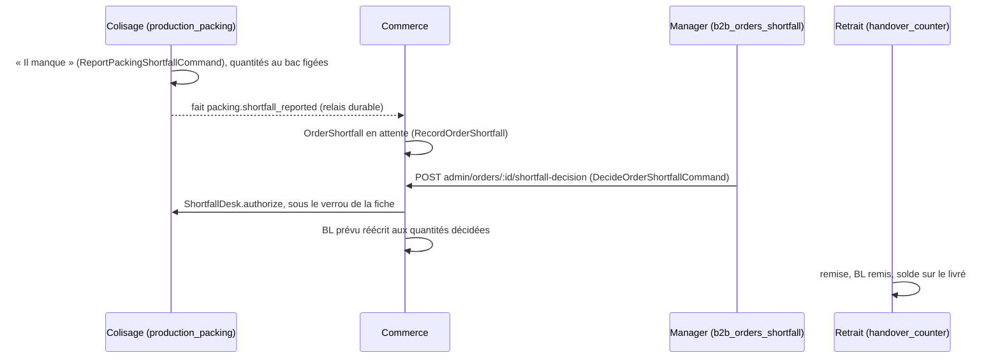

# Plan — le départ incomplet décidé au comptoir

> 📐 Plan, écrit le 2026-11-03 (Hugo). Rien n'est bâti. Touche l'argent (le
> bon de livraison et la facture) et un droit : contredit par `vitruve` le
> même jour — quatre objections bloquantes (piste A impossible sans signal en
> base, bloc de la route, atomicité décision + remise, ordre des verrous),
> toutes corrigées au §4.

## 1. Le problème

Au comptoir, « Remettre la commande » passe sur un sac pas fini : le serveur
ne refuse jamais le premier envoi pour « pas colisé » (`handoverBlocker`,
`src/handover/domain/services/handover.ts` — `prepared` vaut toujours vrai au
rang 1, posé par l'adaptateur qui construit le candidat, relu le 2026-11-03 —
l'adaptateur lui-même reste à rouvrir en C1). Le bon de livraison naît à la remise et chiffre
la commande **entière** sans décision de départ (`departingSourceOf`,
`src/b2b/delivery-notes/domain/services/departing-source.ts`) ; la facture
suit. Sur ORD-536 du scénario de dev (2 lignes au bac sur 18), le client
emporterait 42 pièces et recevrait un BL et une facture pour 234.

## 2. Les décisions de Hugo (2026-11-03)

| #   | Décision                                                                                                                                                                                                                                                                                                                                                                                                                                                                                                                                      |
| --- | --------------------------------------------------------------------------------------------------------------------------------------------------------------------------------------------------------------------------------------------------------------------------------------------------------------------------------------------------------------------------------------------------------------------------------------------------------------------------------------------------------------------------------------------- |
| D1  | Le comptoir décide lui-même du départ incomplet, sans manager.                                                                                                                                                                                                                                                                                                                                                                                                                                                                                |
| D2  | **Tout vendeur du comptoir** (`handover_counter:write`) peut le décider ; la décision est tracée (qui, quand).                                                                                                                                                                                                                                                                                                                                                                                                                                |
| D3  | Ce qui part = **ce qui est au bac** au colisage, jamais une saisie (la règle d'E6 ne change pas).                                                                                                                                                                                                                                                                                                                                                                                                                                             |
| D4  | Le sort du reste : le vendeur choisit (abandonné, ou reliquat à retirer plus tard).                                                                                                                                                                                                                                                                                                                                                                                                                                                           |
| D5  | **Pas de dialogue sur le chemin heureux** : sac fini, « Remettre » remet directement, comme aujourd'hui.                                                                                                                                                                                                                                                                                                                                                                                                                                      |
| D6  | Le reliquat se choisit **au comptoir**, sous deux formes : le client **repasse au comptoir**, à une heure convenue (un retrait avec créneau) ; ou **on le lui apporte**, par le circuit de livraison (une tournée) ou à la main (une livraison manuelle, hors tournée). Le cas courant est le second : le client qui passe au comptoir est **à côté**, on y va à pied — **sans réveiller le circuit de livraison** (ni tournée, ni véhicule, ni bac) : le reste se remet comme au comptoir, par le geste du retrait, au nom de qui l'a porté. |

### Ce que le dépôt impose à ces décisions

- **D4 est coupé en deux.** « Abandonné » existe (E6b). « Reliquat à retirer
  plus tard » est le lot **L8** d'E7, **pas bâti**
  ([`../commandes/etat-chantier-e7-reliquat.md`](../commandes/etat-chantier-e7-reliquat.md),
  relu le 2026-11-03 : la naissance du BL-2 manque). Ce plan bâtit
  l'abandon ; le choix du reliquat s'ajoutera au même dialogue avec L8.
- **Carte et bon de fidélité : pas de départ incomplet.** `ShortfallDecision.decide`
  refuse `CardOrderShortfallError` (il faudrait un remboursement partiel, E9,
  pas bâti) et `VoucherOrderShortfallError`. Le dialogue ne l'offre donc qu'aux
  commandes au compte ; sur les autres, il dit pourquoi et ne propose que
  « remettre en entier » ou « ne pas remettre ».
- **Rien au bac : pas de départ.** `NothingDepartsError` — le dialogue renvoie
  à l'annulation.

## 3. Ce qui existe (relu le 2026-11-03)

- Signal : `POST admin/packing/:date/orders/:orderId/shortfall`, sous
  `production_packing` (`packing/http/packing-orders.controller.ts`).
- Le commerce l'apprend par un abonné **durable**
  (`on-packing-shortfall-reported.handler.ts`) : c'est **asynchrone**.
- Décision : `POST admin/orders/:id/shortfall-decision`, sous `b2b_orders` +
  `b2b_orders_shortfall` (`b2b/orders/http/admin-order-shortfall.controller.ts`).
- Remise : `handover/`, sous `handover_counter`.

## 4. Ce qui change (révisé après `vitruve`, 2026-11-03)

### 4.1 Les états d'un sac « pas fini » — ce ne sont pas tous des manques

Un sac pas fini (`bagReadiness().ready` faux) recouvre quatre cas, lus sur la
fiche de colis, et le dialogue n'offre que ce que chacun permet :

| Cas (fiche de colis)                                                           | Ce que le dialogue offre                                            |
| ------------------------------------------------------------------------------ | ------------------------------------------------------------------- |
| **Tout est réparti**, bac pas fermé (`NothingShortError` au signal)            | rien de partiel : « Remettre » remet tout, sans dialogue (D5)       |
| **Il manque des pièces**, au moins une au bac                                  | « Remettre ce qui est au bac — le reste est abandonné » (au compte) |
| **Rien au bac** (`NothingDepartsError`)                                        | rien de partiel : on renvoie à l'annulation                         |
| **Pas encore tiré au colisage** (`PackingOrderNotDrawnYetError`, pas de fiche) | rien de partiel : il n'y a pas de bac à lire                        |

Les refus de la décision, nommés dans le dialogue AVANT le geste plutôt que
reçus après : carte (`CardOrderShortfallError`), bon de fidélité
(`VoucherOrderShortfallError`), commande pas `confirmed` au rang 1
(`ShortfallOrderNotConfirmedError`), termes non figés
(`OrderTooOldForShortfallError`), comptage par contenants
(`ContainersCountedError`).

### 4.2 Le serveur — UNE transaction, dans le commerce (piste C)

La piste A (décider sans signal) est **écartée** : une décision n'existe pas
sans manque signalé, en base (`orders.prisma`, clé étrangère obligatoire
`OrderShortfallDecision.shortfall`, `signal_reported_at` NOT NULL) et dans le
domaine (`OrderShortfall.decide`, `ShortfallDecision.decide` tire `departing`
du signal). La piste B fait attendre le client. Retenue : **C**.

Une route du **commerce**, sous `handover_counter:write`, qui fait tout dans
**une** transaction, dans l'ordre des verrous établi (« commande, puis fiche »,
`shortfall-desk.ts`) :

1. **verrou de la commande** ;
2. **la remise est-elle permise ?** — jugée AVANT toute écriture (réglée,
   retenue qualité, annulée, déjà retirée) : si non, refus nommé et rien n'est
   écrit (correction de l'objection « décision définitive, client parti sans
   rien ») ;
3. **le bac, figé sous le verrou de la fiche** — un nouveau geste du guichet
   du colisage (`packing/channels/commerce/`, déclaré et implémenté par le
   colisage, appelé dans la transaction de l'appelant comme `BinDesk`) : il lit
   les quantités au bac et pose la marque « manque », SANS publier de fait —
   le commerce écrit lui-même le signal ;
4. **le commerce écrit le signal** (`OrderShortfall.report`) **puis la
   décision** (`ShortfallDecision.decide`, « abandonné »), et réécrit le BL-1
   (`followDecision`) — le chemin d'E6b, inchangé ;
5. **la remise**, par un port que le retrait déclare et implémente dans
   `handover/channels/commerce/` (le sens `b2b → handover : port uniquement`
   de la matrice), dans la même transaction.

Un échec à n'importe quelle étape annule tout. Le fait
`packing.shortfall_reported` n'est jamais publié par ce chemin ; s'il en
existait un en vol (« Il manque » pressé au poste juste avant), `report`
rencontre le signal déjà posé et la décision le reprend — comportement à
fixer par un e2e de course.

### 4.3 Le droit — qui, puis quel sort

La route ne décide que pour un **retrait au comptoir** (mode `pickup`), de la
**journée** de service ouverte, dans les commandes que la file du comptoir
montre — garde nommée, éprouvée en e2e (une livraison, un autre jour : 403
nommé). « Qui peut décider au comptoir » (`handover_counter:write` + cette
garde) est séparé de « quel sort » : le sort est un paramètre, `abandoned`
seul aujourd'hui, pour que le reliquat (lot R) s'y ajoute sans rouvrir la
question du droit. La route des managers (`b2b_orders_shortfall`) ne bouge
pas. Aucune migration de droit.

### 4.4 L'écran

- Sac fini, ou « tout est réparti » : « Remettre la commande », sans dialogue.
- Il manque des pièces : un dialogue (`dialogSide()`) — ce qui part (au bac),
  ce qui ne part pas, et « Remettre ce qui est au bac — le reste est
  abandonné », ou « Annuler ». Les refus du §4.1 y sont dits avant le geste.
- 🔴 **« Remettre la commande entière » malgré un manque n'est PAS offert**
  (objection de `vitruve`) : il facturerait le commandé sur la seule parole du
  vendeur — exactement le défaut du §1. Si le sac contient plus que ce que le
  colisage a posé, c'est le colisage qu'on corrige, au poste. À confirmer par
  Hugo le 2026-11-03 (Q1).

## 5. Les lots

| Lot | Contenu                                                                                                                                                                                                                                                                                                                                                                                            |
| --- | -------------------------------------------------------------------------------------------------------------------------------------------------------------------------------------------------------------------------------------------------------------------------------------------------------------------------------------------------------------------------------------------------- |
| C1  | Serveur : le geste du guichet du colisage (figer le bac sans publier), le port de remise du retrait, la route du commerce en une transaction (§4.2), la garde (§4.3) ; e2e : BL et solde sur le livré, refus carte / bon / pas `confirmed` / rien au bac / pas tiré, garde (livraison, autre jour), course avec « Il manque » du poste, remise refusée ⇒ rien d'écrit.                             |
| C2  | Écran : le dialogue du sac pas fini, ses trois gestes, le refus dit sur carte et bon.                                                                                                                                                                                                                                                                                                              |
| C3  | Doc d'état (`comptoir/README.md`, `commandes/bon-de-livraison.md`), et ce plan retiré.                                                                                                                                                                                                                                                                                                             |
| R   | Le reliquat (D6), dans le même dialogue : « le client repasse » — jour et heure de retrait au comptoir — ou « on le lui apporte » — par une tournée, ou à la main. Il **repose sur L8 d'E7** (la naissance du BL-2, son jour, son passage au fournil et au colisage), pas bâti : soit L8 d'abord, soit un L8 taillé pour ce seul cas du comptoir. À planifier à part, avec `vitruve`, après C1–C3. |

## 6. Les questions à Hugo

- ~~**Q1**~~ — tranchée le 2026-11-03 (Hugo : « oui retire-le ») : « Remettre la
  commande entière » malgré un manque au colisage n'est **pas** offert ; le
  colisage se corrige au poste.

## 7. Ce qui n'est pas vérifié

- Ce que devient la fiche de colis d'une commande remise sans être colisée :
  le colisage n'écoute pas `handover.handed_over` (relu le 2026-11-03), elle
  resterait au poste. À trancher dans C1.
- L'incohérence vue sur ORD-536 (en-tête « 42 / 234 », colisage « 2 / 18
  posés », une seule ligne au bac à l'écran) : soit les données du scénario,
  soit un champ (`allocated`) que l'écran lit mal. À lever avant C2, puisque
  le dialogue affichera ces quantités.
