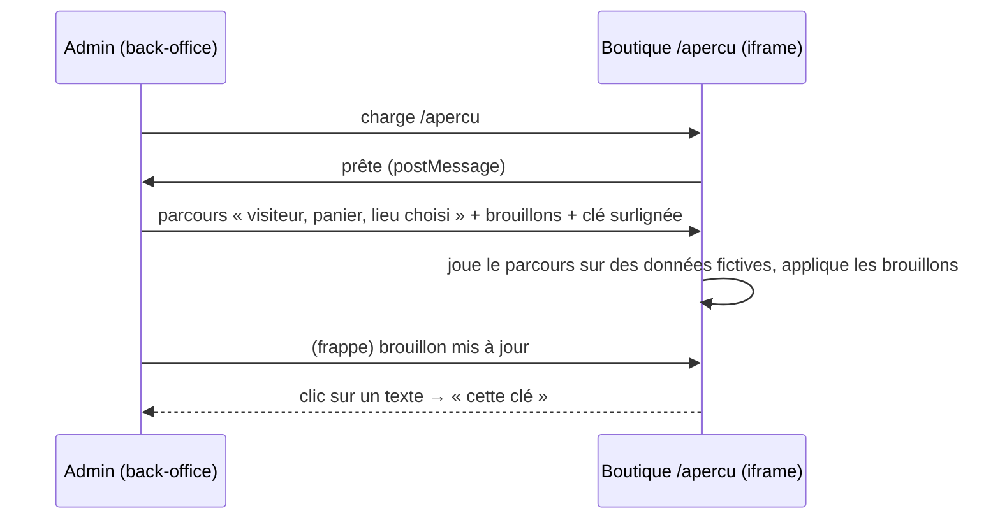

# Plan — éditer les textes de la boutique, avec aperçu et parcours simulés

> **Statut : T0 et T1 bâtis (2026-10-11), T2 à T5 à faire.** Écrit le 2026-10-11, contredit par
> `vitruve` le même jour (3 BLOQUANTS, 7 SÉRIEUX). **Le §10 l'emporte** sur
> les sections 1 à 9 : il remplace notamment l'aperçu « vraie boutique en
> production dans une iframe » par une **application d'aperçu séparée**.

## 0. La demande

> « je veux pouvoir éditer tous mes textes de dialogs et de cartes dans
> E-commerce-LFC, je veux une admin intuitive avec des previews, un sélecteur
> de parcours aussi pour les différents cas de figure qui simule la vraie
> boutique » — Hugo, 2026-10-11.

Trois arbitrages rendus le même jour, sur question :

- **A1 — brouillon puis « Publier »** : on modifie et prévisualise plusieurs
  textes ; un seul geste les envoie tous en boutique.
- **A2 — les trois langues, le français en référence** : chaque texte montre
  FR, EN, IT côte à côte ; l'écran signale un français modifié dont une
  traduction n'a pas suivi.
- **A3 — le parcours de commande d'abord** : accueil, rayon, panier, lieu,
  heure, connexion, invité, règlement, confirmation. Le reste des écrans suit
  sur le même socle.

## 1. Ce qui existe (ouvert le 2026-10-11)

| Fait                                                                                                                                                                                                                                                                                                                                                                                                               | Où                                                 |
| ------------------------------------------------------------------------------------------------------------------------------------------------------------------------------------------------------------------------------------------------------------------------------------------------------------------------------------------------------------------------------------------------------------------ | -------------------------------------------------- |
| Tous les textes sont dans le code, en trois langues : **1 246 textes** rangés en **33 espaces** (compté par le manifeste du T0, le 2026-10-11) — un dictionnaire général (`ClientCopy`) et des fichiers d'écran (`copy/screens/*.copy.ts`) lus par **9 fonctions d'écran** (`slotPickerCopy(locale)`, `housePickerCopy(locale)`…), appelées par **16 composants** ; **107 fichiers** injectent `ClientCopyService` | `apps/lfc-ecommerce-frontend/src/app/client/copy/` |
| `ClientCopyService.t` est un `computed` sur la langue courante                                                                                                                                                                                                                                                                                                                                                     | `copy/client-copy.service.ts`                      |
| La boutique est servie en **statique**, sans rendu serveur (`outputMode: static`, `ssr: false`)                                                                                                                                                                                                                                                                                                                    | `angular.json`                                     |
| Elle charge des réglages au démarrage sans attendre (`provideAppInitializer`)                                                                                                                                                                                                                                                                                                                                      | `app.config.ts`                                    |
| La vitrine a déjà un éditeur avec un aperçu mobile **dessiné** (pas la vraie boutique)                                                                                                                                                                                                                                                                                                                             | back-office `contenu/storefront-mobile-preview`    |
| Les textes de la carte de contact sont déjà réglables par langue et par public                                                                                                                                                                                                                                                                                                                                     | `contenu-ecommerce/demandes-clients.md`            |
| Le budget de la boutique est serré (config cloudflare, 1,30 Mo) ; une valeur du baril `@lfd/contracts` au démarrage embarque zod                                                                                                                                                                                                                                                                                   | mémoire du dépôt                                   |

## 2. Le modèle : un remplacement, jamais une copie

Le code reste **la source** de chaque texte. L'admin n'écrit que des
**remplacements** : `(clé, langue) → texte`. Une clé sans remplacement montre
le texte du code. Conséquences voulues :

- une base vide, une API en panne ou un remplacement illisible rendent **la
  boutique d'aujourd'hui**, jamais un trou ;
- « revenir à l'original » = supprimer le remplacement ;
- un texte ajouté au code apparaît dans l'admin sans migration.

**La clé** est le chemin du texte dans son dictionnaire, préfixé de son
espace : `cart.whoTitle`, `slotPicker.ctaIdle`. Un **manifeste** généré au
build à partir des dictionnaires FR/EN/IT la liste avec : son espace (l'écran
ou le dialogue), ses valeurs du code dans les trois langues, ses **variables**
(`{name}`, `{points}`…), et sa longueur.

**Les garde-fous du remplacement** (refus à l'enregistrement, côté serveur,
contre le manifeste) :

- la clé existe ;
- les **variables** sont exactement celles du texte d'origine — un `{points}`
  perdu ferait afficher une phrase fausse ;
- longueur bornée (un multiple raisonnable de l'original, à fixer) ;
- texte non vide (vider = revenir à l'original).

Un remplacement dont la clé a disparu du code (texte retiré) est **montré
comme orphelin** à l'admin, jamais appliqué.

## 3. Le stockage et la publication (A1)

Une table `shop_copy_entries` dans le schéma du commerce : `key`, `locale`,
`draft_text` (nullable), `published_text` (nullable), qui et quand pour les
deux. **Publier** copie tous les brouillons vers le publié, dans une
transaction, et écrit **un** fait au journal (`shop_copy.published`, la liste
des clés). Une **version** (compteur ou instant de publication) accompagne le
publié.

- `GET /shop/copy?locale=fr` — **public**, le publié seul, avec sa version ;
  réponse petite (seuls les remplacements), mise en cache.
- `GET/PUT/DELETE /admin/shop-copy/…` — brouillons, sous le droit de la
  vitrine (`b2b_storefront` : `read` pour voir, `write` pour modifier et
  publier). ⚠️ À trancher : un droit propre `shop_copy` ? Proposé : non, c'est
  le même métier que la vitrine.
- Le manifeste est servi à l'admin depuis le build de la boutique (un fichier
  JSON publié avec elle), pour que l'admin lise **exactement** les clés que la
  boutique servie connaît.

## 4. La boutique applique les remplacements

- `ClientCopyService` et les fonctions d'écran passent par **un seul point**
  qui superpose les remplacements de la langue courante sur le texte du code
  (fusion par clé).
- Au démarrage, la boutique lit `GET /shop/copy` **sans attendre** (comme
  l'accès aux fonctionnalités) ; un remplacement arrive quelques millisecondes
  après le premier dessin. ⚠️ Un texte peut donc changer sous les yeux au
  premier chargement : à mesurer ; si c'est visible, garder la dernière
  version en `localStorage` et l'appliquer dès le premier dessin.
- Aucune dépendance au baril de `@lfd/contracts` au démarrage (budget).
- Les 22 composants qui appellent une fonction d'écran : migrés **écran par
  écran**, dans l'ordre du parcours de commande (A3).

## 5. Le mode aperçu : la vraie boutique, dans l'admin

L'aperçu n'est pas un dessin : c'est **la boutique déployée**, dans un cadre
(`<iframe>`) de l'admin, sur une route dédiée (`/apercu`).

**Ce que le mode aperçu fait :**

- il n'accepte de messages **que de l'origine du back-office** (liste fermée
  par environnement) ;
- il applique les brouillons **en mémoire**, dans ce cadre seulement ;
- il **surligne** le texte en cours d'édition, et un clic sur un texte de
  l'aperçu ouvre sa clé dans l'éditeur (chaque texte rendu porte sa clé en
  attribut, en aperçu seulement) ;
- il joue un **parcours** (§6) sur des **données fictives**.

🔴 **Ce qu'il ne fait jamais** — c'est la frontière :

- **aucun appel qui écrit** : un intercepteur HTTP, actif en aperçu seulement,
  refuse tout `POST/PUT/PATCH/DELETE` ;
- **aucune identité réelle** : « connecté » en aperçu est un **état
  d'écran** ; aucun jeton n'est fabriqué, aucune route murée n'est appelée —
  l'intercepteur sert les lectures murées depuis les données du parcours ;
- **aucune persistance** : ni panier, ni choix, ni fiche invité écrits dans le
  `localStorage` du visiteur ;
- **inactif hors cadre** : `/apercu` ouvert directement dans un onglet ne joue
  rien (pas de parent autorisé, pas de parcours).

**La fenêtre détachée (2026-10-11, demandée par Hugo).** « Ouvrir dans une
fenêtre » déplace l'aperçu dans une fenêtre à part (`window.open`, nom fixe
`lfc-shop-copy-preview`, sans `noopener`) ; la colonne le dit et propose
« Ramener ici ». Une seule cible à la fois ; la fermeture est sondée et
rétablit l'iframe. L'aperçu parle alors à `window.opener` comme à un parent :
`ready` à chaque origine autorisée, garde origine + émetteur, puis la seule
origine du premier `show`. ⚠️ `frame-ancestors` ne protège pas une fenêtre
ouverte : ce sont la liste d'origines et le contrôle de `source` qui tiennent.
Sans `show` accepté en 1,5 s, l'écran « hors cadre » s'affiche.

Les lectures publiques (catalogue, vitrine, points de retrait) restent
réelles : l'aperçu montre les vrais produits.

## 6. Le sélecteur de parcours (A3)

Un parcours = un **état de départ** + un **écran ou dialogue ouvert**. Les
données fictives sont écrites une fois, typées, et rejouées à l'identique.

| Parcours                   | État                                 | Ce qu'on voit                                       |
| -------------------------- | ------------------------------------ | --------------------------------------------------- |
| Visiteur, première visite  | non connecté, sans lieu, panier vide | accueil, cartes des portes, rail des maisons        |
| Visiteur, choix du lieu    | idem                                 | dialogue « où », puis « quand »                     |
| Visiteur, panier sans lieu | 2 articles, sans lieu                | rayon et barre, panier « qui passe cette commande » |
| Visiteur, prêt à payer     | lieu + heure + 2 articles            | panier, saisie invité, connexion                    |
| Visiteur, confirmation     | commande payée, points et bonus      | confirmation invité                                 |
| Particulier connecté       | connecté, lieu, panier               | panier, règlement, confirmation                     |
| Pro au compte              | société, crédit accordé              | panier « au compte / carte »                        |
| Boutique fermée            | commandes fermées à cette clientèle  | rayon et panier fermés                              |

Chaque parcours se choisit dans une liste en tête de l'aperçu, avec la
**largeur** (mobile, bureau) et la **langue**.

## 7. L'éditeur

**Contenu › Textes de la boutique**, trois colonnes :

1. **Parcours et écrans** — l'arbre des espaces, filtré par le parcours
   choisi ; une pastille par espace : modifié, à publier, traduction en retard.
2. **Les textes** — pour chaque clé de l'écran : FR, EN, IT ; le texte du code
   en gris dessous ; les variables affichées comme des pastilles non
   éditables ; « revenir à l'original » ; un avertissement quand le FR a
   changé depuis la dernière modification d'une traduction (A2).
3. **L'aperçu** — la vraie boutique (§5), qui suit la frappe.

En tête : **recherche** (par texte affiché, dans les trois langues),
« N modifications à publier », **Publier**, et l'historique des publications
(journal).

## 7 bis. Le recueil des textes — la base pour reformuler

> « au fur et à mesure que tu fabriques, note tous les textes actuels dans un
> document, car ça va devenir notre base pour reformuler » — Hugo, 2026-10-11.

`documentation/contenu-ecommerce/textes-de-la-boutique.md`, **généré** depuis
le même manifeste que l'éditeur, jamais écrit à la main : rangé par parcours
puis par écran ou dialogue, une ligne par clé avec FR, EN, IT et les
variables. Un recueil recopié vieillirait au premier texte changé ; un
recueil généré ne peut pas mentir.

- Il dit le texte **du code**. Quand T1 existera, une colonne « publié » dira
  le remplacement en ligne, s'il y en a un.
- Une porte (`lint:shop-copy-digest`) échoue si le recueil commité ne
  correspond plus aux dictionnaires : changer un texte du code oblige à le
  régénérer dans le même commit.
- Il est le **premier lot** (T0) : il ne demande ni base ni écran, et sert dès
  aujourd'hui de matière à la reformulation.

## 8. Les lots

| Lot    | Contenu                                                                                                                               | Livre quelque chose d'utilisable ?            |
| ------ | ------------------------------------------------------------------------------------------------------------------------------------- | --------------------------------------------- |
| **T0** | Le recueil généré des textes actuels et sa porte (§7 bis)                                                                             | oui : la base pour reformuler, dès maintenant |
| **T1** | Manifeste au build ; table, routes admin et publique, garde-fous ; la boutique applique les remplacements du **dictionnaire général** | oui : éditer sans aperçu                      |
| **T2** | L'éditeur (colonnes 1 et 2, recherche, publier, langues)                                                                              | oui                                           |
| **T3** | Le mode aperçu (§5) et ses garde-fous, les parcours du §6                                                                             | oui : l'aperçu                                |
| **T4** | Migration écran par écran des fonctions d'écran du parcours de commande, chacune avec son parcours                                    | au fil de l'eau                               |
| **T5** | Le reste de la boutique (compte, fidélité, commandes, livraison)                                                                      | plus tard (A3)                                |

## 9. Questions ouvertes

1. Un droit propre ou celui de la vitrine (§3) ?
2. Le texte qui change au premier dessin (§4) : mesurer avant de compliquer.
3. Les longueurs bornées : un facteur de l'original, ou une limite par espace ?
4. Les e-mails (confirmation, QR) : hors de ce plan — ils vivent côté API.

## 10. La contradiction de `vitruve` (2026-10-11) et ce qu'elle change

### B1 — le serveur ne peut pas valider contre un manifeste servi par la boutique

**Corrigé.** Le manifeste est **généré au T0 et commité** dans le dépôt, à
côté des dictionnaires ; l'API l'**embarque à son build** (import du JSON).
API et boutique sortent du même commit : la validation se fait contre la
version que l'API connaît. Une clé que la boutique servie ne connaît pas
encore (déploiements décalés) est simplement **ignorée** par elle ; une clé
que l'API ne connaît plus est montrée **orpheline** à l'admin. Aucun appel
réseau entre l'API et la boutique.

### B2 — tous les textes ne sont pas des chaînes

**Corrigé.** Les textes écrits en **fonctions** (`stepNumber: (n) => …` dans
`delivery-procedure.{en,it}.ts`, et ceux que T0 recensera) sont **réécrits en
chaînes à jetons** (`'Étape {n}'`, servies par `fill()`), écran par écran,
avant d'être éditables. Les **tableaux** ont une clé par case. Les
**pluriels** : une clé par forme (`…One`, `…Other`), choisie par le code.
Un remplacement est du **texte brut** : ni HTML, ni markdown — Angular
l'échappe, et l'éditeur le dit.

### B3 — « connecté » en aperçu n'a pas de mécanisme, et l'aperçu en production n'est pas tenable

**Changement de conception.** L'aperçu n'est **plus** la boutique de
production dans une iframe. C'est une **seconde application Angular** du même
projet (`lfc-ecommerce-preview`), qui :

- **importe les vrais composants** de la boutique — les écrans, les dialogues,
  les styles : ce qu'on voit est ce que le client verra ;
- remplace, **à la composition**, ce qui touche le monde : une `AuthFacade` de
  démonstration (l'état du parcours, aucun SDK Auth0), un `HttpClient` qui
  **ne sort jamais** (toutes les réponses viennent des données du parcours —
  catalogue compris), pas de Sentry, pas de mesures, pas de Stripe (l'élément
  de paiement est remplacé par un cadre qui en a la taille et le dit) ;
- garde l'état **en mémoire** : un `Storage` de démonstration remplace
  `localStorage` à la composition (les stores le reçoivent par injection ; ceux
  qui l'appellent en direct sont migrés vers le port existant `local-store.ts`
  — à compter en T3) ;
- est **déployée à part** (son propre projet Pages), servie avec
  `Content-Security-Policy: frame-ancestors <origine du back-office>` ;
  n'accepte de messages **que** de cette origine, et ne répond **qu'à** elle
  (`postMessage(…, origineDuBackOffice)`, jamais `'*'`).

Ce qui en découle : **le bundle de production ne contient aucun mode
aperçu**, aucune façade d'auth factice, aucun intercepteur de démonstration.
La frontière de sécurité disparaît au lieu d'être gardée (interdire plutôt que
vérifier). Le prix : un second build et un second déploiement, et l'aperçu ne
lit pas le vrai catalogue (des produits de démonstration, typés).

Le 2026-10-11, l'aperçu peut aussi vivre dans une **fenêtre détachée** ouverte
par l'éditeur (§5) : même protocole, l'opener à la place du parent ; la largeur
choisie redimensionne la fenêtre (`resizeTo`, par l'aperçu lui-même — l'éditeur
ne le peut pas sur une autre origine) quand le navigateur le permet.

### Les objections sérieuses

| Objection                                                      | Sort                                                                                                                                                                                                                                                                                                                                                                                                                            |
| -------------------------------------------------------------- | ------------------------------------------------------------------------------------------------------------------------------------------------------------------------------------------------------------------------------------------------------------------------------------------------------------------------------------------------------------------------------------------------------------------------------- |
| Écritures hors HttpClient (Sentry, mesures, Auth0)             | **Disparaît** : l'application d'aperçu ne les fournit pas.                                                                                                                                                                                                                                                                                                                                                                      |
| `localStorage` partout                                         | **Disparaît en production** ; en aperçu, `Storage` en mémoire (B3).                                                                                                                                                                                                                                                                                                                                                             |
| Aucun `frame-ancestors` aujourd'hui                            | Posé sur l'application d'aperçu. Pour la boutique elle-même, hors de ce plan : **noté au `todos/`** (n'importe quel site peut l'encadrer aujourd'hui).                                                                                                                                                                                                                                                                          |
| Le brouillon a trois états, `DELETE` contourne « Publier »     | **Corrigé** : `draft_state` ∈ `unchanged` / `set` / `reset` ; « revenir à l'original » écrit `reset`, appliqué au prochain Publier. Le fait `shop_copy.published` porte **les valeurs** avant et après, pour relire et annuler.                                                                                                                                                                                                 |
| Budget non chiffré                                             | La boutique ne gagne que la **fusion par clé** et une lecture au démarrage : à mesurer au T1 contre les 1 300 kB, refus si elle dépasse 5 kB.                                                                                                                                                                                                                                                                                   |
| Le texte qui change au premier dessin                          | **Tranché** : la boutique attend `GET /shop/copy` (réponse courte, en cache CDN) **au plus 300 ms** avant de démarrer, puis démarre avec ce qu'elle a. Pas de cache `localStorage` (il basculait de N-1 à N).                                                                                                                                                                                                                   |
| Textes en dur dans 14 gabarits, dont `legacy/` sur le parcours | **Compté par T0** et **dans le champ** : ils passent dans les dictionnaires en T4, écran par écran. Les écrans `legacy/` du parcours sont listés en tête de T4.                                                                                                                                                                                                                                                                 |
| Une clé = un chemin TypeScript, cassée au premier renommage    | **Corrigé** : un fichier de renommages des clés, `apps/lfc-ecommerce-frontend/src/app/client/copy/shop-copy-renames.json` (créé en T1 : ancienne → nouvelle clé). La porte `lint:shop-copy-digest` échoue quand une clé du manifeste précédent disparaît sans entrée de renommage ; l'API applique les renommages aux remplacements au démarrage. Un renommage de clé publiée est donc **un geste explicite**, pas un accident. |
| Le droit                                                       | **Tranché** : `b2b_storefront` (existe, `staff.prisma`), `read` pour voir, `write` pour modifier et publier.                                                                                                                                                                                                                                                                                                                    |
| Les comptes du §1                                              | Faux par endroits (16 appelants d'une fonction d'écran, 9 fonctions, 107 fichiers injectent le service). **T0 rend les vrais chiffres** ; le §1 sera corrigé à sa livraison.                                                                                                                                                                                                                                                    |

### Les lots, révisés

| Lot        | Contenu                                                                                                                                                                                                                          |
| ---------- | -------------------------------------------------------------------------------------------------------------------------------------------------------------------------------------------------------------------------------- |
| **T0**     | Recueil généré, manifeste commité, porte ; recense fonctions, tableaux et textes en dur                                                                                                                                          |
| ~~**T1**~~ | ~~Table à trois états, routes admin et publique, validation contre le manifeste embarqué, renommages ; la boutique attend ses remplacements (≤ 300 ms) et les fusionne — dictionnaire général d'abord~~ — **bâti le 2026-10-11** |
| **T2**     | L'éditeur (arbre, trois langues, recherche, Publier, historique)                                                                                                                                                                 |
| **T3**     | L'application d'aperçu (composition, données de démonstration, en-têtes, messages), ses 8 parcours ; migration des accès directs à `localStorage`                                                                                |
| **T4**     | Écran par écran du parcours de commande : fonctions → chaînes, textes en dur → dictionnaires, `legacy/` compris                                                                                                                  |
| **T5**     | Le reste de la boutique                                                                                                                                                                                                          |

### Ce que T1 a posé (2026-10-11)

- **Stockage** (schéma `public`, migration `20261011220000_les_textes_de_la_boutique`) :
  `shop_copy_entries` (clé, langue, révision, brouillon à trois états, publié,
  qui/quand pour les deux) et `shop_copy_publication` (une ligne, la version).
- **API** : `src/b2b/shop-copy/`, à côté de la vitrine et du contenu, sous
  `b2b_storefront`. `GET /shop/copy?locale=` (public) ;
  `GET /admin/shop-copy`, `PUT /admin/shop-copy/drafts`,
  `POST /admin/shop-copy/resets`, `POST|GET /admin/shop-copy/publications`.
  Fait `shop_copy.published` (avant/après par texte).
- **Manifeste embarqué** : `pnpm copy:digest` dépose une copie à l'identique
  du manifeste et des renommages sous
  `apps/lfd-api/src/b2b/shop-copy/infrastructure/embedded/` — l'émission de
  l'API part de `src/` et son déploiement n'empaquette qu'elle.
  `lint:shop-copy-digest` refuse une copie qui diffère, et une clé du manifeste
  commité qui disparaît sans renommage.
- **Cache** : la lecture publique ne touche pas la base à chaud ; la version
  publiée est relue au plus toutes les 15 s par instance
  (`VERSION_RECHECK_MS`) ; `ETag` = version + langue, `304` ;
  `Cache-Control: public, max-age=60, stale-while-revalidate=600`.
  ⚠️ La passerelle relaie la réponse telle quelle et ne la met pas en cache
  (aucun `caches.default`, vérifié le 2026-10-11) : seul le navigateur la garde.
- **Boutique** : `ClientCopyService.t` superpose les remplacements de la
  langue courante ; un appel par langue et par visite ; le démarrage attend au
  plus 300 ms. Les fonctions d'écran restent pour T4.
