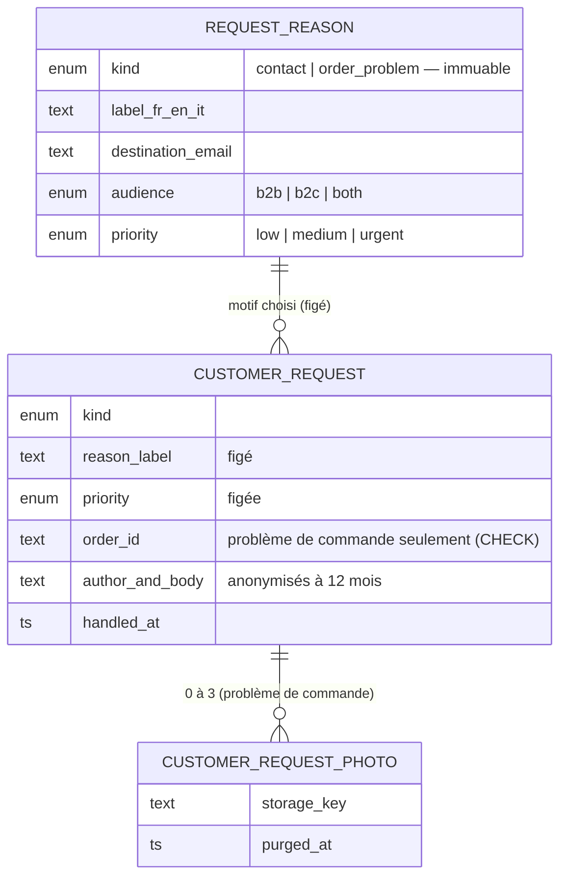

# Demandes clients — contact, problèmes de commande, et ce qui viendra

> ✅ **Bâti le 2026-10-09**, à la demande d'Hugo : une page de contact réglable,
> un formulaire « Nous écrire », un « Signaler un problème » branché pour de
> bon (avec photos), et une seule boîte qui rassemble ce que les clients
> demandent. Ce document décrit l'état du code ; il remplace la doc
> « Nous contacter » et les plans « Nous écrire » et « Demandes clients »,
> relus par `vitruve`, revus après construction, puis supprimés.

## 1. Ce que voit chacun

| Qui                   | Où                                          | Ce qu'il fait                                                                                                                                                                            |
| --------------------- | ------------------------------------------- | ---------------------------------------------------------------------------------------------------------------------------------------------------------------------------------------- |
| Visiteur, client      | Boutique — la carte de contact              | surtitre (s'il est réglé), titre, phrase ; « Appeler » et « Écrire » si la carte les affiche, sinon son message « sans contact »                                                         |
| Visiteur, client      | Boutique — « Nous appeler »                 | la liste des numéros de son public (s'il y en a plus d'un) ; chaque ligne lance l'appel                                                                                                  |
| Visiteur, client      | Boutique — « Nous écrire »                  | motif `contact`, nom, e-mail, téléphone facultatif, message                                                                                                                              |
| Client connecté       | Mes commandes — « Signaler un problème »    | sur une commande **retirée ou livrée** seulement : motif `order_problem`, un mot, jusqu'à 3 photos                                                                                       |
| Staff (`b2b_contact`) | Back-office › Commercial › Demandes clients | toutes les demandes, filtres type / priorité / état, photos, commande liée, « Marquer traité »                                                                                           |
| Staff (`b2b_contact`) | Commercial › Réglages › Motifs des demandes | un onglet par formulaire : « Nous écrire », « Signaler un problème »                                                                                                                     |
| Staff (`b2b_contact`) | Réglages › Contact                          | la carte (surtitre, titre, phrase, mots des deux boutons, message sans contact, par public et par langue ; « Afficher le numéro », « Afficher le formulaire » par public) et les numéros |
| Équipe destinataire   | Sa boîte mail                               | un courriel par demande (référence de commande, nombre de photos, lien vers la boîte), `Reply-To` = l'auteur                                                                             |

Le compteur du menu « Demandes clients » et la cloche disent les demandes à
traiter, tous types.

**Depuis le 2026-10-23, un troisième type : `order_change`** — la demande de
modification d'une commande après l'heure limite (plan
[`plan-modifier-une-commande.md`](../commandes/modification/plan-modifier-une-commande.md),
§4 et §14). Le client la compose depuis « Modifier ma commande » ; elle porte
la commande voulue, et l'équipe y répond par « Appliquer » (une révision de la
commande au nom de l'équipe) ou « Refuser » avec un mot — jamais par « Marquer
traité ». Une seule en attente par commande ; son motif est le premier motif
`order_change` actif pour le public (onglet « Demander une modification »).

## 2. Le modèle

Une **demande** a une **enveloppe** commune (auteur, motif et priorité figés,
état, traitement, anonymisation) et des **détails** propres à son **type**
(`kind`). Un **motif** appartient à un seul type, pour toujours.

Code : `apps/lfd-api/src/b2b/contact/` — agrégats `RequestReason`
(`apps/lfd-api/src/b2b/contact/domain/request-reason.ts`) et `CustomerRequest` (`apps/lfd-api/src/b2b/contact/domain/customer-request.ts`,
factories `contact()` et `orderProblem()`, `attachPhoto`, `markHandled`,
`anonymize`), détails par type dans `apps/lfd-api/src/b2b/contact/domain/customer-request-details.ts`. Ports
de lecture et d'écriture séparés, un handler par cas. Schéma
`prisma/schema/public/contact.prisma`, migration `20261009180000_les_demandes_clients`
(elle remplace quatre migrations du même jour, jamais poussées). Contrats
`packages/contracts/src/contact.ts` et `contact.values.ts`.

**Ajouter un type** (devis, rendez-vous…) : une valeur de `RequestKind`
(contrat et enum), une variante de détails et son entrée dans les tables du
domaine et du mapper (le `Record` les exige), ses colonnes ou sa table, une
factory et un handler ; côté back-office, un composant de détails et une
ligne dans `apps/lfd-backoffice-frontend/src/app/b2b/demandes/request-details.ts` ; un onglet de motifs. L'enveloppe, la boîte,
la priorité, la cloche, le compteur et l'anonymisation ne bougent pas.

## 3. Les règles, et où elles vivent

- **Le public est déduit au serveur**, jamais pris au corps : visiteur → `b2c` ;
  connecté → `b2b` pour une société active, `b2c` sinon. Un motif hors de ce
  public, ou d'un autre type que le formulaire, est refusé.
- **« Nous écrire »** (`POST /contact-messages`, `POST /me/contact-messages`) :
  3 messages / 10 min **par IP** ; champ piège `lfd_trap` (rempli : 204, rien
  rangé, avertissement au journal sans donnée personnelle). Pas de délai
  minimal : déclaré par le client, il n'arrêtait aucun robot.
- **« Signaler un problème »** (`POST /me/orders/:orderId/problems`, multipart) :
  3 / 10 min **par compte** ; la commande doit être visible par le client (la
  règle de `get-order.handler.ts`, par le port `ReportableOrderReader`) — sinon
  404 — et `fulfilled` — sinon 409 `contact.order_problem.not_fulfilled` ;
  photos ≤ 3, 5 Mo, JPEG/PNG/WebP relus aux octets (`REQUEST_PHOTO_BOUNDS`).
- **Photos** : rangées par le `DocumentStore` (le même espace que les photos
  des notes et des étapes de livraison, le seul qui sait supprimer), servies
  par `GET /admin/customer-requests/:id/photos/:photoId` — jamais publiques.
- **Courriel** (`platform/mailer/`) : texte échappé, objet assaini, « [Urgent] »
  pour un motif urgent, `Reply-To` par demande (une adresse refusée → courriel
  sans `Reply-To`), aucune pièce jointe.
- **Traitement** : `markHandled` refuse un second traitement ; fait journalisé
  `customer_request.handled` (le type et le motif, jamais l'auteur).
- **Conservation** : `CUSTOMER_REQUEST_RETENTION_MONTHS` = 12 (Hugo) — après
  traitement, ou après réception pour une demande jamais traitée. Le balayage
  nocturne supprime les photos du stockage, puis vide l'auteur, le texte et
  `order_id`. Pas de `DELETE` de la demande. Registre RGPD : personne
  `contact`, tables `customer_request` et `customer_request_photo`, tenu par
  `lint:rgpd-staff`.
- **Carte de contact** : surtitre sans repli (vide = rien) ; titre et phrase
  de repli à un seul endroit, `CONTACT_CARD_DEFAULTS`. **Plus de numéro de
  repli** (décision de Hugo, 2026-10-26 : « on ne peut plus afficher une
  information fausse ») : aucun numéro actif pour le public, la boutique et
  l'aperçu du back-office ne montrent ni numéro ni « Appeler » ; « Écrire »
  reste.
- **Ce que la carte offre** (décision de Hugo, 2026-10-26) : par public, deux
  interrupteurs, « Afficher le numéro de téléphone » et « Afficher le
  formulaire de contact » (affichés par défaut, migration
  `20261026120000_la_carte_de_contact_sans_contact`). Numéro coupé : aucun
  numéro sur cette carte, et la route publique ne sert pas un numéro qu'aucune
  carte de son public n'affiche (`servedPhones`). Formulaire coupé : pas de
  « Écrire ». Les deux coupés : la carte montre son **message sans contact**
  (fr, en, it ; « Nous vous contacterons bientôt »), sans repli —
  `ContactSettings.pose` refuse le réglage s'il est vide en français
  (`ContactCardSilentError`, 400 : « une carte sans numéro ni formulaire doit
  dire quelque chose »). Si la carte affiche le numéro mais qu'aucun n'est
  réglé et que le formulaire est coupé, la boutique montre le message s'il
  est écrit, et rien sinon.
- **Les mots des deux boutons** (décision de Hugo, 2026-10-26) : « Appeler »
  et « Écrire » se règlent par public et par langue ; vides, la boutique garde
  ceux de son dictionnaire (`accueil-public.copy.ts`, §contact), que l'aperçu
  du back-office recopie dans `shop-contact-fallback.ts`.

## 4. Les routes

| Méthode et route                                                                                | Garde                                                                 |
| ----------------------------------------------------------------------------------------------- | --------------------------------------------------------------------- |
| `GET /contact-settings`, `GET /request-reasons?kind=&audience=`                                 | publiques                                                             |
| `POST /contact-messages`                                                                        | publique, débit par IP                                                |
| `POST /me/contact-messages`                                                                     | client, débit par IP                                                  |
| `POST /me/orders/:orderId/problems`                                                             | client, débit par compte                                              |
| `GET                                                                                            | POST /admin/request-reasons?kind=`, `PUT …/:id`, `POST …/:id/archive` | `b2b_contact`                  |
| `GET /admin/customer-requests?status=&kind=`, `POST …/:id/handled`, `GET …/:id/photos/:photoId` | `b2b_contact`                                                         |
| `POST`, `GET /me/orders/:orderId/change-request` (2026-10-23)                                   | client, débit par compte                                              |
| `GET /admin/customer-requests/:id/order-change/quote`, `POST …/apply`, `POST …/refuse`          | `b2b_contact`                                                         |
| `GET                                                                                            | PUT /admin/contact/settings`, `GET                                    | POST /admin/contact/phones`, … | `b2b_contact` |

Back-office : `/commercial/demandes` depuis le 2026-10-17 (Hugo), une vue du
Commercial sous `b2b_contact:read` (plus le mur `b2b_companies:read` de la
coquille ; celui de `b2b_settings` est tombé avec l'espace E-commerce). Les
anciennes `/b2b/demandes` et `/b2b/contact/messages` y redirigent, et
`?demande=<id>` ouvre la demande. La carte de contact vit à `/contact`. Les motifs vivent depuis le
2026-10-13 dans **Réglages › Commercial**,
`/reglages/commercial/motifs-des-demandes` (les anciennes
`/b2b/reglages/motifs-des-demandes` et `/commercial/reglages/motifs-des-demandes`
y redirigent), sous `b2b_request_reasons:read`, et sous lui seul. `b2b_contact` est ajoutée **sans droit accordé** :
l'accorder à l'écran après déploiement (runbook).

## 5. Ce qui reste

- Les types à venir : demande de rendez-vous, demande de devis, et le
  rapatriement des demandes de rappel à l'activation (`support_requests`).
- Le back-office garde les libellés des boutons « Appeler / Écrire » pour
  l'aperçu (`shop-contact-fallback.ts`), absents de `CONTACT_CARD_DEFAULTS`.
