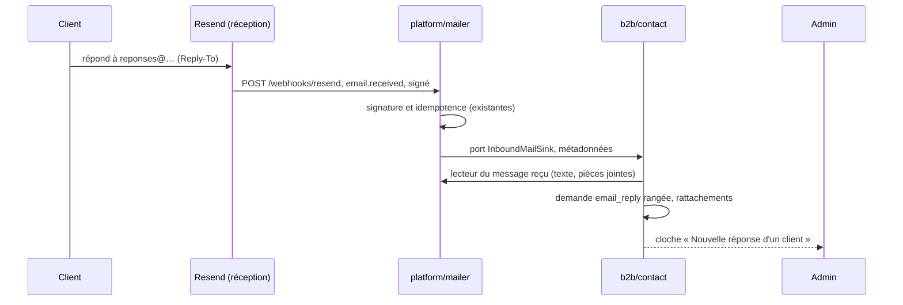

# Plan — les réponses des clients à nos e-mails, lues dans l'admin

> ✅ **R1–R3 bâtis le 2026-10-28** (`a5d0e08a0`, `6c3e6b22d`), R4 écrit (doc).
> **Non déployé, non ouvert** : restent les gestes de Hugo (§6), dans l'ordre.

> 🔍 **Contredit par vitruve le 2026-10-28** : trois BLOQUANTS levés (le
> `svix-id` consommé avant le traitement perdait un rangement échoué ; un
> message long ou cité était refusé ; l'événement des demandes relayait chaque
> e-mail par courriel) et les SÉRIEUX pris (rattachement présumé et verdict
> d'authentification, réponses automatiques et plafond, rendu sans
> `innerHTML`, anonymisation de l'objet et des pièces jointes, registre,
> motif posé par la migration, SDK, adresse irréversible).

> 📝 Plan du 2026-10-28, doc-first. Demande de Hugo : « pour des réponses de
> clients », « je veux lire dans l'admin ». Choix faits sans réponse de Hugo,
> les plus prudents, à confirmer : **lire seulement** (répondre depuis l'admin
> viendra après), **le droit des demandes clients** (`b2b_contact`), **la
> cloche** à chaque message. Rien ne se déploie avant son accord.
>
> 🔴 Il revient sur une décision écrite : [`../ops/mailer-resend.md`](../ops/mailer-resend.md)
> §2.5 (2026-08-16) — « on n'ouvre aucune adresse de réception pour
> l'instant », et `MAILER_REPLY_TO` reste vide. Ce plan l'ouvre, sur un
> **sous-domaine** : le domaine principal et son courrier ne bougent pas.

## 1. Ce qui existe (relu le 2026-10-28)

| Maillon               | Aujourd'hui                                                                                                                                                                                                                                                                                                                                              |
| --------------------- | -------------------------------------------------------------------------------------------------------------------------------------------------------------------------------------------------------------------------------------------------------------------------------------------------------------------------------------------------------- |
| Boîte des demandes    | [`demandes-clients.md`](demandes-clients.md) : `b2b/contact/`, agrégat `CustomerRequest` (enveloppe + détails par `kind` : `contact`, `order_problem`, `order_change`), page Commercial › Demandes clients, droit `b2b_contact`, cloche (`ring-customer-request-received.handler.ts`), anonymisation à 12 mois. « Ajouter un type » y est décrit (§2).   |
| Récepteur Resend      | `POST /webhooks/resend` (`platform/mailer/webhook/resend-webhook.controller.ts`), signature Svix vérifiée (`svix-signature.ts`, secret `RESEND_WEBHOOK_SECRET`), idempotence par `svix-id` (`ops.webhook_event`). Il ne connaît que l'**envoi** (`resend-event.ts` : sent, delayed, delivered, complained, bounced) ; un type inconnu est ignoré en 200. |
| Client Resend         | `packages/mailer/src/resend-mailer.ts`, SDK `resend` ^6.12, typé pour `emails.send` seulement ; aucune lecture d'un e-mail reçu.                                                                                                                                                                                                                         |
| `Reply-To`            | `MAILER_REPLY_TO` (`platform/config/env-readers.ts`), appliqué à chaque envoi (`resend-mailer.ts`) ; **vide en production**.                                                                                                                                                                                                                             |
| Retrouver qui et quoi | un compte par e-mail (`company-member.repository.ts`, `findAccountByEmail`, refus si ambigu) ; une commande par numéro (`ORD-<n>` ou l'ancien `ORD-<8>-<4>`, CHECK `orders_order_number_format`).                                                                                                                                                        |
| HTML externe          | aucun nettoyeur dans le dépôt ; le back-office n'affiche aucun texte riche venu de l'extérieur.                                                                                                                                                                                                                                                          |

## 2. Le modèle

- **Un quatrième type de demande : `email_reply`.** L'enveloppe ne bouge pas :
  auteur, texte, priorité, état, « Marquer traité », anonymisation à 12 mois.
  Les détails : l'objet, l'identifiant Resend du message reçu (**unique** :
  c'est lui qui rend la réception idempotente), la liste des pièces jointes
  (nom, type, taille — **jamais leur contenu**), et le **verdict
  d'authentification** de l'expéditeur (SPF / DKIM / DMARC tel que Resend le
  rend ; « inconnu » s'il ne le rend pas).
- **Le texte** : la partie texte du message ; à défaut, le HTML réduit à du
  texte côté serveur. **L'historique cité est coupé** (lignes `>` et ce qui
  suit « Le … a écrit : » / « On … wrote: »), puis le texte est **tronqué** à
  une borne propre au type (`EMAIL_REPLY_BOUNDS.body`, plus large que les
  4 000 caractères du formulaire), avec la mention « (tronqué) ». Un message
  ne se refuse jamais pour sa longueur.
- **La protection contre le XSS est le rendu, pas la réduction** (règle de R3) :
  le texte s'affiche par interpolation Angular, **jamais** par `innerHTML`, et
  **aucune** adresse ni lien n'y est rendu cliquable.
- **Le motif** : un motif système « Réponse à un e-mail », du type
  `email_reply`, posé par la migration de R1 avec un identifiant fixe (une
  donnée de référence, pas un droit) et **non modifiable** à l'écran des motifs.
- **Le rattachement est PRÉSUMÉ.** L'expéditeur d'un e-mail n'est pas
  authentifié : l'admin affiche « expéditeur non vérifié » quand le verdict
  n'est pas un DKIM aligné, et le compte, la société et la commande
  (numéro `ORD-…` de l'objet, visible par ce compte) y sont dits « présumés ».
  Un expéditeur dont l'adresse est illisible est écarté, journalisé sans
  donnée personnelle.
- **Écartés à la réception** : les réponses automatiques (en-tête
  `Auto-Submitted` autre que `no`, `Precedence: bulk|auto_reply|list`) — sans
  quoi un « absent du bureau » ferait une demande et une sonnerie à chaque
  e-mail envoyé ; et, au-delà de **10 messages par heure pour une même
  adresse**, les suivants (journalisés, non rangés).
- **Un événement à lui**, `CustomerEmailReplyReceived` : la cloche s'y abonne,
  **aucun e-mail n'est relayé** (`CustomerRequestReceivedEvent`, qui envoie un
  courriel à l'adresse du motif, n'est pas émis pour ce type). La cloche sonne
  au plus une fois par heure et par expéditeur.
- **L'anonymisation à 12 mois** vide aussi l'objet et les noms de pièces
  jointes (`anonymizeDetails`) ; l'identifiant Resend reste (il porte
  l'idempotence et ne dit rien de la personne).

## 3. Le chemin d'un message

- `platform` ne connaît pas `b2b` : il **déclare** le port `InboundMailSink`
  (« un message est arrivé ») et un lecteur technique du message reçu
  (l'API de réception de Resend) ; `b2b/contact` implémente le premier et
  lit par le second ; `appBootstrap` les relie.
- 🔴 **Ne rien perdre.** Aujourd'hui le récepteur consomme le `svix-id` AVANT
  de traiter (`receive-resend-event.handler.ts`, `rememberEvent`) : un
  rangement qui échoue serait rejoué par Resend… et ignoré. Pour
  `email.received`, le `svix-id` **n'est pas consommé** : l'idempotence est
  l'unicité de l'identifiant du message dans `customer_request`
  (insérer-ou-ignorer), et un échec rend une erreur, que Resend rejoue.
- L'appel `platform → b2b` est **synchrone, par un port** que `platform`
  déclare et que `b2b/contact` implémente (`appBootstrap` relie) : la forme
  admise par la matrice, et la seule qui laisse l'échec remonter à Resend.
- La lecture du message (`emails.receiving.get` du SDK `resend`, présent en
  6.18.1) vit dans `packages/mailer`, à côté de l'envoi ; le plancher du
  paquet passe à `^6.18.1`.

## 4. Lots

| Lot | Contenu                                                                                                                                                                                                                                                                                                                                                                                    | Où          |
| --- | ------------------------------------------------------------------------------------------------------------------------------------------------------------------------------------------------------------------------------------------------------------------------------------------------------------------------------------------------------------------------------------------ | ----------- |
| R1  | Le type `email_reply` : enum, détails, colonnes (objet, identifiant reçu unique, pièces jointes en `jsonb`, verdict d'authentification), factory `emailReply()` (coupe de l'historique, troncature), motif système posé par la migration, `anonymizeDetails` ; registre RGPD : les nouvelles colonnes et leur durée, Resend comme sous-traitant de la réception et sa propre conservation. | api         |
| R2  | La réception : `email.received` lu et déclaré (`resend-event.ts`, `webhook-declaration.ts`) sans consommer le `svix-id` ; lecture du message dans `packages/mailer` ; port `InboundMailSink` ; filtres (réponses automatiques, 10 / heure / adresse) ; rangement idempotent et rattachements présumés ; événement `CustomerEmailReplyReceived` et sa cloche bornée.                        | api, mailer |
| R3  | L'admin : le type dans la boîte des demandes (filtre ; détails : objet, texte par interpolation seulement, pièces jointes listées, « expéditeur non vérifié », liens client et commande « présumés ») ; « Marquer traité ».                                                                                                                                                                | back-office |
| R4  | Ouverture : `mailer-resend.md` §2.5, sa ligne `MAILER_REPLY_TO` (« à ne PAS poser ») et son §4 réécrits ; les gestes de Hugo (§6).                                                                                                                                                                                                                                                         | doc         |

## 5. Tranché pour le bâti (à confirmer par Hugo)

1. Le motif système est posé par la migration, non modifiable.
2. Les pièces jointes sont **listées**, pas téléchargeables (un second lot
   pourra les ranger dans le `DocumentStore`, avec les bornes des photos).
3. Les réponses automatiques sont **écartées**.

## 6. Ce que Hugo fait, une fois le code en ligne

1. Resend → **Receiving** : activer la réception sur `reponses.lafoliecoffee.info`.
2. DNS (Cloudflare, zone `lafoliecoffee.info`) : l'enregistrement **MX** que
   Resend donne pour ce sous-domaine. L'apex n'est pas touché.
3. Resend → **Webhooks** : ajouter l'événement `email.received` au webhook
   existant (même adresse, même secret) — **après** le déploiement de R2 :
   avant, l'événement serait reçu et ignoré.
4. GitHub → variable `MAILER_REPLY_TO` = `reponses@reponses.lafoliecoffee.info`,
   puis redéployer l'API. ⚠️ **Irréversible en pratique** : chaque e-mail
   envoyé ensuite porte cette adresse dans la boîte du client, pour toujours ;
   changer de sous-domaine plus tard laisserait ces réponses sans destination.
5. Écrire à cette adresse depuis une boîte personnelle, et voir la demande
   arriver dans l'admin.
