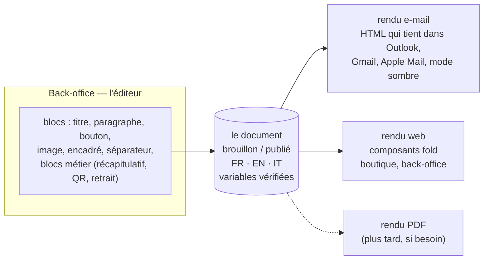

# L'éditeur de contenu — un document par blocs, plusieurs rendus

> 📋 **Doc-first, 2026-11-06.** Hugo : « je voudrais me rapprocher d'un éditeur
> d'envoi de mail professionnel pour la mise en page […] ça risque de devenir
> une feature cross app assez vite car je vais avoir d'autres besoins en app
> sur d'autres sujets ». Rien n'est conçu au-delà de cette page ni bâti. Ce
> document pose l'avis et les questions ; le plan viendra après les réponses
> (§ 5), et passera par `vitruve` (il fixe une frontière transverse et touche
> des e-mails qui partent pour de vrai).

## Partie 1 — Comprendre

### Ce qu'on veut

Que l'équipe compose elle-même un e-mail (et demain un message dans la
boutique, une page, une notification) **comme dans Mailchimp ou Brevo** :
choisir des blocs, les ordonner, écrire leur texte, voir l'aperçu, s'envoyer
un essai, publier. Sans développeur, et sans jamais casser la charte ni
l'affichage chez le destinataire.

### L'idée en une phrase

**Un document est une liste de blocs typés ; la charte décide de leur
apparence ; chaque destination a son moteur de rendu.**

### Pourquoi des blocs et pas un éditeur libre

- **Le HTML d'e-mail est un piège.** Chaque client de messagerie le rend à sa
  façon ; une mise en page libre, belle dans l'éditeur, casse chez une partie
  des destinataires.
- **La charte dériverait.** Chaque e-mail finirait avec sa police, ses
  couleurs, ses marges. Avec des blocs, la charte est appliquée par le moteur,
  pas par la personne qui écrit.
- **C'est ce que font les outils pro.** Mailchimp, Brevo, Customer.io
  proposent des blocs, pas une page blanche.

### Pourquoi ça devient transverse sans effort

Le **texte du panier** mis en chantier le 2026-11-05
([`../contenu-ecommerce/todo-texte-du-panier.md`](../contenu-ecommerce/todo-texte-du-panier.md))
est exactement un petit document par blocs. Un bandeau de la boutique, une
page d'information, une notification aussi. Avec ce socle, chaque nouveau
besoin est **un emplacement de plus**, pas un éditeur de plus.

### Ce qui reste hors de ce socle

- **Les e-mails marketing** (newsletters, relances commerciales) : consentement,
  lien de désinscription, RGPD. Un chantier à part ; un outil spécialisé
  (Brevo, par exemple) peut alors valoir mieux que de le bâtir.
- **Les documents légaux** (factures, bons de livraison) : leur mise en page
  est réglementée, ils gardent leur moteur et leur planche de spécimens.

## Partie 2 — Technique

### 1. Ce qui existe déjà (ouvert le 2026-11-06)

Une bonne part du chemin est faite pour les e-mails, par le plan
[`../contenu-ecommerce/plan-textes-des-e-mails.md`](../contenu-ecommerce/plan-textes-des-e-mails.md)
(E1 à E4b, bâtis le 2026-10-23) :

- **Les textes** des 28 e-mails sont au dictionnaire, en trois langues
  (`apps/lfd-api/src/platform/mailer/copy/`), avec un manifeste généré qui
  liste pour chaque texte ses variables permises et obligatoires
  (`mail-copy-manifest.json`, tenu par `lint:mail-copy-digest`).
- **Le texte effectif** (défaut + publié) est servi par
  `apps/lfd-api/src/platform/mailer/effective-copy/` ; l'écran de
  Communication édite, prévisualise, envoie un essai au staff, publie.
- **Les sections** : un e-mail est déjà une suite de sections déclarées par
  gabarit (`apps/lfd-api/src/platform/mailer/sections/`), de nature `text`
  (ses textes se réécrivent) ou `system` (produite par les données : QR,
  récapitulatif, itinéraire), dont **l'ordre** se règle, en brouillon puis
  publié. L'en-tête et le pied sont des cadres fixes.
- **Le rendu** passe par la coquille de `@lfd/mailer` (`packages/mailer/`).

**L'écart avec un éditeur par blocs est donc précis** : aujourd'hui on
réécrit des textes et on **réordonne** des sections que le code déclare ;
demain on **ajoute, retire et choisit** des blocs, d'un catalogue commun à
toutes les destinations.

### 2. La forme proposée (à contredire)

- **Un catalogue de blocs, versionné dans le code.** Chaque type de bloc
  déclare ses champs (texte, lien, image de la médiathèque), ses règles
  (longueurs, un seul titre principal) et ses rendus (e-mail, web). Les
  blocs métier (`system`) restent produits par les données ; l'éditeur ne
  fait que les placer.
- **Un emplacement = un document.** Chaque emplacement (« confirmation de
  commande », « texte du panier », « bandeau de la boutique ») déclare les
  blocs qu'il admet et les variables qu'il fournit. Un bloc ou une variable
  hors de cette déclaration est refusé à l'enregistrement, comme les
  variables le sont déjà (C5 du plan des e-mails).
- **Le cycle de vie existant, généralisé** : brouillon, aperçu avec de vraies
  données, essai envoyé à soi, publication, versions datées et retour
  arrière, trois langues côte à côte.
- **Le moteur de rendu e-mail** : un moteur fait pour les clients de
  messagerie (MJML ou React Email), choisi au plan, derrière la coquille
  actuelle — les octets d'aujourd'hui servent de référence de non-régression,
  comme pour E1.

### 3. Où il vit

À trancher au plan. Le socle (catalogue de blocs, document, cycle de vie) est
transverse et sans métier : il relève de `platform/` côté API et d'un paquet
partagé côté front (la matrice du § 3 de `CLAUDE.md` interdit à `platform`
de connaître un contexte métier). Les **emplacements** et les **blocs
métier** appartiennent chacun à leur contexte, qui les déclare.

### 4. Ce qui n'est pas vérifié

- que la coquille de `@lfd/mailer` puisse céder la place à un moteur comme
  MJML sans changer les octets des e-mails existants ;
- le poids d'un tel moteur dans le conteneur de l'API ;
- le besoin réel d'ajouter et de retirer des blocs, par rapport au seul
  réordonnancement déjà bâti (question 3 ci-dessous).

### 5. Les questions avant le plan

1. ✅ **Tranché par Hugo le 2026-11-06 : le transactionnel d'abord**
   (confirmation, rappel de retrait, invitation…), sur Resend et notre
   éditeur. Le marketing viendra plus tard, probablement par un outil
   spécialisé (Brevo, ~20–30 € par mois en offre Standard selon des
   comparatifs tiers de 2026, prix non vérifié sur le site de Brevo).
2. **Qui édite** : Hugo seul, ou l'équipe, avec un droit dédié ?
3. **Changer la structure** (ajouter, retirer des blocs), ou seulement le
   texte et l'ordre dans une structure fixe par e-mail ? La seconde est déjà
   presque là, et couvre souvent l'essentiel du besoin.
4. **Les premiers emplacements hors e-mail** : le texte du panier d'abord ?
