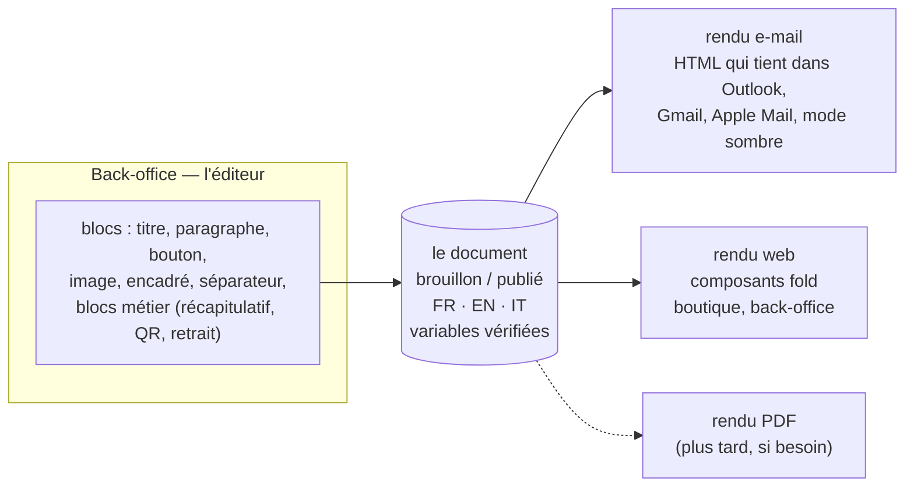
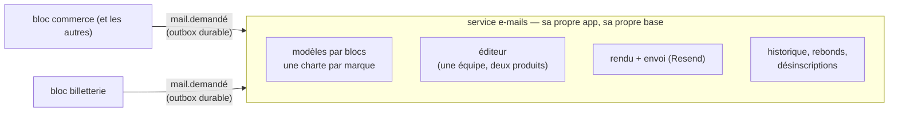

# L'éditeur de contenu — un document par blocs, plusieurs rendus

> 🧭 **Bandeau du 2026-11-07.** Ce document est la **note doc-first d'origine** (2026-11-06), gardée telle quelle : presque tout ce qu'elle propose a été bâti depuis, sous une autre forme parfois. Pour l'état réel et ce qui reste à faire, lire [`les-e-mails.md`](les-e-mails.md). Le corps n'est pas réécrit.

> 📋 **Doc-first, 2026-11-06.** Hugo : « je voudrais me rapprocher d'un éditeur
> d'envoi de mail professionnel pour la mise en page […] ça risque de devenir
> une feature cross app assez vite car je vais avoir d'autres besoins en app
> sur d'autres sujets ». Rien n'est conçu au-delà de cette page ni bâti. Ce
> document pose l'avis et les questions ; le plan viendra après les réponses
> (§ 5), et passera par `vitruve` (il fixe une frontière transverse et touche
> des e-mails qui partent pour de vrai).

## Partie 1 — Comprendre

### Ce qu'on veut

Que l'équipe compose elle-même un e-mail (et demain un message dans la
boutique, une page, une notification) **comme dans Mailchimp ou Brevo** :
choisir des blocs, les ordonner, écrire leur texte, voir l'aperçu, s'envoyer
un essai, publier. Sans développeur, et sans jamais casser la charte ni
l'affichage chez le destinataire.

### L'idée en une phrase

**Un document est une liste de blocs typés ; la charte décide de leur
apparence ; chaque destination a son moteur de rendu.**

### Pourquoi des blocs et pas un éditeur libre

- **Le HTML d'e-mail est un piège.** Chaque client de messagerie le rend à sa
  façon ; une mise en page libre, belle dans l'éditeur, casse chez une partie
  des destinataires.
- **La charte dériverait.** Chaque e-mail finirait avec sa police, ses
  couleurs, ses marges. Avec des blocs, la charte est appliquée par le moteur,
  pas par la personne qui écrit.
- **C'est ce que font les outils pro.** Mailchimp, Brevo, Customer.io
  proposent des blocs, pas une page blanche.

### Pourquoi ça devient transverse sans effort

Le **texte du panier** mis en chantier le 2026-11-05
([`../contenu-ecommerce/todo-texte-du-panier.md`](../contenu-ecommerce/todo-texte-du-panier.md))
est exactement un petit document par blocs. Un bandeau de la boutique, une
page d'information, une notification aussi. Avec ce socle, chaque nouveau
besoin est **un emplacement de plus**, pas un éditeur de plus.

### Ce qui reste hors de ce socle

- **Les e-mails marketing** (newsletters, relances commerciales) : consentement,
  lien de désinscription, RGPD. Un chantier à part ; un outil spécialisé
  (Brevo, par exemple) peut alors valoir mieux que de le bâtir.
- **Les documents légaux** (factures, bons de livraison) : leur mise en page
  est réglementée, ils gardent leur moteur et leur planche de spécimens.

## Partie 2 — Technique

### 1. Ce qui existe déjà (ouvert le 2026-11-06)

Une bonne part du chemin est faite pour les e-mails, par le plan
[`../contenu-ecommerce/plan-textes-des-e-mails.md`](../contenu-ecommerce/plan-textes-des-e-mails.md)
(E1 à E4b, bâtis le 2026-10-23) :

- **Les textes** des 28 e-mails sont au dictionnaire, en trois langues
  (`apps/lfd-api/src/mail/templates/copy/`), avec un manifeste généré qui
  liste pour chaque texte ses variables permises et obligatoires
  (`mail-copy-manifest.json`, tenu par `lint:mail-copy-digest`).
- **Le texte effectif** (défaut + publié) est servi par
  `apps/lfd-api/src/mail/templates/effective-copy/` ; l'écran de
  Communication édite, prévisualise, envoie un essai au staff, publie.
- **Les sections** : un e-mail est déjà une suite de sections déclarées par
  gabarit (`apps/lfd-api/src/mail/templates/sections/`), de nature `text`
  (ses textes se réécrivent) ou `system` (produite par les données : QR,
  récapitulatif, itinéraire), dont **l'ordre** se règle, en brouillon puis
  publié. L'en-tête et le pied sont des cadres fixes.
- **Le rendu** passe par la coquille de `@lfd/mailer` (`packages/mailer/`).

**L'écart avec un éditeur par blocs est donc précis** : aujourd'hui on
réécrit des textes et on **réordonne** des sections que le code déclare ;
demain on **ajoute, retire et choisit** des blocs, d'un catalogue commun à
toutes les destinations.

### 2. La forme proposée (à contredire)

- **Un catalogue de blocs, versionné dans le code.** Chaque type de bloc
  déclare ses champs (texte, lien, image de la médiathèque), ses règles
  (longueurs, un seul titre principal) et ses rendus (e-mail, web). Les
  blocs métier (`system`) restent produits par les données ; l'éditeur ne
  fait que les placer.
- **Un emplacement = un document.** Chaque emplacement (« confirmation de
  commande », « texte du panier », « bandeau de la boutique ») déclare les
  blocs qu'il admet et les variables qu'il fournit. Un bloc ou une variable
  hors de cette déclaration est refusé à l'enregistrement, comme les
  variables le sont déjà (C5 du plan des e-mails).
- **Le cycle de vie existant, généralisé** : brouillon, aperçu avec de vraies
  données, essai envoyé à soi, publication, versions datées et retour
  arrière, trois langues côte à côte.
- **Le moteur de rendu e-mail** : un moteur fait pour les clients de
  messagerie (MJML ou React Email), choisi au plan, derrière la coquille
  actuelle — les octets d'aujourd'hui servent de référence de non-régression,
  comme pour E1.

### 3. Où il vit — un service d'e-mails commun (Hugo, 2026-11-06)

**Le constat.** La Folie Coffee envoie des e-mails ; la future **billetterie
d'événements** en enverra aussi. Elle sera **un bloc de `lfd-api`**, avec
son schéma dans la base unique (Hugo, 2026-11-06 : « c'est le principe du
modular monolith »), et non une API à part comme écrit plus tôt le même jour. Les deux produits relèvent de **la même société**, et
**les mêmes personnes** éditent leurs e-mails (Hugo, 2026-11-06).

**La décision : les apps demandent, le service d'e-mails compose et envoie**
(proposition de Hugo, le modèle de Postmark, SendGrid ou Customer.io).

- **Une demande dit quoi, à qui, avec quelles données** : le modèle (par
  exemple `order-placed`), le produit, le destinataire, la langue, et les
  données que le modèle déclare. Elle part par l'**outbox durable** que les
  API ont déjà : un service d'e-mails arrêté retarde l'envoi, il ne le perd
  pas, et la commande n'attend jamais l'e-mail.
- **Le contrat d'un modèle** : chaque modèle déclare la forme de ses données
  (variables, récapitulatif, QR, itinéraire), versionnée dans un paquet de
  contrats partagé. Le manifeste des variables d'aujourd'hui
  (`mail-copy-manifest.json`) en est l'amorce.
- **Le service possède** les modèles, l'éditeur, le rendu, l'envoi et le suivi
  (rebonds, liste de suppression chez Resend, historique). Les apps ne savent
  plus rien de la mise en page.
- **Écartée : la bibliothèque partagée** (chaque produit avec son éditeur et
  ses modèles dans sa base). Plus simple au départ, elle aurait donné deux
  éditeurs pour une seule équipe, et deux endroits où chercher un rebond.

**Pour l'instant : un bloc de `lfd-api`, pas une app à part** (Hugo,
2026-11-06 : « j'aime le modular monolith »). Le service d'e-mails est un
**bloc** de premier niveau de `apps/lfd-api/src/` (nom à fixer au plan, par
exemple `mail/`), avec **son schéma Postgres** dans la base unique, comme
`delivery`, `packing` ou `production` :

- **Les autres blocs ne l'importent que par un canal** : le bloc d'e-mails
  déclare la porte « demander un e-mail » (`<bloc>/channels/…`), les blocs
  métier la lisent en `port uniquement`, et la demande part par l'outbox
  durable, comme une vraie messagerie entre deux applications. Le bloc
  n'importe aucun bloc métier en retour.
- **Ses tables ne sont lues que par lui** (`lint:prisma-model-ownership`) et
  jamais jointes à une autre (`lint:cross-schema-join`).
- **La matrice du § 3 de `CLAUDE.md` gagne une ligne et une colonne**, et
  `lint:context-boundaries` doit connaître le bloc AVANT le premier fichier
  qui y entre — une porte qui ignore un dossier neuf ne refuse rien.
- **L'extraire plus tard** en app à part, quand la billetterie en aura besoin
  ou plus tôt si l'exploitation le demande, revient à déménager un bloc dont
  les frontières sont déjà tenues : son schéma part avec lui, les demandes
  passent déjà par une file. La billetterie, bloc de la même API, demande
  ses e-mails par la même porte que les autres blocs.

**L'éditeur vit dans le back-office `lfd-backoffice-frontend`** (Hugo,
2026-11-06), là où l'écran des textes des e-mails est déjà, sous
Communication. Le personnel s'y connecte comme aujourd'hui, et le droit
d'éditer se règle à l'écran des rôles : le coût 3 (les droits) se résout par
l'existant tant que le bloc vit dans `lfd-api`. Les modèles de la billetterie
s'y éditeront aussi, rangés par produit.

Les coûts 1 (une app de plus) et 5 (une migration entre deux bases)
ci-dessous sont donc **reportés à l'extraction** : aujourd'hui, la bascule se
fait dans la même base.

**Ce que ça coûte, à porter au plan :**

1. **Une app de plus** : son conteneur, sa base, son entrée dans la
   passerelle, son `/health`, son déploiement.
2. **Les données des clients traversent** (nom, e-mail, détail d'une
   commande) : un traitement de plus au registre RGPD
   (`documentation/legal/rgpd-registre.json`), avec sa durée de conservation.
   Le service ne garde des données d'un envoi que ce que le suivi exige.
3. **Les droits** : les personnes du staff se connectent à l'éditeur ; la
   manière (l'annuaire du staff de La Folie Coffee, Auth0) est à trancher.
4. **L'aperçu et l'essai** demandent des données d'exemple par modèle.
5. **La bascule de La Folie Coffee** : ses textes et l'ordre de ses sections
   publiés aujourd'hui (`prisma/schema/public/mail-copy.prisma`) deviennent
   des modèles du service, sans changer un octet des e-mails envoyés. C'est
   une migration de données entre deux bases : le plan passe par `vitruve`.

### 4. Ce qui n'est pas vérifié

- que la coquille de `@lfd/mailer` puisse céder la place à un moteur comme
  MJML sans changer les octets des e-mails existants ;
- le poids d'un tel moteur dans le conteneur de l'API ;
- le besoin réel d'ajouter et de retirer des blocs, par rapport au seul
  réordonnancement déjà bâti (question 3 ci-dessous) ;
- la façon dont la passerelle et Auth0 accueilleraient une troisième API.

### 5. Les questions avant le plan

1. ✅ **Tranché par Hugo le 2026-11-06 : le transactionnel d'abord**
   (confirmation, rappel de retrait, invitation…), sur Resend et notre
   éditeur. Le marketing viendra plus tard, probablement par un outil
   spécialisé (Brevo, ~20–30 € par mois en offre Standard selon des
   comparatifs tiers de 2026, prix non vérifié sur le site de Brevo).
2. ✅ **L'équipe, avec un droit dédié** réglé à l'écran des rôles (Hugo,
   2026-11-06).
3. ✅ **Ajouter et retirer des blocs** d'un catalogue commun, pas seulement le
   texte et l'ordre (Hugo, 2026-11-06).
4. ✅ **Rien hors e-mail pour l'instant** : les e-mails seuls ; le socle reste
   pensé pour d'autres emplacements, sans en bâtir (Hugo, 2026-11-06).

Le plan : [`plan-service-e-mails.md`](plan-service-e-mails.md).
