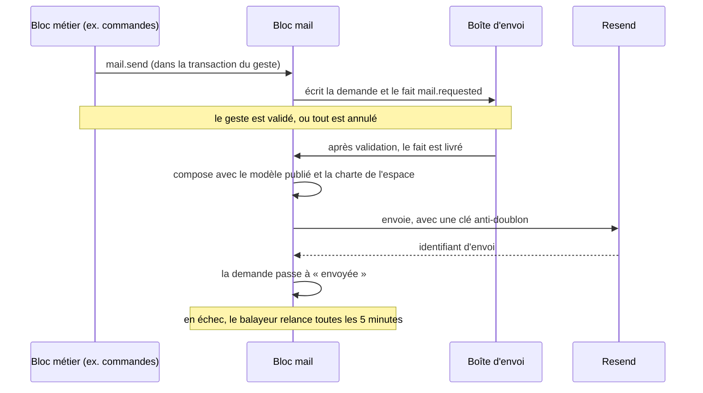
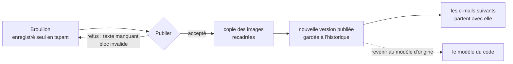
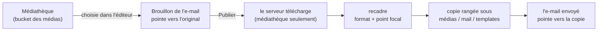

# Les e-mails — ce qui existe, et ce qui reste à faire

> 🟡 **Doc d'état, écrit le 2026-11-07** à partir des trois journaux de chantier
> et vérifié dans le code le même jour (branche `dev`). Les journaux gardent
> le détail, les écarts et les raisons de chaque lot :
> [`plan-service-e-mails.md`](plan-service-e-mails.md) (le service, lots S0 à
> S8), [`plan-editeur-par-blocs.md`](plan-editeur-par-blocs.md) (l'éditeur,
> S4, S5, R1–R2, C1–C3) et [`README.md`](README.md) (la note doc-first
> d'origine). **Ce document-ci dit l'état et le reste à faire** ; quand il
> contredit un journal, c'est lui qui a été relu dans le code.

## Partie 1 — En simple

### Le service d'envoi

Tous les e-mails de l'API passent par **un seul service**, le bloc `mail`.
Un autre bloc (commandes, comptes, comptabilité, fournil, équipe…) ne sait
plus fabriquer un e-mail : il **demande** « l'e-mail _commande passée_, à
cette personne, avec ces données », et le bloc `mail` compose, envoie et
garde la trace.

Il y a deux façons de demander :

- **Envoi différé** (`mail.send`, le cas normal) : la demande est écrite en
  même temps que le geste. Si le geste est annulé, aucun e-mail ne part. Si
  le geste réussit, l'e-mail part juste après, et il est **relancé** tout
  seul en cas de panne (toutes les 5 minutes, pendant 23 h).
- **Envoi immédiat** (`mail.sendAndAwaitReceipt`) : réservé à quelques gestes
  de l'équipe qui doivent lire le résultat à l'écran (« lien envoyé »), à
  l'essai d'un e-mail et à la sonde. La liste est fermée et tenue par une
  porte.

**Le suivi** : chaque demande laisse une ligne (modèle, destinataire, état,
identifiant Resend). Elle doit être effacée au bout d'un an ; la purge existe
mais tourne **à blanc** tant que Hugo ne l'active pas.

**La sonde et la veille** : à chaque déploiement, la sonde envoie un e-mail
immédiat **et** un e-mail différé, et le déploiement échoue si le second
n'est pas parti en 75 s. En continu, une veille regarde toutes les 5 minutes
s'il reste des e-mails coincés depuis plus de 15 minutes ou en échec
définitif, et **sonne la cloche** du back-office. Elle ne prévient jamais par
e-mail : c'est ce qui serait en panne.

L'e-mail de la sonde (`ops.deploy-check`) est un contrôle technique : il
part, mais il n'est **pas dans l'éditeur** (ni dans la liste, ni dans un
espace ; l'ouvrir rend un 404 nommé) — Hugo, 2026-11-07. Il porte
`outOfEditor` dans sa déclaration (`team-mail-layouts.ts`). Les routes
d'écriture des textes refusent ses textes (`MAIL_COPY_OUT_OF_EDITOR`, 409), et
le compte des changements à publier (`copyPendingCount`) ne les compte pas.

### Les espaces

Les e-mails sont rangés en **deux espaces** :

- **La Folie Coffee — clients** : tous les e-mails aux clients ;
- **La Folie Douce — équipe** : les e-mails à l'équipe, et les quatre
  e-mails internes (rangés sous « Interne »).

Chaque espace a :

- **sa charte** : logo, couleurs (claires et sombres), couleur du bandeau,
  police des titres, pied de page. Elle se publie comme un e-mail
  (brouillon, publier, historique), et le contraste est contrôlé avant
  publication. Tant qu'aucune charte n'est publiée, les e-mails partent
  exactement comme avant ;
- **son expéditeur** : nom, adresse d'envoi, adresse de réponse. C'est une
  donnée réglée à l'écran, pas une variable de déploiement. Une adresse dont
  le domaine n'est pas vérifié chez Resend est refusée, et un essai part à
  l'enregistrement. Sans réglage, l'espace envoie sous l'adresse par défaut
  (`no-reply@lafoliecoffee.info`).

### L'éditeur

Au back-office, page **« E-mails »** (`/emails`), une carte par espace, puis
la liste de ses e-mails. Ouvrir un e-mail montre **l'e-mail lui-même** au
milieu de l'écran : chaque bloc est la vraie portion d'e-mail.

- **On écrit en cliquant sur le texte.** Les valeurs qui changent d'un
  client à l'autre (référence, prénom, jour…) sont des **pastilles** qu'on
  ne casse pas en tapant.
- **Les ressources** (panneau de gauche) : ce que l'e-mail fournit pour
  chaque destinataire — des valeurs, des liens (posés sur un bouton), des
  blocs de données (récapitulatif, QR de retrait, itinéraire). Chacune a un
  nom lisible, une description et un exemple. On ne fabrique jamais une
  ressource, on la pose.
- **Les blocs** (panneau de droite) : titre, paragraphe, encadré, bouton,
  séparateur, colonnes, **image**. On ajoute, déplace, supprime les blocs
  libres ; les blocs du modèle se déplacent mais ne se suppriment pas.
- **Les images** viennent de la médiathèque, et d'elle seule. On choisit un
  **format** (originale, 3:2, 2:1, 1:1) et un **point focal** ; à la
  publication, le serveur recadre et range sa propre copie (voir « Les images
  d'un e-mail » plus bas).
- **Les conditions d'affichage** : un bloc qui n'apparaît que dans certains
  cas (par exemple l'itinéraire, seulement pour un retrait dont l'adresse est
  connue) porte un badge « Sous condition » et sa phrase ; l'aperçu se règle en « Retrait » ou
  « Livraison » pour le voir.
- **Les langues** : français, anglais, italien côte à côte.
- **Aperçu** téléphone / ordinateur, clair / sombre ; **essai** envoyé à soi ;
  **publier** ; **historique** ; **revenir au modèle d'origine**.

### Les images d'un e-mail

Une image d'e-mail se **choisit dans la médiathèque** — c'est la seule source
possible, sans réglage pour en ajouter une autre. À la **publication**, le
serveur la télécharge, la recadre au format et au point focal choisis, et en
range une **copie** dans le même bucket que la médiathèque, dans un dossier à
part : `mail/`. L'e-mail envoyé pointe vers cette copie.

Pourquoi une copie : un e-mail parti ne se rappelle pas. Si quelqu'un retire
ou remplace l'image dans la médiathèque, les e-mails déjà envoyés et le
modèle publié gardent la leur. Rien ne supprime jamais une copie.

**Rien à régler** : le bucket des médias (`R2_MEDIA_*`) suffit. S'il est
incomplet, publier un e-mail avec image est refusé, et le message nomme la
variable qui manque.

L'ancien écran **« Textes des e-mails »** (`/textes-emails`) renvoie
désormais vers `/emails` ; son code est retiré depuis le 2026-11-07. Le droit qui ouvre l'éditeur s'appelle
**« Modèles d'e-mails »**.

### La règle : le staff n'écrit que l'accroche

Décidée par Hugo le 2026-11-07 : **un e-mail pour tout le monde**. Le staff
écrit l'accroche (titre, message, bouton, blocs libres), la même pour tous.
Tout ce qui dépend du client ou de la commande (jour, lieu, règlement,
montants, QR, lien de paiement) est un **bloc de données** que le staff place
sans en réécrire les libellés. Un seul exemple par e-mail, plus de « cas ».

**Aujourd'hui, un seul e-mail suit la règle** : « Commande passée »
(`customer.order-placed`). Les 31 autres attendent la décision de Hugo,
e-mail par e-mail.

## Partie 2 — Technique

Vérifié dans le code le 2026-11-07 sauf mention contraire.

### Le bloc `mail` (`apps/lfd-api/src/mail/`)

| Contexte     | Ce qu'il fait                                                                                                     | Routes                                                                                                                               |
| ------------ | ----------------------------------------------------------------------------------------------------------------- | ------------------------------------------------------------------------------------------------------------------------------------ |
| `requests/`  | demandes, envoi après validation, balayeur, purge, veille, sonde                                                  | `POST /admin/mail/requests/sweep`, `…/purge`, `…/watch` (machine, cron `*/5`) ; `POST /admin/ops/mail-check`                         |
| `templates/` | les gabarits, le dictionnaire (`copy/`, trois langues), les sections, les ressources (`resources/`), les exemples | —                                                                                                                                    |
| `copy/`      | les phrases réécrites par l'équipe et leur publication                                                            | `/admin/mail-copy` (écran historique)                                                                                                |
| `documents/` | le document par blocs d'un e-mail : brouillon, publication, retour, aperçus, essai, phrases                       | `/admin/mail-templates/:template` (`draft`, `publications`, `reverts`, `previews`, `block-previews`, `trials`, `history`, `phrases`) |
| `images/`    | la copie recadrée des images (S3d, S5d)                                                                           | — (appelée à la publication)                                                                                                         |
| `charters/`  | la charte d'un espace                                                                                             | `/admin/mail-charters/:space` (`draft`, `publications`, `previews`, `history`)                                                       |
| `senders/`   | l'identité d'envoi d'un espace                                                                                    | `GET`/`PUT /admin/mail-senders/:space`                                                                                               |

- **La porte** : `apps/lfd-api/src/mail/channels/requests/mail.ts` (`Mail`,
  injectée sous le nom `mail`), typée par modèle. La matrice du § 3 de
  `CLAUDE.md` ouvre `→ mail : port uniquement` à tous les blocs métier ; `mail`
  n'importe que `platform` et `staff`.
- **Le contrat des gabarits** : `apps/lfd-api/src/mail/channels/templates/`
  (`b2b-mails.ts`, langue, libellés de l'équipe). Registre :
  `apps/lfd-api/src/mail/templates/mail-templates.ts` — 32 modèles d'après
  les journaux (non recompté).
- **La veille et la carte de santé** : `ops` déclare
  `apps/lfd-api/src/ops/health/mail-backlog-readings.port.ts`, le bloc publie
  `apps/lfd-api/src/mail/channels/requests/mail-backlog-survey.ts`,
  `apps/lfd-api/src/appBootstrap/mail-backlog-readings.module.ts` les relie.
  Le cron vit dans `apps/lfd-api/container/worker.ts` ; la sonde est appelée
  par `.github/workflows/deploy_lfd_api.yml`.
- **La purge du suivi** : réglage `MAIL_REQUEST_PURGE`, `dry-run` par défaut
  (`apps/lfd-api/src/platform/config/app-config.ts`).
- **Les images** : port `MailImageReframer`
  (`apps/lfd-api/src/mail/images/domain/ports/mail-image.reframer.ts`),
  `sharp` dans `apps/lfd-api/src/mail/images/infrastructure/sharp-mail-image.reframer.ts`,
  stockage R2 dans `apps/lfd-api/src/mail/images/infrastructure/r2-mail-image.store.ts`,
  téléchargement borné dans `apps/lfd-api/src/mail/images/infrastructure/fetch-mail-image.downloader.ts`.
  Détail ci-dessous, « Les images : source et stockage ».

### Les images : source et stockage (décidé par Hugo le 2026-11-08)

Deux règles tenues **par construction** — aucune variable ne peut les
desserrer :

| Règle                                                                                        | Où                                                                                                                     | Pourquoi                                                                                                                                               |
| -------------------------------------------------------------------------------------------- | ---------------------------------------------------------------------------------------------------------------------- | ------------------------------------------------------------------------------------------------------------------------------------------------------ |
| La source admise est l'origine de `R2_MEDIA_PUBLIC_BASE_URL`, et elle seule                  | `AppConfig.mailImageOrigins` (`apps/lfd-api/src/platform/config/app-config.ts`), vérifiée par `MailImageSource.admit`  | Publier un modèle fait télécharger le serveur : sans liste fermée, ce serait un client HTTP ouvert (SSRF). Le téléchargeur ne suit aucune redirection. |
| La copie va dans le bucket des médias, sous `mail/templates/<sha256>.<ext>`, servie immuable | `R2MailImageStore` (`apps/lfd-api/src/mail/images/infrastructure/r2-mail-image.store.ts`), `MAIL_COPIES_ROOT = "mail"` | Un seul bucket, un seul domaine public, aucun réglage propre au mailer. Le dossier `mail/` sépare ce que le bloc écrit de ce que la médiathèque range. |

Conséquences à connaître :

- **« Déjà une copie »** ne vaut que sous `<médias>/mail/`
  (`MailImageAdmission.copiesBaseUrl`, posé par `mail-images.module.ts`).
  Sources et copies partageant le bucket, une règle sur l'adresse des médias
  entière aurait pris toute image de la médiathèque pour une copie, et sauté
  son recadrage. Un test du copieur le tient
  (`mail-image-copier.service.spec.ts`, « hors de `mail/`, se copie bien »).
- **Aucune suppression ne les atteint** : le bloc `mail` n'a pas de verbe
  pour retirer, et la médiathèque (`discard-media.ts`, `sweep-orphan-media.ts`)
  ne supprime que les clés inscrites dans SA table, jamais en parcourant le
  bucket — vérifié le 2026-11-08. Une copie sous `mail/` n'y figure pas.
- **Les accès** : le jeton `R2_MEDIA_*` écrit aussi les copies. R2 donne ses
  droits par bucket, pas par dossier ; un bucket à part ne se justifiait que
  par là, et ce n'est plus le choix retenu.
- **Le refus** : sans `R2_MEDIA_*` complets, la copie refuse en nommant ce qui
  manque ; le bulletin de démarrage le signale déjà sous les médias.
- **Ce qui a disparu** le 2026-11-08 : `MAIL_IMAGE_ORIGINS`, `R2_MAIL_BUCKET`,
  `R2_MAIL_ACCESS_KEY_ID`, `R2_MAIL_SECRET_ACCESS_KEY`, `R2_MAIL_ENDPOINT`,
  `R2_MAIL_PUBLIC_BASE_URL`, et le lecteur de config qui les lisait
  (commits `82d3df1db`, `4f6451f7b`).

### Les tables

| Table                                                               | Schéma   | Rôle                                          |
| ------------------------------------------------------------------- | -------- | --------------------------------------------- |
| `mail_request`                                                      | `mail`   | une demande et son suivi                      |
| `mail_document`, `mail_document_version`                            | `mail`   | le document d'un e-mail et ses versions       |
| `mail_charter`, `mail_charter_version`                              | `mail`   | la charte d'un espace et ses versions         |
| `mail_sender_identity`                                              | `mail`   | l'identité d'envoi d'un espace, par révision  |
| `mail_copy_entries`, `mail_copy_publication`, `mail_section_orders` | `public` | les phrases réécrites (restées dans `public`) |

Schémas : `apps/lfd-api/prisma/schema/mail.prisma` et
`apps/lfd-api/prisma/schema/public/mail-copy.prisma`. La ressource
`mail_templates` (libellé « Modèles d'e-mails »,
`packages/contracts/src/staff-access.ts`) est ajoutée par migration ; le droit
se donne à l'écran des rôles.

### Les paquets

- **`@lfd/mail-blocks`** (`packages/mail-blocks/src/`) : le contrat partagé
  API ↔ back-office — document, validation, ressources, espaces
  (`MAIL_SPACES = ["lfc", "lfd"]`), charte et contraste, identité d'envoi,
  cadrage d'image.
- **`@lfd/mailer`** (`packages/mailer/src/`) : le rendu HTML (coquille,
  document par blocs, charte, thème sombre) et le transport Resend
  (disjoncteur, mode à blanc). Pas de MJML.

### Le back-office

`apps/lfd-backoffice-frontend/src/app/mail-editor/` : routes `emails`,
`emails/espaces/:space/{templates,charte,expediteur}`, `emails/:template` et
`emails/:template/historique` (`apps/lfd-backoffice-frontend/src/app/app.routes.ts`).

### Les portes qui tiennent les e-mails

`mail-through-block` (aucun envoyeur hors du bloc, dette à 0),
`mail-receipt-admitted` (envoi immédiat sur liste admise),
`mail-copy-digest` (manifeste des textes), `mail-key-no-pii` (aucune adresse
dans une clé), `intent-key-gestures` (clé d'intention des gestes du staff),
`log-no-email`, `mail-attachment-by-reference`, `context-boundaries`,
`network-outside-transaction`. Liste et rôle : `pnpm gate --list`.

## Ce qui reste à faire

Une ligne par point ; le lien mène à la section du journal qui le détaille.
« Service » = [`plan-service-e-mails.md`](plan-service-e-mails.md),
« Éditeur » = [`plan-editeur-par-blocs.md`](plan-editeur-par-blocs.md).

### a. À faire par Hugo, hors code

1. Rien à poser pour les images d'e-mail : elles vont dans le bucket des
   médias, sous `mail/` (2026-11-08). Sans `R2_MEDIA_*` complets, publier un
   e-mail avec image est refusé — Service § 24.
2. Vérifier que la clé Resend de prod peut **lire les domaines** (une clé
   « envoi seulement » fait refuser tout réglage d'expéditeur) — Éditeur § 25,
   C3 écarts.
3. ~~Ajouter `lfd-backoffice.com` chez Resend avec ses DNS~~ — fait le
   2026-11-07 (DKIM, `send`, `rsend`, `_dmarc` et le MX de réception posés
   dans Cloudflare ; vérification Resend en attente). Reste : régler
   l'expéditeur de l'espace La Folie Douce après le déploiement de C3 —
   Éditeur § 25, C3.
4. Réception activée chez Resend sur `lfd-backoffice.com` et
   `lafoliecoffee.info` le 2026-11-07 (MX posés, vérification en attente) : les
   e-mails reçus restent dans Resend (« Inboxes ») tant que le chantier
   « Support » n'existe pas.
5. Donner le droit « Modèles d'e-mails » aux rôles qui éditent, à l'écran des
   rôles — Éditeur § 15.
6. Activer la purge du suivi (`MAIL_REQUEST_PURGE`) le moment venu — Service § 7.

### b. Avant le prochain push ou déploiement

1. ~~Batterie racine (`pnpm test`, lint, portes, build AOT)~~ — faite le
   2026-11-07 ; ses rouges corrigés (`fd10ad0a9`, `c3a51bb54`), CI de dev
   verte sur `c3a51bb54` — `CLAUDE.md` § 9 bis.
2. ~~`e2e:rebalance`~~ — fait le 2026-11-07, durées commitées (`fd10ad0a9`).
3. Un `docker build` complet de l'API pour `sharp` (seul l'essai isolé a
   tourné ; tenté le 2026-11-07, arrêté par le disque plein de Docker) —
   Éditeur § 19, format et point focal.
4. Repasser les migrations du jour (documents, chartes, identité d'envoi) au
   `lecteur-de-migrations` avant `main` : chacune a été relue au commit, la
   règle demande une relecture d'ensemble avant la production — `CLAUDE.md`
   § 9 bis.

### c. Décisions en suspens

1. Rendre visibles les e-mails « échoués » au staff (écran du suivi) : la
   veille sonne, mais aucun écran ne liste les envois — Service, revue cas 2.
2. Les pièces jointes par URL signée (S3c) « à revoir » ; d'ici là le bloc
   `mail` lit le stockage des pièces client — Service § 22.
3. Le dossier du fournil part encore en octets : ouvrir son stockage au bloc
   `mail`, ou le laisser — Service, revue cas 7.
4. Durée de conservation des mandats rangés au stockage — Service, revue cas 7.
5. ~~`@lfd/mailer` journalise l'adresse du destinataire~~ — fait le
   2026-11-07 : le contexte des journaux du paquet porte la clé d'idempotence
   (et l'identifiant Resend une fois accepté), que `mail.mail_request` relie
   au destinataire ; la porte `log-no-email` lit aussi `packages/*/src`.
6. Le sens de « envoyé » : un type par étape, retours Resend reliés au suivi,
   faits `mail.delivered` / `mail.bounced` — décidé, pas bâti — Service, revue cas 5.
7. ~~Adresse de réponse d'un espace obligatoire, refus de `no-reply`~~ —
   tranché oui et fait le 2026-11-07 : `validateMailSenderIdentity` refuse une
   adresse absente ou qui ne reçoit rien ; une identité déjà rangée sans elle
   reste lisible et envoie comme avant — Éditeur § 26, n° 1.
8. ~~Marquer « sous condition » un bouton qui ne disparaît que sans adresse de
   boutique~~ — tranché non le 2026-11-07 — Éditeur § 26, n° 2.
9. « Voir ma commande » d'un invité mène à la page d'annulation : la garder ou
   créer une page de consultation — Éditeur § 26, n° 3.
10. ~~« Voir ma commande » et « Gérer ou annuler » mènent au même endroit dans
    « Commande passée » : en retirer un~~ — fait le 2026-11-07 : un seul
    bouton, le lien « Gérer ou annuler ma commande » est retiré — Éditeur
    § 26, n° 4.
11. ~~Masquer l'e-mail des anciennes inscriptions au journal~~ — fait le
    2026-11-07 (décision RGPD) — Éditeur § 26, n° 5.
12. ~~Refuser côté serveur l'écriture d'un libellé système (aujourd'hui seul
    l'éditeur le cache)~~ — fait le 2026-11-07 — Éditeur § 23, écarts.

### d. Chantiers notés, non bâtis

1. Passer les 31 autres e-mails à la règle de l'accroche : 16 faciles et
   4 moyens d'abord, puis les 11 « à discuter » ligne par ligne (Éditeur § 26,
   n° 6) — Éditeur § 23, relevé.
2. ~~L'aperçu fidèle et le canevas n'appliquent pas encore la charte publiée~~
   — fait le 2026-11-07 — Éditeur § 25, C1 écarts.
3. Les demandes suivies entre blocs (un identifiant de suivi pour toute
   demande) — [`../todos/todo-demandes-suivies.md`](../todos/todo-demandes-suivies.md).
4. Colonnes « hybrides » qui s'empilent sans `@media` (Gmail application,
   certains Outlook) — Hugo : « non pas là » — Éditeur § 24, piste.
5. MJML, en piste seulement : pas maintenant ; il resterait contenu dans
   `@lfd/mailer` ; à envisager si on fait des colonnes hybrides, si un rendu
   cassé est constaté dans Outlook ou Gmail application, ou pour des blocs
   complexes — Service § 2, C6.
6. ~~Retirer le code de l'ancien écran `textes-emails`~~ — fait le
   2026-11-07 : la redirection reste ; les libellés et les règles de texte
   que l'éditeur lisait sont dans `mail-editor/rules/`.
7. ~~Liste des paires de contraste recopiée au back-office~~ — fait le
   2026-11-07 : `CHARTER_CONTRAST_PAIRS` (`@lfd/mail-blocks`), lue par le
   refus et par la carte « Contraste ».
8. Non vérifié à l'écran : glisser-déposer des variables et des blocs, saisie
   avec pastilles dans Safari et Firefox — Éditeur § 22.
9. Non vérifié en vrai : le QR et l'empilement des colonnes en mode sombre de
   Gmail et Outlook — Éditeur § 8.
10. **Le chantier « Support »** (Hugo, 2026-11-07) : traiter dans le
    back-office les e-mails reçus (`support@lfd-backoffice.com`, puis une
    adresse client sur `lafoliecoffee.info`). Le webhook Resend `email.received`
    signé vers l'API, le message rangé et relié à sa commande ou à son compte,
    la cloche, un écran « Support » (entrée de menu et droit à part) pour lire
    et répondre ; la réponse part par le bloc `mail`. Et dans Email Templates,
    l'onglet « Expéditeur » devient « Réglages », l'adresse de réponse choisie
    parmi les adresses que le Support reçoit. Route publique et données
    personnelles : plan contredit par `vitruve` avant Hugo. Non écrit.
11. L'e-mail de vérification d'Auth0 (« Verify your email ») part en anglais et
    hors du suivi du bloc `mail` (constaté le 2026-11-07 sur un rebond).
