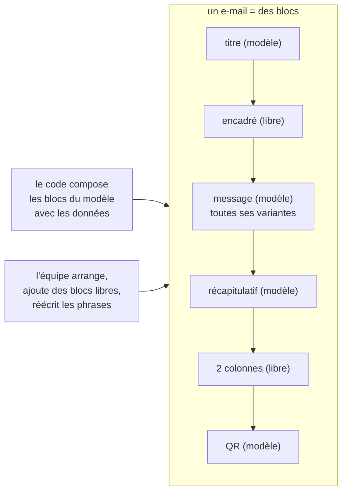

# Plan — l'éditeur d'e-mails par blocs (S4 et S5)

> 📋 **Doc-first, 2026-11-06, réécrit le même jour après deux passages de
> `vitruve`.** Suite de [`plan-service-e-mails.md`](plan-service-e-mails.md) :
> S4 (le modèle par blocs et son rendu) et S5 (l'éditeur au back-office).
> Décisions de Hugo aux § 13, 14, 14 bis et 14 ter de ce plan-là, tirées de
> deux maquettes qu'il a manipulées. Hugo s'est absenté (« tu ne t'arrêtes
> pas, tu notes tes questions ») : les choix par défaut sont marqués, les
> questions sont au § 9.
>
> 🔁 **Pourquoi cette réécriture.** La première forme faisait de chaque phrase
> d'un e-mail un bloc libre. `vitruve` a montré (§ 10) que les e-mails
> d'aujourd'hui **calculent** leurs phrases : axes croisés (l'annulation croise
> l'auteur, le jour, le régime de paiement, le remboursement et le bon
> d'achat), élisions, pluriels, prénom présent ou non, objet qui varie. Les
> refaire en blocs libres aurait réécrit cette logique en conditions, ou cassé
> les e-mails. **Forme retenue : le code compose toujours le message ; l'équipe
> arrange autour, ajoute ses propres blocs, et réécrit les phrases du code.**

## Partie 1 — Comprendre

### L'idée

Un e-mail est une suite de **blocs**, de deux sortes :

- **les blocs du modèle** — ce que le code compose à partir des données :
  le titre, le message (avec toutes ses variantes), le récapitulatif, le QR,
  l'itinéraire, le bouton de commande et son lien secondaire, le pied. L'équipe les **déplace**
  et **réécrit leurs phrases** (dans toutes leurs variantes), elle ne les
  supprime pas et n'en change pas la logique ;
- **les blocs libres** — ce que l'équipe **ajoute** : un titre, un paragraphe,
  un encadré (« Fermé le 1ᵉʳ mai »), un bouton vers une adresse fixe, un
  séparateur, une mise en page à 2 ou 3 colonnes, plus tard une image.



### Ce qui ne change pas

- **Tant qu'un e-mail n'a pas été réarrangé, il part exactement comme
  aujourd'hui**, à l'octet près. Le document de départ est l'ordre actuel des
  blocs du modèle, sans bloc libre : il se rend avec la coquille actuelle.
- **Une seule source pour les phrases** : le dictionnaire et ses réécritures
  publiées (`public.mail_copy_entries`), comme aujourd'hui. Le document ne
  stocke que **l'arrangement et les blocs libres**.
- La charte vient du modèle (la coquille d'aujourd'hui), jamais réglée à
  l'écran.

## Partie 2 — Technique

### 1. L'existant (ouvert le 2026-11-06)

- **La coquille** `renderLayout` (`packages/mailer/src/html.ts`) rend des
  sections dans un ordre réglable (`sections`) : titre, corps (un paragraphe
  `pre-line` composé par le gabarit), récapitulatif, image (`cid:`),
  itinéraire, bouton, lien secondaire, pied ; un en-tête et un recours fixes.
  Trois coquilles existent dans les faits : clients « La Folie Coffee »,
  équipe « La Folie Douce » avec son recours, et quatre e-mails internes **sans
  marque** (`ops.deploy-check`, `staff.account-alert`,
  `staff.appointment-booked`, `staff.support-requested`). Rien n'est déclaré
  pour le mode sombre.
- **Les phrases** : le dictionnaire du code (`mail/templates/copy/`), ses
  réécritures publiées (`b2b/mail-copy`, `public.mail_copy_entries`), l'ordre
  des sections publié (`public.mail_section_orders`), l'écran `textes-emails`.
  Les variantes y existent déjà (`title.paid`, S6 du plan des textes).
- **Les langues** : 14 des 32 modèles ne partent qu'en français
  (`DEFAULT_MAIL_LOCALE`, relevé par `vitruve` le 2026-11-06).
- **Deux modèles** n'ont que des données comme message :
  `customer.order-shortfall` (le message écrit à l'envoi) et
  `agency.vitrine-notice` (objet, titre et corps).
- Le QR : PNG déterministe, fond blanc opaque, zone de silence intégrée
  (`apps/lfd-api/src/mail/templates/qr-image.ts`).
- Le back-office a `@angular/cdk` (22.1.2) pour le glisser-déposer.

### 2. Le document d'un e-mail (S4)

```ts
// La forme, en esprit — le contrat exact se fixe au bâti.
type MailDocument = {
  template: MailTemplateKey; // "customer.order-placed", …
  blocks: Block[]; // l'ordre de l'e-mail
};
type Block =
  | { id; kind: "model"; section: ModelSectionId } // déclarée par le modèle
  | { id; kind: "heading" | "paragraph"; text: Localized<RichText> }
  | { id; kind: "callout"; tone: "info" | "warning"; text: Localized<RichText> }
  | { id; kind: "button"; label: Localized<string>; href: HttpsUrl }
  | { id; kind: "divider" }
  | { id; kind: "columns"; widths: Step[]; cells: FreeBlock[][] }; // 2 ou 3
```

- **Les blocs du modèle** sont les sections que chaque modèle déclare
  aujourd'hui (`mail/templates/sections/`), généralisées : titre, message,
  récapitulatif, QR, itinéraire, bouton de commande, lien secondaire, pied,
  le bouton et son lien secondaire forment **un seul bloc** (le lien n'est rendu qu'avec le bouton). Le code les compose comme aujourd'hui ; **un bloc du modèle absent d'un envoi est rendu exactement comme aujourd'hui** (`joinSections` laisse une ligne vide à la place de 7 des 8 sections absentes, rien pour l'itinéraire). **Ne sont pas des blocs** : l'en-tête, le surtitre, le logo et le recours (cadres fixes), et les pièces jointes (données de l'envoi, sans place dans l'e-mail). L'objet de l'e-mail reste
  composé par le code, ses phrases réécrites dans le dictionnaire.
- **Les blocs libres** n'ont **pas de variable ni de variante** : un texte
  fixe par langue. Ce qui dépend des données reste dans les blocs du modèle.
  (Choix par défaut : question 7.)
- **Règles tenues au serveur** : tous les blocs du modèle présents, une fois ;
  blocs libres de types admis ; pas de colonnes dans une colonne ; les blocs
  du modèle jamais dans une colonne ; en 3 colonnes, des blocs courts
  seulement (titre, bouton) ; adresses en `https://` ; largeurs sur des crans
  (25, 33, 50, 67, 75 %) qui font 100.
- **Les langues** : un modèle déclare les siennes (FR seul pour 14 d'entre
  eux) ; un bloc libre porte un texte par langue déclarée.
- **Le contrat** vit dans un **paquet dédié** importé par l'API et le
  back-office seulement (`@lfd/mail-blocks`, nom au bâti) : rien n'entre dans
  le baril de `@lfd/contracts`, que la boutique charge.

### 3. Les phrases : une seule source

- Réécrire une phrase d'un bloc du modèle (dans toutes ses variantes), c'est
  écrire dans `public.mail_copy_entries`, comme aujourd'hui — **par le bloc `mail`**, qui en devient l'écrivain en S3 (`plan-service-e-mails.md`, § 3) : brouillon,
  publication, variables gardées, trois langues. L'écran `textes-emails` est
  absorbé par l'éditeur : quand un bloc du modèle est sélectionné, le panneau
  de droite montre ses phrases et leurs variantes (la carte de section
  d'aujourd'hui, S6).
- Aucune divergence possible entre deux sources : le document ne copie
  jamais une phrase du modèle.
- L'ordre publié d'aujourd'hui (`public.mail_section_orders`) devient le
  **document de départ** d'un e-mail ; à la première publication d'un
  document, le document fait foi pour l'ordre, et la table n'est plus lue pour
  cet e-mail.

### 4. Le rendu (S4)

- `@lfd/mailer` rend un document : les blocs du modèle exactement comme la
  coquille aujourd'hui, les blocs libres avec les mêmes styles en ligne — **tirés des mêmes constantes**, exportées de `html.ts` (`BRAND` et les fragments de style, privés aujourd'hui), jamais recopiés
  (titre, paragraphe, encadré, bouton) et les colonnes en tableaux ;
  l'empilement sur téléphone par une règle `@media` — **émise seulement pour un document réarrangé** (§ 4, garantie) — (Apple Mail, Gmail web ;
  ailleurs les colonnes restent côte à côte).
- **Trois chartes**, celles qui existent : `lfc` (clients), `lfd` (équipe,
  dont l'e-mail reçoit son recours), `internal` (sans marque) ; la billetterie viendra. L'adresse de recours reste une donnée de l'envoi, pas un style. Chacune avec une variante sombre déclarée par `prefers-color-scheme`, lue par les messageries qui la respectent — **émise seulement pour un document réarrangé** : un `<style>` dans le `<head>` changerait les octets du document de départ (la coquille n'a de `<head>` qu'avec une police, `layout-header.ts`).
- **Le QR** garde son PNG sur fond blanc opaque, dans une cellule
  `bgcolor="#ffffff"`. À vérifier en vrai dans Gmail et Outlook sombres.
- **La garantie, testée pour les 32 modèles** : le document de départ rend
  **les mêmes octets** que la coquille actuelle (HTML, objet, pièces jointes),
  sur les jeux de données des empreintes existantes
  (`mail/templates/__tests__/rendering-golden/`). Un document réarrangé, lui,
  change le rendu, et c'est voulu.
- `@lfd/mailer` change : `pnpm test` à la racine.

### 5. Le stockage et la publication (S4)

- **Schéma `mail`** : une table des documents (modèle, brouillon, publié,
  révision, auteur, dates) et une table des versions publiées, en ajout seul.
- **« Revenir au modèle d'origine »** : retirer le document publié rend
  l'e-mail à son arrangement de départ ; ses phrases, elles, n'ont jamais
  quitté le dictionnaire.
- Faits de journal : document enregistré, publié, retiré.
- **Ouvrir un e-mail n'écrit rien** : le document de départ est calculé à la
  lecture, enregistré à la première modification.
- **Permission** : une ressource `mail_templates` (`StaffResource`, migration
  additive), le droit s'accorde à l'écran des rôles.
- Le bloc `mail` lit le document publié au rendu, par une mémoire versionnée.
- **Chaque envoi garde la version qui l'a composé** (Hugo, 2026-11-07, sur la
  question « comment dit-on tel e-mail, tel modèle ») : `mail_request` porte la
  clé du modèle (`template`, déjà là) et la version publiée du document,
  `null` pour le document de départ. Sans elle, on saurait qu'un client a reçu
  `customer.order-ready`, pas quel texte.

### 6. L'éditeur (S5)

**L'entrée** : le menu principal du back-office, **au-dessus de la
Médiathèque**, avec sa propre icône. La liste des e-mails, rangés par
destinataire (clients, équipe) ; l'adresse de `textes-emails` renvoie à
l'éditeur.

**Trois colonnes** :

| À gauche                                                                                                                 | Au milieu                                                                                                                                              | À droite                                                                                                                                                                                                             |
| ------------------------------------------------------------------------------------------------------------------------ | ------------------------------------------------------------------------------------------------------------------------------------------------------ | -------------------------------------------------------------------------------------------------------------------------------------------------------------------------------------------------------------------- |
| les **cas** du modèle (ses variantes : payé / à régler / au compte…) et ses variables, pour lire et réécrire les phrases | le **canevas** : les blocs en composants Angular, déplacés par glisser-déposer (`cdk/drag-drop`), les blocs libres retirés, leur texte écrit sur place | la **bibliothèque** (mises en page 2 et 3 colonnes, blocs libres) ; sous elle, les **réglages du bloc sélectionné** : pour un bloc du modèle, ses phrases et leurs variantes ; pour un bloc libre, son lien, son ton |

**Au-dessus** : la langue (celles du modèle), le cas affiché, « vue
téléphone », « clair / sombre », « aperçu fidèle » (le rendu du serveur, à la
demande, dans un cadre isolé), « M'envoyer un essai », brouillon / publier /
historique / revenir au modèle d'origine. L'aperçu fidèle n'est jamais
appelé à chaque frappe.

Clavier : chaque bloc se déplace aussi par « monter / descendre » (RGAA).
fold-ng d'abord (`apps/lfd-backoffice-frontend/CLAUDE.md`).

### 7. Les lots

| Lot     | Contenu                                                                                                                                                                                                                                                                | Ce qui change pour un client    |
| ------- | ---------------------------------------------------------------------------------------------------------------------------------------------------------------------------------------------------------------------------------------------------------------------- | ------------------------------- |
| **S4a** | Le contrat (paquet dédié), les déclarations par modèle (blocs du modèle, langues, charte), ses tests. Peut précéder S3                                                                                                                                                 | rien                            |
| **S4b** | Le rendu d'un document dans `@lfd/mailer` (constantes de style exportées de `html.ts`), les trois chartes, les colonnes ; variante sombre et `@media` émises pour un document réarrangé seulement ; le test « mêmes octets » du document de départ pour les 32 modèles | rien                            |
| **S4c** | **Après S3.** Le stockage, une seule publication (arrangement et phrases, dans le bloc `mail`), le retour au modèle d'origine, le journal, la permission ; l'envoi lit le document publié s'il existe                                                                  | rien tant que rien n'est publié |
| **S5a** | L'entrée au menu, la liste, l'aperçu fidèle en lecture seule                                                                                                                                                                                                           | rien                            |
| **S5b** | Le canevas : glisser-déposer, blocs libres, colonnes, réglages, phrases du modèle et leurs variantes (l'écran `textes-emails` absorbé), langues, cas                                                                                                                   | rien tant que rien n'est publié |
| **S5c** | Vue téléphone, clair / sombre, essai, publier, historique, revenir au modèle d'origine                                                                                                                                                                                 | l'équipe publie ses e-mails     |
| **S5d** | Le bloc image : l'écran choisit dans la médiathèque et passe l'**adresse** ; à la publication, le bloc `mail` en range sa copie (lot S3d). Aucun canal vers `media` — révisé le 2026-11-07, `plan-service-e-mails.md` § 23                                             | des images dans les e-mails     |

S3 (déménager gabarits, dictionnaire et sections dans le bloc `mail`) reste
le préalable de S4b et S4c.

### 8. Ce qui n'est pas vérifié

- le périmètre de remplacement de l'envoi (C2, `effective-copy-mailer.ts`) :
  inchangé par cette forme, puisque les phrases restent servies comme
  aujourd'hui — à confirmer en S4a ;
- que l'empilement des colonnes tienne dans Gmail application ;
- que Gmail et Outlook sombres n'inversent pas le QR.

### 9. Questions pour Hugo (notées pendant son absence)

1. ✅ **Tranché le 2026-11-07** (Hugo, « je veux le plus découplé ») : ni
   `cid:`, ni adresse de la médiathèque — une copie dans le stockage public du
   bloc `mail`, faite à la publication (`plan-service-e-mails.md` § 23, lot S3d).
   La question d'origine : la médiathèque ne sert aucune variante
   réduite. (a) jointes (`cid:`) à leur taille d'origine, (b) jointes après
   réduction par le bloc `mail`, (c) distantes depuis le domaine public de la
   médiathèque. Le bloc image attend ta réponse (S5d).
2. **Texte manquant** dans une langue d'un bloc libre : défaut, l'éditeur
   refuse de publier tant qu'il manque (les phrases du modèle, elles, ont
   toujours leur texte d'origine).
3. **Qui publie** : défaut, le même droit écrit et publie.
4. **Annuler / rétablir** : défaut, oui, sur la session d'édition.
5. **Les e-mails de l'équipe** : défaut, éditables, rangés à part, avec leur
   charte (`lfd` ou `internal`).
6. **La forme retenue** (§ « Pourquoi cette réécriture ») : l'équipe arrange
   les blocs du modèle, ajoute des blocs libres, et réécrit les phrases du
   modèle dans toutes leurs variantes. Elle ne peut pas supprimer ni
   recomposer le message calculé. Ça te convient ? L'autre voie (tout en blocs
   libres avec des conditions) demanderait de réécrire la logique de 25
   modèles.
7. **Les blocs libres** avec une variable (« Bonjour {prénom} » dans un
   encadré) : défaut, non au départ ; à ajouter si le besoin se confirme.
8. **Trois colonnes** réservées aux blocs courts (titre, bouton) : d'accord ?

## 10. Contredit par `vitruve` le 2026-11-06 (deux passages)

**Premier passage** : 3 bloquants (variantes que le code décide, « mêmes
octets » impossible en découpant le corps, médiathèque inatteignable),
7 sérieux. **Second passage** : 3 bloquants (axes croisés sur un même texte
dans au moins 7 modèles, objet de l'e-mail absent du document, quatre e-mails
sans marque), 7 sérieux (test « mêmes textes » trop faible, textes produits
par fonction, deux modèles sans texte, 14 modèles en français seul, retour
au modèle d'origine trompeur, périmètre C2, contradictions du plan).

**Réponse : la réécriture de ce plan** (§ « Pourquoi cette réécriture ») :

| Objection                                                                   | Où elle est réglée                                                                                                                          |
| --------------------------------------------------------------------------- | ------------------------------------------------------------------------------------------------------------------------------------------- |
| variantes, axes croisés, élisions, pluriels, prénom absent, objet qui varie | le code compose toujours les blocs du modèle et l'objet ; l'équipe réécrit les phrases dans le dictionnaire, variantes comprises (§ 2, § 3) |
| « mêmes octets »                                                            | tenu pour le document de départ, qui est l'arrangement d'aujourd'hui (§ 4)                                                                  |
| médiathèque                                                                 | bloc image reporté en S5d, par un canal (§ 7)                                                                                               |
| deux sources qui divergent, retour au modèle d'origine trompeur             | les phrases n'ont qu'une source, le dictionnaire ; le document ne stocke que l'arrangement (§ 3, § 5)                                       |
| quatre e-mails sans marque                                                  | trois chartes (§ 4)                                                                                                                         |
| 14 modèles en français seul                                                 | chaque modèle déclare ses langues (§ 2)                                                                                                     |
| deux modèles sans texte                                                     | leurs blocs du modèle portent les données ; il n'y a que l'arrangement et des blocs libres à éditer                                         |
| glisser-déposer dans un aperçu serveur                                      | canevas Angular au milieu, aperçu fidèle à la demande (§ 6)                                                                                 |
| contrat dans `@lfd/contracts`                                               | paquet dédié (§ 2)                                                                                                                          |
| brouillon écrit à la lecture                                                | calculé à la lecture, enregistré à la première modification (§ 5)                                                                           |

Les listes d'axes et de données par modèle relevées par `vitruve` au second
passage restent valables : ce sont les cas que le panneau de gauche montre
(S5b), et les jeux de données du test « mêmes octets » (S4b).

## 11. Troisième passage de `vitruve` (2026-11-06) — ce qui change

| Objection                                                                                          | Gravité  | Ce que le plan fait maintenant                                                                                                                                                                                                            |
| -------------------------------------------------------------------------------------------------- | -------- | ----------------------------------------------------------------------------------------------------------------------------------------------------------------------------------------------------------------------------------------- |
| variante sombre et `@media` dans `<head>` contredisent « mêmes octets »                            | BLOQUANT | émises **seulement pour un document réarrangé** ; le document de départ rend la coquille d'aujourd'hui (§ 4)                                                                                                                              |
| « un bloc absent est sauté » est faux : `joinSections` laisse une ligne vide pour 7 sections sur 8 | BLOQUANT | un bloc du modèle absent est rendu **exactement comme aujourd'hui** (§ 2)                                                                                                                                                                 |
| la pièce jointe n'est pas un bloc visuel                                                           | BLOQUANT | retirée des blocs ; en-tête, surtitre, logo, recours et pièces jointes sont fixes (§ 2)                                                                                                                                                   |
| deux publications indépendantes (phrases par `b2b/mail-copy`, arrangement par `mail`)              | SÉRIEUX  | **une seule publication**, dans le bloc `mail`, qui devient en S3 l'écrivain des phrases : S4c vient **après S3** (§ 7). Un bouton « Publier » publie l'arrangement et les phrases ensemble, dans une transaction                         |
| C2 n'est pas « inchangé » : l'envoi doit lire une troisième source                                 | SÉRIEUX  | l'envoi lit le document publié s'il existe, sinon l'ordre publié de l'ancienne table, sinon l'ordre du code ; un document publié illisible se replie sur **l'ordre du code**, comme `layoutOrCode` aujourd'hui, et l'échec est journalisé |
| propriété des tables avant S3                                                                      | SÉRIEUX  | S4a (contrat pur) ne lit aucune table ; S4c et S5b viennent après S3                                                                                                                                                                      |
| styles des blocs libres dupliqués                                                                  | SÉRIEUX  | constantes de style exportées de `html.ts`, jamais recopiées (§ 4)                                                                                                                                                                        |
| lien secondaire déplacé seul disparaît                                                             | SÉRIEUX  | bouton et lien secondaire forment un seul bloc (§ 2)                                                                                                                                                                                      |
| recours confondu avec la charte                                                                    | SÉRIEUX  | l'adresse de recours est une donnée de l'envoi (§ 4)                                                                                                                                                                                      |

**Non vérifié** (reporté de `vitruve`) : une version texte (`text`) des
e-mails, à ordonner aussi si elle existe ; le contenu exact des empreintes de
rendu.

## 12. S4a — bâti le 2026-11-07

**Ce qui existe.** Le paquet `packages/mail-blocks` (`@lfd/mail-blocks`, ESM,
sans dépendance), importé par `lfd-api` seulement à ce jour — le back-office
l'ajoutera en S5. Aucune table lue, aucun rendu changé.

- **Le contrat** (`packages/mail-blocks/src/mail-document.ts`) : `MailDocument { template, blocks }`,
  `ModelBlock`, les blocs libres `heading` / `paragraph` / `callout` /
  `button` / `divider`, `ColumnsBlock { widths, cells }`,
  `MailTemplateDeclaration { modelBlocks, locales, charter }`.
- **Les blocs du modèle** (`packages/mail-blocks/src/model-sections.ts`) : `title`, `body`, `summary`,
  `image`, `itinerary`, `cta`, `footer` — les sections de la coquille, le
  lien secondaire rangé dans `cta` (`modelSectionOfLayoutSection`).
- **Les règles du serveur**, en fonctions pures qui rendent une liste de
  refus (code, bloc, message pour l'équipe), sans rien lever :
  `validateMailDocument` (forme, à chaque enregistrement) et
  `validateMailDocumentForPublication` (plus un texte par langue du modèle
  dans chaque bloc libre — question 2, défaut).
- **Le document de départ** : `startingMailDocument(template, declaration,
publishedLayoutOrder?)` — l'ordre publié de l'ancienne table, passé par
  l'appelant, sinon l'ordre de la déclaration.
- **Les déclarations des 32 modèles**, côté API :
  `apps/lfd-api/src/mail/templates/sections/mail-block-declarations.ts`
  (`mailBlockDeclarationOf`) — blocs tirés de `MAIL_LAYOUTS` (une seule
  source), langues, charte ; le test revérifie langues
  (`mailFollowsLocale`) et charte (en rendant chaque exemple).

**Écarts au texte.**

- **21 modèles** partent en français seul, pas 14 (§ 1) : 14 est le nombre
  de ceux qui appellent `local()` dans `mail-templates.ts` ; sept autres
  (`collection-notice`, `sub-account-activity`, `sub-account-gesture`,
  `access-opened`, `production-dossier`, `customer-request`,
  `vitrine-notice`) lisent `DEFAULT_MAIL_LOCALE` dans leur propre fichier.
  Onze suivent la langue du destinataire.
- **Les crans se comptent en douzièmes** : 33 et 67 sont des tiers. En pour
  cent, `33 + 33 + 33` ferait 99, et aucune ligne de trois colonnes égales
  ne serait admise.
- **`RichText`** n'est pas fixé : les textes libres sont du texte brut
  (`Localized<string>`) jusqu'à S5b.
- **Le lien secondaire suit son bouton** : un ordre publié qui les séparait
  (possible avec `public.mail_section_orders`) ne se reproduit pas dans un
  document — le bloc prend la place du premier des deux. À éprouver par le
  test « mêmes octets » de S4b sur un ordre publié, pas seulement sur
  l'ordre par défaut.
- Les quatre e-mails sans marque sont bien `ops.deploy-check`,
  `staff.account-alert`, `staff.appointment-booked`, `staff.support-requested`.

**Ce que S5 importe** de `@lfd/mail-blocks` : les types `MailDocument`,
`MailBlock`, `ModelBlock`, `FreeBlock`, `TextBlock`, `CalloutBlock`,
`ButtonBlock`, `DividerBlock`, `ColumnsBlock`, `MailTemplateDeclaration`,
`ModelSectionId`, `MailLocale`, `Localized`, `MailCharter`, `ColumnWidthStep`,
`CalloutTone`, `MailDocumentViolation(Code)` ; les constantes
`MODEL_SECTIONS`, `MODEL_SECTION_LABELS`, `FREE_BLOCK_KINDS`,
`SHORT_BLOCK_KINDS`, `COLUMN_COUNTS`, `COLUMN_WIDTH_STEPS`, `CALLOUT_TONES`,
`MAIL_LOCALES`, `MAIL_CHARTERS` ; les fonctions `validateMailDocument`,
`validateMailDocumentForPublication`, `isHttpsUrl`, `widthsFillTheRow`,
`isColumnWidthStep`, `startingMailDocument`, `modelBlockId`. La déclaration
d'un modèle, elle, lui viendra de l'API (S5a) : elle vit côté serveur.
