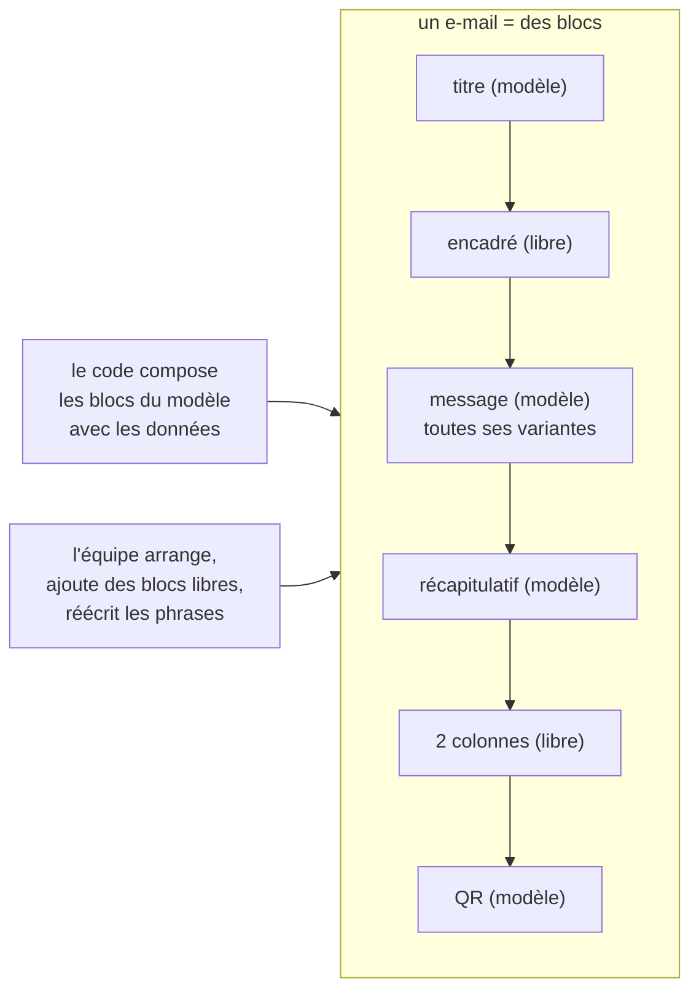

# Plan — l'éditeur d'e-mails par blocs (S4 et S5)

> 📋 **Doc-first, 2026-11-06, réécrit le même jour après deux passages de
> `vitruve`.** Suite de [`plan-service-e-mails.md`](plan-service-e-mails.md) :
> S4 (le modèle par blocs et son rendu) et S5 (l'éditeur au back-office).
> Décisions de Hugo aux § 13, 14, 14 bis et 14 ter de ce plan-là, tirées de
> deux maquettes qu'il a manipulées. Hugo s'est absenté (« tu ne t'arrêtes
> pas, tu notes tes questions ») : les choix par défaut sont marqués, les
> questions sont au § 9.
>
> 🔁 **Pourquoi cette réécriture.** La première forme faisait de chaque phrase
> d'un e-mail un bloc libre. `vitruve` a montré (§ 10) que les e-mails
> d'aujourd'hui **calculent** leurs phrases : axes croisés (l'annulation croise
> l'auteur, le jour, le régime de paiement, le remboursement et le bon
> d'achat), élisions, pluriels, prénom présent ou non, objet qui varie. Les
> refaire en blocs libres aurait réécrit cette logique en conditions, ou cassé
> les e-mails. **Forme retenue : le code compose toujours le message ; l'équipe
> arrange autour, ajoute ses propres blocs, et réécrit les phrases du code.**

## Partie 1 — Comprendre

### L'idée

Un e-mail est une suite de **blocs**, de deux sortes :

- **les blocs du modèle** — ce que le code compose à partir des données :
  le titre, le message (avec toutes ses variantes), le récapitulatif, le QR,
  l'itinéraire, le bouton de commande et son lien secondaire, le pied. L'équipe les **déplace**
  et **réécrit leurs phrases** (dans toutes leurs variantes), elle ne les
  supprime pas et n'en change pas la logique ;
- **les blocs libres** — ce que l'équipe **ajoute** : un titre, un paragraphe,
  un encadré (« Fermé le 1ᵉʳ mai »), un bouton vers une adresse fixe, un
  séparateur, une mise en page à 2 ou 3 colonnes, plus tard une image.



### Ce qui ne change pas

- **Tant qu'un e-mail n'a pas été réarrangé, il part exactement comme
  aujourd'hui**, à l'octet près. Le document de départ est l'ordre actuel des
  blocs du modèle, sans bloc libre : il se rend avec la coquille actuelle.
- **Une seule source pour les phrases** : le dictionnaire et ses réécritures
  publiées (`public.mail_copy_entries`), comme aujourd'hui. Le document ne
  stocke que **l'arrangement et les blocs libres**.
- La charte vient du modèle (la coquille d'aujourd'hui), jamais réglée à
  l'écran.

## Partie 2 — Technique

### 1. L'existant (ouvert le 2026-11-06)

- **La coquille** `renderLayout` (`packages/mailer/src/html.ts`) rend des
  sections dans un ordre réglable (`sections`) : titre, corps (un paragraphe
  `pre-line` composé par le gabarit), récapitulatif, image (`cid:`),
  itinéraire, bouton, lien secondaire, pied ; un en-tête et un recours fixes.
  Trois coquilles existent dans les faits : clients « La Folie Coffee »,
  équipe « La Folie Douce » avec son recours, et quatre e-mails internes **sans
  marque** (`ops.deploy-check`, `staff.account-alert`,
  `staff.appointment-booked`, `staff.support-requested`). Rien n'est déclaré
  pour le mode sombre.
- **Les phrases** : le dictionnaire du code (`mail/templates/copy/`), ses
  réécritures publiées (`b2b/mail-copy`, `public.mail_copy_entries`), l'ordre
  des sections publié (`public.mail_section_orders`), l'écran `textes-emails`.
  Les variantes y existent déjà (`title.paid`, S6 du plan des textes).
- **Les langues** : 14 des 32 modèles ne partent qu'en français
  (`DEFAULT_MAIL_LOCALE`, relevé par `vitruve` le 2026-11-06).
- **Deux modèles** n'ont que des données comme message :
  `customer.order-shortfall` (le message écrit à l'envoi) et
  `agency.vitrine-notice` (objet, titre et corps).
- Le QR : PNG déterministe, fond blanc opaque, zone de silence intégrée
  (`apps/lfd-api/src/mail/templates/qr-image.ts`).
- Le back-office a `@angular/cdk` (22.1.2) pour le glisser-déposer.

### 2. Le document d'un e-mail (S4)

```ts
// La forme, en esprit — le contrat exact se fixe au bâti.
type MailDocument = {
  template: MailTemplateKey; // "customer.order-placed", …
  blocks: Block[]; // l'ordre de l'e-mail
};
type Block =
  | { id; kind: "model"; section: ModelSectionId } // déclarée par le modèle
  | { id; kind: "heading" | "paragraph"; text: Localized<RichText> }
  | { id; kind: "callout"; tone: "info" | "warning"; text: Localized<RichText> }
  | { id; kind: "button"; label: Localized<string>; href: HttpsUrl }
  | { id; kind: "divider" }
  | { id; kind: "columns"; widths: Step[]; cells: FreeBlock[][] }; // 2 ou 3
```

- **Les blocs du modèle** sont les sections que chaque modèle déclare
  aujourd'hui (`mail/templates/sections/`), généralisées : titre, message,
  récapitulatif, QR, itinéraire, bouton de commande, lien secondaire, pied,
  le bouton et son lien secondaire forment **un seul bloc** (le lien n'est rendu qu'avec le bouton). Le code les compose comme aujourd'hui ; **un bloc du modèle absent d'un envoi est rendu exactement comme aujourd'hui** (`joinSections` laisse une ligne vide à la place de 7 des 8 sections absentes, rien pour l'itinéraire). **Ne sont pas des blocs** : l'en-tête, le surtitre, le logo et le recours (cadres fixes), et les pièces jointes (données de l'envoi, sans place dans l'e-mail). L'objet de l'e-mail reste
  composé par le code, ses phrases réécrites dans le dictionnaire.
- **Les blocs libres** n'ont **pas de variable ni de variante** : un texte
  fixe par langue. Ce qui dépend des données reste dans les blocs du modèle.
  (Choix par défaut : question 7.)
- **Règles tenues au serveur** : tous les blocs du modèle présents, une fois ;
  blocs libres de types admis ; pas de colonnes dans une colonne ; les blocs
  du modèle jamais dans une colonne ; en 3 colonnes, des blocs courts
  seulement (titre, bouton) ; adresses en `https://` ; largeurs sur des crans
  (25, 33, 50, 67, 75 %) qui font 100.
- **Les langues** : un modèle déclare les siennes (FR seul pour 14 d'entre
  eux) ; un bloc libre porte un texte par langue déclarée.
- **Le contrat** vit dans un **paquet dédié** importé par l'API et le
  back-office seulement (`@lfd/mail-blocks`, nom au bâti) : rien n'entre dans
  le baril de `@lfd/contracts`, que la boutique charge.

### 3. Les phrases : une seule source

- Réécrire une phrase d'un bloc du modèle (dans toutes ses variantes), c'est
  écrire dans `public.mail_copy_entries`, comme aujourd'hui — **par le bloc `mail`**, qui en devient l'écrivain en S3 (`plan-service-e-mails.md`, § 3) : brouillon,
  publication, variables gardées, trois langues. L'écran `textes-emails` est
  absorbé par l'éditeur : quand un bloc du modèle est sélectionné, le panneau
  de droite montre ses phrases et leurs variantes (la carte de section
  d'aujourd'hui, S6).
- Aucune divergence possible entre deux sources : le document ne copie
  jamais une phrase du modèle.
- L'ordre publié d'aujourd'hui (`public.mail_section_orders`) devient le
  **document de départ** d'un e-mail ; à la première publication d'un
  document, le document fait foi pour l'ordre, et la table n'est plus lue pour
  cet e-mail.

### 4. Le rendu (S4)

- `@lfd/mailer` rend un document : les blocs du modèle exactement comme la
  coquille aujourd'hui, les blocs libres avec les mêmes styles en ligne — **tirés des mêmes constantes**, exportées de `html.ts` (`BRAND` et les fragments de style, privés aujourd'hui), jamais recopiés
  (titre, paragraphe, encadré, bouton) et les colonnes en tableaux ;
  l'empilement sur téléphone par une règle `@media` — **émise seulement pour un document réarrangé** (§ 4, garantie) — (Apple Mail, Gmail web ;
  ailleurs les colonnes restent côte à côte).
- **Trois chartes**, celles qui existent : `lfc` (clients), `lfd` (équipe,
  dont l'e-mail reçoit son recours), `internal` (sans marque) ; la billetterie viendra. L'adresse de recours reste une donnée de l'envoi, pas un style. Chacune avec une variante sombre déclarée par `prefers-color-scheme`, lue par les messageries qui la respectent — **émise seulement pour un document réarrangé** : un `<style>` dans le `<head>` changerait les octets du document de départ (la coquille n'a de `<head>` qu'avec une police, `layout-header.ts`).
- **Le QR** garde son PNG sur fond blanc opaque, dans une cellule
  `bgcolor="#ffffff"`. À vérifier en vrai dans Gmail et Outlook sombres.
- **La garantie, testée pour les 32 modèles** : le document de départ rend
  **les mêmes octets** que la coquille actuelle (HTML, objet, pièces jointes),
  sur les jeux de données des empreintes existantes
  (`mail/templates/__tests__/rendering-golden/`). Un document réarrangé, lui,
  change le rendu, et c'est voulu.
- `@lfd/mailer` change : `pnpm test` à la racine.

### 5. Le stockage et la publication (S4)

- **Schéma `mail`** : une table des documents (modèle, brouillon, publié,
  révision, auteur, dates) et une table des versions publiées, en ajout seul.
- **« Revenir au modèle d'origine »** : retirer le document publié rend
  l'e-mail à son arrangement de départ ; ses phrases, elles, n'ont jamais
  quitté le dictionnaire.
- Faits de journal : document enregistré, publié, retiré.
- **Ouvrir un e-mail n'écrit rien** : le document de départ est calculé à la
  lecture, enregistré à la première modification.
- **Permission** : une ressource `mail_templates` (`StaffResource`, migration
  additive), le droit s'accorde à l'écran des rôles.
- Le bloc `mail` lit le document publié au rendu, par une mémoire versionnée.
- **Chaque envoi garde la version qui l'a composé** (Hugo, 2026-11-07, sur la
  question « comment dit-on tel e-mail, tel modèle ») : `mail_request` porte la
  clé du modèle (`template`, déjà là) et la version publiée du document,
  `null` pour le document de départ. Sans elle, on saurait qu'un client a reçu
  `customer.order-ready`, pas quel texte.

### 6. L'éditeur (S5)

**L'entrée** : le menu principal du back-office, **au-dessus de la
Médiathèque**, avec sa propre icône. La liste des e-mails, rangés par
destinataire (clients, équipe) ; l'adresse de `textes-emails` renvoie à
l'éditeur.

**Trois colonnes** :

| À gauche                                                                                                                 | Au milieu                                                                                                                                              | À droite                                                                                                                                                                                                             |
| ------------------------------------------------------------------------------------------------------------------------ | ------------------------------------------------------------------------------------------------------------------------------------------------------ | -------------------------------------------------------------------------------------------------------------------------------------------------------------------------------------------------------------------- |
| les **cas** du modèle (ses variantes : payé / à régler / au compte…) et ses variables, pour lire et réécrire les phrases | le **canevas** : les blocs en composants Angular, déplacés par glisser-déposer (`cdk/drag-drop`), les blocs libres retirés, leur texte écrit sur place | la **bibliothèque** (mises en page 2 et 3 colonnes, blocs libres) ; sous elle, les **réglages du bloc sélectionné** : pour un bloc du modèle, ses phrases et leurs variantes ; pour un bloc libre, son lien, son ton |

**Au-dessus** : la langue (celles du modèle), le cas affiché, « vue
téléphone », « clair / sombre », « aperçu fidèle » (le rendu du serveur, à la
demande, dans un cadre isolé), « M'envoyer un essai », brouillon / publier /
historique / revenir au modèle d'origine. L'aperçu fidèle n'est jamais
appelé à chaque frappe.

Clavier : chaque bloc se déplace aussi par « monter / descendre » (RGAA).
fold-ng d'abord (`apps/lfd-backoffice-frontend/CLAUDE.md`).

### 7. Les lots

| Lot     | Contenu                                                                                                                                                                                                                                                                | Ce qui change pour un client    |
| ------- | ---------------------------------------------------------------------------------------------------------------------------------------------------------------------------------------------------------------------------------------------------------------------- | ------------------------------- |
| **S4a** | Le contrat (paquet dédié), les déclarations par modèle (blocs du modèle, langues, charte), ses tests. Peut précéder S3                                                                                                                                                 | rien                            |
| **S4b** | Le rendu d'un document dans `@lfd/mailer` (constantes de style exportées de `html.ts`), les trois chartes, les colonnes ; variante sombre et `@media` émises pour un document réarrangé seulement ; le test « mêmes octets » du document de départ pour les 32 modèles | rien                            |
| **S4c** | **Après S3.** Le stockage, une seule publication (arrangement et phrases, dans le bloc `mail`), le retour au modèle d'origine, le journal, la permission ; l'envoi lit le document publié s'il existe                                                                  | rien tant que rien n'est publié |
| **S5a** | L'entrée au menu, la liste, l'aperçu fidèle en lecture seule                                                                                                                                                                                                           | rien                            |
| **S5b** | Le canevas : glisser-déposer, blocs libres, colonnes, réglages, phrases du modèle et leurs variantes (l'écran `textes-emails` absorbé), langues, cas                                                                                                                   | rien tant que rien n'est publié |
| **S5c** | Vue téléphone, clair / sombre, essai, publier, historique, revenir au modèle d'origine                                                                                                                                                                                 | l'équipe publie ses e-mails     |
| **S5d** | Le bloc image : l'écran choisit dans la médiathèque et passe l'**adresse** ; à la publication, le bloc `mail` en range sa copie (lot S3d). Aucun canal vers `media` — révisé le 2026-11-07, `plan-service-e-mails.md` § 23                                             | des images dans les e-mails     |

S3 (déménager gabarits, dictionnaire et sections dans le bloc `mail`) reste
le préalable de S4b et S4c.

### 8. Ce qui n'est pas vérifié

- le périmètre de remplacement de l'envoi (C2, `effective-copy-mailer.ts`) :
  inchangé par cette forme, puisque les phrases restent servies comme
  aujourd'hui — à confirmer en S4a ;
- que l'empilement des colonnes tienne dans Gmail application ;
- que Gmail et Outlook sombres n'inversent pas le QR.

### 9. Questions pour Hugo (notées pendant son absence)

1. ✅ **Tranché le 2026-11-07** (Hugo, « je veux le plus découplé ») : ni
   `cid:`, ni adresse de la médiathèque — une copie dans le stockage public du
   bloc `mail`, faite à la publication (`plan-service-e-mails.md` § 23, lot S3d).
   La question d'origine : la médiathèque ne sert aucune variante
   réduite. (a) jointes (`cid:`) à leur taille d'origine, (b) jointes après
   réduction par le bloc `mail`, (c) distantes depuis le domaine public de la
   médiathèque. Le bloc image attend ta réponse (S5d).
2. **Texte manquant** dans une langue d'un bloc libre : défaut, l'éditeur
   refuse de publier tant qu'il manque (les phrases du modèle, elles, ont
   toujours leur texte d'origine).
3. **Qui publie** : défaut, le même droit écrit et publie.
4. **Annuler / rétablir** : défaut, oui, sur la session d'édition.
5. **Les e-mails de l'équipe** : défaut, éditables, rangés à part, avec leur
   charte (`lfd` ou `internal`).
6. **La forme retenue** (§ « Pourquoi cette réécriture ») : l'équipe arrange
   les blocs du modèle, ajoute des blocs libres, et réécrit les phrases du
   modèle dans toutes leurs variantes. Elle ne peut pas supprimer ni
   recomposer le message calculé. Ça te convient ? L'autre voie (tout en blocs
   libres avec des conditions) demanderait de réécrire la logique de 25
   modèles.
7. **Les blocs libres** avec une variable (« Bonjour {prénom} » dans un
   encadré) : défaut, non au départ ; à ajouter si le besoin se confirme.
8. **Trois colonnes** réservées aux blocs courts (titre, bouton) : d'accord ?

## 10. Contredit par `vitruve` le 2026-11-06 (deux passages)

**Premier passage** : 3 bloquants (variantes que le code décide, « mêmes
octets » impossible en découpant le corps, médiathèque inatteignable),
7 sérieux. **Second passage** : 3 bloquants (axes croisés sur un même texte
dans au moins 7 modèles, objet de l'e-mail absent du document, quatre e-mails
sans marque), 7 sérieux (test « mêmes textes » trop faible, textes produits
par fonction, deux modèles sans texte, 14 modèles en français seul, retour
au modèle d'origine trompeur, périmètre C2, contradictions du plan).

**Réponse : la réécriture de ce plan** (§ « Pourquoi cette réécriture ») :

| Objection                                                                   | Où elle est réglée                                                                                                                          |
| --------------------------------------------------------------------------- | ------------------------------------------------------------------------------------------------------------------------------------------- |
| variantes, axes croisés, élisions, pluriels, prénom absent, objet qui varie | le code compose toujours les blocs du modèle et l'objet ; l'équipe réécrit les phrases dans le dictionnaire, variantes comprises (§ 2, § 3) |
| « mêmes octets »                                                            | tenu pour le document de départ, qui est l'arrangement d'aujourd'hui (§ 4)                                                                  |
| médiathèque                                                                 | bloc image reporté en S5d, par un canal (§ 7)                                                                                               |
| deux sources qui divergent, retour au modèle d'origine trompeur             | les phrases n'ont qu'une source, le dictionnaire ; le document ne stocke que l'arrangement (§ 3, § 5)                                       |
| quatre e-mails sans marque                                                  | trois chartes (§ 4)                                                                                                                         |
| 14 modèles en français seul                                                 | chaque modèle déclare ses langues (§ 2)                                                                                                     |
| deux modèles sans texte                                                     | leurs blocs du modèle portent les données ; il n'y a que l'arrangement et des blocs libres à éditer                                         |
| glisser-déposer dans un aperçu serveur                                      | canevas Angular au milieu, aperçu fidèle à la demande (§ 6)                                                                                 |
| contrat dans `@lfd/contracts`                                               | paquet dédié (§ 2)                                                                                                                          |
| brouillon écrit à la lecture                                                | calculé à la lecture, enregistré à la première modification (§ 5)                                                                           |

Les listes d'axes et de données par modèle relevées par `vitruve` au second
passage restent valables : ce sont les cas que le panneau de gauche montre
(S5b), et les jeux de données du test « mêmes octets » (S4b).

## 11. Troisième passage de `vitruve` (2026-11-06) — ce qui change

| Objection                                                                                          | Gravité  | Ce que le plan fait maintenant                                                                                                                                                                                                            |
| -------------------------------------------------------------------------------------------------- | -------- | ----------------------------------------------------------------------------------------------------------------------------------------------------------------------------------------------------------------------------------------- |
| variante sombre et `@media` dans `<head>` contredisent « mêmes octets »                            | BLOQUANT | émises **seulement pour un document réarrangé** ; le document de départ rend la coquille d'aujourd'hui (§ 4)                                                                                                                              |
| « un bloc absent est sauté » est faux : `joinSections` laisse une ligne vide pour 7 sections sur 8 | BLOQUANT | un bloc du modèle absent est rendu **exactement comme aujourd'hui** (§ 2)                                                                                                                                                                 |
| la pièce jointe n'est pas un bloc visuel                                                           | BLOQUANT | retirée des blocs ; en-tête, surtitre, logo, recours et pièces jointes sont fixes (§ 2)                                                                                                                                                   |
| deux publications indépendantes (phrases par `b2b/mail-copy`, arrangement par `mail`)              | SÉRIEUX  | **une seule publication**, dans le bloc `mail`, qui devient en S3 l'écrivain des phrases : S4c vient **après S3** (§ 7). Un bouton « Publier » publie l'arrangement et les phrases ensemble, dans une transaction                         |
| C2 n'est pas « inchangé » : l'envoi doit lire une troisième source                                 | SÉRIEUX  | l'envoi lit le document publié s'il existe, sinon l'ordre publié de l'ancienne table, sinon l'ordre du code ; un document publié illisible se replie sur **l'ordre du code**, comme `layoutOrCode` aujourd'hui, et l'échec est journalisé |
| propriété des tables avant S3                                                                      | SÉRIEUX  | S4a (contrat pur) ne lit aucune table ; S4c et S5b viennent après S3                                                                                                                                                                      |
| styles des blocs libres dupliqués                                                                  | SÉRIEUX  | constantes de style exportées de `html.ts`, jamais recopiées (§ 4)                                                                                                                                                                        |
| lien secondaire déplacé seul disparaît                                                             | SÉRIEUX  | bouton et lien secondaire forment un seul bloc (§ 2)                                                                                                                                                                                      |
| recours confondu avec la charte                                                                    | SÉRIEUX  | l'adresse de recours est une donnée de l'envoi (§ 4)                                                                                                                                                                                      |

**Non vérifié** (reporté de `vitruve`) : une version texte (`text`) des
e-mails, à ordonner aussi si elle existe ; le contenu exact des empreintes de
rendu.

## 12. S4a — bâti le 2026-11-07

**Ce qui existe.** Le paquet `packages/mail-blocks` (`@lfd/mail-blocks`, ESM,
sans dépendance), importé par `lfd-api` seulement à ce jour — le back-office
l'ajoutera en S5. Aucune table lue, aucun rendu changé.

- **Le contrat** (`packages/mail-blocks/src/mail-document.ts`) : `MailDocument { template, blocks }`,
  `ModelBlock`, les blocs libres `heading` / `paragraph` / `callout` /
  `button` / `divider`, `ColumnsBlock { widths, cells }`,
  `MailTemplateDeclaration { modelBlocks, locales, charter }`.
- **Les blocs du modèle** (`packages/mail-blocks/src/model-sections.ts`) : `title`, `body`, `summary`,
  `image`, `itinerary`, `cta`, `footer` — les sections de la coquille, le
  lien secondaire rangé dans `cta` (`modelSectionOfLayoutSection`).
- **Les règles du serveur**, en fonctions pures qui rendent une liste de
  refus (code, bloc, message pour l'équipe), sans rien lever :
  `validateMailDocument` (forme, à chaque enregistrement) et
  `validateMailDocumentForPublication` (plus un texte par langue du modèle
  dans chaque bloc libre — question 2, défaut).
- **Le document de départ** : `startingMailDocument(template, declaration,
publishedLayoutOrder?)` — l'ordre publié de l'ancienne table, passé par
  l'appelant, sinon l'ordre de la déclaration.
- **Les déclarations des 32 modèles**, côté API :
  `apps/lfd-api/src/mail/templates/sections/mail-block-declarations.ts`
  (`mailBlockDeclarationOf`) — blocs tirés de `MAIL_LAYOUTS` (une seule
  source), langues, charte ; le test revérifie langues
  (`mailFollowsLocale`) et charte (en rendant chaque exemple).

**Écarts au texte.**

- **21 modèles** partent en français seul, pas 14 (§ 1) : 14 est le nombre
  de ceux qui appellent `local()` dans `mail-templates.ts` ; sept autres
  (`collection-notice`, `sub-account-activity`, `sub-account-gesture`,
  `access-opened`, `production-dossier`, `customer-request`,
  `vitrine-notice`) lisent `DEFAULT_MAIL_LOCALE` dans leur propre fichier.
  Onze suivent la langue du destinataire.
- **Les crans se comptent en douzièmes** : 33 et 67 sont des tiers. En pour
  cent, `33 + 33 + 33` ferait 99, et aucune ligne de trois colonnes égales
  ne serait admise.
- **`RichText`** n'est pas fixé : les textes libres sont du texte brut
  (`Localized<string>`) jusqu'à S5b.
- **Le lien secondaire suit son bouton** : un ordre publié qui les séparait
  (possible avec `public.mail_section_orders`) ne se reproduit pas dans un
  document — le bloc prend la place du premier des deux. À éprouver par le
  test « mêmes octets » de S4b sur un ordre publié, pas seulement sur
  l'ordre par défaut.
- Les quatre e-mails sans marque sont bien `ops.deploy-check`,
  `staff.account-alert`, `staff.appointment-booked`, `staff.support-requested`.

**Ce que S5 importe** de `@lfd/mail-blocks` : les types `MailDocument`,
`MailBlock`, `ModelBlock`, `FreeBlock`, `TextBlock`, `CalloutBlock`,
`ButtonBlock`, `DividerBlock`, `ColumnsBlock`, `MailTemplateDeclaration`,
`ModelSectionId`, `MailLocale`, `Localized`, `MailCharter`, `ColumnWidthStep`,
`CalloutTone`, `MailDocumentViolation(Code)` ; les constantes
`MODEL_SECTIONS`, `MODEL_SECTION_LABELS`, `FREE_BLOCK_KINDS`,
`SHORT_BLOCK_KINDS`, `COLUMN_COUNTS`, `COLUMN_WIDTH_STEPS`, `CALLOUT_TONES`,
`MAIL_LOCALES`, `MAIL_CHARTERS` ; les fonctions `validateMailDocument`,
`validateMailDocumentForPublication`, `isHttpsUrl`, `widthsFillTheRow`,
`isColumnWidthStep`, `startingMailDocument`, `modelBlockId`. La déclaration
d'un modèle, elle, lui viendra de l'API (S5a) : elle vit côté serveur.

## 13. S5b (canevas) — bâti le 2026-11-07

**Ce qui existe.** Le back-office importe `@lfd/mail-blocks`
(`workspace:*`). Sous `apps/lfd-backoffice-frontend/src/app/mail-editor/`,
des composants **purs**, sans appel HTTP, sans route ni entrée au menu :

- **Les gestes** (`apps/lfd-backoffice-frontend/src/app/mail-editor/rules/mail-document-edits.ts`) : déplacer (rang à rang,
  ou d'un cran), ajouter un bloc de la bibliothèque au fil ou dans une
  cellule, retirer un bloc libre, écrire un texte dans une langue, régler
  une largeur. Fonctions pures : chaque geste rend un nouveau document, et
  aucune n'applique une règle du serveur — sauf qu'un bloc du modèle ne se
  retire pas (le document est rendu tel quel).
- **Le canevas** (`ui/mail-canvas/`) : entrées `document`, `declaration`,
  `template`, `locale` (et `newId`, l'identifiant d'un bloc neuf,
  `crypto.randomUUID` par défaut) ; sortie `documentChange`. Les blocs en
  `fold-card`, déplacés par glisser-déposer (`cdk/drag-drop`, poignée) et par
  « Monter / Descendre » ; ceux du modèle sous leur nom
  (`MODEL_SECTION_LABELS`), sans bouton pour les retirer. Les refus sont
  ceux de `validateMailDocument` : sur la carte du bloc en cause, ou en tête
  quand ils ne visent aucun bloc.
- **La bibliothèque** (`ui/mail-block-library/`), **le texte sur place**
  (`ui/mail-free-block-editor/`) et **les réglages** du bloc sélectionné
  (`ui/mail-block-settings/` : adresse du bouton, ton de l'encadré,
  largeurs sur les crans, ajout dans une colonne).

**Écarts au texte.**

- La **langue** est une entrée du canevas, pas un sélecteur à lui : § 6 la
  met au-dessus, avec la page.
- Le canevas prend aussi la **clé du modèle** (`template`) : sans elle, la
  règle « ce document est celui d'un autre e-mail » ne pourrait rien refuser.
- Dans une colonne, un bloc se retire et s'écrit, mais **ne se déplace
  pas** (ni entre cellules, ni dans la sienne) ; un bloc du fil n'entre pas
  dans une colonne par glisser-déposer. Seul l'ajout par les réglages y pose
  un bloc.
- Un bouton naît **sans adresse** et un bloc **sans texte** : aucune donnée
  inventée, la règle refuse l'adresse vide tant qu'elle n'est pas saisie.
- Les **phrases du modèle et leurs variantes** (colonne de gauche, écran
  `textes-emails` absorbé) et les **cas** ne sont pas dans ce passage.

**Ce qui reste.** La page qui branche le canevas (S5a) : lecture de la
déclaration et du document depuis l'API, choix de la langue, enregistrement
du brouillon ; puis les phrases du modèle dans les réglages d'un bloc du
modèle, et les cas (S5b, suite).

## 14. S4b — bâti le 2026-11-07

**Ce qui existe.** `@lfd/mailer` rend un document (`renderMailDocument`,
`packages/mailer/src/render-document.ts`) ; il dépend désormais de
`@lfd/mail-blocks` (le contrat, et `modelSectionOfLayoutSection` pour ranger
le lien secondaire sous son bouton).

- **Les styles** sortent de `html.ts` dans `packages/mailer/src/layout-styles.ts` (`BRAND`,
  `TITLE_STYLE`, `BODY_STYLE`, `BUTTON_STYLE`, `RULE_STYLE`…), réexportés par
  `html.ts` et par le paquet ; les fragments de la coquille dans
  `packages/mailer/src/layout-fragments.ts`, son entrée dans `packages/mailer/src/layout-input.ts`, son cadre dans
  `renderLayoutFrame`. La coquille et les blocs libres
  (`packages/mailer/src/document-blocks.ts`) lisent les mêmes constantes.
- **Un document sans bloc libre** est rendu PAR la coquille : l'ordre du code
  la rend sans ordre, tout autre ordre comme un ordre publié de sections.
  Aucun `<head>` neuf.
- **Un document réarrangé** (au moins un bloc libre) : blocs du modèle par
  les fragments de la coquille, blocs libres (titre `h2`, paragraphe,
  encadré `info` / `warning`, bouton, séparateur), colonnes en tableaux
  (`td.lfd-col`, largeur en %), et un `<head>` : `color-scheme`, la variante
  sombre de la charte (`MAIL_CHARTER_DARK`, `packages/mailer/src/document-theme.ts`) sous
  `prefers-color-scheme`, l'empilement sous 600 px, la police de l'enseigne.
  Les sections que le modèle ne déclare pas gardent leur ligne vide, après
  le document.
- **Côté API** : le périmètre de mise en page porte un document par e-mail
  (`MailLayoutScope.documents`, `apps/lfd-api/src/mail/templates/sections/mail-layout-scope.ts`), lu par
  `renderLayoutWithLogo` via `apps/lfd-api/src/mail/templates/sections/mail-document-rendering.ts` (charte
  et sections déclarées tirées du code). **Aucun envoi ne le pose** : seuls
  les tests.
- **La garantie** : `apps/lfd-api/src/mail/templates/__tests__/mail-document-rendering-golden.spec.ts`
  — le document de départ rend l'empreinte (objet, HTML, pièces jointes) des
  32 modèles sur tous les cas, et, sous un ordre publié renversé, les mêmes
  octets que la coquille sous cet ordre (192 tests).

**Écarts au texte.**

- **« Réarrangé » veut dire « porte un bloc libre »** : un document qui ne
  fait que déplacer des blocs du modèle dit un ordre de sections, que la
  coquille rend déjà — sans variante sombre. À confirmer.
- **Les trois chartes partagent la palette claire** `BRAND` : ce qui les
  distingue aujourd'hui (enseigne, recours) est une donnée de l'envoi. Elles
  ne diffèrent que par leur variante sombre, identique pour l'instant.
- **Deux ordres publiés ne se reproduisent pas** : un ordre qui sépare le
  bouton de son lien secondaire (§ 12), et un ordre publié **égal à l'ordre
  du code** — la coquille le rend avec les sections non déclarées à la fin,
  le document de départ, qui ne le distingue pas de « aucun ordre », les
  rend à leur place par défaut. Les deux ne touchent que l'aperçu d'un
  document de départ : sans document publié, l'envoi garde l'ordre publié.
- Un texte libre manquant dans la langue de l'envoi ne rend **rien** (pas de
  repli sur le français) ; la publication le refuse déjà.
- Le QR n'a pas gagné de cellule `bgcolor` : il est un bloc du modèle, rendu
  à l'octet ; son `` porte déjà `background:#ffffff`.

**Ce que S4c branchera.** Lire le document publié, le poser dans
`MailLayoutScope.documents` avec la langue de l'envoi (sinon l'ordre publié,
sinon l'ordre du code ; un document illisible se replie sur l'ordre du code,
journalisé), et garder sa version dans `mail_request`.

## 15. S4c — bâti le 2026-11-07

**Ce qui existe.** Le contexte `apps/lfd-api/src/mail/documents/` (style
B2B : commande et handler en fichiers séparés), sous le droit
`mail_templates`.

- **Le stockage** (migrations `20261107100000_le_droit_des_modeles_d_e_mails`
  et `20261107100100_les_documents_d_e_mails`, additives) :
  `mail.mail_document` (modèle, révision, brouillon, publié et sa version,
  dernière version posée, retrait, auteurs et dates) et
  `mail.mail_document_version` en ajout seul (un déclencheur refuse UPDATE
  et DELETE). `mail.mail_request.document_version`, nullable : la version
  publiée qui a composé l'envoi, `null` pour le document de départ.
- **L'agrégat** `MailTemplateDocument`
  (`apps/lfd-api/src/mail/documents/domain/mail-template-document.ts`) :
  enregistrer (`validateMailDocument`), publier
  (`validateMailDocumentForPublication`), revenir au modèle d'origine ;
  chaque geste sur la révision lue (409 sinon). Port `load`/`save`.
- **Une seule publication** (`PublishMailDocumentHandler`) : dans une
  transaction, le brouillon du document devient la version suivante, et les
  phrases en attente de **cet e-mail** (textes et ordre des sections) se
  publient avec lui, sous la même version des textes
  (`public.mail_copy_publication`). Sans brouillon de document, les phrases
  seules ; sans rien, 409.
- **Revenir au modèle d'origine** (`RevertMailDocumentHandler`) : retire le
  publié et le brouillon ; les phrases ne bougent pas. La version des textes
  monte quand même : c'est l'estampille du cache, sans elle les autres
  instances enverraient le document retiré.
- **Le journal** : `mail_copy.document_saved`, `mail_copy.document_published`,
  `mail_copy.document_retracted` (préfixe `mail_copy.`, déjà rangé côté
  serveur ; `mail_copy.published` accompagne une publication qui change une
  phrase).
- **L'envoi** : `CachedPublishedMailCopyReader.documents()` (même version
  que les textes) ; `EffectiveCopyMailer` pose le document dans
  `MailLayoutScope.documents`, avec la langue de l'envoi
  (`apps/lfd-api/src/mail/templates/sections/mail-document-locale.ts`) ;
  sinon l'ordre publié de l'ancienne table, sinon l'ordre du code. Un
  document qui ne tient plus contre le code, ou une lecture qui échoue :
  ordre du code, et un avertissement au journal de l'API. La version qui a
  composé l'envoi remonte par `composeMail`
  (`apps/lfd-api/src/mail/templates/effective-copy/mail-composition.ts`) jusqu'à
  `MailRequest.markSent`.
- **La permission** : `mail_templates` (`StaffResource`), graine à
  l'administrateur seul, aucune migration ne l'accorde.
- **Les contrats des routes** : `packages/mail-blocks/src/mail-editor-routes.ts`
  (types seulement : le paquet reste une feuille ; la forme est vérifiée
  par Zod dans `http/`).

**Les routes que S5a branchera** (toutes sous `mail_templates`) :

| Verbe  | Chemin                                         | Droit   | Rend                                |
| ------ | ---------------------------------------------- | ------- | ----------------------------------- |
| `GET`  | `/admin/mail-templates`                        | `read`  | `MailEditorListView`                |
| `GET`  | `/admin/mail-templates/:template`              | `read`  | `MailEditorView` (rien n'est écrit) |
| `GET`  | `/admin/mail-templates/:template/history`      | `read`  | `MailDocumentHistoryView`           |
| `POST` | `/admin/mail-templates/:template/previews`     | `read`  | `MailDocumentPreviewView` (200)     |
| `PUT`  | `/admin/mail-templates/:template/draft`        | `write` | 204 ; 400 refus, 409 révision       |
| `POST` | `/admin/mail-templates/:template/publications` | `write` | `MailDocumentPublicationView` (201) |
| `POST` | `/admin/mail-templates/:template/reverts`      | `write` | `MailDocumentPublicationView` (201) |

**Écarts au texte.**

- **« Publier » ne publie que l'e-mail ouvert.** La publication des textes
  d'aujourd'hui (`POST /admin/mail-copy/publications`) publie les brouillons
  de TOUS les e-mails ; celle de l'éditeur ne prend que ceux de l'e-mail
  qu'il montre, pour la raison même de `MailCopyRelease` : on met en service
  ce qu'on a vu. La version des textes reste une seule, commune.
- **Les phrases s'écrivent encore par `admin/mail-copy`**, sous
  `b2b_storefront` : aucune route d'écriture de phrase sous
  `mail_templates`. S5 en a besoin, ou d'un droit double. À trancher.
- **Les cas** : un seul est servi, l'exemple de l'e-mail
  (`mail/templates/specimens/`). Les autres jeux de données (payé, à
  régler…) ne vivent que dans les tests des empreintes
  (`mail/templates/__tests__/rendering-golden/`) ; les servir demande de les
  sortir des tests.
- **Une demande garde la version de l'envoi qui a réussi** : posée par
  `markSent`, pas à la demande. Une demande différée composée par un document
  publié entre-temps garde celui qui l'a vraiment rendue.
- **Un document rangé illisible** (forme d'un autre code) se refuse à
  l'ouverture (500 nommé) ; à l'envoi, l'e-mail part dans l'ordre du code.
- Le § 1 cite `b2b/mail-copy` : l'écrivain est `mail/copy` depuis S3.

## 16. S4d — les phrases sous `mail_templates`, et un exemple par cas (Hugo, 2026-11-07) — à bâtir

Deux réponses de Hugo aux questions laissées par S4c (§ 15) :

1. **« des routes propres sous `mail_templates` »** : l'éditeur écrit les
   phrases du modèle par ses propres routes, gardées par `mail_templates`.
   Personne n'a besoin de `b2b_storefront` pour éditer un e-mail. Les routes
   `admin/mail-copy` restent pour l'écran `textes-emails` tant qu'il existe ;
   elles et les nouvelles appellent **les mêmes commandes** du bloc `mail`
   (`mail/copy/`) — aucune règle dupliquée, seule la garde change.
2. **« un exemple par cas »** : chaque cas d'un modèle (payé / à régler / au
   compte…, les axes relevés par `vitruve` au second passage, § 10) a un **jeu
   de données d'exemple servi en production**, et l'éditeur peut afficher
   chaque cas, en aperçu fidèle comme dans le canevas. Aujourd'hui ces jeux
   n'existent que dans les empreintes de test
   (`apps/lfd-api/src/mail/templates/__tests__/rendering-golden/`) ; le seul
   exemple servi est le `specimen` (`apps/lfd-api/src/mail/templates/specimens/`).

### Ce que le lot fait

- **Phrases** : routes d'écriture et de lecture des phrases d'un e-mail sous
  `admin/mail-templates/…` (même préfixe que S4c), contrats ajoutés à
  `@lfd/mail-blocks` (ajout seul, rien de renommé : S5a les lit déjà), qui
  passent par les commandes existantes de `mail/copy/`. Les phrases
  enregistrées partent avec la publication unique de S4c.
- **Cas** : une table des cas par modèle, dans le code (`mail/templates/specimens/`),
  chacun avec un identifiant stable, un libellé français et ses données
  d'exemple — des données **inventées et lisibles comme telles** (« Boulangerie
  Exemple »), jamais tirées d'un client réel. Les empreintes de test les
  réutilisent au lieu d'en porter une copie, quand c'est possible sans changer
  un octet des empreintes. La lecture d'un e-mail sert la liste des cas ;
  l'aperçu fidèle prend un cas.
- **Garde** : un test vérifie que chaque modèle a au moins un cas, et que
  chaque axe déclaré a un cas qui l'exerce.

## 17. S5a — bâti le 2026-11-07

**Ce qui existe.** Sous `apps/lfd-backoffice-frontend/src/app/mail-editor/` :

- **Le transport** (`apps/lfd-backoffice-frontend/src/app/mail-editor/data/mail-editor.service.ts`) : la liste, un
  e-mail ouvert, le brouillon (`PUT …/draft`, 204) et l'aperçu fidèle
  (`POST …/previews`) — les routes et les types de S4c (§ 15,
  `packages/mail-blocks/src/mail-editor-routes.ts`), rien d'autre. La clé du
  modèle est encodée dans le chemin.
- **L'entrée au menu** : « E-mails », icône `inbox`, au rail **et** aux
  tuiles du menu mobile, juste au-dessus de la Médiathèque, sous
  `mail_templates:read` (`canSeeMailEditor`, `apps/lfd-backoffice-frontend/src/app/app.ts`).
  Routes `/emails` et `/emails/:template`, même garde.
- **La liste** (`ui/mail-templates-page/`) : rangée par destinataire puis
  par moment (`apps/lfd-backoffice-frontend/src/app/mail-editor/rules/mail-template-groups.ts`, les intitulés de l'écran
  `textes-emails`), un lien par e-mail, « Brouillon » sur ceux qui en ont un.
- **La page d'un e-mail** (`ui/mail-template-page/`) : le canevas de S5b
  monté avec le document ouvert et la déclaration du modèle ; au-dessus, la
  langue (celles du modèle seulement) et d'où vient le document (brouillon,
  version publiée, arrangement d'origine). « Enregistrer le brouillon »
  (`mail_templates:write`, actif sur un document modifié) envoie la
  révision lue puis relit ; un refus (400, 409) garde le document à l'écran.
- **L'aperçu fidèle** (`ui/mail-faithful-preview/`) : à la demande (un
  bouton), le document à l'écran dans la langue choisie, phrases en
  brouillon ; objet, pièces jointes nommées, corps dans un `iframe`
  `srcdoc` au `sandbox` **vide**. Quand le document ou la langue ont changé
  depuis, il le dit au lieu de se relancer.

**Écarts au texte.**

- **`textes-emails` ne renvoie pas encore à l'éditeur.** § 6 le demande,
  mais l'éditeur n'écrit pas encore les phrases du modèle (S4d, puis la
  suite de S5b) : rediriger aujourd'hui retirerait la seule façon de les
  réécrire et de les publier. L'écran et son entrée au menu restent tels
  quels ; la redirection se pose quand l'éditeur les a absorbées. À
  confirmer.
- **L'aperçu fidèle lit toujours les phrases en brouillon** (`source:
"draft"`), et ne choisit pas de cas : un seul est servi (§ 15), et
  `MailDocumentPreviewPayload` n'en prend pas encore (S4d).
- **Quitter la page avec un document non enregistré ne retient rien** :
  pas de garde de sortie. À poser avec « annuler / rétablir » (question 4).
- Le droit seul ne mène pas à l'éditeur depuis une page fermée : le garde
  ne propose pas `/emails` parmi ses destinations (la Médiathèque non plus).

**Ce qui reste.**

- **S5c** : publier, historique, revenir au modèle d'origine, « M'envoyer un
  essai », vue téléphone, clair / sombre.
- **S5b, suite** (après S4d) : les phrases du modèle et leurs variantes dans
  les réglages d'un bloc du modèle, les cas (colonne de gauche, et le cas de
  l'aperçu fidèle), puis la redirection de `textes-emails`.
- **Côté S4c**, vu en bâtissant : le registre des phrases du journal du
  back-office (`apps/lfd-backoffice-frontend/src/app/shared/journal/phrases/`)
  n'a pas encore les trois faits `mail_copy.document_*` que les contrats
  déclarent — le typecheck et le build du back-office échouent sur lui seul.

### Bâti le 2026-11-07 — écarts

**Ce qui existe.**

- **Les phrases** : `apps/lfd-api/src/mail/documents/http/admin-mail-template-phrases.controller.ts`,
  sous `mail_templates`, envoie `SaveMailCopyDraftCommand` et
  `ResetMailCopyDraftCommand` (`mail/copy/`), l'e-mail tiré du chemin.
  Aucune règle recopiée ; la lecture (`GetMailTemplatePhrasesQuery`) partage
  `phrasesOfTemplate` avec l'ouverture de l'éditeur.
- **Les cas** : `apps/lfd-api/src/mail/templates/specimens/cases/` — une table
  par e-mail (`MAIL_CASE_TABLES`, exhaustive par le type), le premier cas est
  l'exemple (`specimen`), les autres en dérivent par une donnée changée
  (marque `EXEMPLE`, domaine `exemple.invalid`). Chaque table déclare ses
  **axes**, dont la valeur est LUE sur les données d'un cas ; la garde
  (`apps/lfd-api/src/mail/templates/specimens/cases/__tests__/mail-specimen-cases.spec.ts`) vérifie que chaque e-mail a
  un cas, que chaque valeur d'axe en a un qui l'exerce, et qu'aucun cas ne
  porte une donnée des empreintes.
- **L'aperçu** prend un cas ; **l'essai** de l'éditeur
  (`SendMailDocumentTrialCommand`) résout le document montré (brouillon,
  sinon publié, sinon départ) et passe par `SendMailCopyTrialCommand`,
  étendue d'un choix facultatif `{ caseId, document }` : même destinataire,
  même « une fois par intention », même fait `mail_copy.trial_sent`. Le
  geste est inscrit à `intent-key-gestures`.

**Routes ajoutées** (toutes sous `mail_templates`) :

| Verbe  | Chemin                                           | Droit   | Corps / rend                                                                               |
| ------ | ------------------------------------------------ | ------- | ------------------------------------------------------------------------------------------ |
| `GET`  | `/admin/mail-templates/:template/phrases`        | `read`  | `MailEditorPhrasesView`                                                                    |
| `PUT`  | `/admin/mail-templates/:template/phrases/drafts` | `write` | `MailPhraseDraftPayload` → 204 ; 400, 409                                                  |
| `POST` | `/admin/mail-templates/:template/phrases/resets` | `write` | `MailPhraseResetPayload` → 204 ; 409                                                       |
| `POST` | `/admin/mail-templates/:template/trials`         | `write` | `MailDocumentTrialPayload` + `Idempotency-Key` → 204 ; 400 sans clé, 404 cas               |
| `POST` | `/admin/mail-templates/:template/previews`       | `read`  | accepte désormais `MailDocumentCasePreviewPayload` (`caseId` facultatif) ; 404 cas inconnu |

**Types ajoutés** à `@lfd/mail-blocks` (aucun renommé ni changé) :
`MailDocumentCasePreviewPayload` (étend `MailDocumentPreviewPayload` de
`caseId?`), `MailEditorPhrasesView`, `MailPhraseDraftPayload`,
`MailPhraseResetPayload`, `MailDocumentTrialPayload`. Les cas restent servis
par `MailEditorView.cases` (`MailEditorCaseView`, inchangé).

**Écarts au texte.**

- **Les empreintes ne réutilisent pas les cas.** Leurs données ne sont pas
  marquées (`ORD-4812`, `shop.lfc.test`, « Jeanne M. ») : les remplacer par
  des cas lisibles comme inventés changerait chaque empreinte. Elles gardent
  leur copie, et la garde refuse qu'un cas servi porte une de leurs données.
- **Les axes ne sont nulle part dans ce plan** : le § 10 renvoie aux listes
  de `vitruve` sans les recopier. Ils sont déclarés dans le code, tirés des
  branches des gabarits et des cas des empreintes (régime, mode, auteur,
  bon, prénom présent…). À relire contre la liste de `vitruve` si elle
  existe encore.
- **L'essai de l'éditeur part toujours sur les brouillons** (phrases et
  document) : l'écran des textes garde son choix `source`.
- Une phrase rétablie (`resets`) sur un chemin inconnu n'est pas refusée :
  c'est la commande de `mail/copy`, inchangée, qui ne le vérifie pas.

## 18. S5c (gestes) — bâti le 2026-11-07

**Ce qui existe.** Sur la page d'un e-mail
(`apps/lfd-backoffice-frontend/src/app/mail-editor/ui/mail-template-page/`),
avec les seules routes de S4c (§ 15) :

- **Publier** (`POST …/publications`, révision lue, `mail_templates:write`) :
  confirmation sur place (`fold-inline-confirm`) qui dit ce qui partira —
  « dès le prochain envoi, les clients (l'équipe, l'agence) recevront cet
  e-mail tel qu'il est enregistré, avec les phrases en attente de cet
  e-mail ». Le bouton attend un document **enregistré** : « Publier » met en
  service le brouillon du serveur, pas l'écran. Les refus de
  `validateMailDocumentForPublication` (texte manquant dans une langue…)
  s'affichent avant l'appel et ferment le bouton ; un refus du serveur
  (409 révision, rien à publier) s'affiche tel qu'il le dit, en encadré.
- **Revenir au modèle d'origine** (`POST …/reverts`) : offert seulement s'il
  y a un brouillon ou une version publiée ; la confirmation dit que le
  brouillon est effacé, le publié retiré, et que les phrases ne changent pas.
- **L'historique** (`ui/mail-template-history/`, `GET …/history`) : les
  versions en `fold-timeline`, la plus récente en tête, celle en service
  nommée, qui et quand ; le dernier retour au modèle d'origine ; relu après
  chaque publication ou retour.
- **L'aperçu fidèle** (`ui/mail-faithful-preview/`) : « Ordinateur /
  Téléphone » (cadre à 375 px) et « Clair / Sombre » (`color-scheme` posé sur
  l'`iframe`, que le message lit par `prefers-color-scheme`) ; l'`iframe`
  reste `sandbox=""`, et basculer ne redemande pas le rendu.
- **La garde de sortie** : la route `emails/:template` porte
  `pendingChangesGuard` ; un document modifié retient la première sortie et
  le dit (encadré), la seconde passe — la forme de la vitrine. Fermer
  l'onglet passe par `beforeunload`.

**Écarts au texte.**

- **Une version passée ne s'ouvre pas en aperçu** : le contrat n'a aucune
  route qui rende le document d'une version (`MailDocumentPreviewPayload`
  prend un document ou celui que l'éditeur ouvrirait). Liste seule.
- **L'auteur s'affiche par son identifiant de fiche staff** (`staffId`) : le
  contrat ne porte pas de nom, et l'écran n'a pas d'annuaire à lire. À
  trancher : un nom dans `MailEditorStamp`, ou une lecture de l'annuaire.
- Le sombre ne change l'aperçu que d'un document **réarrangé** : la variante
  sombre n'est émise que pour lui (S4b, § 7).

**Ce qui reste.** Le panneau des phrases, le choix du cas (et le cas de
l'aperçu fidèle) et « M'envoyer un essai » — passage suivant, sur les routes
de S4d.

## 19. S5d — le bloc image (Hugo, 2026-11-07) — à bâtir

La règle est au `plan-service-e-mails.md` § 23 (« le plus découplé ») et le
stockage au § 24 (S3d, bâti) : l'écran choisit une image dans la médiathèque
et passe son **adresse** ; à la **publication**, le bloc `mail` en range sa
copie par `MailImageCopier.copy` et la version publiée pointe vers la copie.
Le bloc `mail` n'importe rien de `media`.

### Ce que le lot fait (côté API et paquets)

- **Contrat** (`@lfd/mail-blocks`, ajout) : un bloc libre
  `{ id, kind: "image", src: string, alt: Localized<string>, href?: string }`.
  Un bloc libre, donc admis en colonne (2 colonnes ; en 3 colonnes, la règle
  des blocs courts décide — à trancher au bâti, écrit dans les écarts).
- **Règles** : `src` en `https://` (ou boucle locale en dev, la règle de S3d) ;
  `alt` obligatoire dans chaque langue **à la publication** (RGAA : une image
  sans texte de remplacement est un défaut d'accessibilité ; une image
  décorative se déclare explicitement par un `alt` vide voulu — à trancher au
  bâti, le plus simple qui reste accessible) ; `href` en `https://` s'il existe.
- **Publication** : `PublishMailDocumentHandler` copie, **avant** la
  transaction (réseau hors transaction), chaque `src` qui n'est pas déjà sur
  l'adresse publique du bloc (`mailPublicBaseUrl`), puis publie le document où
  chaque `src` est remplacé par l'adresse de sa copie. Une copie refusée
  (origine non admise, pas une image, trop lourde, stockage non configuré)
  refuse la publication en nommant le bloc et la raison. Le brouillon garde
  l'adresse d'origine.
- **Rendu** (`@lfd/mailer`, `document-blocks.ts`) : `` en tableau, largeur
  pleine de sa cellule, `alt`, `border:0`, lien s'il y a `href` — styles tirés
  des constantes, jamais recopiés. La garantie « mêmes octets » du document de
  départ est inchangée (il n'a pas de bloc libre).
- **Aperçu** : l'aperçu fidèle d'un brouillon rend l'adresse d'origine.

### Côté front (passage suivant)

Un bloc « Image » dans la bibliothèque ; ses réglages : choisir dans la
médiathèque (sélecteur existant de la médiathèque, lu par l'écran), texte de
remplacement par langue, lien.

## 19. S5b (phrases, cas) et essai — bâti le 2026-11-07

**Ce qui existe.** Sur la page d'un e-mail
(`apps/lfd-backoffice-frontend/src/app/mail-editor/ui/mail-template-page/`),
avec les seules routes de S4d (§ 16) :

- **Les phrases du modèle** (`apps/lfd-backoffice-frontend/src/app/mail-editor/state/mail-phrases-store.ts`,
  `ui/mail-phrase-editor/`) : chaque phrase dans la langue choisie, écrite en
  brouillon au fil de la frappe (`PUT …/phrases/drafts`, révision lue),
  « Rétablir » (`POST …/phrases/resets`), un `409` relit (`GET …/phrases`)
  et le dit, un `400` reste sous le champ tel que le serveur le dit ; les
  variables sont des boutons d'insertion, les obligatoires marquées. La
  mécanique est celle de `MailDraftWriter` de `textes-emails` ; ses règles
  d'état (`upcomingText`, `stateOf`, `canResetTo`) sont **partagées**, pas
  recopiées. « Publier » et l'essai envoient d'abord la frappe en attente.
- **Les cas** : « Cas affiché » (`fold-listbox`, au-dessus du canevas, dès
  qu'il y en a plus d'un), le premier par défaut ; l'aperçu fidèle rend le
  cas choisi (`caseId`) et dit quand le cas a changé depuis.
- **« M'envoyer un essai »** (`POST …/trials`, `mail_templates:write`) :
  confirmation sur place qui dit ce qui part (langue, cas, arrangement
  enregistré, phrases en brouillon) et à qui (l'auteur seul) ; clé
  d'intention `GestureIntents` par (e-mail, langue, cas), renvoyée à chaque
  clic jusqu'à l'envoi, en en-tête `Idempotency-Key`.

**Écarts au texte.**

- **Les phrases ne sont pas rangées par bloc du modèle.** § 3 et § 6 les
  veulent dans le panneau du bloc sélectionné ; `MailEditorPhraseView` ne
  dit pas à quel bloc une phrase appartient, ni le nom de sa variante (« Commande
  payée par carte »), ni l'objet et l'en-tête — l'écran des textes les lit
  dans `GET /admin/mail-copy` (sous `b2b_storefront`). Les deviner du préfixe
  du chemin serait inventer. Elles sont listées toutes, sous le canevas, en
  « Phrases du modèle ». À trancher : ajouter au contrat la section et la
  variante de chaque phrase.
- **Les cas sont au-dessus, pas dans une colonne de gauche** (§ 6 dit les
  deux) ; les variables sont sous chaque phrase.
- **`textes-emails` n'est pas redirigé** : l'éditeur n'a pas encore la
  publication globale (tous les e-mails), le rangement des phrases par
  section et leurs noms de variantes, l'objet et l'en-tête comme cadres,
  les traductions en retard, « le texte d'origine a changé », les textes
  hors carte et orphelins, la désignation d'une phrase par un clic dans
  l'aperçu, et l'essai sur les phrases publiées (`source`).
