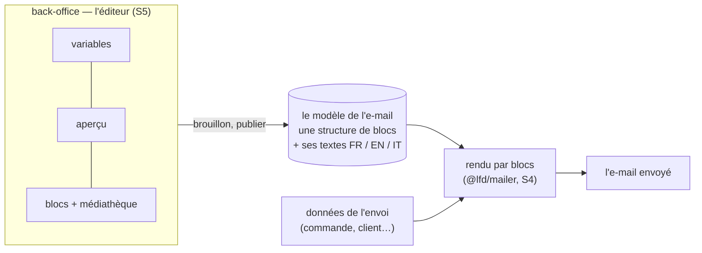

# Plan — l'éditeur d'e-mails par blocs (S4 et S5)

> 📋 **Doc-first, 2026-11-06.** Suite de
> [`plan-service-e-mails.md`](plan-service-e-mails.md) : S4 (le modèle par
> blocs et son rendu) et S5 (l'éditeur au back-office). Décisions de Hugo du
> même jour, rassemblées aux § 13, 14, 14 bis et 14 ter de ce plan-là, et
> tirées de deux maquettes qu'il a manipulées. Hugo s'est absenté en laissant
> la consigne « tu ne t'arrêtes pas, tu notes tes questions » : les choix
> faits par défaut sont marqués, les questions sont au § 9.
>
> ⚔️ **À contredire par `vitruve`** avant le bâti : le plan porte des données
> enregistrées (les modèles), une permission neuve et le rendu des e-mails
> qui partent pour de vrai.

## Partie 1 — Comprendre

### Ce qu'on construit

Un écran du back-office où l'équipe compose un e-mail **comme dans un outil
d'e-mailing professionnel** : à gauche les variables de l'e-mail, au milieu
son aperçu, à droite une bibliothèque de blocs et d'images. On glisse un
bloc, on écrit son texte, on l'ordonne, on le met en colonnes ; on regarde le
rendu en français, anglais, italien, sur téléphone, en mode sombre ; on
s'envoie un essai ; on publie.



### Ce qui ne change pas

- **Tant que rien n'est publié pour un e-mail, il part exactement comme
  aujourd'hui**, à l'octet près pour son HTML et son objet.
- Les blocs **système** (récapitulatif, QR, itinéraire) restent produits par
  les données : l'équipe les place, elle ne les écrit pas.
- La charte (couleurs, police, marges) est celle de la marque, jamais réglée
  dans un e-mail.

## Partie 2 — Technique

### 1. L'existant (ouvert le 2026-11-06)

- **La coquille** `renderLayout` (`packages/mailer/src/html.ts`) rend des
  **champs fixes** — titre, corps, bouton, lien secondaire, récapitulatif,
  image (`cid:`), itinéraire, pied — dans un ordre réglable
  (`sections`), avec un en-tête (logo) et un recours fixes. Le corps est **un
  seul texte** (`white-space:pre-line`), échappé. La charte est une constante
  `BRAND` (marine `#24448f`, ivoire, encre) écrite en dur. **Rien n'est
  déclaré pour le mode sombre** (aucun `prefers-color-scheme`).
- **Les textes** : le dictionnaire du code (`platform/mailer/copy/`), les
  réécritures publiées de l'équipe (`public.mail_copy_entries`, contexte
  `b2b/mail-copy`), l'ordre des sections publié
  (`public.mail_section_orders`), l'écran `textes-emails` du back-office
  (`apps/lfd-backoffice-frontend/src/app/textes-emails/`).
- **Le QR** : PNG déterministe, fond blanc opaque, zone de silence intégrée
  (`apps/lfd-api/src/platform/mailer/qr-image.ts`).
- **Le back-office** a `@angular/cdk` (22.1.2) : le glisser-déposer
  (`cdk/drag-drop`) est disponible sans dépendance neuve.
- La Médiathèque est la route `mediatheque` du back-office.

### 2. Le modèle d'un e-mail (S4)

**Un document par (e-mail, marque)** : une **structure** de blocs commune aux
trois langues, et les **textes** de chaque bloc en FR, EN, IT (Hugo,
2026-11-06).

```ts
// La forme, en esprit — le contrat exact se fixe au bâti.
type MailDocument = {
  template: MailTemplateKey; // "customer.order-placed", …
  brand: "lfc"; // la billetterie viendra
  blocks: Block[]; // l'ordre de l'e-mail
};
type Block =
  | { id; kind: "heading" | "paragraph" | "footer"; text: Localized<RichText> }
  | { id; kind: "button" | "secondaryLink"; label: Localized<string>; href: LinkTarget }
  | { id; kind: "callout"; tone: "info" | "warning"; text: Localized<RichText> }
  | { id; kind: "divider" }
  | { id; kind: "image"; mediaId; alt: Localized<string>; widthPct: Step }
  | { id; kind: "columns"; widths: Step[]; cells: SimpleBlock[][] } // 2 ou 3
  | { id; kind: "system"; system: "summary" | "qr" | "itinerary"; caption?: Localized<string> };
```

- **`RichText`** : du texte, du gras, de l'italique, des liens, et des
  **jetons de variable** (`{prénom}`) — jamais du HTML libre.
- **`LinkTarget`** : une variable que le modèle fournit (lien de paiement, de
  suivi…) ou une adresse fixe en `https://`.
- **Les crans** de largeur : 25, 33, 50, 67, 75 % ; une rangée fait 100.
- **Règles tenues au serveur à chaque enregistrement** (le front les montre,
  le serveur les refuse) : blocs admis par le modèle ; pas de colonnes dans
  une colonne ; pas de bloc système dans une colonne ; chaque bloc système
  obligatoire du modèle présent une fois ; variables connues du modèle ;
  variables obligatoires présentes ; adresses en `https://`.

**Le contrat** (le schéma des blocs) vit dans un paquet partagé par l'API et le
back-office — `@lfd/contracts` s'il convient, sinon un paquet dédié (choix
au bâti). Le rendu, lui, reste dans `@lfd/mailer`.

**Chaque modèle déclare** (dans le code du bloc `mail`, à partir du registre
`B2bMails`) : ses variables (le manifeste d'aujourd'hui), ses blocs système et
lesquels sont obligatoires, les blocs qu'il admet, et son **document par
défaut**.

### 3. Pas de migration de masse : le document par défaut

Les réécritures publiées d'aujourd'hui (textes et ordre des sections) **ne
sont pas converties en masse**. Choix par défaut, à contredire :

- Sans document publié, un e-mail part comme aujourd'hui (coquille actuelle +
  textes effectifs). Rien ne bouge.
- Quand l'équipe **ouvre** un e-mail dans l'éditeur pour la première fois, le
  serveur lui propose un **brouillon de départ** calculé : la conversion de
  la coquille actuelle en blocs, avec les textes **effectifs** du moment
  (dictionnaire + réécritures publiées) dans les trois langues.
- À la **première publication** d'un document, il prend la main pour cet
  e-mail ; les réécritures de l'ancien écran ne s'appliquent plus à lui.

**Garantie, prouvée par un test par modèle et par langue** : le document de
départ, rendu par le moteur par blocs, donne **les mêmes octets** (HTML et
objet) que la coquille actuelle. Sans elle, publier un e-mail sans rien
toucher changerait ce que reçoit le client.

### 4. Le rendu par blocs (S4)

- `@lfd/mailer` gagne un rendu **par liste de blocs**, avec la même coquille
  (en-tête, recours, `max-width:560px`, CSS en ligne, tableaux de
  présentation). Les colonnes sont des tableaux ; sur téléphone elles
  s'empilent par une règle `@media` dans `<head>` (lue par Apple Mail et
  Gmail web ; ignorée ailleurs, où les colonnes restent côte à côte).
- **La charte par marque** remplace la constante `BRAND` : `lfc` aujourd'hui,
  la billetterie demain. Elle porte une **variante sombre** déclarée par
  `prefers-color-scheme` pour les messageries qui la respectent.
- **Le QR** garde son PNG sur fond blanc opaque : jamais inversé.
- **Les images de la Médiathèque** : par défaut, **jointes en ligne**
  (`cid:`), comme le logo et le QR — la règle « aucune image distante » de la
  coquille tient, et les messageries qui bloquent les images distantes les
  affichent quand même. Une variante réduite (~600 px de large) est jointe,
  pas l'original. Question au § 9.
- `@lfd/mailer` change : `pnpm test` à la racine à chaque lot qui y touche.

### 5. Le stockage et la publication (S4)

- **Schéma `mail`** (le bloc l'a depuis S0) : une table des documents
  (modèle, marque, brouillon, publié, révision, auteur, dates) et une table
  **des versions publiées**, en ajout seul (le retour arrière republie une
  version passée).
- Brouillon enregistré à chaque modification (autosave), publication
  explicite, comme les textes de la boutique et des e-mails aujourd'hui.
- Faits de journal : document enregistré, publié, version rétablie.
- Le bloc `mail` lit le document **publié** au rendu, par une mémoire versionnée
  (la forme du texte publié d'aujourd'hui, `cached-published-mail-copy.reader.ts`).
- **Permission** : une ressource neuve `mail_templates` (`StaffResource`,
  migration additive) ; **le droit s'accorde à l'écran des rôles**, jamais par
  migration (`lint:no-role-grants-in-migrations`).

### 6. L'éditeur (S5)

**L'entrée** : le menu principal du back-office, **au-dessus de la
Médiathèque**, avec sa propre icône (Hugo, 2026-11-06). La liste des e-mails,
rangés par destinataire (clients, équipe) puis par produit ; l'éditeur d'un
e-mail. L'écran `textes-emails` disparaît, son adresse renvoie à l'éditeur.

**Trois colonnes** (maquette du 2026-11-06) :

| À gauche                                                           | Au milieu                                                                         | À droite                                                                                                                                                                                                           |
| ------------------------------------------------------------------ | --------------------------------------------------------------------------------- | ------------------------------------------------------------------------------------------------------------------------------------------------------------------------------------------------------------------ |
| les **variables** du modèle, glissées dans un texte, jamais tapées | l'**aperçu** : blocs déplacés par glisser-déposer, retirés, texte écrit sur place | la **bibliothèque** : mises en page (2, 3 colonnes), blocs, images de la Médiathèque ; **sous elle, les réglages du bloc sélectionné** (lien d'un bouton, ton d'un encadré, texte alternatif, largeur d'une image) |

**Au-dessus de l'aperçu** : le sélecteur de langue FR / EN / IT (un texte
manquant dans une langue se signale sur son bloc), « vue téléphone »,
« clair / sombre » (simulation), et la barre brouillon / publier / historique
/ « M'envoyer un essai ».

**L'aperçu est rendu par le serveur**, avec des données d'exemple du modèle :
c'est le même moteur que l'envoi, donc ce qu'on voit est ce qui part. Il
s'affiche dans un cadre isolé ; chaque bloc y porte un repère
(`data-mail-block`) pour la sélection et le glisser-déposer, jamais dans un
e-mail envoyé (la forme de `markSections` aujourd'hui).

Le glisser-déposer : `cdk/drag-drop`, fold-ng d'abord pour tout le reste
(`apps/lfd-backoffice-frontend/CLAUDE.md`). Clavier : chaque bloc se déplace
aussi par « monter / descendre » (RGAA).

### 7. Les lots

| Lot     | Contenu                                                                                                                                                                                                       | Ce qui change pour un client    |
| ------- | ------------------------------------------------------------------------------------------------------------------------------------------------------------------------------------------------------------- | ------------------------------- |
| **S4a** | Le contrat des blocs (schéma, règles), ses tests ; les déclarations par modèle (variables, blocs système, blocs admis)                                                                                        | rien                            |
| **S4b** | Le rendu par blocs dans `@lfd/mailer`, la charte par marque (avec sa variante sombre), les colonnes ; **le document par défaut de chaque modèle et le test « mêmes octets »** pour les 32 modèles × 3 langues | rien                            |
| **S4c** | Le stockage (tables du schéma `mail`, versions), la publication, le journal, la permission `mail_templates` ; le bloc `mail` rend un document publié s'il existe                                              | rien tant que rien n'est publié |
| **S5a** | L'entrée au menu, la liste des e-mails, l'aperçu serveur en lecture seule                                                                                                                                     | rien                            |
| **S5b** | L'éditeur : glisser-déposer des blocs et des colonnes, texte sur place, variables, réglages du bloc, langues, autosave                                                                                        | rien tant que rien n'est publié |
| **S5c** | Vue téléphone, clair / sombre, essai, publier, historique et retour arrière ; l'écran `textes-emails` retiré                                                                                                  | l'équipe publie ses e-mails     |

S3 (déménager gabarits, dictionnaire et sections dans le bloc `mail`) reste
le préalable de S4 (`plan-service-e-mails.md`, § 3).

### 8. Ce qui n'est pas vérifié

- que la coquille puisse produire les mêmes octets depuis un document par
  défaut pour les 32 modèles (des gabarits composent peut-être leur corps
  hors du dictionnaire — à relever modèle par modèle en S4b) ;
- le poids des images jointes de la Médiathèque dans un e-mail ;
- que l'empilement des colonnes par `@media` tienne dans Gmail application.

### 9. Questions pour Hugo (notées pendant son absence)

1. **Images de la Médiathèque : jointes ou distantes ?** Défaut choisi :
   jointes (`cid:`), réduites à ~600 px. Distantes alourdiraient moins l'e-mail
   mais seraient bloquées par défaut dans certaines messageries.
2. **Un texte manquant en anglais ou en italien** : défaut choisi, on publie
   quand même et l'e-mail part en français pour cette langue, avec un
   avertissement à l'écran. L'autre option : refuser de publier.
3. **Qui publie** : défaut choisi, le même droit (`mail_templates`) écrit et
   publie. L'autre option : un droit « publier » séparé.
4. **Annuler / rétablir** dans l'éditeur (Ctrl+Z) : prévu en S5b ? Défaut
   choisi : oui, sur la session d'édition.
5. **Les e-mails de l'équipe** (invitation, alerte, dossier du fournil) :
   éditables au même titre que ceux des clients ? Défaut choisi : oui, rangés
   à part dans la liste.
