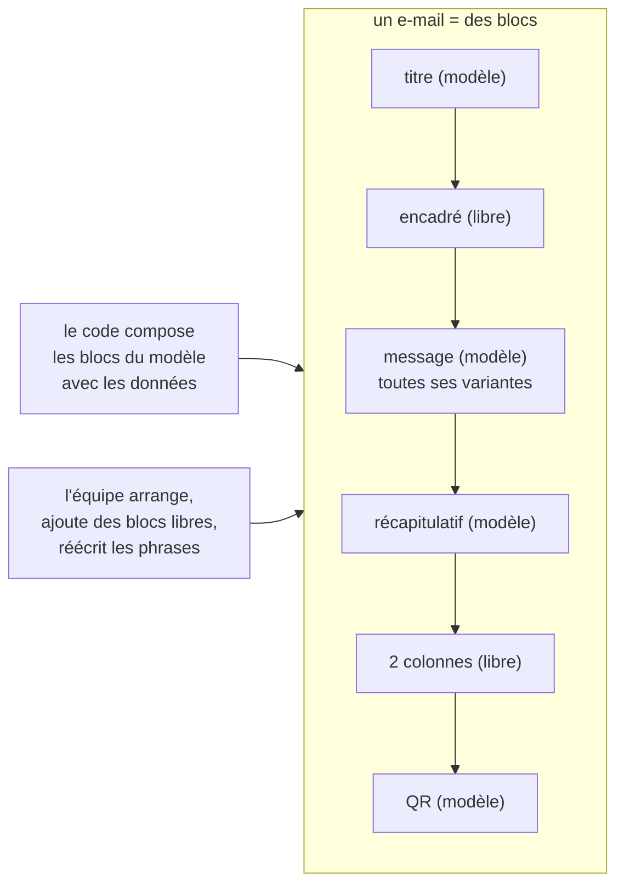
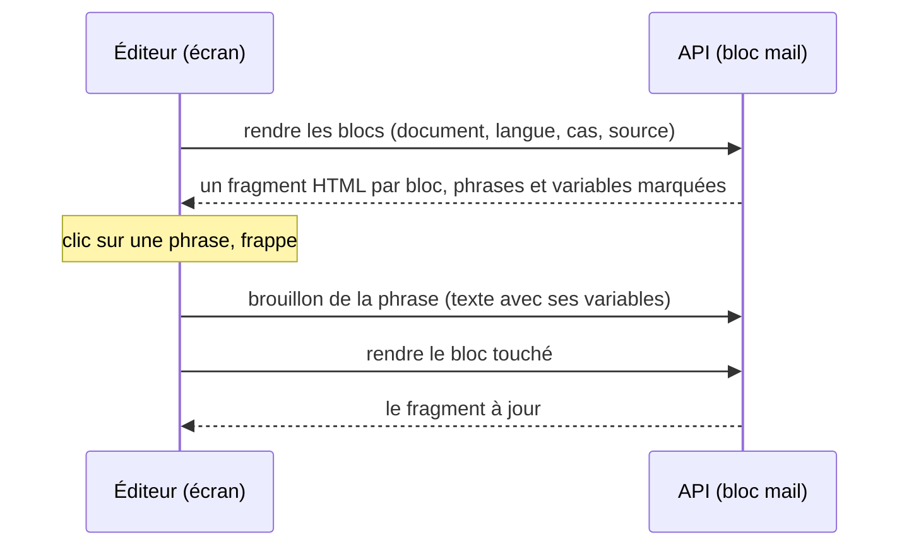
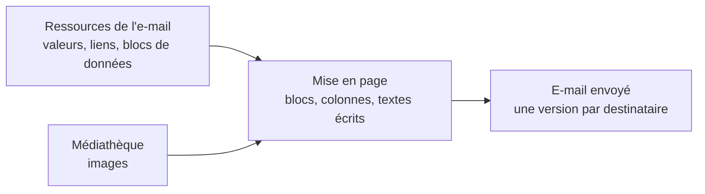
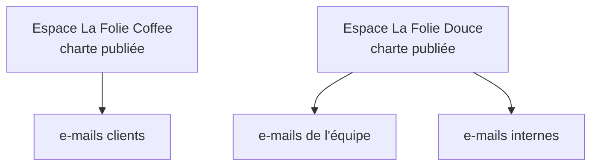

# Plan — l'éditeur d'e-mails par blocs (S4 et S5)

> 📋 **Doc-first, 2026-11-06, réécrit le même jour après deux passages de
> `vitruve`.** Suite de [`plan-service-e-mails.md`](plan-service-e-mails.md) :
> S4 (le modèle par blocs et son rendu) et S5 (l'éditeur au back-office).
> Décisions de Hugo aux § 13, 14, 14 bis et 14 ter de ce plan-là, tirées de
> deux maquettes qu'il a manipulées. Hugo s'est absenté (« tu ne t'arrêtes
> pas, tu notes tes questions ») : les choix par défaut sont marqués, les
> questions sont au § 9.
>
> 🔁 **Pourquoi cette réécriture.** La première forme faisait de chaque phrase
> d'un e-mail un bloc libre. `vitruve` a montré (§ 10) que les e-mails
> d'aujourd'hui **calculent** leurs phrases : axes croisés (l'annulation croise
> l'auteur, le jour, le régime de paiement, le remboursement et le bon
> d'achat), élisions, pluriels, prénom présent ou non, objet qui varie. Les
> refaire en blocs libres aurait réécrit cette logique en conditions, ou cassé
> les e-mails. **Forme retenue : le code compose toujours le message ; l'équipe
> arrange autour, ajoute ses propres blocs, et réécrit les phrases du code.**

## Partie 1 — Comprendre

### L'idée

Un e-mail est une suite de **blocs**, de deux sortes :

- **les blocs du modèle** — ce que le code compose à partir des données :
  le titre, le message (avec toutes ses variantes), le récapitulatif, le QR,
  l'itinéraire, le bouton de commande et son lien secondaire, le pied. L'équipe les **déplace**
  et **réécrit leurs phrases** (dans toutes leurs variantes), elle ne les
  supprime pas et n'en change pas la logique ;
- **les blocs libres** — ce que l'équipe **ajoute** : un titre, un paragraphe,
  un encadré (« Fermé le 1ᵉʳ mai »), un bouton vers une adresse fixe, un
  séparateur, une mise en page à 2 ou 3 colonnes, plus tard une image.



### Ce qui ne change pas

- **Tant qu'un e-mail n'a pas été réarrangé, il part exactement comme
  aujourd'hui**, à l'octet près. Le document de départ est l'ordre actuel des
  blocs du modèle, sans bloc libre : il se rend avec la coquille actuelle.
- **Une seule source pour les phrases** : le dictionnaire et ses réécritures
  publiées (`public.mail_copy_entries`), comme aujourd'hui. Le document ne
  stocke que **l'arrangement et les blocs libres**.
- La charte vient du modèle (la coquille d'aujourd'hui), jamais réglée à
  l'écran.

## Partie 2 — Technique

### 1. L'existant (ouvert le 2026-11-06)

- **La coquille** `renderLayout` (`packages/mailer/src/html.ts`) rend des
  sections dans un ordre réglable (`sections`) : titre, corps (un paragraphe
  `pre-line` composé par le gabarit), récapitulatif, image (`cid:`),
  itinéraire, bouton, lien secondaire, pied ; un en-tête et un recours fixes.
  Trois coquilles existent dans les faits : clients « La Folie Coffee »,
  équipe « La Folie Douce » avec son recours, et quatre e-mails internes **sans
  marque** (`ops.deploy-check`, `staff.account-alert`,
  `staff.appointment-booked`, `staff.support-requested`). Rien n'est déclaré
  pour le mode sombre.
- **Les phrases** : le dictionnaire du code (`mail/templates/copy/`), ses
  réécritures publiées (`b2b/mail-copy`, `public.mail_copy_entries`), l'ordre
  des sections publié (`public.mail_section_orders`), l'écran `textes-emails`.
  Les variantes y existent déjà (`title.paid`, S6 du plan des textes).
- **Les langues** : 14 des 32 modèles ne partent qu'en français
  (`DEFAULT_MAIL_LOCALE`, relevé par `vitruve` le 2026-11-06).
- **Deux modèles** n'ont que des données comme message :
  `customer.order-shortfall` (le message écrit à l'envoi) et
  `agency.vitrine-notice` (objet, titre et corps).
- Le QR : PNG déterministe, fond blanc opaque, zone de silence intégrée
  (`apps/lfd-api/src/mail/templates/qr-image.ts`).
- Le back-office a `@angular/cdk` (22.1.2) pour le glisser-déposer.

### 2. Le document d'un e-mail (S4)

```ts
// La forme, en esprit — le contrat exact se fixe au bâti.
type MailDocument = {
  template: MailTemplateKey; // "customer.order-placed", …
  blocks: Block[]; // l'ordre de l'e-mail
};
type Block =
  | { id; kind: "model"; section: ModelSectionId } // déclarée par le modèle
  | { id; kind: "heading" | "paragraph"; text: Localized<RichText> }
  | { id; kind: "callout"; tone: "info" | "warning"; text: Localized<RichText> }
  | { id; kind: "button"; label: Localized<string>; href: HttpsUrl }
  | { id; kind: "divider" }
  | { id; kind: "columns"; widths: Step[]; cells: FreeBlock[][] }; // 2 ou 3
```

- **Les blocs du modèle** sont les sections que chaque modèle déclare
  aujourd'hui (`mail/templates/sections/`), généralisées : titre, message,
  récapitulatif, QR, itinéraire, bouton de commande, lien secondaire, pied,
  le bouton et son lien secondaire forment **un seul bloc** (le lien n'est rendu qu'avec le bouton). Le code les compose comme aujourd'hui ; **un bloc du modèle absent d'un envoi est rendu exactement comme aujourd'hui** (`joinSections` laisse une ligne vide à la place de 7 des 8 sections absentes, rien pour l'itinéraire). **Ne sont pas des blocs** : l'en-tête, le surtitre, le logo et le recours (cadres fixes), et les pièces jointes (données de l'envoi, sans place dans l'e-mail). L'objet de l'e-mail reste
  composé par le code, ses phrases réécrites dans le dictionnaire.
- **Les blocs libres** n'ont **pas de variable ni de variante** : un texte
  fixe par langue. Ce qui dépend des données reste dans les blocs du modèle.
  (Choix par défaut : question 7.)
- **Règles tenues au serveur** : tous les blocs du modèle présents, une fois ;
  blocs libres de types admis ; pas de colonnes dans une colonne ; les blocs
  du modèle jamais dans une colonne ; en 3 colonnes, des blocs courts
  seulement (titre, bouton) ; adresses en `https://` ; largeurs sur des crans
  (25, 33, 50, 67, 75 %) qui font 100.
- **Les langues** : un modèle déclare les siennes (FR seul pour 14 d'entre
  eux) ; un bloc libre porte un texte par langue déclarée.
- **Le contrat** vit dans un **paquet dédié** importé par l'API et le
  back-office seulement (`@lfd/mail-blocks`, nom au bâti) : rien n'entre dans
  le baril de `@lfd/contracts`, que la boutique charge.

### 3. Les phrases : une seule source

- Réécrire une phrase d'un bloc du modèle (dans toutes ses variantes), c'est
  écrire dans `public.mail_copy_entries`, comme aujourd'hui — **par le bloc `mail`**, qui en devient l'écrivain en S3 (`plan-service-e-mails.md`, § 3) : brouillon,
  publication, variables gardées, trois langues. L'écran `textes-emails` est
  absorbé par l'éditeur : quand un bloc du modèle est sélectionné, le panneau
  de droite montre ses phrases et leurs variantes (la carte de section
  d'aujourd'hui, S6).
- Aucune divergence possible entre deux sources : le document ne copie
  jamais une phrase du modèle.
- L'ordre publié d'aujourd'hui (`public.mail_section_orders`) devient le
  **document de départ** d'un e-mail ; à la première publication d'un
  document, le document fait foi pour l'ordre, et la table n'est plus lue pour
  cet e-mail.

### 4. Le rendu (S4)

- `@lfd/mailer` rend un document : les blocs du modèle exactement comme la
  coquille aujourd'hui, les blocs libres avec les mêmes styles en ligne — **tirés des mêmes constantes**, exportées de `html.ts` (`BRAND` et les fragments de style, privés aujourd'hui), jamais recopiés
  (titre, paragraphe, encadré, bouton) et les colonnes en tableaux ;
  l'empilement sur téléphone par une règle `@media` — **émise seulement pour un document réarrangé** (§ 4, garantie) — (Apple Mail, Gmail web ;
  ailleurs les colonnes restent côte à côte).
- **Trois chartes**, celles qui existent : `lfc` (clients), `lfd` (équipe,
  dont l'e-mail reçoit son recours), `internal` (sans marque) ; la billetterie viendra. L'adresse de recours reste une donnée de l'envoi, pas un style. Chacune avec une variante sombre déclarée par `prefers-color-scheme`, lue par les messageries qui la respectent — **émise seulement pour un document réarrangé** : un `<style>` dans le `<head>` changerait les octets du document de départ (la coquille n'a de `<head>` qu'avec une police, `layout-header.ts`).
- **Le QR** garde son PNG sur fond blanc opaque, dans une cellule
  `bgcolor="#ffffff"`. À vérifier en vrai dans Gmail et Outlook sombres.
- **La garantie, testée pour les 32 modèles** : le document de départ rend
  **les mêmes octets** que la coquille actuelle (HTML, objet, pièces jointes),
  sur les jeux de données des empreintes existantes
  (`mail/templates/__tests__/rendering-golden/`). Un document réarrangé, lui,
  change le rendu, et c'est voulu.
- `@lfd/mailer` change : `pnpm test` à la racine.

### 5. Le stockage et la publication (S4)

- **Schéma `mail`** : une table des documents (modèle, brouillon, publié,
  révision, auteur, dates) et une table des versions publiées, en ajout seul.
- **« Revenir au modèle d'origine »** : retirer le document publié rend
  l'e-mail à son arrangement de départ ; ses phrases, elles, n'ont jamais
  quitté le dictionnaire.
- Faits de journal : document enregistré, publié, retiré.
- **Ouvrir un e-mail n'écrit rien** : le document de départ est calculé à la
  lecture, enregistré à la première modification.
- **Permission** : une ressource `mail_templates` (`StaffResource`, migration
  additive), le droit s'accorde à l'écran des rôles.
- Le bloc `mail` lit le document publié au rendu, par une mémoire versionnée.
- **Chaque envoi garde la version qui l'a composé** (Hugo, 2026-11-07, sur la
  question « comment dit-on tel e-mail, tel modèle ») : `mail_request` porte la
  clé du modèle (`template`, déjà là) et la version publiée du document,
  `null` pour le document de départ. Sans elle, on saurait qu'un client a reçu
  `customer.order-ready`, pas quel texte.

### 6. L'éditeur (S5)

**L'entrée** : le menu principal du back-office, **au-dessus de la
Médiathèque**, avec sa propre icône. La liste des e-mails, rangés par
destinataire (clients, équipe) ; l'adresse de `textes-emails` renvoie à
l'éditeur.

**Trois colonnes** :

| À gauche                                                                                                                 | Au milieu                                                                                                                                              | À droite                                                                                                                                                                                                             |
| ------------------------------------------------------------------------------------------------------------------------ | ------------------------------------------------------------------------------------------------------------------------------------------------------ | -------------------------------------------------------------------------------------------------------------------------------------------------------------------------------------------------------------------- |
| les **cas** du modèle (ses variantes : payé / à régler / au compte…) et ses variables, pour lire et réécrire les phrases | le **canevas** : les blocs en composants Angular, déplacés par glisser-déposer (`cdk/drag-drop`), les blocs libres retirés, leur texte écrit sur place | la **bibliothèque** (mises en page 2 et 3 colonnes, blocs libres) ; sous elle, les **réglages du bloc sélectionné** : pour un bloc du modèle, ses phrases et leurs variantes ; pour un bloc libre, son lien, son ton |

**Au-dessus** : la langue (celles du modèle), le cas affiché, « vue
téléphone », « clair / sombre », « aperçu fidèle » (le rendu du serveur, à la
demande, dans un cadre isolé), « M'envoyer un essai », brouillon / publier /
historique / revenir au modèle d'origine. L'aperçu fidèle n'est jamais
appelé à chaque frappe.

Clavier : chaque bloc se déplace aussi par « monter / descendre » (RGAA).
fold-ng d'abord (`apps/lfd-backoffice-frontend/CLAUDE.md`).

### 7. Les lots

| Lot     | Contenu                                                                                                                                                                                                                                                                | Ce qui change pour un client    |
| ------- | ---------------------------------------------------------------------------------------------------------------------------------------------------------------------------------------------------------------------------------------------------------------------- | ------------------------------- |
| **S4a** | Le contrat (paquet dédié), les déclarations par modèle (blocs du modèle, langues, charte), ses tests. Peut précéder S3                                                                                                                                                 | rien                            |
| **S4b** | Le rendu d'un document dans `@lfd/mailer` (constantes de style exportées de `html.ts`), les trois chartes, les colonnes ; variante sombre et `@media` émises pour un document réarrangé seulement ; le test « mêmes octets » du document de départ pour les 32 modèles | rien                            |
| **S4c** | **Après S3.** Le stockage, une seule publication (arrangement et phrases, dans le bloc `mail`), le retour au modèle d'origine, le journal, la permission ; l'envoi lit le document publié s'il existe                                                                  | rien tant que rien n'est publié |
| **S5a** | L'entrée au menu, la liste, l'aperçu fidèle en lecture seule                                                                                                                                                                                                           | rien                            |
| **S5b** | Le canevas : glisser-déposer, blocs libres, colonnes, réglages, phrases du modèle et leurs variantes (l'écran `textes-emails` absorbé), langues, cas                                                                                                                   | rien tant que rien n'est publié |
| **S5c** | Vue téléphone, clair / sombre, essai, publier, historique, revenir au modèle d'origine                                                                                                                                                                                 | l'équipe publie ses e-mails     |
| **S5d** | Le bloc image : l'écran choisit dans la médiathèque et passe l'**adresse** ; à la publication, le bloc `mail` en range sa copie (lot S3d). Aucun canal vers `media` — révisé le 2026-11-07, `plan-service-e-mails.md` § 23                                             | des images dans les e-mails     |

S3 (déménager gabarits, dictionnaire et sections dans le bloc `mail`) reste
le préalable de S4b et S4c.

### 8. Ce qui n'est pas vérifié

- le périmètre de remplacement de l'envoi (C2, `effective-copy-mailer.ts`) :
  inchangé par cette forme, puisque les phrases restent servies comme
  aujourd'hui — à confirmer en S4a ;
- que l'empilement des colonnes tienne dans Gmail application ;
- que Gmail et Outlook sombres n'inversent pas le QR.

### 9. Questions pour Hugo (notées pendant son absence)

1. ✅ **Tranché le 2026-11-07** (Hugo, « je veux le plus découplé ») : ni
   `cid:`, ni adresse de la médiathèque — une copie dans le stockage public du
   bloc `mail`, faite à la publication (`plan-service-e-mails.md` § 23, lot S3d).
   La question d'origine : la médiathèque ne sert aucune variante
   réduite. (a) jointes (`cid:`) à leur taille d'origine, (b) jointes après
   réduction par le bloc `mail`, (c) distantes depuis le domaine public de la
   médiathèque. Le bloc image attend ta réponse (S5d).
2. **Texte manquant** dans une langue d'un bloc libre : défaut, l'éditeur
   refuse de publier tant qu'il manque (les phrases du modèle, elles, ont
   toujours leur texte d'origine).
3. **Qui publie** : défaut, le même droit écrit et publie.
4. **Annuler / rétablir** : défaut, oui, sur la session d'édition.
5. **Les e-mails de l'équipe** : défaut, éditables, rangés à part, avec leur
   charte (`lfd` ou `internal`).
6. **La forme retenue** (§ « Pourquoi cette réécriture ») : l'équipe arrange
   les blocs du modèle, ajoute des blocs libres, et réécrit les phrases du
   modèle dans toutes leurs variantes. Elle ne peut pas supprimer ni
   recomposer le message calculé. Ça te convient ? L'autre voie (tout en blocs
   libres avec des conditions) demanderait de réécrire la logique de 25
   modèles.
7. **Les blocs libres** avec une variable (« Bonjour {prénom} » dans un
   encadré) : défaut, non au départ ; à ajouter si le besoin se confirme.
8. **Trois colonnes** réservées aux blocs courts (titre, bouton) : d'accord ?

## 10. Contredit par `vitruve` le 2026-11-06 (deux passages)

**Premier passage** : 3 bloquants (variantes que le code décide, « mêmes
octets » impossible en découpant le corps, médiathèque inatteignable),
7 sérieux. **Second passage** : 3 bloquants (axes croisés sur un même texte
dans au moins 7 modèles, objet de l'e-mail absent du document, quatre e-mails
sans marque), 7 sérieux (test « mêmes textes » trop faible, textes produits
par fonction, deux modèles sans texte, 14 modèles en français seul, retour
au modèle d'origine trompeur, périmètre C2, contradictions du plan).

**Réponse : la réécriture de ce plan** (§ « Pourquoi cette réécriture ») :

| Objection                                                                   | Où elle est réglée                                                                                                                          |
| --------------------------------------------------------------------------- | ------------------------------------------------------------------------------------------------------------------------------------------- |
| variantes, axes croisés, élisions, pluriels, prénom absent, objet qui varie | le code compose toujours les blocs du modèle et l'objet ; l'équipe réécrit les phrases dans le dictionnaire, variantes comprises (§ 2, § 3) |
| « mêmes octets »                                                            | tenu pour le document de départ, qui est l'arrangement d'aujourd'hui (§ 4)                                                                  |
| médiathèque                                                                 | bloc image reporté en S5d, par un canal (§ 7)                                                                                               |
| deux sources qui divergent, retour au modèle d'origine trompeur             | les phrases n'ont qu'une source, le dictionnaire ; le document ne stocke que l'arrangement (§ 3, § 5)                                       |
| quatre e-mails sans marque                                                  | trois chartes (§ 4)                                                                                                                         |
| 14 modèles en français seul                                                 | chaque modèle déclare ses langues (§ 2)                                                                                                     |
| deux modèles sans texte                                                     | leurs blocs du modèle portent les données ; il n'y a que l'arrangement et des blocs libres à éditer                                         |
| glisser-déposer dans un aperçu serveur                                      | canevas Angular au milieu, aperçu fidèle à la demande (§ 6)                                                                                 |
| contrat dans `@lfd/contracts`                                               | paquet dédié (§ 2)                                                                                                                          |
| brouillon écrit à la lecture                                                | calculé à la lecture, enregistré à la première modification (§ 5)                                                                           |

Les listes d'axes et de données par modèle relevées par `vitruve` au second
passage restent valables : ce sont les cas que le panneau de gauche montre
(S5b), et les jeux de données du test « mêmes octets » (S4b).

## 11. Troisième passage de `vitruve` (2026-11-06) — ce qui change

| Objection                                                                                          | Gravité  | Ce que le plan fait maintenant                                                                                                                                                                                                            |
| -------------------------------------------------------------------------------------------------- | -------- | ----------------------------------------------------------------------------------------------------------------------------------------------------------------------------------------------------------------------------------------- |
| variante sombre et `@media` dans `<head>` contredisent « mêmes octets »                            | BLOQUANT | émises **seulement pour un document réarrangé** ; le document de départ rend la coquille d'aujourd'hui (§ 4)                                                                                                                              |
| « un bloc absent est sauté » est faux : `joinSections` laisse une ligne vide pour 7 sections sur 8 | BLOQUANT | un bloc du modèle absent est rendu **exactement comme aujourd'hui** (§ 2)                                                                                                                                                                 |
| la pièce jointe n'est pas un bloc visuel                                                           | BLOQUANT | retirée des blocs ; en-tête, surtitre, logo, recours et pièces jointes sont fixes (§ 2)                                                                                                                                                   |
| deux publications indépendantes (phrases par `b2b/mail-copy`, arrangement par `mail`)              | SÉRIEUX  | **une seule publication**, dans le bloc `mail`, qui devient en S3 l'écrivain des phrases : S4c vient **après S3** (§ 7). Un bouton « Publier » publie l'arrangement et les phrases ensemble, dans une transaction                         |
| C2 n'est pas « inchangé » : l'envoi doit lire une troisième source                                 | SÉRIEUX  | l'envoi lit le document publié s'il existe, sinon l'ordre publié de l'ancienne table, sinon l'ordre du code ; un document publié illisible se replie sur **l'ordre du code**, comme `layoutOrCode` aujourd'hui, et l'échec est journalisé |
| propriété des tables avant S3                                                                      | SÉRIEUX  | S4a (contrat pur) ne lit aucune table ; S4c et S5b viennent après S3                                                                                                                                                                      |
| styles des blocs libres dupliqués                                                                  | SÉRIEUX  | constantes de style exportées de `html.ts`, jamais recopiées (§ 4)                                                                                                                                                                        |
| lien secondaire déplacé seul disparaît                                                             | SÉRIEUX  | bouton et lien secondaire forment un seul bloc (§ 2)                                                                                                                                                                                      |
| recours confondu avec la charte                                                                    | SÉRIEUX  | l'adresse de recours est une donnée de l'envoi (§ 4)                                                                                                                                                                                      |

**Non vérifié** (reporté de `vitruve`) : une version texte (`text`) des
e-mails, à ordonner aussi si elle existe ; le contenu exact des empreintes de
rendu.

## 12. S4a — bâti le 2026-11-07

**Ce qui existe.** Le paquet `packages/mail-blocks` (`@lfd/mail-blocks`, ESM,
sans dépendance), importé par `lfd-api` seulement à ce jour — le back-office
l'ajoutera en S5. Aucune table lue, aucun rendu changé.

- **Le contrat** (`packages/mail-blocks/src/mail-document.ts`) : `MailDocument { template, blocks }`,
  `ModelBlock`, les blocs libres `heading` / `paragraph` / `callout` /
  `button` / `divider`, `ColumnsBlock { widths, cells }`,
  `MailTemplateDeclaration { modelBlocks, locales, charter }`.
- **Les blocs du modèle** (`packages/mail-blocks/src/model-sections.ts`) : `title`, `body`, `summary`,
  `image`, `itinerary`, `cta`, `footer` — les sections de la coquille, le
  lien secondaire rangé dans `cta` (`modelSectionOfLayoutSection`).
- **Les règles du serveur**, en fonctions pures qui rendent une liste de
  refus (code, bloc, message pour l'équipe), sans rien lever :
  `validateMailDocument` (forme, à chaque enregistrement) et
  `validateMailDocumentForPublication` (plus un texte par langue du modèle
  dans chaque bloc libre — question 2, défaut).
- **Le document de départ** : `startingMailDocument(template, declaration,
publishedLayoutOrder?)` — l'ordre publié de l'ancienne table, passé par
  l'appelant, sinon l'ordre de la déclaration.
- **Les déclarations des 32 modèles**, côté API :
  `apps/lfd-api/src/mail/templates/sections/mail-block-declarations.ts`
  (`mailBlockDeclarationOf`) — blocs tirés de `MAIL_LAYOUTS` (une seule
  source), langues, charte ; le test revérifie langues
  (`mailFollowsLocale`) et charte (en rendant chaque exemple).

**Écarts au texte.**

- **21 modèles** partent en français seul, pas 14 (§ 1) : 14 est le nombre
  de ceux qui appellent `local()` dans `mail-templates.ts` ; sept autres
  (`collection-notice`, `sub-account-activity`, `sub-account-gesture`,
  `access-opened`, `production-dossier`, `customer-request`,
  `vitrine-notice`) lisent `DEFAULT_MAIL_LOCALE` dans leur propre fichier.
  Onze suivent la langue du destinataire.
- **Les crans se comptent en douzièmes** : 33 et 67 sont des tiers. En pour
  cent, `33 + 33 + 33` ferait 99, et aucune ligne de trois colonnes égales
  ne serait admise.
- **`RichText`** n'est pas fixé : les textes libres sont du texte brut
  (`Localized<string>`) jusqu'à S5b.
- **Le lien secondaire suit son bouton** : un ordre publié qui les séparait
  (possible avec `public.mail_section_orders`) ne se reproduit pas dans un
  document — le bloc prend la place du premier des deux. À éprouver par le
  test « mêmes octets » de S4b sur un ordre publié, pas seulement sur
  l'ordre par défaut.
- Les quatre e-mails sans marque sont bien `ops.deploy-check`,
  `staff.account-alert`, `staff.appointment-booked`, `staff.support-requested`.

**Ce que S5 importe** de `@lfd/mail-blocks` : les types `MailDocument`,
`MailBlock`, `ModelBlock`, `FreeBlock`, `TextBlock`, `CalloutBlock`,
`ButtonBlock`, `DividerBlock`, `ColumnsBlock`, `MailTemplateDeclaration`,
`ModelSectionId`, `MailLocale`, `Localized`, `MailCharter`, `ColumnWidthStep`,
`CalloutTone`, `MailDocumentViolation(Code)` ; les constantes
`MODEL_SECTIONS`, `MODEL_SECTION_LABELS`, `FREE_BLOCK_KINDS`,
`SHORT_BLOCK_KINDS`, `COLUMN_COUNTS`, `COLUMN_WIDTH_STEPS`, `CALLOUT_TONES`,
`MAIL_LOCALES`, `MAIL_CHARTERS` ; les fonctions `validateMailDocument`,
`validateMailDocumentForPublication`, `isHttpsUrl`, `widthsFillTheRow`,
`isColumnWidthStep`, `startingMailDocument`, `modelBlockId`. La déclaration
d'un modèle, elle, lui viendra de l'API (S5a) : elle vit côté serveur.

## 13. S5b (canevas) — bâti le 2026-11-07

**Ce qui existe.** Le back-office importe `@lfd/mail-blocks`
(`workspace:*`). Sous `apps/lfd-backoffice-frontend/src/app/mail-editor/`,
des composants **purs**, sans appel HTTP, sans route ni entrée au menu :

- **Les gestes** (`apps/lfd-backoffice-frontend/src/app/mail-editor/rules/mail-document-edits.ts`) : déplacer (rang à rang,
  ou d'un cran), ajouter un bloc de la bibliothèque au fil ou dans une
  cellule, retirer un bloc libre, écrire un texte dans une langue, régler
  une largeur. Fonctions pures : chaque geste rend un nouveau document, et
  aucune n'applique une règle du serveur — sauf qu'un bloc du modèle ne se
  retire pas (le document est rendu tel quel).
- **Le canevas** (`ui/mail-canvas/`) : entrées `document`, `declaration`,
  `template`, `locale` (et `newId`, l'identifiant d'un bloc neuf,
  `crypto.randomUUID` par défaut) ; sortie `documentChange`. Les blocs en
  `fold-card`, déplacés par glisser-déposer (`cdk/drag-drop`, poignée) et par
  « Monter / Descendre » ; ceux du modèle sous leur nom
  (`MODEL_SECTION_LABELS`), sans bouton pour les retirer. Les refus sont
  ceux de `validateMailDocument` : sur la carte du bloc en cause, ou en tête
  quand ils ne visent aucun bloc.
- **La bibliothèque** (`ui/mail-block-library/`), **le texte sur place**
  (`ui/mail-free-block-editor/`) et **les réglages** du bloc sélectionné
  (`ui/mail-block-settings/` : adresse du bouton, ton de l'encadré,
  largeurs sur les crans, ajout dans une colonne).

**Écarts au texte.**

- La **langue** est une entrée du canevas, pas un sélecteur à lui : § 6 la
  met au-dessus, avec la page.
- Le canevas prend aussi la **clé du modèle** (`template`) : sans elle, la
  règle « ce document est celui d'un autre e-mail » ne pourrait rien refuser.
- Dans une colonne, un bloc se retire et s'écrit, mais **ne se déplace
  pas** (ni entre cellules, ni dans la sienne) ; un bloc du fil n'entre pas
  dans une colonne par glisser-déposer. Seul l'ajout par les réglages y pose
  un bloc.
- Un bouton naît **sans adresse** et un bloc **sans texte** : aucune donnée
  inventée, la règle refuse l'adresse vide tant qu'elle n'est pas saisie.
- Les **phrases du modèle et leurs variantes** (colonne de gauche, écran
  `textes-emails` absorbé) et les **cas** ne sont pas dans ce passage.

**Ce qui reste.** La page qui branche le canevas (S5a) : lecture de la
déclaration et du document depuis l'API, choix de la langue, enregistrement
du brouillon ; puis les phrases du modèle dans les réglages d'un bloc du
modèle, et les cas (S5b, suite).

## 14. S4b — bâti le 2026-11-07

**Ce qui existe.** `@lfd/mailer` rend un document (`renderMailDocument`,
`packages/mailer/src/render-document.ts`) ; il dépend désormais de
`@lfd/mail-blocks` (le contrat, et `modelSectionOfLayoutSection` pour ranger
le lien secondaire sous son bouton).

- **Les styles** sortent de `html.ts` dans `packages/mailer/src/layout-styles.ts` (`BRAND`,
  `TITLE_STYLE`, `BODY_STYLE`, `BUTTON_STYLE`, `RULE_STYLE`…), réexportés par
  `html.ts` et par le paquet ; les fragments de la coquille dans
  `packages/mailer/src/layout-fragments.ts`, son entrée dans `packages/mailer/src/layout-input.ts`, son cadre dans
  `renderLayoutFrame`. La coquille et les blocs libres
  (`packages/mailer/src/document-blocks.ts`) lisent les mêmes constantes.
- **Un document sans bloc libre** est rendu PAR la coquille : l'ordre du code
  la rend sans ordre, tout autre ordre comme un ordre publié de sections.
  Aucun `<head>` neuf.
- **Un document réarrangé** (au moins un bloc libre) : blocs du modèle par
  les fragments de la coquille, blocs libres (titre `h2`, paragraphe,
  encadré `info` / `warning`, bouton, séparateur), colonnes en tableaux
  (`td.lfd-col`, largeur en %), et un `<head>` : `color-scheme`, la variante
  sombre de la charte (`MAIL_CHARTER_DARK`, `packages/mailer/src/document-theme.ts`) sous
  `prefers-color-scheme`, l'empilement sous 600 px, la police de l'enseigne.
  Les sections que le modèle ne déclare pas gardent leur ligne vide, après
  le document.
- **Côté API** : le périmètre de mise en page porte un document par e-mail
  (`MailLayoutScope.documents`, `apps/lfd-api/src/mail/templates/sections/mail-layout-scope.ts`), lu par
  `renderLayoutWithLogo` via `apps/lfd-api/src/mail/templates/sections/mail-document-rendering.ts` (charte
  et sections déclarées tirées du code). **Aucun envoi ne le pose** : seuls
  les tests.
- **La garantie** : `apps/lfd-api/src/mail/templates/__tests__/mail-document-rendering-golden.spec.ts`
  — le document de départ rend l'empreinte (objet, HTML, pièces jointes) des
  32 modèles sur tous les cas, et, sous un ordre publié renversé, les mêmes
  octets que la coquille sous cet ordre (192 tests).

**Écarts au texte.**

- **« Réarrangé » veut dire « porte un bloc libre »** : un document qui ne
  fait que déplacer des blocs du modèle dit un ordre de sections, que la
  coquille rend déjà — sans variante sombre. À confirmer.
- **Les trois chartes partagent la palette claire** `BRAND` : ce qui les
  distingue aujourd'hui (enseigne, recours) est une donnée de l'envoi. Elles
  ne diffèrent que par leur variante sombre, identique pour l'instant.
- **Deux ordres publiés ne se reproduisent pas** : un ordre qui sépare le
  bouton de son lien secondaire (§ 12), et un ordre publié **égal à l'ordre
  du code** — la coquille le rend avec les sections non déclarées à la fin,
  le document de départ, qui ne le distingue pas de « aucun ordre », les
  rend à leur place par défaut. Les deux ne touchent que l'aperçu d'un
  document de départ : sans document publié, l'envoi garde l'ordre publié.
- Un texte libre manquant dans la langue de l'envoi ne rend **rien** (pas de
  repli sur le français) ; la publication le refuse déjà.
- Le QR n'a pas gagné de cellule `bgcolor` : il est un bloc du modèle, rendu
  à l'octet ; son `` porte déjà `background:#ffffff`.

**Ce que S4c branchera.** Lire le document publié, le poser dans
`MailLayoutScope.documents` avec la langue de l'envoi (sinon l'ordre publié,
sinon l'ordre du code ; un document illisible se replie sur l'ordre du code,
journalisé), et garder sa version dans `mail_request`.

## 15. S4c — bâti le 2026-11-07

**Ce qui existe.** Le contexte `apps/lfd-api/src/mail/documents/` (style
B2B : commande et handler en fichiers séparés), sous le droit
`mail_templates`.

- **Le stockage** (migrations `20261107100000_le_droit_des_modeles_d_e_mails`
  et `20261107100100_les_documents_d_e_mails`, additives) :
  `mail.mail_document` (modèle, révision, brouillon, publié et sa version,
  dernière version posée, retrait, auteurs et dates) et
  `mail.mail_document_version` en ajout seul (un déclencheur refuse UPDATE
  et DELETE). `mail.mail_request.document_version`, nullable : la version
  publiée qui a composé l'envoi, `null` pour le document de départ.
- **L'agrégat** `MailTemplateDocument`
  (`apps/lfd-api/src/mail/documents/domain/mail-template-document.ts`) :
  enregistrer (`validateMailDocument`), publier
  (`validateMailDocumentForPublication`), revenir au modèle d'origine ;
  chaque geste sur la révision lue (409 sinon). Port `load`/`save`.
- **Une seule publication** (`PublishMailDocumentHandler`) : dans une
  transaction, le brouillon du document devient la version suivante, et les
  phrases en attente de **cet e-mail** (textes et ordre des sections) se
  publient avec lui, sous la même version des textes
  (`public.mail_copy_publication`). Sans brouillon de document, les phrases
  seules ; sans rien, 409.
- **Revenir au modèle d'origine** (`RevertMailDocumentHandler`) : retire le
  publié et le brouillon ; les phrases ne bougent pas. La version des textes
  monte quand même : c'est l'estampille du cache, sans elle les autres
  instances enverraient le document retiré.
- **Le journal** : `mail_copy.document_saved`, `mail_copy.document_published`,
  `mail_copy.document_retracted` (préfixe `mail_copy.`, déjà rangé côté
  serveur ; `mail_copy.published` accompagne une publication qui change une
  phrase).
- **L'envoi** : `CachedPublishedMailCopyReader.documents()` (même version
  que les textes) ; `EffectiveCopyMailer` pose le document dans
  `MailLayoutScope.documents`, avec la langue de l'envoi
  (`apps/lfd-api/src/mail/templates/sections/mail-document-locale.ts`) ;
  sinon l'ordre publié de l'ancienne table, sinon l'ordre du code. Un
  document qui ne tient plus contre le code, ou une lecture qui échoue :
  ordre du code, et un avertissement au journal de l'API. La version qui a
  composé l'envoi remonte par `composeMail`
  (`apps/lfd-api/src/mail/templates/effective-copy/mail-composition.ts`) jusqu'à
  `MailRequest.markSent`.
- **La permission** : `mail_templates` (`StaffResource`), graine à
  l'administrateur seul, aucune migration ne l'accorde.
- **Les contrats des routes** : `packages/mail-blocks/src/mail-editor-routes.ts`
  (types seulement : le paquet reste une feuille ; la forme est vérifiée
  par Zod dans `http/`).

**Les routes que S5a branchera** (toutes sous `mail_templates`) :

| Verbe  | Chemin                                         | Droit   | Rend                                |
| ------ | ---------------------------------------------- | ------- | ----------------------------------- |
| `GET`  | `/admin/mail-templates`                        | `read`  | `MailEditorListView`                |
| `GET`  | `/admin/mail-templates/:template`              | `read`  | `MailEditorView` (rien n'est écrit) |
| `GET`  | `/admin/mail-templates/:template/history`      | `read`  | `MailDocumentHistoryView`           |
| `POST` | `/admin/mail-templates/:template/previews`     | `read`  | `MailDocumentPreviewView` (200)     |
| `PUT`  | `/admin/mail-templates/:template/draft`        | `write` | 204 ; 400 refus, 409 révision       |
| `POST` | `/admin/mail-templates/:template/publications` | `write` | `MailDocumentPublicationView` (201) |
| `POST` | `/admin/mail-templates/:template/reverts`      | `write` | `MailDocumentPublicationView` (201) |

**Écarts au texte.**

- **« Publier » ne publie que l'e-mail ouvert.** La publication des textes
  d'aujourd'hui (`POST /admin/mail-copy/publications`) publie les brouillons
  de TOUS les e-mails ; celle de l'éditeur ne prend que ceux de l'e-mail
  qu'il montre, pour la raison même de `MailCopyRelease` : on met en service
  ce qu'on a vu. La version des textes reste une seule, commune.
- **Les phrases s'écrivent encore par `admin/mail-copy`**, sous
  `b2b_storefront` : aucune route d'écriture de phrase sous
  `mail_templates`. S5 en a besoin, ou d'un droit double. À trancher.
- **Les cas** : un seul est servi, l'exemple de l'e-mail
  (`mail/templates/specimens/`). Les autres jeux de données (payé, à
  régler…) ne vivent que dans les tests des empreintes
  (`mail/templates/__tests__/rendering-golden/`) ; les servir demande de les
  sortir des tests.
- **Une demande garde la version de l'envoi qui a réussi** : posée par
  `markSent`, pas à la demande. Une demande différée composée par un document
  publié entre-temps garde celui qui l'a vraiment rendue.
- **Un document rangé illisible** (forme d'un autre code) se refuse à
  l'ouverture (500 nommé) ; à l'envoi, l'e-mail part dans l'ordre du code.
- Le § 1 cite `b2b/mail-copy` : l'écrivain est `mail/copy` depuis S3.

## 16. S4d — les phrases sous `mail_templates`, et un exemple par cas (Hugo, 2026-11-07) — bâti le 2026-11-07

Deux réponses de Hugo aux questions laissées par S4c (§ 15) :

1. **« des routes propres sous `mail_templates` »** : l'éditeur écrit les
   phrases du modèle par ses propres routes, gardées par `mail_templates`.
   Personne n'a besoin de `b2b_storefront` pour éditer un e-mail. Les routes
   `admin/mail-copy` restent pour l'écran `textes-emails` tant qu'il existe ;
   elles et les nouvelles appellent **les mêmes commandes** du bloc `mail`
   (`mail/copy/`) — aucune règle dupliquée, seule la garde change.
2. **« un exemple par cas »** : chaque cas d'un modèle (payé / à régler / au
   compte…, les axes relevés par `vitruve` au second passage, § 10) a un **jeu
   de données d'exemple servi en production**, et l'éditeur peut afficher
   chaque cas, en aperçu fidèle comme dans le canevas. Aujourd'hui ces jeux
   n'existent que dans les empreintes de test
   (`apps/lfd-api/src/mail/templates/__tests__/rendering-golden/`) ; le seul
   exemple servi est le `specimen` (`apps/lfd-api/src/mail/templates/specimens/`).

### Ce que le lot fait

- **Phrases** : routes d'écriture et de lecture des phrases d'un e-mail sous
  `admin/mail-templates/…` (même préfixe que S4c), contrats ajoutés à
  `@lfd/mail-blocks` (ajout seul, rien de renommé : S5a les lit déjà), qui
  passent par les commandes existantes de `mail/copy/`. Les phrases
  enregistrées partent avec la publication unique de S4c.
- **Cas** : une table des cas par modèle, dans le code (`mail/templates/specimens/`),
  chacun avec un identifiant stable, un libellé français et ses données
  d'exemple — des données **inventées et lisibles comme telles** (« Boulangerie
  Exemple »), jamais tirées d'un client réel. Les empreintes de test les
  réutilisent au lieu d'en porter une copie, quand c'est possible sans changer
  un octet des empreintes. La lecture d'un e-mail sert la liste des cas ;
  l'aperçu fidèle prend un cas.
- **Garde** : un test vérifie que chaque modèle a au moins un cas, et que
  chaque axe déclaré a un cas qui l'exerce.

## 17. S5a — bâti le 2026-11-07

**Ce qui existe.** Sous `apps/lfd-backoffice-frontend/src/app/mail-editor/` :

- **Le transport** (`apps/lfd-backoffice-frontend/src/app/mail-editor/data/mail-editor.service.ts`) : la liste, un
  e-mail ouvert, le brouillon (`PUT …/draft`, 204) et l'aperçu fidèle
  (`POST …/previews`) — les routes et les types de S4c (§ 15,
  `packages/mail-blocks/src/mail-editor-routes.ts`), rien d'autre. La clé du
  modèle est encodée dans le chemin.
- **L'entrée au menu** : « E-mails », icône `inbox`, au rail **et** aux
  tuiles du menu mobile, juste au-dessus de la Médiathèque, sous
  `mail_templates:read` (`canSeeMailEditor`, `apps/lfd-backoffice-frontend/src/app/app.ts`).
  Routes `/emails` et `/emails/:template`, même garde.
- **La liste** (`ui/mail-templates-page/`) : rangée par destinataire puis
  par moment (`apps/lfd-backoffice-frontend/src/app/mail-editor/rules/mail-template-groups.ts`, les intitulés de l'écran
  `textes-emails`), un lien par e-mail, « Brouillon » sur ceux qui en ont un.
- **La page d'un e-mail** (`ui/mail-template-page/`) : le canevas de S5b
  monté avec le document ouvert et la déclaration du modèle ; au-dessus, la
  langue (celles du modèle seulement) et d'où vient le document (brouillon,
  version publiée, arrangement d'origine). « Enregistrer le brouillon »
  (`mail_templates:write`, actif sur un document modifié) envoie la
  révision lue puis relit ; un refus (400, 409) garde le document à l'écran.
- **L'aperçu fidèle** (`ui/mail-faithful-preview/`) : à la demande (un
  bouton), le document à l'écran dans la langue choisie, phrases en
  brouillon ; objet, pièces jointes nommées, corps dans un `iframe`
  `srcdoc` au `sandbox` **vide**. Quand le document ou la langue ont changé
  depuis, il le dit au lieu de se relancer.

**Écarts au texte.**

- **`textes-emails` ne renvoie pas encore à l'éditeur.** § 6 le demande,
  mais l'éditeur n'écrit pas encore les phrases du modèle (S4d, puis la
  suite de S5b) : rediriger aujourd'hui retirerait la seule façon de les
  réécrire et de les publier. L'écran et son entrée au menu restent tels
  quels ; la redirection se pose quand l'éditeur les a absorbées. À
  confirmer.
- **L'aperçu fidèle lit toujours les phrases en brouillon** (`source:
"draft"`), et ne choisit pas de cas : un seul est servi (§ 15), et
  `MailDocumentPreviewPayload` n'en prend pas encore (S4d).
- **Quitter la page avec un document non enregistré ne retient rien** :
  pas de garde de sortie. À poser avec « annuler / rétablir » (question 4).
- Le droit seul ne mène pas à l'éditeur depuis une page fermée : le garde
  ne propose pas `/emails` parmi ses destinations (la Médiathèque non plus).

**Ce qui reste.**

- **S5c** : publier, historique, revenir au modèle d'origine, « M'envoyer un
  essai », vue téléphone, clair / sombre.
- **S5b, suite** (après S4d) : les phrases du modèle et leurs variantes dans
  les réglages d'un bloc du modèle, les cas (colonne de gauche, et le cas de
  l'aperçu fidèle), puis la redirection de `textes-emails`.
- **Côté S4c**, vu en bâtissant : le registre des phrases du journal du
  back-office (`apps/lfd-backoffice-frontend/src/app/shared/journal/phrases/`)
  n'a pas encore les trois faits `mail_copy.document_*` que les contrats
  déclarent — le typecheck et le build du back-office échouent sur lui seul.

### Bâti le 2026-11-07 — écarts

**Ce qui existe.**

- **Les phrases** : `apps/lfd-api/src/mail/documents/http/admin-mail-template-phrases.controller.ts`,
  sous `mail_templates`, envoie `SaveMailCopyDraftCommand` et
  `ResetMailCopyDraftCommand` (`mail/copy/`), l'e-mail tiré du chemin.
  Aucune règle recopiée ; la lecture (`GetMailTemplatePhrasesQuery`) partage
  `phrasesOfTemplate` avec l'ouverture de l'éditeur.
- **Les cas** : `apps/lfd-api/src/mail/templates/specimens/cases/` — une table
  par e-mail (`MAIL_CASE_TABLES`, exhaustive par le type), le premier cas est
  l'exemple (`specimen`), les autres en dérivent par une donnée changée
  (marque `EXEMPLE`, domaine `exemple.invalid`). Chaque table déclare ses
  **axes**, dont la valeur est LUE sur les données d'un cas ; la garde
  (`apps/lfd-api/src/mail/templates/specimens/cases/__tests__/mail-specimen-cases.spec.ts`) vérifie que chaque e-mail a
  un cas, que chaque valeur d'axe en a un qui l'exerce, et qu'aucun cas ne
  porte une donnée des empreintes.
- **L'aperçu** prend un cas ; **l'essai** de l'éditeur
  (`SendMailDocumentTrialCommand`) résout le document montré (brouillon,
  sinon publié, sinon départ) et passe par `SendMailCopyTrialCommand`,
  étendue d'un choix facultatif `{ caseId, document }` : même destinataire,
  même « une fois par intention », même fait `mail_copy.trial_sent`. Le
  geste est inscrit à `intent-key-gestures`.

**Routes ajoutées** (toutes sous `mail_templates`) :

| Verbe  | Chemin                                           | Droit   | Corps / rend                                                                               |
| ------ | ------------------------------------------------ | ------- | ------------------------------------------------------------------------------------------ |
| `GET`  | `/admin/mail-templates/:template/phrases`        | `read`  | `MailEditorPhrasesView`                                                                    |
| `PUT`  | `/admin/mail-templates/:template/phrases/drafts` | `write` | `MailPhraseDraftPayload` → 204 ; 400, 409                                                  |
| `POST` | `/admin/mail-templates/:template/phrases/resets` | `write` | `MailPhraseResetPayload` → 204 ; 409                                                       |
| `POST` | `/admin/mail-templates/:template/trials`         | `write` | `MailDocumentTrialPayload` + `Idempotency-Key` → 204 ; 400 sans clé, 404 cas               |
| `POST` | `/admin/mail-templates/:template/previews`       | `read`  | accepte désormais `MailDocumentCasePreviewPayload` (`caseId` facultatif) ; 404 cas inconnu |

**Types ajoutés** à `@lfd/mail-blocks` (aucun renommé ni changé) :
`MailDocumentCasePreviewPayload` (étend `MailDocumentPreviewPayload` de
`caseId?`), `MailEditorPhrasesView`, `MailPhraseDraftPayload`,
`MailPhraseResetPayload`, `MailDocumentTrialPayload`. Les cas restent servis
par `MailEditorView.cases` (`MailEditorCaseView`, inchangé).

**Écarts au texte.**

- **Les empreintes ne réutilisent pas les cas.** Leurs données ne sont pas
  marquées (`ORD-4812`, `shop.lfc.test`, « Jeanne M. ») : les remplacer par
  des cas lisibles comme inventés changerait chaque empreinte. Elles gardent
  leur copie, et la garde refuse qu'un cas servi porte une de leurs données.
- **Les axes ne sont nulle part dans ce plan** : le § 10 renvoie aux listes
  de `vitruve` sans les recopier. Ils sont déclarés dans le code, tirés des
  branches des gabarits et des cas des empreintes (régime, mode, auteur,
  bon, prénom présent…). À relire contre la liste de `vitruve` si elle
  existe encore.
- **L'essai de l'éditeur part toujours sur les brouillons** (phrases et
  document) : l'écran des textes garde son choix `source`.
- Une phrase rétablie (`resets`) sur un chemin inconnu n'est pas refusée :
  c'est la commande de `mail/copy`, inchangée, qui ne le vérifie pas.

## 18. S5c (gestes) — bâti le 2026-11-07

**Ce qui existe.** Sur la page d'un e-mail
(`apps/lfd-backoffice-frontend/src/app/mail-editor/ui/mail-template-page/`),
avec les seules routes de S4c (§ 15) :

- **Publier** (`POST …/publications`, révision lue, `mail_templates:write`) :
  confirmation sur place (`fold-inline-confirm`) qui dit ce qui partira —
  « dès le prochain envoi, les clients (l'équipe, l'agence) recevront cet
  e-mail tel qu'il est enregistré, avec les phrases en attente de cet
  e-mail ». Le bouton attend un document **enregistré** : « Publier » met en
  service le brouillon du serveur, pas l'écran. Les refus de
  `validateMailDocumentForPublication` (texte manquant dans une langue…)
  s'affichent avant l'appel et ferment le bouton ; un refus du serveur
  (409 révision, rien à publier) s'affiche tel qu'il le dit, en encadré.
- **Revenir au modèle d'origine** (`POST …/reverts`) : offert seulement s'il
  y a un brouillon ou une version publiée ; la confirmation dit que le
  brouillon est effacé, le publié retiré, et que les phrases ne changent pas.
- **L'historique** (`ui/mail-template-history/`, `GET …/history`) : les
  versions en `fold-timeline`, la plus récente en tête, celle en service
  nommée, qui et quand ; le dernier retour au modèle d'origine ; relu après
  chaque publication ou retour.
- **L'aperçu fidèle** (`ui/mail-faithful-preview/`) : « Ordinateur /
  Téléphone » (cadre à 375 px) et « Clair / Sombre » (`color-scheme` posé sur
  l'`iframe`, que le message lit par `prefers-color-scheme`) ; l'`iframe`
  reste `sandbox=""`, et basculer ne redemande pas le rendu.
- **La garde de sortie** : la route `emails/:template` porte
  `pendingChangesGuard` ; un document modifié retient la première sortie et
  le dit (encadré), la seconde passe — la forme de la vitrine. Fermer
  l'onglet passe par `beforeunload`.

**Écarts au texte.**

- **Une version passée ne s'ouvre pas en aperçu** : le contrat n'a aucune
  route qui rende le document d'une version (`MailDocumentPreviewPayload`
  prend un document ou celui que l'éditeur ouvrirait). Liste seule.
- **L'auteur s'affiche par son identifiant de fiche staff** (`staffId`) : le
  contrat ne porte pas de nom, et l'écran n'a pas d'annuaire à lire. À
  trancher : un nom dans `MailEditorStamp`, ou une lecture de l'annuaire.
- Le sombre ne change l'aperçu que d'un document **réarrangé** : la variante
  sombre n'est émise que pour lui (S4b, § 7).

**Ce qui reste.** Le panneau des phrases, le choix du cas (et le cas de
l'aperçu fidèle) et « M'envoyer un essai » — passage suivant, sur les routes
de S4d.

## 19. S5d — le bloc image (Hugo, 2026-11-07) — à bâtir

La règle est au `plan-service-e-mails.md` § 23 (« le plus découplé ») et le
stockage au § 24 (S3d, bâti) : l'écran choisit une image dans la médiathèque
et passe son **adresse** ; à la **publication**, le bloc `mail` en range sa
copie par `MailImageCopier.copy` et la version publiée pointe vers la copie.
Le bloc `mail` n'importe rien de `media`.

### Ce que le lot fait (côté API et paquets)

- **Contrat** (`@lfd/mail-blocks`, ajout) : un bloc libre
  `{ id, kind: "image", src: string, alt: Localized<string>, href?: string }`.
  Un bloc libre, donc admis en colonne (2 colonnes ; en 3 colonnes, la règle
  des blocs courts décide — à trancher au bâti, écrit dans les écarts).
- **Règles** : `src` en `https://` (ou boucle locale en dev, la règle de S3d) ;
  `alt` obligatoire dans chaque langue **à la publication** (RGAA : une image
  sans texte de remplacement est un défaut d'accessibilité ; une image
  décorative se déclare explicitement par un `alt` vide voulu — à trancher au
  bâti, le plus simple qui reste accessible) ; `href` en `https://` s'il existe.
- **Publication** : `PublishMailDocumentHandler` copie, **avant** la
  transaction (réseau hors transaction), chaque `src` qui n'est pas déjà sur
  l'adresse publique du bloc (`mailPublicBaseUrl`), puis publie le document où
  chaque `src` est remplacé par l'adresse de sa copie. Une copie refusée
  (origine non admise, pas une image, trop lourde, stockage non configuré)
  refuse la publication en nommant le bloc et la raison. Le brouillon garde
  l'adresse d'origine.
- **Rendu** (`@lfd/mailer`, `document-blocks.ts`) : `` en tableau, largeur
  pleine de sa cellule, `alt`, `border:0`, lien s'il y a `href` — styles tirés
  des constantes, jamais recopiés. La garantie « mêmes octets » du document de
  départ est inchangée (il n'a pas de bloc libre).
- **Aperçu** : l'aperçu fidèle d'un brouillon rend l'adresse d'origine.

### Côté front (passage suivant)

Un bloc « Image » dans la bibliothèque ; ses réglages : choisir dans la
médiathèque (sélecteur existant de la médiathèque, lu par l'écran), texte de
remplacement par langue, lien.

### Bâti le 2026-11-07 — écarts (côté API et paquets)

**Ce qui existe.** `ImageBlock` dans `@lfd/mail-blocks`
(`packages/mail-blocks/src/mail-document.ts`), ses règles
(`packages/mail-blocks/src/validate-image.ts`, `packages/mail-blocks/src/urls.ts`) et
`imageBlocksOf` / `withImageSources` (`packages/mail-blocks/src/image-sources.ts`) ;
son rendu dans `packages/mailer/src/document-blocks.ts` (`IMAGE_STYLE`,
`IMAGE_SPACING_STYLE`, `IMAGE_LINK_STYLE` dans `layout-styles.ts`) ; la
copie à la publication par le port `MailDocumentImages`
(`apps/lfd-api/src/mail/documents/domain/ports/mail-document-images.ts`),
branché sur `MailImageCopier` par `CopierMailDocumentImages`, et
`copyDocumentImages` (`apps/lfd-api/src/mail/documents/application/copy-document-images.ts`).

- **Image en trois colonnes : refusée.** La règle des blocs courts décide,
  sans exception : `SHORT_BLOCK_KINDS` reste `heading`, `button`. Sur 560 px,
  un tiers de colonne réduit l'image à une vignette. En deux colonnes, admise.
- **Image décorative : un drapeau explicite**, `decorative?: boolean`. Le
  plus simple qui reste accessible : un `alt` vide seul ne distingue pas
  l'oubli du choix. Décorative : rendue `alt=""`, aucun texte de remplacement
  exigé, et **pas de lien** (refus `decorative-image-link` : un lien sans nom
  accessible ne s'annonce pas). Sinon, un `alt` non vide par langue du
  modèle à la publication (`missing-text`, message « Cette image n'a pas de
  texte de remplacement en … »).
- **Une adresse vide est admise dans un brouillon** (l'image n'est pas encore
  choisie quand le bloc entre dans le canevas) et refusée à la publication
  (`image-src-missing`). Une adresse non vide qui n'est ni `https://` ni
  `http://` en boucle locale est refusée dès l'enregistrement
  (`image-src-invalid`). Le lien suit la règle du bouton (`href-not-https`).
  Codes de refus ajoutés : `image-src-invalid`, `image-src-missing`,
  `decorative-image-link`.
- **`href` et `decorative` sont absents plutôt que `undefined`** : la forme
  Zod les lit en `exactOptional()`, et la colonne `jsonb` ne les écrit que
  posés.
- **« Déjà sur l'adresse publique » est tenu par la copie elle-même** :
  `MailImageAdmission` porte `publicBaseUrl` (`mailPublicBaseUrl()`), et
  `MailImageCopier.copy` rend telle quelle une adresse sous `<base>/`, sans
  réseau. Republier ne recopie rien. Les quatre fournisseurs de la copie
  sont sortis de `MailModule` dans `apps/lfd-api/src/mail/images/mail-images.module.ts`,
  importé par `MailDocumentsModule`.
- **L'ordre de la publication** : le document est lu et vérifié
  (`MailTemplateDocument.publishableDraft`, révision comprise) AVANT toute
  copie — un brouillon refusé ne télécharge rien ; puis les copies, hors
  transaction, chaque adresse une fois ; puis la transaction, qui relit et
  publie avec la table adresse → copie. L'agrégat refuse une image sans copie
  (`MailDocumentImageNotCopiedError`, 409).
- **Le refus nommé** : `MailDocumentImageRefusedError` (400, la cause est une
  `DomainError` de la copie : origine, taille, octets) ou
  `MailDocumentImageUnavailableError` (500 : téléchargement, stockage). Le
  message désigne l'image par son rang et son texte de remplacement français
  (« la 2ᵉ image (« Une brioche ») »), puis reprend la raison de la copie ;
  l'identifiant du bloc reste dans l'erreur (`image.blockId`), pas dans la
  réponse — l'enveloppe d'erreur ne sert que le message.
- **« Le brouillon garde l'adresse d'origine »** : vrai tant qu'il vit. Une
  publication réussie vide le brouillon (comportement de S4c) ; l'éditeur
  rouvre alors le publié, qui porte l'adresse de la copie. Une publication
  refusée laisse le brouillon intact.
- Les copies faites avant un refus restent rangées : adressées par leur
  contenu, aucun e-mail ne les lit tant que rien n'est publié.
- **L'e2e** (`apps/lfd-api/test/mail-templates.e2e-spec.ts`) double le
  téléchargeur et le stockage (frontières sortantes) et pose l'admission ; le
  reste est le vrai chemin. `mailCopyScene` accepte des doublures en plus.

**Ce que le front doit faire.** `textOf` et `withText`
(`mail-editor/rules/mail-document-edits.ts`) ne couvrent plus toutes les
sortes de `FreeBlock` ; les `@switch` de le gabarit de l’ancien éditeur de bloc libre (retiré par S5f),
`mail-canvas.html` et `mail-block-settings.html` n'ont pas de cas `image`.
Le bloc image de la bibliothèque part avec `src: ""` ; l'interrupteur
« image décorative » coupe le lien ; un `alt` par langue sinon.

### Bâti le 2026-11-07 (front) — écarts

**Ce qui existe** (`apps/lfd-backoffice-frontend/src/app/mail-editor/`) :
l'entrée « Image » de la bibliothèque (`{ kind: "image", src: "", alt: {} }`,
aussi dans la bibliothèque d'une colonne) ; dans le canevas, la vignette de
l'image choisie et son texte de remplacement dans la langue affichée
(`ui/mail-free-block-editor/`) ; dans les réglages (`ui/mail-block-settings/`),
« Choisir dans la médiathèque » — le panneau `LibraryPicker` des fiches
(`pim/catalogue/library-picker/`), en choix unique, dont l'écran ne garde que
l'adresse publique —, l'interrupteur « Image décorative » (qui retire le
lien et le champ du texte de remplacement) et le lien en https. Les gestes
purs sont `withDecorative` et `withImageHref` (`rules/mail-document-edits.ts`) :
un champ retiré est absent, jamais `undefined`. Les refus sont ceux du paquet,
sous le bloc ; les deux erreurs de publication s'affichent par
`httpErrorMessage`, qui rend déjà le message du serveur, 400 comme 500.

- **Un bloc posé dans une colonne a désormais son bouton de réglages.** Sans
  lui, une image en colonne n'aurait pas pu être choisie ; le bouton d'une
  colonne gagne du même coup son adresse, qu'aucun écran ne permettait de
  saisir jusqu'ici.
- **L'interrupteur est une `fold-checkbox`** : fold n'a pas de composant
  interrupteur.
- **La vignette porte `alt=""`** : dans l'éditeur, elle double le champ du
  texte de remplacement juste dessous.
- Une image pas encore choisie n'a pas de vignette ; le refus
  `image-src-missing` le dit à la publication, rien n'est inventé avant.

## 20. S5b (phrases, cas) et essai — bâti le 2026-11-07

**Ce qui existe.** Sur la page d'un e-mail
(`apps/lfd-backoffice-frontend/src/app/mail-editor/ui/mail-template-page/`),
avec les seules routes de S4d (§ 16) :

- **Les phrases du modèle** (`apps/lfd-backoffice-frontend/src/app/mail-editor/state/mail-phrases-store.ts`,
  `ui/mail-phrase-editor/`) : chaque phrase dans la langue choisie, écrite en
  brouillon au fil de la frappe (`PUT …/phrases/drafts`, révision lue),
  « Rétablir » (`POST …/phrases/resets`), un `409` relit (`GET …/phrases`)
  et le dit, un `400` reste sous le champ tel que le serveur le dit ; les
  variables sont des boutons d'insertion, les obligatoires marquées. La
  mécanique est celle de `MailDraftWriter` de `textes-emails` ; ses règles
  d'état (`upcomingText`, `stateOf`, `canResetTo`) sont **partagées**, pas
  recopiées. « Publier » et l'essai envoient d'abord la frappe en attente.
- **Les cas** : « Cas affiché » (`fold-listbox`, au-dessus du canevas, dès
  qu'il y en a plus d'un), le premier par défaut ; l'aperçu fidèle rend le
  cas choisi (`caseId`) et dit quand le cas a changé depuis.
- **« M'envoyer un essai »** (`POST …/trials`, `mail_templates:write`) :
  confirmation sur place qui dit ce qui part (langue, cas, arrangement
  enregistré, phrases en brouillon) et à qui (l'auteur seul) ; clé
  d'intention `GestureIntents` par (e-mail, langue, cas), renvoyée à chaque
  clic jusqu'à l'envoi, en en-tête `Idempotency-Key`.

**Écarts au texte.**

- **Les phrases ne sont pas rangées par bloc du modèle.** § 3 et § 6 les
  veulent dans le panneau du bloc sélectionné ; `MailEditorPhraseView` ne
  dit pas à quel bloc une phrase appartient, ni le nom de sa variante (« Commande
  payée par carte »), ni l'objet et l'en-tête — l'écran des textes les lit
  dans `GET /admin/mail-copy` (sous `b2b_storefront`). Les deviner du préfixe
  du chemin serait inventer. Elles sont listées toutes, sous le canevas, en
  « Phrases du modèle ». À trancher : ajouter au contrat la section et la
  variante de chaque phrase.
- **Les cas sont au-dessus, pas dans une colonne de gauche** (§ 6 dit les
  deux) ; les variables sont sous chaque phrase.
- **`textes-emails` n'est pas redirigé** : l'éditeur n'a pas encore la
  publication globale (tous les e-mails), le rangement des phrases par
  section et leurs noms de variantes, l'objet et l'en-tête comme cadres,
  les traductions en retard, « le texte d'origine a changé », les textes
  hors carte et orphelins, la désignation d'une phrase par un clic dans
  l'aperçu, et l'essai sur les phrases publiées (`source`).

## 21. S5e — l'éditeur couvre tout l'écran `textes-emails` (Hugo, 2026-11-07) — à bâtir

Hugo, 2026-11-07 : « enchaîne les trois ». L'ancien écran `textes-emails`
ne peut être redirigé vers l'éditeur que quand l'éditeur fait tout ce qu'il
fait. Le bâti de S5b (§ 20) a relevé ce qui manque ; ce lot le comble.

### Côté API et contrat (`@lfd/mail-blocks`, ajout seul)

Pour chaque phrase servie sous `mail_templates` :

- son **bloc du modèle** (`ModelSectionId`) ou son **cadre** (objet, en-tête —
  hors des blocs, § 2), lus là où l'écran `textes-emails` les lit déjà
  (`GET /admin/mail-copy`) : une seule source, jamais déduits du chemin ;
- le **nom de sa variante** en français (« Commande payée par carte ») ;
- les signaux **traduction en retard** et **texte d'origine changé depuis**,
  calculés comme pour `textes-emails` ;
- les **textes orphelins** et **hors carte** d'un e-mail.

Et deux gestes sous `mail_templates`, par les commandes existantes :

- **publier tous les e-mails en attente** d'un coup (la publication globale de
  `textes-emails`) ;
- **l'essai sur les phrases publiées** (`source`), à côté de l'essai sur les
  brouillons.

### Côté front

Le bloc image (§ 19 : bibliothèque, réglages, choix dans la médiathèque,
texte de remplacement par langue, décorative, lien ; refus affichés) ; les
phrases rangées sous le bloc sélectionné et les cadres objet / en-tête ; les
signaux ; les orphelins ; la publication globale ; le choix de la source de
l'essai ; puis, si plus rien ne manque, `textes-emails` redirige vers
`/emails` et ses entrées de menu (rail et tuiles) disparaissent.

### Bâti le 2026-11-07 (API) — écarts

**Ce qui existe.** Toutes les informations viennent de la vue de l'écran des
textes (`mailCopyAdminView`, `apps/lfd-api/src/mail/copy/application/`), lue
par les mêmes lectures ; le rangement est fait dans
`apps/lfd-api/src/mail/documents/application/mail-editor-phrases.ts`, sans
rien recalculer.

Types ajoutés à `@lfd/mail-blocks` (`packages/mail-blocks/src/mail-editor-routes.ts`) :

- `MailEditorDefaultChangeView` (`previousDefault`) ;
- `MailEditorFrame` (`"subject" | "header"`) ;
- `MailEditorPhrasePlace` (`{ kind: "block", block: ModelSectionId }` ou
  `{ kind: "frame", frame }`) ;
- `MailDocumentSourcedTrialPayload` (`MailDocumentTrialPayload` + `source?`).

Champs ajoutés à des types existants (rien de renommé ni de retiré) :

- `MailEditorPhraseLocaleView.defaultChangedSince` ;
- `MailEditorPhraseView.place` (`null` : hors carte, ou orpheline),
  `.variant`, `.staleTranslations` ;
- `MailEditorView.orphans` et `MailEditorPhrasesView.orphans` (même forme
  que les phrases, `place` et `variant` à `null`) ;
- `MailEditorListView.copyPendingCount`.

Routes :

| Verbe  | Chemin                                   | Droit   | Rend                                                                               |
| ------ | ---------------------------------------- | ------- | ---------------------------------------------------------------------------------- |
| `POST` | `/admin/mail-templates/publications`     | `write` | `MailDocumentPublicationView` (201) ; 409 rien n'attend — `PublishMailCopyCommand` |
| `POST` | `/admin/mail-templates/:template/trials` | `write` | inchangée, accepte `source` (`draft` par défaut) ; clé d'intention inchangée       |

**Écarts.**

- **Les textes hors carte ne sont pas une liste à part** : ce sont les
  phrases dont `place` vaut `null` (l'écran des textes les calcule pareil,
  côté front, par `unplacedTexts`). Une section de la coquille qu'aucun bloc
  du modèle ne porte (`modelSectionOfLayoutSection` rend `null`) laisse ses
  phrases hors carte plutôt que d'inventer un bloc.
- **La publication de tous les e-mails ne publie pas les arrangements** :
  c'est la commande de `admin/mail-copy` (phrases et ordres de sections).
  Un brouillon de document se publie depuis son e-mail. D'où
  `copyPendingCount`, qui ne compte pas `hasDraft`.
- **L'essai sur les phrases publiées garde le document que l'éditeur
  montre** (le brouillon s'il y en a un), comme l'aperçu avec
  `source: "published"` depuis S4d.
- **Champs requis ajoutés** à des vues servies : un double de test du front
  qui construit `MailEditorPhraseView`, `MailEditorView` ou
  `MailEditorListView` doit les poser.

### Bâti le 2026-11-07 (front) — écarts

**Ce qui existe**, dans `apps/lfd-backoffice-frontend/src/app/mail-editor/` :

- **Les phrases rangées par place** : le canevas (`ui/mail-canvas/`) montre
  l'objet et l'en-tête en deux cadres au-dessus des blocs ; un bouton
  « crayon » sur un cadre ou un bloc du modèle le sélectionne (`focus`), et
  la colonne de droite montre SES phrases (`place`), nommées par leur
  variante (`variant`, règle `textHeading` de l'écran des textes). Les
  phrases hors carte (`place: null`, ou sous un bloc du modèle que le
  document n'a pas) sont sous le canevas en « Autres textes » ; les
  orphelines (`orphans`) en « Textes que le code ne connaît plus », lues et
  seulement rétablies. Rangement : `rules/mail-phrase-places.ts`.
- **Les signaux** : sous chaque phrase, « Traduction en retard »
  (`staleTranslations`) et « Texte d'origine changé », avant / maintenant
  (`defaultChangedSince`) — les mots et la forme de l'écran des textes ; le
  compte de page reprend `defaultChangedIn` (élargi à un type structurel).
- **Publier tous les e-mails** sur la liste : le compte `copyPendingCount`,
  confirmation sur place, refus du serveur (`409` rien n'attend) affiché tel
  quel.
- **La source des phrases** (brouillons / publiées) se choisit au-dessus du
  canevas, pour l'aperçu fidèle ET l'essai ; la confirmation de l'essai dit
  laquelle part. La clé d'intention de l'essai compte la source.

**Écarts.**

- **La source n'est pas DANS la confirmation** : `fold-inline-confirm` ne
  projette que son déclencheur (`["*"]`, vérifié dans les types publiés de fold-ng le
  2026-11-07). Le choix vit dans la barre (langue, cas, phrases), et le
  message de confirmation le répète.
- **La désignation d'une phrase par un clic dans l'aperçu n'est pas faite.**
  L'aperçu fidèle est un cadre au `sandbox=""` : origine opaque, aucun
  script — le parent ne peut ni lire son document ni en recevoir un
  événement. L'écran des textes le fait parce que son cadre porte
  `allow-same-origin`. Le faire ici demanderait de relâcher le `sandbox`,
  ce que le lot interdit.
- **`textes-emails` n'est PAS redirigé.** Ce qui manque encore à l'éditeur :
  1. la désignation par clic dans l'aperçu (ci-dessus) ;
  2. les langues d'un e-mail qui part toujours en français : l'écran des
     textes laisse préparer l'anglais et l'italien (« prêts pour le jour
     où… ») ; l'éditeur ne montre que `declaration.locales` ;
  3. l'ordre des sections de la coquille (monter / descendre, « Rétablir
     l'ordre ») : l'éditeur arrange le document, mais un ordre de sections
     en brouillon reste compté par `copyPendingCount` sans être visible ni
     rétablissable ici.

### Tranché par Hugo le 2026-11-07 — ce qui restait avant la redirection

Hugo : « renonce au clic, ouvre les langues, le document fait foi pour
l'ordre ».

1. **Le clic dans l'aperçu est abandonné.** L'aperçu fidèle garde son
   `sandbox=""` ; une phrase se désigne par son bloc dans le canevas.
2. **Les langues sont ouvertes dans le panneau des phrases** : on prépare
   l'anglais et l'italien d'un e-mail qui part aujourd'hui en français seul,
   comme `textes-emails` le permettait. Les **blocs libres**, eux, restent
   écrits dans les langues de départ du modèle (`declaration.locales`) : ce
   sont elles que la publication exige.
3. **Le document fait foi pour l'ordre.** L'ordre des sections en brouillon
   (`public.mail_section_orders`) n'est plus un geste : il ne compte plus
   dans `copyPendingCount`, « Publier tous les e-mails » ne le publie plus, et
   les routes `mail_templates` ne l'écrivent pas. L'ordre **déjà publié**
   reste lu, comme document de départ et en repli à l'envoi (§ 11) — rien
   n'est supprimé en base.

Avec ces trois points, `textes-emails` redirige vers `/emails` et ses entrées
de menu disparaissent.

### Bâti le 2026-11-07 (front, après la décision) — écarts

- **Les langues des phrases** : quand le modèle ne part pas dans les trois
  langues, la barre porte un second choix, « Langue des phrases » (FR, EN,
  IT), qui suit la langue du document tant qu'on ne le change pas. Il règle
  le panneau du bloc sélectionné, les « Autres textes » et les orphelines ;
  le canevas (blocs libres), l'aperçu et l'essai restent dans
  `declaration.locales`. Une langue où l'e-mail ne part pas est dite au-dessus
  du canevas : « Cet e-mail part aujourd'hui en français seulement : les
  phrases en italien se préparent, aucun client ne les reçoit. » Le contrat
  servait déjà les trois langues (`MailEditorPhraseView.locales` est un
  `Record` sur `MailLocale`) et les écritures de phrases ne filtrent pas la
  langue côté API : rien n'attend l'API.
- **L'ordre des sections** n'avait aucun geste dans l'éditeur ; seuls trois
  commentaires (liste, service) disaient que « Publier tous les e-mails » le
  publiait — retirés.
- **La redirection** : `/textes-emails` → `/emails` (`redirectTo`, sans
  garde), entrées retirées du rail et des tuiles. Le code de l'écran reste,
  sans route qui le charge. Aucun lien interne n'y menait hors du menu
  (`router-links` vert). La table des écrans du test des routes a gagné
  `emails` et `emails/:template`, qui y manquaient depuis S5a.
- ⚠️ Le commit `e3212d33d` (2026-11-01) avait retiré les redirections
  d'adresses renommées en pré-release ; celle-ci est posée parce que ce plan
  la demande.

**Bâti côté API le 2026-11-07 (non commité à l'écriture), et ses écarts :**

- Point 2 : rien à bâtir. Les phrases servies sous `mail_templates` portaient
  déjà `fr`, `en` et `it` pour tout e-mail (lues par `mailCopyAdminView`,
  comme `admin/mail-copy`) ; un e2e le tient désormais. `@lfd/mail-blocks`
  n'a pas changé.
- Point 3 : `MailCopyRelease.publish` prend `withSectionOrders` (vrai par
  défaut). `PublishMailCopyCommand` le porte ; `admin/mail-copy` garde le
  défaut — **son comportement ne change pas**, il publie encore les ordres.
  `POST admin/mail-templates/publications` et la publication d'UN e-mail
  (`POST …/:template/publications`, qui publiait aussi l'ordre de l'e-mail en
  attente) passent `false` : l'ordre en brouillon reste en brouillon, et un
  ordre seul en attente ne suffit plus à publier (409). `copyPendingCount` ne
  lit plus les ordres. Conséquence visible sur l'ancien écran tant qu'il vit :
  un ordre qu'il a mis en brouillon y reste compté jusqu'à ce que lui-même le
  publie.

## 22. S5f — le canevas devient l'e-mail (Hugo, 2026-11-07) — bâti le 2026-11-07

### En simple

Hugo, le 2026-11-07, devant l'éditeur bâti : « je trouve que le front est
incompréhensible comparé à l'interface super que tu avais proposée, quelque
chose où on manipule les blocs, on voit le texte ». La maquette du jour
(l'e-mail « Commande prête ») a été validée : « oui c'est ça ».

**Au milieu, l'e-mail lui-même**, à sa largeur, avec la charte de la marque
et les données du cas choisi. Chaque bloc est la vraie portion d'e-mail ; au
survol, une poignée (glisser), monter / descendre, et une corbeille pour les
blocs libres. **On écrit en cliquant sur le texte** : une phrase du modèle ou
le texte d'un bloc libre devient modifiable sur place ; les variables y sont
des pastilles qu'on ne casse pas en tapant. **À gauche** : le cas, les
variables à glisser dans un texte, l'objet. **À droite** : la bibliothèque
de blocs, puis les réglages du bloc sélectionné (lien, ton, image et texte
de remplacement). **En haut** : langue, téléphone / ordinateur, clair /
sombre, essai, brouillon / publier / historique — inchangés.



### Une seule façon de dessiner un e-mail

Le serveur dessine les blocs ; l'écran ne recopie aucun style. Les phrases
et les variables sont **marquées** dans le fragment rendu, et seulement dans
ce rendu-là :

- une phrase : un élément qui porte son chemin et sa variante
  (`data-phrase`, `data-variant`) autour du texte résolu ;
- une variable : un élément `data-var` autour de sa valeur d'exemple ;
- le texte d'un bloc libre : `data-free-block` + la langue.

🔴 **Le rendu envoyé aux clients ne change pas d'un octet** : le marquage est
un mode du rendu (aperçu de l'éditeur seulement), et le test « mêmes octets »
des 32 modèles doit rester vert. Un fragment ne porte ni script ni gestionnaire
d'événement ; toute donnée y est échappée par le serveur comme aujourd'hui.

### Côté API (`mail/documents`, `@lfd/mailer`, `@lfd/mail-blocks`)

- **Route** `POST /admin/mail-templates/:template/block-previews` (sous
  `mail_templates`) : `{ document, locale, caseId?, source }` →
  `{ subject, header, footer, blocks: [{ blockId, html }] }`, l'objet et les
  cadres marqués eux aussi. Contrat en ajout seul.
- **Le marquage** : là où une phrase est résolue pour le rendu, le mode
  « éditeur » l'entoure de son marqueur ; les variables interpolées aussi.
  Une phrase qui n'apparaît pas dans le cas choisi n'est pas rendue — c'est
  le cas qui décide quelles variantes on voit.
- **L'écriture** reste celle de S4d : `PUT …/phrases/drafts` avec le texte au
  format du dictionnaire (`{ref}`), et le brouillon du document pour les
  blocs libres.

### Côté front (`apps/lfd-backoffice-frontend/src/app/mail-editor/`)

- Le canevas affiche les fragments du serveur (injection d'HTML venu de notre
  propre API, échappé par elle — l'écran n'y ajoute rien de tiers) ; les zones
  marquées deviennent `contenteditable` ; à la frappe, le texte est relu en
  format du dictionnaire (une pastille de variable redevient `{nom}`), écrit
  en brouillon après une pause, et le bloc est redemandé.
- Glisser-déposer et « monter / descendre » sur les blocs ; corbeille sur les
  blocs libres seulement ; ajout depuis la bibliothèque sous le bloc
  sélectionné.
- Les variables du cas glissées dans une zone marquée s'insèrent en pastille ;
  une variable obligatoire retirée est refusée par le serveur (S4d), refus
  affiché sous le bloc.
- L'ancien panneau des phrases et la liste « Autres textes / orphelins »
  restent accessibles **sous** l'e-mail, repliés : ce qu'on ne voit pas dans
  le cas choisi doit rester atteignable.
- Accessibilité (RGAA) : chaque bloc est focalisable, ses gestes ont un nom,
  le déplacement au clavier existe.

### Bâti le 2026-11-07 (API) — écarts

**Ce qui existe.**

- **La route** `POST /admin/mail-templates/:template/block-previews`
  (`mail_templates:read`, contrôleur en bus) →
  `PreviewMailDocumentBlocksQuery` / `…Handler`
  (`apps/lfd-api/src/mail/documents/application/queries/`). Le handler
  valide le document (`validateMailDocument`), lit les phrases de la source
  demandée (`replacementTexts`) et leurs variantes par la lecture même de
  `GET …/phrases` (`phrasesOfTemplate`), puis appelle le port
  `MailBlockPreviewRenderer` — distinct de l'aperçu fidèle (ISP).
- **Le mode « éditeur » du rendu** : `MailLayoutScope.editor`
  (`apps/lfd-api/src/mail/templates/sections/mail-layout-scope.ts`). Là où
  une phrase est résolue (`mailCopyOf`, `copy/mail-copy.ts`), le dictionnaire
  est repéré comme pour l'aperçu de l'écran des textes (`mail-text-markers.ts`) ;
  là où une variable est interpolée (`fill`), sa valeur porte un repère
  (`apps/lfd-api/src/mail/templates/sections/mail-editor-markers.ts`). La coquille (`renderLayoutWithLogo`)
  remet son entrée au périmètre ; l'adaptateur
  (`apps/lfd-api/src/mail/documents/infrastructure/specimen-mail-block-preview.renderer.ts`)
  la découpe par `renderMailDocumentParts` (`packages/mailer/src/render-document-parts.ts`),
  qui lit les MÊMES fragments que l'envoi (`layoutFragments`,
  `renderFreeBlock`, `renderColumns`), puis change les repères en balises.
  Aucun gabarit n'a changé de signature.
- **Les garanties**, tenues par
  `apps/lfd-api/src/mail/documents/infrastructure/__tests__/specimen-mail-block-preview.renderer.spec.ts`
  (32 e-mails × chaque cas × chaque langue de départ) : rendu en mode
  éditeur, repères ôtés = l'e-mail envoyé à l'octet (objet, HTML, noms de
  pièces) ; ni `data-phrase`, ni `data-var`, ni `data-free-block` hors de ce
  mode, aperçu fidèle compris ; chaque `data-phrase` est un chemin servi par
  `GET …/phrases`, avec sa variante ; aucun `<script>`, attribut `on*` ou
  `javascript:` ; marqueurs équilibrés, aucun `cid:`. Le test « mêmes
  octets » des 32 modèles (`mail-document-rendering-golden.spec.ts`) est
  inchangé et vert. E2E : `apps/lfd-api/test/mail-templates.e2e-spec.ts`.

**Le contrat** (`packages/mail-blocks/src/mail-editor-routes.ts`, ajout seul) :

```ts
interface MailDocumentBlockPreviewPayload {
  readonly document: MailDocument; // obligatoire : le document de l'écran
  readonly locale: MailLocale;
  readonly source: "draft" | "published";
  readonly caseId?: string | undefined; // sans lui : "specimen"
}
interface MailBlockPreviewFragment {
  readonly blockId: string;
  readonly html: string;
}
interface MailDocumentBlockPreviewView {
  readonly template: string;
  readonly locale: MailLocale; // la langue RENDUE (repli comme l'aperçu fidèle)
  readonly subject: string; // HTML échappé, marqué
  readonly header: string; // <table role="presentation">…</table> ou ""
  readonly footer: string; // le recours, dans sa table, ou ""
  readonly blocks: readonly MailBlockPreviewFragment[]; // un par bloc, ordre du document
}
```

`200` ; `400` corps mal formé ou document refusé ; `404` e-mail ou cas inconnu.

**Les marqueurs** :

- phrase : `<span data-phrase="<chemin>" data-variant="<MailEditorPhraseView.variant>">…</span>`,
  `data-variant` absent quand la variante vaut `null` ;
- variable : `<span data-var="<nom>">valeur</span>`, à l'intérieur de la phrase ;
- bloc libre : `<span data-free-block="<MailBlock.id>" data-locale="<langue>">…</span>`
  autour du texte (titre, paragraphe, encadré, libellé du bouton).

Exemple réel (`customer.order-ready`, cas `specimen`, `fr`) :

```html
<!-- subject -->
<span data-phrase="subject">Votre commande <span data-var="ref">EXEMPLE-0001</span> est prête</span>
<!-- blockId "model:body" -->
<p style="margin:0;line-height:1.6;white-space:pre-line;">
  <span data-phrase="introPickup" data-variant="Commande en retrait"
    >Votre commande vous attend au comptoir.</span
  >

  EXEMPLE-0001
</p>
<!-- blockId "libre-1" -->
<p style="margin:16px 0 0;line-height:1.6;white-space:pre-line;">
  <span data-free-block="libre-1" data-locale="fr">Bon appétit</span>
</p>
```

**Écarts.**

- **`data-variant` porte le NOM de la variante** (« Commande en retrait »),
  celui que `GET …/phrases` sert : le plan ne disait pas sa forme. La variante
  est déjà dans le chemin ; le nom sert à l'écran sans relecture.
- **Seules les valeurs placées par une phrase sont des variables.** Une
  donnée que le gabarit écrit hors du dictionnaire (« EXEMPLE-0001 » sous
  l'intro ci-dessus, la valeur d'une ligne du récapitulatif) n'a pas de
  `data-var` : elle n'est dans aucun texte qu'on réécrit.
- **Une phrase d'un AUTRE e-mail** rendue par ce gabarit ne serait pas
  marquée (aucune aujourd'hui : chaque `data-phrase` rendu est servi, test
  à l'appui) ; une phrase dans un attribut (texte de repli d'une image) perd
  ses repères — elle se réécrit au panneau, pas sur place.
- **Les cadres sont des tables complètes** : la coquille les pose en `<tr>`,
  qu'un `innerHTML` hors d'une table déferait.
- **Le pied (`footer`) est le recours**, texte du code, sans phrase ; le
  bloc du modèle `footer` reste un bloc.
- **Une contraction a dû apprendre le repère** :
  `contractFrenchAt` (alors dans order-placed-intro.ts, retiré le
  2026-11-07 avec l'intro à trajet, § 23)
  laissait passer le repère d'une variable entre « à » et « Le » ; sans repère,
  l'expression rendait exactement ce qu'elle rendait (test « à l'octet » vert).
- **Le gabarit est rendu en entier** pour en tirer l'objet et les images :
  un appel par rendu de bloc demandé, comme l'aperçu fidèle.

### Bâti le 2026-11-07 (front) — écarts

**Ce qui existe**, dans `apps/lfd-backoffice-frontend/src/app/mail-editor/` :

- **Le canevas** (`ui/mail-canvas/`) : au milieu, l'e-mail sur le fond de la
  coquille, à 600 px au plus — bandeau (`header`), un élément par bloc dans
  l'ordre du document, recours (`footer`). Chaque bloc est focalisable ; au
  survol, au focus ou sélectionné, son cadre, son nom (« Titre · du modèle »,
  « Paragraphe · bloc libre »), la poignée, monter / descendre et, bloc libre
  seulement, la corbeille. Entrée ou Espace sélectionne, Alt + flèche déplace
  (le bloc garde le focus). À gauche : le cas (`fold-listbox`), l'objet (écrit
  sur place), les variables. À droite : la bibliothèque, qui ajoute sous le
  bloc sélectionné (`insertBlockAfter`), puis les réglages du bloc libre ou de
  la mise en page sélectionnés ; un bloc du modèle ou un cadre sélectionné
  y montre ses phrases, toutes variantes — c'est ainsi qu'une variante que
  le cas ne montre pas reste atteignable.
- **Un fragment** (`ui/mail-block-fragment/`) : le HTML du serveur injecté
  après `isSafeMailFragment` (`rules/mail-fragments.ts` : `<script`, attribut
  `on…=` dans une balise, `javascript:` même masqué par des entités ou des
  caractères de contrôle — refusé, et le bloc le dit). Les zones `data-phrase`
  connues et `data-free-block` du document deviennent modifiables
  (`contenteditable="plaintext-only"`, `role="textbox"`, nom = la variante),
  les `data-var` des pastilles `contenteditable="false"`. Un fragment qui a le
  focus n'est pas remplacé : le rendu suivant attend la sortie du focus. Les
  liens ne s'ouvrent pas.
- **La relecture** (`rules/mail-editable-text.ts`) : une pastille redevient
  `{nom}`, `<br>` et les lignes en `<div>` redeviennent `\n`.
- **Le rendu** (`state/mail-block-previews-store.ts`) : `POST …/block-previews`
  sur le document à l'écran, la langue et le cas, le dernier demandé
  l'emporte ; un geste sur le document attend 800 ms, une langue, un cas ou
  une phrase acceptée (`MailPhrasesStore.written`) relancent tout de suite.
  Un échec sans rien à l'écran : `fold-empty-state` + « Réessayer » ; avec un
  rendu à l'écran : encadré, l'ancien rendu reste.
- **Sous l'e-mail, replié** (`fold-disclosure`) : « Autres textes » et les
  orphelines.
- **Retiré** : la liste de cartes de l'ancien canevas et
  `ui/mail-free-block-editor/` (le texte d'un bloc s'écrit sur place, le texte
  de remplacement d'une image passe aux réglages).

**Écarts.**

- **Le texte d'un bloc libre change le document à l'écran**, pas
  `PUT …/draft` : il s'enregistre avec « Enregistrer le brouillon », comme
  tout geste du canevas (garde de sortie, révision). Enregistrer le document à
  chaque pause aurait changé la mécanique de S5a sans que le plan le dise. À
  trancher si Hugo veut l'enregistrement automatique.
- **Le canevas rend toujours les phrases en brouillon** (`source: "draft"`) :
  c'est ce qu'on écrit. Le choix « Brouillons / Publiées » de la barre reste
  celui de l'aperçu fidèle et de l'essai.
- **On écrit dans la langue RENDUE** (`MailDocumentBlockPreviewView.locale`) :
  si le serveur se replie, c'est le texte affiché qu'on réécrit. Le choix
  « Langue des phrases » (S5e) ne règle que le panneau de droite et la
  section repliée.
- **Les variables ne se posent que dans une phrase.** Le texte d'un bloc
  libre n'est pas interpolé (`renderFreeBlock`, lu le 2026-11-07) : une
  pastille y partirait en `{nom}` littéral. Au clavier, une variable choisie
  s'insère au dernier curseur posé dans une phrase.
- **Un bloc libre que le serveur ne rend pas** (texte vide dans la langue,
  bouton sans adresse valable) garde une zone d'écriture posée par l'écran
  (`freeBlockFallback`), sans les styles de l'e-mail ; une image pas choisie,
  ou un bloc du modèle vide dans le cas, le disent en une ligne.
- **Les blocs posés dans une colonne** n'ont pas de cadre propre : le
  fragment de la mise en page est un seul tableau. Leur texte s'écrit sur
  place ; leurs réglages et leur retrait sont listés dans les réglages de la
  mise en page.
- **Le fond de la coquille et la feuille** sont des jetons fold
  (`surface-sunken`, `surface-card`) : le contrat ne sert pas les couleurs de
  la charte, et l'écran n'en recopie aucune. Le texte hérite de la police du
  back-office.
- **Téléphone / ordinateur et clair / sombre** restent sur l'aperçu fidèle,
  inchangés : le canevas est à la largeur d'ordinateur.
- **Les espaces tapées** : les zones modifiables sont en `pre-wrap`, pour que
  le navigateur n'écrive pas d'insécables que le dictionnaire garderait ;
  les insécables écrites exprès sont gardées telles quelles.
- **Retouche du 2026-11-07 (Hugo, à l'essai)** : cadre pointillé toujours visible (marqué au survol, plein à la sélection), poignée `grip` toujours visible et nommée avec le geste clavier (Alt + flèche, gardé), croix sur les seuls blocs libres avec « Annuler » dans un `fold-callout` (fold n'a pas de toast à action), boutons monter / descendre retirés ; `editablePhrases` lue par le canevas (zones et variables), le panneau et « Autres textes » ; un seul cas : la carte « Cas affiché » disparaît.

**Non vérifié à l'écran** (tests jsdom seulement) : le glisser-déposer natif
d'une variable (`caretRangeFromPoint`), `plaintext-only` avec une pastille
non modifiable (Chrome, Safari, Firefox), le rendu réel des fragments
(tables, images `data:`) dans la page, et le glisser des blocs.

## 23. Un e-mail pour tout le monde : le staff n'écrit que l'accroche (Hugo, 2026-11-07) — en cours (premier e-mail bâti le 2026-11-07)

Hugo, devant les cinq cas de « Commande passée » : « je pense que pour
confirmation de commande il ne faut qu'un e-mail pour tout le monde, tous les
cas ; le récapitulatif tableau marche assez bien » — et « plus on complexifie,
moins le staff va le faire ».

**La règle, pour tous les e-mails :**

- **Le staff écrit l'accroche** : titre, message, bouton, et les blocs libres
  qu'il ajoute. Ces textes sont **les mêmes pour toutes les commandes**.
- **Ce qui dépend de la commande est un bloc système** : récapitulatif
  (retrait ou livraison, jour, lieu, statut du règlement, montants HT/TTC),
  QR, lien de paiement, itinéraire. Le staff le place ; il n'en réécrit pas
  les libellés.
- **Plus de cas dans l'éditeur** dès qu'un e-mail suit la règle : un seul
  exemple ; ce qui change d'une commande à l'autre se lit dans le tableau.
- Les e-mails envoyés changent : c'est voulu, et les empreintes de rendu
  (`rendering-golden/`) sont réécrites en connaissance de cause, e-mail par
  e-mail.

### Premier e-mail : `customer.order-placed`

- L'intro devient **une seule phrase fixe**, sans jour ni trajet, dans les
  trois langues (FR : « Votre commande {ref} a bien été prise en compte par
  nos services. ») ; `introWithoutDay` et les quatre `routing*` quittent le
  dictionnaire.
- Le **récapitulatif** dit le jour demandé et le trajet (retrait à tel lieu,
  livraison à telle ville et sa fenêtre), s'il ne le dit pas déjà.
- Le **QR** et le **lien de paiement** restent conditionnés par la commande,
  comme aujourd'hui.
- Les phrases éditables de cet e-mail : titre, intro, bouton, lien de gestion.
  Les libellés du récapitulatif et du QR sont système.
- Un seul cas servi à l'éditeur.

Les autres e-mails suivent après le tableau soumis à Hugo (ce qui devient
fixe, ce qui passe en bloc système), e-mail par e-mail.

### Bâti le 2026-11-07 — écarts (`customer.order-placed`)

**Ce qui existe.**

- **L'intro fixe**, trois langues (`copy/{fr,en,it}/order-mails.*.ts`) :
  « Votre commande {ref} a bien été prise en compte par nos services. » /
  « Your order {ref} has been received by our team. » / « Il suo ordine {ref}
  è stato preso in carico dai nostri servizi. ». `introWithoutDay` et les
  quatre `routing*` ont quitté le modèle, le dictionnaire, les variables et
  la déclaration ; order-placed-intro.ts et son test sont supprimés.
- **Le récapitulatif** (`apps/lfd-api/src/mail/templates/order-placed-route-rows.ts`) :
  une ligne **« Jour »** (`recapDay`, neuve ; absente sans jour), puis
  « Retrait » / « Livraison » dont la valeur dit le **point** (sinon la
  ville) ou la **ville** livrée, suivie du créneau (`windowBetween` /
  `windowBefore`, rangés désormais au récapitulatif). Avant, la ligne disait
  la ville même en retrait. QR, lien de paiement et itinéraire inchangés.
- **Les phrases éditables** : `MailLayoutDeclaration.editablePhrases`
  (`sections/order-mail-layouts.ts` : `subject`, `title`, `intro`, `cta`,
  `manageLink`), servie au front dans `MailTemplateDeclaration.editablePhrases`
  (`@lfd/mail-blocks`, ajout seul, avec `isEditablePhrase`). Absente, tout
  reste éditable. L'aperçu par blocs ne marque que ces phrases ; une phrase
  non éditable ne porte ni `data-phrase` ni `data-var` sur ses variables.
- **Un seul cas** : `MailCaseTable.axesInSystemBlocks` déclare les axes
  (règlement, trajet, clientèle) qui ne changent que les blocs système ; la
  garde exige qu'un e-mail à `editablePhrases` déclare ces axes et n'ait
  qu'un cas, et réciproquement.

**Le rendu, avant → après** (empreintes régénérées pour les cinq cas de
l'e-mail ; objet et pièces jointes identiques ; ces trois changements défaits,
le HTML rend l'empreinte d'avant à l'octet) :

|         | avant                                                                                                                   | après                                                                    |
| ------- | ----------------------------------------------------------------------------------------------------------------------- | ------------------------------------------------------------------------ |
| intro   | « Votre commande ORD-4812 pour le mardi 8 septembre, en retrait au Labo, a bien été prise en compte par nos services. » | « Votre commande ORD-4812 a bien été prise en compte par nos services. » |
| tableau | Retrait — Val d'Isère                                                                                                   | Jour — mardi 8 septembre · Retrait — Le Labo                             |

**Écarts.**

- **Le libellé « Jour »** (`Day`, `Giorno`) n'était pas écrit au plan.
- **Le sur-titre (`kicker`) et le libellé de l'itinéraire** ne sont pas dans
  la liste éditable : le plan nomme titre, intro, bouton, lien de gestion
  (et l'objet). À trancher si le sur-titre doit s'écrire.
- **Rien n'est refusé à l'écriture** : la liste règle l'éditeur (servie,
  marquage), pas les routes `PUT …/phrases/drafts` ni l'écran
  `textes-emails`, qui écrivent encore un libellé système. Le front de
  l'éditeur (panneau, « Autres textes ») ne lit pas encore
  `editablePhrases` — non touché dans ce lot.
- **Les phrases réécrites en base** pour `introWithoutDay` et les `routing*`
  deviennent des **orphelines** (lues, jamais envoyées) ; une réécriture de
  `intro` qui portait `{day}` ou `{routing}` laisserait ces variables en
  clair : à relire à l'écran. Rien n'est migré ni supprimé.

- **Le surtitre et l'itinéraire sont éditables** (Hugo, 2026-11-07, « modifiable
  staff ») : `kicker` et `itinerary` rejoignent la liste de `customer.order-placed`.
  Le refus côté serveur d'une écriture sur un libellé système reste **non
  tranché** (Hugo : « je ne sais pas ») : aujourd'hui, la liste ne règle que
  ce que l'éditeur montre.
- **La destination du bouton** (2026-11-07) : `MailTemplateDeclaration.ctaDestination`
  (`@lfd/mail-blocks`, ajout seul), déclarée dans `sections/*-mail-layouts.ts`
  pour les 15 e-mails à bouton. Écart : les liens « voir ma commande » mènent
  à la liste `/mes-commandes`, pas à la commande ; le front ne l'affiche pas encore.

### Les 31 autres e-mails — relevé du 2026-11-07, soumis à Hugo

Relevé fait dans le dictionnaire français (`apps/lfd-api/src/mail/templates/copy/fr/`),
les déclarations de sections (`apps/lfd-api/src/mail/templates/sections/`) et
les cas (`apps/lfd-api/src/mail/templates/specimens/cases/`) ; gabarits ouverts
seulement quand il le fallait, dictionnaires anglais et italien non relus.
**Rien n'est tranché** tant que Hugo n'a pas répondu.

**16 faciles** — l'accroche est déjà la même pour tous ; ce qui varie est un
prénom ou une ligne de tableau. Déclarer les phrases éditables, un seul cas.

- Clients : `customer.order-delayed`, `customer.payment-expired`,
  `customer.order-change-refused`, `customer.order-shortfall`,
  `customer.order-payment-link`, `customer.company-attached`,
  `customer.order-placed-with-your-email`, `customer.login-method-linked`,
  `customer.password-reset`.
- Équipe : `staff.appointment-booked`, `staff.account-alert`, `staff.invited`,
  `staff.access-suspended`, `staff.access-restored`,
  `staff.support-requested`, et `ops.deploy-check` (proposé : le sortir de
  l'éditeur, c'est un contrôle technique).

**4 moyens** — proposition :

| E-mail                          | Proposition                                                                                                                                                              |
| ------------------------------- | ------------------------------------------------------------------------------------------------------------------------------------------------------------------------ |
| `customer.invoice-issued`       | l'intro perd « pour les commandes {period} » : la période est déjà au tableau                                                                                            |
| `customer.payment-failed`       | « Reprenez le règlement ci-dessous » est écrit même sans bouton (faux aujourd'hui, vérifié le 2026-11-07) : phrase fixe d'un côté, renvoi au bouton dans le bloc système |
| `customer.order-change-applied` | « X € de plus / de moins à payer » porte des montants : bloc système ; accroche « Votre modification est faite. »                                                        |
| `staff.customer-request`        | l'objet est composé de données (formulaire, motif, urgence) : il reste au gabarit ; seul le titre est éditable                                                           |

**11 à discuter** — la variante dit un sens métier qu'un tableau ne dit pas :

| E-mail                          | Ce qui varie                                              | Recommandation                                                                                      |
| ------------------------------- | --------------------------------------------------------- | --------------------------------------------------------------------------------------------------- |
| `customer.order-ready`          | annonce / rappel / reste ; comptoir / livraison           | garder 3 accroches (annonce, rappel, reste) ; unifier comptoir et livraison dans une intro à écrire |
| `customer.delivery-en-route`    | commande entière / reste                                  | garder les 2 : sans « le reste », le client croit à une nouvelle commande                           |
| `customer.order-cancelled`      | qui a annulé × date ; remboursement, bon                  | titre fixe ; qui a annulé et remboursement en bloc système                                          |
| `customer.collection-notice`    | 1er avis / rectificatif / annulation                      | garder les 3 : trois actes bancaires                                                                |
| `customer.mandate-to-sign`      | CORE / B2B                                                | accroche commune ; les deux pieds juridiques en bloc système                                        |
| `customer.access-opened`        | mot de passe à choisir / connexion par code               | garder les 2 : pas le même geste                                                                    |
| `customer.sub-account-activity` | nature de l'événement                                     | titre commun « Un de vos sites a agi », l'événement au tableau                                      |
| `customer.sub-account-gesture`  | 15 gestes (RIB, contact…)                                 | titre commun, le geste au tableau                                                                   |
| `staff.password-reset`          | « votre mot de passe actuel reste valable », non vérifiée | décision de sécurité : vérifier dans le code avant de la garder                                     |
| `staff.production-dossier`      | arrêté / complété                                         | hors de l'éditeur : document chiffré, pas un texte                                                  |
| `agency.vitrine-notice`         | titre et corps écrits à chaque envoi                      | hors règle ; seuls surtitre et pied éditables                                                       |

Proposé à Hugo : passer d'abord les 16 faciles et les 4 moyens, puis trancher
les 11 ligne par ligne.

## 24. Un e-mail, c'est une mise en page où l'on pose des ressources (Hugo, 2026-11-07) — plan, à valider

### En simple

Hugo, le 2026-11-07 : « au final, préparer un mail, c'est mapper des
ressources dans un layout ».

- **La mise en page** : l'ordre des blocs, les colonnes, et les textes qu'on
  écrit soi-même (titre, accroche, encadrés, boutons ajoutés). Elle est la
  même pour tous les destinataires.
- **Les ressources** : ce que l'envoi fournit pour **chaque destinataire**, et
  que personne n'écrit. Quatre sortes :

| Sorte               | Exemples                                                                   | Où on la pose                                   |
| ------------------- | -------------------------------------------------------------------------- | ----------------------------------------------- |
| **Valeur**          | référence de commande, prénom, jour de retrait, créneau                    | dans un texte, en pastille                      |
| **Lien**            | la liste de ses commandes, son lien de règlement, son lien de mot de passe | sur un bouton                                   |
| **Bloc de données** | récapitulatif, code de retrait (QR), itinéraire                            | dans la page, comme un bloc                     |
| **Image**           | une image de la médiathèque                                                | dans la page, comme un bloc ; la même pour tous |

Préparer un e-mail, c'est **choisir la mise en page, puis poser les bonnes
ressources aux bons endroits**. On ne fabrique jamais une ressource : on la
prend dans la liste de ce que l'e-mail fournit.



### Chaque ressource a sa fiche, et la fiche est imposée

Une ressource se présente à la personne qui prépare l'e-mail par **un nom
lisible, une description et un exemple** — jamais par son nom technique.

| Champ       | Exemple pour `ref`                                             |
| ----------- | -------------------------------------------------------------- |
| nom         | Référence de commande                                          |
| description | le numéro de la commande, celui que le client voit sur son bon |
| exemple     | ORD-4812                                                       |

**Imposé, pas espéré** : le catalogue des fiches est typé à partir des
ressources que les e-mails emploient. Une ressource sans fiche **ne compile
pas** ; un test refuse un nom, une description ou un exemple vides.

**Un même nom technique peut avoir deux sens** selon l'e-mail. Relevé le
2026-11-07 dans `apps/lfd-api/src/mail/templates/copy/mail-copy.variables.ts` :
54 noms de variables, dont `name` (nom d'un produit dans un récapitulatif,
nom d'un membre dans une annulation) et `ref` / `reference` (deux noms pour
une référence). La fiche porte un sens par défaut et une précision par e-mail
quand il le faut ; le test refuse un nom employé dans deux e-mails sans fiche
précisée pour l'un d'eux.

### Ce que chaque e-mail déclare

Pour chaque modèle, à côté de ses blocs, de ses langues et de sa charte
(§ 12) :

- ses **valeurs** : les variables qu'il fournit (aujourd'hui
  `MAIL_COPY_VARIABLES`, rangées par texte ; demain, la liste de l'e-mail) ;
- ses **liens** : ce qu'il fournit à poser sur un bouton — aujourd'hui un seul
  par e-mail au plus, décrit par `ctaDestination` (commit `1286384cd`), plus le
  lien secondaire quand il existe ;
- ses **blocs de données** : les blocs du modèle qui affichent de la donnée
  (`summary`, `image` — le QR —, `itinerary`), qui se placent et ne s'écrivent
  pas (§ 23).

Les images ne sont pas déclarées par l'e-mail : elles viennent de la
médiathèque (§ 19, et `plan-service-e-mails.md` § 23).

### L'écran

- **À gauche, « Ressources de cet e-mail »**, rangées par sorte : chaque
  ressource avec son nom lisible, sa description au survol, son exemple. On
  glisse une valeur dans un texte, un lien sur un bouton, un bloc de données
  dans la page. Le choix du cas disparaît quand l'e-mail n'en a qu'un (§ 23).
- **Au milieu, la mise en page** : l'e-mail (§ 22). Les valeurs y sont des
  pastilles au nom lisible ; un bouton porte une **pastille de lien** du même
  style (« Liste de ses commandes ») ; un bouton ajouté montre son adresse
  dans une pastille qu'on clique pour la changer.
- **À droite, la bibliothèque** de ce qu'on ajoute soi-même (titres,
  paragraphes, encadrés, boutons, images, colonnes) et les réglages du bloc
  sélectionné.

### Ce qui ne change pas

Ce qui part chez Resend : la mise en page et les textes s'enregistrent comme
aujourd'hui (`{ref}` dans le dictionnaire). Les fiches sont une couche de
lecture pour la personne qui prépare l'e-mail, pas un nouveau format.

### Les lots

| Lot    | Contenu                                                                                                                                                                                                                  |
| ------ | ------------------------------------------------------------------------------------------------------------------------------------------------------------------------------------------------------------------------ |
| **R1** | Côté API : le catalogue des fiches (valeurs, liens, blocs de données), typé et testé ; les fiches des 54 valeurs, des liens et des blocs de données ; servi à l'éditeur par le contrat (`@lfd/mail-blocks`, ajout seul). |
| **R2** | Côté back-office : le panneau « Ressources » à gauche, les pastilles au nom lisible, les pastilles de lien sur les boutons.                                                                                              |
| **R3** | Plus tard, si un e-mail fournit plusieurs liens : choisir lequel poser sur un bouton.                                                                                                                                    |

### Questions pour Hugo

1. **Les noms des fiches** : je les écris d'après le code, en français
   courant ; tu les relis dans l'éditeur une fois servis. D'accord ?
2. **`ref` et `reference`** : les fusionner en une seule ressource (« Référence
   de commande ») demande de renommer `{reference}` dans les textes — une
   valeur de donnée, donc une migration des textes réécrits en base. Fusionner,
   ou garder deux noms techniques sous la même fiche ?

### Réponses de Hugo (2026-11-07) et ce que le code a dit ensuite

1. **Noms des fiches** : oui, écrits d'après le code, relus par Hugo dans
   l'éditeur.
2. **`ref` / `reference`** : Hugo a dit « fusionne » — **mais la fusion serait
   fausse**, vérifié le 2026-11-07 après sa réponse. `reference` n'est employé
   que par `customer.sub-account-gesture`
   (`apps/lfd-api/src/mail/templates/sub-account-gesture-mail.ts`) et désigne
   **l'objet du geste**, libellé « Référence » en général et « Commande »
   seulement pour un problème signalé (`referenceLabelOf`). Ce n'est pas la
   référence d'une commande. **Pas de fusion, pas de migration** : deux fiches
   distinctes (« Référence de commande » pour `ref`, « Référence de l'objet du
   geste » pour `reference`). Soumis à Hugo.
3. **R1 lancé** le 2026-11-07.

### R1 — bâti le 2026-11-07 — écarts

**Ce qui existe.**

- **Le contrat** (`packages/mail-blocks/src/mail-resources.ts`, ajout seul) :
  `MailEditorResources { values, links, dataBlocks }` ; une valeur
  `{ name, label, description, example, phrases }` (`phrases` : les chemins
  qui ont le droit de la porter) ; un lien `{ slot: "cta" | "secondaryLink",
label, description }` ; un bloc de données `{ block: "summary" | "image" |
"itinerary", label, description }`. Servi dans `MailEditorView.resources`
  (`GET /admin/mail-templates/:template`), porté par l'entrée du registre
  (`MailTemplateEntry.resources`).
- **Le catalogue** (`apps/lfd-api/src/mail/templates/resources/`) : les fiches
  des valeurs en trois fichiers (`apps/lfd-api/src/mail/templates/resources/order-value-cards.ts`, `apps/lfd-api/src/mail/templates/resources/billing-value-cards.ts`, `apps/lfd-api/src/mail/templates/resources/people-value-cards.ts`),
  typées par `MailVariableName`, dérivé de `MAIL_COPY_VARIABLES` (désormais
  `as const satisfies`) — **une variable sans fiche ne compile pas**, et un
  nom employé par deux e-mails porte `senses`, une entrée par e-mail qui
  l'emploie (`SAME_SENSE` ou une fiche précisée) : un e-mail qui se met à
  employer le nom ne compile plus tant que son sens n'est pas décidé. Les
  liens (`apps/lfd-api/src/mail/templates/resources/mail-link-cards.ts`) et les blocs de données
  (`apps/lfd-api/src/mail/templates/resources/mail-data-block-cards.ts`) sont des tables exhaustives par e-mail.
  `mailResourcesOf(mail)` compose les trois.
- **La garde** (`apps/lfd-api/src/mail/templates/resources/__tests__/mail-resources.spec.ts`) : aucun champ
  vide ; les 54 noms et eux seuls ; un nom de deux e-mails sans sens décidé
  pour chacun, ou un sens précisé pour un e-mail qui ne l'emploie pas, est
  refusé ; un lien sans section `cta` / `secondaryLink`, ou l'inverse ; un bloc
  de données hors de la déclaration, ou l'inverse ; chaque exemple est une
  valeur que les cas de l'e-mail rendent, quand un cas la rend.
- **Rien d'envoyé ne change** : aucun gabarit, aucun texte, aucune empreinte
  touchés ; `{ref}` reste `{ref}`.

**Écarts.**

- **La description du bouton EST `ctaDestination`** (une seule source) : la
  fiche du lien n'ajoute que le nom court.
- **Un bloc de données n'a pas d'exemple** : il se rend dans l'e-mail ; sa
  fiche dit ce qu'il montre dans CET e-mail.
- **`resources` est facultatif dans le type** (`MailEditorView`) : toujours
  servi, mais le rendre obligatoire aurait cassé les doublures du back-office,
  hors de ce lot. À resserrer en R2.
- **Quatre exemples ne viennent pas des cas** : aucun cas ne rend une ligne
  au poids, une base de remise ni un taux de TVA. `name` « Saumon gravlax » et
  `weight` « 500 g » viennent du JSDoc et des tests du gabarit
  (`apps/lfd-api/src/mail/templates/order-mail-content.ts`), `base` « 100,00 € » du test de
  `pickup-discount-mail-label`, `rate` « 5,5 » du taux des données d'exemple.
- **Un même nom change de sens DANS un e-mail** : `day` dans
  `customer.order-cancelled` (le jour de la commande, et la fin de validité du
  bon de fidélité), `day` et `amount` dans `customer.collection-notice` (date
  ou montant annoncés avant un rectificatif, date d'un rejet). La fiche est
  par e-mail, pas par phrase : sa description le dit.
- **`order` et `ref` désignent la même chose** (le numéro d'une commande) sous
  deux noms : deux fiches, « Numéro de commande » et « Référence de
  commande ». Pas de fusion, pour la raison de `ref` / `reference`.

**Les noms qui changent de sens d'un e-mail à l'autre** : `ref` (mandat),
`count` (pièces, heures, photos, nombre du dossier), `name` (produit au poids,
personne qui a annulé), `site` (point de retrait, site d'une société), `day`
(prélèvement, commande, production), `amount` (prélèvement, remboursement,
écart), `pieces` (ce que le prélèvement règle, pièces à produire), `title`
(titre de facture, nature de l'avis, événement d'un site), `action` (geste
sur une commande, geste hors commande).

**Les fiches, pour relecture par Hugo** (nom technique → nom lisible ; fiche
précisée par e-mail quand le sens change) :

Valeurs :

- `action` → Ce que le site a fait ; précisé : customer.sub-account-gesture : « Ce que le site a fait »
- `amount` → Montant du prélèvement ; précisé : customer.order-cancelled : « Montant remboursé », customer.order-change-applied : « Écart de total »
- `at` → Moment de l'arrêt
- `author` → Auteur de la demande
- `base` → Montant éligible à la remise
- `buyer` → Client facturé
- `by` → Auteur de l'arrêt
- `company` → Société
- `contact` → Contact
- `count` → Nombre de pièces ; précisé : customer.order-ready : « Nombre de pièces », customer.password-reset : « Nombre d'heures », staff.production-dossier : « Nombre », staff.customer-request : « Nombre de photos »
- `creditor` → Créancier
- `day` → Date du prélèvement ; précisé : customer.order-cancelled : « Jour de la commande », staff.production-dossier : « Jour de production »
- `debtor` → Titulaire du compte prélevé
- `document` → Nom du mandat
- `email` → Adresse e-mail du destinataire
- `end` → Fin du créneau
- `figures` → Chiffres du plan
- `firstName` → Prénom du destinataire
- `form` → Formulaire
- `head` → Commandes du plan
- `method` → Méthode de connexion
- `name` → Produit vendu au poids ; précisé : customer.order-cancelled : « Personne qui a annulé »
- `number` → Numéro de facture
- `numbers` → Numéros de facture
- `order` → Numéro de commande
- `orders` → Nombre de commandes
- `period` → Période facturée
- `pieces` → Ce que le prélèvement règle ; précisé : staff.production-dossier : « Nombre de pièces »
- `previous` → Ancien total
- `principal` → Compte principal
- `product` → Produit
- `purpose` → Motif du contact
- `quantity` → Quantité
- `rate` → Taux de TVA
- `reason` → Motif de la demande
- `ref` → Référence de commande ; précisé : customer.mandate-to-sign : « Référence du mandat (RUM) »
- `reference` → Référence de l'objet du geste
- `remainder` → Valeur du bon en reliquat
- `resupplies` → Nombre de réassorts
- `revision` → Révision déployée
- `rule` → Règle d'alerte
- `seller` → Vendeur
- `share` → Pièces et réassorts
- `site` → Site ; précisé : customer.order-ready : « Point de retrait »
- `split` → Retraits et livraisons
- `start` → Début du créneau
- `statement` → Référence de l'arrêté
- `subject` → Objet de la demande
- `title` → Titre de l'e-mail ; précisé : customer.collection-notice : « Nature de l'avis », customer.sub-account-activity : « Ce qui s'est passé », customer.sub-account-gesture : « Ce qui s'est passé »
- `total` → Total TTC de la facture
- `validity` → Durée de validité du lien
- `value` → Valeur du bon de fidélité
- `weight` → Poids commandé
- `when` → Jour et heure du rendez-vous

Liens (bouton du modèle, lien secondaire) :

- `customer.order-placed` bouton → Liste de ses commandes
- `customer.order-placed` lien secondaire → Gérer ou annuler la commande
- `customer.order-ready` bouton → Liste de ses commandes
- `customer.delivery-en-route` bouton → Liste de ses commandes
- `customer.order-delayed` bouton → Liste de ses commandes
- `customer.payment-failed` bouton → Reprendre le règlement
- `customer.order-payment-link` bouton → Lien de règlement
- `customer.invoice-issued` bouton → Ses factures
- `customer.access-opened` bouton → Connexion à la boutique
- `customer.access-opened` lien secondaire → Choisir un mot de passe
- `customer.password-reset` bouton → Nouveau mot de passe
- `staff.appointment-booked` bouton → Le rendez-vous
- `staff.account-alert` bouton → Alertes du compte
- `staff.invited` bouton → Choisir son mot de passe
- `staff.password-reset` bouton → Nouveau mot de passe
- `staff.access-restored` bouton → Accueil du back-office
- `staff.customer-request` bouton → La demande du client

Blocs de données :

- `customer.order-placed` : `summary` → Récapitulatif de la commande, `image` → Code de retrait (QR), `itinerary` → Itinéraire vers la boutique
- `customer.order-ready` : `summary` → Récapitulatif de la commande, `image` → Code de retrait (QR), `itinerary` → Itinéraire vers la boutique
- `customer.delivery-en-route` : `summary` → Récapitulatif de la livraison
- `customer.order-delayed` : `summary` → Récapitulatif
- `customer.payment-failed` : `summary` → Récapitulatif
- `customer.payment-expired` : `summary` → Récapitulatif
- `customer.order-payment-link` : `summary` → Récapitulatif
- `customer.invoice-issued` : `summary` → Récapitulatif de la facture
- `customer.collection-notice` : `summary` → Récapitulatif du prélèvement
- `customer.mandate-to-sign` : `summary` → Références du mandat
- `customer.sub-account-activity` : `summary` → Récapitulatif de la commande du site
- `customer.sub-account-gesture` : `summary` → Récapitulatif du geste
- `customer.order-change-applied` : `summary` → Récapitulatif
- `customer.order-change-refused` : `summary` → Récapitulatif

### Piste, pas décidée — des colonnes qui s'empilent partout (2026-11-07)

Les colonnes ne s'empilent sur téléphone que là où la règle `@media` est lue
(`packages/mailer/src/document-theme.ts`, la règle `stackRule`) ; Gmail application avec un compte
non Gmail et une partie des Outlook l'ignorent. Un rendu « hybride »
(colonnes en `inline-block` à largeur minimale) s'empilerait sans elle. Hugo,
le 2026-11-07 : « non pas là » — noté, non planifié.

### R2 — bâti le 2026-11-07 — écarts

**Ce qui existe** (`apps/lfd-backoffice-frontend/src/app/mail-editor/`).

- **« Ressources de cet e-mail »**, à gauche sous l'objet
  (`apps/lfd-backoffice-frontend/src/app/mail-editor/ui/mail-resources-panel/`) : Valeurs, Liens, Blocs de données, chacune
  par sa fiche — nom lisible, description et exemple **écrits dessous, en
  petit** (lisibles au toucher ; la description est aussi au survol). Remplace
  la liste des variables. Le choix du cas reste au-dessus quand il y en a
  plusieurs.
- **Une valeur ne se pose que dans une phrase qui la reçoit** (`phrases` de
  la fiche), glissée ou cliquée au curseur : sinon le dépôt est refusé et
  le refus est dit sous les ressources (« « Jour de retrait » ne peut pas
  aller dans cette phrase : à l'envoi, elle n'y est pas fournie… »). Une
  valeur qu'aucune phrase modifiable ne reçoit est grisée ; une valeur exigée
  par une phrase reste pleine (comme avant). Règle :
  `apps/lfd-backoffice-frontend/src/app/mail-editor/rules/mail-resources.ts`.
- **Pastilles lisibles** : une pastille `data-var` **affiche le nom lisible**
  (« Référence de commande ») et, au survol, sa description et la valeur du
  cas affiché (gardée dans `data-example`). Choisi parce que la valeur
  d'exemple brute (« EX-1 ») ne dit pas ce qu'elle est, alors que le nom le
  dit ; la valeur reste à un survol, et l'aperçu fidèle la montre. Le
  relecteur (`readDictionaryText`) ne lit que `data-var` : `{ref}` reste
  `{ref}`, ses tests sont inchangés et un test le reprouve sur une pastille
  nommée.
- **Pastilles de lien** : le bouton du modèle porte une pastille par lien de
  l'e-mail (« Lien · Liste de ses commandes », description au survol) ; la
  carte « Lien automatique » a disparu des réglages. Un bouton ajouté montre
  son adresse dans une pastille (« Lien · https://… » ou « pas encore
  d'adresse ») qui ouvre ses réglages.
- **Blocs de données et liens** : survolés ou focalisés à gauche, ils
  éclairent le bloc du modèle qui les porte (un lien éclaire le bouton). Ils
  ne s'ajoutent pas ; ils se déplacent dans l'e-mail comme avant.
- Les doublures de `mail-template-page.spec.ts` servent `resources`
  obligatoirement (`ServedView`) ; le contrat reste facultatif côté paquet,
  et la page passe des ressources vides quand l'API n'en sert pas.

**Écarts.**

- **Les deux pastilles de lien n'ont pas exactement le même dessin** : celle
  du bouton du modèle est un `fold-badge` (rien à cliquer), celle d'un bouton
  ajouté un `foldButton` doux (elle se clique). fold n'a pas de pastille
  cliquable ; à demander à fold si l'écart gêne à l'écran.
- **Les pastilles de lien vivent sous le bloc**, pas dans le bouton rendu : le
  HTML du bouton vient du serveur, sans marqueur de lien.
- **Un bouton ajouté DANS une colonne** n'a pas de pastille dans l'e-mail :
  il se règle par la liste des blocs de la colonne, comme avant.
- **Glisser un lien sur un bouton** n'existe pas : un e-mail n'en fournit
  qu'un par emplacement (R3).
- **Cliquer une valeur sans curseur dans une phrase** dit « Posez d'abord le
  curseur dans une phrase de l'e-mail » (avant : rien).

## 25. Les espaces et leurs chartes (Hugo, 2026-11-07) — plan, à bâtir

### En simple

Hugo, le 2026-11-07 : « comment je peux séparer lfd-backoffice mail et la
folie coffee mail dans des espaces différents pour y associer des chartes
graphiques ». Réponses du même jour : **même droit** que les e-mails
(`mail_templates`) ; puis « Interne devrait avoir celle de lfd » : **les
e-mails internes prennent la charte de La Folie Douce**.

- **La page « E-mails » s'ouvre sur deux espaces** : « La Folie Coffee —
  clients » et « La Folie Douce — équipe ». Les quatre e-mails internes sont
  rangés dans l'espace La Folie Douce, sous un groupe « Interne ». Un e-mail
  appartient à un seul espace ; chaque espace liste les siens.
- **Chaque espace a sa charte** : logo, couleurs, police des
  titres, variantes sombres, pied de page commun. On la règle sur une page
  « Charte », avec un aperçu sur un e-mail de l'espace, en clair et en sombre.
- **La charte se publie comme un e-mail** : brouillon, publier, historique.
  Publiée, elle vaut pour tous les e-mails de l'espace au prochain envoi.
- **Les e-mails internes** sont rendus avec la charte de La Folie Douce.
  Aujourd'hui ils partent **sans marque** (pas d'enseigne ni de recours) :
  tant qu'aucune charte n'est publiée, ils gardent ce rendu à l'octet ; la
  première publication de la charte La Folie Douce leur donne ses couleurs,
  son logo et sa police — ce qu'Hugo a demandé.



### L'existant (vérifié le 2026-11-07)

- L'espace existe déjà sous un autre nom : la **charte** de chaque modèle,
  `lfc` / `lfd` / `internal`, déclarée dans le code
  (`apps/lfd-api/src/mail/templates/sections/mail-block-declarations.ts`,
  `CHARTERS`). Quatre e-mails sont `internal` : `staff.appointment-booked`,
  `staff.account-alert`, `ops.deploy-check`, `staff.support-requested`.
- Mais la charte n'est qu'un mot : les trois partagent les mêmes couleurs
  (`BRAND`, `packages/mailer/src/layout-styles.ts`) et le même sombre
  (`MAIL_CHARTER_DARK` donne `SUITE_DARK` aux trois,
  `packages/mailer/src/document-theme.ts`). Le logo est joint en ligne
  (`cid:`, `packages/mailer/src/layout-header.ts`), la police se donne par
  une adresse.

### Ce que la charte porte

| Réglage           | Forme                                                                                            | Règle                                                          |
| ----------------- | ------------------------------------------------------------------------------------------------ | -------------------------------------------------------------- |
| logo              | une image de la médiathèque, copiée dans le stockage du bloc `mail` à la publication (§ 19, S3d) | texte de remplacement obligatoire                              |
| couleurs          | fond de page, carte, texte, texte secondaire, couleur principale (boutons, liens), bordure       | contraste texte / fond ≥ 4,5:1 vérifié à la publication (RGAA) |
| variantes sombres | les mêmes couleurs, pour `prefers-color-scheme`                                                  | même contrôle de contraste                                     |
| police des titres | une police déclarée, avec sa police de secours                                                   | la police de secours est obligatoire                           |
| pied de page      | adresse, mentions, contact — textes par langue                                                   | écrit comme une phrase (§ 3)                                   |

### La règle qui ne se négocie pas

**La charte de départ de chaque espace est celle d'aujourd'hui, à l'octet.**
Tant qu'aucune charte n'est publiée, le rendu lit les constantes actuelles,
et le test « mêmes octets » des 32 modèles reste vert. Une charte publiée
change le rendu de son espace, et seulement de lui.

### Les lots

| Lot    | Contenu                                                                                                                                                                                                                                                                                                                                                                                                    |
| ------ | ---------------------------------------------------------------------------------------------------------------------------------------------------------------------------------------------------------------------------------------------------------------------------------------------------------------------------------------------------------------------------------------------------------- |
| **C1** | API : l'espace comme notion (le mot `charter` devient l'espace, sans renommer de valeur stockée) ; la charte (agrégat, brouillon / publication / historique en ajout seul, schéma `mail`, migration additive) ; le contrôle de contraste ; le logo copié à la publication ; `@lfd/mailer` lit une charte au lieu des constantes, la charte de départ rend les mêmes octets ; routes sous `mail_templates`. |
| **C2** | Back-office : la page « E-mails » par espaces ; la page « Charte » d'un espace (réglages, aperçu clair / sombre sur un e-mail de l'espace, publier, historique).                                                                                                                                                                                                                                           |

Pas d'argent, pas de frontière de sécurité nouvelle (même droit) : `vitruve`
n'est pas requis ; la migration additive passera au lecteur de migrations.

### C3 — une identité d'envoi par espace, rangée en base (Hugo, 2026-11-07) — bâti le 2026-11-07

Hugo : « écrivons le truc scalable ; pour l'instant j'ai un seul domaine
lafoliecoffee dans Resend, mais je voudrais passer les mails admin via un
no-reply@lfd-backoffice.com » ; puis : l'adresse d'expédition est une donnée,
pas une variable d'environnement ; et **même droit** (`mail_templates`).

**Aujourd'hui** (vérifié le 2026-11-07) : une seule identité d'envoi
(`optionalMailerConfig`, `apps/lfd-api/src/platform/config/env-readers.ts` —
clé Resend, `MAILER_FROM_ADDRESS` par défaut `no-reply@lafoliecoffee.info`,
`MAILER_REPLY_TO`, `MAILER_STAFF_INBOX`) ; chaque demande porte une marque
(`mail.mail_request.brand`), mais le type n'en connaît qu'une
(`MailBrandName = "lfc"`, `apps/lfd-api/src/mail/channels/requests/mail.ts`) et
les e-mails de l'équipe partent sous `lfc`.

**La règle** : **une marque = un espace = une charte = une identité d'envoi.**
Ajouter une app, c'est créer un espace — pas de déploiement, pas de variable.

- **La marque d'un e-mail découle de son espace** (§ 25) : `lfc` pour les
  e-mails clients, `lfd` pour l'équipe et l'interne. L'appelant ne la choisit
  plus ; « lfc » écrit en dur disparaît.
- **L'identité d'envoi est un réglage de l'espace, en base** (schéma `mail`) :
  nom d'expéditeur, adresse d'envoi, adresse de réponse. **Seule la clé Resend
  reste un secret de configuration**, commune à tous les espaces (un compte,
  plusieurs domaines vérifiés).
- **Refusée si le domaine n'est pas vérifié** : à l'enregistrement, le serveur
  lit la liste des domaines vérifiés chez Resend (hors transaction) et refuse
  nommément une adresse dont le domaine n'y est pas (« lfd-backoffice.com
  n'est pas vérifié chez Resend : ajoutez-le et posez ses enregistrements
  DNS »).
- **Un essai part à l'enregistrement**, vers l'auteur, sous la nouvelle
  identité ; refusé par Resend, l'identité n'est pas enregistrée.
- **Repli unique et visible** : un espace sans identité envoie sous
  l'identité par défaut de la configuration (`MAILER_FROM_ADDRESS`, aujourd'hui
  `no-reply@lafoliecoffee.info`) ; la page de l'espace le dit.
- **À l'envoi**, l'identité est lue par une mémoire versionnée (comme les
  documents publiés), pas une lecture en base par e-mail.
- **Journal** : chaque changement d'identité, avec son auteur. Droit :
  `mail_templates`, comme la charte — le contrôle du domaine empêche d'écrire
  au nom d'un domaine qui n'est pas à nous.
- **La sonde de déploiement** (S8) éprouve l'identité de chaque espace.
- **Base** : la contrainte sur `mail_request.brand` accepte la liste des
  marques ; tables de l'identité — migrations additives.

**À faire par Hugo, hors code** : ajouter `lfd-backoffice.com` dans Resend et
poser ses enregistrements DNS ; puis, dans l'éditeur, régler l'identité de
l'espace La Folie Douce (`no-reply@lfd-backoffice.com`).

### C3 — bâti le 2026-11-07 — écarts

**Ce qui existe.** Le contexte `apps/lfd-api/src/mail/senders/` (style
B2B), sous le droit `mail_templates`.

- **La marque découle de l'espace.** `MailDemand.brand` a disparu : le bloc
  la lit du modèle (`mailSpaceOf`, dans `BlockMail`). `MailBrandName =
MailSpace`, `MAIL_BRANDS = MAIL_SPACES`. Les 37 `brand: "lfc"` des
  appelants (sonde et essai compris) sont retirés. Les e-mails de l'équipe
  et les internes sont désormais rangés `lfd`.
- **Le stockage** (migration `20261107140000_l_identite_d_envoi_des_espaces`,
  additive) : `mail.mail_sender_identity` (espace, révision, nom
  d'expéditeur, adresse d'envoi, adresse de réponse facultative, auteur et
  date) ; `mail_request_brand_check` élargie à `('lfc', 'lfd')`. `changed_by`
  est au registre RGPD.
- **Le contrat** (`packages/mail-blocks/src/mail-sender-identity.ts`) :
  `MailSenderIdentity { senderName, fromAddress, replyToAddress: string |
null }`, `validateMailSenderIdentity` (codes
  `MAIL_SENDER_VIOLATION_CODES`), `senderDomainOf`, `senderHeaderOf`
  (`"Nom" <adresse>`), `MailSenderView`, `MailSenderPayload`,
  `MailSenderDefaultView`.
- **L'agrégat** `MailSpaceSender` : `change(identity, verifiedDomains,
expectedRevision, stamp)` refuse une forme fausse, un domaine absent de
  la liste vérifiée (égalité exacte, sans casse — un sous-domaine n'hérite
  pas), une révision dépassée.
- **Le geste** (`ChangeMailSenderHandler`, une fois par intention) :
  révision → domaines lus chez Resend hors transaction
  (`ResendVerifiedSendingDomains`, `GET https://api.resend.com/domains`,
  statut `verified`, garde `assertOutsideTransaction`) → essai envoyé à
  l'adresse de la fiche de l'auteur par `mail.sendAndAwaitReceipt` sous
  `withMailSender` (`MailPortSenderTrial`, clé
  `mail-sender.trial:<intention>`) → transaction : relit, change, fait
  monter la version des textes (`markDocumentChange`), journalise
  `mail_copy.sender_changed` (`space`, `revision`, `senderName`,
  `fromDomain`, `publicationVersion` — aucune adresse). Essai refusé :
  rien n'est enregistré.
- **L'envoi** : `CachedPublishedMailCopyReader.senders()` (même version que
  les textes) ; `EffectiveCopyMailer` pose `from` et `replyTo`
  (`SendMailArgs.from`, ajouté à `@lfd/mailer`) depuis l'identité de
  l'espace du modèle ; un périmètre `withMailSender` ouvert l'emporte. Sans
  identité, illisible, ou lecture en échec : l'identité par défaut du
  mailer, et un avertissement au journal pour les deux derniers cas.
- **Le repli dit** : au démarrage (`MailSenderBootReport`), une ligne par
  espace sans identité, avec le domaine par défaut (aucune adresse) ; la
  route de lecture porte `fallback`.
- **La sonde** (`CheckMailDeliveryHandler`) : l'immédiat et le différé
  partent sous l'identité de l'espace de `ops.deploy-check` (`lfd`), puis
  un immédiat de plus sous celle de chaque autre espace qui en a une (clé
  `<appel>:<espace>`). `MailCheckResult.senderSpaces` dit lesquels.

**Les routes que l'écran branchera** (contrôleur `AdminMailSendersController`) :

| Verbe | Chemin                       | Droit   | Corps / en-tête                                     | Rend                                                                                          |
| ----- | ---------------------------- | ------- | --------------------------------------------------- | --------------------------------------------------------------------------------------------- |
| `GET` | `/admin/mail-senders/:space` | `read`  | —                                                   | `MailSenderView` (`identity` `null` = repli ; `verifiedDomains` `null` = liste illisible)     |
| `PUT` | `/admin/mail-senders/:space` | `write` | `MailSenderPayload` + `Idempotency-Key` obligatoire | 204 ; 400 forme ou clé absente ; 404 espace ; 409 domaine non vérifié, essai refusé, révision |

**Écarts au texte.**

- **L'essai est un `ops.deploy-check`** (« le courrier sortant fonctionne »,
  révision et expéditeur) : un modèle de plus aurait demandé textes,
  manifeste et empreintes. Il porte la charte `lfd` et son pied dit « envoyé
  à chaque déploiement », même pour l'essai d'une identité `lfc`.
- **`lint:mail-receipt-admitted` n'a pas d'entrée pour l'essai** : la porte
  exclut le bloc `mail` par construction (la sonde et les essais y vivent) ;
  inscrire un fichier du bloc la ferait échouer (« admis mais n'appelle
  plus »). Le geste est inscrit dans `intent-key-gestures` (GESTURES).
- **Pas de retour à l'identité par défaut** : le plan ne le demande pas.
- **Sans adresse de réponse, les réponses vont à l'adresse d'envoi**, pas à
  `MAILER_REPLY_TO` (celle d'une autre identité).
- **La clé Resend doit pouvoir lire les domaines** : une clé « envoi
  seulement » répond 401/403, et l'enregistrement le refuse nommément
  (`MAIL_SENDING_DOMAINS_UNAVAILABLE`). À vérifier par Hugo avant le premier
  réglage.
- **Une identité dont Resend refuse ensuite le domaine** fait échouer les
  envois de l'espace en erreur technique, que le disjoncteur compte : la
  sonde de déploiement le dit au déploiement suivant, pas avant.
- **Le back-office n'a pas de phrase pour `mail_copy.sender_changed`** ni de
  mot pour le sujet `mail_sender` (moteur de phrases, comme en C1).
- **La couleur du bandeau** (Hugo, 2026-11-07, ajoutée à ce lot) :
  `MailCharterColors.band`, **obligatoire** dans le contrat — le formulaire
  de C2 doit l'ajouter. Contrôlée comme une couleur (`#rrggbb`) et en
  contraste avec le blanc de l'enseigne (`colors.band`). La charte de départ
  la porte à `#1a3157` (`BRAND.navyDeep`) : publiée sans rien changer, elle
  ne fonce plus le bandeau (test `render-charter.spec.ts`). Une charte rangée
  avant ce champ est relue avec son bandeau = sa couleur principale, ce
  qu'elle rendait.

### C1 — bâti le 2026-11-07 — écarts

**Ce qui existe.** Le contexte `apps/lfd-api/src/mail/charters/` (style
B2B : commande et handler en fichiers séparés), sous le droit
`mail_templates`, et le rendu de `@lfd/mailer` qui lit une charte.

- **L'espace** (`packages/mail-blocks/src/mail-spaces.ts`) : `MAIL_SPACES`
  (`lfc`, `lfd`), `MailSpace`, `MAIL_SPACE_LABELS`, `isMailSpace`,
  `mailSpaceOfCharter` (`internal` → `lfd`). Aucune valeur rangée renommée :
  côté API, `mailSpaceOf(mail)`
  (`apps/lfd-api/src/mail/templates/sections/mail-block-declarations.ts`) le
  lit de `CHARTERS`. La liste des e-mails sert `space` sur chaque ligne
  (`MailEditorListItem.space`, **facultatif dans le type** le temps que C2 le
  lise, comme `resources`).
- **Le contrat de la charte** (`packages/mail-blocks/src/charter-settings.ts`) :
  `MailCharterSettings { logo: MailCharterLogo | null, colors:
MailCharterColors, darkColors: MailCharterDarkColors, headingFont:
MailCharterFont | null, footer: Localized<string> }` ; couleurs en
  `#rrggbb`. Les règles (`packages/mail-blocks/src/validate-charter.ts`) :
  `validateMailCharter` (forme, à l'enregistrement) et
  `validateMailCharterForPublication(settings, locales)` ; refus
  `MailCharterViolation { code, field, message }`, codes
  `MAIL_CHARTER_VIOLATION_CODES`. Le contraste
  (`packages/mail-blocks/src/contrast.ts`) : `contrastRatio`, `MIN_TEXT_CONTRAST`
  (4,5), formule WCAG 2.x.
- **Le stockage** (migration `20261107120000_les_chartes_des_espaces_d_e_mails`,
  additive) : `mail.mail_charter` (espace, révision, brouillon, publiée et sa
  version, dernière version, auteurs et dates) et `mail.mail_charter_version`
  en ajout seul (un déclencheur refuse UPDATE et DELETE). Les trois colonnes
  d'auteur sont au registre RGPD.
- **L'agrégat** `MailSpaceCharter`
  (`apps/lfd-api/src/mail/charters/domain/mail-space-charter.ts`) :
  enregistrer, publier ; chaque geste sur la révision lue (409 sinon). Port
  `MailSpaceCharterRepository` (`load`/`save`), lecture
  `MailCharterReader` à part.
- **La publication** (`PublishMailCharterHandler`) : brouillon vérifié AVANT
  toute copie ; logo copié par `MailImageCopier` (port `MailCharterLogo`) hors
  transaction ; puis la transaction relit, publie avec l'adresse de la copie,
  et fait **monter la version des textes des e-mails** (`markDocumentChange`) :
  c'est l'estampille du cache de l'envoi, sans elle les autres instances
  garderaient l'ancienne charte.
- **L'envoi** : `CachedPublishedMailCopyReader.charters()` (même version que
  les textes) ; `EffectiveCopyMailer` résout la charte de l'espace de
  l'e-mail dans la langue de l'envoi et l'ouvre par `withMailCharter`
  (`apps/lfd-api/src/mail/templates/sections/mail-charter-scope.ts`), un
  périmètre à part de la mise en page — un essai la reçoit aussi. Charte
  illisible ou lecture en échec : charte de départ, et un avertissement au
  journal de l'API.
- **Le rendu** (`@lfd/mailer`) : `MailRenderCharter`
  (`packages/mailer/src/render-charter.ts`) posée sur
  `LayoutInput.charter` ; styles calculés par `mailStylesOf(charter)`
  (`packages/mailer/src/charter-styles.ts`). Les constantes exportées
  (`TITLE_STYLE`, `BUTTON_STYLE`…) sont désormais celles de
  `STARTING_MAIL_CHARTER`, tirée de `BRAND` : les empreintes des 32 e-mails
  (`mail-rendering-golden.spec.ts`, `mail-document-rendering-golden.spec.ts`)
  sont vertes sans réécriture. `startingMailCharterSettings(brandFontUrl)`
  rend la charte de départ telle que l'écran la montre ; `renderCharterOf(settings,
locale)` la charte publiée telle que le rendu la lit.
- **Le journal** : `mail_copy.charter_saved`, `mail_copy.charter_published`
  (`packages/contracts/src/journal-facts/commerce.ts`), sujet
  `mail_charter`, `subjectLabel` = le nom de l'espace.

**Les routes que C2 branchera** (toutes sous `mail_templates`, contrôleur
`AdminMailChartersController`) :

| Verbe  | Chemin                                     | Droit   | Corps                       | Rend                                                    |
| ------ | ------------------------------------------ | ------- | --------------------------- | ------------------------------------------------------- |
| `GET`  | `/admin/mail-charters/:space`              | `read`  | —                           | `MailCharterView` (rien n'est écrit)                    |
| `GET`  | `/admin/mail-charters/:space/history`      | `read`  | —                           | `MailCharterHistoryView`                                |
| `POST` | `/admin/mail-charters/:space/previews`     | `read`  | `MailCharterPreviewPayload` | `MailCharterPreviewView` (200) ; 404 e-mail hors espace |
| `PUT`  | `/admin/mail-charters/:space/draft`        | `write` | `MailCharterDraftPayload`   | 204 ; 400 refus, 409 révision                           |
| `POST` | `/admin/mail-charters/:space/publications` | `write` | `MailCharterPublishPayload` | `MailCharterPublicationView` (201) ; 400 contraste, 409 |

`:space` vaut `lfc` ou `lfd` ; tout autre (y compris `internal`) est un 404
nommé. Types dans `packages/mail-blocks/src/mail-charter-routes.ts`.

**Écarts au texte.**

- **La variante sombre ne porte que quatre couleurs** (fond de page, carte,
  texte, filets), pas les six : c'est ce que la variante sombre
  d'aujourd'hui remplace (`SUITE_DARK`), et les boutons et liens ont leur
  style en ligne, qu'une règle `<head>` ne vise pas sans classe. Les fonds
  sombres des encadrés restent ceux de la suite.
- ~~**Le bandeau prend la couleur principale**~~ — tranché par Hugo le
  2026-11-07 : la charte porte une couleur de bandeau à part
  (`colors.band`), bâtie avec C3 (voir ses écarts).
- **Une charte publiée donne le `<head>` (variante sombre, police) à TOUS les
  e-mails de l'espace**, pas seulement aux documents réarrangés : sans quoi
  l'aperçu « en sombre » ne montrerait rien pour la plupart des e-mails. La
  charte de départ n'en pose toujours pas.
- **`logo: null` = le logo embarqué d'aujourd'hui** (La Folie Coffee, joint en
  ligne) ; c'est la valeur de départ des deux espaces. Un logo choisi est
  rendu par son adresse (la copie), hauteur 56 px en attribut, largeur
  libre — la copie ne connaît pas les dimensions de l'image — et la pièce
  jointe du logo embarqué n'est plus jointe.
- **`headingFont: null` = aucune police web.** La charte de départ porte
  Chunk à l'adresse de la boutique si elle est en `https://`, sinon `null`.
  La police d'une charte publiée s'applique aussi aux titres (`h1`, `h2`) ;
  au départ, seule l'enseigne du bandeau la porte.
- **Le pied de page commun** se rend sous le corps, au-dessus du recours,
  en texte discret ; vide, rien.
- **Les langues d'un espace** sont l'union de celles de ses e-mails :
  `lfc` fr/en/it, `lfd` fr. Le texte de remplacement du logo est exigé dans
  chacune à la publication.
- **Le contraste vérifié** : texte / carte, texte / page, texte secondaire /
  carte, liens (principale) / carte, blanc des boutons / principale ; en
  sombre, texte / carte et texte / page. L'aperçu applique la forme, pas le
  contraste : on prévisualise justement pour le corriger.
- **Pas de « revenir à la charte de départ »** : le plan ne le demande pas.
- **L'aperçu fidèle et le canevas de l'éditeur d'un e-mail ne lisent pas
  encore la charte publiée** (ils ouvrent leur propre périmètre de rendu) :
  seuls l'envoi, l'essai et l'aperçu de la charte la montrent.
- **Le back-office n'a pas de phrase pour les deux faits neufs** : la clôture
  du moteur de phrases (`apps/lfd-backoffice-frontend/src/app/shared/journal/__tests__/closure.spec.ts`)
  attend un mot pour la clé `space` et une phrase pour
  `mail_copy.charter_saved` / `mail_copy.charter_published` — à poser en C2.

### C2 — bâti le 2026-11-07 — écarts

**Ce qui existe** (`apps/lfd-backoffice-frontend/src/app/mail-editor/`) :

- **La page « E-mails » par espaces** (`ui/mail-templates-page/`, rangement
  dans `apps/lfd-backoffice-frontend/src/app/mail-editor/rules/mail-template-spaces.ts`) : une section par espace, toujours
  les deux et dans l'ordre de `MAIL_SPACES`, titrée par `MAIL_SPACE_LABELS`,
  avec son nombre d'e-mails et un bouton « Charte ». Dans chacune, le
  rangement d'avant (destinataire, puis moment) ; les e-mails de charte
  `internal` sous « Interne », en fin de l'espace La Folie Douce. L'espace
  se lit de `space` ; tant que le champ reste facultatif dans le type, à
  défaut, de `mailSpaceOfCharter(charter)` — la règle même du serveur.
- **La page « Charte »** (`ui/mail-charter-page/`), route
  `emails/espaces/:space/charte` sous `mail_templates:read`, garde de
  sortie : logo (sélecteur de la médiathèque du bloc image, texte de
  remplacement dans la langue choisie, « Revenir au logo d'origine » =
  `null`) ; six couleurs claires et quatre sombres
  (`ui/mail-charter-color-field/` : pastille, sélecteur natif, valeur
  hexadécimale) ; police des titres (une case l'ouvre, trois champs) ; pied
  de page par langue de l'espace. Les refus de
  `validateMailCharterForPublication` sont calculés sur la charte À
  L'ÉCRAN et posés sous leur réglage (`field`), plus une liste en tête ;
  une carte « Contraste » donne le rapport de chacune des sept paires,
  qu'elle passe ou non. Enregistrer (`PUT …/draft`), Publier (confirmation :
  « tous les e-mails de l'espace « … » (N e-mails) »), ouvert seulement sur
  un brouillon enregistré, intact et sans refus. Historique
  (`ui/mail-charter-history/`), aperçu (`ui/mail-charter-preview/` :
  l'e-mail de l'espace au choix, clair / sombre, cadre `sandbox=""`, à la
  demande, « périmé » quand la charte bouge).
- **Journal** : `mail_copy.charter_saved` et `mail_copy.charter_published`
  ont leur phrase (`shared/journal/phrases/storefront-phrases.ts`) ; elles
  consomment `space` et `subjectLabel`, la clé `space` n'a donc pas eu
  besoin d'un mot.

**Écarts.**

- **Le sélecteur de couleur est le natif** : fold n'en a pas
  (`FoldInputComponent.type` n'admet pas `color`, `node_modules/fold-ng/types/fold-ng.d.ts` relu le
  2026-11-07). Même figure que `reglages/sites/.../site-color-fields`. Un
  `fold-color-input` serait un chantier fold.
- **La liste des paires de contraste est recopiée** dans
  `apps/lfd-backoffice-frontend/src/app/mail-editor/rules/mail-charter-edits.ts` (`contrastReport`) : le paquet n'exporte que
  les refus, pas les rapports qui passent. Les refus affichés restent ceux
  du paquet ; si la liste du paquet change, la carte « Contraste » ment
  jusqu'à ce qu'on la recopie. Exporter la liste depuis `@lfd/mail-blocks`
  la fermerait.
- **Pas d'aperçu d'une version passée** ni de « revenir à la charte de
  départ » : le contrat ne les a pas (C1).
- **Pas d'entrée de menu** : la charte s'ouvre depuis la page « E-mails »,
  qui a déjà la sienne.
- **Retouche du 2026-11-07** (Hugo : « une card par espace […] un espace
  détail avec la liste des mails ») : `/emails` montre une `fold-card` par
  espace (nom, ce qu'il couvre, nombre d'e-mails, brouillons d'arrangement
  en attente, logo s'il est réglé et pastilles bandeau / principale / fond /
  texte lues de `GET /admin/mail-charters/:space`) ; toute la carte mène à
  `/emails/espaces/:space` (`ui/mail-space-page/` : ses e-mails rangés comme
  avant, « Charte » en en-tête) ; la charte et un e-mail reviennent à leur
  espace. « Publier tous les e-mails » reste sur `/emails` : il publie les
  phrases de tous les espaces, et le compte n'est pas servi par espace. « Ce
  que l'espace couvre » est un libellé de l'écran (`MAIL_SPACE_SCOPES`), pas
  du paquet.
- **C3 à l'écran, 2026-11-07** : carte « Expéditeur » en tête de
  `/emails/espaces/:space` (`ui/mail-sender-card/`, essai puis enregistrement
  sous une clé `GestureIntents`), champ « Bandeau » et paire « Texte blanc du
  bandeau » dans la carte « Contraste » (huit paires), phrase de
  `mail_copy.sender_changed` ; écarts : pas de mot pour le sujet `mail_sender`
  (la phrase suffit à la clôture), et la date du dernier changement
  (`changed`) n'est pas affichée.
