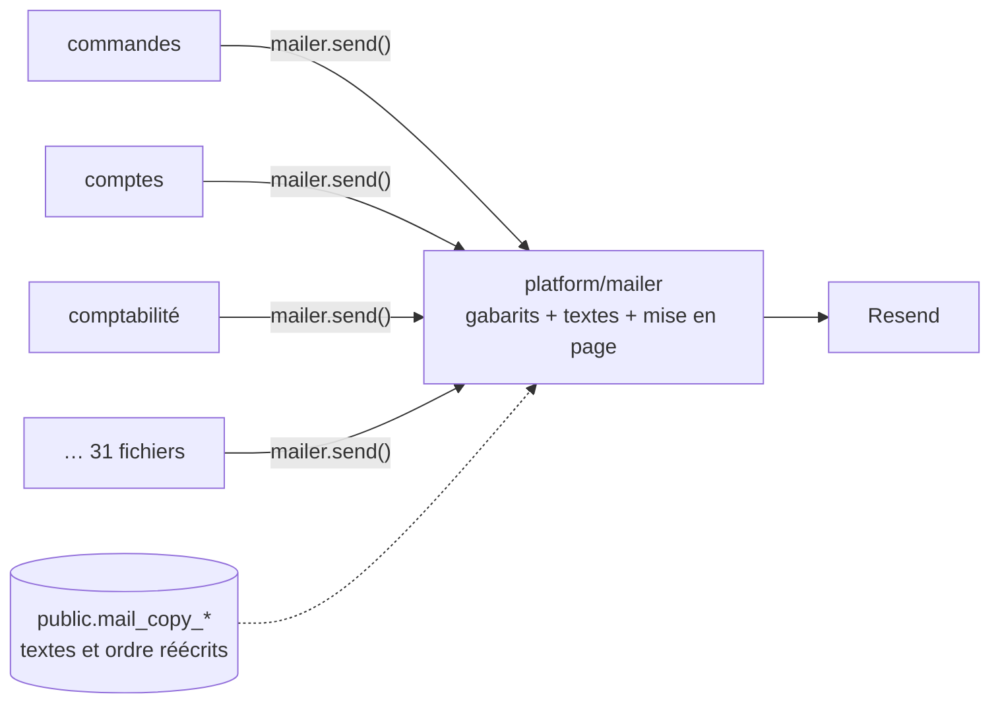
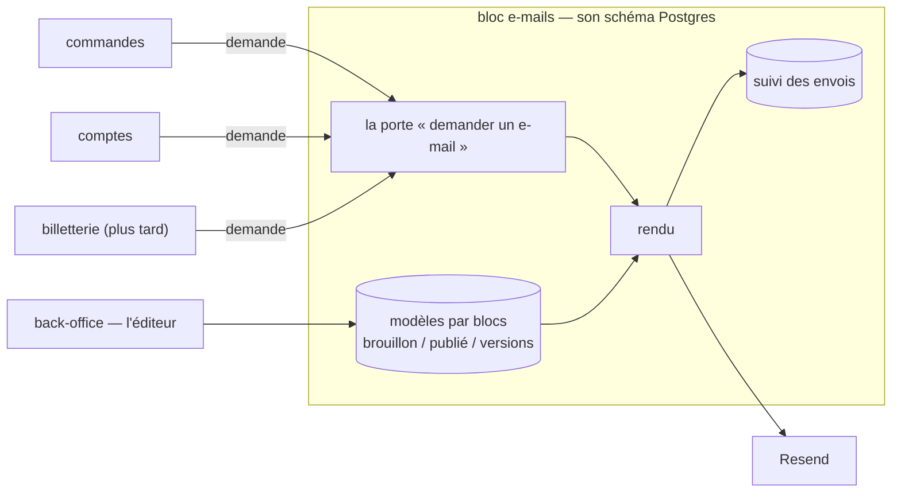

# Plan — le service d'e-mails : un bloc de l'API, un éditeur par blocs

> 📋 **Doc-first, 2026-11-06.** Décisions de Hugo du même jour, rassemblées
> dans [`README.md`](README.md) : le transactionnel d'abord ; l'équipe édite
> avec un droit ; on ajoute et retire des blocs ; rien hors e-mail pour
> l'instant ; un service commun où **les blocs demandent et le service compose
> et envoie** ; ce service est **un bloc de `lfd-api`** (monolithe modulaire),
> comme le sera la billetterie ; l'éditeur vit dans le **back-office**.
>
> ⚔️ **Contredit par `vitruve` le 2026-11-06** : 3 bloquants, 6 sérieux, tous
> intégrés (§ 6). Nom du bloc et du schéma : **`mail`** (Hugo, 2026-11-06).
>
> 🏗️ **S0 et S1 bâtis le 2026-11-06.** S1 : `apps/lfd-api/src/mail/` (porte
> `apps/lfd-api/src/mail/channels/requests/mail-requests.ts`, contexte `mail/requests/`), table
> `mail.mail_request`, abonné durable `mail.requested`, porte
> `lint:mail-through-block` (dette : 31). Aucun envoyeur ne passe encore par la
> porte. Écarts au texte : `request` n'accepte en S1 que les 28 modèles sans PDF
> en base64 (les 4 autres attendent le stockage, S2) ; la langue n'est pas un
> champ de la demande, elle est lue dans `locale` des données. La durée de
> conservation du destinataire a été décidée après coup (1 an, § 7) ; sa purge
> est bâtie à blanc.
>
> 🏗️ **S1b bâti le 2026-11-06** (§ 8) : état `sending`, envoi après
> validation, balayeur `POST /admin/mail/requests/sweep` sur le cron `*/5`.
> Écarts au texte en fin de § 8.

## Partie 1 — Comprendre

### Aujourd'hui

Chaque bloc qui envoie un e-mail **appelle le mailer lui-même** : il prépare
les données, choisit le gabarit, envoie, et lit le résultat. Les gabarits, les
textes et la mise en page vivent dans `platform/mailer/` ; les textes et l'ordre
des sections que l'équipe a réécrits vivent dans le schéma du commerce.

### Demain

Un **bloc d'e-mails** reçoit des **demandes** (« l'e-mail _commande passée_, à
cette personne, en français, avec ces données »), les compose à partir de
**modèles par blocs** que l'équipe édite au back-office, les envoie et en
garde le suivi. Les autres blocs ne savent plus rien de la mise en page.

### Ce qui ne change pas

- **Pas un octet** des e-mails envoyés ne change tant que l'équipe n'a rien
  publié : chaque modèle part du gabarit d'aujourd'hui, prouvé par des
  empreintes.
- L'envoi passe toujours par `@lfd/mailer` et Resend (disjoncteur, mode à
  blanc, liste de suppression).
- Les e-mails légaux joints (factures, bons) gardent leur moteur PDF.

## Partie 2 — Technique

### 1. L'existant (ouvert le 2026-11-06)

- **31 fichiers** de `apps/lfd-api/src` injectent `MAILER` (hors tests) :
  `b2b/orders` 11, `b2b/account` 5, `b2b/contact` 3, `b2b/accounting` 2, et un
  chacun dans `alerts`, `growth`, `mail-copy`, `payments`,
  `sub-account-notices`, `vitrine`, `production`, `staff/directory`,
  `staff/invitations`, `platform/mailer`. **6** seulement sont des
  `@DurableHandler` ; les autres envoient dans une commande, un service ou un
  abonné en mémoire.
- **Environ 6 appelants** rendent le résultat de l'envoi à un écran
  (`mailSent`) : `open-staff-access`, `grant-account-access`,
  `attach-account-holder`, `create-company-by-staff`, `invite-company-member`,
  `vitrine-notice-dispatcher`. (Le plan disait 14 fichiers : 7 sont le client
  Prisma généré ou la colonne de la vitrine — relu par `vitruve` le
  2026-11-06.) Ils envoient APRÈS leur `uow.run`, hors transaction
  (`open-staff-access.service.ts`). `mailSent: true` atteste que Resend a
  accepté, pas que le message est arrivé (`CLAUDE.md`, § 0).
- Le registre `B2bMails`, **32 clés** (et non 28 : relu par `vitruve` le 2026-11-06), (`apps/lfd-api/src/platform/mailer/mail-templates.ts`,
  1 120 lignes) déclare les 28 e-mails ; leurs textes sont au dictionnaire
  (`platform/mailer/copy/`, trois langues, manifeste des variables tenu par
  `lint:mail-copy-digest`) ; leurs sections sont déclarées par gabarit
  (`platform/mailer/sections/`), de nature `text` ou `system`.
- La mise en page de `@lfd/mailer` (`packages/mailer/src/html.ts`,
  `LayoutInput`) est faite de **champs fixes** (titre, corps, bouton, lien
  secondaire, lignes de récapitulatif, image, pied) que l'ordre des sections
  réarrange (`packages/mailer/src/layout-sections.ts`).
- Les réécritures de l'équipe : `public.mail_copy_entries`,
  `public.mail_copy_publication`, `public.mail_section_orders`
  (`prisma/schema/public/mail-copy.prisma`), écrites par `b2b/mail-copy` seul,
  lues par le mailer par un port relié dans `appBootstrap/`.
- L'écran : `textes-emails` du back-office, sous Communication.
- L'outbox durable : `apps/lfd-api/src/platform/outbox/durable-handler.ts`.

### 2. Les choix

- **C1 — Un bloc `mail/`** de premier niveau de `apps/lfd-api/src/`, avec son
  schéma Postgres `mail` (nom tranché par Hugo le 2026-11-06).
- **C2 — Une porte, deux gestes, déclarée par le bloc** (Hugo, 2026-11-06).
  `mail/channels/requests/` déclare `MailRequests`, **typée par modèle** :
  `request("order-placed", { … })` est vérifié par le compilateur, comme
  `mailer.send()` aujourd'hui. Le bloc l'implémente lui-même. La matrice gagne
  une colonne « → `mail` : port uniquement », ouverte à tous les blocs,
  `staff` et `production` compris : `mail` n'a pas de métier propre, c'est un
  service que chacun consomme, et n'importer que son canal ne couple à rien
  d'autre. `mail` n'importe que `platform` et `staff` (autorisation de
  l'éditeur) ; `staff` et `mail` se lisent donc dans les deux sens, par des
  fichiers distincts — le cas que `handover` connaît déjà.
  - _Écartée : la porte déclarée dans `platform/`_ (première correction de
    `vitruve`) : `platform` ne connaît aucun métier, la porte aurait reçu une
    clé et des données non typées, validées seulement à l'envoi. 32 modèles et
    31 envoyeurs sans vérification du compilateur coûtent plus qu'une colonne
    de matrice.
  - `request(demande)` — **le défaut** : la demande est écrite dans la
    transaction de l'appelant et part après validation par l'outbox durable.
    Une commande n'attend jamais son e-mail ; un service arrêté retarde, ne
    perd pas.
  - `sendNow(demande)` — pour un geste du staff qui doit lire le résultat à
    l'écran (les ~6 producteurs de `mailSent`), pour l'essai et pour la
    sonde : envoi immédiat, résultat rendu. **Il lève une erreur s'il est
    appelé sous une unité de travail** (le symétrique de
    `DurableFactOutsideUnitOfWorkError` pour `Outbox.append`) : jamais
    d'e-mail pour une écriture qui sera annulée. Le suivi s'inscrit APRÈS
    l'envoi, dans sa propre écriture.
  - Une demande porte : le **modèle** (clé du registre), la **marque**
    (La Folie Coffee aujourd'hui), le destinataire, la langue, les données que
    le modèle déclare, les **références** de ses pièces jointes, et une **clé
    d'idempotence** (un rejeu de l'outbox ne double pas un envoi).
  - **Une pièce jointe n'entre jamais dans la demande.** Aujourd'hui la
    facture et le dossier du fournil arrivent en base64 dans les données du
    gabarit (`invoice-issued-mail.ts`, `production-dossier-mail.ts`) : dans
    `request`, ils seraient écrits dans le `jsonb` de l'outbox et rejoués.
    L'appelant dépose le PDF au stockage (`@lfd/storage`), la demande porte sa
    clé, le bloc le relit au rendu.
- **C3 — Le contrat d'un modèle** : chaque modèle déclare la forme de ses
  données (schéma Zod), ses variables et ses blocs `system`. Le manifeste des
  variables d'aujourd'hui devient ce contrat ; la porte
  `lint:mail-copy-digest` le tient toujours.
- **C4 — Les modèles sont des documents par blocs**, par modèle et par langue,
  en brouillon puis publiés, avec leurs versions datées et le retour arrière.
  Sans version publiée, le modèle est **celui du code**, qui reproduit le
  gabarit d'aujourd'hui octet pour octet.
- **C5 — Le catalogue de blocs est du code** : titre, paragraphe, bouton, lien
  secondaire, image (médiathèque), encadré, séparateur, et les blocs `system`
  (récapitulatif, QR, itinéraire, …) que les données produisent. Un modèle
  déclare les blocs qu'il admet ; un bloc hors de cette liste, ou une variable
  inconnue, est refusé à l'enregistrement.
- **C6 — Le rendu étend la coquille de `@lfd/mailer`** au lieu de la
  remplacer : `LayoutInput` passe de champs fixes à une **liste ordonnée de
  blocs**, et les champs d'aujourd'hui en deviennent un cas particulier. Pas
  de MJML au départ : il changerait les octets et alourdirait le conteneur ;
  à reconsidérer si un client de messagerie résiste.
- **C7 — Le suivi** : chaque demande laisse une ligne (modèle, marque,
  destinataire, langue, état, identifiant Resend, dates). Une donnée
  personnelle de plus au registre RGPD, avec sa durée de conservation
  (1 an, décidée le 2026-11-06, § 7).
- **C8 — L'éditeur** est au back-office, sous Communication, à la place de
  l'écran `textes-emails` qu'il absorbe ; un droit dédié se règle à l'écran
  des rôles (une migration ajoute la ressource, jamais le droit — `CLAUDE.md`,
  § 3).

### 3. Les lots

| Lot      | Contenu                                                                                                                                                                                                                                                                                                                                                                                                                                                | Ce qui change pour un client                                                                                            |
| -------- | ------------------------------------------------------------------------------------------------------------------------------------------------------------------------------------------------------------------------------------------------------------------------------------------------------------------------------------------------------------------------------------------------------------------------------------------------------ | ----------------------------------------------------------------------------------------------------------------------- |
| **S0**   | ✅ bâti le 2026-11-06 (`ffff2ca92`). Armer les portes, le nom tranché par Hugo d'abord (un schéma créé ne se renomme pas) : le bloc `mail` dans la matrice du § 3 de `CLAUDE.md` et dans `lint:context-boundaries`, le schéma `mail` dans le `datasource` et dans `lint:prisma-schema-layout`, la colonne « → `mail` : port uniquement » et la ligne `mail` (→ `platform`, `staff` autorisation) dans la matrice et la porte, AVANT le premier fichier | rien                                                                                                                    |
| **S1**   | ✅ bâti le 2026-11-06 (`d2c3b7dc4`). Le bloc, sa porte (`request` et `sendNow`), la table des demandes et du suivi, l'envoi par l'outbox ; le rendu reste celui de `platform/mailer`. Une porte `lint:mail-through-block` compte les injections de `MAILER` hors du bloc : la dette (31) ne peut que décroître                                                                                                                                         | rien                                                                                                                    |
| **S1b**  | ✅ bâti le 2026-11-06 (`0ebe1daec`, raccord `dacdfa77d`). L'envoi sort de la transaction de livraison : état `sending`, envoi après validation, résultat dans une écriture courte, balayeur borné par la fenêtre d'idempotence de Resend (§ 8)                                                                                                                                                                                                         | rien                                                                                                                    |
| **P**    | ✅ bâti le 2026-11-06 (`71f95d36f`), **à blanc** : purges de l'outbox (30 j après livraison) et du suivi (1 an), catégorie RGPD `client` ; rien n'est supprimé tant que Hugo n'active pas (§ 7)                                                                                                                                                                                                                                                        | rien                                                                                                                    |
| **S2**   | Faire passer les 31 envoyeurs par la porte, bloc par bloc : `sendNow` pour les ~6 producteurs de `mailSent`, l'essai (`specimen-mail-trial`) et la sonde (`admin-mail-check`) ; `request` pour le reste. Les PDF passent au stockage                                                                                                                                                                                                                   | les e-mails des abonnés en mémoire deviennent durables ; délai à mesurer sur « commande prête » et « livreur en route » |
| **S2a**  | 🏗️ en cours depuis le 2026-11-06 : les fondations (`request` rend l'identifiant de la demande, pièces jointes par référence au stockage, `replyTo`) puis le bloc `b2b/orders` (~12 envoyeurs, dont les abonnés durables qui envoyaient dans la transaction de livraison)                                                                                                                                                                               | les e-mails des commandes partent après la validation, par le bloc                                                      |
| **S2b…** | à venir, un bloc à la fois : `b2b/account`, `b2b/contact`, `b2b/accounting` (facture), `b2b/payments` (mandat), `production` (dossier), `staff`, puis les isolés (`alerts`, `growth`, `vitrine`, `sub-account-notices`, `platform/mailer`) ; la dette de `lint:mail-through-block` descend jusqu'à 0                                                                                                                                                   | selon le bloc                                                                                                           |
| **S3**   | Déménager les gabarits, le dictionnaire et les sections de `platform/mailer/` dans le bloc. **Restent dans `platform/mailer/`** : `webhook/` (lu par `ops`), `inbound/` et `journal/`, techniques. Les trois tables `public.mail_*` **restent dans `public`** : seul leur écrivain change (de `b2b/mail-copy` au bloc `mail`), dans le même déploiement que leur lecteur. Les tables neuves du bloc vont dans son schéma                               | rien                                                                                                                    |
| **S4**   | Les modèles par blocs : catalogue de blocs, documents en brouillon / publié / versions, conversion des réécritures existantes en documents, rendu par liste de blocs. Les empreintes (`mail-rendering.golden.json`) couvrent le HTML et l'objet, **pas les octets des PDF et PNG**. `@lfd/mailer` change : `pnpm test` à la racine                                                                                                                     | rien tant que rien n'est publié                                                                                         |
| **S5**   | L'éditeur au back-office : ajouter, retirer, ordonner, écrire, insérer une variable, aperçu, essai, publier, versions, trois langues côte à côte ; le droit dédié                                                                                                                                                                                                                                                                                      | l'équipe compose ses e-mails                                                                                            |

### 4. Tranché par `vitruve` (2026-11-06)

Les questions posées ici sont répondues au § 6.

### 5. Ce qui n'est pas vérifié

- que les ~6 producteurs de `mailSent` ont tous besoin d'un résultat immédiat ;
- le volume d'envois par jour, qui dimensionne le suivi ;

## 6. Contredit par `vitruve` le 2026-11-06 — ce qui a changé

| Objection                                                                                                                 | Gravité  | Ce que le plan fait maintenant                                                                                                                                                                                                           |
| ------------------------------------------------------------------------------------------------------------------------- | -------- | ---------------------------------------------------------------------------------------------------------------------------------------------------------------------------------------------------------------------------------------- |
| S2 exigeait `staff → mail` et `production → mail`, deux cases interdites, et faisait du socle `staff` le client d'un bloc | BLOQUANT | d'abord corrigé par une porte dans `platform/` ; **puis tranché par Hugo le 2026-11-06** : la porte reste dans `mail/channels/requests/`, typée, et la matrice ouvre « → `mail` : port uniquement » à tous les blocs, dit et assumé (C2) |
| absorber `platform/mailer` cassait `ops` (`mail-readings.reader.ts` lit `webhook/`) et trois liaisons d'`appBootstrap`    | BLOQUANT | `webhook/`, `inbound/`, `journal/` restent dans `platform/mailer/` (S3)                                                                                                                                                                  |
| les PDF voyagent en base64 dans les données : `request` les écrirait dans le `jsonb` de l'outbox                          | BLOQUANT | une pièce jointe est déposée au stockage, la demande porte sa clé (C2)                                                                                                                                                                   |
| « 14 lecteurs de `mailSent` » : 7 sont du code généré ou une colonne                                                      | SÉRIEUX  | recompté : ~6 producteurs (§ 1)                                                                                                                                                                                                          |
| `sendNow` sous une transaction enverrait pour une écriture annulée                                                        | SÉRIEUX  | il lève sous une unité de travail ; le suivi s'écrit après l'envoi (C2)                                                                                                                                                                  |
| S2 ne classait pas ses envoyeurs                                                                                          | SÉRIEUX  | `sendNow` pour les producteurs de `mailSent`, l'essai et la sonde ; `request` pour le reste ; délai à mesurer sur « commande prête » et « livreur en route » (S2)                                                                        |
| `SET SCHEMA` : un rangement pour une migration irréversible, et une porte rouge entre deux déploiements                   | SÉRIEUX  | les tables restent dans `public`, seul l'écrivain change, en un déploiement (S3)                                                                                                                                                         |
| « octet pour octet » ne couvre pas les pièces jointes                                                                     | SÉRIEUX  | dit (S4)                                                                                                                                                                                                                                 |
| `@lfd/mailer` change sans `pnpm test` racine                                                                              | SÉRIEUX  | ajouté à S4                                                                                                                                                                                                                              |
| 28 e-mails au lieu de 32 clés ; répartition des 31 envoyeurs à recompter                                                  | MINEUR   | 32 (§ 1) ; recompte au bâti de S2                                                                                                                                                                                                        |
| le nom du bloc et du schéma est irréversible une fois créé                                                                | MINEUR   | tranché par Hugo le 2026-11-06 : **`mail`**                                                                                                                                                                                              |

**Non vérifié** (reporté de `vitruve`) : la taille d'une facture en base64 ;
les composeurs de `LayoutInput` hors de `platform/mailer`.

## 7. Tranché par Hugo le 2026-11-06, après S1

- **Purge de l'outbox** : une ligne livrée est supprimée **30 jours** après
  sa livraison ; un message mort reste jusqu'à son rejeu ou son abandon. À
  bâtir avant S2, qui en fait grossir le volume.
- **Le destinataire d'un e-mail** entre au registre RGPD
  (`documentation/legal/rgpd-registre.json`) dans une catégorie **client**,
  neuve.
- **Le suivi des envois** (`mail.mail_request`) se conserve **1 an**, puis se
  purge.

**Bâti le 2026-11-06, À BLANC** (Hugo, le même jour : « je ne veux pas perdre
de la data sans le savoir »). Les deux purges existent et tournent chaque nuit
sur le cron `45 3 * * *` (`QUALITY_UPLOAD_SWEEP_CRON`, `container/worker.ts`,
avec les autres purges RGPD) — `POST /admin/outbox/purge` et
`POST /admin/mail/requests/purge` —, mais **ne suppriment rien** : leur réglage
(`OUTBOX_PURGE`, `MAIL_REQUEST_PURGE`, lus par `AppConfig`) vaut `dry-run` par
défaut, et le passage ne fait que compter et journaliser ce qu'il supprimerait
(nombre, date la plus ancienne). `off` coupe même le compte ; `on` supprime.
**Leur activation est une décision à part de Hugo** : aucune des deux
variables n'est posée au déploiement, et le Worker ne les transmet pas
encore au container — `on` demandera aussi de les y ajouter.

- Boîte d'envoi : un message est éligible quand TOUTES ses livraisons sont
  faites depuis plus de 30 jours ; une livraison en attente ou morte garde le
  message entier, et un message sans livraison n'est jamais éligible.
  Code : `apps/lfd-api/src/platform/outbox/prisma-outbox-pruner.ts`, index
  `outbox_occurred_at_idx` (migration `20261106170000`). À peser avant `on` :
  la clé d'un message purgé est oubliée, un même fait réémis après 30 jours
  serait relivré.
- Suivi des e-mails : une demande `sent`, `failed` ou `refused` dont l'issue
  date de plus d'un an ; jamais une demande `requested`. Code :
  `apps/lfd-api/src/mail/requests/infrastructure/prisma-mail-request.pruner.ts`.
- Registre RGPD : catégorie `client` ; `mail.mail_request.recipient`, `locale`,
  `failure_reason` (1 an) et `platform.outbox.payload` (30 jours), chacune
  marquée « purge non activée (à blanc) ».

## 8. Contredit par `vitruve` le 2026-11-06 — l'envoi sort de la transaction (lot S1b, avant S2)

S1 envoie l'e-mail **pendant** la transaction de livraison de l'outbox, comme
le faisaient déjà les abonnés durables du commerce. `vitruve` l'a refusé
avant que S2 ne le multiplie par ~25 :

| Objection                                                                                                                                                                                                                                                                       | Gravité  | Fondement                                                                   |
| ------------------------------------------------------------------------------------------------------------------------------------------------------------------------------------------------------------------------------------------------------------------------------- | -------- | --------------------------------------------------------------------------- |
| un appel à Resend peut durer plus que la transaction : `UnitOfWork` ouvre `$transaction` sans option (5 s par défaut de Prisma), le mailer relance jusqu'à 3 fois sur un 429 en dormant jusqu'à 30 s ; l'e-mail part, la transaction expire, le reçu est perdu, l'outbox rejoue | BLOQUANT | `platform/database/unit-of-work.ts`, `packages/mailer/src/resend-mailer.ts` |
| seule la clé d'idempotence de Resend évite le doublon, sur une fenêtre que le dépôt ne documente pas, alors que l'outbox peut rejouer jusqu'à 6 h d'écart et 10 fois                                                                                                            | SÉRIEUX  | `platform/outbox/retry-policy.ts`                                           |
| l'état `failed` n'est jamais écrit sur le chemin durable : il meurt avec le rollback, et une demande épuisée reste `requested` pour toujours                                                                                                                                    | SÉRIEUX  | `mail/requests/application/` (l'abonné)                                     |
| un lot de 20 envois lents dépasse le bail de 60 s du relais : deux passages peuvent envoyer le même e-mail                                                                                                                                                                      | SÉRIEUX  | `platform/outbox/outbox-relay.ts`                                           |
| « les abonnés du commerce font pareil » est une dette, contraire au JSDoc de la garde de livraison et d'`UnitOfWork`                                                                                                                                                            | SÉRIEUX  | `platform/outbox/durable-delivery-guard.ts`                                 |

**La forme retenue (S1b)** :

1. **L'abonné durable, dans la transaction** : charge la demande ; si elle
   est `requested` (ou `failed` relançable), la passe en **`sending`** avec
   l'instant de la tentative ; valide. L'accusé de l'outbox part avec.
2. **Après la validation, hors transaction** : envoi par Resend avec la même
   clé d'idempotence, puis une écriture courte du résultat (`sent`,
   `refused`, `failed`) — la forme que `sendNow` a déjà.
3. **Un balayeur du bloc `mail`** reprend les demandes `sending` ou `failed`
   plus anciennes que quelques minutes, avec la même clé, un plafond d'essais,
   et **jamais au-delà de la fenêtre d'idempotence de Resend** (à relever dans
   sa documentation) : au-delà, `failed` sans renvoi automatique, visible au
   suivi, et un humain décide.

Gains : plus aucune connexion tenue pendant un appel réseau ; `failed` vrai
au suivi ; un doublon possible devient visible (`sending` orphelin) au lieu
d'être silencieux. Coût : un état, un balayeur, leurs tests. Réversible tant
que S2 n'a pas branché les envoyeurs. Les six abonnés durables du commerce
qui envoient dans la transaction rejoindront cette forme en S2, en passant
par la porte.

**La fenêtre d'idempotence de Resend : 24 heures** (documentation de Resend,
`resend.com/docs/dashboard/emails/idempotency-keys`, relue le 2026-11-06 : une
clé est gardée 24 h ; une requête de même clé encore en cours rend un 409
`concurrent_idempotent_requests`, qu'on peut retenter). Le balayeur ne
renvoie donc jamais une demande dont la première tentative date de plus de
**23 heures** : au-delà, `failed`, visible, et un humain décide.

### Bâti le 2026-11-06 — ce qui existe, et les écarts

- **L'agrégat** (`mail/requests/domain/entities/mail-request.ts`) : état
  `sending`, colonnes `first_attempt_at`, `last_attempt_at`, `attempts`
  (migration `20261106180000_l_envoi_hors_transaction`, CHECK élargi).
  `beginSending` : `requested → sending`, et la reprise `failed`/`sending →
sending` tant que la première tentative a moins de **23 h** et que le
  plafond (**10 essais**) n'est pas atteint ; sinon il refuse
  (`MailRequestNotResumableError`). `giveUp` : un `sending` hors fenêtre
  passe `failed`, avec une raison qui dit de vérifier chez Resend.
- **L'abonné** (`DeliverRequestedMail`) : dans la livraison, `sending` et
  rien d'autre ; l'envoi part par `AfterCommit` (suivi par
  `BackgroundWork`), puis `DeferredMailSender` écrit le résultat.
- **Le 409 `concurrent_idempotent_requests`** : `@lfd/mailer` le lève
  désormais en `MailerIdempotencyInFlightError` (sous-classe de
  `MailerSendError`, ignorée du disjoncteur) ; le bloc le traduit en
  `MailInFlightError` et laisse la demande `sending`.
- **Le balayeur** (`SweepMailRequestsHandler`, route
  `admin/mail/requests/sweep`, `RecomputeGuard`, cron `*/5` à côté de la
  boîte d'envoi) : lots de **20**, une tentative est en retard après
  **10 minutes**.

Écarts et choix du bâti, à relire :

- **D'où le balayeur tire les données du modèle.** Le texte ne le disait pas,
  et C7 les exclut du suivi. Elles ne vivent que dans le fait `mail.requested`
  de la boîte d'envoi : le balayeur les relit par sa clé déterministe, par
  un port de lecture de `platform/outbox` (`DurableFactPayloads`). La purge
  de l'outbox (30 jours après livraison) ne gêne pas une fenêtre de 23 h ;
  un fait introuvable n'est pas renvoyé (`missingFact` au compte rendu).
- **Un échec de `sendNow` n'est jamais repris par le balayeur** : `sendNow`
  ne passe pas par `sending`, et l'équipe a vu l'erreur à l'écran — c'est à
  elle de refaire le geste. Seuls les envois différés ont une première
  tentative datée.
- **Les nombres** (10 essais, 10 minutes, lots de 20) sont des choix du
  bâti, pas du plan.
