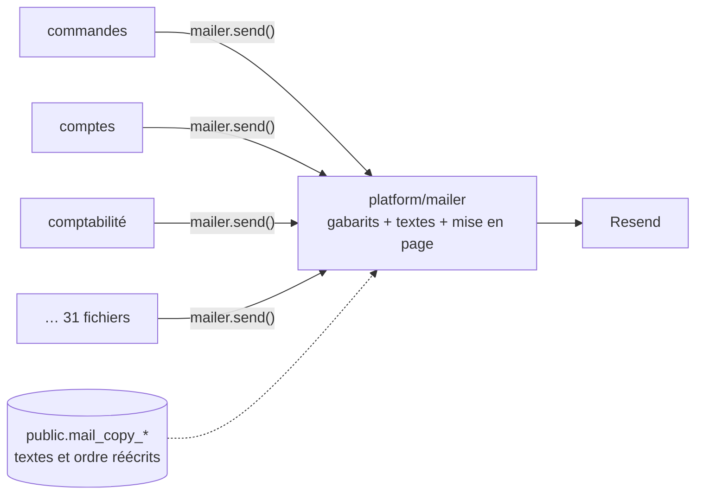
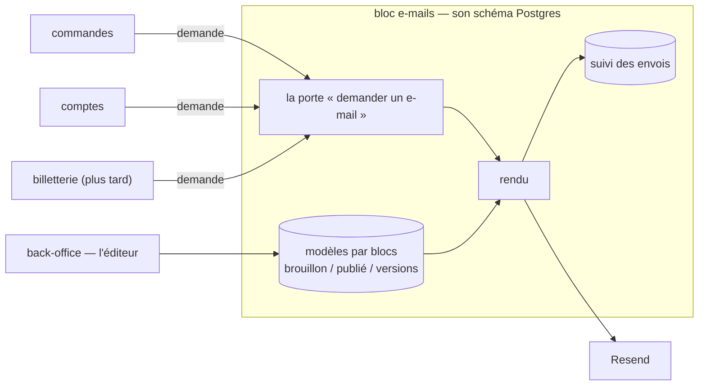

# Plan — le service d'e-mails : un bloc de l'API, un éditeur par blocs

> 📋 **Doc-first, 2026-11-06.** Décisions de Hugo du même jour, rassemblées
> dans [`README.md`](README.md) : le transactionnel d'abord ; l'équipe édite
> avec un droit ; on ajoute et retire des blocs ; rien hors e-mail pour
> l'instant ; un service commun où **les blocs demandent et le service compose
> et envoie** ; ce service est **un bloc de `lfd-api`** (monolithe modulaire),
> comme le sera la billetterie ; l'éditeur vit dans le **back-office**.
>
> ⚔️ **À contredire par `vitruve` avant Hugo** : le plan porte une migration
> de données (les textes publiés changent de schéma) et déplace une frontière
> (un bloc neuf dans la matrice). Rien n'est bâti.

## Partie 1 — Comprendre

### Aujourd'hui

Chaque bloc qui envoie un e-mail **appelle le mailer lui-même** : il prépare
les données, choisit le gabarit, envoie, et lit le résultat. Les gabarits, les
textes et la mise en page vivent dans `platform/mailer/` ; les textes et l'ordre
des sections que l'équipe a réécrits vivent dans le schéma du commerce.

### Demain

Un **bloc d'e-mails** reçoit des **demandes** (« l'e-mail _commande passée_, à
cette personne, en français, avec ces données »), les compose à partir de
**modèles par blocs** que l'équipe édite au back-office, les envoie et en
garde le suivi. Les autres blocs ne savent plus rien de la mise en page.

### Ce qui ne change pas

- **Pas un octet** des e-mails envoyés ne change tant que l'équipe n'a rien
  publié : chaque modèle part du gabarit d'aujourd'hui, prouvé par des
  empreintes.
- L'envoi passe toujours par `@lfd/mailer` et Resend (disjoncteur, mode à
  blanc, liste de suppression).
- Les e-mails légaux joints (factures, bons) gardent leur moteur PDF.

## Partie 2 — Technique

### 1. L'existant (ouvert le 2026-11-06)

- **31 fichiers** de `apps/lfd-api/src` injectent `MAILER` (hors tests) :
  `b2b/orders` 11, `b2b/account` 5, `b2b/contact` 3, `b2b/accounting` 2, et un
  chacun dans `alerts`, `growth`, `mail-copy`, `payments`,
  `sub-account-notices`, `vitrine`, `production`, `staff/directory`,
  `staff/invitations`, `platform/mailer`. **6** seulement sont des
  `@DurableHandler` ; les autres envoient dans une commande, un service ou un
  abonné en mémoire.
- **14 fichiers** lisent `mailSent` : le résultat de l'envoi remonte à un
  écran (« invitation envoyée », par exemple) — `mailSent: true` atteste que
  Resend a accepté, pas que le message est arrivé (`CLAUDE.md`, § 0).
- Le registre `B2bMails` (`apps/lfd-api/src/platform/mailer/mail-templates.ts`,
  1 120 lignes) déclare les 28 e-mails ; leurs textes sont au dictionnaire
  (`platform/mailer/copy/`, trois langues, manifeste des variables tenu par
  `lint:mail-copy-digest`) ; leurs sections sont déclarées par gabarit
  (`platform/mailer/sections/`), de nature `text` ou `system`.
- La mise en page de `@lfd/mailer` (`packages/mailer/src/html.ts`,
  `LayoutInput`) est faite de **champs fixes** (titre, corps, bouton, lien
  secondaire, lignes de récapitulatif, image, pied) que l'ordre des sections
  réarrange (`packages/mailer/src/layout-sections.ts`).
- Les réécritures de l'équipe : `public.mail_copy_entries`,
  `public.mail_copy_publication`, `public.mail_section_orders`
  (`prisma/schema/public/mail-copy.prisma`), écrites par `b2b/mail-copy` seul,
  lues par le mailer par un port relié dans `appBootstrap/`.
- L'écran : `textes-emails` du back-office, sous Communication.
- L'outbox durable : `apps/lfd-api/src/platform/outbox/durable-handler.ts`.

### 2. Les choix

- **C1 — Un bloc `mail/`** de premier niveau de `apps/lfd-api/src/`, avec son
  schéma Postgres `mail`. Nom à confirmer par Hugo.
- **C2 — Une porte, deux gestes.** Le bloc déclare
  `mail/channels/requests/` : `MailRequests`, implémenté par lui-même, que les
  autres blocs lisent en `port uniquement`.
  - `request(demande)` — **le défaut** : la demande est écrite dans la
    transaction de l'appelant et part après validation par l'outbox durable.
    Une commande n'attend jamais son e-mail ; un service arrêté retarde, ne
    perd pas.
  - `sendNow(demande)` — pour un geste du staff qui doit lire le résultat à
    l'écran (les 14 lecteurs de `mailSent`) : envoi immédiat, résultat rendu,
    et la demande est quand même inscrite au suivi.
  - Une demande porte : le **modèle** (clé du registre), la **marque**
    (La Folie Coffee aujourd'hui), le destinataire, la langue, les données que
    le modèle déclare, les pièces jointes, et une **clé d'idempotence** (un
    rejeu de l'outbox ne double pas un envoi).
- **C3 — Le contrat d'un modèle** : chaque modèle déclare la forme de ses
  données (schéma Zod), ses variables et ses blocs `system`. Le manifeste des
  variables d'aujourd'hui devient ce contrat ; la porte
  `lint:mail-copy-digest` le tient toujours.
- **C4 — Les modèles sont des documents par blocs**, par modèle et par langue,
  en brouillon puis publiés, avec leurs versions datées et le retour arrière.
  Sans version publiée, le modèle est **celui du code**, qui reproduit le
  gabarit d'aujourd'hui octet pour octet.
- **C5 — Le catalogue de blocs est du code** : titre, paragraphe, bouton, lien
  secondaire, image (médiathèque), encadré, séparateur, et les blocs `system`
  (récapitulatif, QR, itinéraire, …) que les données produisent. Un modèle
  déclare les blocs qu'il admet ; un bloc hors de cette liste, ou une variable
  inconnue, est refusé à l'enregistrement.
- **C6 — Le rendu étend la coquille de `@lfd/mailer`** au lieu de la
  remplacer : `LayoutInput` passe de champs fixes à une **liste ordonnée de
  blocs**, et les champs d'aujourd'hui en deviennent un cas particulier. Pas
  de MJML au départ : il changerait les octets et alourdirait le conteneur ;
  à reconsidérer si un client de messagerie résiste.
- **C7 — Le suivi** : chaque demande laisse une ligne (modèle, marque,
  destinataire, langue, état, identifiant Resend, dates). Une donnée
  personnelle de plus au registre RGPD, avec sa durée de conservation, à
  décider par Hugo.
- **C8 — L'éditeur** est au back-office, sous Communication, à la place de
  l'écran `textes-emails` qu'il absorbe ; un droit dédié se règle à l'écran
  des rôles (une migration ajoute la ressource, jamais le droit — `CLAUDE.md`,
  § 3).

### 3. Les lots

| Lot    | Contenu                                                                                                                                                                                                                                                                   | Ce qui change pour un client                           |
| ------ | ------------------------------------------------------------------------------------------------------------------------------------------------------------------------------------------------------------------------------------------------------------------------- | ------------------------------------------------------ |
| **S0** | Armer les portes : le bloc `mail` dans la matrice du § 3 de `CLAUDE.md` et dans `lint:context-boundaries`, le schéma `mail` dans le `datasource` et dans `lint:prisma-schema-layout`, AVANT le premier fichier                                                            | rien                                                   |
| **S1** | Le bloc, sa porte (`request` et `sendNow`), la table des demandes et du suivi, l'envoi par l'outbox ; le rendu reste celui de `platform/mailer`. Une porte `lint:mail-through-block` compte les injections de `MAILER` hors du bloc : la dette (31) ne peut que décroître | rien                                                   |
| **S2** | Faire passer les 31 envoyeurs par la porte, bloc par bloc ; les 14 lecteurs de `mailSent` par `sendNow`                                                                                                                                                                   | les e-mails des abonnés en mémoire deviennent durables |
| **S3** | Déménager les gabarits, le dictionnaire et les sections de `platform/mailer/` dans le bloc ; les trois tables `public.mail_*` passent dans le schéma `mail` (`ALTER TABLE … SET SCHEMA`, qui garde les lignes)                                                            | rien                                                   |
| **S4** | Les modèles par blocs : catalogue de blocs, documents en brouillon / publié / versions, conversion des réécritures existantes en documents, rendu par liste de blocs, empreintes octet pour octet                                                                         | rien tant que rien n'est publié                        |
| **S5** | L'éditeur au back-office : ajouter, retirer, ordonner, écrire, insérer une variable, aperçu, essai, publier, versions, trois langues côte à côte ; le droit dédié                                                                                                         | l'équipe compose ses e-mails                           |

### 4. Ce que `vitruve` doit trancher

- **S3 en `SET SCHEMA`** : sûr sous le trafic (verrou court sur trois petites
  tables) ? Ce que deviennent les migrations déjà appliquées qui les citent.
- **`sendNow` et la transaction** : un `sendNow` appelé dans une unité de
  travail envoie-t-il avant la validation (un e-mail pour une écriture
  annulée) ? Faut-il l'interdire dans une transaction ?
- **L'idempotence** : la clé fournie par l'appelant, ou dérivée de la demande ?
- **S2 change un comportement** : un abonné en mémoire qui envoyait tout de
  suite enverra après la validation, par l'outbox — un délai, et un e-mail qui
  part même si le processus redémarre. Lister ceux où ce délai se verrait.
- **Le suivi et le RGPD** : quoi garder, combien de temps.
- **C6** : la coquille actuelle peut-elle rendre une liste libre de blocs sans
  changer les octets des 28 e-mails d'aujourd'hui ?

### 5. Ce qui n'est pas vérifié

- que les 14 lecteurs de `mailSent` ont tous besoin d'un résultat immédiat ;
- le volume d'envois par jour, qui dimensionne le suivi ;
- que l'outbox durable supporte une demande avec pièce jointe (taille de la
  charge) ;
- le nom du bloc et du schéma (`mail` proposé).
