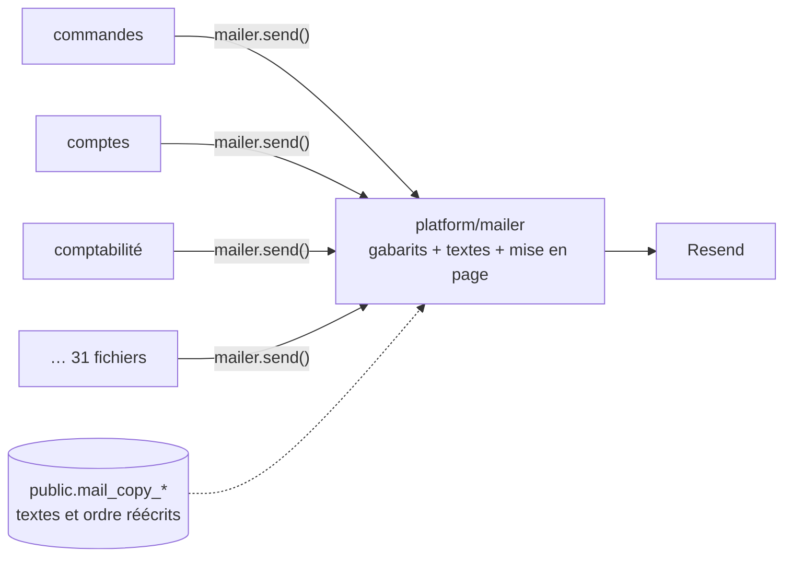
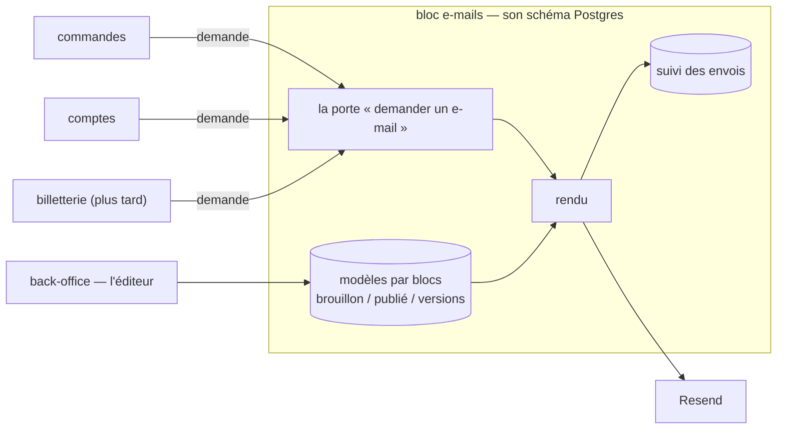

# Plan — le service d'e-mails : un bloc de l'API, un éditeur par blocs

> 📋 **Doc-first, 2026-11-06.** Décisions de Hugo du même jour, rassemblées
> dans [`README.md`](README.md) : le transactionnel d'abord ; l'équipe édite
> avec un droit ; on ajoute et retire des blocs ; rien hors e-mail pour
> l'instant ; un service commun où **les blocs demandent et le service compose
> et envoie** ; ce service est **un bloc de `lfd-api`** (monolithe modulaire),
> comme le sera la billetterie ; l'éditeur vit dans le **back-office**.
>
> ⚔️ **Contredit par `vitruve` le 2026-11-06** : 3 bloquants, 6 sérieux, tous
> intégrés (§ 6). Nom du bloc et du schéma : **`mail`** (Hugo, 2026-11-06).
>
> 🏗️ **S0 et S1 bâtis le 2026-11-06.** S1 : `apps/lfd-api/src/mail/` (porte
> `apps/lfd-api/src/mail/channels/requests/mail.ts` depuis le § 21, contexte `mail/requests/`), table
> `mail.mail_request`, abonné durable `mail.requested`, porte
> `lint:mail-through-block` (dette : 31). Au bâti de S1, aucun envoyeur ne passait
> par la porte. Écarts au texte : `request` n'accepte en S1 que les 28 modèles sans PDF
> en base64 (les 4 autres attendent le stockage, S2) ; la langue n'est pas un
> champ de la demande, elle est lue dans `locale` des données. La durée de
> conservation du destinataire a été décidée après coup (1 an, § 7) ; sa purge
> est bâtie à blanc.
>
> 🏗️ **S1b bâti le 2026-11-06** (§ 8) : état `sending`, envoi après
> validation, balayeur `POST /admin/mail/requests/sweep` sur le cron `*/5`.
> Écarts au texte en fin de § 8.
>
> 🏗️ **S2a bâti le 2026-11-06** (§ 9) : les fondations (`request` rend
> l'identifiant, pièces jointes par référence au stockage, `order-placed`
> ouvert à `request`) et le bloc `b2b/orders` (11 envoyeurs) passé par la
> porte. Dette de `lint:mail-through-block` : **20**.
>
> 🏗️ **S2b bâti le 2026-11-06** (§ 10) : le bloc `b2b/account` (5 envoyeurs)
> passé par la porte. Dette : **15**.
>
> 🏗️ **S2c bâti le 2026-11-06** (§ 11) : le bloc `b2b/contact` (3 envoyeurs)
> passé par la porte ; la demande porte un `replyTo`. Dette : **12**.
>
> 🏗️ **S2e bâti le 2026-11-06** (§ 15) : le mandat de `b2b/payments` passé
> par la porte, en `sendNow` (corrigé : `request` prévu). Dette : **9**.

## Partie 1 — Comprendre

### Aujourd'hui

Chaque bloc qui envoie un e-mail **appelle le mailer lui-même** : il prépare
les données, choisit le gabarit, envoie, et lit le résultat. Les gabarits, les
textes et la mise en page vivent dans `platform/mailer/` ; les textes et l'ordre
des sections que l'équipe a réécrits vivent dans le schéma du commerce.

### Demain

Un **bloc d'e-mails** reçoit des **demandes** (« l'e-mail _commande passée_, à
cette personne, en français, avec ces données »), les compose à partir de
**modèles par blocs** que l'équipe édite au back-office, les envoie et en
garde le suivi. Les autres blocs ne savent plus rien de la mise en page.

### Ce qui ne change pas

- **Pas un octet** des e-mails envoyés ne change tant que l'équipe n'a rien
  publié : chaque modèle part du gabarit d'aujourd'hui, prouvé par des
  empreintes.
- L'envoi passe toujours par `@lfd/mailer` et Resend (disjoncteur, mode à
  blanc, liste de suppression).
- Les e-mails légaux joints (factures, bons) gardent leur moteur PDF.

## Partie 2 — Technique

### 1. L'existant (ouvert le 2026-11-06)

- **31 fichiers** de `apps/lfd-api/src` injectent `MAILER` (hors tests) :
  `b2b/orders` 11, `b2b/account` 5, `b2b/contact` 3, `b2b/accounting` 2, et un
  chacun dans `alerts`, `growth`, `mail-copy`, `payments`,
  `sub-account-notices`, `vitrine`, `production`, `staff/directory`,
  `staff/invitations`, `platform/mailer`. **6** seulement sont des
  `@DurableHandler` ; les autres envoient dans une commande, un service ou un
  abonné en mémoire.
- **Environ 6 appelants** rendent le résultat de l'envoi à un écran
  (`mailSent`) : `open-staff-access`, `grant-account-access`,
  `attach-account-holder`, `create-company-by-staff`, `invite-company-member`,
  `vitrine-notice-dispatcher`. (Le plan disait 14 fichiers : 7 sont le client
  Prisma généré ou la colonne de la vitrine — relu par `vitruve` le
  2026-11-06.) Ils envoient APRÈS leur `uow.run`, hors transaction
  (`open-staff-access.service.ts`). `mailSent: true` atteste que Resend a
  accepté, pas que le message est arrivé (`CLAUDE.md`, § 0).
- Le registre `B2bMails`, **32 clés** (et non 28 : relu par `vitruve` le 2026-11-06), (`apps/lfd-api/src/mail/templates/mail-templates.ts`,
  1 120 lignes) déclare les 28 e-mails ; leurs textes sont au dictionnaire
  (`platform/mailer/copy/`, trois langues, manifeste des variables tenu par
  `lint:mail-copy-digest`) ; leurs sections sont déclarées par gabarit
  (`platform/mailer/sections/`), de nature `text` ou `system`.
- La mise en page de `@lfd/mailer` (`packages/mailer/src/html.ts`,
  `LayoutInput`) est faite de **champs fixes** (titre, corps, bouton, lien
  secondaire, lignes de récapitulatif, image, pied) que l'ordre des sections
  réarrange (`packages/mailer/src/layout-sections.ts`).
- Les réécritures de l'équipe : `public.mail_copy_entries`,
  `public.mail_copy_publication`, `public.mail_section_orders`
  (`prisma/schema/public/mail-copy.prisma`), écrites par `b2b/mail-copy` seul,
  lues par le mailer par un port relié dans `appBootstrap/`.
- L'écran : `textes-emails` du back-office, sous Communication.
- L'outbox durable : `apps/lfd-api/src/platform/outbox/durable-handler.ts`.

### 2. Les choix

- **C1 — Un bloc `mail/`** de premier niveau de `apps/lfd-api/src/`, avec son
  schéma Postgres `mail` (nom tranché par Hugo le 2026-11-06).
- **C2 — Une porte, deux gestes, déclarée par le bloc** (Hugo, 2026-11-06).
  _Noms d'origine ci-dessous ; depuis le § 21 : `Mail`, `mail.send`,
  `mail.sendAndAwaitReceipt`, `lint:mail-receipt-admitted`._
  `mail/channels/requests/` déclare `MailRequests`, **typée par modèle** :
  `request("order-placed", { … })` est vérifié par le compilateur, comme
  `mailer.send()` aujourd'hui. Le bloc l'implémente lui-même. La matrice gagne
  une colonne « → `mail` : port uniquement », ouverte à tous les blocs,
  `staff` et `production` compris : `mail` n'a pas de métier propre, c'est un
  service que chacun consomme, et n'importer que son canal ne couple à rien
  d'autre. `mail` n'importe que `platform` et `staff` (autorisation de
  l'éditeur) ; `staff` et `mail` se lisent donc dans les deux sens, par des
  fichiers distincts — le cas que `handover` connaît déjà.
  - _Écartée : la porte déclarée dans `platform/`_ (première correction de
    `vitruve`) : `platform` ne connaît aucun métier, la porte aurait reçu une
    clé et des données non typées, validées seulement à l'envoi. 32 modèles et
    31 envoyeurs sans vérification du compilateur coûtent plus qu'une colonne
    de matrice.
  - `request(demande)` — **le défaut** : la demande est écrite dans la
    transaction de l'appelant et part après validation par l'outbox durable.
    Une commande n'attend jamais son e-mail ; un service arrêté retarde, ne
    perd pas.
  - `sendNow(demande)` — pour un geste du staff qui doit lire le résultat à
    l'écran (les ~6 producteurs de `mailSent`), pour l'essai et pour la
    sonde : envoi immédiat, résultat rendu. **Il lève une erreur s'il est
    appelé sous une unité de travail** (le symétrique de
    `DurableFactOutsideUnitOfWorkError` pour `Outbox.append`) : jamais
    d'e-mail pour une écriture qui sera annulée. Le suivi s'inscrit APRÈS
    l'envoi, dans sa propre écriture.
  - Une demande porte : le **modèle** (clé du registre), la **marque**
    (La Folie Coffee aujourd'hui), le destinataire, la langue, les données que
    le modèle déclare, les **références** de ses pièces jointes, et une **clé
    d'idempotence** (un rejeu de l'outbox ne double pas un envoi).
  - **Une pièce jointe n'entre jamais dans la demande.** Aujourd'hui la
    facture et le dossier du fournil arrivent en base64 dans les données du
    gabarit (`invoice-issued-mail.ts`, `production-dossier-mail.ts`) : dans
    `request`, ils seraient écrits dans le `jsonb` de l'outbox et rejoués.
    L'appelant dépose le PDF au stockage (`@lfd/storage`), la demande porte sa
    clé, le bloc le relit au rendu.
  - **`lint:send-now-admitted` le tient** (2026-11-06) : hors du bloc `mail`,
    `sendNow` ne s'appelle que depuis une liste admise, chaque appelant avec
    sa raison et sa date (dix aujourd'hui) ; un appel hors liste échoue
    (passer par `request`), une entrée qui n'appelle plus `sendNow` aussi.
- **C3 — Le contrat d'un modèle** : chaque modèle déclare la forme de ses
  données (schéma Zod), ses variables et ses blocs `system`. Le manifeste des
  variables d'aujourd'hui devient ce contrat ; la porte
  `lint:mail-copy-digest` le tient toujours.
- **C4 — Les modèles sont des documents par blocs**, par modèle et par langue,
  en brouillon puis publiés, avec leurs versions datées et le retour arrière.
  Sans version publiée, le modèle est **celui du code**, qui reproduit le
  gabarit d'aujourd'hui octet pour octet.
- **C5 — Le catalogue de blocs est du code** : titre, paragraphe, bouton, lien
  secondaire, image (médiathèque), encadré, séparateur, et les blocs `system`
  (récapitulatif, QR, itinéraire, …) que les données produisent. Un modèle
  déclare les blocs qu'il admet ; un bloc hors de cette liste, ou une variable
  inconnue, est refusé à l'enregistrement.
- **C6 — Le rendu étend la coquille de `@lfd/mailer`** au lieu de la
  remplacer : `LayoutInput` passe de champs fixes à une **liste ordonnée de
  blocs**, et les champs d'aujourd'hui en deviennent un cas particulier. Pas
  de MJML au départ : il changerait les octets et alourdirait le conteneur ;
  à reconsidérer si un client de messagerie résiste.
- **C7 — Le suivi** : chaque demande laisse une ligne (modèle, marque,
  destinataire, langue, état, identifiant Resend, dates). Une donnée
  personnelle de plus au registre RGPD, avec sa durée de conservation
  (1 an, décidée le 2026-11-06, § 7).
- **C8 — L'éditeur** est au back-office, sous Communication, à la place de
  l'écran `textes-emails` qu'il absorbe ; un droit dédié se règle à l'écran
  des rôles (une migration ajoute la ressource, jamais le droit — `CLAUDE.md`,
  § 3).

### 3. Les lots

| Lot     | Contenu                                                                                                                                                                                                                                                                                                                                                                                                                                                                                                                                                                                                                                                                                                                                                                                          | Ce qui change pour un client                                                                                            |
| ------- | ------------------------------------------------------------------------------------------------------------------------------------------------------------------------------------------------------------------------------------------------------------------------------------------------------------------------------------------------------------------------------------------------------------------------------------------------------------------------------------------------------------------------------------------------------------------------------------------------------------------------------------------------------------------------------------------------------------------------------------------------------------------------------------------------ | ----------------------------------------------------------------------------------------------------------------------- |
| **S0**  | ✅ bâti le 2026-11-06 (`ffff2ca92`). Armer les portes, le nom tranché par Hugo d'abord (un schéma créé ne se renomme pas) : le bloc `mail` dans la matrice du § 3 de `CLAUDE.md` et dans `lint:context-boundaries`, le schéma `mail` dans le `datasource` et dans `lint:prisma-schema-layout`, la colonne « → `mail` : port uniquement » et la ligne `mail` (→ `platform`, `staff` autorisation) dans la matrice et la porte, AVANT le premier fichier                                                                                                                                                                                                                                                                                                                                           | rien                                                                                                                    |
| **S1**  | ✅ bâti le 2026-11-06 (`d2c3b7dc4`). Le bloc, sa porte (`request` et `sendNow`), la table des demandes et du suivi, l'envoi par l'outbox ; le rendu reste celui de `platform/mailer`. Une porte `lint:mail-through-block` compte les injections de `MAILER` hors du bloc : la dette (31) ne peut que décroître                                                                                                                                                                                                                                                                                                                                                                                                                                                                                   | rien                                                                                                                    |
| **S1b** | ✅ bâti le 2026-11-06 (`0ebe1daec`, raccord `dacdfa77d`). L'envoi sort de la transaction de livraison : état `sending`, envoi après validation, résultat dans une écriture courte, balayeur borné par la fenêtre d'idempotence de Resend (§ 8)                                                                                                                                                                                                                                                                                                                                                                                                                                                                                                                                                   | rien                                                                                                                    |
| **P**   | ✅ bâti le 2026-11-06 (`71f95d36f`), **à blanc** : purges de l'outbox (30 j après livraison) et du suivi (1 an), catégorie RGPD `client` ; rien n'est supprimé tant que Hugo n'active pas (§ 7)                                                                                                                                                                                                                                                                                                                                                                                                                                                                                                                                                                                                  | rien                                                                                                                    |
| **S2**  | ✅ terminé le 2026-11-06 (S2a à S2h, dette de `lint:mail-through-block` à 0). Faire passer les 31 envoyeurs par la porte, bloc par bloc : `sendNow` pour les ~6 producteurs de `mailSent`, l'essai (`specimen-mail-trial`) et la sonde (`admin-mail-check`) ; `request` pour le reste. Les PDF passent au stockage                                                                                                                                                                                                                                                                                                                                                                                                                                                                               | les e-mails des abonnés en mémoire deviennent durables ; délai à mesurer sur « commande prête » et « livreur en route » |
| **S2a** | ✅ bâti le 2026-11-06 (`6abe4d3ee`, § 9) : les fondations (`request` rend l'identifiant de la demande, pièces jointes par référence au stockage — `pdfStored` remplace `pdfBase64` dans les données —, la porte servie par un module global) puis le bloc `b2b/orders` (11 envoyeurs) ; dette 31 → 20                                                                                                                                                                                                                                                                                                                                                                                                                                                                                            | les e-mails des commandes partent après la validation, par le bloc                                                      |
| **S2b** | ✅ bâti le 2026-11-06 (`851cb1037`, § 10) : le bloc `b2b/account` (5 envoyeurs) ; `sendNow` pour l'ouverture d'accès et le lien de mot de passe, `request` pour le reste ; dette 20 → 15                                                                                                                                                                                                                                                                                                                                                                                                                                                                                                                                                                                                         | la demande de rappel et l'alerte de rattachement partent après la validation, par le bloc                               |
| **S2c** | ✅ bâti le 2026-11-06 (`17ff8fb12`, § 11) : le bloc `b2b/contact` (3 envoyeurs), tous en `request` depuis la transaction du geste qui publie ; la demande gagne `replyTo` ; dette 15 → 12                                                                                                                                                                                                                                                                                                                                                                                                                                                                                                                                                                                                        | la demande client et la réponse à une modification partent après la validation, par le bloc                             |
| **S2d** | ✅ bâti le 2026-11-06 (`a883de137`, § 12) : le bloc `b2b/accounting` (2 envoyeurs) ; `sendNow` pour l'avis de prélèvement (le dépôt du lot lit son issue), `request` pour « Votre facture » (facture par référence à la clé où le rendu Factur-X l'a rangée), `sendNow` pour son renvoi ; `customer.invoice-issued` ouvert à `request` ; dette 12 → 10                                                                                                                                                                                                                                                                                                                                                                                                                                           | « Votre facture » part après la validation, par le bloc                                                                 |
| **S2e** | ✅ bâti le 2026-11-06 (`291febd07`, § 15) : le bloc `b2b/payments` (1 envoyeur, le mandat à signer) en **`sendNow`**, contre le plan : le fait `payment_mandate.sent` porte l'identifiant du fournisseur et le refus s'affiche au staff ; le PDF reste en octets, `customer.mandate-to-sign` reste fermé à `request` ; une clé par geste ; dette 10 → 9                                                                                                                                                                                                                                                                                                                                                                                                                                          | le mandat part par le bloc, sur-le-champ (suivi au bloc)                                                                |
| **S2f** | ✅ bâti le 2026-11-06 (`d985850b9`, § 16) : le bloc `production` (1 envoyeur, le dossier du jour) en **`sendNow`**, contre le plan : la trace d'envoi, le fait `production_day.dossier_sent` et la cloche lisent l'issue de chaque envoi ; `deliver` tournait déjà hors transaction ; le PDF reste en octets, `staff.production-dossier` reste fermé à `request` ; clé inchangée (par occasion et par ligne) ; dette 9 → 8                                                                                                                                                                                                                                                                                                                                                                       | le dossier part par le bloc, sur-le-champ (suivi au bloc)                                                               |
| **S2g** | ✅ bâti le 2026-11-06 (`d2a80194f`, § 17) : le bloc `staff` (2 envoyeurs) ; `sendNow` pour ouvrir un accès (l'écran lit `mailSent`, le lien est un secret), `request` pour la suspension et le rétablissement, depuis leur transaction ; une clé par geste ; dette 8 → 6                                                                                                                                                                                                                                                                                                                                                                                                                                                                                                                         | la suspension et le rétablissement partent après la validation, par le bloc                                             |
| **S2h** | ✅ bâti le 2026-11-06 (`2a6611246`, § 18) : les 6 isolés ; `request` pour l'alerte de compte, le rendez-vous pris (chacun dans sa propre unité de travail, best-effort gardé) et les avis aux comptes principaux (abonnés durables) ; `sendNow` pour l'annonce de la vitrine, l'essai d'un e-mail et la sonde de déploiement, **entrée dans le bloc `mail`** (même route) ; dette 6 → 0                                                                                                                                                                                                                                                                                                                                                                                                          | l'alerte de compte, le rendez-vous et les avis aux principaux partent après la validation, par le bloc                  |
| **S3**  | ✅ bâti le 2026-11-06 (`336b46e7f`, § 19 ; S3b `7f6dfae8d`, § 20) : `b2b/mail-copy` → `mail/copy/`, puis les gabarits, le dictionnaire, le texte effectif, les sections et les spécimens → `mail/templates/` ; le contrat (`B2bMails`, la langue de repli, les libellés de l'équipe) et deux ports dans `mail/channels/templates/` ; le mailer est composé par le bloc. Déménager les gabarits, le dictionnaire et les sections de `platform/mailer/` dans le bloc. **Restent dans `platform/mailer/`** : `webhook/` (lu par `ops`), `inbound/` et `journal/`, techniques. Les trois tables `public.mail_*` **restent dans `public`** : seul leur écrivain change (de `b2b/mail-copy` au bloc `mail`), dans le même déploiement que leur lecteur. Les tables neuves du bloc vont dans son schéma | rien                                                                                                                    |
| **S4**  | Les modèles par blocs : catalogue de blocs, documents en brouillon / publié / versions, conversion des réécritures existantes en documents, rendu par liste de blocs. Les empreintes (`mail-rendering.golden.json`) couvrent le HTML et l'objet, **pas les octets des PDF et PNG**. `@lfd/mailer` change : `pnpm test` à la racine                                                                                                                                                                                                                                                                                                                                                                                                                                                               | rien tant que rien n'est publié                                                                                         |
| **S5**  | L'éditeur au back-office : ajouter, retirer, ordonner, écrire, insérer une variable, aperçu, essai, publier, versions, trois langues côte à côte ; le droit dédié                                                                                                                                                                                                                                                                                                                                                                                                                                                                                                                                                                                                                                | l'équipe compose ses e-mails                                                                                            |

### À valider par Hugo à la fin de S2

Les changements de comportement que les lots de S2 ont introduits
**volontairement**. Rien n'est en production avant le soir du 2026-11-06 ;
Hugo les relit ensemble à la fin de S2, avant le déploiement groupé.

| Lot | Ce qui change                                                                                                                                                                                                                                                                                      | Avant                                                                          |
| --- | -------------------------------------------------------------------------------------------------------------------------------------------------------------------------------------------------------------------------------------------------------------------------------------------------- | ------------------------------------------------------------------------------ |
| S2a | ~~Les e-mails des commandes partent **après la validation**, par le bloc ; délai non mesuré sur « commande prête » et « livreur en route »~~ ✅ cas 1                                                                                                                                              | ~~envoyés pendant ou juste après l'écriture~~                                  |
| S2a | ~~Un **échec d'envoi est relancé** automatiquement (balayeur, jusqu'à 23 h)~~ ✅ cas 1                                                                                                                                                                                                             | ~~« en route » et le retard ne relançaient jamais~~                            |
| S2a | « Client prévenu » (retard, lettre de manque) veut dire **e-mail demandé** ; le résultat réel se lit au suivi                                                                                                                                                                                      | « accepté par Resend »                                                         |
| S2a | Retard et lettre de manque : seul un échec de la **demande** fait échouer le geste ; un échec d'envoi ne remonte plus à l'écran                                                                                                                                                                    | un échec d'envoi s'affichait (lettre de manque) ou était journalisé (retard)   |
| S2a | ~~« Livreur en route » : une demande en échec fait **rejouer** la livraison du fait, sans doublon~~ ✅ cas 1                                                                                                                                                                                       | ~~un envoi raté était perdu~~                                                  |
| S2a | Un rejeu de l'avis d'annulation à un client sans compte envoie **1 e-mail** au lieu de 2 (clé d'idempotence)                                                                                                                                                                                       | 2 e-mails                                                                      |
| S2a | Le bon de commande joint vient **du stockage** (rangé avant la demande) ; si le rangement échoue, l'e-mail part sans pièce, journalisé                                                                                                                                                             | fabriqué en mémoire à l'envoi                                                  |
| S2b | Demande de support : un échec de la **demande** d'e-mail fait échouer le dépôt                                                                                                                                                                                                                     | une panne d'envoi était avalée                                                 |
| S2b | « Envoyé » à l'écran (ouvrir un accès) = Resend a rendu un identifiant ; un envoi accepté sans identifiant s'afficherait « non envoyé »                                                                                                                                                            | `mailer.enabled` après un envoi réussi                                         |
| S2b | **Une clé par geste** (ouvrir l'accès, rattacher, mot de passe, méthode liée) : chaque clic envoie son e-mail, le bloc gardant une clé un an                                                                                                                                                       | clé stable, dédoublonnée 24 h par Resend                                       |
| S2b | Rattacher un titulaire envoie l'e-mail **avant** d'enregistrer la société (inchangé, signalé)                                                                                                                                                                                                      | pareil                                                                         |
| S2c | « Nous écrire », « Signaler un problème », « Demander une modification » : un échec de la **demande** d'e-mail fait échouer le dépôt                                                                                                                                                               | la demande était rangée, une panne d'envoi était avalée (journalisée)          |
| S2c | « Appliquer » / « Refuser » une modification : un échec de la **demande** d'e-mail annule la réponse (et la révision appliquée)                                                                                                                                                                    | la réponse tenait, une panne d'envoi était avalée (journalisée)                |
| S2c | ~~Ces quatre e-mails partent **après la validation** et sont **relancés** par le balayeur ; plus rien n'est perdu à un redémarrage~~ ✅ cas 1                                                                                                                                                      | ~~envoyés en fond après la réponse HTTP, jamais relancés~~                     |
| S2c | ~~« Signaler un problème » : la demande d'e-mail entre dans la transaction de la demande ; les photos restent rangées avant~~ ✅ cas 1                                                                                                                                                             | ~~photos, puis transaction, puis envoi en fond~~                               |
| S2d | « Votre facture » : le fait `invoice.notice_sent` (journal, phrase « a envoyé » au back-office) veut dire **e-mail demandé** ; un refus de Resend ne fait plus `invoice.notice_failed`, il se lit au suivi et se relance                                                                           | « accepté par Resend », un refus partiel journalisé `notice_failed`            |
| S2d | « Votre facture » : une demande refusée annule toutes les demandes et le fait ; l'abonné le journalise (log), rien au journal métier                                                                                                                                                               | chaque adresse partait seule, l'échec allait au journal                        |
| S2d | Clés de « Votre facture » et de son renvoi : le **rang** du destinataire remplace son adresse (`invoice.notice:<facture>:<rang>`, `invoice.notice-resend:<renvoi>:<rang>`) ; un rejeu dont la liste a changé entre deux passages peut taire un destinataire décalé                                 | adresse dans la clé, dédoublonnée 24 h par Resend                              |
| S2d | La facture jointe est relue **au stockage** par le bloc, sans vérifier son empreinte (l'abonné l'a vérifiée juste avant, au rendu)                                                                                                                                                                 | octets vérifiés en mémoire, joints directement                                 |
| S2d | Avis de prélèvement : **inchangé** — `sent` reste « accepté par Resend » (`sendNow`) ; le suivi du bloc s'y ajoute                                                                                                                                                                                 | —                                                                              |
| S2e | Envoi du mandat : **une clé par clic** (`mandate-to-sign:<mandat>:<id>`) ; deux clics rapides envoient deux courriels, et renvoyer le même brouillon renvoie toujours                                                                                                                              | clé par mandat, dédoublonnée 24 h par Resend                                   |
| S2e | Envoi du mandat : `payment_mandate.sent` garde son sens (« accepté par Resend », `sendNow`) ; l'envoi est suivi au bloc ; un refus s'affiche toujours au staff                                                                                                                                     | —                                                                              |
| S2f | Dossier du jour : **inchangé** — la trace (`sent` + identifiant du fournisseur, ou `failed`), le journal et la cloche gardent le sens « accepté par Resend » (`sendNow`) ; l'envoi est suivi au bloc, qui garde la clé un an (une même occasion ne renvoie jamais, comme la trace le faisait déjà) | —                                                                              |
| S2g | Suspendre / rétablir un membre de l'équipe : l'e-mail est **demandé dans la transaction** et part après la validation, relancé par le balayeur ; un échec de la DEMANDE annule le geste (une écriture de plus dans la même base, comme la trace) ; Resend en panne ne retient plus rien            | envoyé après le commit, une panne avalée (journalisée), jamais relancé         |
| S2g | Ouvrir un accès d'équipe : « envoyé » = Resend a rendu un identifiant (comme S2b) ; **une clé par geste** (`staff.invited:<fiche>:<id>`, `staff.password-reset:<fiche>:<id>`), chaque renvoi part                                                                                                  | `mailer.enabled` après un envoi réussi ; pas de clé                            |
| S2g | Suspendre / rétablir : une clé par geste (`staff.access-suspended:<fiche>:<id>`, `staff.access-restored:<fiche>:<id>`) ; une seconde suspension prévient encore                                                                                                                                    | pas de clé                                                                     |
| S2g | Le journal d'un échec d'invitation nomme la **fiche**, plus l'adresse                                                                                                                                                                                                                              | l'adresse en clair dans le log                                                 |
| S2h | ~~Alerte de compte et rendez-vous pris : l'e-mail à l'équipe est **demandé** dans sa propre unité de travail, part après la validation et est **relancé** par le balayeur ; un échec de la demande reste avalé (journalisé), comme une panne d'envoi l'était~~ ✅ cas 1                            | ~~envoyé en direct (en fond pour l'alerte), une panne avalée, jamais relancé~~ |
| S2h | Alerte de compte et rendez-vous : les clés (`mail:<sorte>:<commande>`, `mail:appointment.booked:<rendez-vous>`) sont gardées **un an** par le bloc, plus 24 h par Resend                                                                                                                           | dédoublonnées 24 h par Resend                                                  |
| S2h | Avis aux comptes principaux : **demandés** dans la transaction de la livraison du fait, partis après la validation ; la ligne du journal d'envoi et la demande tombent ensemble                                                                                                                    | envoyés DANS la transaction de livraison                                       |
| S2h | Annonce de la vitrine : « envoyé » = Resend a rendu un identifiant (comme S2b) ; une reprise ne renvoie pas un e-mail dont la clé est déjà partie (le bloc la garde un an) et le consigne « envoyé » ; une clé déjà **refusée** n'est pas retentée (consignée « non envoyée »)                     | `mailer.enabled` après un envoi accepté ; Resend dédoublonnait 24 h            |
| S2h | Essai d'un e-mail : suivi au bloc ; **une clé par essai** (`mail-copy.trial:<id>`)                                                                                                                                                                                                                 | pas de clé                                                                     |
| S2h | Sonde de déploiement : **déplacée dans le bloc `mail`**, même route ; elle éprouve aussi le bloc (suivi écrit, schéma `mail`) — un bloc cassé fait désormais échouer le déploiement ; une clé par appel (`ops.deploy-check:<révision>:<id>`), suivie un an                                         | envoi direct au mailer, pas de clé, pas de suivi                               |
| S2h | Le journal d'un échec d'ouverture d'accès client nomme le **compte**, plus l'adresse (`grant-account-access`)                                                                                                                                                                                      | l'adresse en clair dans le log                                                 |

### Revue des changements avec Hugo (2026-11-06)

Hugo, en relisant la liste ci-dessus : « il y a sûrement des choses qui
indiquent un manque dans le flow d'origine ». Les 33 lignes regroupées en
9 cas, repris un par un ; un cas rayé est validé.

| #     | Le trou d'origine                                                                            | Décision                                                                                                                                                                                                                                                |
| ----- | -------------------------------------------------------------------------------------------- | ------------------------------------------------------------------------------------------------------------------------------------------------------------------------------------------------------------------------------------------------------- |
| ~~1~~ | ~~Des e-mails perdus sans retour : envoyés en fond, jamais relancés, perdus au redémarrage~~ | ✅ rayé : la demande entre dans la transaction, le balayeur relance. Suites : la porte `lint:send-now-admitted` (`request` par défaut, `sendNow` sur liste admise) ; le relevé des autres canaux (`documentation/todos/todo-notifications-durables.md`) |
| 2     | Des pannes avalées en silence : le geste réussit, l'e-mail ne part pas, personne ne le sait  |                                                                                                                                                                                                                                                         |
| 3     | Des envois pendant une transaction : double envoi, ou e-mail pour une écriture annulée       |                                                                                                                                                                                                                                                         |
| 4     | Des clés de doublon absentes ou limitées à 24 h                                              |                                                                                                                                                                                                                                                         |
| 5     | Le sens de « envoyé » / « prévenu »                                                          |                                                                                                                                                                                                                                                         |
| 6     | Des adresses e-mail en clair dans les logs                                                   |                                                                                                                                                                                                                                                         |
| 7     | Les pièces jointes fabriquées en mémoire à l'envoi                                           |                                                                                                                                                                                                                                                         |
| 8     | La sonde de déploiement ne testait que le transport                                          |                                                                                                                                                                                                                                                         |
| 9     | Rattacher un titulaire envoie l'e-mail avant d'enregistrer la société (pas corrigé)          |                                                                                                                                                                                                                                                         |

### Les 31 envoyeurs à faire passer par la porte (S2)

La liste est celle que tient `lint:mail-through-block` (`DEBT`,
`dev-toolbox/gates/mail-through-block.mjs`, relue le 2026-11-06) : un
fichier coché est retiré de la dette, et la porte échoue s'il y reste. Le
geste est celui **prévu** ; le bâti de chaque lot le confirme et dit
pourquoi. Chemins sous `apps/lfd-api/src/`.

| Lot | Fichier                                                                                                                | Geste prévu                                                                                                                          | État |
| --- | ---------------------------------------------------------------------------------------------------------------------- | ------------------------------------------------------------------------------------------------------------------------------------ | ---- |
| S2a | `b2b/orders/application/commands/resend-order-payment-link.handler.ts`                                                 | `sendNow` — geste du staff sans écriture, l'échec s'affiche à l'agent                                                                | ✅   |
| S2a | `b2b/orders/application/commands/warn-customer-of-delay.handler.ts`                                                    | `request`                                                                                                                            | ✅   |
| S2a | `b2b/orders/application/commands/write-shortfall-letter.handler.ts`                                                    | `request`                                                                                                                            | ✅   |
| S2a | `b2b/orders/application/handlers/send-guest-order-notice.handler.ts`                                                   | `request` (abonné durable)                                                                                                           | ✅   |
| S2a | `b2b/orders/application/handlers/send-order-cancelled-mail.handler.ts`                                                 | `request` (abonné durable)                                                                                                           | ✅   |
| S2a | `b2b/orders/application/handlers/send-order-placed-mail.handler.ts`                                                    | `request` (abonné durable, PDF par référence)                                                                                        | ✅   |
| S2a | `b2b/orders/application/handlers/send-payment-expired-mail.handler.ts`                                                 | `request` (abonné durable)                                                                                                           | ✅   |
| S2a | `b2b/orders/application/handlers/send-payment-failed-mail.handler.ts`                                                  | `request` (abonné durable)                                                                                                           | ✅   |
| S2a | `b2b/orders/application/services/delivery-en-route-mail.service.ts`                                                    | `request` — délai à mesurer                                                                                                          | ✅   |
| S2a | `b2b/orders/application/services/order-placed-mail.service.ts`                                                         | `request` (PDF par référence)                                                                                                        | ✅   |
| S2a | `b2b/orders/application/services/order-ready-mail.service.ts`                                                          | `request` — délai à mesurer                                                                                                          | ✅   |
| S2b | `b2b/account/application/services/support-requested-mail.service.ts` (ex-abonné `MailSupportRequested`)                | `request` — depuis la commande du dépôt, plus d'abonné en mémoire (§ 10)                                                             | ✅   |
| S2b | `b2b/account/application/handlers/send-login-method-linked-mail.handler.ts`                                            | `request` (abonné durable)                                                                                                           | ✅   |
| S2b | `b2b/account/application/services/grant-account-access.service.ts`                                                     | `sendNow` (l'écran lit `mailSent`)                                                                                                   | ✅   |
| S2b | `b2b/account/infrastructure/auth0-customer-identity.ts`                                                                | `sendNow` — tranché : le lien de mot de passe (§ 10)                                                                                 | ✅   |
| S2b | `b2b/account/infrastructure/dev-customer-identity.ts`                                                                  | `sendNow` — même forme que l'adaptateur Auth0                                                                                        | ✅   |
| S2c | `b2b/contact/application/services/customer-request-mail.service.ts` (ex-abonné `MailCustomerRequest`)                  | `request` (`replyTo`) — depuis les trois commandes de dépôt (§ 11)                                                                   | ✅   |
| S2c | `b2b/contact/application/services/order-change-applied-mail.service.ts` (ex-abonné)                                    | `request` — depuis la transaction d'« Appliquer » (§ 11)                                                                             | ✅   |
| S2c | `b2b/contact/application/services/order-change-refused-mail.service.ts` (ex-abonné)                                    | `request` — depuis la transaction de « Refuser » (§ 11)                                                                              | ✅   |
| S2d | `b2b/accounting/application/services/collection-notice-sender.ts`                                                      | **`sendNow`** — corrigé : le dépôt du lot exige l'issue du fournisseur (§ 12)                                                        | ✅   |
| S2d | `b2b/accounting/application/services/invoice-notice-sender.ts`                                                         | `request` (facture par référence) ; `sendNow` pour le renvoi du staff (§ 12)                                                         | ✅   |
| S2e | `b2b/payments/application/commands/send-mandate.handler.ts`                                                            | **`sendNow`** — corrigé : le fait lit le reçu, le staff lit le refus (§ 15)                                                          | ✅   |
| S2f | `production/application/services/dossier-dispatch.service.ts`                                                          | **`sendNow`** — corrigé : la trace, le journal et la cloche lisent l'issue (§ 16)                                                    | ✅   |
| S2g | `staff/directory/application/set-staff-status.handler.ts`                                                              | **`request`** — tranché : depuis la transaction du geste, aucun écran ne lit (§ 17)                                                  | ✅   |
| S2g | `staff/invitations/open-staff-access.service.ts`                                                                       | `sendNow` — confirmé : l'écran lit `mailSent`, le lien est un secret (§ 17)                                                          | ✅   |
| S2h | `b2b/alerts/application/handlers/dispatch-alert-channels.service.ts`                                                   | `request` — confirmé : dans sa propre unité de travail, pas celle du journal des alertes (§ 18)                                      | ✅   |
| S2h | `b2b/growth/infrastructure/mail-appointment-booked-alert.ts`                                                           | `request` — confirmé : dans sa propre unité de travail, après le rendez-vous (§ 18)                                                  | ✅   |
| S2h | `b2b/sub-account-notices/application/services/principal-notice.sender.ts`                                              | `request` — confirmé : appelants tous durables (§ 18)                                                                                | ✅   |
| S2h | `b2b/vitrine/application/services/vitrine-notice-dispatcher.ts`                                                        | `sendNow` — confirmé : l'annonce consigne chaque issue, l'écran la lit (§ 18)                                                        | ✅   |
| S2h | `mail/copy/infrastructure/specimen-mail-trial.sender.ts` (`b2b/mail-copy/` avant S3)                                   | `sendNow` — confirmé : l'essai, une clé par essai (§ 18)                                                                             | ✅   |
| S2h | `apps/lfd-api/src/mail/requests/http/mail-check.controller.ts` (ex-`admin-mail-check.controller` de `platform/mailer`) | `sendNow` — confirmé ; **déplacée** dans le bloc (`apps/lfd-api/src/mail/requests/http/mail-check.controller.ts`), même route (§ 18) | ✅   |

### 4. Tranché par `vitruve` (2026-11-06)

Les questions posées ici sont répondues au § 6.

### 5. Ce qui n'est pas vérifié

- que les ~6 producteurs de `mailSent` ont tous besoin d'un résultat immédiat ;
- le volume d'envois par jour, qui dimensionne le suivi ;

## 6. Contredit par `vitruve` le 2026-11-06 — ce qui a changé

| Objection                                                                                                                 | Gravité  | Ce que le plan fait maintenant                                                                                                                                                                                                           |
| ------------------------------------------------------------------------------------------------------------------------- | -------- | ---------------------------------------------------------------------------------------------------------------------------------------------------------------------------------------------------------------------------------------- |
| S2 exigeait `staff → mail` et `production → mail`, deux cases interdites, et faisait du socle `staff` le client d'un bloc | BLOQUANT | d'abord corrigé par une porte dans `platform/` ; **puis tranché par Hugo le 2026-11-06** : la porte reste dans `mail/channels/requests/`, typée, et la matrice ouvre « → `mail` : port uniquement » à tous les blocs, dit et assumé (C2) |
| absorber `platform/mailer` cassait `ops` (`mail-readings.reader.ts` lit `webhook/`) et trois liaisons d'`appBootstrap`    | BLOQUANT | `webhook/`, `inbound/`, `journal/` restent dans `platform/mailer/` (S3)                                                                                                                                                                  |
| les PDF voyagent en base64 dans les données : `request` les écrirait dans le `jsonb` de l'outbox                          | BLOQUANT | une pièce jointe est déposée au stockage, la demande porte sa clé (C2)                                                                                                                                                                   |
| « 14 lecteurs de `mailSent` » : 7 sont du code généré ou une colonne                                                      | SÉRIEUX  | recompté : ~6 producteurs (§ 1)                                                                                                                                                                                                          |
| `sendNow` sous une transaction enverrait pour une écriture annulée                                                        | SÉRIEUX  | il lève sous une unité de travail ; le suivi s'écrit après l'envoi (C2)                                                                                                                                                                  |
| S2 ne classait pas ses envoyeurs                                                                                          | SÉRIEUX  | `sendNow` pour les producteurs de `mailSent`, l'essai et la sonde ; `request` pour le reste ; délai à mesurer sur « commande prête » et « livreur en route » (S2)                                                                        |
| `SET SCHEMA` : un rangement pour une migration irréversible, et une porte rouge entre deux déploiements                   | SÉRIEUX  | les tables restent dans `public`, seul l'écrivain change, en un déploiement (S3)                                                                                                                                                         |
| « octet pour octet » ne couvre pas les pièces jointes                                                                     | SÉRIEUX  | dit (S4)                                                                                                                                                                                                                                 |
| `@lfd/mailer` change sans `pnpm test` racine                                                                              | SÉRIEUX  | ajouté à S4                                                                                                                                                                                                                              |
| 28 e-mails au lieu de 32 clés ; répartition des 31 envoyeurs à recompter                                                  | MINEUR   | 32 (§ 1) ; recompte au bâti de S2                                                                                                                                                                                                        |
| le nom du bloc et du schéma est irréversible une fois créé                                                                | MINEUR   | tranché par Hugo le 2026-11-06 : **`mail`**                                                                                                                                                                                              |

**Non vérifié** (reporté de `vitruve`) : la taille d'une facture en base64 ;
les composeurs de `LayoutInput` hors de `platform/mailer`.

## 7. Tranché par Hugo le 2026-11-06, après S1

- **Purge de l'outbox** : une ligne livrée est supprimée **30 jours** après
  sa livraison ; un message mort reste jusqu'à son rejeu ou son abandon. À
  bâtir avant S2, qui en fait grossir le volume.
- **Le destinataire d'un e-mail** entre au registre RGPD
  (`documentation/legal/rgpd-registre.json`) dans une catégorie **client**,
  neuve.
- **Le suivi des envois** (`mail.mail_request`) se conserve **1 an**, puis se
  purge.

**Bâti le 2026-11-06, À BLANC** (Hugo, le même jour : « je ne veux pas perdre
de la data sans le savoir »). Les deux purges existent et tournent chaque nuit
sur le cron `45 3 * * *` (`QUALITY_UPLOAD_SWEEP_CRON`, `container/worker.ts`,
avec les autres purges RGPD) — `POST /admin/outbox/purge` et
`POST /admin/mail/requests/purge` —, mais **ne suppriment rien** : leur réglage
(`OUTBOX_PURGE`, `MAIL_REQUEST_PURGE`, lus par `AppConfig`) vaut `dry-run` par
défaut, et le passage ne fait que compter et journaliser ce qu'il supprimerait
(nombre, date la plus ancienne). `off` coupe même le compte ; `on` supprime.
**Leur activation est une décision à part de Hugo** : aucune des deux
variables n'est posée au déploiement. Le Worker les transmet au container
depuis le 2026-11-06 (`RUNTIME_KEYS`, `apps/lfd-api/container/worker.ts`) :
absentes, elles valent `dry-run` ; `on` ne demandera que de les poser dans
`deploy_lfd_api.yml` (et de les retirer de `NOT_DEPLOYED` dans
`container/__tests__/runtime-keys.spec.ts`).

- Boîte d'envoi : un message est éligible quand TOUTES ses livraisons sont
  faites depuis plus de 30 jours ; une livraison en attente ou morte garde le
  message entier, et un message sans livraison n'est jamais éligible.
  Code : `apps/lfd-api/src/platform/outbox/prisma-outbox-pruner.ts`, index
  `outbox_occurred_at_idx` (migration `20261106170000`). À peser avant `on` :
  la clé d'un message purgé est oubliée, un même fait réémis après 30 jours
  serait relivré.
- Suivi des e-mails : une demande `sent`, `failed` ou `refused` dont l'issue
  date de plus d'un an ; jamais une demande `requested`. Code :
  `apps/lfd-api/src/mail/requests/infrastructure/prisma-mail-request.pruner.ts`.
- Registre RGPD : catégorie `client` ; `mail.mail_request.recipient`, `locale`,
  `failure_reason` (1 an) et `platform.outbox.payload` (30 jours), chacune
  marquée « purge non activée (à blanc) ».

## 8. Contredit par `vitruve` le 2026-11-06 — l'envoi sort de la transaction (lot S1b, avant S2)

S1 envoie l'e-mail **pendant** la transaction de livraison de l'outbox, comme
le faisaient déjà les abonnés durables du commerce. `vitruve` l'a refusé
avant que S2 ne le multiplie par ~25 :

| Objection                                                                                                                                                                                                                                                                       | Gravité  | Fondement                                                                   |
| ------------------------------------------------------------------------------------------------------------------------------------------------------------------------------------------------------------------------------------------------------------------------------- | -------- | --------------------------------------------------------------------------- |
| un appel à Resend peut durer plus que la transaction : `UnitOfWork` ouvre `$transaction` sans option (5 s par défaut de Prisma), le mailer relance jusqu'à 3 fois sur un 429 en dormant jusqu'à 30 s ; l'e-mail part, la transaction expire, le reçu est perdu, l'outbox rejoue | BLOQUANT | `platform/database/unit-of-work.ts`, `packages/mailer/src/resend-mailer.ts` |
| seule la clé d'idempotence de Resend évite le doublon, sur une fenêtre que le dépôt ne documente pas, alors que l'outbox peut rejouer jusqu'à 6 h d'écart et 10 fois                                                                                                            | SÉRIEUX  | `platform/outbox/retry-policy.ts`                                           |
| l'état `failed` n'est jamais écrit sur le chemin durable : il meurt avec le rollback, et une demande épuisée reste `requested` pour toujours                                                                                                                                    | SÉRIEUX  | `mail/requests/application/` (l'abonné)                                     |
| un lot de 20 envois lents dépasse le bail de 60 s du relais : deux passages peuvent envoyer le même e-mail                                                                                                                                                                      | SÉRIEUX  | `platform/outbox/outbox-relay.ts`                                           |
| « les abonnés du commerce font pareil » est une dette, contraire au JSDoc de la garde de livraison et d'`UnitOfWork`                                                                                                                                                            | SÉRIEUX  | `platform/outbox/durable-delivery-guard.ts`                                 |

**La forme retenue (S1b)** :

1. **L'abonné durable, dans la transaction** : charge la demande ; si elle
   est `requested` (ou `failed` relançable), la passe en **`sending`** avec
   l'instant de la tentative ; valide. L'accusé de l'outbox part avec.
2. **Après la validation, hors transaction** : envoi par Resend avec la même
   clé d'idempotence, puis une écriture courte du résultat (`sent`,
   `refused`, `failed`) — la forme que `sendNow` a déjà.
3. **Un balayeur du bloc `mail`** reprend les demandes `sending` ou `failed`
   plus anciennes que quelques minutes, avec la même clé, un plafond d'essais,
   et **jamais au-delà de la fenêtre d'idempotence de Resend** (à relever dans
   sa documentation) : au-delà, `failed` sans renvoi automatique, visible au
   suivi, et un humain décide.

Gains : plus aucune connexion tenue pendant un appel réseau ; `failed` vrai
au suivi ; un doublon possible devient visible (`sending` orphelin) au lieu
d'être silencieux. Coût : un état, un balayeur, leurs tests. Réversible tant
que S2 n'a pas branché les envoyeurs. Les six abonnés durables du commerce
qui envoient dans la transaction rejoindront cette forme en S2, en passant
par la porte.

**La fenêtre d'idempotence de Resend : 24 heures** (documentation de Resend,
`resend.com/docs/dashboard/emails/idempotency-keys`, relue le 2026-11-06 : une
clé est gardée 24 h ; une requête de même clé encore en cours rend un 409
`concurrent_idempotent_requests`, qu'on peut retenter). Le balayeur ne
renvoie donc jamais une demande dont la première tentative date de plus de
**23 heures** : au-delà, `failed`, visible, et un humain décide.

### Bâti le 2026-11-06 — ce qui existe, et les écarts

- **L'agrégat** (`mail/requests/domain/entities/mail-request.ts`) : état
  `sending`, colonnes `first_attempt_at`, `last_attempt_at`, `attempts`
  (migration `20261106180000_l_envoi_hors_transaction`, CHECK élargi).
  `beginSending` : `requested → sending`, et la reprise `failed`/`sending →
sending` tant que la première tentative a moins de **23 h** et que le
  plafond (**10 essais**) n'est pas atteint ; sinon il refuse
  (`MailRequestNotResumableError`). `giveUp` : un `sending` hors fenêtre
  passe `failed`, avec une raison qui dit de vérifier chez Resend.
- **L'abonné** (`DeliverRequestedMail`) : dans la livraison, `sending` et
  rien d'autre ; l'envoi part par `AfterCommit` (suivi par
  `BackgroundWork`), puis `DeferredMailSender` écrit le résultat.
- **Le 409 `concurrent_idempotent_requests`** : `@lfd/mailer` le lève
  désormais en `MailerIdempotencyInFlightError` (sous-classe de
  `MailerSendError`, ignorée du disjoncteur) ; le bloc le traduit en
  `MailInFlightError` et laisse la demande `sending`.
- **Le balayeur** (`SweepMailRequestsHandler`, route
  `admin/mail/requests/sweep`, `RecomputeGuard`, cron `*/5` à côté de la
  boîte d'envoi) : lots de **20**, une tentative est en retard après
  **10 minutes**.

Écarts et choix du bâti, à relire :

- **D'où le balayeur tire les données du modèle.** Le texte ne le disait pas,
  et C7 les exclut du suivi. Elles ne vivent que dans le fait `mail.requested`
  de la boîte d'envoi : le balayeur les relit par sa clé déterministe, par
  un port de lecture de `platform/outbox` (`DurableFactPayloads`). La purge
  de l'outbox (30 jours après livraison) ne gêne pas une fenêtre de 23 h ;
  un fait introuvable n'est pas renvoyé (`missingFact` au compte rendu).
- **Un échec de `sendNow` n'est jamais repris par le balayeur** : `sendNow`
  ne passe pas par `sending`, et l'équipe a vu l'erreur à l'écran — c'est à
  elle de refaire le geste. Seuls les envois différés ont une première
  tentative datée.
- **Les nombres** (10 essais, 10 minutes, lots de 20) sont des choix du
  bâti, pas du plan.

## 9. S2a — bâti le 2026-11-06 : les fondations, puis `b2b/orders`

### Les fondations

- **`request` rend l'identifiant de la demande** (`Promise<string>`) ; pour
  une clé d'idempotence déjà connue, celui de la demande existante.
  `sendNow` est inchangé.
- **Les pièces jointes par référence** (C2). Partout où un gabarit attend
  `pdfBase64`, la forme différée des données (`ByReference<T>`, dans la
  porte) porte `pdfStored: { store, key }`. Le bloc relit le fichier **à
  chaque essai** — envoi d'après validation, balayeur, `sendNow` — par le
  port `MailAttachmentStore` (adaptateur sur `CustomerDocumentStore`, seul
  stockage ouvert : `customer-documents`). Une pièce introuvable :
  `MailAttachmentMissingError` (409, nomme la clé), la demande passe
  `refused`, **rien ne part** ; une référence mal formée ou un stockage non
  ouvert : `InvalidMailRequestError`, `refused` aussi. Une panne du
  stockage reste technique (`failed`, reprise par le balayeur).
- **`DeferrableMailTemplate`** accepte désormais `customer.order-placed`,
  son bon passant par référence. Restent exclus : `customer.invoice-issued`,
  `customer.mandate-to-sign`, `staff.production-dossier` (ils s'ouvriront
  avec leur bloc).
- **`replyTo`** : aucun envoyeur d'`orders` n'en a besoin ; la demande ne le
  portait pas. Ajouté avec le bloc `contact` (S2c, § 11).
- **La porte est servie par un module GLOBAL** : `MailModule` est
  `@Global()`, importé une fois par `AppModule`. Un bloc métier n'a le droit
  d'importer que `mail/channels/requests/` (« port uniquement ») ; importer
  `MailModule` lui ferait franchir la matrice.

### `b2b/orders` — le geste de chaque envoyeur

| Fichier                                                     | Geste     | Raison                                                                                                                |
| ----------------------------------------------------------- | --------- | --------------------------------------------------------------------------------------------------------------------- |
| `send-order-placed-mail.handler` (durable)                  | `request` | dans la transaction de livraison ; le bon par référence                                                               |
| `send-order-cancelled-mail.handler` (durable)               | `request` | idem                                                                                                                  |
| `send-payment-failed-mail.handler` (durable)                | `request` | idem                                                                                                                  |
| `send-payment-expired-mail.handler` (durable)               | `request` | idem                                                                                                                  |
| `send-guest-order-notice.handler` (durable, et `…-on-paid`) | `request` | idem ; il n'avait pas de clé : `order.guest-notice:<orderId>` (l'adresse n'y entre pas, la clé est rangée au suivi)   |
| `order-placed-mail.service`                                 | `request` | son seul appelant est un abonné durable (`order.paid`)                                                                |
| `order-ready-mail.service`                                  | `request` | appelé par un abonné durable et par le rappel au client, désormais dans la transaction du rappel                      |
| `delivery-en-route-mail.service`                            | `request` | appelé par l'abonné durable du départ, qui n'envoie plus après validation lui-même (`AfterCommit` retiré)             |
| `warn-customer-of-delay.handler`                            | `request` | il écrivait une trace dans une unité de travail puis envoyait en fond : la demande rejoint la transaction de la trace |
| `write-shortfall-letter.handler`                            | `request` | il envoyait DANS sa transaction : la demande y reste, l'envoi sort après validation                                   |
| `resend-order-payment-link.handler`                         | `sendNow` | geste du staff sans unité de travail ni écriture ; l'échec d'envoi doit s'afficher à l'agent, comme avant             |

`send-handover-reminder.handler` (pas un injecteur de `MAILER`) demande
désormais dans sa transaction, via `OrderReadyMail`.

### Écarts au texte, à relire

- **La référence vit DANS les données** (`pdfStored` à la place de
  `pdfBase64`), pas dans un champ « pièces » à part de la demande. C'est ce
  qui laisse le gabarit inchangé et vaut pour les quatre modèles à PDF, où
  qu'y soit la pièce (`document.pdfBase64`, ou à la racine).
- **Le bon de commande doit être rangé AVANT la demande**
  (`OrderSheetArchive.kept`) : le rangement n'est plus best-effort pour le
  courriel. Un rangement qui échoue fait partir le courriel sans pièce,
  journalisé, comme un rendu qui échoue aujourd'hui. Un bon de retrait sans
  QR (commande non réglée) ne se range pas : courriel sans pièce, journalisé
  (cas qu'aucun des deux chemins d'`order-placed` ne produit, 2026-11-06).
- **« Prévenu » change de sens** pour « Écrire au client » : la trace dit
  « courriel demandé », plus « accepté par le fournisseur ». L'erreur
  `orders.shortfall_letter.not_sent` n'est plus levée (classe retirée) ; le
  back-office la traite encore (`order-shortfall-letter.ts`), branche morte.
- **« Avertir le client »** et **« Écrire au client »** : un échec de la
  DEMANDE fait désormais échouer le geste (la trace avec) ; un échec d'ENVOI
  ne remonte plus, il se lit au suivi.
- **« En route »** : plus rien n'est perdu à un redémarrage
  (`documentation/livraisons/livreur/en-route.md`, § 3) ; une demande qui
  échoue fait échouer la livraison, rejouée sans doublon.
- **Un double partagé** pour les tests des blocs : `RecordingMailRequests`
  et `OpenableUnitOfWork` (`RecordingMail`, dans
  `apps/lfd-api/src/mail/channels/requests/__tests__/recording-mail.ts`, depuis le § 21) ; le
  double refuse `request` hors transaction et `sendNow` dedans, comme la
  porte.

**Non mesuré** : le délai ajouté sur « commande prête » et « livreur en
route » (un saut de plus par la boîte d'envoi).

## 10. S2b — bâti le 2026-11-06 : `b2b/account`

| Fichier                                                                | Geste     | Raison                                                                                                                                                                                                                                                                             |
| ---------------------------------------------------------------------- | --------- | ---------------------------------------------------------------------------------------------------------------------------------------------------------------------------------------------------------------------------------------------------------------------------------- |
| `support-requested-mail.service` (ex-`mail-support-requested.handler`) | `request` | voir le premier écart ci-dessous                                                                                                                                                                                                                                                   |
| `send-login-method-linked-mail.handler` (durable)                      | `request` | dans la transaction de livraison, comme S2a                                                                                                                                                                                                                                        |
| `grant-account-access.service`                                         | `sendNow` | l'écran lit `mailSent` (ouvrir un accès, rattacher un détenteur, créer une société, inviter un membre) ; aucun des quatre appelants n'appelle `grant` sous une unité de travail (relu le 2026-11-06)                                                                               |
| `auth0-customer-identity`                                              | `sendNow` | il envoie `customer.password-reset`, le lien que la personne demande elle-même (`RequestPasswordResetHandler`, hors transaction) ; l'échec doit atteindre son écran, et `request` écrirait le lien — un secret — dans le fait `mail.requested` de la boîte d'envoi, gardé 30 jours |
| `dev-customer-identity`                                                | `sendNow` | le double de dev garde la forme de la production                                                                                                                                                                                                                                   |

### Écarts au texte, à relire

- **La demande de rappel n'a plus d'abonné.** `MailSupportRequested` écoutait
  `SupportRequestedEvent` en mémoire ; appeler `MailRequests` depuis là est
  refusé par `lint:durable-cross-block` (un abonné en mémoire qui appelle le
  port d'un autre bloc). Il est devenu `SupportRequestedMail`, appelé par
  `RequestActivationSupportHandler` dans une unité de travail ouverte autour
  de `support.record` — la forme d'« Avertir le client » (S2a). **Changement
  de sens** : un échec de la DEMANDE d'e-mail fait désormais échouer le dépôt
  (la demande de contact est annulée avec lui), là où une panne d'envoi était
  avalée ; un échec d'ENVOI se lit au suivi. Sans boîte d'équipe configurée,
  rien n'est demandé, comme avant.
- **`mailSent` garde son sens** : « accepté par Resend ». Il valait
  `mailer.enabled` après un envoi réussi ; il vaut désormais
  `receipt.providerId !== null`, que le mailer à blanc rend `null`. Seul cas
  divergent : un envoi accepté dont Resend ne rendrait pas d'identifiant,
  annoncé « non envoyé ».
- **Clés d'idempotence par GESTE pour `sendNow`.** Le bloc garde une clé un an
  et rend le reçu d'une clé déjà envoyée sans renvoyer : une clé stable par
  compte aurait fait qu'un second « ouvrir l'accès » ou une seconde demande
  de lien ne renvoie rien — alors que chacun fabrique un lien neuf. D'où
  `account.access-opened:<userId>:<companyId>:<id>`,
  `account.company-attached:…` et `account.password-reset:<id>`, l'`<id>`
  venant de l'`IdGenerator` ; ni adresse ni `sub`.
- **L'alerte de rattachement change de clé** :
  `login_method.linked:<userId>:<provider>:<eventId>`. L'ancienne clé (sans
  l'identifiant du fait) ne dédoublonnait que sur les 24 h de Resend ; gardée
  un an par le bloc, elle aurait tu l'alerte d'un second rattachement de la
  même méthode — la seule alerte de ce geste.
- **Non changé** : `attach-account-holder` envoie (par `grant`) AVANT son
  `uow.run` qui enregistre la société ; c'était déjà le cas.

## 11. S2c — bâti le 2026-11-06 : `b2b/contact`

Les trois envoyeurs étaient des **abonnés en mémoire** (`@EventsHandler`), qui
envoyaient en fond après la réponse HTTP. Appeler `MailRequests` depuis là est
refusé par `lint:durable-cross-block` ; un `@DurableHandler` aurait demandé
d'écrire un fait durable de plus pour chaque geste, alors que chaque geste a
déjà sa transaction. Ils sont donc devenus des **services appelés dans
l'unité de travail du geste qui publie** — la forme de S2b.

| Fichier                                                    | Geste     | Raison                                                                                                                                                                                                            |
| ---------------------------------------------------------- | --------- | ----------------------------------------------------------------------------------------------------------------------------------------------------------------------------------------------------------------- |
| `customer-request-mail.service` (ex-`MailCustomerRequest`) | `request` | appelé par « Nous écrire » (unité de travail ouverte autour de la demande, il n'y en avait pas), « Signaler un problème » (dans `persist`, avec le fait du site) et « Demander une modification » (avec son fait) |
| `order-change-applied-mail.service` (ex-abonné)            | `request` | dans l'unité de travail d'« Appliquer », qui tenait déjà la révision et la réponse                                                                                                                                |
| `order-change-refused-mail.service` (ex-abonné)            | `request` | dans l'unité de travail de « Refuser »                                                                                                                                                                            |

La cloche (`RingCustomerRequestReceived`) reste un abonné en mémoire, hors du
lot : elle n'envoie pas d'e-mail. `CustomerRequestReceivedEvent` est toujours
publié, après la validation, pour elle seule.

### `replyTo`

- **La porte** : `MailDemand.replyTo?` (et donc la demande différée). Le bloc
  le porte jusqu'au mailer : `OutgoingMail.replyTo?`, dans le **fait**
  `mail.requested` (relu par l'abonné et par le balayeur), passé à
  `mailer.send` par `MailerMailDispatch`. `@lfd/mailer` l'admettait déjà
  (`SendMailArgs.replyTo`, revalidé en en-tête) : `packages/` ne change pas.
- **Pas au suivi** : `mail.mail_request` n'a pas de colonne de plus ; le
  balayeur relit le fait, pas la ligne. Pas de migration.
- **RGPD** : l'adresse de réponse est une donnée personnelle (l'auteur), mais
  elle ne vit que dans `platform.outbox.payload`, déjà au registre (30 jours,
  purge à blanc) ; aucune colonne neuve, donc rien à classer en plus.
- L'envoyeur garde le garde-fou d'avant : une adresse que `isValidReplyTo`
  refuse est **écartée** (demande sans `replyTo`, avertissement), sinon le
  mailer refuserait l'envoi entier — ce qui serait désormais un `refused`
  (erreur `business`).

### Écarts au texte, à relire

- **Clés d'idempotence inchangées** (`customer-request:<id>`,
  `order-change-applied:<requestId>`, `order-change-refused:<requestId>`) :
  chacune nomme un geste qui n'a lieu qu'une fois (une demande, une réponse
  verrouillée sur une demande en attente) ; ni adresse ni `sub`.
- **Changement de sens** : un échec de la DEMANDE d'e-mail fait échouer le
  geste (dépôt du client, réponse de l'équipe — révision comprise), là où une
  panne d'envoi était avalée. Un échec d'ENVOI se lit au suivi et se relance.
- « Nous écrire » n'avait pas d'unité de travail : il en a une, autour de
  l'écriture de la demande et de la demande d'e-mail.
- `documentation/pricing/obsolete/recensement-montants-de-commande.md` citait
  l'ancien chemin de l'abonné « modification appliquée » : repointé vers le
  service (`lint:doc-references`).

## 12. S2d — bâti le 2026-11-06 : `b2b/accounting`

| Fichier                          | Geste                                 | Raison                                                                                                                                                                                                                                                                                                                                         |
| -------------------------------- | ------------------------------------- | ---------------------------------------------------------------------------------------------------------------------------------------------------------------------------------------------------------------------------------------------------------------------------------------------------------------------------------------------- |
| `collection-notice-sender`       | `sendNow` (corrigé : `request` prévu) | l'issue écrite sur l'avis (`queued` → `sent` \| `failed`) est celle du fournisseur, et `CollectionBatch.markDeposited` refuse un lot dont un avis n'est pas `sent` : le préavis SEPA doit être parti avant le prélèvement. Avec `request`, `sent` voudrait dire « demandé ». L'appel était déjà hors transaction (après la validation du reçu) |
| `invoice-notice-sender` — envoi  | `request`, facture par référence      | aucun état comptable ne lit l'issue : seul le journal (`invoice.notice_sent`). Demandes et fait dans une même unité de travail, ouverte après le rendu                                                                                                                                                                                         |
| `invoice-notice-sender` — renvoi | `sendNow`                             | geste du staff qui lit le refus à l'écran (`InvoiceNoticeResendRefusedError`, 409) ; hors transaction                                                                                                                                                                                                                                          |

### La facture au stockage

La facture n'est **pas rangée une seconde fois**. `InvoiceDocumentRenderer.ensure`
(appelé par l'abonné `SendInvoiceNotice` AVANT l'envoi) range le PDF/A-3
Factur-X au stockage des pièces client (`CustomerDocumentStore`, celui que le
bloc `mail` ouvre déjà : `customer-documents`) sous
`invoices/<entité légale>/<numéro>.pdf` (`invoiceDocumentKey`), puis l'attache
à la facture (`Invoice.documentKey`) dans sa transaction. L'envoyeur relit la
facture après ce rendu et met cette clé dans `pdfStored`. Pas de PDF rendu, ou
pas de clé : l'e-mail est demandé sans pièce, comme avant. Aucun stockage
neuf n'est ouvert au bloc `mail`.

`DeferrableMailTemplate` ouvre `customer.invoice-issued` ; restent exclus
`customer.mandate-to-sign` et `staff.production-dossier` (spec figé mis à
jour).

### Écarts au texte, à relire

- **L'avis de prélèvement reste en `sendNow`**, contre la liste : c'est le seul
  envoyeur de S2 dont l'issue garde un invariant métier (le dépôt du lot).
  Rien ne change pour l'écran ni pour le dépôt.
- **« Votre facture » change de sens au journal** : `invoice.notice_sent` =
  demandé. Le back-office le dit « a envoyé » (`invoice-phrases.ts`) ; la
  phrase n'est pas touchée ici (front, hors lot).
- **Le rendu reste après la validation du reçu**, en fond (`AfterCommit` +
  `BackgroundWork`) : un redémarrage entre les deux ne laisse toujours aucune
  demande (inchangé, documenté sur l'abonné ; le staff renvoie).
- **Clés sans adresse** : rang du destinataire dans la liste dédoublonnée.

## 13. L'éditeur dans le back-office — où il vit (Hugo, 2026-11-06)

L'éditeur des e-mails (S5) a **son entrée dans le menu principal du
back-office, au-dessus de la Médiathèque**, avec sa propre icône. Il absorbe
l'écran `textes-emails` d'aujourd'hui (sous Communication).

## 14. Le catalogue de blocs et l'écran de l'éditeur — premières décisions (Hugo, 2026-11-06)

Tirées d'une maquette manipulée par Hugo le 2026-11-06 (variables à gauche,
aperçu au milieu, bibliothèque à droite, glisser-déposer) : « c'est pas mal
pour commencer ».

**L'écran (S5)** : trois colonnes.

- **À gauche, les variables** que le modèle fournit, glissées dans un texte ;
  jamais tapées à la main.
- **Au milieu, l'aperçu** de l'e-mail : les blocs s'y déplacent par
  glisser-déposer, s'y retirent, et leur texte s'y modifie.
- **À droite, la bibliothèque** : les blocs, et les images de la médiathèque.

**Les blocs (S4)** — ceux de la maquette : titre, paragraphe, bouton, lien
secondaire, encadré, séparateur, image de la médiathèque, pied ; et les blocs
système du modèle (récapitulatif, QR, itinéraire), déplaçables mais non
retirables.

**Les mises en page à colonnes** (Hugo, 2026-11-06 : « des layouts genre 2
cols, 3 cols, pouvoir les étirer, mettre des boutons, du texte, des images
dedans ») : un bloc **conteneur** à 2 ou 3 colonnes, dont chaque colonne
reçoit des blocs (texte, bouton, image). Les largeurs s'étirent à la souris.

Ce que l'e-mail impose, à trancher au plan de S4 :

- **Les largeurs s'arrêtent sur des crans** (par exemple 25 / 33 / 50 / 67 /
  75 %) plutôt qu'au pixel : une colonne d'e-mail est un tableau, et un
  pourcentage libre se rend mal dans Outlook.
- **Sur téléphone, les colonnes s'empilent** les unes sous les autres.
- **Pas de colonne dans une colonne** : un conteneur ne reçoit que des blocs
  simples, pas un autre conteneur.
- Un bloc système (récapitulatif, QR) ne va pas dans une colonne : il reste
  sur toute la largeur.

## 15. S2e — bâti le 2026-11-06 : `b2b/payments`

| Fichier                | Geste                                 | Raison                                                                                                                                                                                                                                                                                                                                                         |
| ---------------------- | ------------------------------------- | -------------------------------------------------------------------------------------------------------------------------------------------------------------------------------------------------------------------------------------------------------------------------------------------------------------------------------------------------------------- |
| `send-mandate.handler` | `sendNow` (corrigé : `request` prévu) | le fait `payment_mandate.sent` porte l'identifiant rendu par le fournisseur (décision de Hugo du 2026-09-19) : avec `request`, il n'existerait pas au moment d'écrire le fait. C'est un clic du staff sans écriture locale ni unité de travail, dont le refus s'affiche à l'écran — la forme du renvoi du lien de paiement (S2a) et du renvoi de facture (S2d) |

Relu le 2026-11-06 :

- **Aucun état du mandat ne dépend de l'envoi** : il reste `draft` jusqu'à la
  preuve signée (`attach-mandate-proof`). Seuls le fait au journal et l'écran
  du staff (204 ou refus) lisent l'issue.
- **Le PDF n'était pas rangé** : il est rendu en mémoire par
  `buildCustomerMandate`, la même lecture que l'aperçu. `sendNow` accepte
  `pdfBase64`, et rien ne passe par la boîte d'envoi : il n'est **pas** rangé
  au stockage, `customer.mandate-to-sign` reste hors de `OpenedByReference`
  (`DeferrableMailTemplate` inchangé, son spec figé ne change que de libellé).
- **Pas de lien de signature** : le courriel porte le PDF à imprimer et
  signer, la RUM et l'ICS ; aucun secret. Le PDF porte l'IBAN, mais en
  `sendNow` il n'entre ni dans l'outbox ni au suivi.

### Écarts au texte, à relire

- **Geste corrigé** : `sendNow` au lieu de `request` ; donc pas de mandat par
  référence.
- **Clé par geste** : `mandate-to-sign:<mandat>:<id>` (`IdGenerator`). Le bloc
  garde une clé un an et ne renvoie pas une clé déjà envoyée : la clé par
  mandat d'avant aurait fait qu'un second « Envoyer » du même brouillon ne
  renvoie plus rien. Prix : deux clics rapides envoient deux courriels (et
  écrivent deux faits), comme S2b.

### 14 bis. Ce que la maquette à colonnes a tranché (Hugo, 2026-11-06)

- **Une seule structure de blocs par e-mail, des textes traduits par bloc.**
  L'ordre, les colonnes et leurs largeurs, les images et les blocs système
  sont communs aux trois langues ; chaque bloc de texte porte son texte en
  FR, EN et IT. Ajouter ou retirer un bloc vaut pour les trois langues. C'est
  la forme du modèle enregistré (S4).
- À l'écran (S5), à porter au plan :
  - un **panneau de réglages du bloc sélectionné** (lien d'un bouton, ton d'un
    encadré, texte alternatif d'une image, alignement), en bas de la colonne
    de droite ; le texte, lui, s'écrit dans l'aperçu ;
  - un **sélecteur de langue** au-dessus de l'aperçu ; un texte manquant dans
    une langue se signale ;
  - l'**aperçu avec des données d'exemple** et « M'envoyer un essai », comme
    l'écran des textes d'aujourd'hui ;
  - la barre **brouillon / publier / historique**.

### 14 ter. Le mode sombre et le QR (Hugo, 2026-11-06)

**Le mode sombre d'un e-mail est décidé par la messagerie du destinataire.**
Apple Mail respecte un rendu sombre déclaré (`prefers-color-scheme`) ; Gmail
(application) et Outlook inversent les couleurs à leur façon, sans le lire.
On ne l'impose donc pas : on prépare l'e-mail à le subir.

- **S4 — une variante sombre dans la charte de chaque marque**, déclarée dans
  le HTML pour les messageries qui la respectent ; rien à régler e-mail par
  e-mail. Images qui survivent à l'inversion : logo sur fond transparent avec
  un contour, pas de texte important dans une image sur fond blanc. **Non
  vérifié** : ce que la coquille de `@lfd/mailer` déclare déjà pour le mode
  sombre — à relever avant le plan de S4.
- **S5 — un bouton clair / sombre au-dessus de l'aperçu**, à côté de « vue
  téléphone » : une simulation, pour repérer un logo qui disparaît ou un texte
  illisible. Le seul vrai test reste « M'envoyer un essai », ouvert sur un
  téléphone.

**Le QR de retrait est un bloc système, jamais inversé.** Son contenu (le
jeton de retrait) vient de la commande ; le serveur le fabrique en PNG
déterministe, noir sur blanc, avec la zone de silence de la norme (4 modules)
**intégrée à l'image sur fond blanc opaque**
(`apps/lfd-api/src/mail/templates/qr-image.ts`, relu le 2026-11-06), joint en
ligne (`cid:`), avec une ligne de repli sous l'image. Dans l'éditeur, l'équipe
le déplace et réécrit la ligne de repli ; elle ne le retire pas, ne le met
pas en colonne, ne change ni sa taille ni sa couleur. **À vérifier en vrai** :
que l'inversion d'Outlook en mode sombre ne touche pas ce carré blanc (un
e-mail d'essai ouvert dans Outlook).

Le plan détaillé de S4 et S5 : [`plan-editeur-par-blocs.md`](plan-editeur-par-blocs.md).

## 16. S2f — bâti le 2026-11-06 : `production`

| Fichier                    | Geste                                 | Raison                                                                                                                                                                                                                                                                                                                                                                                                                                                                                                                                                                                                                                   |
| -------------------------- | ------------------------------------- | ---------------------------------------------------------------------------------------------------------------------------------------------------------------------------------------------------------------------------------------------------------------------------------------------------------------------------------------------------------------------------------------------------------------------------------------------------------------------------------------------------------------------------------------------------------------------------------------------------------------------------------------- |
| `dossier-dispatch.service` | `sendNow` (corrigé : `request` prévu) | l'envoi est déclenché par une **clôture** (manuelle ou automatique) ou un **retirage**, par deux abonnés durables du bloc (`SendDossierOnDayClosed`, `SendDossierOnDayRetaken`). Leur `deliver` lit l'issue de chaque envoi : la trace `DossierDispatchLog` la note (`sent` + identifiant du fournisseur, ou `failed`), le fait `production_day.dossier_sent` compte envoyés et refusés, et la cloche `dossierNotSent` nomme ceux qui n'ont rien reçu. Avec `request`, ces trois lectures diraient « demandé ». `deliver` tourne déjà après la validation, hors transaction (`AfterCommit` sort du contexte), là où `sendNow` est permis |

Relu le 2026-11-06 :

- **Aucun écran n'attend le résultat** : l'arrêt du plan ne l'attend pas (le
  dossier part en fond). Ce sont la trace, le journal et la cloche qui le
  lisent — c'est ce qui tranche.
- **Le PDF n'était pas rangé pour l'envoi** : `ProductionPapers.dossierOf` le
  fabrique et l'archive au stockage du fournil (`ProductionDocumentStore`),
  que le bloc `mail` ne lit pas. En `sendNow`, il part en octets, n'entre ni
  dans la boîte d'envoi ni au suivi ; aucun stockage n'est ouvert au bloc,
  `staff.production-dossier` reste hors de `OpenedByReference`
  (`DeferrableMailTemplate` inchangé, son spec figé ne change que de libellé).
- **La clé ne change pas** : `production-dossier:<journée>:<instant de
l'occasion>:<ligne de la liste>` — une par occasion (clôture ou retirage,
  chacun à son instant) et par destinataire, sans adresse. Le bloc la garde un
  an et ne renvoie pas une clé déjà envoyée : c'est ce que la trace faisait
  déjà (`claim`). Une nouvelle clôture après un retirage a un autre instant,
  donc une autre clé.
- **Frontière** : `production` n'importe que `mail/channels/requests/`
  (`lint:context-boundaries` vert).

### Écarts au texte, à relire

- **Geste corrigé** : `sendNow` au lieu de `request` ; donc pas de dossier par
  référence.
- **Inchangé pour le fournil** : mêmes destinataires, même PDF, même trace,
  même cloche ; seul le suivi du bloc s'ajoute.

## 17. S2g — bâti le 2026-11-06 : `staff`

| Fichier                     | Geste                | Raison                                                                                                                                                                                                                                                                                                                                            |
| --------------------------- | -------------------- | ------------------------------------------------------------------------------------------------------------------------------------------------------------------------------------------------------------------------------------------------------------------------------------------------------------------------------------------------- |
| `open-staff-access.service` | `sendNow` (confirmé) | l'écran de l'annuaire lit `mailSent` (inviter, renvoyer un lien) ; l'envoi tournait déjà APRÈS `uow.run` (relu le 2026-11-06) ; `request` écrirait le lien de mot de passe — un secret qui vaut prise de contrôle — dans le fait `mail.requested` de la boîte d'envoi (raisonnement de S2b)                                                       |
| `set-staff-status.handler`  | `request` (tranché)  | aucun écran ne lit l'issue (la route rend 204) ; c'est une commande, pas un abonné en mémoire ; elle a déjà une transaction (statut + fait), où la demande entre. L'ancien envoi « après commit, panne avalée » protégeait la suspension d'un Resend en panne : `request` le garantit mieux, la demande n'étant qu'une écriture dans la même base |

Relu le 2026-11-06 :

- **Clés par geste**, l'`<id>` venant de l'`IdGenerator`, ni adresse ni nom :
  le bloc garde une clé un an, et une clé fixe par personne tairait un renvoi
  de lien ou une seconde suspension.
- **Inchangé** : le cache d'accès est toujours oublié après le commit ; un
  changement de statut sans transition (déjà suspendue) demande toujours son
  e-mail, comme il l'envoyait.
- **Frontière** : `staff` n'importe que `mail/channels/requests/`
  (`lint:context-boundaries` vert) ; aucun modèle ni rendu ne change.
- **Tests** : unitaires (`RecordingMailRequests`, dans ou hors transaction
  selon le geste, clés distinctes) ; e2e `staff-journal` (suspension puis
  rétablissement parties après drainage, clés sans adresse ; invitation suivie
  au bloc sans rien dans la boîte d'envoi ; journal en panne → aucune demande).

## 18. S2h — bâti le 2026-11-06 : les isolés

| Fichier                                                     | Geste                | Raison                                                                                                                                                                                                                                                                                       |
| ----------------------------------------------------------- | -------------------- | -------------------------------------------------------------------------------------------------------------------------------------------------------------------------------------------------------------------------------------------------------------------------------------------- |
| `b2b/alerts/…/dispatch-alert-channels.service`              | `request` (confirmé) | aucun écran ne lit l'issue ; appelé hors transaction (évaluation en fond) ; la demande prend **sa propre** unité de travail : dans celle du journal des alertes, une demande refusée annulerait la trace, et la règle écrite du service — un e-mail perdu n'emporte pas l'alerte — tomberait |
| `b2b/growth/infrastructure/mail-appointment-booked-alert`   | `request` (confirmé) | aucun écran ne lit l'issue ; sa propre unité de travail, après l'écriture du rendez-vous : le port promet le best-effort, une demande refusée ne doit pas annuler la réservation                                                                                                             |
| `b2b/sub-account-notices/…/principal-notice.sender`         | `request` (confirmé) | ses appelants sont les dix-huit `@DurableHandler` du bloc, par ses deux dispatchers (relu le 2026-11-06) : la demande entre dans la transaction de la livraison, avec la ligne du journal d'envoi ; clé inchangée (`sub-account-notice:<fait>:<personne>`)                                   |
| `b2b/vitrine/…/vitrine-notice-dispatcher`                   | `sendNow` (confirmé) | chaque issue est consignée sur l'annonce (`recordAttempt`) et l'écran la lit ; envoi et reprise n'ouvrent pas d'unité de travail ; clé inchangée, la même à l'envoi et à la reprise                                                                                                          |
| `b2b/mail-copy/infrastructure/specimen-mail-trial.sender`   | `sendNow` (confirmé) | le staff lit l'issue de l'essai ; envoyé hors de l'unité de travail du geste ; le bloc envoie dans la même chaîne asynchrone, donc sous le périmètre du brouillon                                                                                                                            |
| `platform/mailer/admin-mail-check.controller` → bloc `mail` | `sendNow` (confirmé) | voir « La sonde » ci-dessous                                                                                                                                                                                                                                                                 |

### La sonde

`platform` n'a le droit d'importer aucun bloc (`lint:context-boundaries` :
`platform: new Set([])`) : la sonde ne pouvait pas appeler la porte depuis
`platform/mailer/`. Deux formes restaient — l'admettre en contournement dans
`lint:mail-through-block`, ou la faire entrer dans le bloc. **Elle entre dans
le bloc** : `apps/lfd-api/src/mail/requests/http/mail-check.controller.ts` (bus seulement),
`CheckMailDeliveryCommand` et son handler, en `sendNow`.

- **Pourquoi** : depuis S2, tout e-mail passe par le bloc. Une sonde qui le
  contournerait resterait verte avec un bloc cassé (schéma `mail` absent,
  suivi qui n'écrit plus). Par `sendNow`, elle éprouve la même chaîne qu'avant
  (`RUNTIME_KEYS` → `AppConfig` → le mailer → Resend), plus le bloc. Le
  commentaire de `mailer.module.ts` qui la gardait près de l'adaptateur
  « pour qu'on ne la déplace pas sans voir ce qu'elle teste » est réécrit.
- **La route ne change pas** (`POST /admin/ops/mail-check`, `RecomputeGuard`) :
  `deploy_lfd_api.yml` l'appelle par son chemin.
- **Une clé par appel** (`ops.deploy-check:<révision>:<id>`) : deux
  déploiements de la même révision font deux e-mails — une clé par révision
  rendrait le reçu du premier.

### Relu le 2026-11-06

- **`lint:durable-cross-block`** : aucun abonné en mémoire n'injecte la porte.
  L'alerte de compte reste évaluée par un `@EventsHandler` (`order.placed`,
  même bloc) via `BackgroundWork` — inchangé, hors du lot : un redémarrage
  perd l'évaluation, l'alerte ET son e-mail ensemble, comme avant.
- **Clés** : aucune ne porte d'adresse ni de nom.
- **Frontière** : tous n'importent que `mail/channels/requests/` ; aucun
  modèle ni rendu ne change.
- **Dette de `lint:mail-through-block` : 6 → 0.** La liste est vide ; tout
  envoyeur neuf hors du bloc échoue.
- **Au passage** (relevé en S2g) : `grant-account-access` journalise l'échec
  d'envoi par l'identifiant du compte, plus l'adresse.
- **Tests** : unitaires (porte doublée, dans ou hors transaction selon le
  geste) pour les six ; e2e `mail-check` (neuf : même route, suivie au bloc,
  deux appels deux e-mails, refus qui fait échouer, jeton exigé) ;
  `vitrine-notices` ajusté (le transport doublé rend un identifiant ; la
  reprise supprime aussi la ligne du suivi, l'état qu'un processus tué
  laisse ; un cas neuf : une clé déjà partie n'est pas renvoyée).

## 19. S3 — bâti à moitié le 2026-11-06 : l'écrivain des textes déménage, les gabarits attendent

### Ce qui a déménagé

- **Le contexte des textes** : `apps/lfd-api/src/b2b/mail-copy/` →
  `apps/lfd-api/src/mail/copy/` (`git mv`, 70 fichiers, même profondeur :
  aucun import interne ne change). Il est désormais l'écrivain de
  `public.mail_copy_entries`, `public.mail_copy_publication` et
  `public.mail_section_orders`, qui **restent dans `public`** ; aucune
  migration. `lint:prisma-model-ownership` vert dans le même commit.
- **Les routes gardent leurs adresses** (`admin/mail-copy`, surface
  `b2b_storefront`) ; les valeurs (`mail-copy.trial:<id>`, faits du journal)
  ne changent pas — une valeur n'est pas un nom.
- `lint:journal-tracked` suit la zone (`src/mail/copy`) ; `appBootstrap`
  (`app.module.ts`, `mail-copy-source.module.ts`), le harnais e2e et
  `mail-copy-default-drift.e2e-spec.ts` pointent le nouveau chemin.

### Les arcs de la matrice

- `mail → platform` (mailer, base, temps, journal, auth) et `mail → staff`
  (`staff/directory/domain/staff-contacts`) : admis, `mail: ["staff", "platform"]`.
- `appBootstrap → mail/copy` : la racine voit tout.
- Aucun bloc métier n'importe `mail/copy/` (relu le 2026-11-06).

### Ce qui n'a PAS déménagé, et pourquoi

Les gabarits (`mail-templates.ts` et les données de chaque modèle), le
dictionnaire (`copy/`), le texte effectif (`effective-copy/`), les sections et
les spécimens restent dans `platform/mailer/`. **Des blocs métier les lisent**
(relu le 2026-11-06), et `lint:context-boundaries` ne leur ouvre que
`mail/channels/` :

- **du comportement** :
  `b2b/vitrine/infrastructure/template-vitrine-notice-mail.renderer.ts` rend
  l'aperçu par `b2bMailTemplates` + `mailBrandingOf` ;
  `b2b/orders/application/queries/get-shortfall-letter-draft.handler.ts`
  rédige le brouillon par `draftOrderShortfallMessage`, `withMailCopyOverlay`
  et `PublishedMailCopyReader` ;
- **des types et constantes** : `DEFAULT_MAIL_LOCALE` (dix fichiers de
  `b2b/orders`, `b2b/contact`, `b2b/accounting`), les données des modèles
  (`InvoiceIssuedMailData`, `OrderCancelledMailData`, `OrderSheetMailDocument`,
  `SubAccountGesture`, `SubAccountActivity`), `staff-mail-labels`
  (`b2b/account`, `b2b/growth`), et `B2bMails` dans des doubles de tests
  (`b2b/*`, `production`, `staff`).

Les déplacer dans `mail/templates/` rougirait la porte. Le plan ne dit pas
lequel des gestes prendre — **c'est à trancher avant la seconde moitié** :

1. un canal de plus (par ex. `mail/channels/templates/` : types des données,
   `DEFAULT_MAIL_LOCALE`, libellés), et une décision pour les deux lecteurs
   de comportement (l'aperçu de la vitrine et le brouillon de la lettre de
   manque) : un port de rendu ou de rédaction que le bloc `mail` implémente ;
2. ou ouvrir `mail/templates/` aux blocs métier dans la matrice, ce que le
   commentaire de la porte refuse aujourd'hui (« Ni ses modèles, ni son
   rendu, ni ses tables ne sont atteignables »).

### Ce qui a surpris

- Le contexte des textes ne touchait aucun bloc métier : hors `platform/`,
  il ne lit que `staff`, déjà admis pour le bloc `mail`. Le déménagement de
  l'écrivain est donc indépendant de celui des gabarits, et S4c (« après
  S3 ») n'attend plus que la seconde moitié si la publication unique doit
  aussi écrire les gabarits — ce que le plan de l'éditeur ne demande pas.
- `mail/copy/` côtoie `platform/mailer/copy/` (le dictionnaire) : deux
  « copy » jusqu'à la seconde moitié.

**À valider** : aucun comportement ne change, aucun octet ; seule la
question de frontière ci-dessus.

### 19 bis. La seconde moitié de S3 — tranché (2026-11-06, Hugo absent)

**Voie 1 retenue : un canal, pas une matrice élargie.** Les types et
constantes que les blocs métier lisent (`B2bMails` et les types de données
des modèles, `DEFAULT_MAIL_LOCALE`, les libellés de l'équipe) sont le
**contrat** du bloc `mail` : ils vont dans `mail/channels/` (la porte
`MailRequests` est déjà typée par `B2bMails`). Les deux lectures de
comportement passent par des ports que le bloc implémente :

- l'aperçu de l'avis de vitrine (`b2b/vitrine`, rendu par les gabarits) ;
- le brouillon de la lettre de manque (`b2b/orders`, rédigé avec le texte
  publié).

Ouvrir `mail/templates/` aux blocs métier (voie 2) aurait rendu le bloc
lisible de l'intérieur, contre la règle « port uniquement ». Lot **S3b**.

## 20. S3b — bâti le 2026-11-06 : les gabarits entrent dans le bloc, par un canal

### Ce qui a déménagé

- `apps/lfd-api/src/platform/mailer/` → `apps/lfd-api/src/mail/templates/`
  (déplacement suivi par git, même profondeur) : `mail-templates.ts` et les
  fichiers de données et de rendu de chaque modèle, le dictionnaire (`copy/`,
  avec son manifeste), le texte effectif (`effective-copy/`), les sections
  (`sections/`), les spécimens (`specimens/`), les tests et les empreintes
  `__tests__/rendering-golden/`. **Aucun octet de rendu** : dans ces fichiers,
  seuls des chemins d'import changent, et `mail-rendering-golden.spec.ts`
  passe sans régénération.
- Le manifeste (`apps/lfd-api/src/mail/templates/copy/mail-copy-manifest.json`) :
  `dev-toolbox/mail-copy/build.mjs`, `lint:mail-copy-digest`, `.prettierignore`
  et le bandeau de `CLAUDE.md` (porte 47) suivent ; `pnpm mail-copy:digest` ne
  change que le `$comment` qui nomme le dossier.
- **Le mailer lui-même** (le transport `MAIL_TRANSPORT` chargé des gabarits,
  `EffectiveCopyMailer`, `JournalingMailer` par-dessus, le jeton `MAILER` et
  `mailer.tokens.ts`) : composé par `MailModule`
  (`apps/lfd-api/src/mail/templates/mail-transport.providers.ts`), à
  l'identique. ⚠️ Le plan le disait « resté dans `platform/mailer/` » :
  c'était impossible, le transport charge le registre des gabarits et
  `platform` ne connaît aucun bloc. Seul le bloc injectait `MAILER` (relu le
  2026-11-06). `lint:mail-through-block` n'admet plus `mailer.module.ts`.

### Le contrat du canal (`mail/channels/templates/`)

- `b2b-mails.ts` : la carte `B2bMails`, sortie de `mail-templates.ts` (qui la
  réexporte pour l'intérieur du bloc), et les formes de données que les blocs
  métier écrivent (`InvoiceIssuedMailData`, `OrderCancelledMailData`,
  `OrderSheetMailDocument`, `SubAccountGesture`, `SubAccountActivity`).
  Chaque forme vit à côté du gabarit qui la lit ; le canal la nomme. Des
  types seulement.
- `mail-locale.ts` : `DEFAULT_MAIL_LOCALE` (le dictionnaire la réexporte).
- `staff-mail-labels.ts` : les libellés du motif et du canal d'un échange
  (`b2b/account`, `b2b/growth`).
- `MailRequests` (`mail/channels/requests/`) et les doubles de tests des
  blocs (`b2b/*`, `production`, `staff`) lisent `B2bMails` au canal.

### Les deux ports, déclarés et implémentés par le bloc

- **`MailTemplatePreview`** (« rends-moi l'aperçu de ce modèle avec ces
  données ») : `RegistryMailTemplatePreview`, le registre et la marque de
  l'envoi (`mailBrandingOf`). `b2b/vitrine`
  (`TemplateVitrineNoticeMailRenderer`) ne voit plus que le port.
- **`ShortfallLetterDrafter`** (« rédige la proposition de la lettre de
  manque ») : `PublishedShortfallLetterDrafter`, le dictionnaire sous les
  textes publiés, repli sur le code quand le publié est illisible
  (journalisé). `GetShortfallLetterDraftHandler` garde ce qui est à la
  commande (le sujet, les refus, les lignes, la langue de repli) ; ses
  assertions de texte sont passées avec la rédaction
  (`apps/lfd-api/src/mail/templates/__tests__/published-shortfall-letter-drafter.spec.ts`).
- Reliés par `MailModule` (global), comme `MailRequests`.

### Ce qui reste dans `platform/mailer/`

`webhook/` (lu par `ops`), `inbound/`, `journal/` (`MailJournal`,
`JournalingMailer`, générique) et `mailer.module.ts`, qui ne sert plus que le
journal, le webhook Resend et la lecture des e-mails reçus.

### 21. Le nom de la porte (Hugo, 2026-11-06 — revue de la DX)

> ✅ **Fait le 2026-11-06** (`refactor(mail)`) : la porte est `Mail`
> (`apps/lfd-api/src/mail/channels/requests/mail.ts` ; le dossier garde son nom,
> `requests/` — ce que la porte reçoit est une demande, et la matrice des
> frontières le cite), implémentée par `BlockMail`, doublée par `RecordingMail`
> (`queued` pour `send`, `awaitedReceipt` pour l'autre geste), injectée
> sous le nom `mail` partout. La porte `lint:mail-receipt-admitted` tient la
> liste admise ET le nom d'injection. Les sections datées plus haut gardent
> les noms d'origine : ce sont des comptes rendus.

Hors contexte, `request` et `sendNow` ne disaient ni qu'il s'agit d'un
e-mail, ni lequel est le geste normal ; « commit » est un mot technique,
réservé à la base. Décidé :

| Aujourd'hui                    | Demain                                                                                                                                                                                          |
| ------------------------------ | ----------------------------------------------------------------------------------------------------------------------------------------------------------------------------------------------- |
| porte `MailRequests`           | **`Mail`**, injectée sous le nom `mail`                                                                                                                                                         |
| `request(demande)`             | **`mail.send(demande)`** — le geste par défaut : durable, part après l'enregistrement, relancé ; lève une erreur nommée hors d'une unité de travail (dit dans son JSDoc, éprouvé par les tests) |
| `sendNow(demande)`             | **`mail.sendAndAwaitReceipt(demande)`** — l'exception : immédiat, on attend le reçu de Resend ; réservé à une liste admise                                                                      |
| porte `lint:send-now-admitted` | **`lint:mail-receipt-admitted`**                                                                                                                                                                |

Des méthodes statiques (`Mail.send(…)`) ont été écartées : elles auraient
caché les dépendances (base, outbox, mailer) dans un singleton, contre le § 2
de `CLAUDE.md`, et empêché les tests d'injecter une doublure. Le renommage se
fait dans un passage dédié, avec le rangement des portes dans `lint/`.
