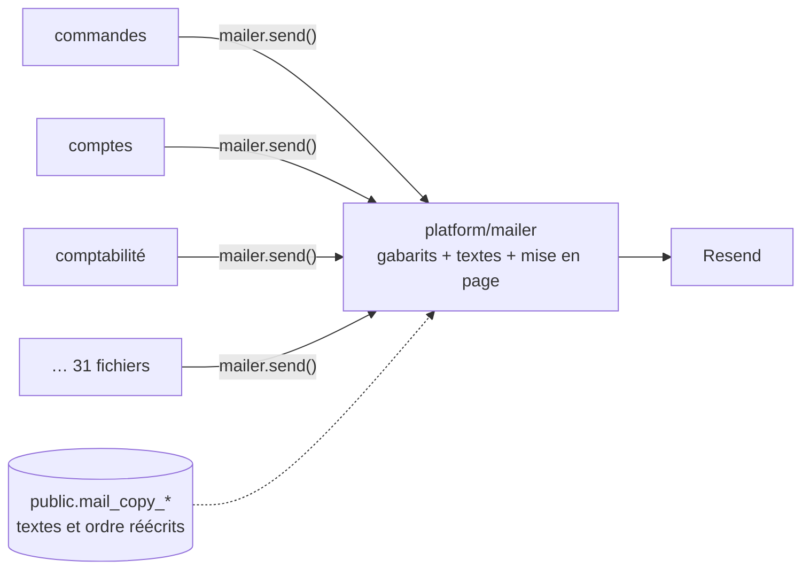
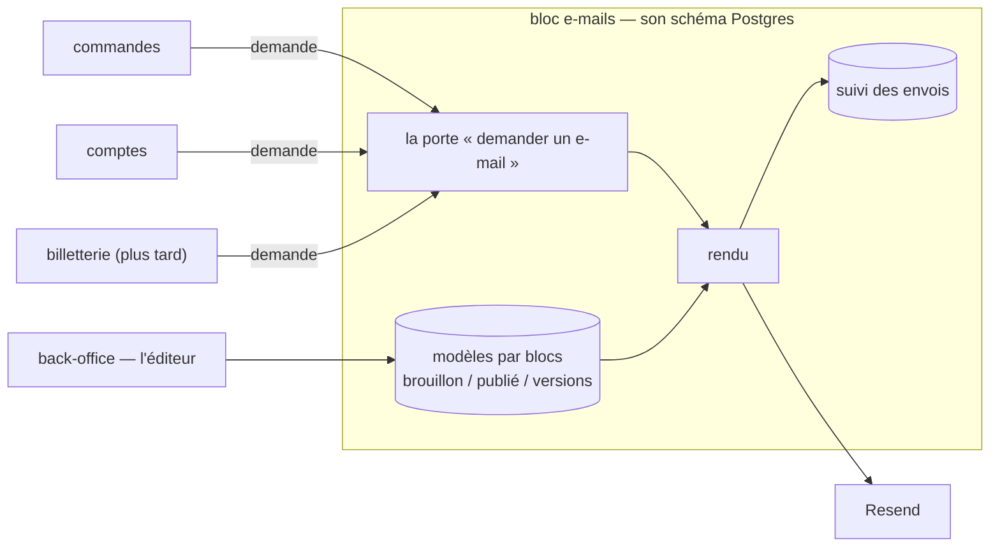

# Plan — le service d'e-mails : un bloc de l'API, un éditeur par blocs

> 📋 **Doc-first, 2026-11-06.** Décisions de Hugo du même jour, rassemblées
> dans [`README.md`](README.md) : le transactionnel d'abord ; l'équipe édite
> avec un droit ; on ajoute et retire des blocs ; rien hors e-mail pour
> l'instant ; un service commun où **les blocs demandent et le service compose
> et envoie** ; ce service est **un bloc de `lfd-api`** (monolithe modulaire),
> comme le sera la billetterie ; l'éditeur vit dans le **back-office**.
>
> ⚔️ **Contredit par `vitruve` le 2026-11-06** : 3 bloquants, 6 sérieux, tous
> intégrés (§ 6). Rien n'est bâti. Reste à Hugo : le nom du bloc et du schéma.

## Partie 1 — Comprendre

### Aujourd'hui

Chaque bloc qui envoie un e-mail **appelle le mailer lui-même** : il prépare
les données, choisit le gabarit, envoie, et lit le résultat. Les gabarits, les
textes et la mise en page vivent dans `platform/mailer/` ; les textes et l'ordre
des sections que l'équipe a réécrits vivent dans le schéma du commerce.

### Demain

Un **bloc d'e-mails** reçoit des **demandes** (« l'e-mail _commande passée_, à
cette personne, en français, avec ces données »), les compose à partir de
**modèles par blocs** que l'équipe édite au back-office, les envoie et en
garde le suivi. Les autres blocs ne savent plus rien de la mise en page.

### Ce qui ne change pas

- **Pas un octet** des e-mails envoyés ne change tant que l'équipe n'a rien
  publié : chaque modèle part du gabarit d'aujourd'hui, prouvé par des
  empreintes.
- L'envoi passe toujours par `@lfd/mailer` et Resend (disjoncteur, mode à
  blanc, liste de suppression).
- Les e-mails légaux joints (factures, bons) gardent leur moteur PDF.

## Partie 2 — Technique

### 1. L'existant (ouvert le 2026-11-06)

- **31 fichiers** de `apps/lfd-api/src` injectent `MAILER` (hors tests) :
  `b2b/orders` 11, `b2b/account` 5, `b2b/contact` 3, `b2b/accounting` 2, et un
  chacun dans `alerts`, `growth`, `mail-copy`, `payments`,
  `sub-account-notices`, `vitrine`, `production`, `staff/directory`,
  `staff/invitations`, `platform/mailer`. **6** seulement sont des
  `@DurableHandler` ; les autres envoient dans une commande, un service ou un
  abonné en mémoire.
- **Environ 6 appelants** rendent le résultat de l'envoi à un écran
  (`mailSent`) : `open-staff-access`, `grant-account-access`,
  `attach-account-holder`, `create-company-by-staff`, `invite-company-member`,
  `vitrine-notice-dispatcher`. (Le plan disait 14 fichiers : 7 sont le client
  Prisma généré ou la colonne de la vitrine — relu par `vitruve` le
  2026-11-06.) Ils envoient APRÈS leur `uow.run`, hors transaction
  (`open-staff-access.service.ts`). `mailSent: true` atteste que Resend a
  accepté, pas que le message est arrivé (`CLAUDE.md`, § 0).
- Le registre `B2bMails`, **32 clés** (et non 28 : relu par `vitruve` le 2026-11-06), (`apps/lfd-api/src/platform/mailer/mail-templates.ts`,
  1 120 lignes) déclare les 28 e-mails ; leurs textes sont au dictionnaire
  (`platform/mailer/copy/`, trois langues, manifeste des variables tenu par
  `lint:mail-copy-digest`) ; leurs sections sont déclarées par gabarit
  (`platform/mailer/sections/`), de nature `text` ou `system`.
- La mise en page de `@lfd/mailer` (`packages/mailer/src/html.ts`,
  `LayoutInput`) est faite de **champs fixes** (titre, corps, bouton, lien
  secondaire, lignes de récapitulatif, image, pied) que l'ordre des sections
  réarrange (`packages/mailer/src/layout-sections.ts`).
- Les réécritures de l'équipe : `public.mail_copy_entries`,
  `public.mail_copy_publication`, `public.mail_section_orders`
  (`prisma/schema/public/mail-copy.prisma`), écrites par `b2b/mail-copy` seul,
  lues par le mailer par un port relié dans `appBootstrap/`.
- L'écran : `textes-emails` du back-office, sous Communication.
- L'outbox durable : `apps/lfd-api/src/platform/outbox/durable-handler.ts`.

### 2. Les choix

- **C1 — Un bloc `mail/`** de premier niveau de `apps/lfd-api/src/`, avec son
  schéma Postgres `mail`. Nom à confirmer par Hugo.
- **C2 — Une porte, deux gestes, déclarée par `platform/`.** La porte
  `MailRequests` est **déclarée dans `platform/`** (sans métier), implémentée
  par le bloc `mail`, et reliée dans `appBootstrap/` — la forme que
  `CLAUDE.md` § 3 prescrit quand `platform` a besoin d'un service. Tous les
  blocs, `staff` et `production` compris, la lisent sans qu'aucune case
  interdite de la matrice ne s'ouvre ; le bloc `mail` n'importe que `platform`
  et `staff` (autorisation de l'éditeur).
  - `request(demande)` — **le défaut** : la demande est écrite dans la
    transaction de l'appelant et part après validation par l'outbox durable.
    Une commande n'attend jamais son e-mail ; un service arrêté retarde, ne
    perd pas.
  - `sendNow(demande)` — pour un geste du staff qui doit lire le résultat à
    l'écran (les ~6 producteurs de `mailSent`), pour l'essai et pour la
    sonde : envoi immédiat, résultat rendu. **Il lève une erreur s'il est
    appelé sous une unité de travail** (le symétrique de
    `DurableFactOutsideUnitOfWorkError` pour `Outbox.append`) : jamais
    d'e-mail pour une écriture qui sera annulée. Le suivi s'inscrit APRÈS
    l'envoi, dans sa propre écriture.
  - Une demande porte : le **modèle** (clé du registre), la **marque**
    (La Folie Coffee aujourd'hui), le destinataire, la langue, les données que
    le modèle déclare, les **références** de ses pièces jointes, et une **clé
    d'idempotence** (un rejeu de l'outbox ne double pas un envoi).
  - **Une pièce jointe n'entre jamais dans la demande.** Aujourd'hui la
    facture et le dossier du fournil arrivent en base64 dans les données du
    gabarit (`invoice-issued-mail.ts`, `production-dossier-mail.ts`) : dans
    `request`, ils seraient écrits dans le `jsonb` de l'outbox et rejoués.
    L'appelant dépose le PDF au stockage (`@lfd/storage`), la demande porte sa
    clé, le bloc le relit au rendu.
- **C3 — Le contrat d'un modèle** : chaque modèle déclare la forme de ses
  données (schéma Zod), ses variables et ses blocs `system`. Le manifeste des
  variables d'aujourd'hui devient ce contrat ; la porte
  `lint:mail-copy-digest` le tient toujours.
- **C4 — Les modèles sont des documents par blocs**, par modèle et par langue,
  en brouillon puis publiés, avec leurs versions datées et le retour arrière.
  Sans version publiée, le modèle est **celui du code**, qui reproduit le
  gabarit d'aujourd'hui octet pour octet.
- **C5 — Le catalogue de blocs est du code** : titre, paragraphe, bouton, lien
  secondaire, image (médiathèque), encadré, séparateur, et les blocs `system`
  (récapitulatif, QR, itinéraire, …) que les données produisent. Un modèle
  déclare les blocs qu'il admet ; un bloc hors de cette liste, ou une variable
  inconnue, est refusé à l'enregistrement.
- **C6 — Le rendu étend la coquille de `@lfd/mailer`** au lieu de la
  remplacer : `LayoutInput` passe de champs fixes à une **liste ordonnée de
  blocs**, et les champs d'aujourd'hui en deviennent un cas particulier. Pas
  de MJML au départ : il changerait les octets et alourdirait le conteneur ;
  à reconsidérer si un client de messagerie résiste.
- **C7 — Le suivi** : chaque demande laisse une ligne (modèle, marque,
  destinataire, langue, état, identifiant Resend, dates). Une donnée
  personnelle de plus au registre RGPD, avec sa durée de conservation, à
  décider par Hugo.
- **C8 — L'éditeur** est au back-office, sous Communication, à la place de
  l'écran `textes-emails` qu'il absorbe ; un droit dédié se règle à l'écran
  des rôles (une migration ajoute la ressource, jamais le droit — `CLAUDE.md`,
  § 3).

### 3. Les lots

| Lot    | Contenu                                                                                                                                                                                                                                                                                                                                                                                                                  | Ce qui change pour un client                                                                                            |
| ------ | ------------------------------------------------------------------------------------------------------------------------------------------------------------------------------------------------------------------------------------------------------------------------------------------------------------------------------------------------------------------------------------------------------------------------ | ----------------------------------------------------------------------------------------------------------------------- |
| **S0** | Armer les portes, le nom tranché par Hugo d'abord (un schéma créé ne se renomme pas) : le bloc `mail` dans la matrice du § 3 de `CLAUDE.md` et dans `lint:context-boundaries`, le schéma `mail` dans le `datasource` et dans `lint:prisma-schema-layout`, la porte `MailRequests` dans `platform/` et sa liaison dans `appBootstrap/`, AVANT le premier fichier                                                          | rien                                                                                                                    |
| **S1** | Le bloc, sa porte (`request` et `sendNow`), la table des demandes et du suivi, l'envoi par l'outbox ; le rendu reste celui de `platform/mailer`. Une porte `lint:mail-through-block` compte les injections de `MAILER` hors du bloc : la dette (31) ne peut que décroître                                                                                                                                                | rien                                                                                                                    |
| **S2** | Faire passer les 31 envoyeurs par la porte, bloc par bloc : `sendNow` pour les ~6 producteurs de `mailSent`, l'essai (`specimen-mail-trial`) et la sonde (`admin-mail-check`) ; `request` pour le reste. Les PDF passent au stockage                                                                                                                                                                                     | les e-mails des abonnés en mémoire deviennent durables ; délai à mesurer sur « commande prête » et « livreur en route » |
| **S3** | Déménager les gabarits, le dictionnaire et les sections de `platform/mailer/` dans le bloc. **Restent dans `platform/mailer/`** : `webhook/` (lu par `ops`), `inbound/` et `journal/`, techniques. Les trois tables `public.mail_*` **restent dans `public`** : seul leur écrivain change (de `b2b/mail-copy` au bloc `mail`), dans le même déploiement que leur lecteur. Les tables neuves du bloc vont dans son schéma | rien                                                                                                                    |
| **S4** | Les modèles par blocs : catalogue de blocs, documents en brouillon / publié / versions, conversion des réécritures existantes en documents, rendu par liste de blocs. Les empreintes (`mail-rendering.golden.json`) couvrent le HTML et l'objet, **pas les octets des PDF et PNG**. `@lfd/mailer` change : `pnpm test` à la racine                                                                                       | rien tant que rien n'est publié                                                                                         |
| **S5** | L'éditeur au back-office : ajouter, retirer, ordonner, écrire, insérer une variable, aperçu, essai, publier, versions, trois langues côte à côte ; le droit dédié                                                                                                                                                                                                                                                        | l'équipe compose ses e-mails                                                                                            |

### 4. Tranché par `vitruve` (2026-11-06)

Les questions posées ici sont répondues au § 6.

### 5. Ce qui n'est pas vérifié

- que les ~6 producteurs de `mailSent` ont tous besoin d'un résultat immédiat ;
- le volume d'envois par jour, qui dimensionne le suivi ;
- le nom du bloc et du schéma (`mail` proposé).

## 6. Contredit par `vitruve` le 2026-11-06 — ce qui a changé

| Objection                                                                                                                 | Gravité  | Ce que le plan fait maintenant                                                                                                                                    |
| ------------------------------------------------------------------------------------------------------------------------- | -------- | ----------------------------------------------------------------------------------------------------------------------------------------------------------------- |
| S2 exigeait `staff → mail` et `production → mail`, deux cases interdites, et faisait du socle `staff` le client d'un bloc | BLOQUANT | la porte `MailRequests` est déclarée dans `platform/`, implémentée par `mail`, reliée dans `appBootstrap/` (C2) : aucune case ne s'ouvre                          |
| absorber `platform/mailer` cassait `ops` (`mail-readings.reader.ts` lit `webhook/`) et trois liaisons d'`appBootstrap`    | BLOQUANT | `webhook/`, `inbound/`, `journal/` restent dans `platform/mailer/` (S3)                                                                                           |
| les PDF voyagent en base64 dans les données : `request` les écrirait dans le `jsonb` de l'outbox                          | BLOQUANT | une pièce jointe est déposée au stockage, la demande porte sa clé (C2)                                                                                            |
| « 14 lecteurs de `mailSent` » : 7 sont du code généré ou une colonne                                                      | SÉRIEUX  | recompté : ~6 producteurs (§ 1)                                                                                                                                   |
| `sendNow` sous une transaction enverrait pour une écriture annulée                                                        | SÉRIEUX  | il lève sous une unité de travail ; le suivi s'écrit après l'envoi (C2)                                                                                           |
| S2 ne classait pas ses envoyeurs                                                                                          | SÉRIEUX  | `sendNow` pour les producteurs de `mailSent`, l'essai et la sonde ; `request` pour le reste ; délai à mesurer sur « commande prête » et « livreur en route » (S2) |
| `SET SCHEMA` : un rangement pour une migration irréversible, et une porte rouge entre deux déploiements                   | SÉRIEUX  | les tables restent dans `public`, seul l'écrivain change, en un déploiement (S3)                                                                                  |
| « octet pour octet » ne couvre pas les pièces jointes                                                                     | SÉRIEUX  | dit (S4)                                                                                                                                                          |
| `@lfd/mailer` change sans `pnpm test` racine                                                                              | SÉRIEUX  | ajouté à S4                                                                                                                                                       |
| 28 e-mails au lieu de 32 clés ; répartition des 31 envoyeurs à recompter                                                  | MINEUR   | 32 (§ 1) ; recompte au bâti de S2                                                                                                                                 |
| le nom du bloc et du schéma est irréversible une fois créé                                                                | MINEUR   | **à trancher par Hugo avant S0** : `mail` proposé                                                                                                                 |

**Non vérifié** (reporté de `vitruve`) : la taille d'une facture en base64 ;
les composeurs de `LayoutInput` hors de `platform/mailer`.
