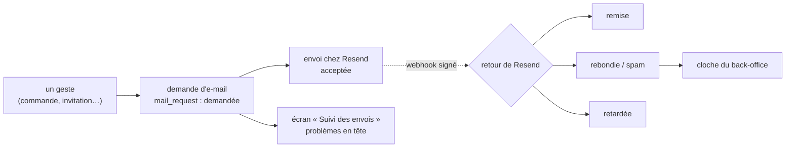

# Le suivi des e-mails — plan

> 📝 **Doc-first**, écrit le 2026-11-08 à la demande de Hugo (« le suivi des
> mails ça me paraît être la bonne suite »). Il bâtit les cas 2 et 5 de la
> revue du service ([`plan-service-e-mails.md`](plan-service-e-mails.md),
> « Revue des changements avec Hugo »). Décisions de Hugo du 2026-11-08 :
> l'adresse masquée dans la liste, en clair au détail et tracée ; un droit à
> part ; les retours de Resend remplacent `ops.mail_send`. Contredit par
> `vitruve` le 2026-11-08 (2 bloquants, 7 sérieux), corrigé ci-dessous.
> Rien n'est bâti.

## Partie 1 — En simple

Aujourd'hui, un e-mail « parti » veut dire **« Resend l'a accepté »**. Qu'il
soit arrivé, qu'il ait rebondi sur une adresse fausse ou fini en spam, on le
sait chez Resend, dans une table que seule la carte de santé lit — et pas
pour un e-mail donné. Aucun écran ne montre les envois, ni ceux qui ont échoué.

Après ce chantier :

- chaque demande d'e-mail porte **son étape réelle** : demandée, acceptée,
  remise, retardée, rebondie, signalée comme spam ;
- un écran **« Suivi des envois »** dans Email Templates liste les envois,
  les problèmes en tête, filtrables ; un envoi s'ouvre sur son détail ;
- l'adresse du destinataire est **masquée** dans la liste (`c•••@halles.fr`),
  affichée en clair dans le détail sur demande, et **chaque révélation est
  inscrite au journal** — qui, quand, quel envoi, jamais l'adresse. Une
  révélation vaut cinq minutes pour cet envoi et cette personne ;
- la recherche par adresse est tracée de la même façon, et bornée ;
- les e-mails de contrôle (la sonde du déploiement) et ceux du mode à blanc
  ne polluent ni la liste des problèmes ni la cloche.

## Partie 2 — Technique

### Ce qui existe (lu le 2026-11-08)

| Pièce                  | Où                                                                                                                                     | Ce qu'elle fait                                                                                                                                                                                                                                                                |
| ---------------------- | -------------------------------------------------------------------------------------------------------------------------------------- | ------------------------------------------------------------------------------------------------------------------------------------------------------------------------------------------------------------------------------------------------------------------------------ |
| Le suivi des demandes  | `mail.mail_request` (`apps/lfd-api/prisma/schema/mail.prisma`)                                                                         | une ligne par e-mail demandé : modèle, espace, destinataire, `status` (`requested` / `sending` / `sent` / `failed` / `refused`), `provider_id`, raison, tentatives, version du document. Tous les envois y passent : `lint:mail-through-block` compte 0 envoyeur hors du bloc. |
| Le journal du courrier | `ops.mail_send` (`apps/lfd-api/prisma/schema/ops.prisma`), écrit par `PrismaMailJournal` (`apps/lfd-api/src/platform/mailer/journal/`) | une ligne par e-mail accepté (`recordSend`, depuis `JournalingMailer`), relevée vers le haut par les retours (`recordOutcome` : `sent` < `delayed` < `delivered` < `complained` < `bounced`). Sans lien avec `mail_request`.                                                   |
| Le webhook             | `apps/lfd-api/src/platform/mailer/webhook/`                                                                                            | vérifie la signature Svix, dédoublonne par `svix-id` (`ops.webhook_event`), écarte `opened`/`clicked` exprès, range l'issue dans `ops.mail_send` ; remet `email.received` au port `InboundMailSink`, que `b2b/contact` implémente.                                             |
| La carte de santé      | `apps/lfd-api/src/ops/health/mail-readings.reader.ts`                                                                                  | compte `ops.mail_send` par état sur 7 jours (`MAIL_WINDOW_DAYS`) et nomme le modèle le plus rejeté.                                                                                                                                                                            |
| La veille              | `watch-mail-requests.handler.ts`                                                                                                       | sonne la cloche pour les demandes coincées ou en échec définitif — pas pour un rebond.                                                                                                                                                                                         |
| La purge               | `purge-settled-mail-requests.handler.ts`                                                                                               | supprime les demandes closes depuis 1 an, sous `MAIL_REQUEST_PURGE` (`dry-run` par défaut).                                                                                                                                                                                    |
| Le registre RGPD       | `documentation/legal/rgpd-registre.json`                                                                                               | porte déjà `mail.mail_request.recipient`, `failure_reason`, `locale`.                                                                                                                                                                                                          |

### Les décisions de forme

1. **Deux axes, pas un.** `status` reste le cycle de la **demande** (notre
   côté : demandée → envoi → acceptée / échouée / refusée). Une colonne
   neuve `delivery` porte le **retour du fournisseur** : `null` (rien reçu),
   `delayed`, `delivered`, `complained`, `bounced`, avec `delivery_at` et
   `delivery_kind`. Les fondre ferait mentir l'un ou l'autre : une demande
   acceptée puis rebondie n'a pas « échoué » de notre côté, et la reprise ne
   doit pas la relancer. `email.sent` est **écarté** : il redit l'acceptation,
   que `status` porte déjà.
2. **Aucun retour ne se perd, même arrivé avant nous** (bloquant 1 de
   vitruve). Aujourd'hui le `svix-id` est consommé avant le traitement
   (`receive-resend-event.handler.ts`), et l'envoi n'écrit `provider_id`
   qu'au `save` qui suit l'appel à Resend (`mail-send-attempt.ts`) : un
   rebond rapide trouverait un identifiant inconnu et serait oublié. Donc
   **chaque retour est d'abord rangé** dans une table du bloc,
   `mail.mail_delivery_event` (`provider_id`, retour, genre, instant,
   `svix-id` unique — c'est elle, désormais, qui dédoublonne), puis appliqué
   à la demande si elle est connue. Une demande qui reçoit son `provider_id`
   relit ses retours en attente dans la même transaction ; le balayeur `*/5`
   applique ceux qui resteraient. Un retour sans demande au bout de 30 jours
   (e-mail parti avant la colonne, ou d'un autre système) est purgé.
3. **Relevé vers le haut seulement**, même règle que `recordOutcome` (rang
   `delayed` < `delivered` < `complained` < `bounced`) : les webhooks n'ont
   pas d'ordre garanti. Index **non unique** sur `provider_id` : la prod n'a
   pas été vérifiée contre des doublons, et un retour s'applique alors à
   toutes les demandes qui le portent.
4. **Aucun texte du fournisseur n'est rangé** (bloquant 2). `bounce.message`
   cite souvent l'adresse ; on ne garde que le **genre** du retour
   (`bounce.type` / `subType` de Resend : `Permanent`, `Transient`,
   `Undetermined`, et le sous-genre), une valeur courte et sans donnée
   personnelle, ajoutée au registre RGPD comme non personnelle. Même défaut
   déjà en base : `failure_reason` (nos propres messages d'échec, qui peuvent
   reprendre une erreur Resend citant l'adresse) n'est servi **qu'avec**
   l'adresse, au moment d'une révélation.
5. **Le déménagement se fait en deux déploiements** (sérieux 8 et 9). T1
   écrit le nouveau suivi **et** continue d'alimenter `ops.mail_send` ; la
   carte de santé reste sur l'ancienne table. T1b, au moins sept jours plus
   tard, bascule la carte sur le suivi et cesse d'écrire `ops.mail_send`
   (qui reste en base, CLAUDE.md § 0). Pas de carte qui ment une semaine, et
   un retour arrière de T1 ne perd rien.
6. **Les ports, nommés** (sérieux 7). Le port `MailJournal` est coupé en
   deux : `WebhookEventRegistry` (`rememberEvent`, que lit
   `send-guest-order-notice`) reste dans `platform/` ; `recordSend` /
   `recordOutcome` disparaissent en T1b avec `ops.mail_send`. Le webhook
   (`webhooks/resend`, même route) passe dans `mail/deliveries/` ; il relaie
   `email.received` au port `InboundMailSink` de `platform/`, que `b2b/contact`
   implémente et qu'`appBootstrap` relie — inchangé, `mail` ne connaît pas
   `b2b`. La carte de santé lit par `MailDeliveryTally` (déclaré dans
   `platform/`, implémenté par `mail`) : `ops` n'importe aucun bloc.
7. **La révélation d'une adresse, en deux temps et dans le bloc** (sérieux 3).
   La commande `RevealMailRecipient` écrit une ligne dans
   `mail.mail_recipient_reveal` (staff, envoi, instant ; jamais l'adresse) et
   publie le fait `mail.recipient_revealed` au journal. La requête
   `GetMailRecipient` lit **cette table du bloc** — pas le journal des
   faits — et ne rend l'adresse (et `failure_reason`) que si ce staff a
   révélé cet envoi depuis moins de 5 minutes ; sinon 403 nommé. La trace dit
   donc « révélé », pas « affiché » : pendant 5 minutes, relire ne trace rien
   de plus. Une révélation coûte une commande : au-delà de **30 par heure et
   par personne**, la commande refuse (règle de l'agrégat, lue sur la table).
8. **La recherche par adresse, comme une révélation** (sérieux 4). Savoir
   qu'une adresse a reçu tel e-mail est déjà une information. La commande
   `SearchMailByRecipient` (adresse en corps, jamais en URL) range la
   recherche — staff, instant, **empreinte** HMAC de l'adresse, jamais
   l'adresse — publie `mail.recipient_searched`, et rend l'identifiant de la
   recherche ; la requête `GetMailSearchResults` rend les envois trouvés,
   masqués, à son auteur seulement, pendant 5 minutes. Même plafond horaire,
   partagé avec les révélations.
9. **L'adresse se compare normalisée** (sérieux 5). Colonne neuve
   `recipient_key` = adresse en minuscules, écrite par l'agrégat à la
   création, index ordinaire déclaré dans `mail.prisma` — pas d'index
   d'expression, que Prisma prendrait pour une dérive. Les demandes déjà en
   base sont remplies par la migration (`lower(recipient)`).
10. **Ce qui ne compte pas** (sérieux 6). Les modèles marqués `outOfEditor`
    (`ops.deploy-check`, la sonde) sont listés à part, hors des problèmes, de
    la carte et de la cloche. Une demande acceptée **à blanc** (`provider_id`
    nul) a le retour `dry_run`, servi comme tel — jamais confondu avec
    « rien reçu ».
11. **Un droit à part** : ressource `mail_sends` (« Suivi des e-mails »),
    lecture seule. La migration ajoute la valeur, **aucun droit à aucun
    rôle** (`lint:no-role-grants-in-migrations`) : Hugo l'accorde à l'écran.
12. **L'état servi en code anglais** (`requested`, `sending`, `accepted`,
    `failed`, `refused` ; `dry_run`, `delayed`, `delivered`, `complained`,
    `bounced`) ; le back-office traduit. `sent` devient `accepted` **dans le
    contrat de réponse** de `packages/contracts` seulement — la valeur en base
    ne se renomme pas (une valeur n'est pas un nom), et la porte de T4 vise
    les champs `mailSent` / `sent`, pas cet état.

### Les lots

**T1 — les retours rangés et appliqués (API, migration additive).**
Tables `mail.mail_delivery_event` et colonnes `delivery`, `delivery_at`,
`delivery_kind`, `recipient_key` (remplie), index `provider_id`,
`recipient_key`, `(delivery, delivery_at)`. Le webhook passe dans
`mail/deliveries/`, range puis applique ; `MailRequest.recordDelivery`
refuse de descendre ; la demande relit ses retours en attente au
`markSent` ; le balayeur applique le reste ; la purge des retours orphelins
(30 jours, sous le cran `MAIL_REQUEST_PURGE`). `ops.mail_send` **toujours
écrite**. Registre RGPD : `delivery_kind`, `recipient_key` (personnelle,
même durée que `recipient`). Tests aux trois niveaux, dont : un `bounced`
reçu avant le `save` de l'envoi, puis appliqué ; un webhook rejoué ; un
`delivered` arrivé après un `bounced`.

**T2 — le droit et les lectures (API, migration additive).**
Ressource `mail_sends`, tables `mail_recipient_reveal` et
`mail_recipient_search`, faits `mail.recipient_revealed` et
`mail.recipient_searched` au contrat du journal. `GET /admin/mail/sends`
(filtres, curseur, problèmes d'abord, sonde à part), `GET
/admin/mail/sends/:id` (étapes, genre du retour, version du document,
tentatives — adresse masquée, sans `failure_reason`), `POST
…/:id/recipient-reveal` puis `GET …/:id/recipient`, `POST
/admin/mail/sends/searches` puis `GET …/searches/:id`. Contrôleurs à bus
seulement. E2e : le droit, le masque, la révélation qui expire, le plafond,
la recherche à son seul auteur, aucune adresse dans une URL ni un journal.

**T3 — l'écran (back-office).** « Suivi des envois » en tête d'Email
Templates, page `/emails/envois` : liste, filtres, recherche ; détail en
panneau avec « Afficher l'adresse ». Le dictionnaire traduit les états.

**T1b — la bascule (au moins 7 jours après T1).** La carte de santé lit
`MailDeliveryTally` ; la veille sonne aussi pour un `bounced` /
`complained` des dernières 24 h (une cloche par modèle, sonde exclue) ;
`ops.mail_send` n'est plus écrite ; `recordSend` / `recordOutcome` retirés.

**T4 — l'honnêteté du mot « envoyé » (porte).** `lint:mail-status-honest` et
les types `MailDemand`, `MailAcceptance`, `MailDelivery` du cas 5 ; anciens
noms en dette décroissante.

**Hors de ce plan** : les faits `mail.delivered` / `mail.bounced` publiés aux
autres blocs (« e-mail reçu » sur la fiche d'une commande) — ils demandent
qu'une demande connaisse son sujet (commande, compte), ce que `mail_request`
ne porte pas. Lot suivant, à décider.

### Ce qui sera difficile à défaire (à dire à Hugo)

- Les faits `mail.recipient_revealed` et `mail.recipient_searched` entrent au
  contrat du journal : un fait écrit ne se renomme plus gratuitement.
- T1b cesse d'écrire `ops.mail_send` : passé ce déploiement, un retour
  arrière du code retrouve un trou dans l'ancienne table.

### La contradiction de `vitruve` (2026-11-08), et ce qu'elle a changé

| Objection                                                     | Traitement                                                                       |
| ------------------------------------------------------------- | -------------------------------------------------------------------------------- |
| B1 — un retour arrivé avant `provider_id` est perdu           | décision 2 : rangé d'abord, appliqué ensuite                                     |
| B2 — `bounce.message` cite l'adresse                          | décision 4 : seul le genre est rangé ; `failure_reason` servi avec la révélation |
| S3 — la trace vaut une révélation, pas un affichage           | décision 7 : dit tel quel, lu dans une table du bloc, plafonné                   |
| S4 — la recherche, oracle d'appartenance                      | décision 8 : tracée et plafonnée comme une révélation                            |
| S5 — adresse non normalisée, index d'expression               | décision 9 : colonne `recipient_key`                                             |
| S6 — mode à blanc et sonde dans les problèmes                 | décision 10                                                                      |
| S7 — port `MailJournal` partagé, relais d'`InboundMailSink`   | décision 6                                                                       |
| S8, S9 — carte fausse 7 jours, pas de retour arrière          | décision 5 : deux déploiements                                                   |
| Mineurs — `email.sent`, doublons de `provider_id`, `accepted` | décisions 1, 3, 12                                                               |

**Non vérifié** : le délai réel de Resend avant le premier webhook ; le texte
exact d'un `bounce.message`, et les noms des champs `bounce.type` /
`subType` (lus dans le code actuel pour `type` seulement) ; d'éventuels doublons de `provider_id` en prod
(à lire avant la migration, au `lecteur-de-migrations`).
