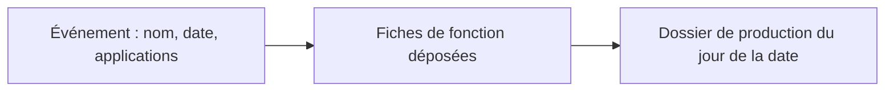

# Plan — les événements et leurs fiches de fonction

> ✅ **En production depuis le 2026-11-25** (`7ae983e40`) : E0–E3, archivage, remplacement, partie « Fiches de fonction » de la fenêtre d'impression. Mise en service : accorder la ressource `events` à l'écran `/admin/staff-roles`. Demande de Hugo du même jour.
> Hors des quatre cas de `vitruve` (ni argent, ni migration de données, ni
> frontière de sécurité déplacée, ni runbook) : les affirmations sur
> l'existant ci-dessous ont été ouvertes le 2026-11-24.

## En bref

La production a un circuit parallèle : pour un **événement** (une journée
d'event), une **fiche de fonction** — aujourd'hui un Excel — décrit le déroulé
de la journée et ce qu'il faut produire. On veut :

1. une entrée **Événements** dans le menu principal du back-office : une table
   des événements et un bouton « Créer un événement » qui ouvre un popover
   (nom + date) ;
2. une page **détail** d'un événement où l'on dépose ses fiches de fonction ;
3. ces fiches **imprimées avec le dossier de production du jour** de
   l'événement.



Les événements finiront transverses (plusieurs applications) : ils vivent
**dans leur propre bloc et leur propre schéma**, et chaque événement **dit
quelles applications il concerne** — aujourd'hui `lafoliecoffee`.

## Partie technique

### Le bloc `events/` et le schéma `events`

Un bloc de premier niveau, à la figure de `recurring/` (schéma propre, aucune
clé étrangère qui sort) :

```
src/events/
├── event/            l'agrégat Event, ses routes /admin/events
├── function-sheet/   les fiches de fonction (dépôt, liste, retrait)
├── channels/
│   └── production/   l'implémentation du port que le fournil déclare
└── events.module.ts
```

| Table                   | Colonnes                                                                                                                                                           |
| ----------------------- | ------------------------------------------------------------------------------------------------------------------------------------------------------------------ |
| `events.event`          | `id`, `name`, `event_date` (`date`), `applications` (`text[]`, `CHECK` sur les valeurs connues, non vide), `archived_at`, `created_by`, `created_at`, `updated_at` |
| `events.function_sheet` | `id`, `event_id` (FK interne au schéma), `file_name`, `storage_key`, `content_type`, `size_bytes`, `position`, `uploaded_by`, `uploaded_at`, `archived_at`         |

- **`applications`** : la liste des applications concernées, valeurs nommées
  dans le domaine (`lafoliecoffee` seule aujourd'hui). Un `text[]` plutôt
  qu'une table : il n'y a rien à dire d'une application ici, seulement son nom.
- **Pas de DELETE** : un événement et une fiche s'archivent (§ 3).
- L'agrégat `Event.declare(name, date, applications)` refuse un nom vide et
  une liste vide ; `rename`, `reschedule`, `archive`. La fiche n'est pas un
  agrégat de plus : `Event` porte ses fiches (ordre, retrait), la règle
  « pas de dépôt sur un événement archivé » s'y écrit.

### La matrice des frontières

- `events` n'importe que `staff` (autorisation) et `platform`.
- **`production` DÉCLARE** `production/channels/events/` — `EventFunctionSheetsReader` (et `InForceFunctionSheetsReader`, sans les octets, pour la fenêtre) :
  « les fiches de fonction à joindre au dossier de ce jour » (nom de
  l'événement, fiches dans l'ordre, octets lus au stockage). `events`
  l'implémente, `appBootstrap` relie. `production → events` reste interdit :
  le fournil ne sait pas qui lui fournit des fiches. Le filtre « concerne
  `lafoliecoffee` » est dans l'implémentation.
- Une ligne et une colonne `events` dans la matrice du `CLAUDE.md` § 3, et le
  bloc dans `lint:context-boundaries` **avant** le premier fichier (armer la
  porte avant de déménager), dans `lint:prisma-schema-layout` et
  `lint:prisma-model-ownership`.

### Les droits

Une ressource `StaffResource.events` ajoutée par la migration, **sans droit
accordé** : Hugo l'accorde à l'écran (`/admin/staff-roles`). Lire = voir la
table et le détail ; écrire = créer, renommer, déposer, retirer.

### Les routes

| Route                                        | Ce qu'elle fait                                   |
| -------------------------------------------- | ------------------------------------------------- |
| `GET /admin/events?from=&to=`                | la table, plus proche d'abord, archivés exclus    |
| `POST /admin/events`                         | `{ name, date }` → id (`@IntentKey`, scellé)      |
| `GET /admin/events/:id`                      | le détail et ses fiches                           |
| `PATCH /admin/events/:id`                    | nom, date                                         |
| `DELETE /admin/events/:id`                   | archive l'événement (pas d'effacement), rejouable |
| `POST /admin/events/:id/function-sheets`     | dépôt d'un fichier (multipart), rangé au stockage |
| `GET /admin/events/:id/function-sheets/:sid` | sert le fichier                                   |
| `DELETE …/function-sheets/:sid`              | archive la fiche (pas d'effacement)               |

### Le format des fiches — **option A, décidée par Hugo le 2026-11-24**

Le dossier du jour est un PDF tiré par le serveur (`pdfkit`). Ouvert le
2026-11-24 : l'API n'a **aucune bibliothèque qui lit ou fusionne un PDF**
existant, et rien ne convertit un Excel.

- **Option A (recommandée)** : on dépose des **PDF** (Excel → « Exporter en
  PDF »), et le dossier les **ajoute à la fin**, précédées d'un intercalaire
  « Événement : <nom> — fiches de fonction ». Demande une dépendance de
  fusion (`pdf-lib`, pure JS, consommateur unique : pas au catalogue pnpm).
- **Option B** : on accepte l'`.xlsx` et on le convertit au serveur
  (LibreOffice en container) — lourd, et le rendu d'un Excel imprimé dépend de
  ses zones d'impression ; à écarter pour commencer.
- **Option C** : le dossier imprime seulement un **renvoi** (« 2 fiches de
  fonction : imprimer depuis l'événement ») — rien à fusionner, mais deux
  impressions.

### L'impression dans le dossier

- Dans la fenêtre d'impression, une partie de plus : **Fiches de fonction**,
  cochée par défaut quand le jour a un événement.
- Les fiches ne sont **pas figées à l'arrêt** : chaque tirage lit les fiches
  en vigueur (section « Une version plus récente d'une fiche »).
- Un `events` muet (panne) laisse partir le dossier **sans les fiches et non
  archivé**, comme un commerce muet pour les BL — le pied le dit.
- `DOSSIER_LAYOUT_VERSION` monte d'un cran.

### Le back-office

- Entrée de menu **Événements** (`/evenements`), à côté de la production.
- Table fold : nom, date, applications, nombre de fiches ; « Créer un
  événement » ouvre un popover (nom, date) puis mène au détail.
- Détail : nom et date modifiables, liste des fiches (télécharger, retirer),
  zone de dépôt.

## Les lots

| Lot | Contenu                                                                         |
| --- | ------------------------------------------------------------------------------- |
| E0  | portes armées pour `events`, matrice du `CLAUDE.md`, schéma et migration        |
| E1  | agrégat, routes de l'événement, ressource de droit ; table + popover au front   |
| E2  | dépôt, liste, retrait des fiches ; page détail                                  |
| E3  | port `EventSheetsReader`, partie « Fiches de fonction » dans le dossier du jour |

## Questions à Hugo

1. ~~Format des fiches~~ : **A** (Hugo, 2026-11-24). Un dépôt qui n'est pas un
   PDF est refusé, et le refus dit « exportez la fiche en PDF depuis Excel ».
2. Un événement peut-il durer **plusieurs jours** (une date de début et de
   fin) ? **Un seul jour pour l'instant** (Hugo, 2026-11-24 : « un event peut durer plusieurs jours, mais pour l'instant on fait simple »). Passer à une date de début et de fin plus tard reste additif : `event_date` deviendrait le premier jour.
3. Les fiches sont-elles toujours pour **le jour même** de l'événement, ou
   parfois pour la veille (production la veille d'un event) ? **Le jour même** (Hugo, 2026-11-24).

## Tranché au bâti (E0–E2, 2026-11-24)

- La table trie les événements à venir du plus proche au plus lointain, puis
  les passés du plus récent au plus ancien ; pas de fenêtre par défaut.
- Un événement archivé ne bouge plus : renommer, déplacer, déposer ou retirer
  une fiche y est refusé (409).
- L'écran ne choisit pas les applications : la création pose toutes celles
  connues, soit `lafoliecoffee`.
- Pas de journal (`@sans-journal`) : l'auteur est gardé sur la ligne.
- `DELETE /admin/events/:id` archive l'événement (ajouté à la demande de Hugo le 2026-11-24).
- Le module Nest s'appelle `EventsBlockModule` : `EventsModule` existe déjà
  dans `platform/events`.

## Une version plus récente d'une fiche (Hugo, 2026-11-24)

« Si quelqu'un dépose une version plus récente de la fiche, c'est cette
nouvelle version qui part dans le dossier. »

- **Remplacer** une fiche : `POST /admin/events/:id/function-sheets/:sheetId/replacement`
  (multipart, `@IntentKey`). L'agrégat archive l'ancienne et donne **son rang**
  à la nouvelle, qui porte `replaces_sheet_id`. L'ancienne reste en base et au
  stockage.
- Le rang n'est donc plus unique que parmi les fiches en vigueur : index
  unique partiel `(event_id, position) WHERE archived_at IS NULL`, par une
  migration à part.
- **Au dossier (E3)** : les fiches ne sont **pas figées à l'arrêt**. Chaque
  tirage — provisoire, dossier, retirage, extrait — lit les fiches en vigueur
  à cet instant. Le dossier déjà archivé garde la version qu'il a imprimée (un
  PDF tiré ne bouge plus) ; une version plus récente sort au tirage suivant,
  et la fenêtre d'impression signale « fiche de fonction remplacée depuis
  l'impression #N ».
