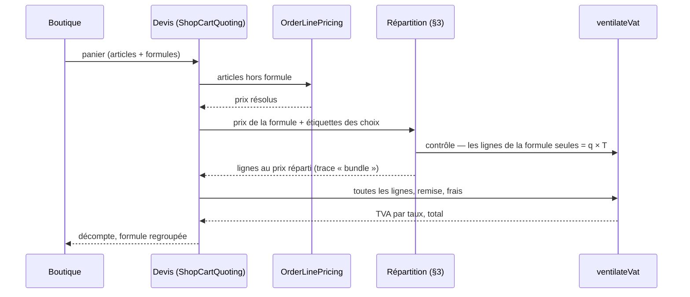

# Plan — les formules

> 🔁 **Relu contre le code le 2026-10-17** (dépôt `dev`, après le lot D, le
> lot S, l'audience, X0 et X1 ; X2 en cours). Chaque affirmation du §1 est
> citée `fichier:ligne` et a été ouverte ce jour-là. Changements de cette
> relecture :
>
> - **le mot du code est `Bundle`** (Hugo, 2026-10-17) — agrégat `Bundle`,
>   contexte `b2b/bundles/`, champ de ligne `bundle`, colonne
>   `bundle_occurrence_id`, étage de trace `bundle`. « Formule » reste le mot
>   des écrans et de la doc ;
> - **l'écran vit dans Gestion Boutique** (Hugo, 2026-10-17) ;
> - **la forme de l'altération de prix n'est pas tranchée** : D1 la présente
>   face à ses alternatives (Q4) ;
> - le §1 est réécrit : le HT public n'est plus déduit par le commerce, il
>   arrive résolu du référentiel ; aucun prix ne se décide plus sur la
>   plateforme (lot D) ; la boutique sert aussi des pros (audience) ;
> - le §2 bis est **toujours vrai** au 2026-10-17, et il a désormais un
>   symptôme constaté en production et son propre document.
>
> ⚠️ **La contradiction de `vitruve` du 2026-09-28 (§9) est à refaire** : elle
> portait sur un code qui a changé sous elle (prix décidé, push, version de
> catalogue). Ses corrections restent dans le texte, mais aucune n'a été
> re-contredite. Le plan touche à l'argent et porte une migration : `vitruve`
> d'office avant Hugo (CLAUDE.md §9 bis).

> **État : 📐 plan, rien n'est bâti** (aucun `bundle` ni `formula` dans
> `apps/lfd-api/src`, vérifié le 2026-10-17). Ouvert le 2026-09-28 sur la
> demande de Hugo : « une sélection de produits de différentes catégories qui
> ont un tarif particulier ensemble ». Premier cas : **le petit déjeuner** —
> une viennoiserie, une baguette, une boisson.
>
> Place réservée depuis le plan de la boutique :
> [`commandes/boutique-rayon-layout.md`](../commandes/boutique-rayon-layout.md), ligne
> « Formule » (`:168`, toujours « ❌ à concevoir » au 2026-10-17) — « un choix
> par groupe, le prix de la formule appliqué ».

---

## 0. Ce qu'est une formule

Une formule est une **offre commerciale** : des **groupes** (viennoiserie, pain,
boisson), chacun avec ses **choix admis**, et un **prix fixe taxe comprise**. Le
client prend **un article par groupe** ; il paie le prix de la formule, pas la
somme des articles.

```
Petit déjeuner — 3,90 €
├── Viennoiserie : croissant · pain au chocolat
├── Pain         : baguette tradition
└── Boisson      : café · chocolat chaud · jus d'orange
```

Ce n'est **pas** un produit : ni fiche réglementaire, ni allergènes à elle, ni
fabrication. Ses allergènes sont ceux des articles choisis ; ce que le fournil
fabrique, ce sont des croissants et des baguettes.

---

## 1. Ce qui existe, et sur quoi le plan s'appuie

Chaque affirmation a été **ouverte le 2026-10-17** (la version du 2026-09-28
citait des fichiers sans ligne ; trois de ses affirmations étaient devenues
fausses, signalées ⚠️).

| Fait                                                                                                                                                                                                                                                                           | Où                                                                                                                                                  |
| ------------------------------------------------------------------------------------------------------------------------------------------------------------------------------------------------------------------------------------------------------------------------------ | --------------------------------------------------------------------------------------------------------------------------------------------------- |
| Devis et commande ventilent la TVA par **une seule fonction**, `ventilateVat` : regroupement par taux, un arrondi par taux, montants **HT en centimes**.                                                                                                                       | `packages/money/src/vat.ts:116`                                                                                                                     |
| Sa remise est **une seule somme**, retranchée au prorata de **toutes** les marchandises ; `computeOrderTotals` y ajoute le bon de fidélité (`discountCents + voucherDiscountCents`).                                                                                           | `vat.ts` ; `apps/lfd-api/src/b2b/orders/domain/services/vat.ts:138`, `:141`                                                                         |
| Une ligne fige `unitPriceMillicents` (HT), `vatRate`, `quantity`, `lineTotalCents` — **arrondi au centime par ligne** (`lineTotalCents`), avant toute ventilation —, `unitPriceTtcCents` scellé par `ttcCentsOf`, la trace de prix et les allergènes.                          | `b2b/orders/domain/value-objects/order-line.ts:120`, `:137` ; `packages/money/src/millicents.ts:76`, `vat.ts:241`                                   |
| La trace de prix doit **aboutir** au prix facturé, sinon refus (sauf `floored` / `clampedToZero`).                                                                                                                                                                             | `order-line.ts:191` (`assertConsistent`), `:214`                                                                                                    |
| La trace est persistée en colonnes de ligne : `base_price_millicents`, `pricing_steps`, `pricing_floor`, `pricing_floored`, `pricing_clamped_to_zero`, `pricing_commitment`, `pricing_rejected`, `allergens` — chacune nullable, `NULL` = « on ne savait pas ».                | `prisma/schema/public/orders.prisma:421-490`                                                                                                        |
| 🔴 **Un SKU n'apparaît qu'une fois par commande** : `@@unique([orderId, sku])` ; son commentaire invoque la fusion des quantités et les moyennes par SKU.                                                                                                                      | `orders.prisma:496-502`                                                                                                                             |
| ⚠️ **Changé** — Le HT public **n'est plus déduit par le commerce** : le référentiel le résout par contexte de vente (`htMillicentsOf` y est appelé) et le commerce le lit tel quel dans `public_by_context[takeaway]`. L'étiquette TTC est rangée à part (`public_ttc_cents`). | projection.ts:173 (la projection du push, retirée en X4) ; `b2b/catalog/infrastructure/prisma-catalog.reader.ts:284` ; `catalog.prisma:173`, `:190` |
| ⚠️ **Changé (lot D, 2026-10-15)** — Plus aucun prix ne se décide sur la plateforme : `decided_public_ttc_cents` n'est plus lu ni écrit (la colonne reste en base). Le prix servi est celui du référentiel, puis mercuriales, promotions, paliers.                              | `prisma-catalog.reader.ts:262-275` (JSDoc) ; `catalog.prisma:521`                                                                                   |
| ⚠️ **Changé (audience)** — Un article se vend à `pro`, `public` ou `both` ; `servedTo` est la règle unique de « servi à ce lecteur ». Le devis de la boutique sert **visiteur et société** (la route reconnue passe la société, son audience en est déduite).                  | `b2b/catalog/domain/served-to.ts:8`, `:46` ; `b2b/orders/application/services/shop-cart-quoting.service.ts:106-118`, `:229`                         |
| Devis et commande demandent le prix par `OrderLinePricing.resolve`, qui **additionne les quantités par SKU** avant de résoudre (paliers).                                                                                                                                      | `b2b/orders/application/services/order-line-pricing.service.ts:70`, `:114`                                                                          |
| Le devis de la boutique vérifie aussi les **opérations au commerce** (`operations.ensure`) ; un article `operationOnly` ne se commande que dans son opération.                                                                                                                 | `shop-cart-quoting.service.ts:123` ; `b2b/catalog/domain/operation-access.ts:42`, `:85`                                                             |
| L'empreinte d'idempotence hache `sku:quantity` trié ; le bon n'y entre **que s'il est présent**.                                                                                                                                                                               | `b2b/orders/domain/services/order-fingerprint.ts:58-59`, `:79`                                                                                      |
| ⚠️ **Changé (X0, 2026-10-17)** — La commande ne fige plus de version de catalogue (`catalogVersionId: null` sur toute commande neuve ; la colonne reste, X2 la retire de l'usage).                                                                                             | `b2b/orders/application/services/order-drafting.service.ts:240`                                                                                     |
| `lint:dated-decisions` ne lit **que** `b2b/pricing/domain/` (`pricing-materials.ts` et cinq fichiers déclarants).                                                                                                                                                              | `dev-toolbox/gates/dated-decisions.mjs:51`, `:121-127`                                                                                              |
| La boutique publique ne vend qu'**à emporter** (`PUBLIC_SALES_CONTEXT = "takeaway"`, Hugo, 2026-09-21).                                                                                                                                                                        | `b2b/catalog/domain/public-context.ts:30`                                                                                                           |
| Les points de fidélité : un point par centime d'assiette **HT**, remise et bon déduits.                                                                                                                                                                                        | `b2b/loyalty/domain/services/order-earning.ts:28`, `:50`                                                                                            |
| **Gestion Boutique** est une section du back-office (Hugo, 2026-10-13) : opérations datées, promotions, fidélité, chacune sous son droit.                                                                                                                                      | `apps/lfd-backoffice-frontend/src/app/app.ts:310-320`                                                                                               |

Chemins `b2b/…` relatifs à `apps/lfd-api/src/`, `prisma/…` à `apps/lfd-api/`.

---

## 2 bis. 🔴 Un défaut qui précède les formules : l'étiquette n'est pas toujours ce qu'on encaisse

> **État au 2026-10-17 : toujours vrai, non corrigé, et le lot D ne l'a pas
> changé.** Le lot D a retiré le prix _décidé_ ; la chaîne de calcul
> (HT par ligne arrondi → TVA par taux) est la même (`order-line.ts:120`,
> `vat.ts:116`). Le seul déplacement : le HT unitaire est désormais calculé
> **au référentiel** (projection.ts:173 (retirée en X4)) au lieu du commerce — même
> fonction, même résultat. Depuis le 2026-10-09, le défaut a un **symptôme
> constaté en production** (1,90 € + 0,50 € encaissés 2,39 €) et son propre
> document, [`pricing/ecart-du-centime-particuliers.md`](../pricing/ecart-du-centime-particuliers.md),
> qui attend la réponse du cabinet comptable sur la TVA « en dedans » (son
> §6). F0 et Q0 en dépendent désormais.

`vitruve` a montré qu'un prix de formule TTC peut être **impossible à
facturer**. Le même raisonnement vaut pour **n'importe quelle étiquette
publique**, et il a été mesuré sur la chaîne réelle (`htMillicentsOf` →
`lineTotalCents` → `ttcCentsOf`, celle du devis et de la commande), pour une
étiquette de 0,50 € à 10,00 €, quantité 1 :

| Taux  | Étiquettes encaissées à un autre montant | Exemples                          |
| ----- | ---------------------------------------- | --------------------------------- |
| 5,5 % | **49 sur 951** (≈ 5 %)                   | 0,67 € → 0,68 € ; 1,25 € → 1,24 € |
| 10 %  | **86 sur 951** (≈ 9 %)                   | 0,60 € → 0,61 €                   |
| 20 %  | **159 sur 951** (≈ 17 %)                 | 0,51 € → 0,52 €                   |

**La cause est structurelle, pas un arrondi mal placé.** Le HT est arrondi au
centime par ligne, puis la TVA l'est par taux. Le TTC vaut donc
`H + arrondi(H × taux)`, qui saute certains centimes : aucun HT entier ne
donne 0,67 € à 5,5 %. `architecture-prix-ancre-ttc.md` écrit « l'étiquette est
ce que la caisse encaisse » ; la chaîne ne le tient pas pour ces montants.

Ce n'est pas propre aux formules, et ce plan ne le corrige pas en douce. Mais
**les formules ne peuvent pas être plus justes que les articles** : tant que ce
défaut vit, un prix de formule tombe dans les mêmes trous. D'où le lot **F0**
(§6) — mesurer sur le catalogue réel, puis décider — et une question à Hugo
(Q0).

La correction probable est de **faire foi du TTC jusqu'au bout** pour le
public : totaux de ligne en TTC, TVA **extraite** par taux du TTC cumulé, HT
en différence. C'est ce que fait une caisse de boulangerie. Cela change
`ventilateVat` et le scellement des lignes : c'est la piste « TTC d'abord » du
document de l'écart du centime (§5), retirée le 2026-10-09 après `vitruve` en
attendant le cabinet.

⚠️ Les chiffres du tableau ci-dessus ont été mesurés le 2026-09-28 sur la
chaîne de l'époque ; ils n'ont **pas** été remesurés le 2026-10-17. La chaîne
n'a pas changé de forme, mais le lot F0 doit les refaire.

---

## 2. Les décisions

### D1 — La commande porte les ARTICLES, au prix réparti de la formule

> ❓ **Forme de l'altération de prix : à trancher par Hugo (Q4, 2026-10-17).**
> Hugo ne sait pas encore laquelle il veut. Le plan garde D1, mais voici les
> trois formes côte à côte, chacune avec ce qu'elle coûte **dans le code
> d'aujourd'hui** :
>
> | Forme                                                                    | Ce que le client lit                                  | Ce qui casse ou change                                                                                                                                                                                                                                                                   |
> | ------------------------------------------------------------------------ | ----------------------------------------------------- | ---------------------------------------------------------------------------------------------------------------------------------------------------------------------------------------------------------------------------------------------------------------------------------------- |
> | **A. Prix fixe TTC réparti sur les lignes** (D1, retenu)                 | « Petit déjeuner 3,90 € », articles dessous sans prix | l'unicité `(orderId, sku)` (`orders.prisma:502`), un étage de trace ; `ventilateVat` intact, TVA juste par article                                                                                                                                                                       |
> | **B. Articles au prix normal + une remise globale de formule**           | 4,50 € puis « −0,60 € formule »                       | `ventilateVat` n'a **qu'une** remise, au prorata de **tout** le panier (`vat.ts:116`) : la réduction du café se répartit sur le gâteau acheté à part, et sur d'autres taux. Il faudrait une assiette de remise par groupe de lignes — changer la fonction partagée par devis et commande |
> | **C. Prix modifié par article** (« croissant à 1,10 € dans la formule ») | chaque article à son prix de formule                  | même unicité que A ; mais le prix est saisi **par article**, pas par formule : le total d'une combinaison dépend du choix (3,85 € ou 3,95 €), ce qui contredit « un prix fixe »                                                                                                          |
>
> **Pourquoi A** : c'est la seule où le prix affiché est **un** montant ET où
> la TVA de chaque article porte sur ce qu'il a réellement coûté, sans toucher
> `ventilateVat`. B coûte moins de migration mais ment sur la TVA d'un panier
> mixte. C est A sans la garantie du prix fixe — elle devient intéressante si
> Hugo veut des formules à prix **variable** selon le choix (ce que D3
> repousse).

🔴 **Révision de l'orientation donnée à Hugo le 2026-09-28** (« les articles au
prix normal, plus une remise de formule »). `ventilateVat` n'a qu'**une**
remise, répartie sur **tout** le panier : une remise de formule retrancherait
de l'assiette des AUTRES articles et d'autres taux. Dans « petit déjeuner + un
gâteau », le gâteau porterait une partie de la réduction du café.

**Retenu** : chaque article de la formule est une **ligne de commande**, au
prix unitaire égal à **sa part du prix de la formule** (§3). Il n'y a pas de
remise ; la réduction est dans les lignes.

Ce qui en découle sans rien changer : `ventilateVat` et `computeOrderTotals`,
la TVA de chaque article sur son prix réellement payé (la règle d'un menu à
plusieurs taux), les **points de fidélité** sur le HT déjà réduit.

Ce qui **change**, et que la première version taisait (`vitruve`, B1 et B2) :

- **L'unicité `(orderId, sku)` tombe.** Deux petits déjeuners avec le même
  croissant et deux boissons différentes, ou un petit déjeuner plus un
  croissant acheté à part, donnent **deux lignes du même SKU à deux prix**. La
  contrainte devient `(orderId, sku, bundle_occurrence_id)`, avec
  `NULLS NOT DISTINCT` : hors formule, la règle d'aujourd'hui tient
  exactement. En deux déploiements : poser le nouvel index, puis retirer
  l'ancien. `lecteur-de-migrations` obligatoire.
- **Les lecteurs par SKU sont à relire, un par un** (lot F3) : le plan de
  production (qui **somme** — ce qu'il doit continuer de faire), les moyennes
  par SKU que le commentaire de la contrainte invoque, le mail, le bon de
  commande, la fidélité, le retrait, la comptabilité. Aucun n'est déclaré
  neutre avant d'avoir été ouvert.
- **La trace de prix gagne un étage `bundle`** : prix de référence, prix de la
  formule, part retenue. `assertConsistent` l'accepte quand la trace aboutit à
  la part. C'est un **champ additif** du contrat `@lfd/contracts` : les traces
  d'avant restent lisibles telles quelles.

La ligne gagne `bundle: { occurrenceId, key, name, priceTtcCents } | null`.
`null` ne veut dire qu'une chose : **hors formule**. Les commandes antérieures
le sont réellement — aucune formule n'existait —, ce n'est donc pas une
ignorance déguisée.

### D2 — Les choix sont une LISTE d'articles, pas une famille

Une famille entière ferait entrer **en silence** dans une formule à 3,90 € la
viennoiserie à 3,50 € ajoutée demain. Un article n'entre dans une formule que
si on l'y met.

### D3 — Pas de supplément pour commencer

Un choix plus cher n'est **pas admis**. Le supplément se greffera plus tard sur
le choix (un montant, `0` par défaut) sans changer la répartition.

### D4 — Le public seulement — ❓ à confirmer (Q5)

Un compte de société ne voit pas les formules ; une commande de société qui en
porte une est **refusée** — pas ignorée, ce qui afficherait un total que la
commande contredirait (même règle que le bon).

**Relu le 2026-10-17, face à l'audience.** Depuis le plan d'audience, un
article se vend à `pro`, `public` ou `both` (`served-to.ts:8`), et la même
boutique sert visiteur et société (`shop-cart-quoting.service.ts:106-118`,
`:229`). Une formule pourrait donc porter **sa propre audience** et passer par
la même règle `servedTo`, au lieu d'un refus en dur. Ce que ça coûterait :

- la référence de répartition devient le **prix pro HT** pour une société, pas
  l'étiquette TTC (§3.1) — un prix de formule pro serait **HT**, et D6
  (« taxe comprise ») ne vaudrait plus pour lui ;
- les mercuriales et paliers d'une société s'appliquent aux articles : la
  référence à répartir serait le prix **résolu** pour elle, pas l'étiquette —
  donc la part de chaque article dépendrait de la société ;
- chaque choix devrait être servi à l'audience de la formule.

Recommandation inchangée : **le public seulement pour commencer**, avec un
champ d'audience dans l'agrégat posé à `public` et seule valeur admise — pour
que l'ouverture aux pros soit un élargissement de valeur, pas une migration.

### D5 — Ce qui se cumule

| Terme                      | Sur une formule ?   | Pourquoi                                                                                                                                                                                                                              |
| -------------------------- | ------------------- | ------------------------------------------------------------------------------------------------------------------------------------------------------------------------------------------------------------------------------------- |
| Paliers de quantité        | **non**             | Les articles d'une formule **n'entrent pas** dans la somme par SKU de `OrderLinePricing` : sinon trois petits déjeuners déclencheraient un palier sur le croissant acheté à part, et la part de chacun dépendrait du reste du panier. |
| Remise du point de retrait | **à trancher (Q2)** |                                                                                                                                                                                                                                       |
| Bon de fidélité            | **oui**             | Il porte sur le total.                                                                                                                                                                                                                |
| Gain de points             | **oui**             | Sur le HT réellement payé, déjà réduit.                                                                                                                                                                                               |

### D6 — Le prix de la formule est une décision DATÉE, taxe comprise

- **Taxe comprise** : c'est ce que le public lit. Un prix HT fixe donnerait un
  TTC qui varie avec la boisson choisie.
- **Daté** (`validFrom`, `validTo` nullable) ; changer le prix ferme la version
  en cours et en ouvre une.
- ⚠️ **Aucune porte ne le tient.** `lint:dated-decisions` ne lit que les
  matériaux du prix, et la formule n'en est pas un. Le seul garde est
  l'invariant de l'agrégat (versions sans chevauchement, une seule ouverte),
  éprouvé par ses tests. Étendre la porte à `b2b/bundles/` est possible ; ce
  plan ne le fait pas.

### D7 — La formule vit dans le COMMERCE, pas au PIM

🔴 **Seconde révision** de l'orientation du 2026-09-28 (« la composition au PIM,
le prix au commerce »). ⚠️ La justification du 2026-09-28 comparait à « une opération
datée, fait du référentiel que la réception surcharge » : c'est **faux
depuis le 2026-10-16** — les opérations datées sont passées au commerce
(`apps/lfd-api/src/b2b/operations/`), et la réception disparaît en X2. Le
précédent va donc désormais **dans le sens** de D7. Une formule n'a rien que le référentiel sache mieux dire :
pas de fiche, pas d'allergène propre, pas de canal. Son essence est son prix.
La couper en deux ferait traverser un canal pour que chaque moitié soit
inutilisable sans l'autre.

**Retenu** : `b2b/bundles/`, qui ne connaît les articles que par leur SKU et le
catalogue reçu. La répartition (§3), fonction pure, vit dans le domaine
`orders` qui l'applique ; `bundles` ne l'importe pas — il demande seulement si
un prix est **facturable** (§3.3), par un port. **À confirmer (Q1).**

---

## 3. La répartition

### 3.1 L'entrée et la sortie

- **Prix de référence** de chaque article choisi : son **étiquette publique
  TTC**, telle que la boutique l'affiche (`public_ttc_cents`,
  `catalog.prisma:173`, venue du référentiel par ses faits depuis X1 ; plus
  aucune étiquette décidée sur la plateforme depuis le lot D). Pas un HT
  reconverti : c'est l'étiquette qu'on compare, et le client aussi.
- **Sortie** : pour chaque article, un prix unitaire HT **en millicentimes**, à
  poser sur une ligne de quantité `q`.

### 3.2 Le calcul

1. **Parts TTC au prorata, au plus fort reste.** `tᵢ = T × pᵢ / Σp`, tronqué au
   centime ; les centimes restants vont aux plus forts restes (égalité : ordre
   des groupes). `Σtᵢ = T` exactement.
2. **Du TTC au HT** par `htMillicentsOf(tᵢ, tauxᵢ)` (`packages/money/src/tax.ts:82`)
   — la fonction par laquelle le référentiel déduit le HT des étiquettes
   (projection.ts:173 (retirée en X4)). Pas de seconde formule. ⚠️ Le commerce, lui, ne
   l'appelle plus pour l'article (il lit le HT résolu,
   `prisma-catalog.reader.ts:284`) : la répartition sera son seul appelant
   côté commerce.
3. **Contrôle par la chaîne de la caisse**, pour la quantité réellement
   commandée : `lineTotalCents(htᵢ, q)` pour chaque ligne, puis `ventilateVat`
   sur les seules lignes de la formule. Le résultat doit valoir `q × T`.

⚠️ La marge du millicentime **ne sert pas** au contrôle, contrairement à ce que
disait la première version : `lineTotalCents` arrondit au centime **avant**
`ventilateVat`. Ce qui compte, c'est le centime de ligne.

### 3.3 Quand le contrôle échoue

Il échoue pour les mêmes raisons qu'une étiquette d'article (§2 bis). Il n'y a
**pas** de « correction bornée » : sur un seul taux, certains totaux sont
inatteignables, et déplacer un centime n'y change rien. Sur plusieurs taux, un
centime peut changer de ligne, dans les deux sens, sans jamais faire passer une
part sous zéro. Ce déplacement reste à écrire et à éprouver (F1).

Le refus a lieu **au moment où le prix est posé ou la formule mise en vente**,
pas au paiement : on vérifie **toutes les combinaisons** de choix (le produit
des tailles de groupes — 2 × 1 × 3 = 6 pour l'exemple) pour `q = 1`. Un prix
infacturable est refusé en `BusinessError`, avec la combinaison fautive et les
deux prix voisins facturables.

Une étiquette d'article peut changer **après** la mise en vente. Le devis
refait donc le contrôle ; s'il échoue, la formule est refusée **avec son nom**
(« le prix du petit déjeuner ne se facture plus juste avec le chocolat chaud »,
409), et le back-office la signale. Jamais un 500.

### 3.4 L'exemple

Taux d'exemple ; le vrai vient de l'article.

| Article   | Étiquette  | Taux  | Part de 3,90 € |
| --------- | ---------- | ----- | -------------- |
| Croissant | 1,30 €     | 5,5 % | 1,13 €         |
| Baguette  | 1,20 €     | 5,5 % | 1,04 €         |
| Café      | 2,00 €     | 10 %  | 1,73 €         |
| **Total** | **4,50 €** |       | **3,90 €**     |

Parts brutes 1,1267 · 1,0400 · 1,7333 → 3,89 ; le centime restant va au plus
fort reste, le croissant.

### 3.5 Ce qui n'est pas garanti

Dans un **panier mixte**, le total peut s'écarter d'un centime par taux de
« prix de la formule + étiquettes des autres articles ». C'est déjà vrai sans
formule (`ttcCentsOf` le dit), et c'est le serveur qui dit le total.

**Testé** : chaque combinaison acceptée tombe à `q × T` pour `q` de 1 à 10 ;
un panier mixte s'écarte d'au plus un centime par taux présent.

---

## 4. Le modèle

### 4.1 L'agrégat `Bundle`

```
Bundle
├── id, key (slug stable), name
├── status : draft | on_sale | withdrawn        — jamais de DELETE
├── groups[] (ordonnés)
│     ├── key, label
│     └── choices[] : sku                       — au moins un
└── prices[] : { priceTtcCents, validFrom, validTo | null }
```

Invariants : au moins **deux** groupes ; au moins **un** choix par groupe ; un
SKU **une seule fois** dans la formule ; versions de prix **sans
chevauchement** ; `on_sale` exige un prix en vigueur. La facturabilité (§3.3)
demande les étiquettes du catalogue : le handler la vérifie par un port avant
`save`.

### 4.2 Ce qu'un choix doit être pour se vendre

Un article **servi au public** en ce moment — `servedTo(item, "public")`
(`served-to.ts:46`), la règle unique du masquage, audience et validation
comprises ; pas une lecture à part. Un article `operationOnly`
(`operation-access.ts:42`) est **refusé** à l'enregistrement. Un groupe vide à la lecture ⇒ la
formule ne paraît pas ; au devis ⇒ refus nommé, pas « SKU inconnu ».

### 4.3 Le panier, le devis, la commande

- **Panier** : une entrée à part, `{ bundleKey, choices: { groupKey: sku },
quantity }`.
- **Devis** : `ShopCartQuoting` résout les articles hors formule par
  `OrderLinePricing.resolve` **comme aujourd'hui**, lit les étiquettes des
  articles de formule, répartit, puis ventile toutes les lignes ensemble.
- **Occurrences** : mêmes choix = une occurrence de quantité `q` ; choix
  différents = deux occurrences.
- **Idempotence** : les formules entrent dans l'empreinte **seulement si le
  panier en porte**, sous une clé à part, triée. Un panier sans formule a
  exactement l'empreinte d'aujourd'hui : une clé en vol au déploiement reste
  valable.

### 4.4 Ce qu'on affiche

Les lignes scellent chacune leur TTC par `ttcCentsOf`. Leur somme peut faire
3,89 € ou 3,91 € là où la ventilation d'ensemble fait 3,90 € : le bon de
commande, le mail et l'historique affichent donc **le prix de la formule, une
fois**, et les articles en dessous **sans prix**. La TVA par taux reste celle
de la commande.



---

## 5. Les écrans

- **Back-office** — une entrée **Formules** dans la section **Gestion
  Boutique** (Hugo, 2026-10-17 ; la section existe, `app.ts:310-320`, à côté
  des opérations datées, des promotions et de la fidélité). Son droit est à
  créer (une ressource `StaffResource` par migration, accordée **à l'écran** —
  CLAUDE.md §3). L'écran : la liste, puis l'éditeur (groupes,
  choix par recherche d'article, prix et son historique, mise en vente,
  retrait). Il affiche le refus de facturabilité avec les prix voisins, et
  signale une formule devenue infacturable.
- **Boutique** — la formule paraît dans un rayon (les rayons sont des
  familles en données depuis le 2026-09-26, `lint:no-shelf-literals` : la
  place d'une formule dans un rayon est à décider, pas à écrire en dur), avec son prix et « au lieu de
  4,50 € ». Le clic ouvre le **dialogue de composition** : un choix par groupe,
  le prix ne bouge pas. Au panier et au récapitulatif, les articles sont groupés
  sous la formule.
- **Mail, bon de commande, historique** — le regroupement du §4.4.

---

## 6. Les lots

| Lot    | Contenu                                                                                                                                                         | Qui                                   |
| ------ | --------------------------------------------------------------------------------------------------------------------------------------------------------------- | ------------------------------------- |
| **F0** | Mesurer le §2 bis sur le **catalogue réel** (combien d'étiquettes en service sont encaissées à un autre montant) ; Hugo décide (Q0). Pas de code produit.       | moi + Hugo (lecture prod)             |
| **F1** | La répartition et son contrôle (§3), fonction pure du domaine `orders`, tests de propriété sur `q` de 1 à 10.                                                   | `batisseur`                           |
| **F2** | L'agrégat `Bundle`, sa migration **additive**, son droit, la facturabilité à la pose, l'admin par le bus.                                                       | `batisseur`                           |
| **F3** | La commande : unicité `(orderId, sku, occurrence)` en deux temps, étage de trace `bundle`, relecture de chaque lecteur par SKU, devis, empreinte, refus nommés. | `batisseur` + `lecteur-de-migrations` |
| **F4** | Le back-office (Gestion Boutique).                                                                                                                              | `pablo`                               |
| **F5** | La boutique, le mail, le bon de commande.                                                                                                                       | `pablo`                               |

⚠️ **F0 a changé de nature (2026-10-17)** : la mesure reste à faire, mais la
décision ne revient plus à Hugo seul — elle suit la réponse du cabinet sur
l'écart du centime (`pricing/ecart-du-centime-particuliers.md` §6).

⚠️ **Après X2** : F3 ne doit pas s'appuyer sur la réception du catalogue ni
sur ses versions (en cours de retrait). Relire le devis après X2 avant de
bâtir.

⚠️ **Irréversible au premier merge de F3** : la forme de `bundle` sur les
lignes et les parts figées dans des commandes réelles. Un mauvais choix ne se
rattrape que par une migration en trois temps, sur un back-office en service.

---

## 7. Questions à Hugo (relues le 2026-10-17)

- **Q0** — Le §2 bis : ouverte, et désormais **liée au cabinet**. Si la TVA
  « en dedans » est admise pour le public (`ecart-du-centime-particuliers.md`
  §6), la chaîne change et les formules héritent de la garantie ; sinon, on
  bâtit sous la même garantie que les articles en refusant les prix
  infacturables (§3.3). Recommandation : **attendre la réponse du cabinet**
  avant F1, mener F0 en attendant.
- **Q1** — La formule vit **entièrement dans le commerce** (D7). D'accord ?
  (le précédent des opérations datées, passées au commerce, va dans ce sens.)
- **Q2** — La **remise du point de retrait** s'applique-t-elle à une formule ?
  Recommandation : **oui** — elle récompense le mode de retrait, pas la
  composition, et l'exclure demanderait une assiette de remise partielle dans
  `ventilateVat`. ⚠️ La formule baisse le sous-total : une remise **à seuil**
  peut ne plus se déclencher. ⚠️ Et une remise en **montant fixe** est saisie
  HT pour toutes les clientèles (`commandes/todo-remise-du-point-de-retrait-en-ttc.md`,
  ouvert le 2026-09-26, rien n'est pris) : sur une formule affichée TTC, le
  client lirait le même écart.
- **Q3** — Une **plage horaire** (petit déjeuner retiré avant 11 h) ?
  Recommandation : **non** pour commencer.
- **Q4** — 🆕 **La forme de l'altération de prix** : prix fixe TTC réparti
  (A, retenu), remise globale (B) ou prix par article (C) — tableau en tête de
  D1. Recommandation : **A**.
- **Q5** — 🆕 **Le public seulement** (D4) tient-il, maintenant que la
  boutique sert aussi des pros ? Recommandation : **oui pour commencer**, avec
  un champ d'audience figé à `public`.

---

## 8. Hors du plan

Les formules pro (D4), les suppléments (D3), un groupe qui se choisit
plusieurs fois (« 2 viennoiseries au choix »), la vente sur place.

---

## 9. Contradiction par `vitruve` (2026-09-28) — ⚠️ à refaire

> Relu le 2026-10-17 : les sorts ci-dessous datent du 2026-09-28. Ils n'ont
> pas été re-contredits sur le code d'aujourd'hui, ni sur Q4 et Q5. Une
> nouvelle contradiction est due avant de soumettre à Hugo.

| #   | Objection                                                                               | Sort                                                                                         |
| --- | --------------------------------------------------------------------------------------- | -------------------------------------------------------------------------------------------- |
| B1  | `@@unique([orderId, sku])` refuse deux lignes du même SKU                               | **Corrigé** — D1 : unicité par occurrence, en deux temps ; lecteurs relus en F3              |
| B2  | La trace qui aboutit au prix habituel fait échouer `assertConsistent`                   | **Corrigé** — D1 : étage `bundle`, additif                                                   |
| B3  | Certains prix sont infacturables ; l'échec arrivait en 500 au paiement                  | **Corrigé** — §3.3 : refus à la pose, 409 nommé au devis. **Et généralisé** : §2 bis, F0, Q0 |
| B4  | La preuve ignorait la quantité                                                          | **Corrigé** — §3.2 contrôle à `q`, §3.5 tests de 1 à 10                                      |
| S   | Somme des TTC scellés ≠ prix affiché                                                    | **Corrigé** — §4.4                                                                           |
| S   | Les paliers additionnent par SKU                                                        | **Corrigé** — D5 : exclus                                                                    |
| S   | `lint:dated-decisions` ne lit pas la formule                                            | **Assumé et dit** — D6                                                                       |
| S   | « La porte » n'était pas le chemin réel ; référence TTC non définie                     | **Corrigé** — §3.1, §4.3                                                                     |
| S   | Format de l'empreinte                                                                   | **Corrigé** — §4.3                                                                           |
| S   | Effet de seuil de la remise de retrait                                                  | **Remonté** — Q2                                                                             |
| S   | `bundle` nullable : trois états ?                                                       | **Répondu** — D1 : `null` = hors formule, vrai aussi du passé                                |
| S   | Irréversible au premier merge                                                           | **Dit** — §6                                                                                 |
| m   | Sens de la correction, part sous zéro                                                   | **Corrigé** — §3.3 ; reste à éprouver en F1                                                  |
| m   | D5 contredisait §4.3 sur la trace                                                       | **Corrigé**                                                                                  |
| —   | Non vérifié par `vitruve` : la porte `context-boundaries` entre sous-contextes de `b2b` | **Contourné** — D7 : `bundles` n'importe pas `orders`, il passe par un port                  |

## 10. Contradiction par `vitruve` (2026-10-17), qui prime sur D1–D7 et les lots

- **Le colisage perd des pièces sans erreur** (BLOQUANT, vérifié) : la ligne de
  colisage a pour clé `(serviceDay, orderId, sku)` (`apps/lfd-api/prisma/schema/packing.prisma:72`)
  et l'ombre écrit en `createMany(..., skipDuplicates: true)`
  (`apps/lfd-api/src/packing/infrastructure/prisma-packing-shadow.ledger.ts:39-47`) :
  deux lignes du même SKU dans une commande (deux petits déjeuners, ou un petit
  déjeuner et un croissant à part), et la seconde est ignorée — le bac reçoit
  moins que la commande. Tout le domaine du colisage raisonne par SKU, la
  livraison aussi (`delivery.prisma:994`). **À décider** : regrouper par SKU au
  moment où le fait quitte le commerce, ou migrer ces schémas.
- **Le chemin qui encaisse n'est pas décrit** (BLOQUANT) : la commande résout
  ses lignes à part (`order-drafting.service.ts:166`, « checkout ») ; le plan
  ne décrit que le devis. Il doit dire où la commande refait la répartition, et
  ce qui se passe si l'étiquette change entre devis et paiement.
- **Les promotions** (SÉRIEUX) : absentes de D5. La boutique publique applique
  des promotions ; la répartition part de l'étiquette — pendant une promotion,
  « au lieu de » ment et la formule peut coûter plus que les articles seuls.
- **§3.5 promet plus que §3.3 ne vérifie** (SÉRIEUX) : le contrôle ne porte que
  sur q = 1 ; à q = 7, les arrondis peuvent tomber faux et refuser la commande.
  Contrôler q de 1 à N à la pose, ou retirer la promesse.
- **Lecteurs par SKU non nommés** (SÉRIEUX) : l'explication d'une ligne
  (`admin-order-pricing.controller.ts:35`, `reconstruct-line-rules.handler.ts:49`
  qui prend la première ligne du SKU), `deadline-thresholds.ts:124`,
  `customer-warnings.ts`, `list-customer-skus.handler.ts`. F3 n'est pas chiffré.
- **La trace `bundle`** (SÉRIEUX) : `assertConsistent` (`order-line.ts:191-230`)
  gagne une troisième voie ; le plan doit dire ce que la trace contient, sans
  quoi un champ permettrait d'écrire n'importe quel prix.
- **Annulation d'un article de formule** (SÉRIEUX) : rien d'écrit ; à écrire
  avant qu'un écran ne le permette.
- **F0 → réponse du cabinet → F1** devient une **condition**, pas une
  recommandation : si la TVA « en dedans » est admise, F1 est à refaire.
- Mineurs : `NULLS NOT DISTINCT` demande un index en SQL brut (précédents
  `20260915180000_panier_par_espace`) ; le commentaire de `orders.prisma:496-500`
  deviendra faux ; §9 B1 « corrigé » est en fait « reporté » ; D6 sans porte
  `lint:dated-decisions`.

**Non vérifié** : les chiffres du §2 bis, le devis après X2, le mail, le bon de
commande, la facturation, l'agrégation du fournil (`sited-day-orders.service.ts`
— s'il regroupe déjà par commande et SKU, le premier BLOQUANT s'y règle).
