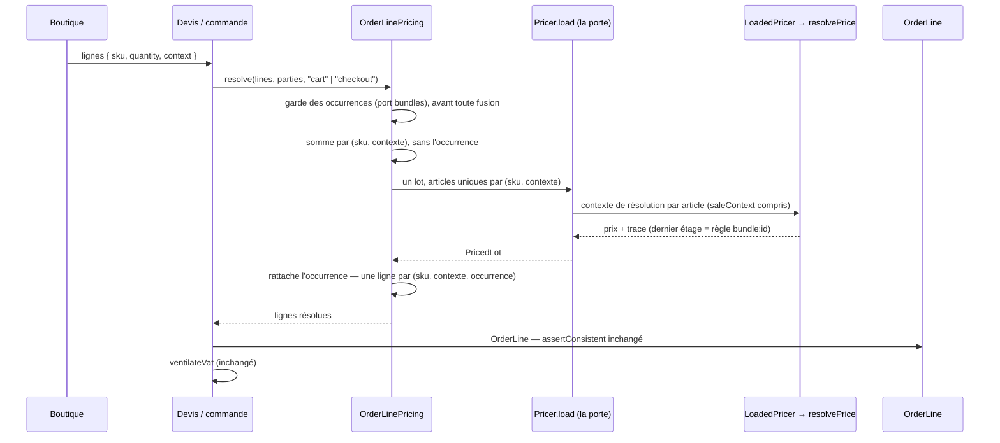

# Plan — la tarification des formules

> **État : 📐 plan — contredit le 2026-10-19, décisions de Hugo intégrées.**
> Rien n'est bâti. La contradiction de `vitruve` (2026-10-19) est consignée au
> §12 et corrigée dans le corps ; les décisions que Hugo a prises le même jour
> en réponse sont au §1 bis. Ouvert le 2026-10-19, séparé de
> [`plan-les-formules.md`](plan-les-formules.md), qui garde la composition, le
> modèle, les écrans et la commande hors prix, et renvoie ici pour tout ce qui
> touche au prix. La composition (lot F2a) est bâtie et commitée
> (`6bc6c44f7`) ; aucune ligne de prix de formule n'existe.
>
> Ce document **reprend** ce que le plan d'origine disait du prix — D1 et son
> tableau A/B/C, D5, D6, la répartition, le défaut du centime, F0/F1, Q0/Q2/Q4
> et la partie prix des deux contradictions de `vitruve` — et y porte la
> **décision de Hugo du 2026-10-19**, qui change l'orientation : l'option
> « prix fixe réparti » (A) est **reportée**, l'option « prix par article »
> (C, ici « option a ») est **retenue**.
>
> Le plan touche à l'argent et porte une migration : `vitruve` d'office avant
> Hugo (CLAUDE.md §9 bis). Sa place est réservée au §11.

---

## 1. La décision de Hugo (2026-10-19)

1. **La ligne de commande porte un CONTEXTE de vente** :
   `context: { kind: "bundle", bundleId, occurrence } | null`, `null` = vente
   à l'unité. Il généralise la colonne `bundle_occurrence_id` du plan
   d'origine ; il s'appelle « contexte » pour servir demain à d'autres cadres
   (sur place, opération datée). Une étape de trace de prix lui correspond.
2. **Prix local par article dans le contexte (option a)** : une règle de prix
   `alter` du **moteur de prix existant**, portée sur le contexte
   `bundle:<id>`, **datée** comme toute décision (fenêtre), posée par Hugo
   pour chaque article de la formule. Le total dépend donc de la
   combinaison ; la formule s'affiche « à partir de X ». Ce que ça achète :
   la porte de prix, sa trace, ses fenêtres et ses portes CI s'appliquent
   telles quelles ; pas de répartition ; l'écart du centime (§6) ne se pose
   pas plus que pour une étiquette.
3. **Vue des combinaisons à l'écran** : pour chaque combinaison de choix, le
   total TTC calculé par le moteur, pour viser un prix rond ; les
   combinaisons qui ne tombent pas sur la même somme sont signalées.
4. **Le prix fixe imposé avec répartition (option b)** reste décrit (§9),
   **reporté** après la réponse du cabinet sur la TVA « en dedans ».

---

## 1 bis. Les décisions de Hugo après la contradiction (2026-10-19)

Prises le 2026-10-19, en réponse aux objections de `vitruve` du même jour
(§12). Citées telles que Hugo les a dites quand elles l'ont été.

| Sujet                          | Décision du 2026-10-19                                                                                                                                           | Où dans ce plan |
| ------------------------------ | ---------------------------------------------------------------------------------------------------------------------------------------------------------------- | --------------- |
| **Promotions** (S3)            | « c'est un choix business, pas à moi de décider, à régler en admin » → la formule porte un **réglage** de combinaison avec une promotion sur un de ses articles. | §3.6            |
| **Audience** (S6)              | « une formule a une AUDIENCE si on veut bundler pour les pros » → audience `public` / `pro` / les deux, réglée en admin.                                         | §3.4            |
| **Plancher** (S7)              | « possible de le déterminer en admin ? » → **oui** : un réglage par prix d'article dans la formule, plancher appliqué par défaut.                                | §3.5            |
| **Dérive** (S11)               | « oui, sauf si on met des REPLACE PRICE documentés » → deux modes par article, `replace` et `alter` ; `alter` déclenche une alerte de dérive.                    | §3.2, §3.7      |
| **Trace** (S5)                 | OK : les règles hors contexte sont **filtrées** avant l'arbitrage, jamais consignées.                                                                            | §4 (M3)         |
| **Écran de tarification** (S4) | OK : les règles de contexte s'affichent **à part**, et les recouvrements les excluent des ventes à l'unité.                                                      | §5.3            |
| **Paliers** (S8)               | **Noté, pas de décision.** Question ouverte.                                                                                                                     | §8, Q8          |
| **Facture**                    | **Pas de réponse claire.** La proposition reste une question ouverte, à valider avec le cabinet.                                                                 | Q11             |

---

## 2. L'existant, ouvert le 2026-10-19

Chemins `b2b/…` relatifs à `apps/lfd-api/src/`, `prisma/…` à `apps/lfd-api/`.
Chaque ligne a été ouverte ce jour.

### 2.1 Le moteur — ce qu'est une règle

| Fait                                                                                                                                                                                                                                                                                                                                                                                                                                                                                                                                                                                                                 | Où                                                                                          |
| -------------------------------------------------------------------------------------------------------------------------------------------------------------------------------------------------------------------------------------------------------------------------------------------------------------------------------------------------------------------------------------------------------------------------------------------------------------------------------------------------------------------------------------------------------------------------------------------------------------------- | ------------------------------------------------------------------------------------------- |
| Quatre étages, dans un ordre qui **est** la décision commerciale : `mercuriale`, `volume`, `promotion`, `geste`.                                                                                                                                                                                                                                                                                                                                                                                                                                                                                                     | `b2b/pricing/domain/price-rule.ts:21`                                                       |
| Les étages qu'une règle peut porter excluent `volume` (le barème l'occupe) ; le contrat n'admet à la saisie que `promotion` et `geste`.                                                                                                                                                                                                                                                                                                                                                                                                                                                                              | `price-rule.ts:36` ; `packages/contracts/src/pricing.ts:78`                                 |
| La **portée** dit quel article : `global` / `category` / `product` / `variant`. L'**audience** dit quel client : `all` / `segment` / `company`. Aucune dimension ne dit **dans quel cadre** l'article est vendu.                                                                                                                                                                                                                                                                                                                                                                                                     | `price-rule.ts:39`, `:42`                                                                   |
| Une règle = étage, portée, audience, seuil, fenêtre `[validFrom, validTo)`, `suspendedFrom`, libellé, `stacksOverMercuriale`, puis `replace` (prix posé, millicentimes HT) **ou** `alter` (sens + `percent` en bp ou `amount` en **millicentimes**).                                                                                                                                                                                                                                                                                                                                                                 | `price-rule.ts:146-191` ; `PriceAlteration` `:77-79`                                        |
| Le `PricingContext` de résolution : instant, quantité, SKU, lignée de familles, société, société de mercuriale, segment, cumul d'engagement. **Pas de cadre de vente.**                                                                                                                                                                                                                                                                                                                                                                                                                                              | `price-rule.ts:194-235` (interface)                                                         |
| `pricingContextFor` le construit (`pricing-context.ts:37-62`), mais **pas seul** : `vitruve` (2026-10-19) le trouve construit en littéral dans `loaded-pricer.ts:299-315` et en quatre autres endroits. Le plan d'origine disait « un seul endroit » : faux.                                                                                                                                                                                                                                                                                                                                                         | `b2b/pricing/domain/pricing-context.ts:37-62` ; `loaded-pricer.ts:299-315`                  |
| `replace` n'est **pas** réservé à la mercuriale : le type admet `replace` à tout étage (`price-rule.ts:188-191`), le contrat de saisie aussi (`packages/contracts/src/pricing.ts:139-145`, sans restriction d'étage), et `apply` pose le prix quel que soit l'étage (`resolve-price.ts:285-289`). La seule contrainte va dans l'autre sens : une mercuriale **doit** être un `replace` (`b2b/pricing/domain/entities/pricing-rule.ts:117`). Le **scellement** est attaché à l'**étage** `mercuriale`, pas à la nature (`resolve-price.ts`, `if (stage === "mercuriale")` après l'application). Ouvert le 2026-10-19. | ci-contre                                                                                   |
| `applies` = en vigueur ∧ non suspendue ∧ portée ∧ audience ∧ seuil ; `rejectionCauseOf` rejoue ces prédicats pour nommer le refus.                                                                                                                                                                                                                                                                                                                                                                                                                                                                                   | `b2b/pricing/domain/specificity.ts:262-273`, `:288`                                         |
| La spécificité est lexicographique : audience, portée, proximité de famille, seuil.                                                                                                                                                                                                                                                                                                                                                                                                                                                                                                                                  | `specificity.ts:32-36`, `:43-48`, `:72-86`                                                  |
| `resolvePrice` : par étage, filtre `applies`, désigne un gagnant, applique, consigne `steps` et `rejected` ; une mercuriale scelle les étages suivants sauf `stacksOverMercuriale`. Plancher, puis ramené à zéro.                                                                                                                                                                                                                                                                                                                                                                                                    | `b2b/pricing/domain/resolve-price.ts:52-192` (boucle `:88-152`)                             |
| Les matériaux sont indexés **par portée** (`ScopeKey`) ; les candidats d'un contexte sont la concaténation de ses seaux.                                                                                                                                                                                                                                                                                                                                                                                                                                                                                             | `b2b/pricing/domain/scope-index.ts:14`, `:40-47`, `:111-113` ; `pricing-materials.ts:69-88` |
| Le lecteur de règles garde **la table entière** en cache et filtre fenêtre + audience par requête ; la portée est rejugée par l'index.                                                                                                                                                                                                                                                                                                                                                                                                                                                                               | `b2b/pricing/infrastructure/prisma-price-rule.reader.ts:34-56`                              |
| En base, `price_rules` : `stage`, `nature`, `scope_type/id`, `audience_type/id`, `min_quantity`, `direction/mode/value`, `valid_from/to` (`Timestamptz`), pause, archivage — jamais de `DELETE`.                                                                                                                                                                                                                                                                                                                                                                                                                     | `prisma/schema/public/pricing.prisma:17-101`                                                |
| 🔴 La garantie de non-ambiguïté est en SQL : `price_rules_no_overlap`, exclusion GiST sur (étage, portée, audience, seuil, fenêtre), partielle `archived_at IS NULL`.                                                                                                                                                                                                                                                                                                                                                                                                                                                | `prisma/migrations/20260817210000_cycle_de_vie_et_journal_tarifaire/migration.sql:34-45`    |

### 2.2 La porte et ses gardiens

| Fait                                                                                                                                                                                                                                  | Où                                                                          |
| ------------------------------------------------------------------------------------------------------------------------------------------------------------------------------------------------------------------------------------- | --------------------------------------------------------------------------- |
| `Pricer.load(LotRequest)` est la porte : articles scellés + quantité, société, instant, `caller` obligatoire (`shelf` / `cart` / `checkout` / `back-office`).                                                                         | `b2b/pricing/application/pricer.ts:27-42`, `:101-111` ; `pricing-caller.ts` |
| 🔴 **La porte refuse deux fois le même SKU dans un lot** (`DuplicateArticleError`).                                                                                                                                                   | `pricer.ts:117-122`                                                         |
| Le chargeur construit un contexte par article, charge règles, planchers, barèmes, engagements, mercuriale, et rend un `LoadedPricer`.                                                                                                 | `b2b/pricing/application/pricing-materials.loader.ts:93-170`                |
| `PricedLot` range ses articles **par SKU** et répond à `price(sku, quantity)`.                                                                                                                                                        | `b2b/pricing/application/priced-lot.ts:31-48`                               |
| `LoadedPricer` construit le contexte lui-même (`contextFor`) et appelle `resolvePrice` **deux fois** (`:322` et `:407`, relevé de `vitruve` le 2026-10-19 ; le plan disait « le seul appel »). Il reste le seul **fichier** appelant. | `b2b/pricing/domain/loaded-pricer.ts:322`, `:337-350`, `:400-420`           |
| Plancher : `LoadedPricer` le charge par article, `resolvePrice` le pose après les étages.                                                                                                                                             | `loaded-pricer.ts:353-356` ; `resolve-price.ts:153-155`                     |
| Le cache des matériaux (`PricingMaterialsCache`) est invalidé par `pricing-act.writer.ts` : une règle posée hors de ce chemin servirait un cache périmé.                                                                              | `b2b/pricing/infrastructure/pricing-act.writer.ts`                          |
| `lint:price-pipeline` : **une** entrée déclarée, `loaded-pricer.ts`.                                                                                                                                                                  | `dev-toolbox/gates/price-pipeline.mjs:69-80`, `:151`                        |
| `lint:price-door` : hors de `b2b/pricing/`, personne n'importe `LoadedPricer` ni `PricingMaterialsLoader` (le code servi ; les suites peuvent).                                                                                       | `dev-toolbox/gates/price-door.mjs` (en-tête et regex `INTERNALS`)           |
| `lint:dated-decisions` : chaque famille de `PricingMaterials` est déclarée dans un fichier qui prononce `validFrom` — `price-rule.ts` en est.                                                                                         | `dev-toolbox/gates/dated-decisions.mjs:51`, `:121-127`                      |
| `lint:catalogue-authority` : seul `b2b/catalog/` frappe un `CatalogArticle` (`catalogueArticle(` ou `as CatalogArticle`).                                                                                                             | `dev-toolbox/gates/catalogue-authority.mjs` (en-tête, `AUTHORITY`, `FORGE`) |

### 2.3 Devis, commande, ligne

| Fait                                                                                                                                                                    | Où                                                                                            |
| ----------------------------------------------------------------------------------------------------------------------------------------------------------------------- | --------------------------------------------------------------------------------------------- |
| `OrderLinePricing.resolve` **additionne les quantités par SKU**, lit le catalogue en un lot, charge **un** lot à la porte, puis `priceLine` par SKU.                    | `b2b/orders/application/services/order-line-pricing.service.ts:70-77`, `:112-115`, `:168-175` |
| Une ligne demandée n'est qu'un `{ sku, quantity }`.                                                                                                                     | `packages/contracts/src/order.ts:122-126`                                                     |
| Le devis de la boutique appelle `resolve(…, "cart")`, puis `operations.ensure`, puis `ventilateVat`.                                                                    | `b2b/orders/application/services/shop-cart-quoting.service.ts:112-124`, `:156`                |
| La commande (le chemin qui encaisse) appelle `resolve(content.lines, parties, "checkout")`.                                                                             | `b2b/orders/application/services/order-drafting.service.ts:170`                               |
| `assertConsistent` : la dernière étape de la trace doit valoir le prix facturé, sauf `floored` ou ramené à zéro.                                                        | `b2b/orders/domain/value-objects/order-line.ts:191-221`                                       |
| La trace persistée : `base_price_millicents`, `pricing_steps`, `pricing_floor`, `pricing_floored`, `pricing_clamped_to_zero`, `pricing_commitment`, `pricing_rejected`. | `prisma/schema/public/orders.prisma:432-484`                                                  |
| Une étape de trace porte un `stage` validé par `priceStageSchema` (quatre valeurs).                                                                                     | `packages/contracts/src/pricing.ts:42`, `:739`, `:888`                                        |
| 🔴 `@@unique([orderId, sku])` — ligne **:513** au 2026-10-19 (le plan d'origine citait `:502`).                                                                         | `orders.prisma:508-513`                                                                       |
| L'empreinte d'idempotence hache `sku:quantity` trié.                                                                                                                    | `b2b/orders/domain/services/order-fingerprint.ts:57-59`                                       |
| `ventilateVat` : une seule fonction pour devis et commande.                                                                                                             | `packages/money/src/vat.ts:116`                                                               |

---

## 3. Le modèle

### 3.1 Le contexte de vente sur la ligne

```ts
type SaleContext = {
  readonly kind: "bundle";
  readonly bundleId: string;
  readonly occurrence: string;
} | null;
```

- **Sur la ligne demandée** (`orderLineInputSchema`) : champ additif
  `context`, absent = `null`. Un panier sans formule garde exactement la forme
  d'aujourd'hui.
- **Sur la ligne figée** : colonnes `sale_context_kind`, `sale_context_id`,
  `sale_context_occurrence`, nullables. `NULL` ne veut dire qu'une chose :
  **vente à l'unité** — vrai aussi de toutes les commandes passées, aucune
  formule n'existant ; ce n'est pas une ignorance déguisée.
- **L'occurrence** distingue deux petits déjeuners aux choix différents
  (mêmes choix = une occurrence de quantité `q`).
- Le `kind` est un discriminant **fermé** dans le domaine ; « sur place » ou
  « opération » s'y ajouteront comme valeurs, pas comme colonnes.

### 3.2 La règle de prix portée sur le contexte

Une règle du moteur gagne une dimension : `context: { kind: "bundle"; id } | null`.

- `null` = **toute vente**, ce qui est la sémantique de toutes les règles
  d'aujourd'hui. Aucune règle existante ne change de comportement.
- `bundle:<id>` = n'agit **que** sur une ligne dont le contexte est cette
  formule.

C'est une **dimension**, pas une nouvelle portée : la portée dit _quel
article_ (`variant:croissant`), le contexte dit _dans quel cadre_. En faire un
`scopeType = "bundle"` perdrait l'article — or la règle est « le croissant,
dans le petit déjeuner ».

La règle d'un article de formule est donc : portée `variant:<sku>`, audience
celle de la formule (§3.4), contexte `bundle:<id>`, nature `replace` **ou**
`alter` (ci-dessous), fenêtre datée, étage `promotion` (Q6). Hugo en pose une
par choix de la formule.

**Deux modes de prix par article — décision de Hugo, 2026-10-19** (« oui, sauf
si on met des REPLACE PRICE documentés ») :

| Mode      | Ce qu'il dit                                         | Dérive quand l'étiquette change          | Trace                                                                                                                                                                       |
| --------- | ---------------------------------------------------- | ---------------------------------------- | --------------------------------------------------------------------------------------------------------------------------------------------------------------------------- |
| `replace` | « le croissant est à 1,10 € dans le petit déjeuner » | **aucune** : le prix est posé            | l'étape porte la règle `replace`, libellé « prix posé dans la formule » ; l'acte tarifaire le nomme comme tel (`pricing-act-summary.ts:157` sait déjà décrire un `replace`) |
| `alter`   | « −0,20 € sur le croissant dans le petit déjeuner »  | **possible** : le total suit l'étiquette | étape ordinaire ; une dérive déclenche l'alerte du §3.7                                                                                                                     |

**Ce que le moteur a déjà, ouvert le 2026-10-19** : `replace` existe à **tout
étage**, pas seulement à la mercuriale. Le type `PriceRule` l'admet
(`price-rule.ts:188-191`), le contrat de saisie aussi, sans restriction
d'étage (`packages/contracts/src/pricing.ts:139-145`), et `apply` pose
`amountMillicents` quel que soit l'étage (`resolve-price.ts:285-289`). La
seule contrainte d'étage est inverse : une mercuriale **doit** être un
`replace` (`entities/pricing-rule.ts:117`). Et le **scellement** tient à
l'**étage** `mercuriale`, pas à la nature `replace` : un `replace` d'étage
`promotion` ne scelle rien. Rien à ajouter au moteur pour le mode `replace` ;
la version précédente de ce paragraphe (« `replace` n'existe que pour la
mercuriale ») était fausse.

⚠️ **Les deux modes sont en millicentimes HT** (`price-rule.ts:65-79`), et
Hugo pense en TTC. L'écran saisit un TTC cible et en déduit le HT. **Le
`replace` en TTC rencontre l'écart du centime (§6)** : un HT entier en
millicentimes passe par `lineTotalCents` puis `ventilateVat`, et certains TTC
ronds sont **inatteignables** à un taux donné (49/951 à 5,5 %, 86/951 à 10 %,
159/951 à 20 % sur les étiquettes mesurées le 2026-09-28). L'écran calcule
par la porte le TTC réellement encaissé pour le HT déduit, et, s'il diffère de
la cible, refuse la saisie en proposant les TTC voisins atteignables. C'est le
même trou qu'une étiquette — mais un `replace` « documenté » qui promettrait
1,10 € et encaisserait 1,09 € serait un mensonge écrit ; d'où le refus à la
saisie plutôt qu'un simple signalement.

### 3.3 Ce que l'option (a) supprime du plan d'origine

La répartition (prorata, plus fort reste), son contrôle sur toutes les
combinaisons, l'étage de trace `bundle` « prix de référence, prix de la
formule, part » et sa troisième voie dans `assertConsistent`, le refus de
« prix infacturable » à la pose. La trace d'une ligne de formule est une
trace **ordinaire** : son dernier étage est la règle de contexte, et
`assertConsistent` (`order-line.ts:191-221`) l'accepte **sans changement**.

### 3.4 L'audience de la formule — décision de Hugo, 2026-10-19

« Une formule a une AUDIENCE si on veut bundler pour les pros. » La formule
porte une audience **`public` / `pro` / les deux**, réglée en admin dans
l'éditeur de formule. Aujourd'hui elle est **figée à `public`** dans
`b2b/bundles/` (`bundles/domain/errors/bundle-errors.ts:31-38`) : le lot T3a
lève ce figement.

- **La règle de prix de formule porte l'audience correspondante** : `public`
  → l'audience qui désigne les particuliers, `pro` → les sociétés, les deux →
  `all`. ⚠️ Le moteur n'a aujourd'hui que `all` / `segment` / `company`
  (`price-rule.ts:42`) : dire « les particuliers » ou « toutes les sociétés »
  n'y est pas exprimable tel quel. À trancher en T1 : une valeur d'audience
  neuve, ou s'appuyer sur la garde (ci-dessous) et laisser la règle en `all`.
  Recommandation : la garde est l'autorité, la règle reste `all` — une seule
  vérité de l'audience, celle de la formule.
- **La garde (§7.1) vérifie l'audience de la formule contre l'acheteur**
  (`parties.companyId` : présent = pro, absent = particulier) et refuse
  sinon.
- **Un pro sous mercuriale** : sa mercuriale **scelle** la chaîne
  (`resolve-price.ts:117-128`) ; une règle de formule d'étage `promotion`
  serait donc écartée (`sealed`) et le pro paierait son prix négocié par
  article, sans le prix de formule — sauf `stacksOverMercuriale`. Question à
  Hugo (Q12) : la formule pro s'applique-t-elle **par-dessus** la mercuriale
  (et alors sur quel prix d'entrée, le négocié ?), ou la mercuriale
  l'emporte-t-elle ?

### 3.5 Le plancher dans la formule — décision de Hugo, 2026-10-19

« Possible de le déterminer en admin ? » — **oui.** Aujourd'hui le plancher
de l'article est chargé (`loaded-pricer.ts:353-356`) et posé après tous les
étages (`resolve-price.ts:153-155`) : un prix de formule sous le plancher
serait relevé en silence, et la combinaison ne vaudrait plus ce que Hugo a
saisi.

- **Le réglage** : chaque prix d'article dans la formule porte « le plancher
  de l'article s'applique ici » — **oui par défaut**. Il est porté par la
  règle de contexte (champ `floorApplies`, défaut `true`), donc daté et
  versionné avec elle.
- **Le moteur** : `resolvePrice` ne pose pas le plancher quand l'étape
  gagnante qui a produit le prix final est une règle de contexte à
  `floorApplies: false`. Pas de calcul parallèle : c'est une condition sur la
  ligne existante `:153-155`.
- **La trace** : quand le plancher est levé, la trace le dit — champ
  `floorWaivedByRuleId` (contrat + colonne `pricing_floor_waived_by`,
  additifs), distinct de `pricing_floored`. `assertConsistent` reste juste :
  `floored` est faux et la dernière étape vaut le prix.
- **L'écran** : il montre le plancher à côté de la saisie ; quand le plancher
  s'applique, une saisie en dessous est **refusée** (le prix ne serait jamais
  encaissé) ; quand il est levé, l'écran **avertit** et l'acte tarifaire
  consigne la levée.

### 3.6 Promotion sur un article de la formule — décision de Hugo, 2026-10-19

« C'est un choix business, pas à moi de décider, à régler en admin. » La
formule porte un **réglage de combinaison** :

| Valeur                                | Ce que paie le client                                         |
| ------------------------------------- | ------------------------------------------------------------- |
| `bundle_wins` — la formule prime      | le prix de formule, la promotion ne s'applique pas            |
| `promotion_wins` — la promotion prime | le prix promu à l'unité, le prix de formule ne s'applique pas |
| `lowest` — le plus bas des deux       | le plus bas des deux, calculés sur le même prix d'entrée      |

**Défaut recommandé : `lowest`** — une formule n'est jamais plus chère que
ses articles à l'unité pendant une promotion, ce qui fermait l'objection
« “au lieu de” ment » (10-17).

**Comment le moteur l'applique, sans calcul parallèle** : la règle de
formule est au **même étage** `promotion` (Q6). L'arbitrage de l'étage
(`winnerOf`, `resolve-price.ts`) gagne une **règle de combinaison** entre le
meilleur candidat de contexte et le meilleur candidat sans contexte :
`bundle_wins` / `promotion_wins` désignent l'un ; `lowest` applique les deux
**au même prix entrant** (`apply`, déjà pur) et garde le plus bas. Le perdant
est consigné `superseded`, comme aujourd'hui. Le réglage est copié sur la
règle de contexte (`promotionPolicy`), écrit par T3 : changer le réglage de
la formule réécrit ses règles en nouvelles versions datées, ce qui le rend
opposable à une date.

**Correction de l'argument de M4** (`vitruve`, 2026-10-19) : M4 disait qu'une
promotion « −10 % sur les viennoiseries » deviendrait ambiguë face à la règle
de formule. Faux : une portée `variant` bat déjà `category` par `SCOPE_RANK`
(`specificity.ts:43-52`). L'ambiguïté réelle n'existe qu'à portée **égale**
(promotion `variant:croissant` contre formule `variant:croissant`), et c'est
le réglage ci-dessus qui la tranche, plus un critère de spécificité.

### 3.7 L'alerte de dérive — décision de Hugo, 2026-10-19

Pour les articles en mode `alter` seulement. Quand une étiquette change (acte
tarifaire du catalogue ou règle sans contexte), le total d'une combinaison
peut changer sans que personne ait touché la formule.

- **Fait journalisé** `bundle.combination_total_drifted` (formule, combinaison,
  ancien total, nouveau total, cause) — calculé par la **porte**, pas par
  l'écran.
- **Notification** dans la cloche du back-office (`staff/notifications/`), au
  droit qui pose les prix de formule (Q9).
- Déclenché par un abonné au fait de changement de prix ; s'il traverse un
  bloc, c'est un `@DurableHandler` (`lint:durable-cross-block`). Les articles
  en `replace` ne dérivent pas et ne déclenchent rien.

---

## 4. Le moteur et les portes — ce qu'il faut changer exactement

L'exigence : **aucun chemin de calcul parallèle.** Le contexte entre dans
`PricingContext` et dans `PriceRule` ; tout le reste suit.

| #   | Où                                                             | Changement                                                                                                                                                                                                                                                                                                                                                                                                                                                                               |
| --- | -------------------------------------------------------------- | ---------------------------------------------------------------------------------------------------------------------------------------------------------------------------------------------------------------------------------------------------------------------------------------------------------------------------------------------------------------------------------------------------------------------------------------------------------------------------------------- |
| M1  | `price-rule.ts`                                                | `PriceRule.context`, `PricingContext.saleContext` (`{ kind, id } \| null` — sans l'occurrence, qui ne regarde pas le prix).                                                                                                                                                                                                                                                                                                                                                              |
| M2  | `pricing-context.ts:37`, `loaded-pricer.ts:299-315` + 4 autres | `pricingContextFor` prend le contexte de vente. ⚠️ Il **n'est pas** le seul constructeur (`vitruve`, 2026-10-19) : `loaded-pricer.ts:299-315` et quatre autres sites construisent un `PricingContext` en littéral. Champ **obligatoire** (`saleContext: … \| null`, pas optionnel), pour que le compilateur désigne chaque littéral ; T1 les fait tous passer par `pricingContextFor` ou leur fait porter `null` explicitement.                                                          |
| M3  | `specificity.ts:262`                                           | `applies` gagne `matchesContext` : règle `null` → vrai ; règle `bundle:X` → vrai ssi la ligne est dans `bundle:X`. **Décision de Hugo (S5)** : une règle hors contexte est **filtrée avant l'arbitrage** (`resolve-price.ts:105-110`) et **jamais consignée** dans `rejected` / `pricing_rejected` — sans quoi chaque croissant vendu à l'unité porterait en trace toutes les règles de formule qui le visent. Pas de cause `out_of_context`.                                            |
| M4  | `resolve-price.ts` (arbitrage d'étage)                         | Plus de critère de spécificité « contexte en tête » : la règle de combinaison du §3.6 (`promotionPolicy`) tranche entre candidat de contexte et candidat sans contexte. Le commentaire « trois critères » de `specificity.ts:76` est déjà périmé (il y en a quatre) : à corriger en passant.                                                                                                                                                                                             |
| M4b | `resolve-price.ts:153-155`                                     | Plancher levé quand la règle de contexte gagnante porte `floorApplies: false` ; trace `floorWaivedByRuleId` (§3.5).                                                                                                                                                                                                                                                                                                                                                                      |
| M5  | `loaded-pricer.ts:337`                                         | `contextFor` passe le contexte de la ligne. `LoadedPricer` appelle `resolvePrice` **deux fois** (`:322` et `:407`, pas une) : les deux appels reçoivent le contexte. `lint:price-pipeline` compte des **fichiers** d'entrée : il reste à une.                                                                                                                                                                                                                                            |
| M6  | `pricer.ts:117-122`, `priced-lot.ts:31-48`                     | 🔴 **B1** — La porte dédoublonne par SKU. La **clé de prix** devient `(sku, contexte)` — `contexte` = `{ kind, id } \| null`, **sans** l'occurrence : le prix ne dépend pas de l'occurrence. Un croissant à l'unité et un croissant de formule sont deux articles du lot ; deux occurrences du même petit déjeuner sont **un** article. `DuplicateArticleError` juge `(sku, contexte)` ; `PricedLot.price(sku, quantity, context)`. Toujours une seule porte, un seul lot.               |
| M7  | `order-line-pricing.service.ts:112-139` (`priceAll`)           | 🔴 **B1** — `priceAll` fusionne par SKU dans une `Map` : l'occurrence se perdrait. Il fusionne désormais par `(sku, contexte)` pour **résoudre**, et **rattache l'occurrence après la résolution**, au moment de figer les lignes : une ligne par `(sku, contexte, occurrence)`, au prix unitaire résolu pour `(sku, contexte)`. La garde de B2 (§7.1) s'applique **avant** cette fusion. Paliers : Q8, ouverte.                                                                         |
| M8  | `pricing.prisma:17` + migration                                | Colonnes `context_kind`, `context_id`, `promotion_policy`, `floor_applies` sur `price_rules` (nullables / défaut) ; **reconstruire `price_rules_no_overlap`** en y ajoutant `coalesce(context_kind,'')`, `coalesce(context_id,'')`. La migration **vérifie d'abord** l'absence de conflit sous la nouvelle définition (requête qui échoue en nommant les lignes), puis `DROP` + `ADD CONSTRAINT` sous verrou `ACCESS EXCLUSIVE` bref (table petite). Additive ; `lecteur-de-migrations`. |
| M9  | `price-rows.ts:82` (`ruleFromRow`)                             | Lit les deux colonnes, refuse un `kind` inconnu comme il refuse les autres discriminants.                                                                                                                                                                                                                                                                                                                                                                                                |
| M10 | `packages/contracts/src/pricing.ts`                            | `context` dans la règle et la trace (étape et rejet), additif ; si Q6 tranche pour un étage neuf, `priceStageSchema` (`:42`) gagne une valeur, et `PRICE_STAGES` (`price-rule.ts:21`) un rang.                                                                                                                                                                                                                                                                                           |

Ce que les portes en disent, sans être modifiées :

- **`lint:price-pipeline`** : inchangée, une entrée (un fichier) — M5 n'ajoute
  aucun appel.
- **`lint:context-boundaries`** : ne juge **pas** les sous-contextes de `b2b`
  entre eux (tranché par `vitruve` le 2026-10-19) — `bundles → pricing` n'y est
  donc pas tenu ; c'est la discipline du bus (§5.1) qui le tient.
- **Cache** : toute règle de formule s'écrit par `pricing-act.writer.ts`, qui
  invalide le `PricingMaterialsCache` ; T3 n'a pas d'autre chemin d'écriture.
- **`lint:price-door`** : inchangée — devis et commande passent toujours par
  `Pricer.load`.
- **`lint:dated-decisions`** : la règle de formule **est** une `PriceRule`,
  déclarée dans `price-rule.ts`, qui porte `validFrom` : elle est couverte.
  C'est ce qui ferme l'objection « D6 sans porte » du plan d'origine.
- **`lint:catalogue-authority`** : inchangée — le contexte ne frappe aucun
  article ; le prix part toujours du `CatalogArticle` scellé.

À ajouter : un test de domaine sur `applies` / spécificité (règle de contexte
contre promotion, même portée), et un e2e qui pose une règle de formule et
vérifie qu'un croissant à l'unité du même panier garde son prix.

---

## 5. L'écran

### 5.1 Le prix par article dans la formule

Dans l'éditeur de formule (Gestion Boutique, lot F2a), chaque choix gagne
« son prix dans la formule » : un TTC cible, une fenêtre (à partir de…,
jusqu'à…), l'historique des versions. L'enregistrement passe par le **bus du
contexte `pricing`** (une commande qui pose une règle de contexte), pas par
une écriture de `bundles` dans `price_rules` : `lint:prisma-model-ownership`
veut qu'un modèle ne soit écrit que par son bloc. La porte `context-boundaries`
ne juge pas les sous-contextes de `b2b` (tranché le 2026-10-19).

Réglages admin portés par l'éditeur, en plus du prix : **mode** `replace` /
`alter` par article (§3.2), **plancher** appliqué ou non par article (§3.5),
**combinaison avec une promotion** pour la formule (§3.6), **audience** de la
formule (§3.4). Chacun aboutit à des règles de contexte datées ; aucun n'est
lu par le moteur ailleurs que sur la règle.

Le droit : `shop_bundles` couvre la composition ; poser un prix de formule est
un geste tarifaire — Q9.

### 5.2 La vue des combinaisons

Le produit des tailles de groupes (2 × 1 × 3 = 6 pour l'exemple). Pour
chacune, le moteur rend le total TTC à `q = 1`, par une **lecture de la porte**
(`caller: "back-office"`) — jamais un calcul de l'écran. L'écran montre :

- le minimum (« à partir de X », ce que la boutique affichera) et le maximum ;
- les combinaisons qui **ne tombent pas** sur la somme visée, surlignées ;
- la somme des étiquettes à l'unité, pour « au lieu de ».

Au-delà d'un plafond de combinaisons (à fixer en T4), l'écran le dit et ne
calcule pas. La boutique affiche « à partir de » le minimum, calculé par la
même porte (`caller: "shelf"`).

### 5.3 L'écran de tarification existant — décision de Hugo (S4), 2026-10-19

`vitruve` relève que l'écran des règles mélangerait les règles de contexte
aux ventes à l'unité : `board-category.ts:74-82` et `:88`, `rule-overlaps.ts`,
`lineage-overlaps.ts`, `company-pricing.query.ts:115`. Décision : l'écran
affiche les règles de contexte **à part** (groupées par formule), et le calcul
des recouvrements les **exclut** des ventes à l'unité — une règle de formule
ne recouvre qu'une règle du même contexte.

---

## 6. L'écart du centime — ce qui ne change pas

Repris du §2 bis du plan d'origine. **Toujours vrai au 2026-10-17** (non
remesuré le 2026-10-19) : la chaîne arrondit le HT au centime par ligne
(`lineTotalCents`), puis la TVA par taux (`ventilateVat`, `vat.ts:116`) ; le
TTC vaut `H + arrondi(H × taux)` et saute certains centimes. Mesuré le
2026-09-28 sur des étiquettes de 0,50 € à 10,00 € : 49/951 encaissées à un
autre montant à 5,5 %, 86/951 à 10 %, 159/951 à 20 %. Symptôme constaté en
production (1,90 € + 0,50 € encaissés 2,39 €), document dédié :
[`pricing/ecart-du-centime-particuliers.md`](../pricing/ecart-du-centime-particuliers.md),
qui attend le cabinet (son §6).

**Avec l'option (a)**, le prix d'un article de formule est un prix d'article :
il tombe dans les mêmes trous qu'une étiquette, ni plus ni moins. La vue des
combinaisons (§5.2) le **montre** au lieu de le refuser. Le lot F0 (mesurer
sur le catalogue réel) reste utile, mais ne bloque plus les formules.

---

## 7. Commande, devis, encaissement



- **Le devis et la commande passent par le même `resolve`**
  (`shop-cart-quoting.service.ts:113`, `order-drafting.service.ts:170`) : ce
  qui répond au BLOQUANT « le chemin qui encaisse n'est pas décrit » du
  §10 du plan d'origine. Il n'y a pas de répartition à refaire au paiement :
  la commande résout ses lignes comme le devis, à son propre instant.
- **Une règle de formule qui change entre devis et paiement** : la commande
  facture la règle en vigueur au paiement, comme pour une promotion. Le devis
  de passation existant détecte l'écart de total (comportement à relire en T2,
  non ouvert ici).
- **La garde des occurrences** — §7.1.
- **Empreinte** : le contexte n'entre dans le hachage que s'il est présent ;
  un panier sans formule garde son empreinte d'aujourd'hui.

### 7.1 La garde des occurrences (B2, `vitruve` 2026-10-19)

Sans elle, un client enverrait `context: bundle:X` sur un seul croissant, ou
sur 3 croissants + 1 café, et obtiendrait le prix de formule. Un port nommé
`BundleOccurrenceGuard`, déclaré par `orders` et implémenté par `bundles`,
appelé dans `OrderLinePricing.resolve` **avant** la fusion par
`(sku, contexte)` — donc pour le devis comme pour la commande. Pour chaque
`(bundleId, occurrence)` du panier :

| Vérification                                                                        | Refus nommé                                                             |
| ----------------------------------------------------------------------------------- | ----------------------------------------------------------------------- |
| la formule existe                                                                   | `BundleNotFoundError` (404)                                             |
| la formule est en vente à l'instant de la requête                                   | `BundleNotOnSaleError` (409)                                            |
| l'audience de la formule admet l'acheteur (`parties.companyId`) — §3.4              | `BundleAudienceMismatchError` (409)                                     |
| **exactement un** article par groupe de la formule, chacun appartenant à son groupe | `BundleOccurrenceIncompleteError` / `BundleChoiceNotInGroupError` (400) |
| tous les articles de l'occurrence ont la **même quantité**                          | `BundleOccurrenceQuantityMismatchError` (400)                           |
| l'occurrence n'est pas répétée avec d'autres choix                                  | `BundleOccurrenceConflictError` (400)                                   |

Les messages nomment la formule et le groupe en cause, pour le personnel qui
lit le refus sans le code (CLAUDE.md §0).

### 7.2 Les BLOQUANTS du §10 (vitruve, 2026-10-17), relus face à l'option (a)

| Objection                                                                                                                                                                                                                                                         | L'option (a) y change-t-elle quelque chose ?                                                                                                                                                                                                                                                                                                                                                                                          |
| ----------------------------------------------------------------------------------------------------------------------------------------------------------------------------------------------------------------------------------------------------------------- | ------------------------------------------------------------------------------------------------------------------------------------------------------------------------------------------------------------------------------------------------------------------------------------------------------------------------------------------------------------------------------------------------------------------------------------- |
| **Colisage par SKU** — `@@id([serviceDay, orderId, sku])` (`prisma/schema/packing.prisma:72`) et `createMany(…, skipDuplicates: true)` (`src/packing/infrastructure/prisma-packing-shadow.ledger.ts:39-47`) : la seconde ligne du même SKU est perdue en silence. | **Non.** Un croissant à l'unité et un croissant de formule restent deux lignes du même SKU. Recommandation : **regrouper par SKU au moment où le fait quitte le commerce** — le bac reçoit des croissants, pas des formules.                                                                                                                                                                                                          |
| **Livraison par SKU** — `@@id([transferId, itemId, sku])` (`prisma/schema/delivery.prisma:994`).                                                                                                                                                                  | **Non.** Même réponse : le regroupement à la sortie du commerce couvre les deux.                                                                                                                                                                                                                                                                                                                                                      |
| **Chemin d'encaissement non décrit.**                                                                                                                                                                                                                             | **Oui, réglé** : même `resolve`, même porte, pas de répartition (§7).                                                                                                                                                                                                                                                                                                                                                                 |
| **Promotions** — « au lieu de » ment pendant une promotion ; la formule peut coûter plus que les articles seuls.                                                                                                                                                  | **Changé, pas réglé** : la promotion et la règle de formule sont deux règles du même moteur ; **réglé par la formule** depuis le 2026-10-19 (§3.6 : `bundle_wins` / `promotion_wins` / `lowest`). La vue des combinaisons montre le résultat réel.                                                                                                                                                                                    |
| **Lecteurs par SKU** (`admin-order-pricing.controller.ts:35`, `reconstruct-line-rules.handler.ts:49`, `deadline-thresholds.ts:124`, `customer-warnings.ts`, `list-customer-skus.handler.ts`).                                                                     | **Non.** Et **sous-comptés** (`vitruve`, 2026-10-19) : **157 fichiers** lisent par SKU, dont `prisma/schema/packing.prisma:197` (`@@id([containerId, sku])`), `prisma/schema/production.prisma:339` (`@@unique([serviceDay, sku])`), la facture `b2b/accounting/domain/services/invoice-lines.ts:58`, `facturx-xml.ts:98`, `invoice-invariants.ts:65-80`. T2 n'est pas chiffrable sans eux → lot **T0bis**, inventaire, **avant** T2. |
| **`@@unique([orderId, sku])`** (`orders.prisma:513`).                                                                                                                                                                                                             | **Non** — bascule détaillée en §7.3.                                                                                                                                                                                                                                                                                                                                                                                                  |
| **Annulation d'un article de formule.**                                                                                                                                                                                                                           | **Simplifiée, pas réglée** : chaque article a son prix propre, donc retirer une ligne ne demande pas de redistribuer une part. Mais une formule amputée n'est plus une formule : retirer un article doit retirer l'occurrence entière, ou refacturer à l'unité. Q10.                                                                                                                                                                  |

La ligne « Promotions » est désormais réglée par le réglage de combinaison
(§3.6), décision de Hugo du 2026-10-19.

### 7.2 bis Le scénario de référence : quatre petits déjeuners (Hugo, 2026-10-19)

Un père de famille commande pour tout le monde. Ce cas sert de **test de bout
en bout** (e2e, lot T4) : il fait rougir tout ce qui raisonne encore « un
article = une ligne ».

| Pour qui           | Viennoiserie     | Boisson        |
| ------------------ | ---------------- | -------------- |
| Lui et sa compagne | croissant        | café           |
| L'aîné             | pain au chocolat | chocolat chaud |
| La cadette         | croissant        | jus d'orange   |
| + à part, pour lui | croissant (seul) | —              |

Ce qui doit se passer :

1. **Panier** — trois occurrences, pas quatre : mêmes choix = une occurrence de
   quantité 2 ; choix différents = une occurrence chacune. Le croissant à part
   est une ligne hors contexte.
2. **Prix** — clé `(sku, contexte)` (B1) : le croissant _dans le petit
   déjeuner_ est résolu une fois pour 3 pièces (2 + 1), au même prix unitaire ;
   le croissant à part, au prix d'étiquette. Deux prix pour le même SKU dans la
   même commande.
3. **Commande figée** — une ligne par article et par occurrence (croissant ×2
   et café ×2 ; pain au chocolat ×1 et chocolat chaud ×1 ; croissant ×1 et jus
   ×1), plus le croissant hors formule. La garde (§7.1) vérifie chaque
   occurrence.
4. **Fournil** — 4 croissants à fabriquer : la somme par SKU reste juste.
5. **Colisage et livraison** — plusieurs lignes « croissant » dans une
   commande : c'est le BLOQUANT du §7.2 ; ce scénario le déclenche à coup sûr.
6. **Paliers** — 3 + 1 = 4 croissants : la question ouverte du §8.1 doit être
   tranchée avant que ce test puisse avoir une attente.
7. **Remise de retrait, fidélité** — sur ce qui est réellement payé.
8. **Facture** — la question Q11 : sans regroupement, deux lignes
   « Croissant » à deux prix.

### 7.3 La bascule de l'unicité des lignes (S10, `vitruve` 2026-10-19)

1. **Forme figée dès T2** : `(order_id, sku, sale_context_kind,
sale_context_id, sale_context_occurrence)`. C'est elle que le premier merge
   de T2 rend irréversible ; aucun lot suivant ne la change.
2. **Déploiement 1 (T2)** : migration qui crée l'index unique
   `NULLS NOT DISTINCT` sur ces cinq colonnes **en SQL brut** (Prisma ne sait
   pas l'exprimer), sur le modèle de
   `20260826090000_unicite_slug_rang_emplacement`. L'ancien
   `@@unique([orderId, sku])` (`orders.prisma:513`) **reste** : tant qu'il
   vit, aucune commande ne peut porter deux lignes du même SKU, et le code de
   T2 ne doit pas encore en écrire.
3. **Déploiement 2** : retrait de `@@unique([orderId, sku])` du schéma et de
   l'index correspondant, **après** que le code qui écrit les lignes par
   `(sku, contexte, occurrence)` est en production. Ce n'est qu'à partir de
   ce déploiement que la boutique peut vendre une formule à côté du même
   article à l'unité.
4. `lecteur-de-migrations` sur les deux.

---

### 7.4 Colisage et livraison : regrouper par article à la frontière (proposé le 2026-10-19)

**Le principe.** Le contexte de vente ne regarde que le **commerce** : le prix,
le regroupement au panier, le bon, la facture. Le fournil, le colisage et la
livraison manipulent des **pièces** : quatre croissants à cuire, à mettre au
bac, à remettre. Pour eux, deux lignes « croissant » d'une même commande sont
**une seule quantité**. Plutôt que de faire entrer le contexte dans leurs
schémas (`packing.prisma:72`, `:197`, `delivery.prisma:994`,
`production.prisma:339` — clés par SKU), le commerce **additionne par SKU** au
moment où la commande quitte son contexte.

**Où, vérifié le 2026-10-19.** La production reçoit les lignes d'une commande
par un seul adaptateur, `apps/lfd-api/src/b2b/orders/infrastructure/prisma-day-orders.source.ts`
(lignes `select { sku, productNameSnapshot, quantity }`, `:83`, mappées une à
une `:103-107`), servi au fournil par `SitedDayOrders` (`b2b/orders/application/services/sited-day-orders.service.ts`)
qui implémente `DayOrdersReader` (`production/channels/commerce/day-orders.reader.ts:125`).
Le colisage reçoit ce que le fournil publie (`production/channels/packing/`) :
il hérite du regroupement sans être touché. La livraison lit le commerce par
ses propres canaux (`delivery/channels/commerce/delivery-orders.reader.ts`,
faits `commerce-order-placed` / `-cancelled`), le retrait aussi
(`handover/channels/commerce/`).

**Le geste.** Chaque implémentation d'un canal qui transmet des lignes de
commande hors du commerce **regroupe par SKU** (somme des quantités, premier
libellé), dans une fonction pure unique du domaine `orders` — pas une par
canal. Le regroupement est une **projection** : la commande, elle, garde ses
lignes par contexte et occurrence.

- Ce qu'on gagne : aucune migration dans `packing`, `delivery`, `production` ;
  le `skipDuplicates` de l'ombre du colisage (`prisma-packing-shadow.ledger.ts:39-47`)
  ne voit jamais deux lignes du même SKU ; le fournil cuit le bon nombre.
- Ce qu'on perd, et qu'il faut accepter ou non : le colisage ne sait pas qu'un
  croissant est « dans un petit déjeuner ». Si Hugo veut un **sachet par
  formule** au bac, le regroupement ne suffit plus — il faudrait alors faire
  entrer l'occurrence dans le colisage (question Q13).

> 🔒 **Limitation assumée (Hugo, 2026-10-19)** : **pas de sachet par formule**
> au colisage. Le bac reçoit les pièces d'une commande additionnées par
> article ; rien ne dit au colisage qu'un croissant appartient à tel petit
> déjeuner. Le jour où un sachet par formule sera voulu, l'occurrence devra
> entrer dans le colisage (schéma `packing`, faits du fournil) — ce n'est
> **pas** un réglage, c'est un lot.

- ⚠️ À tenir : **une seule** fonction de regroupement, et une porte ou un test
  d'architecture qui vérifie que tout lecteur de canal sortant passe par elle
  — sinon le prochain canal l'oubliera, et le défaut revient en silence.
- L'inventaire T0bis dit la liste exacte des canaux sortants à couvrir ; la
  liste ci-dessus est celle ouverte le 2026-10-19, pas exhaustive.
- Annulation d'un article de formule : le fait d'annulation sort, lui aussi,
  regroupé — la quantité retirée d'un SKU, pas la ligne.

## 8. Ce qui se cumule (D5 du plan d'origine, revu)

| Terme                      | Sur un article de formule ?                                                  | Pourquoi                                                                                                  |
| -------------------------- | ---------------------------------------------------------------------------- | --------------------------------------------------------------------------------------------------------- |
| Paliers de quantité        | **question ouverte (Q8)** — noté par Hugo le 2026-10-19, **pas de décision** | §8.1.                                                                                                     |
| Promotions                 | **réglage de la formule** (§3.6)                                             | Décision de Hugo du 2026-10-19 : `bundle_wins` / `promotion_wins` / `lowest`, défaut recommandé `lowest`. |
| Plancher de l'article      | **réglage par article** (§3.5)                                               | Décision de Hugo du 2026-10-19 : appliqué par défaut.                                                     |
| Remise du point de retrait | **à trancher (Q2)**                                                          | Reportée, §9.                                                                                             |
| Bon de fidélité            | **oui**                                                                      | Il porte sur le total.                                                                                    |
| Gain de points             | **oui**                                                                      | Sur le HT réellement payé.                                                                                |

### 8.1 Les paliers — réglés en admin, comme la promotion (Hugo, 2026-10-19)

> **Orientation de Hugo (2026-10-19)** : « ça se décide en admin ». La formule
> porte un réglage **« les articles de cette formule comptent dans les paliers »**
> (oui / non ; défaut proposé : **non** — un palier récompense un volume acheté
> à l'unité, et compter les formules ferait dépendre le prix de chacune du reste
> du panier). Côté moteur : `OrderLinePricing` additionne aujourd'hui par SKU
> (`order-line-pricing.service.ts:112-115`) ; avec « non », la quantité d'une
> clé `(sku, bundle:X)` n'entre pas dans le seuil du barème du SKU hors formule,
> et le barème ne s'ouvre pas sur la clé de formule ; avec « oui », les deux
> quantités s'additionnent pour franchir le seuil. Le texte ci-dessous décrit
> la question telle qu'elle se posait avant ce réglage.

`vitruve` (2026-10-19) : les paliers lisent la quantité par article
(`b2b/pricing/domain/volume-ladder.ts:55`). Avec M7, la quantité présentée au
moteur est celle du `(sku, contexte)`. Deux options, **aucune décidée** :

- **exclure les quantités de formule des paliers** — l'étage `volume` est
  transparent pour une ligne de contexte ; le croissant à l'unité garde son
  palier sur sa seule quantité ;
- **les compter** — le palier se juge sur la quantité totale du SKU (unité +
  formule), ce qui demande de présenter au moteur une quantité de palier
  distincte de la quantité de la ligne.

Hugo a **noté** la question le 2026-10-19 sans la trancher. **Aucun lot ne
peut la contourner sans décision** : T1 et T2 doivent choisir l'une des deux
en code (M7 tel qu'écrit fait implicitement la première) ; ils s'arrêtent sur
ce point et le remontent plutôt que de trancher par défaut.

---

## 9. Ce qui reste reporté

- **Option (b) — prix fixe TTC imposé, réparti sur les articles** (D1 et §3
  du plan d'origine). Parts TTC au prorata des étiquettes, au plus fort
  reste ; HT par `htMillicentsOf` ; contrôle par `lineTotalCents` puis
  `ventilateVat` sur les lignes de la formule, pour `q` de 1 à N ; refus à la
  pose d'un prix infacturable, avec les prix voisins ; étage de trace
  `bundle` (prix de référence, prix de la formule, part) et troisième voie de
  `assertConsistent`. Exemple : croissant 1,30 €, baguette 1,20 €, café
  2,00 € → 1,13 + 1,04 + 1,73 = 3,90 €. **Reportée après la réponse du
  cabinet** sur la TVA « en dedans » : si elle est admise, la chaîne change et
  la répartition se réécrit sur elle. Le tableau A/B/C du plan d'origine :
  A = cette option ; B = remise globale de formule, écartée parce que
  `ventilateVat` n'a qu'une remise, répartie sur tout le panier (`vat.ts:116`) ;
  C = l'option (a) retenue.
- ~~**Les formules pro**~~ — **plus reportées** : décision de Hugo du 2026-10-19, audience de la formule (§3.4). Texte d'origine : la règle de formule porte
  audience `all` ; un compte pro sous mercuriale verrait la chaîne scellée
  (`resolve-price.ts:118`). Public seulement pour commencer.
- **Q2 — la remise du point de retrait** : recommandation inchangée, **oui**
  (elle récompense le mode de retrait) ; ⚠️ une remise à seuil peut ne plus se
  déclencher ; ⚠️ une remise en montant fixe est saisie HT
  (`commandes/todo-remise-du-point-de-retrait-en-ttc.md`).
- **Les promotions sur la formule elle-même** (« le petit déjeuner −10 % ») :
  une règle de contexte sans portée d'article (`global` + `bundle:X`) le
  permettrait ; hors du plan.

---

## 10. Les lots

| Lot       | Contenu                                                                                                                                                                                                                                                                                                                                                                                             | Qui                                                                                                |
| --------- | --------------------------------------------------------------------------------------------------------------------------------------------------------------------------------------------------------------------------------------------------------------------------------------------------------------------------------------------------------------------------------------------------- | -------------------------------------------------------------------------------------------------- |
| **T0**    | ~~Trancher Q6–Q10 avec Hugo ; contradiction `vitruve`~~ — fait le 2026-10-19 (§1 bis, §12). Restent ouvertes : Q8 (paliers), Q11 (facture), Q12 (pro sous mercuriale), et Q2, Q9, Q10.                                                                                                                                                                                                              | moi + Hugo                                                                                         |
| **T0bis** | 🆕 **Inventaire des lecteurs par SKU** (S9) : les 157 fichiers, classés « regroupe par SKU à la sortie » / « doit lire `(sku, contexte, occurrence)` » / « indifférent », avec les schémas (`packing.prisma:197`, `production.prisma:339`) et la facture (`invoice-lines.ts:58`, `facturx-xml.ts:98`, `invoice-invariants.ts:65-80`). **Avant T2**, qui n'est pas chiffrable sans lui. Pas de code. | moi                                                                                                |
| **T1**    | Le moteur : M1–M5, M4b, M9, M10 ; filtre hors contexte avant arbitrage (M3) ; règle de combinaison `promotionPolicy` (§3.6) ; levée du plancher et sa trace (§3.5) ; tous les `PricingContext` littéraux passent le contexte (M2) ; tests de domaine (combinaison × 3 valeurs, plancher levé, `replace` d'étage `promotion` qui ne scelle pas). Bloqué sur Q8 pour l'étage volume.                  | `batisseur`                                                                                        |
| **T1m**   | La migration de `price_rules` (M8) : colonnes, vérification d'absence de conflit, reconstruction de l'exclusion.                                                                                                                                                                                                                                                                                    | `batisseur` + `lecteur-de-migrations`                                                              |
| **T2**    | La commande : M6, M7 (occurrence rattachée après résolution), garde `BundleOccurrenceGuard` (§7.1), contexte sur la ligne demandée et figée, unicité en deux déploiements (§7.3), traitement des lecteurs selon T0bis, empreinte.                                                                                                                                                                   | `batisseur` + `lecteur-de-migrations`                                                              |
| **T3a**   | 🆕 `bundles` : audience de la formule (lever le figement `public`, §3.4), réglage de combinaison avec une promotion (§3.6).                                                                                                                                                                                                                                                                         | `batisseur`                                                                                        |
| **T3**    | Poser une règle de formule : commande du contexte `pricing`, écrite par `pricing-act.writer.ts` ; mode `replace` / `alter`, `floorApplies`, `promotionPolicy`, audience ; refus d'un `replace` TTC inatteignable (§3.2) et d'un prix sous un plancher appliqué (§3.5) ; droit (Q9) ; lecture des combinaisons par la porte.                                                                         | `batisseur`                                                                                        |
| **T3d**   | 🆕 Alerte de dérive (§3.7) : fait `bundle.combination_total_drifted`, abonné, cloche. Articles `alter` seulement.                                                                                                                                                                                                                                                                                   | `batisseur`                                                                                        |
| **T4**    | L'écran : prix par article avec mode, plancher, historique ; réglages de la formule (audience, combinaison) ; vue des combinaisons ; règles de contexte à part dans l'écran de tarification et hors des recouvrements à l'unité (§5.3).                                                                                                                                                             | `pablo` (+ `batisseur` pour `rule-overlaps.ts`, `lineage-overlaps.ts`, `company-pricing.query.ts`) |
| **T5**    | La boutique : « à partir de », dialogue de composition, panier groupé.                                                                                                                                                                                                                                                                                                                              | `pablo`                                                                                            |
| **F0**    | Mesurer l'écart du centime sur le catalogue réel (repris du plan d'origine) ; ne bloque plus.                                                                                                                                                                                                                                                                                                       | moi (lecture prod)                                                                                 |

⚠️ **Irréversible au premier merge de T2** : la forme du contexte sur des
lignes de commandes réelles — `(kind, id, occurrence)`, figée (§7.3).

---

## 11. Questions à Hugo

- **Q0** — L'écart du centime (§6) : attendre le cabinet ; il ne bloque plus
  l'option (a), il bloque l'option (b) — et il borne les `replace` TTC
  (§3.2).
- **Q2** — Remise du point de retrait sur une formule (§9). Recommandation :
  oui.
- **Q4** — **Tranchée le 2026-10-19** : option (a), prix par article ; (b)
  reportée.
- **Q6** — **Tranchée le 2026-10-19** par la décision « promotions » : même
  étage `promotion`, et c'est le réglage de la formule (§3.6) qui dit qui
  l'emporte — plus la spécificité.
- **Q7** — **Tranchée le 2026-10-19** : les deux modes, `replace` documenté
  et `alter` avec alerte de dérive (§3.2, §3.7).
- **Q8** — **Ouverte**, notée le 2026-10-19 sans décision : les paliers
  comptent-ils les quantités de formule ? (§8.1). Aucun lot ne la tranche à
  sa place.
- **Q9** — Le droit de poser un prix de formule : `shop_bundles` ou un droit
  tarifaire ? Recommandation : `shop_bundles`, accordé à l'écran.
- **Q10** — Annuler un article d'une formule : retire l'occurrence entière,
  ou refacture le reste à l'unité ? Recommandation : **l'occurrence entière**.
- **Q11** — 🆕 **La facture** — pas de réponse claire le 2026-10-19.
  Proposition maintenue : la formule apparaît sur la facture comme un
  intitulé, ses articles en dessous avec leur prix et leur TVA. **À valider
  avec le cabinet**, Factur-X compris (`facturx-xml.ts:98` émet une ligne par
  ligne de commande : un intitulé de formule sans montant y a-t-il une
  forme admise ?).
- **Q13** — ✅ **Tranchée par Hugo le 2026-10-19 : pas de sachet par formule pour le moment.** Le regroupement par SKU à la frontière (§7.4) est retenu ; la limitation est consignée au §7.4.
- **Q12** — 🆕 **Un pro sous mercuriale qui achète une formule pro** : sa
  mercuriale scelle la chaîne (`resolve-price.ts:117-128`) et écarterait la
  règle de formule. La formule s'applique-t-elle par-dessus
  (`stacksOverMercuriale`, et sur le prix négocié), ou la mercuriale
  l'emporte-t-elle ? (§3.4)

---

## 12. Contradiction par `vitruve`

### 12.1 Le 2026-10-19

| Objection                                                                                                                                                                     | Sort                                                                                                                                                |
| ----------------------------------------------------------------------------------------------------------------------------------------------------------------------------- | --------------------------------------------------------------------------------------------------------------------------------------------------- |
| **B1** — l'occurrence se perd : `priceAll` fusionne par SKU dans une `Map` (`order-line-pricing.service.ts` ~`:112-139`), la porte dédoublonne par SKU (`pricer.ts:117-122`). | **Corrigé** : clé de prix `(sku, contexte)`, occurrence rattachée après la résolution, une ligne par occurrence au même prix unitaire (M6, M7, §7). |
| **B2** — pas de garde de quantité.                                                                                                                                            | **Corrigé** : `BundleOccurrenceGuard`, avant la fusion, refus nommés (§7.1).                                                                        |
| **S3** — promotions ; argument de M4 faux (`variant` bat déjà `category` par `SCOPE_RANK`, `specificity.ts:47-52`).                                                           | **Décidé par Hugo** : réglage de combinaison en admin (§3.6). M4 corrigé.                                                                           |
| **S4** — l'écran de tarification mêle les règles de contexte (`board-category.ts:74-82`, `:88`, `rule-overlaps.ts`, `lineage-overlaps.ts`, `company-pricing.query.ts:115`).   | **Accepté par Hugo** : affichage à part, recouvrements exclus des ventes à l'unité (§5.3, T4).                                                      |
| **S5** — traces polluées (`resolve-price.ts:105-110`, `pricing_rejected`).                                                                                                    | **Accepté par Hugo** : filtrées avant l'arbitrage, jamais consignées (M3).                                                                          |
| **S6** — les pros.                                                                                                                                                            | **Décidé par Hugo** : audience de la formule (§3.4) ; Q12 ouverte.                                                                                  |
| **S7** — plancher (`loaded-pricer.ts:353-356`, `resolve-price.ts:153-155`).                                                                                                   | **Décidé par Hugo** : réglage par article, appliqué par défaut, tracé (§3.5).                                                                       |
| **S8** — paliers (`volume-ladder.ts:55`).                                                                                                                                     | **Noté, pas de décision** : Q8, §8.1.                                                                                                               |
| **S9** — lecteurs par SKU sous-comptés (157 fichiers ; colisage, fournil, facture).                                                                                           | **Corrigé** : lot T0bis avant T2.                                                                                                                   |
| **S10** — bascule de l'unicité non détaillée.                                                                                                                                 | **Corrigé** : §7.3.                                                                                                                                 |
| **S11** — dérive d'un `alter` quand l'étiquette change.                                                                                                                       | **Décidé par Hugo** : modes `replace` / `alter`, alerte de dérive (§3.2, §3.7).                                                                     |
| Mineur — `PricingContext` construit en littéral (`loaded-pricer.ts:299-315` et 4 autres) : M2 faux.                                                                           | **Corrigé** (§2.1, M2).                                                                                                                             |
| Mineur — deux appels à `resolvePrice` (`loaded-pricer.ts:322`, `:407`).                                                                                                       | **Corrigé** (§2.2, M5).                                                                                                                             |
| Mineur — commentaire « trois critères » de `specificity.ts:76` déjà périmé (quatre).                                                                                          | **Noté** dans M4, à corriger en T1.                                                                                                                 |
| Mineur — invalidation du `PricingMaterialsCache` par `pricing-act.writer.ts`.                                                                                                 | **Corrigé** : T3 écrit par ce chemin (§4).                                                                                                          |
| Mineur — la migration de l'exclusion doit vérifier l'absence de conflit avant reconstruction ; verrou `ACCESS EXCLUSIVE` bref.                                                | **Corrigé** (M8).                                                                                                                                   |
| Mineur — `lint:context-boundaries` ne juge pas les sous-contextes de `b2b`.                                                                                                   | **Question tranchée** (§4, §5.1).                                                                                                                   |

**Non vérifié par `vitruve` le 2026-10-19**, tel quel : le comportement du
devis de passation sur un écart de total ; les chiffres du §6 ; l'agrégation
du fournil (`sited-day-orders.service.ts`) ; le classement des 157 lecteurs
par SKU (objet de T0bis).

**Ouvert par moi le 2026-10-19 après la contradiction** : le mode `replace`
dans le moteur (§3.2) — `price-rule.ts:188-191`,
`packages/contracts/src/pricing.ts:139-145`, `resolve-price.ts:285-289`,
`entities/pricing-rule.ts:117`. Les autres fichier:ligne de §12.1 sont ceux
de `vitruve`, non rouverts.

### 12.2 Les objections antérieures (2026-09-28, 2026-10-17)

| Objection d'origine                                                    | Sort sous l'option (a)                                                                                                  |
| ---------------------------------------------------------------------- | ----------------------------------------------------------------------------------------------------------------------- |
| B2 (09-28) — la trace au prix habituel fait échouer `assertConsistent` | **Sans objet** : le dernier étage est la règle de contexte (§3.3).                                                      |
| B3 (09-28) — prix infacturables, échec en 500 au paiement              | **Ramené au cas d'une étiquette** (§6) ; montré par la vue des combinaisons ; refusé à la saisie d'un `replace` (§3.2). |
| B4 (09-28), §3.5 vs §3.3 (10-17) — contrôle à q = 1 seulement          | **Sans objet** : pas de contrôle de répartition. Repris pour (b).                                                       |
| S (09-28) — les paliers additionnent par SKU                           | **Remplacé** par M7 et Q8 (ouverte).                                                                                    |
| S (09-28), mineur (10-17) — D6 sans `lint:dated-decisions`             | **Réglé** : la règle est une `PriceRule` (§4).                                                                          |
| S (09-28) — effet de seuil de la remise de retrait                     | **Remonté** — Q2.                                                                                                       |
| BLOQUANT (10-17) — chemin d'encaissement                               | **Réglé** — §7.                                                                                                         |
| SÉRIEUX (10-17) — promotions                                           | **Réglé** — réglage de la formule (§3.6).                                                                               |
| SÉRIEUX (10-17) — trace `bundle`                                       | **Sans objet** sous (a) ; repris pour (b).                                                                              |
| F0 → cabinet → F1 comme condition (10-17)                              | **Conservé pour (b)** seulement.                                                                                        |
