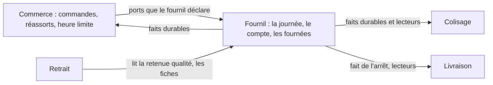

# Le fournil — le contexte `production`

Ce que le bloc `apps/lfd-api/src/production/` possède, ce qu'il demande aux
autres blocs et ce qu'il leur annonce. Les écrans et les gestes du fournil ont
leurs propres documents :

| Sujet                                              | Document                                             |
| -------------------------------------------------- | ---------------------------------------------------- |
| Figer le plan d'une journée, le rouvrir, l'alerte  | [`arret-du-plan.md`](arret-du-plan.md)               |
| Le papier du jour et son envoi par e-mail          | [`dossier-prod-du-jour.md`](dossier-prod-du-jour.md) |
| La matrice des jours, les tranches, le rangement   | [`le-previsionnel.md`](le-previsionnel.md)           |
| La fiche d'atelier, les fournées, les raccourcis   | [`la-fiche-d-atelier.md`](la-fiche-d-atelier.md)     |
| Le verdict du superviseur et la retenue au retrait | [`le-controle-qualite.md`](le-controle-qualite.md)   |

## En bref

Le fournil fabrique ce que les commandes et les réassorts demandent pour une
journée. Le soir, le **plan** de la journée est **arrêté** : le fournil copie
chez lui les commandes et les réassorts du jour, et en tire le **compte à
produire** (un article, une quantité). Le lendemain, il déclare ce qui sort du
four (les **fournées**) ; ce qui sort part au colisage.

Le fournil ne connaît une commande que par **un identifiant et une copie**
prise à l'arrêt, jamais par une jointure : une commande renommée ou annulée
chez le commerce ne fait pas disparaître ce qu'on a fabriqué. Il ne porte
**aucun montant** : il fabrique, il ne facture pas.

---

## Partie technique

### Ce qu'il possède — le schéma `production`

Toutes les tables sont dans `apps/lfd-api/prisma/schema/production.prisma`,
schéma Postgres `production`, sans clé étrangère vers `public`.

| Table                                                                           | Ce qu'elle tient                                                                                              |
| ------------------------------------------------------------------------------- | ------------------------------------------------------------------------------------------------------------- |
| `production_day`                                                                | la journée : arrêt (`closed_at`, auteur), retirage, réouverture, qui colise                                   |
| `production_order`, `production_order_line`                                     | les commandes figées à l'arrêt, avec leur copie (en-tête du bon, échéance, lignes)                            |
| `production_resupply`, `_line`                                                  | les réassorts figés à l'arrêt                                                                                 |
| `production_count`                                                              | le compte à produire, `(service_day, sku)` ; `done_*` = coche de l'ancien poste                               |
| `production_batch`                                                              | les fournées, en ajout seul, annulables                                                                       |
| `production_handoff`, `production_return_request`                               | ce qui a été remis au colisage, et les retours demandés                                                       |
| `production_container`, `production_batch_shortcut`                             | le contenant d'un produit (« 1 plaque · 24 ») et les raccourcis                                               |
| `production_quality_check`, `_photo`, `_upload`, `_quality_settings`            | le contrôle qualité                                                                                           |
| `production_settings`, `production_closed_day`, `production_auto_close_attempt` | jours fermés, tentative d'arrêt automatique (les colonnes d'arrêt de `production_settings` ne sont plus lues) |
| `production_tranche_settings`, `production_display_settings`                    | tranches fixes ou calculées, affichage des sous-catégories                                                    |
| `production_dossier_recipient`, `production_dossier_dispatch`                   | destinataires du dossier du jour, envois faits                                                                |
| `order_withdrawal`, `order_revision_notice`                                     | retraits et révisions d'une commande déjà inscrite                                                            |
| `production_day_change`                                                         | le journal des versions de journée, qui fait relire les écrans                                                |

### La journée, un agrégat

`ProductionDay` (`domain/entities/production-day.ts`, et ses parties
`production-day.*.ts`) porte le **cycle** : arrêtée, retirée, rouverte, lancée
« au plus tôt », révisée, et les fournées. `DayPlan`
(`production-day.plan.ts`) porte le **calcul** du compte à partir des
commandes et des réassorts. Deux refus structurent tout :

1. **Une journée arrêtée ne se recalcule pas.** Seuls des gestes signés la
   refont : le retirage, le lancement d'un réassort « au plus tôt », la
   révision ou le retrait d'une commande inscrite. Aucun ne fait descendre un
   article sous ce qui a déjà été demandé au four (`floorCounts`), et refaire
   le compte par-dessus une coche de l'ancien poste non matérialisée lève
   `UncarriedInheritedChecksError`.
2. **Une journée sans commande ni réassort ne s'arrête pas.**

Les gestes qui touchent la journée prennent un verrou consultatif sur sa clé
puis la rechargent (`infrastructure/prisma-production-day.lock.ts`) ; les
gestes du colisage et de la livraison le prennent en mode partagé
(`ArrestedPlanHold`).

### Les canaux

Le fournil **déclare** ce qu'il demande et **publie** ce qu'il fait ; il
n'importe jamais un autre bloc métier (`production → lafoliecoffee`, `→ packing`,
`→ delivery`, `→ handover` sont interdits, CLAUDE.md § 3). `appBootstrap` relie
chaque port à son adaptateur.

| Canal                | Implémenté par                                      | Ce qu'il porte                                                                                                                                                                                                                                                                                                                                              |
| -------------------- | --------------------------------------------------- | ----------------------------------------------------------------------------------------------------------------------------------------------------------------------------------------------------------------------------------------------------------------------------------------------------------------------------------------------------------- |
| `channels/commerce/` | le commerce                                         | les commandes du jour (`DayOrdersReader`), les réassorts (`DayResuppliesReader`), la demande attendue, les seuils d'échéance, l'heure limite, les rayons (`WorkshopShelvesReader`), les guichets d'admission, de retrait et de révision, le balayage des règlements, les BL ; faits `production.day_closed`, `production.day_reopened`, `resupply_launched` |
| `channels/packing/`  | le fournil publie, le colisage écoute ou implémente | faits `handed_to_packing`, `packing_list_drawn`, `resupply_list_drawn`, `return_requested`… ; `ArrestedPlanHold`, lecteurs d'en-tête et d'étiquette ; `OvenWaitingOrdersReader`, `PackedOrdersReader`, `DayPackingProgressReader` (déclarés par le fournil, implémentés par le colisage)                                                                    |
| `channels/delivery/` | la livraison écoute ou implémente                   | fait `production.day_retaken`, réassorts figés, `DayDispatchProgressReader`                                                                                                                                                                                                                                                                                 |
| `channels/handover/` | les deux sens                                       | `QualityHoldsReader` et `AtelierSheetsReader` publiés par le fournil pour le retrait ; `AttestedHandoversReader` et `OrderCustodyReader` que le retrait implémente                                                                                                                                                                                          |

Les faits sont **durables** : écrits dans la boîte d'envoi dans la même
transaction que la journée, relayés après validation, repris en cas d'échec
([`../journalisation/plan-boite-d-envoi.md`](../journalisation/plan-boite-d-envoi.md)).
Rejouer l'arrêt réannonce le fait sous une clé neuve : c'est le filet.

L'état de la journée (`GET admin/production/batch/:date/status`) rend trois
écarts lus au commerce — `pendingInCommerce`, `packedBehind`,
`handedOverBehind` (`get-production-day-status.handler.ts`) — pour voir ce
qu'un abonné n'aurait pas encore appliqué.

Ce que deviennent les faits ailleurs : le colisage
([`../colisage/colisage.md`](../colisage/colisage.md)), le retrait
([`../retrait/le-retrait.md`](../retrait/le-retrait.md)), la composition des
tournées ([`../livraisons/tournees/composition-automatique.md`](../livraisons/tournees/composition-automatique.md)),
le cycle de la commande
([`../commandes/la-commande/architecture-cycle-de-vie-commande.md`](../commandes/la-commande/architecture-cycle-de-vie-commande.md)).

### Le papier

`application/services/production-paper.service.ts` tire et archive au premier
tirage, dans le bucket `production`
([`../commandes/bon-et-pieces/architecture-pieces-en-r2.md`](../commandes/bon-et-pieces/architecture-pieces-en-r2.md)),
trois pièces : la fiche d'atelier d'une commande
(`orders/<id>/fiche-atelier-v2.pdf`), le compte à produire
(`<jour>/compte-a-produire-v2.pdf`) et le dossier du jour. Chacune a son
spécimen sur la planche des documents.

### Les routes

| Contrôleur (`http/`)                                                       | Préfixe                                        | Droit                                                                           |
| -------------------------------------------------------------------------- | ---------------------------------------------- | ------------------------------------------------------------------------------- |
| `production-day.controller.ts`                                             | `admin/production/batch/:date/…`, `forecast`   | `production_plan` ; arrêt et réouverture sous `production_count_stop:write`     |
| `production-worksheet.controller.ts`                                       | `admin/production/worksheet…`, `containers`    | `production_worksheet` ; contenant en écriture sous `production_settings:write` |
| `production-settings.controller.ts`                                        | `admin/production/settings`                    | `production_settings`                                                           |
| `production-batch-shortcuts.controller.ts`                                 | `admin/production/settings/shortcuts`          | `production_settings`                                                           |
| `production-dossier-recipients.controller.ts`                              | `admin/production/settings/dossier-recipients` | `production_settings`                                                           |
| `production-resupply-launch.controller.ts`                                 | `…/batch/:date/resupplies/:id/launch`          | `production_resupply`                                                           |
| `production-quality.controller.ts`, `production-supervision.controller.ts` | `admin/supervision/…`                          | `b2b_supervision`                                                               |
| `quality-control-settings.controller.ts`                                   | `admin/production/quality-settings`            | `lfc_order_settings`                                                            |
| `auto-close.controller.ts`, `quality-upload-sweep.controller.ts`           | routes machine du Worker                       | jeton du Worker                                                                 |

### Les écrans du back-office

| Écran                                                                  | Où (`apps/lfd-backoffice-frontend/src/app/`)                               |
| ---------------------------------------------------------------------- | -------------------------------------------------------------------------- |
| Prod manager › Prévisionnel (`/prod-manager/previsionnel`)             | `production/previsionnel/`                                                 |
| Prod manager › Réassorts                                               | `production/reassorts-a-produire/`                                         |
| Fournil — la fiche d'atelier (`/fournil`)                              | `production/fiche-atelier/`                                                |
| Réglages › Production (`/reglages/production/fournil`, `…/raccourcis`) | `production/production-settings-page/`, `production/batch-shortcuts-page/` |
| Supervision (contrôle qualité)                                         | `supervision/`                                                             |

`/production` et `/production/previsionnel` redirigent vers le Prod manager.

## Reste à faire

- Retirer les colonnes `production_count.done_*` et la lecture de la coche
  héritée comme fournée implicite (dernier temps de la bascule des fournées,
  [`la-fiche-d-atelier.md`](la-fiche-d-atelier.md)).
- Retirer les colonnes d'arrêt mortes de `production_settings` (`close_mode`,
  `close_at`, `alert_at`) — sur ordre de Hugo, une colonne morte reste en base.
