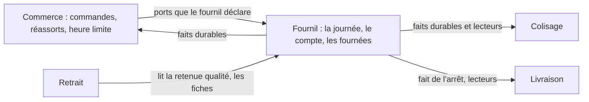
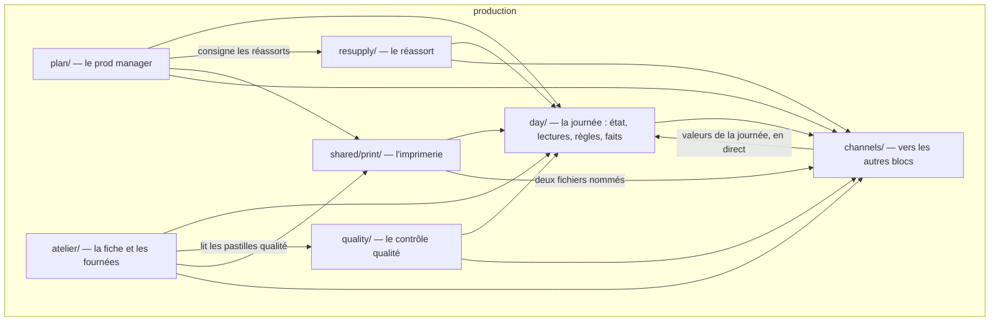

# Le fournil — le contexte `production`

Ce que le bloc `apps/lfd-api/src/production/` possède, ce qu'il demande aux
autres blocs et ce qu'il leur annonce. Les écrans et les gestes du fournil ont
leurs propres documents :

| Sujet                                              | Document                                             |
| -------------------------------------------------- | ---------------------------------------------------- |
| Figer le plan d'une journée, le rouvrir, l'alerte  | [`arret-du-plan.md`](arret-du-plan.md)               |
| Le papier du jour et son envoi par e-mail          | [`dossier-prod-du-jour.md`](dossier-prod-du-jour.md) |
| La matrice des jours, les tranches, le rangement   | [`le-previsionnel.md`](le-previsionnel.md)           |
| La fiche d'atelier, les fournées, les raccourcis   | [`la-fiche-d-atelier.md`](la-fiche-d-atelier.md)     |
| Le verdict du superviseur et la retenue au retrait | [`le-controle-qualite.md`](le-controle-qualite.md)   |

## En bref

Le fournil fabrique ce que les commandes et les réassorts demandent pour une
journée. Le soir, le **plan** de la journée est **arrêté** : le fournil copie
chez lui les commandes et les réassorts du jour, et en tire le **compte à
produire** (un article, une quantité). Le lendemain, il déclare ce qui sort du
four (les **fournées**) ; ce qui sort part au colisage.

Le fournil ne connaît une commande que par **un identifiant et une copie**
prise à l'arrêt, jamais par une jointure : une commande renommée ou annulée
chez le commerce ne fait pas disparaître ce qu'on a fabriqué. Il ne porte
**aucun montant** : il fabrique, il ne facture pas.



### Un noyau, et des métiers autour

Le fournil n'est pas un seul tas de fichiers : c'est **un noyau et quatre
métiers**, plus une imprimerie commune.

- **La journée** (`day/`) est le noyau. Elle tient l'état — la journée
  arrêtée, son compte, ses fournées, ses remises — et elle répond aux
  questions qu'on lui pose sur ses tables. Elle ne connaît aucun métier.
- **Les métiers** tiennent les gestes : le **plan** (le prod manager :
  prévisionnel, arrêt, réouverture, retirage, dossier du jour), l'**atelier**
  (la fiche, les fournées, les contenants, les raccourcis, la supervision), la
  **qualité** (contrôles, retenues, photos) et le **réassort** (le lancer, le
  lire).
- **L'imprimerie** (`shared/print/`) tient le papier commun : la fiche d'une
  commande, les pastilles, l'archivage des PDF, les réglages d'affichage.
- **Les canaux** (`channels/`) sont les portes vers les autres blocs
  (commerce, colisage, livraison, retrait).

Chaque métier est une pièce fermée avec **une seule porte**, son `index.ts` ;
l'intérieur est privé, et une porte du dépôt refuse qu'on y entre à côté.



Toute flèche absente est refusée : `day/` n'importe aucun métier, un métier
n'en lit un autre que sur les deux arêtes du schéma, et toujours par son
`index.ts`.

---

## Partie technique

### Ce qu'il possède — le schéma `production`

Toutes les tables sont dans `apps/lfd-api/prisma/schema/production.prisma`,
schéma Postgres `production`, sans clé étrangère vers `public`.

| Table                                                                           | Ce qu'elle tient                                                                                                                                      |
| ------------------------------------------------------------------------------- | ----------------------------------------------------------------------------------------------------------------------------------------------------- |
| `production_day`                                                                | la journée : arrêt (`closed_at`, auteur), retirage, réouverture, qui colise                                                                           |
| `production_order`, `production_order_line`                                     | les commandes figées à l'arrêt, avec leur copie (en-tête du bon, échéance, lignes)                                                                    |
| `production_resupply`, `_line`                                                  | les réassorts figés à l'arrêt                                                                                                                         |
| `production_count`                                                              | le compte à produire, `(service_day, sku)` ; `done_*` = coche de l'ancien poste                                                                       |
| `production_batch`                                                              | les fournées, en ajout seul, annulables                                                                                                               |
| `production_handoff`, `production_return_request`                               | ce qui a été remis au colisage, et les retours demandés                                                                                               |
| `production_container`, `production_batch_shortcut`                             | le contenant d'un produit (« 1 plaque · 24 ») et les raccourcis                                                                                       |
| `production_quality_check`, `_photo`, `_upload`, `_quality_settings`            | le contrôle qualité                                                                                                                                   |
| `production_settings`, `production_closed_day`, `production_auto_close_attempt` | jours fermés, tentative d'arrêt automatique (les colonnes d'arrêt de `production_settings` ne sont plus lues)                                         |
| `production_tranche_settings`, `production_display_settings`                    | tranches fixes ou calculées, affichage des sous-catégories                                                                                            |
| `production_dossier_recipient`, `production_dossier_dispatch`                   | destinataires du dossier du jour, envois faits                                                                                                        |
| `order_withdrawal`, `order_revision_notice`                                     | retraits et révisions d'une commande déjà inscrite                                                                                                    |
| `production_day_change`                                                         | le journal des versions de journée, qui fait relire les écrans                                                                                        |
| `provisional_print`                                                             | les impressions provisoires du dossier avant l'arrêt : numéro, version du commerce, empreintes ([`dossier-prod-du-jour.md`](dossier-prod-du-jour.md)) |

### La journée, un agrégat

`ProductionDay` (`day/domain/entities/production-day.ts`, et ses parties
`production-day.*.ts`) porte le **cycle** : arrêtée, retirée, rouverte, lancée
« au plus tôt », révisée, et les fournées. `DayPlan`
(`production-day.plan.ts`) porte le **calcul** du compte à partir des
commandes et des réassorts. Deux refus structurent tout :

1. **Une journée arrêtée ne se recalcule pas.** Seuls des gestes signés la
   refont : le retirage, le lancement d'un réassort « au plus tôt », la
   révision ou le retrait d'une commande inscrite. Aucun ne fait descendre un
   article sous ce qui a déjà été demandé au four (`floorCounts`), et refaire
   le compte par-dessus une coche de l'ancien poste non matérialisée lève
   `UncarriedInheritedChecksError`.
2. **Une journée sans commande ni réassort ne s'arrête pas.**

Les gestes qui touchent la journée prennent un verrou consultatif sur sa clé
puis la rechargent (`day/infrastructure/prisma-production-day.lock.ts`) ; les
gestes du colisage et de la livraison le prennent en mode partagé
(`ArrestedPlanHold`).

### L'arborescence

```
apps/lfd-api/src/production/
├── production.module.ts        racine du bloc : importe les six modules, n'a aucun fournisseur
├── __tests__/production-route-table.spec.ts   la table des routes du module entier
├── day/          le noyau        index.ts · production-day.module.ts
├── plan/         le prod manager index.ts · production-plan.module.ts
├── atelier/      la fiche        index.ts · production-atelier.module.ts · production-batch-shortcuts.module.ts
├── quality/      la qualité      index.ts · production-quality.module.ts
├── resupply/     le réassort     index.ts · production-resupply.module.ts
├── shared/print/ l'imprimerie    index.ts · production-print.module.ts
└── channels/     commerce/ · packing/ · delivery/ · handover/ (+ payload-fields.ts, resupply-lines.ts)
```

Chaque métier garde les quatre couches (`domain/`, `application/`,
`infrastructure/`, `http/`) ; `resupply/` n'a que `application/` et `http/`,
ses tables appartenant au noyau. Les doubles de test vivent chez le
propriétaire de ce qu'ils doublent (`<métier>/…/__tests__/`).

### Ce que chaque porte expose

| Porte                   | Noms | Ce qu'elle expose                                                                                                                                                                                                                                             |
| ----------------------- | ---- | ------------------------------------------------------------------------------------------------------------------------------------------------------------------------------------------------------------------------------------------------------------- |
| `day/index.ts`          | 75   | le tronc, en six sections (ci-dessous)                                                                                                                                                                                                                        |
| `shared/print/index.ts` | 38   | `OrderSheetPaper` et `atelierSheetSlotOf`, `ProductionPaperArchive`, les réglages d'affichage (entité, lecteur, dépôt), le gabarit de la fiche et du compte, les primitives de dessin et de rangement (`rootShelvesOf`…), les données d'exemple, `servePaper` |
| `atelier/index.ts`      | 2    | `RecordBatchCommand`, `CancelBatchCommand` (le semis)                                                                                                                                                                                                         |
| `plan/index.ts`         | 1    | `CloseProductionDayCommand` (le semis)                                                                                                                                                                                                                        |
| `quality/index.ts`      | 1    | `QualityLineStatusReader`, que la fiche de l'atelier lit                                                                                                                                                                                                      |
| `resupply/index.ts`     | 0    | rien : aucun autre métier ne lit le réassort                                                                                                                                                                                                                  |

`day/index.ts` se lit dans l'ordre de ses six sections :

1. **La journée et ses valeurs** — l'agrégat en type seulement (on le charge
   par le dépôt), ses instantanés, le jour de service, la plage, l'envoi, le
   signataire.
2. **Ce que la journée sait répondre** — un port étroit par question :
   `ProductionDayStatusReader`, `ProductionHandoffReader`,
   `OrderWithdrawalsReader`, `ProductionTrancheSettingsReader`,
   `GetProductionDueThresholdsQuery`, `ArrestedPlanLinesReader`,
   `PlannedOrderLinesReader`, `LaunchedResupplyLookup`.
3. **Ce qu'on écrit** — `ProductionDayRepository`, `ProductionDayLock` et
   `dayLockKey`, `ProductionBatchRepository`, `ProductionHandoffLedger`,
   `ProductionReturnRequests`, `ProductionTrancheSettingsRepository`.
4. **Les règles** — fonctions pures : heure d'arrêt du plan, compte,
   production faite, paliers, remise et reprise d'une fournée, jour relatif.
5. **Les faits** — ce que la journée annonce dans son vocabulaire ; un abonné
   d'un autre métier les écoute en `@DurableHandler`.
6. **Les refus** — les erreurs de l'agrégat et de ses règles, pour qu'un
   métier (ou un test) les reconnaisse sans lire l'intérieur.

`day/index.ts` ne charge **aucun canal** : `channels/` importe les fichiers de
`day/` en direct, et un service qui lit un canal vit dans le métier qui s'en
sert (`PackingHandoffs` à l'atelier, `SealedDayReading` à la qualité, les
délais de la fiche et du dossier chacun chez lui). Un cycle d'imports à
travers un `index.ts` rendrait une classe `undefined` au moment où Nest lit
ses métadonnées.

### Le propriétaire parle de ce qui est à lui

Chaque modèle du schéma `production` a un propriétaire — celui qui l'écrit —
et seul lui le lit. Un métier qui a besoin d'une table du noyau demande une
**lecture nommée** que le noyau publie et implémente sur ses tables, avec la
requête qu'il faut (jamais « charger la journée puis filtrer », qui coûterait
des lectures en production) :

| Lecture du noyau (`day/domain/ports/`) | Adaptateur (`day/infrastructure/`)     | Qui la lit                                                                                                          |
| -------------------------------------- | -------------------------------------- | ------------------------------------------------------------------------------------------------------------------- |
| `ArrestedPlanLinesReader`              | `prisma-arrested-plan-lines.reader.ts` | le prévisionnel du plan (`plan/application/services/arrested-production-plan.reader.ts`, qui garde le regroupement) |
| `PlannedOrderLinesReader`              | `prisma-planned-order-lines.reader.ts` | la retenue au retrait (`quality/application/services/checked-quality-holds.reader.ts`)                              |
| `LaunchedResupplyLookup`               | `prisma-launched-resupply.lookup.ts`   | le réassort, sous le verrou de l'appelant                                                                           |
| `ProductionDayStatusReader`            | —                                      | le tour d'arrêt automatique du plan, l'état du jour                                                                 |

Les réassorts lancés (`production_resupply`, `_line`) sont écrits par
l'agrégat (`launchResupply`) : ils appartiennent au noyau, et `resupply/` ne
les lit que par ces ports.

Le noyau implémente aussi, sur ses tables, quatre ports de canal que la racine
relie en `useExisting` par son module : `PrismaArrestedPlanHold` (le verrou
partagé de l'arrêt, `appBootstrap/packing-feed.module.ts`),
`PrismaClosedPlansReader` (`production-desk-feed.module.ts`),
`PrismaFrozenResuppliesReader` (`production-delivery-feed.module.ts`) et
`PrismaAtelierSheetsReader` (`handover-feed.module.ts`).

### Les modules du fournil

Un module Nest par métier, réunis par `production.module.ts`, qui les importe
et réexporte la journée, l'imprimerie, la qualité, le réassort et le plan (Nest
n'exporte un fournisseur importé que par son module). La journée est importée
par les métiers, jamais l'inverse ; aucun `forwardRef`.

| Module (fichier)                                                      | Importe                                                                                  | Exporte                                                                                                                                                                                                                                       |
| --------------------------------------------------------------------- | ---------------------------------------------------------------------------------------- | --------------------------------------------------------------------------------------------------------------------------------------------------------------------------------------------------------------------------------------------- |
| `ProductionDayModule` (`day/production-day.module.ts`)                | —                                                                                        | aux métiers : dépôts, verrou, lectures de la section 2, registres, `ClosedPlansReader` ; à la racine : la source de version, les guichets de retrait et de révision, les lecteurs d'inscription et d'en-tête, les quatre adaptateurs de canal |
| `ProductionPrintModule` (`shared/print/production-print.module.ts`)   | la journée, `BrandModule`                                                                | `ProductionPaperArchive`, `OrderSheetPaper`, les deux ports d'affichage, `DayOrderLabelHeadReader`                                                                                                                                            |
| `ProductionQualityModule` (`quality/production-quality.module.ts`)    | la journée                                                                               | `QualityLineStatusReader` (la fiche), `QualityCheckReader`, `ChannelQualityHeldOrdersReader`, `CheckedQualityHoldsReader` (retrait et colisage)                                                                                               |
| `ProductionResupplyModule` (`resupply/production-resupply.module.ts`) | la journée                                                                               | `ProductionLaunchedResupplies`                                                                                                                                                                                                                |
| `ProductionPlanModule` (`plan/production-plan.module.ts`)             | la journée, l'imprimerie, `BrandModule`                                                  | `ProductionPlanAdmissionDesk`, `ProductionPaperRenderer`                                                                                                                                                                                      |
| `ProductionAtelierModule` (`atelier/production-atelier.module.ts`)    | la journée, la qualité, l'imprimerie, les raccourcis, `BrandModule`, `DayVersionsModule` | rien                                                                                                                                                                                                                                          |

Un fournisseur (ou un contrôleur) ne figure que dans **un seul** module.
Nest en fait un exemplaire par module qui le déclare : un service qui garde
quelque chose en mémoire aurait deux caches qui divergent, et ni le typecheck
ni les tests ne le voient. Le partage passe par `exports` du module qui le
déclare et `imports` de celui qui s'en sert.

### La porte `production-subcontexts`

`dev-toolbox/gates/production-subcontexts.mjs` (lectures dans
`dev-toolbox/gates/lib/production-subcontexts-*.mjs`, arêtes admises dans
`ALLOWED` de `production-subcontexts-graph.mjs`) refuse :

- **une arête hors du schéma** — les types comptent. Deux fichiers seulement
  sont admis hors des arêtes (`ADMITTED_FILES`) : l'imprimerie lit
  `channels/commerce/order-print-colors*` (la couleur d'une commande) et
  `channels/packing/order-label-head.reader.ts` (l'étiquette d'un sac) ;
- **un import à côté de la porte** : entre sous-contextes, on entre par
  `index.ts` ; un module de métier entre chez un autre par son `*.module.ts` ;
- **un test** qui lit l'intérieur d'un autre sous-contexte (le sien est
  libre) ;
- **un modèle lu hors de son propriétaire**, en Prisma ou en SQL (la carte
  `production-subcontexts.map.json`, clé `models`) ;
- **un abonné en mémoire** sur le fait d'un autre métier : c'est un
  `@DurableHandler` ;
- **un cycle d'exécution à travers un `index.ts`** ;
- **un message du bus** (commande, requête, fait) d'un autre métier hors des
  arêtes ou à côté de son `index.ts`, jugé par le fichier qui déclare la
  classe — le bus de `@nestjs/cqrs` est global, Nest ne le protège pas ;
- **un fournisseur déclaré dans deux modules** du fournil ;
- **une racine** (`appBootstrap/`, `dev/`) qui entre ailleurs que par un
  `index.ts`, un module à la racine d'un métier, `production.module.ts` ou
  `channels/` ;
- **un index qui grandit** : la taille de chaque `index.ts` est une dette
  décroissante, et un `export *` est refusé.

`test/` reste exempté : un e2e qui vérifie une ligne en base doit pouvoir
regarder dedans.

**La dette** (`dev-toolbox/gates/production-subcontexts-debt.json`) est à
zéro partout sauf deux comptes :

- **`testDoor` : 33 imports de tests hors porte** — plan → day 14, atelier →
  day 11, resupply → day 3, shared-print → plan 2, atelier → plan 1,
  atelier → quality 1, quality → day 1. Ce sont surtout des doubles qui
  construisent une `ProductionDay`, que `day/index.ts` n'exporte qu'en type ;
- **`indexSize`** : day 75, shared-print 38, atelier 2, plan 1, quality 1,
  resupply 0.

`pnpm gate production-subcontexts --carte` détaille la surface lue par les
autres.

### Les règles de la surface

- **Une seule porte par métier** : son `index.ts`, qui ne fait que
  réexporter. On n'y met que ce qu'un autre métier lit réellement ; le reste
  est privé.
- **Les types passent aussi par la porte** : un `import type` vers
  l'intérieur d'un autre métier est refusé comme un import de valeur.
- **Aucun cycle à travers un `index.ts`** : un cycle de réexports rend une
  classe `undefined` quand Nest lit ses métadonnées d'injection, et l'API
  refuse de démarrer sur une erreur qui ne nomme pas la cause.
- **`channels/` n'est pas un métier** : il importe les fichiers de `day/` en
  direct, et `day/index.ts` ne charge aucun canal.
- **Les tests** d'un métier lisent son intérieur ; ceux qui doublent le port
  d'un autre passent par son `index.ts`.
- **Les racines** (`appBootstrap/`, `dev/`, `production.module.ts`)
  composent l'application et relient des adaptateurs concrets ; elles entrent
  par un `index.ts`, un module ou `channels/`. `test/` est exempté.

### Les limites assumées

- **Le bus de `@nestjs/cqrs` est global** : un handler répond à n'importe
  quel émetteur. Les modules Nest protègent les services injectés, pas les
  commandes, requêtes et faits — c'est la porte qui les tient.
- **Une seule base, un seul client Prisma** : rien ne rend physiquement
  impossible de lire la table d'un autre métier ; la porte par modèle
  l'interdit, c'est une discipline outillée.
- **Les lectures entre métiers sont synchrones** (par port) : le bon choix
  pour un monolithe, mais un couplage à l'exécution.
- **`test/` lit l'intérieur** des métiers : un e2e vérifie une ligne en base.

La piste pour aller plus loin, métier par métier : un client Prisma restreint
par sous-contexte, sur le modèle de `PimPrismaService`
(`apps/lfd-api/src/pim/infra/database/pim-prisma.service.ts`), qui n'expose
que ses modèles. Lire la table d'un autre métier ne serait plus interdit : ça
ne compilerait plus.

### Les routes

Les chemins d'API sont ceux d'avant le découpage ; seul le dossier du
contrôleur dit son métier.

| Contrôleur                                                                                                                                    | Préfixe                                                                         | Droit (`@AdminSurface`)                                                     |
| --------------------------------------------------------------------------------------------------------------------------------------------- | ------------------------------------------------------------------------------- | --------------------------------------------------------------------------- |
| `plan/http/production-day.controller.ts`                                                                                                      | `admin/production/batch/:date/…` (statut, arrêt, réouverture, PDF), `forecast`  | `production_plan` ; arrêt et réouverture sous `production_count_stop:write` |
| `plan/http/production-day-retake.controller.ts`                                                                                               | `admin/production/worksheet/:date/retake`                                       | `production_worksheet`                                                      |
| `plan/http/production-settings.controller.ts`                                                                                                 | `admin/production/settings` (tranches, jours fermés)                            | `production_settings`                                                       |
| `plan/http/production-dossier-recipients.controller.ts`                                                                                       | `admin/production/settings/dossier-recipients`                                  | `production_settings`                                                       |
| `plan/http/admin-day-papers-specimens.controller.ts`                                                                                          | `admin/document-specimens` (compte, dossier)                                    | `b2b_accounting`                                                            |
| `atelier/http/production-worksheet.controller.ts`                                                                                             | `admin/production/worksheet…`, `containers`                                     | `production_worksheet` ; contenant sous `production_settings:write`         |
| `atelier/http/production-atelier-sheet.controller.ts`                                                                                         | `admin/production/batch/:date/sheets/:reference.pdf`                            | `production_plan` ; `production_worksheet:read` exigé                       |
| `atelier/http/production-display-settings.controller.ts`                                                                                      | `admin/production/settings/display`                                             | `production_settings`                                                       |
| `atelier/http/production-batch-shortcuts.controller.ts`                                                                                       | `admin/production/settings/shortcuts`                                           | `production_settings`                                                       |
| `atelier/http/production-workshop-shortcuts.controller.ts`                                                                                    | `admin/production/shortcuts`                                                    | `production_worksheet`                                                      |
| `atelier/http/production-supervision.controller.ts`                                                                                           | `admin/supervision/preparation`                                                 | `b2b_supervision`                                                           |
| `atelier/http/admin-atelier-sheet-specimen.controller.ts`                                                                                     | `admin/document-specimens/atelier-sheet.pdf`                                    | `b2b_accounting`                                                            |
| `quality/http/production-quality.controller.ts`                                                                                               | `admin/supervision/quality`                                                     | `b2b_supervision`                                                           |
| `quality/http/quality-control-settings.controller.ts`                                                                                         | `admin/production/quality-settings`                                             | `lfc_order_settings`                                                        |
| `resupply/http/production-day-resupplies.controller.ts`                                                                                       | `admin/production/batch/:date/resupplies`                                       | `production_plan`                                                           |
| `resupply/http/production-resupply-launch.controller.ts`                                                                                      | `…/batch/:date/resupplies/:resupplyId/launch`                                   | `production_resupply`                                                       |
| `plan/http/auto-close.controller.ts`, `quality/http/quality-upload-sweep.controller.ts`, `day/http/production-day-change-sweep.controller.ts` | routes machine du Worker (`…/auto-close`, `…/quality/sweep`, `…/journal/sweep`) | jeton du Worker (`RecomputeGuard`)                                          |

### Les canaux

Le fournil **déclare** ce qu'il demande et **publie** ce qu'il fait ; il
n'importe jamais un autre bloc métier (`production → lafoliecoffee`, `→ packing`,
`→ delivery`, `→ handover` sont interdits, CLAUDE.md § 3). `appBootstrap` relie
chaque port à son adaptateur.

| Canal                | Implémenté par                                      | Ce qu'il porte                                                                                                                                                                                                                                                                                                                                                                 |
| -------------------- | --------------------------------------------------- | ------------------------------------------------------------------------------------------------------------------------------------------------------------------------------------------------------------------------------------------------------------------------------------------------------------------------------------------------------------------------------ |
| `channels/commerce/` | le commerce                                         | les commandes du jour (`DayOrdersReader`), les réassorts (`DayResuppliesReader`), la demande attendue, les seuils d'échéance, l'heure limite, les articles et leur rayon (`ProductionArticlesReader`), les guichets d'admission, de retrait et de révision, le balayage des règlements, les BL ; faits `production.day_closed`, `production.day_reopened`, `resupply_launched` |
| `channels/packing/`  | le fournil publie, le colisage écoute ou implémente | faits `handed_to_packing`, `packing_list_drawn`, `resupply_list_drawn`, `return_requested`… ; `ArrestedPlanHold`, lecteurs d'en-tête et d'étiquette ; `OvenWaitingOrdersReader`, `PackedOrdersReader`, `DayPackingProgressReader` (déclarés par le fournil, implémentés par le colisage)                                                                                       |
| `channels/delivery/` | la livraison écoute ou implémente                   | fait `production.day_retaken`, réassorts figés, `DayDispatchProgressReader`                                                                                                                                                                                                                                                                                                    |
| `channels/handover/` | les deux sens                                       | `QualityHoldsReader` et `AtelierSheetsReader` publiés par le fournil pour le retrait ; `AttestedHandoversReader` et `OrderCustodyReader` que le retrait implémente                                                                                                                                                                                                             |

Les faits sont **durables** : écrits dans la boîte d'envoi dans la même
transaction que la journée, relayés après validation, repris en cas d'échec
([`../journalisation/plan-boite-d-envoi.md`](../journalisation/plan-boite-d-envoi.md)).
Rejouer l'arrêt réannonce le fait sous une clé neuve : c'est le filet.

L'état de la journée (`GET admin/production/batch/:date/status`) rend trois
écarts lus au commerce — `pendingInCommerce`, `packedBehind`,
`handedOverBehind` (`get-production-day-status.handler.ts`) — pour voir ce
qu'un abonné n'aurait pas encore appliqué.

Ce que deviennent les faits ailleurs : le colisage
([`../colisage/colisage.md`](../colisage/colisage.md)), le retrait
([`../retrait/le-retrait.md`](../retrait/le-retrait.md)), la composition des
tournées ([`../livraisons/tournees/composition-automatique.md`](../livraisons/tournees/composition-automatique.md)),
le cycle de la commande
([`../commandes/la-commande/architecture-cycle-de-vie-commande.md`](../commandes/la-commande/architecture-cycle-de-vie-commande.md)).

### Le papier

Trois pièces sont tirées et archivées au premier tirage, dans le bucket
`production`
([`../commandes/bon-et-pieces/architecture-pieces-en-r2.md`](../commandes/bon-et-pieces/architecture-pieces-en-r2.md)) :
la fiche d'atelier d'une commande (`orders/<id>/fiche-atelier-v2.pdf`), le
compte à produire (`<jour>/compte-a-produire-v2.pdf`) et le dossier du jour.
L'imprimerie archive (`ProductionPaperArchive`) et rend la fiche d'une
commande (`OrderSheetPaper`), seule ou en série dans le dossier ; le plan rend
le compte et le dossier (`plan/application/services/production-paper.service.ts`,
`ProductionPaperRenderer`). Chaque pièce a son spécimen sur la planche des
documents.

### Les écrans du back-office

| Écran                                                                  | Où (`apps/lfd-backoffice-frontend/src/app/`)                               |
| ---------------------------------------------------------------------- | -------------------------------------------------------------------------- |
| Prod manager › Prévisionnel (`/prod-manager/previsionnel`)             | `production/previsionnel/`                                                 |
| Prod manager › Réassorts                                               | `production/reassorts-a-produire/`                                         |
| Fournil — la fiche d'atelier (`/fournil`)                              | `production/fiche-atelier/`                                                |
| Réglages › Production (`/reglages/production/fournil`, `…/raccourcis`) | `production/production-settings-page/`, `production/batch-shortcuts-page/` |
| Supervision (contrôle qualité)                                         | `supervision/`                                                             |

`/production` et `/production/previsionnel` redirigent vers le Prod manager.

## Reste à faire

- Rendre agnostiques les faits que la journée émet vers l'aval
  ([`plan-faits-agnostiques.md`](plan-faits-agnostiques.md)).
- Vider la dette `testDoor` de la porte (33 imports de tests hors porte).

- Retirer les colonnes d'arrêt mortes de `production_settings` (`close_mode`,
  `close_at`, `alert_at`) — sur ordre de Hugo, une colonne morte reste en base.
