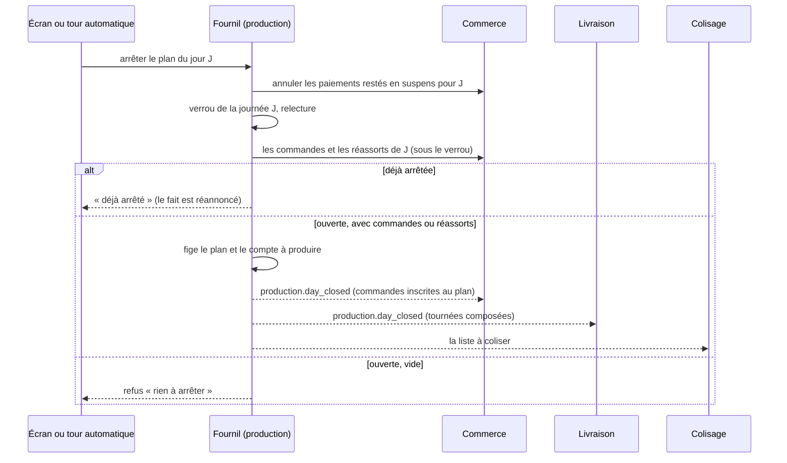
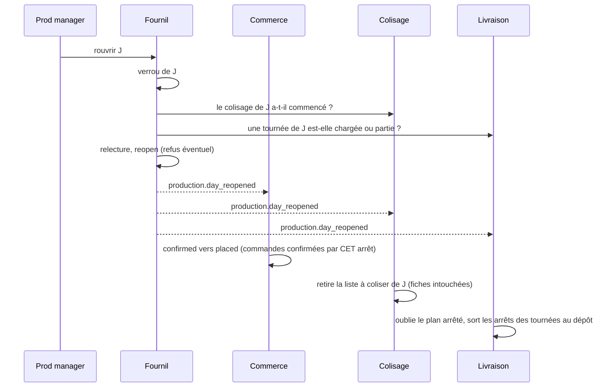

# L'arrêt du plan de production

Ce que l'arrêt fait aux commandes (jour plus proposé, client refusé, équipe
reçue hors plan), avec les autres limites de commande :
[`../limites-de-commande/README.md`](../limites-de-commande/README.md). Le
contexte qui le porte : [`architecture-contexte-production.md`](architecture-contexte-production.md).

## En bref

**Arrêter le plan d'une journée, c'est figer ce que le fournil va produire.**
Tant qu'un plan n'est pas arrêté, rien ne part en fournée : pas de compte à
produire, pas de liste à coliser, pas de tournée composée, pas de dossier du
jour.

- Le plan du jour J s'arrête **tout seul**, à la plus tardive de deux heures :
  la fin du rattrapage de l'heure limite générale pour J (« la veille, 23 h »
  - rattrapage) et l'**heure du réassort** (« la veille, 20:00 » par défaut).
    Les deux se règlent dans Réglages › Commandes › Heure limite.
- Un arrêt à la main **avant** cette heure est refusé ; après (un arrêt
  automatique qui a échoué), il reste possible.
- Une journée arrêtée par erreur se **rouvre** depuis le Prod manager, tant
  que rien n'a commencé en aval.
- Une commande arrivée après l'arrêt n'est pas perdue : « Reprendre le
  tirage » (le retirage, sur la fiche d'atelier) l'ajoute.

---

## Partie technique

### L'heure de l'arrêt

`PlanStopRules` (`apps/lfd-api/src/production/application/services/plan-stop-rules.ts`)
est le seul lecteur de la règle, pour ses quatre usages : le tour
automatique, le refus d'un arrêt anticipé, le prévisionnel et la page
Production › Réglages. Il lit l'heure limite générale
(`channels/commerce/order-cutoff-rules.reader.ts`) et l'heure du réassort
(`ResupplyCutoffTimeReader`). L'instant d'arrêt : `planClosesAt`
(`domain/services/latest-order-cutoff.ts`) ; le refus anticipé :
`domain/services/early-close.ts`. Quand l'heure du réassort est la plus
tardive, tout ce qui suit l'arrêt se décale d'autant.

Un arrêt à la main avant l'heure est refusé en 409,
`production.day.before_order_cutoff`, **avant** le balayage des paiements :
« Le plan du mardi 8 septembre s'arrête tout seul à l'heure limite générale,
rattrapage compris : le lundi 7 septembre à 23:00. … Pour figer le plan plus
tôt, avancez l'heure limite dans Réglages › Commandes › Heure limite. » Une
journée déjà arrêtée se réannonce sans ce contrôle — à condition de l'être
encore sous le verrou : rouverte entre-temps, elle le repasse. Sans heure
limite posée, rien n'arrête le plan tout seul et l'arrêt à la main reste
ouvert.

### Le handler, étape par étape

`application/commands/close-production-day.handler.ts` ; avant le verrou
`application/services/plan-arrest-admission.ts`, sous le verrou
`plan-intake-reading.ts`, écriture et faits `plan-arrest-recording.ts`.

1. **Pas avant l'heure** — contrôlé avant le balayage si l'en-tête lu hors
   verrou dit « ouverte », puis repris sous le verrou si la journée y est
   relue ouverte (e2e `production-day-close-race`).
2. **Balayer d'abord** — le fournil demande au commerce de trancher les
   règlements restés en l'air pour J (`PendingSettlementSweeper`,
   [`../commandes/reglement/architecture-abandon-du-reglement.md`](../commandes/reglement/architecture-abandon-du-reglement.md)),
   à chaque appel, réannonce comprise. Le refus « journée vide » vient après.
3. **Une seule décision, sous le verrou** — verrou consultatif sur la clé de
   la journée, puis rechargement (`infrastructure/prisma-production-day.lock.ts`).
   Deux arrêts simultanés ne ferment qu'une fois ; le second réannonce. Sous
   le même verrou sont lus les commandes (`DayOrdersReader`), les réassorts
   « pour demain » envoyés et non annulés (`DayResuppliesReader`, implémenté
   par `lafoliecoffee/resupply/infrastructure/production-day-resupplies.ts`) et
   les retraits de l'annulation staff. La passation, la révision et l'envoi
   d'un réassort prennent ce verrou par leur guichet (`PlanAdmissionDesk`,
   `ResupplyPlanGate`) : admis avant l'arrêt, figé ; arrivé après, refusé
   « plan arrêté » (ou reçu « hors plan » si l'équipe le saisit).
4. **Figer** — commandes (`production_order`, avec la copie de l'en-tête du
   bon), réassorts (`production_resupply`), et le compte à produire = commandes
   - réassorts. `packing_owner = packing`.
5. **Écrire ensemble** — `production_day.closed` au journal et
   `production.day_closed` dans la boîte d'envoi, dans l'unité de travail qui
   tient le verrou ; puis un `production.packing_list_drawn` par commande et un
   `production.resupply_list_drawn` par réassort d'un point servi par
   transfert ([`../colisage/colisage.md`](../colisage/colisage.md)). Les
   abonnés tournent après validation, chacun dans sa transaction.
6. **La réannonce n'est pas un arrêt de plus** — rien n'est recalculé, aucun
   fait n'est écrit au journal, le fait est republié sous une clé neuve avec la
   liste à coliser. C'est le filet : il fait apprendre au commerce les
   commandes d'un retirage.
7. **L'accusé** — `{ date, absorbed, alreadyClosed, closedAt }`, l'accusé du
   geste et non un modèle de lecture ; même chose pour le retirage et la
   réouverture.

Une journée ouverte arrêtée par un lancement « au plus tôt »
([`../reassort-boutiques/au-plus-tot.md`](../reassort-boutiques/au-plus-tot.md))
n'a jamais publié `production.day_closed`, et sa réannonce n'en publie pas :
`ProductionDay.openedByLaunch` la reconnaît, l'instant étant déduit, pas
stocké.

Passé l'arrêt, un réassort « pour demain » ne s'envoie plus (le comptoir :
« demandez au fournil » ; le fournil : produire hors plan) et ne s'annule plus
(« réceptionnez avec un écart ») : le retirage n'en absorbe donc aucun, il
garde ceux qui sont figés.

### Rouvrir une journée arrêtée

Prod manager : bouton « Rouvrir la journée du … » à côté de l'arrêt et dans le
dossier du jour d'une journée arrêtée (`previsionnel/reopen-day/`). La
confirmation dit l'effet. Route `POST admin/production/batch/:date/reopen`,
droit `production_count_stop:write`, `ProductionDay.reopen`.

**Refusée**, avec le cas nommé, dès qu'une fournée non annulée existe (ou une
ligne cochée par l'ancien poste), qu'un colisage a commencé (contenant ouvert
même annulé, ligne au bac, bac fermé), ou qu'une tournée est chargée ou
partie. Le fournil le demande sous son verrou par `DayPackingProgressReader`
et `DayDispatchProgressReader`. L'autre moitié de la garde : les gestes du
colisage (ouvrir un contenant, « Proposer », mettre au bac, fermer le bac,
fiche de réassort) et de la livraison (charger un bac, faire partir une
tournée) prennent le même verrou en mode **partagé** (`ArrestedPlanHold`) et
refusent si le plan est `reopened` (`packing.plan_reopened`,
`delivery.plan_reopened`). Une journée jamais arrêtée passe cette garde.

**Défait** : l'arrêt, les commandes inscrites, le compte, le retirage (la trace
reste : `reopened_at`, `reopened_by`, `production_day.reopened` au journal) ;
au commerce, les commandes dont `confirmed_at` est l'instant de cet arrêt ; au
colisage, la liste du jour et les fiches de réassort intouchées
(`withdrawn_at`) ; à la livraison, le plan appris et les arrêts posés dans les
tournées au dépôt. Les réassorts figés redeviennent annulables.

**Pas défait** : les tournées elles-mêmes, les transferts internes, le dossier
déjà envoyé, les fournées annulées, le drapeau « reçue hors plan », la
tentative d'arrêt automatique du jour — une journée rouverte s'arrête à la
main.

Chaque abonné ne défait que si la journée est **toujours ouverte**, lu par
`ArrestedPlanHold` sous le verrou partagé jusqu'à son `COMMIT` (e2e
`reopened-fact-rearrest-race`). Le fait de la liste à coliser porte la
réouverture dans sa clé, sans quoi la boîte d'envoi avalerait le nouveau
tirage. E2e : `production-day-reopened`.

### L'arrêt automatique et les alertes

Le Worker appelle toutes les cinq minutes `POST admin/production/auto-close`
(`apps/lfd-api/container/worker.ts`, jeton du Worker). Tour :
`domain/services/auto-close-round.ts`, `run-auto-close-round.handler.ts` ;
arrêt signé « automatiquement » `application/services/bus-automatic-day-closer.ts` ;
alertes `plan-arrest-bell.ts`.

| Situation                                                                            | Ce qui se passe                                                                                              |
| ------------------------------------------------------------------------------------ | ------------------------------------------------------------------------------------------------------------ |
| le lendemain est fermé, déjà arrêté, ou aucune heure limite n'est posée              | rien                                                                                                         |
| l'heure d'arrêt du lendemain est passée                                              | l'arrêt, **une seule tentative par journée** (`production_auto_close_attempt`, prise par une seule instance) |
| … le lendemain est vide                                                              | alerte « Rien à arrêter pour le … : aucune commande »                                                        |
| … l'arrêt échoue                                                                     | alerte avec la raison ; pas de nouvelle tentative                                                            |
| … la tentative reste en cours plus de 15 minutes                                     | alerte « L'arrêt automatique du plan du … n'a pas abouti »                                                   |
| l'arrêt d'aujourd'hui tombe aujourd'hui (rattrapage après minuit)                    | même tentative (`todayOutcome`)                                                                              |
| le plan d'aujourd'hui n'est pas arrêté, porte des commandes, et son heure est passée | alerte « Le plan d'aujourd'hui n'a pas été arrêté » ; jamais arrêté d'office : la fournée est déjà au four   |

Les alertes vont à la cloche et en push, aux personnes qui ont
`production_count_stop`, une par type et par journée, et ouvrent le
prévisionnel.

### Production › Réglages

La page (`production/production-settings-page/`) affiche en lecture l'heure
d'arrêt automatique, avec un lien vers Réglages › Commandes
(`GET admin/production/settings` rend `automaticClose: { daysBefore, time }`,
ou `null`). Elle tient aussi le **calendrier des jours fermés** du fournil
(`production_closed_day`, `POST|DELETE admin/production/settings/closed-days`) :
la veille d'un jour fermé, ni arrêt ni alerte. Les colonnes
`production_settings.close_mode`, `close_at`, `alert_at` ne sont plus lues.

### Au prévisionnel

L'état de chaque colonne vient du serveur (`domain/services/forecast-day-state.ts`) :

| État                            | Rendu                                             |
| ------------------------------- | ------------------------------------------------- |
| plan non arrêté, en retard      | colonne rouge, « Plan non arrêté », barres rouges |
| production du jour, plan arrêté | surcouche accent, « Arrêté »                      |
| journée future arrêtée          | « Arrêté » dans l'en-tête                         |
| journée passée                  | surcouche grise                                   |
| jour fermé                      | hachures, « Fournil fermé »                       |

Un bandeau rouge, sur toutes les semaines, dit que le plan d'aujourd'hui n'est
pas arrêté (« Arrêter le plan du … maintenant ») ; le bouton du soir dit
« Arrêt automatique lundi à 23:00 » (désactivé, `closesAt` de la colonne),
puis « Arrêter le plan du <lendemain> » une fois l'heure passée. Les deux
boutons suivent `production_count_stop:write` ; sans ce droit, le bandeau
reste sans bouton. La page se relit toutes les 60 secondes. Le reste de
l'écran : [`le-previsionnel.md`](le-previsionnel.md).

### Les droits

| Droit                   | Ce qu'il donne                                                                                                                                                           |
| ----------------------- | ------------------------------------------------------------------------------------------------------------------------------------------------------------------------ |
| `production_count_stop` | arrêter et rouvrir le plan ; recevoir les alertes                                                                                                                        |
| `production_settings`   | lire l'arrêt automatique ; tenir les jours fermés                                                                                                                        |
| `production_plan`       | lire le plan. Son `write` ne donne rien : [`../droits-et-permissions/todo-ressources-en-lecture-seule.md`](../droits-et-permissions/todo-ressources-en-lecture-seule.md) |

Les ressources s'accordent à l'écran (`/admin/staff-roles`), jamais par
migration.

## Reste à faire

- Dans la course « arrêt anticipé contre réouverture », le balayage des
  règlements a déjà tourné quand le refus tombe sous le verrou : il a tranché
  les règlements d'une journée qu'on croyait arrêtée.
- `production_plan:write` proposé à l'écran des rôles sans rien donner (TODO
  ci-dessus).
