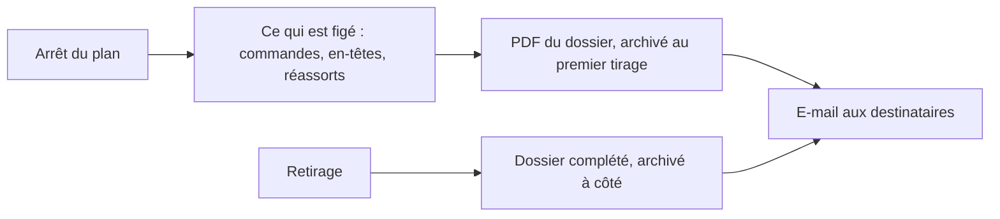
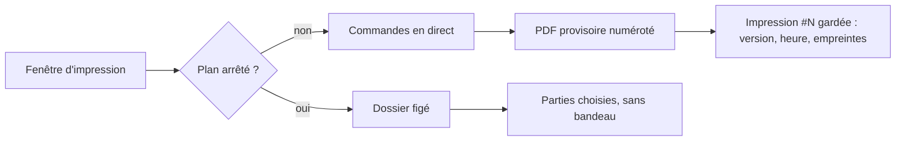

# Le dossier de production du jour

Ce que contient le papier qui part au fournil, **d'où vient chaque
information**, et comment il part par e-mail. Il naît de l'arrêt du plan :
[`arret-du-plan.md`](arret-du-plan.md).

## En bref

Le paquet que le fournil reçoit pour une journée : un récapitulatif de ce qu'il
faut fabriquer, puis un bon par commande. Il se lit à deux endroits :

| Où                                                                                                                                                     | Ce que c'est                                                                            | Quand                                                                 |
| ------------------------------------------------------------------------------------------------------------------------------------------------------ | --------------------------------------------------------------------------------------- | --------------------------------------------------------------------- |
| **Aperçu à l'écran** — Prévisionnel › Dossier du jour (onglets Récapitulatif / Bons)                                                                   | une lecture, depuis les commandes **en direct**                                         | à tout moment                                                         |
| **Le PDF** — bouton « Imprimer le dossier », qui ouvre la fenêtre d'impression, `GET /admin/production/batch/:date/dossier.pdf`, et l'envoi par e-mail | **le papier**, depuis ce que l'arrêt a **figé**                                         | une fois le plan **arrêté** ; la fenêtre en imprime aussi des parties |
| **Le PDF provisoire** — la même fenêtre, avant l'arrêt                                                                                                 | un papier de travail, depuis les commandes **en direct**, « Provisoire 26/11 #3 10:42 » | à tout moment avant l'arrêt ; jamais archivé ni envoyé                |

On n'imprime pas depuis le navigateur : le papier est toujours le PDF du
serveur.

Le PDF serveur ne bouge plus une fois tiré : il est archivé
(`<jour>/dossier-du-jour-v13.pdf`, `DOSSIER_LAYOUT_VERSION` dans
`day-dossier-pdf.ts`). Après un retirage qui ajoute des commandes, un second
dossier « complété » est archivé à côté
(`<jour>/dossier-du-jour-v13-retirage-<instant>.pdf`) ; l'original reste. Le
dossier ne porte **aucun prix ni total en euros** : le fournil fabrique, il ne
facture pas.

---

> **Rangement par poste.** En mode prod (réglage du fournil), la fiche et le
> dossier sont rangés par **poste** au lieu du rayon, avec la même mise en
> page : un poste prend la place d'un rayon, un produit sans poste reste sous
> son rayon, « à ranger ». Voir [`les-postes-du-fournil.md`](les-postes-du-fournil.md).

## L'impression pendant la journée

Le bouton « Imprimer le dossier » ouvre une **fenêtre**. On y choisit :

- les **parties** : couverture, totaux par rayon, calendriers par tranche,
  fiches de commande, BL, fiches de réassort ;
- les **rayons ou postes** : tous, ou une liste ;
- les **commandes** : toutes, celles **nouvelles ou modifiées depuis
  l'impression #N**, ou des commandes choisies une à une.

Chaque partie sort des mêmes dessins que le dossier entier. Quand on choisit
des commandes, chaque page dit « sélection : N commandes sur M » : la
couverture et les totaux ne comptent alors que celles-là (les réassorts
restent dans les totaux).

**Avant l'arrêt**, le papier est **provisoire** : tiré des commandes en
direct, chaque page porte « Provisoire 26/11 #3 10:42 » (le jour du lot, le
numéro d'impression de la journée, l'heure de Paris) et le pied « Provisoire —
plan non arrêté ». Il n'est ni archivé, ni envoyé. La fenêtre prévient quand
la journée a changé depuis la dernière impression.

**Après l'arrêt**, la fenêtre imprime des parties du dossier figé, sans
bandeau. Un extrait n'est jamais archivé ; sans rien décocher, c'est le
dossier archivé qui sort.

## Partie technique

### La mise en page

Chaque page porte une **en-tête** : le logo, le titre de la page, « Lot pour le
lun. 26 oct. » à droite ; le pied porte le **numéro de page encadré**. Une
section qui déborde dit « (1/2) », « (2/2) » dans son titre. L'ordre :

1. **La couverture** — « Dossier de production du lundi 26 octobre 2026 », le
   lot compté, les commandes par acheminement, les rayons et leur total, les
   réassorts. Rien que les pages suivantes ne détaillent.
2. **Un rayon par page** — « Viennoiseries — total à produire ».
   **Suivi de son calendrier** — « Viennoiseries — par tranche horaire »,
   **tournée d'un quart de tour sur une feuille A4 portrait** : une vraie page
   paysage au milieu du dossier ferait poser la question du sens à
   l'impression (décidé par Hugo le 2026-11-02) ; on la lit en tournant la
   feuille. Les produits du rayon en lignes (avec
   leurs sous-catégories si le réglage est actif), les tranches horaires en
   colonnes (« avant 05:00 »…, puis « Dans la journée » et « Sans heure »), la
   quantité à sortir dans chaque case avec **une case à cocher**, le total du
   produit à droite et celui de chaque tranche en bas (pièces seules : un
   article au poids n'y est pas compté, et la page le dit). Seules les
   tranches que le rayon touche ont une colonne ; au-delà de six, chiffres,
   libellés et cases rétrécissent (jusqu'à 55 %), pour que dix colonnes du
   mode « calculé » tiennent sur la feuille. La règle est celle de la
   journée par tranche à l'écran : le total figé du produit, **réparti** par
   les tranches de la fiche d'atelier (`DossierDeadlinesReading`, même règle
   que la fiche : `trancheThresholdsBySku`), le reste
   en « Sans heure » — la somme d'une ligne est toujours le total. Des
   échéances qui dépassent le total ne répartissent rien, et la ligne le dit.
   Tranches illisibles : le dossier part sans calendrier, **non archivé**.
3. **Une fiche par commande** — « ORD-… — Fiche de commande ». L'acheminement
   s'écrit « Retrait <site> · pro / particulier » ou « Livraison · … », derrière
   le carré de la couleur de la commande (`OrderPrintColorsReader`).
   **Suivie de son BL de transport** (non chiffré), dessiné par le commerce par
   le port `PlannedDeliveryNotesReader` (`production/channels/commerce/`) : le
   premier BL non annulé, lu au tirage. Une commande sans BL n'en a pas ; un
   commerce muet laisse partir le dossier sans BL, **non archivé**.
4. **Une fiche par réassort** — « Fiche de réassort ».

La fiche d'atelier (« ORD-… // Fiche de préparation », clé
`fiche-atelier-v2.pdf`) et le compte à produire (clé
`compte-a-produire-v2.pdf`) prennent le même cadre.

Les tableaux ci-dessous décrivent ce que chaque page dit.

### Le récapitulatif (couverture et rayons)

| Ce qu'on lit                                                                                                                                                                                        | D'où ça vient                                                                                                                                      |
| --------------------------------------------------------------------------------------------------------------------------------------------------------------------------------------------------- | -------------------------------------------------------------------------------------------------------------------------------------------------- |
| « Lot pour le mercredi 7 octobre 2026 » (le jour de retrait/livraison), « N commandes (R en retrait, L en livraison) · P pièces » — une part à zéro ne s'écrit pas : « 3 commandes (3 en retrait) » | les commandes figées à l'arrêt (fournil, `production_order`)                                                                                       |
| Les rayons, dans l'ordre du catalogue                                                                                                                                                               | le **catalogue d'aujourd'hui**, lu au commerce au premier tirage (`ProductionArticlesReader`, sans les filtres de vente), puis figé dans l'archive |
| Par rayon, chaque produit : quantité, nom, SKU, nombre de commandes ; le plus gros d'abord                                                                                                          | les lignes figées des commandes (quantité, nom et SKU copiés à l'arrêt)                                                                            |
| « Hors catalogue »                                                                                                                                                                                  | un SKU absent du miroir du catalogue (masqué, réservé ou retiré, il garde son rayon)                                                               |
| « Rayon inconnu »                                                                                                                                                                                   | la lecture des rayons a échoué : le dossier est servi quand même, **mais pas archivé**, pour qu'un tirage suivant ait les rayons                   |

### Un bon par commande

Triés par référence, sous le bandeau « LOT POUR LE MER. 7 OCT. · BON i/N » —
le jour où la marchandise est attendue, pas celui où on la fabrique.

| Ce qu'on lit                                                                    | D'où ça vient                                                                                              |
| ------------------------------------------------------------------------------- | ---------------------------------------------------------------------------------------------------------- |
| Enseigne en titre, raison sociale dessous                                       | commerce, `company.enseigne` et la raison sociale (sinon la personne ou son e-mail) — **figées à l'arrêt** |
| Retrait ou livraison, référence                                                 | la commande figée                                                                                          |
| Le point de retrait nommé, puis l'adresse ligne par ligne                       | commerce : l'adresse de livraison ou du point de retrait, selon le mode — **figée**                        |
| La fenêtre : « 7 h 00 – 8 h 30 », « avant 10 h 00 », ou « Sans heure convenue » | commerce, la fenêtre convenue de la commande — **figée**                                                   |
| Livraison : le contact sur place, ou « Aucun contact sur place »                | commerce : le contact convenu, sinon le détenteur du compte — **figé**                                     |
| « Signature exigée à la remise »                                                | commerce, l'exigence de la commande — **figée**                                                            |
| « Panier récurrent »                                                            | commerce : une commande issue d'un abonnement, non passée par le personnel — **figé**                      |
| Les lignes à préparer, avec une case « Fait »                                   | les lignes figées de la commande                                                                           |
| La note du client                                                               | commerce, la note de la commande — **figée**                                                               |
| Le QR de colisage                                                               | calculé depuis la référence, si l'adresse du back-office est configurée                                    |

Une commande figée sans ces champs (journées les plus anciennes) garde un
rendu court — un seul libellé, la destination sur une ligne, « Pour HH:mm » —
et ce qui manque est omis, jamais deviné.

**Le numéro de révision** d'une commande révisée après l'arrêt
(`order_revision_notice`) n'est pas imprimé sur son bon.

### Le pied de chaque page

« Arrêté par Marie Dupont le mardi 6 octobre 2026 à 20:00 » — « Arrêté
automatiquement le … » pour l'arrêt automatique, « Arrêté le … » quand l'auteur
est inconnu —, puis « — complété par … le
… » après un retirage, puis le folio « x/N » (« 3/12 ») : toutes les pages du fichier sont
comptées, pages de suite et de BL comprises — une feuille manquante se voit. Le jour de
la semaine est aussi dans les pieds de la feuille d'atelier et du compte à
produire (même formatteur). L'auteur de l'arrêt est **figé à l'arrêt** (`production_day.closed_by` : l'id de
la fiche, ou `auto-close` ; `closed_by_name` : son nom ce jour-là), et celui du
retirage au retirage (`retaken_by_name`) : le papier ne bouge pas si la fiche
est renommée. L'heure est **celle de Paris** : en UTC, un arrêt fait après
22 h ou 23 h s'imprimerait à la veille.

### L'impression provisoire et les extraits

| Route                                                  | Ce qu'elle fait                                                                                                                                  |
| ------------------------------------------------------ | ------------------------------------------------------------------------------------------------------------------------------------------------ |
| `GET …/batch/:date/print-options`                      | l'état de la fenêtre : arrêté ou non, rayons ou postes, commandes, impressions du jour, `changedSinceLast`                                       |
| `POST …/batch/:date/provisional-print`                 | refusé après l'arrêt ; tire le PDF, le range au stockage (`<jour>/provisoire-<run>.pdf`), écrit l'impression, rend son id (`@IntentKey`, scellé) |
| `GET …/batch/:date/provisional-print/:id.pdf`          | sert ce PDF ; 404 qui nomme le cas si le rangement a échoué                                                                                      |
| `GET …/batch/:date/dossier.pdf?parts=&groups=&orders=` | après l'arrêt, un extrait du dossier figé, jamais archivé ; `groups` en paramètre répété                                                         |

- **`production.provisional_print`** : une ligne par impression — `run` (le
  `#`, `max + 1` sous `UNIQUE (service_day, run)`, rejoué sur conflit), la
  version du commerce (`public.day_change`, lue par le port
  `CommerceDayVersionReader` du canal `production/channels/commerce/`),
  l'instant, l'auteur (id de la fiche), les **empreintes** des fiches
  imprimées et les parties cochées.
- **L'empreinte** d'une commande est un sha256 de ce qui s'imprime sur sa
  fiche. « Depuis #N » = commandes absentes de #N ou d'empreinte différente ;
  rien de changé est refusé (409) plutôt que d'imprimer une page vide. Les
  empreintes ne sont gardées que si les fiches de commande sont cochées.
- Les commandes en direct passent par la conversion de l'arrêt
  (`arrestPreviewOf`, `day/domain/entities/production-day.plan.ts`) : retraits
  écartés, mêmes instantanés que le dossier figé.
- Le droit est celui du dossier, `production_plan:read`.
- **Balayage** : `POST admin/production/provisional-prints/sweep`, posté par
  le cron juste après celui de `day_change`, retire les PDF puis les lignes
  des journées passées.
- Un extrait se sélectionne par `orderId` et par libellé de rayon ou poste ;
  une clé inconnue du dossier est refusée (400).

Reste : décider la durée de conservation de `printed_by` au registre RGPD
(`a-decider`), et afficher le message du serveur quand un extrait figé est
refusé (la fenêtre dit aujourd'hui un message générique).

### L'envoi par e-mail

**Production › Réglages › Dossier du jour par e-mail** tient la liste des
destinataires (`production_settings`) :

- **le personnel**, choisi dans l'annuaire : son nom et son e-mail sont relus
  à chaque envoi — un changement d'adresse suit, une fiche suspendue ou sans
  adresse est sautée ;
- **une autre personne** : seul l'e-mail est requis ; prénom, nom et poste
  sont facultatifs. Sans nom, la liste rend `firstName` /
  `lastName` à `null`, le journal et l'alerte la disent « un destinataire
  externe » — jamais son adresse —, et l'e-mail la salue « Bonjour, ».

Une même adresse n'est inscrite qu'une fois (sans tenir compte de la casse,
personnel et externes confondus). Un retrait archive la ligne. Le journal
nomme la personne, jamais son adresse.

**Quand ça part** : à chaque arrêt du plan, manuel ou automatique, et de
nouveau après un retirage qui ajoute des commandes (« complété » dans
l'objet). Une réannonce, une clôture déjà dépassée par un retirage ou un
retirage déjà dépassé n'envoient rien : le dernier tirage envoie le sien.

**Ce qui part** : un e-mail par destinataire (gabarit `staff.production-dossier`,
`apps/lfd-api/src/mail/templates/production-dossier-mail.ts`), le PDF joint
(`dossier-du-jour-<jour>.pdf`).

- Objet : « Dossier de production — plan du mercredi 7 octobre 2026 » ; après
  un retirage : « Dossier de production complété — plan du mercredi 7 octobre
  2026 » (le jour de service, heure de Paris).
- Corps :

  > Bonjour Paul, _(« Bonjour, » sans prénom)_
  >
  > Le plan de production du mercredi 7 octobre 2026 a été arrêté par Marie
  > Dupont le mardi 6 octobre 2026 à 20:00. _(« arrêté automatiquement le … » ;
  > « arrêté le … » si l'auteur est inconnu)_
  >
  > Vous trouverez en pièce jointe le dossier à imprimer : un récapitulatif de
  > ce qu'il faut fabriquer, puis un bon par commande.
  >
  > En chiffres : 3 commandes — 2 en retrait, 1 en livraison — et 40 pièces.
  >
  > La Folie Coffee — Fournil

  Après un retirage, la deuxième phrase devient « Le plan du … a été complété
  par … le … : de nouvelles commandes ont été ajoutées à la fournée. », et
  « Ce dossier remplace le précédent. » précède la signature.

- Pied : « Cet e-mail part automatiquement à chaque arrêt du plan. Pour ne
  plus le recevoir, demandez à l'équipe de vous retirer des destinataires
  (Production › Réglages). »

**Une seule fois** : l'envoi est déclenché par un fait livré « au moins une
fois » ; une trace par (journée, instant de l'arrêt ou du retirage,
destinataire) est prise avant d'envoyer (`production.production_dossier_dispatch`),
et la même clé part chez Resend. ⚠️ Si la transaction est annulée après un
envoi, seule la clé Resend (environ 24 h) évite le doublon.

**En cas d'échec** : un destinataire refusé n'empêche pas les autres, et n'est
pas retenté ; une alerte (cloche + push, `production_count_stop`) nomme qui ne
l'a pas reçu. Journal : « Le dossier du … a été envoyé à N destinataires ».

### Où vit le code

- Contenu : `apps/lfd-api/src/production/plan/domain/services/day-dossier.ts`
  (récapitulatif, ordre) et `dossier-sheet-head.ts` (en-tête d'un bon).
- Mise en page : `day-dossier-pdf.ts`, sur la trousse `paper-pdf-kit.ts`.
- Calendrier par tranche : `day-dossier-calendar.ts` (la grille) et
  `day-dossier-calendar-pdf.ts` (la page paysage) ; le cadre d'une section en
  paysage, tournée sur une feuille portrait : `PaperPages.openLandscape`
  (`apps/lfd-api/src/platform/pdf/paper-pages.ts`).
- Archive et tirage : `application/services/production-paper.service.ts`
  (`dossierOf`).
- Ce que l'arrêt fige : le port `production/channels/commerce/day-orders.reader.ts`
  (`sheetDetails`), implémenté par
  `apps/lfd-api/src/lafoliecoffee/orders/infrastructure/prisma-day-orders.source.ts`,
  rangé par `production/day/infrastructure/production-order-sheet.columns.ts`.
- Envoi : `application/services/dossier-dispatch.service.ts`, abonnés
  `application/handlers/send-dossier-on-day-closed.handler.ts` et
  `send-dossier-on-day-retaken.handler.ts`, gabarit
  `apps/lfd-api/src/mail/templates/production-dossier-mail.ts`.
- Destinataires : `domain/entities/dossier-recipients.ts`, routes
  `http/production-dossier-recipients.controller.ts`.
- Écrans : `apps/lfd-backoffice-frontend/src/app/production/previsionnel/dossier-du-jour/`,
  `…/production/dossier-recipients-card/`.

## Reste à faire

- Le numéro de révision d'une commande n'est pas imprimé sur son bon.
- Si la transaction de l'envoi est annulée après un envoi, seule la clé
  d'idempotence de Resend (environ 24 h) évite le doublon.
