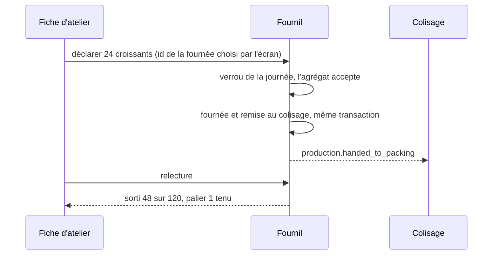

# La fiche d'atelier

L'écran du fournil (`/fournil`) : ce qu'il faut sortir du four aujourd'hui,
rayon par rayon, et le geste qui déclare ce qui est sorti. Le contexte qui le
sert : [`architecture-contexte-production.md`](architecture-contexte-production.md).

## En bref

- **Une ligne par produit** du compte à produire, rangée dans l'onglet de sa
  catégorie racine. Une barre montre ce qui est sorti face à ce qu'il faut, par
  **paliers** : « 120 avant 07:00, puis 120 avant 09:30 ».
- On déclare une **fournée** : « + 1 plaque » (le contenant du produit), un
  raccourci, ou une saisie au pavé. Une fournée s'ajoute, elle ne remplace
  rien, et elle part **aussitôt au colisage**.
- Une erreur se corrige en **annulant** la fournée (bandeau « Annuler » pendant
  quelques secondes, puis la puce de la fournée). Rien n'est effacé.
- Plusieurs postes travaillent ensemble : chaque écran **se relit toutes les
  15 secondes**.
- Si des commandes sont arrivées après l'arrêt du plan, un bandeau le dit et
  propose de **reprendre le tirage** (le retirage).

---

> **Rangement par poste.** En mode prod (réglage du fournil), la fiche et le
> dossier sont rangés par **poste** au lieu du rayon, avec la même mise en
> page : un poste prend la place d'un rayon, un produit sans poste reste sous
> son rayon, « à ranger ». Voir [`les-postes-du-fournil.md`](les-postes-du-fournil.md).
>
> **Niveaux de suivi.** Ce qui suit décrit le niveau **détaillé**. En
> toujours vert (le défaut) et en simple, une ligne n'a que « Problème », ou
> « Fait » et « Problème » : voir [`les-niveaux-de-suivi.md`](les-niveaux-de-suivi.md).

## Partie technique

### Quelle journée, quelles lignes

`GET admin/production/worksheet/current` choisit la journée au serveur, à
l'heure de Paris : **demain si son plan est arrêté, aujourd'hui sinon**.
`GET …/worksheet?date=` sert un lien partagé. La réponse
(`packages/contracts/src/production-worksheet.ts`) dit `relativeDay`.

| La journée est… | Les lignes viennent de                              | `generatedAt`                            |
| --------------- | --------------------------------------------------- | ---------------------------------------- |
| arrêtée         | `production_count` (l'instantané)                   | `closedAt`                               |
| ouverte         | la demande du commerce (`ExpectedProductionReader`) | `null` — l'écran dit « plan non arrêté » |

**La fiche ne calcule rien** : groupes, ordre, compteurs (`doneCount`,
`doneUnits`, `remainingUnits`) et listes `pending` / `done` viennent du
serveur (`production-worksheet-groups.ts`, `production-worksheet-reading.service.ts`).
L'écran garde l'état d'une case pendant son envoi, la fiche ouverte (retenue
par personne, `worksheetCategory` dans les préférences staff) et la mise en
forme.

### Le rangement par catégorie racine

Les rayons viennent du commerce par `ProductionArticlesReader.articlesOf`
(`channels/commerce/`), implémenté par `CatalogProductionArticlesReader` sur le
miroir des articles **sans les filtres de vente**, avec la vue des familles
(`CatalogFamilyView.root`, `path`) : la même lecture dans les deux modes, et
un article masqué, réservé à une clientèle ou retiré garde son vrai rayon
([`les-postes-du-fournil.md`](les-postes-du-fournil.md)). Un onglet par **catégorie
racine** ; le réglage « Afficher les sous-catégories » (Réglages › Production,
carte « Rangement des fiches », `PUT admin/production/settings/display`,
table `production_display_settings`, défaut non) pose des intertitres
(`WorkshopGroup.sections`), jamais un onglet. Ordre : racines par `position`
puis nom ; dans une racine, les articles rangés directement en tête, puis les
sous-catégories. Seul un SKU absent du miroir du catalogue va dans « Hors catalogue » ; une lecture
des rayons en échec rend `shelvesKnown: false` et un groupe « Rayon inconnu »,
la fiche reste servie. Le même rangement vaut au prévisionnel et au dossier
du jour ([`le-previsionnel.md`](le-previsionnel.md)).

### Une ligne

`WorkshopLine` porte, en plus du produit et de la quantité :

| Champ                            | Ce que c'est                                                                                                                                                                                                                                                                                                                                    |
| -------------------------------- | ----------------------------------------------------------------------------------------------------------------------------------------------------------------------------------------------------------------------------------------------------------------------------------------------------------------------------------------------- |
| `produced`, `surplus`, `batches` | Σ des fournées non annulées, le dépassement (« 52 / 48 »), la liste des fournées annulables                                                                                                                                                                                                                                                     |
| `container`                      | le contenant réglé (« plaque », 24 pièces) ou `null` — sans contenant, pas de « + 1 plaque »                                                                                                                                                                                                                                                    |
| `deadlines`                      | les **paliers** : les tranches de production non cumulées, somme = quantité (`deadlinesOf`, `WorksheetDeadlinesReading` sur la règle `trancheThresholdsBySku`). Une fiche arrêtée qui compte moins que les besoins rogne les paliers en partant du dernier ; sans échéance, `before: null` ; tranches illisibles, `[]` et une panne journalisée |
| `waitingOrders`                  | « 1 commande attend · remise 8 h 45 » : `OvenWaitingOrdersReader` (`channels/packing/`), implémenté par le colisage ; `null` si le colisage ne répond pas                                                                                                                                                                                       |
| `quality`                        | le dernier verdict du produit ([`le-controle-qualite.md`](le-controle-qualite.md))                                                                                                                                                                                                                                                              |
| `saleUnit`                       | `piece` ou `weight` : un article au poids se compte en grammes                                                                                                                                                                                                                                                                                  |

Les fonctions de palier (palier en cours, reste, retard) sont pures, côté
écran : `fiche-atelier/rules/workshop-deadlines.ts`, « maintenant » venant de
l'horloge de la fiche (`workshop-clock.ts`).

### L'écran

`production/fiche-atelier/` : deux vues. La fiche s'ouvre **« Par tranche »**
(une carte par heure limite : dépassée, la prochaine, à venir, tenue), la
lecture du four ; « Par produit » est à un appui. Un lien de la cloche qui
désigne une ligne (`?ligne=`) ouvre « Par produit », seule vue qui la cercle.
Ensuite, le
`fold-meter` segmenté pour la barre à paliers, le pavé 3 × 4
(`workshop-keypad/`) prérempli du reste du palier, les raccourcis
(`workshop-shortcuts.reader.ts`), « Annuler la dernière » (`undoLast`,
`workshop-gestures.ts`), l'horloge murale (`workshop-wall-clock/`), et au
téléphone une carte par ligne avec les faites épinglées au pied.

Le dossier se lit en deux parties : un dossier par composant (la page
`fiche-atelier-page/`, une ligne par niveau, la vue par tranche, le pavé, les
bandeaux…), et quatre dossiers de logique sans affichage, chacun testé seul :

| Dossier    | Ce qu'il porte                                                                 |
| ---------- | ------------------------------------------------------------------------------ |
| `rules/`   | les règles pures : paliers, gestes par niveau, choix de la fiche, onglets      |
| `state/`   | ce qu'on lit (la journée, l'horloge, les raccourcis) et ce qu'on fait (gestes) |
| `outbox/`  | les gestes en route : la file d'envoi et son renvoi                            |
| `openers/` | l'ouverture du pavé et du panneau « Problème », le défilement vers une ligne   |

**Les gestes d'une ligne dépendent de son niveau de suivi, et d'un seul
endroit** : `lineGestures` (`workshop-line-gestures.ts`) dit, pour une ligne,
si l'on compte (détaillé), si l'on coche « Fait » (simple) et si l'on signale
« Problème » (simple, toujours vert). Les deux vues le lisent : la vue produit
par `app-workshop-line`, qui choisit le composant du niveau, la vue par tranche
rangée par rangée. Un test monte les deux vues à chaque niveau et compare leurs
gestes.

Pour un poste posé au four, deux briques partagées du back-office :

- `keepScreenAwake()` (`shared/screen-awake/`) garde l'écran allumé tant que la
  fiche est ouverte, et redemande le verrou au retour de l'onglet ; sans
  l'API, l'appareil garde sa veille normale ;
- `GestureFeedback` (`shared/gesture-feedback/`) fait vibrer l'appareil (une
  impulsion si le geste est pris, deux s'il est refusé) ; sans vibreur (iPad,
  Safari), il bipe à la place, aigu pour un geste pris, deux graves pour un
  refus. Toujours, il l'annonce aux lecteurs d'écran.

### Les fournées

`production_batch` : une ligne par sortie, en ajout seul. **Sorti(sku) = Σ des
fournées non annulées** ; aucun compteur tenu à côté.

- **Déclarer** — `PUT …/worksheet/:date/lines/:sku/batches/:batchId`
  (`RecordBatchCommand`). L'`id` vient de l'écran (ULID) : un rejeu de même
  charge réussit sans rien écrire, même si la fournée a été annulée depuis ;
  une autre charge sous le même `id` est refusée (409). Refus : journée non
  arrêtée, SKU hors compte, quantité < 1. Le geste prend le verrou de la
  journée, la recharge, écrit la fournée **et** la remise au colisage
  (`production_handoff`, même `id`) et publie `production.handed_to_packing`
  dans la même unité de travail.
- **Annuler** — `DELETE …/worksheet/:date/batches/:batchId`
  (`CancelBatchCommand`) : entière, tracée (`cancelled_at/by`), jamais
  supprimée. Refusée si les pièces sont déjà au bac : la part annulable se lit
  au colisage ([`../colisage/colisage.md`](../colisage/colisage.md)). Une
  fournée absente que l'agrégat a laissé passer est un défaut nommé
  (`production.batch.cancel_missing`).
- **« Faite » se lit sur les seules fournées** — `done`, `doneAt` et
  `initials` d'une ligne sont ceux de la fournée qui l'a complétée. Il n'y a
  plus de case à cocher : ni route, ni colonne. La coche n'existe plus en
  base depuis la migration `20261115200000_la_fin_des_coches`, qui a retiré
  `production_count.done_at/done_by/done_initials` après avoir vérifié
  qu'aucune ligne cochée n'était sans fournée ; l'auteur vit dans
  `production_batch.recorded_by`. Les fournées d'`id`
  `backfill-<jour>-<sku>` (le rattrapage des coches) et `mark-…` (l'ancienne
  route) restent des fournées comme les autres : annulées, elles ne comptent
  plus, et une journée dont toutes les fournées sont annulées se rouvre.
- **Pas de journal d'activité** pour les fournées : une ligne datée et signée
  en tient lieu ([`../journalisation/todo-journal-activite.md`](../journalisation/todo-journal-activite.md)).

### Le contenant et les raccourcis

Réglés sur une seule page, **Réglages › Production › Raccourcis du fournil**
(`/reglages/production/raccourcis`, `production/batch-shortcuts-page/`), une
table de tous les articles vendables (pro et public, `SellableArticlesReader`)
avec filtre de familles et recherche.

- **Le contenant principal** (`production_container` : `sku`,
  `units_per_container`, `singular`, `plural`) — le gros bouton « + 1 plaque »
  et les touches « 1 plaque / 2 plaques » du pavé. Routes
  `GET|PUT|DELETE admin/production/containers[/:sku]`, écriture sous
  `production_settings:write`. C'est un fait du four, pas un conditionnement
  de vente : il vit dans le fournil, pas au référentiel.
- **Les raccourcis** (`production_batch_shortcut`) — par produit, au plus 6
  (`MAX_BATCH_SHORTCUTS_PER_PRODUCT`), nom de 1 à 30 caractères unique par
  produit, pièces ≥ 1, retrait tracé (`removed_at`). Agrégat
  `ProductBatchShortcuts`. Routes `admin/production/settings/shortcuts`
  (`production_settings`) ; la fiche les lit par `GET admin/production/shortcuts`
  (`production_worksheet`). Un raccourci ouvre le pavé posé sur sa valeur :
  seul « Déclarer » enregistre.

### Le retirage

Le bandeau d'écart (`fiche-atelier/drift-banner/`) se lit sur les commandes que
le commerce rend pour la journée, **moins celles que la journée porte déjà**
(par `orderId`) : il annonce exactement ce que le geste absorbera. « Reprendre
le tirage » (`POST …/worksheet/:date/retake`, `ProductionDay.retake`) absorbe
ces commandes, refait le compte (ce qui est sorti vit dans les fournées, que
le compte refait ne touche pas), signe
`retaken_at` / `retaken_by`, publie `production.day_retaken` et renvoie le
dossier complété. Une ligne déjà commencée dont la quantité change est nommée
dans le bandeau avant le geste.

### La relecture des postes

`apps/lfd-backoffice-frontend/src/app/shared/periodic-refresh.ts`
(`REFRESH_INTERVAL_MS = 15_000`), partagé avec le colisage et la Supervision :

| Règle                                                            | Pourquoi                                                          |
| ---------------------------------------------------------------- | ----------------------------------------------------------------- |
| toutes les 15 s, onglet visible                                  | le temps de sortir une plaque ; rien la nuit derrière une fenêtre |
| tout de suite au retour                                          | un écran retrouvé ne montre pas du périmé                         |
| jamais deux relectures à la fois                                 | au sous-sol, une lecture peut durer plus qu'un intervalle         |
| une réponse partie avant la dernière écriture acceptée est jetée | sinon elle défairait un geste sous les doigts                     |

La relecture est silencieuse ; ce qui change sous les yeux se dit (la fiche
passe à demain quand le plan est arrêté ; le pied dit « relue à 4 h 12 » ou
« relecture impossible depuis… »). Pas de websocket : l'API est sans état et multi-instance, il faudrait d'abord un point
de diffusion commun.

### La file d'envoi, sans réseau

Décidé par Hugo le 2026-11-20. Un geste parti sans réponse du serveur — une
**fournée** ou un **« Fait »** — n'est pas perdu : il est gardé sur l'appareil
(`workshop-outbox.ts`, stockage local, survit à un rechargement) sous sa clé
d'idempotence. Il repart seul (`workshop-queue-replay.ts`) à l'ouverture de la
fiche, au retour du réseau et à chaque relecture, ou tout de suite par
« Renvoyer maintenant » dans le bandeau qui le compte.

- Rejoué, il ne compte qu'une fois, même si le serveur l'avait écrit ; un
  nouvel appui de la même quantité sur la même ligne rejoue la fournée gardée
  au lieu d'en créer une seconde.
- Un geste gardé que le serveur **refuse** sort de la file, et le refus est
  dit : le rejouer ne le ferait pas passer.
- Un « Fait » gardé repart sous sa clé d'intention ; la ligne simple dit
  « fait · en attente » et n'offre plus « Fait » tant qu'il n'est pas parti.
- L'annulation et le retirage partent toujours directement, et disent leur
  échec.
- **La fiche ne calcule toujours rien** : une fournée en route n'est jamais
  ajoutée aux chiffres servis. La ligne la montre à part, « +30 · envoi… »
  pendant l'envoi, « +30 · en attente » gardée sans réseau ; la barre n'avance
  que quand le serveur l'a dit.

## Reste à faire

- Deux postes qui déclarent la même ligne dans le même quart de minute se
  croisent toujours : seule une diffusion en direct fermerait la fenêtre.
- Non porté par le modèle, donc absent de l'écran : un taux de casse, un ordre
  de cuisson, une qualification de poste.
