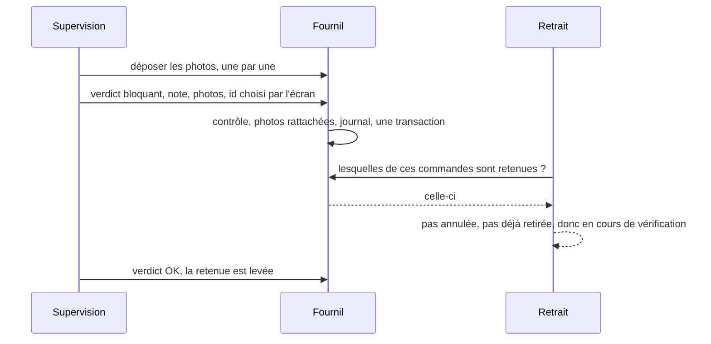

# Le contrôle qualité du superviseur

Depuis la Supervision, le superviseur juge ce qui sort du fournil et du
colisage. Le contexte qui le possède :
[`architecture-contexte-production.md`](architecture-contexte-production.md).

## En bref

Deux choses se contrôlent : une **ligne de préparation** (« les 96
croissants » du compte du jour) et une **commande colisée**. Trois verdicts :

| Verdict      | Effet                                                             | Note        | Photos       |
| ------------ | ----------------------------------------------------------------- | ----------- | ------------ |
| **OK**       | aucun, une trace                                                  | facultative | facultatives |
| **Réserve**  | aucun blocage, une trace visible                                  | obligatoire | facultatives |
| **Bloquant** | la commande est **retenue au retrait** jusqu'à un nouveau verdict | obligatoire | facultatives |

Un blocage sur une ligne retient **toutes les commandes du plan qui portent ce
produit**. Au comptoir, une commande retenue dit « Commande en cours de
vérification. » — sans motif, la phrase est lue devant le client. Le client
n'est pas prévenu. Le contrôle est **facultatif**, et se règle par niveau
dans Réglages › Commandes : au fournil **désactivé** par défaut, au colisage
activé.

---

## Partie technique

### Le modèle

`production_quality_check` : **une ligne par verdict, jamais modifiée** ; le
verdict courant d'une cible est le plus récent. Lever un blocage, c'est rendre
un nouveau verdict. Colonnes : `id` (fourni par l'écran), `service_day`,
`target_kind` (`line` | `order`), `sku` ou `order_id`, `verdict`
(`ok` | `warning` | `blocking`), `note`, `checked_by`, `checked_at`,
`quantity_seen`. En base : exactement une cible, note non vide hors `ok`.
`production_quality_photo` : `UNIQUE (check_id, position)`. Agrégat
`QualityCheck` (`domain/entities/quality-check.ts`), au plus 6 photos
(`MAX_QUALITY_PHOTOS`), JPEG / PNG / WebP / HEIC, 10 Mo
(`QUALITY_PHOTO_MAX_BYTES`).

- **Péremption** — un contrôle de ligne garde `quantity_seen` ; si un retirage
  change la quantité, l'écran dit « contrôlé sur 96, compte actuel 120 — à
  revoir ». Un blocage périmé **reste bloquant**.
- **Retenue** — une commande est retenue si son verdict courant est `blocking`,
  ou si une de ses lignes du plan (`production_order_line`, même SKU que le
  compte) l'est. Une commande hors plan (passée après l'arrêt, pas encore
  retirée) n'est pas retenue par un blocage de ligne ; un retirage qui
  l'absorbe la fait entrer sous le blocage.

### Les photos : déposer, puis rattacher

Le stockage objet n'entre dans aucune transaction : chaque photo part seule
(`POST admin/supervision/quality/photos`) sous `quality/pending/<upload_id>`,
puis le verdict (`POST admin/supervision/quality/checks`) rattache les dépôts
et déplace leur clé vers `quality/<jour>/<check_id>/<position>`, dans la
transaction du contrôle et du journal. Le même `id` rejoué rend le contrôle
écrit ; un `id` connu avec un autre contenu est refusé (409). Les dépôts
jamais rattachés de plus de 24 h sont balayés chaque nuit (cron `45 3 * * *`,
`QUALITY_UPLOAD_SWEEP_CRON`, `apps/lfd-api/container/worker.ts` →
`POST admin/production/quality/sweep`). Bucket `ProductionDocumentStore`,
**sans limite de conservation** : une règle de cycle de vie posée un jour sur
ce bucket doit exclure `quality/` (hors `quality/pending/`).

### Le retrait

`handover → production` passe par `production/channels/handover/` :
`QualityHoldsReader.heldOrders(serviceDay, orderIds)`, par lot, publié par le
fournil (`infrastructure/prisma-quality-holds.reader.ts`) et lu par le retrait.
`handoverBlocker` (`apps/lfd-api/src/handover/domain/services/handover.ts`)
lit la retenue **après** « annulée », « pas passée » et « déjà retirée » : un
sac déjà parti ne répond jamais « en vérification ». La file du comptoir sert
`heldForQuality`. Le colisage lit la même retenue par `QualityHeldOrdersReader`
(`channels/packing/`).

⚠️ La retenue est lue, puis l'attestation écrite, sans verrou commun : un
blocage rendu dans cette fraction de seconde laisse partir le sac. Le refus
au scan est une vérification, pas une interdiction.

### Les droits

`b2b_supervision:write` est le droit de juger ; `read` voit les **pastilles**
seulement. La note, l'historique et les photos se lisent en `write`
(`GET …/checks`, `GET …/checks/:checkId/photos/:position`, marqués
`RequirePermission("b2b_supervision:write")`) : une photo peut montrer une
étiquette ou une adresse. Le rôle « superviseur » est une **donnée** créée
dans Admin › Rôles (Supervision en écriture, notifications internes), sans
code ni migration.

### Le réglage par niveau

Réglages › Commandes › Contrôle qualité (`/reglages/commandes/controle-qualite`),
route `admin/production/quality-settings` sous `lfc_order_settings`, table
`production_quality_settings` (clé `quality`, ligne absente = défauts),
règle `QualityControlSettings.assertCanCheck`. Désactivé : « Contrôler »
disparaît de la Supervision (`QualityBoardView.enabled`) et le serveur refuse
un verdict neuf (409 `production.quality.disabled`), **après** l'idempotence.
Ce qui est enregistré reste lisible, et **une retenue en cours reste** : pour
la lever, on réactive le niveau le temps d'un nouveau verdict.

### Le journal

`production_quality.checked`, `production_quality.hold_raised` (un blocage de
ligne y porte la liste des commandes retenues à cet instant),
`production_quality.hold_lifted`, `production_quality_settings.updated`. Un
journal en panne annule le verdict.

### Les écrans

Supervision (`apps/lfd-backoffice-frontend/src/app/supervision/`) : bouton
« Contrôler » et pastille sur chaque ligne de Préparation et chaque commande
colisée, panneau (trois choix, note, photos, historique), « N commandes
retenues » au masthead, « En vérification » dans la colonne Retrait. Le
retrait boutique l'affiche aussi avant le scan. La fiche d'atelier montre la
pastille sur la ligne ([`la-fiche-d-atelier.md`](la-fiche-d-atelier.md)).
L'écran de la Supervision :
[`../supervision/architecture-supervision-du-jour.md`](../supervision/architecture-supervision-du-jour.md).

## Reste à faire

Rien n'est en cours. Hors périmètre, non demandé : contrôle obligatoire,
échantillonnage, contrôle d'une commande non colisée, statistiques de
non-conformité.
