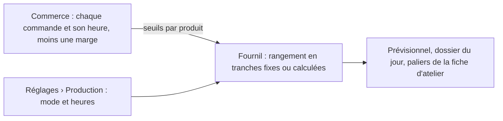

# Le prévisionnel et les tranches de production

L'écran du Prod manager qui dit **quoi produire, quel jour, et pour quelle
heure** (`/prod-manager/previsionnel`). L'arrêt du plan qui s'y pilote :
[`arret-du-plan.md`](arret-du-plan.md) ; le papier qui s'y imprime :
[`dossier-prod-du-jour.md`](dossier-prod-du-jour.md).

## En bref

Trois vues sur la même page :

- **la matrice** — les produits en lignes, les jours en colonnes (sept par
  défaut), la quantité dans chaque case, rangée par catégorie racine. Le pied
  dit combien de pièces et en combien de commandes ;
- **par tranche horaire** — pour une journée, ce qu'il faut avoir sorti avant
  chaque heure (« 400 avant 05:00, 800 de plus avant 07:00 ») ;
- **le dossier du jour** — l'aperçu du papier.

Une colonne **arrêtée** montre le compte figé à l'arrêt — un fait. Une colonne
**ouverte** montre la demande du commerce — elle bougera encore. La colonne dit
laquelle des deux elle porte.

---

## Partie technique

### La matrice

`GET admin/production/forecast?from=&to=` (`GetProductionForecastHandler`,
contrat `packages/contracts/src/production-forecast.ts`).

- `ServiceRange` (`day/domain/value-objects/service-range.value-object.ts`) refuse
  une fin avant le début et plus de 31 jours ; l'arithmétique des jours se fait
  en UTC, à minuit, pour ne jamais redoubler un jour au changement d'heure.
- Par jour : **arrêté** → `production_count` (lu par `ProductionPlanReader`,
  sans charger l'agrégat) ; **ouvert** → `ExpectedProductionReader`
  (`channels/commerce/`, implémenté par le commerce). Les commandes encore
  `placed` d'une journée arrêtée ne sont **pas** additionnées : rien ne
  distingue une commande tardive d'un abonné en retard, et l'écart a son
  compteur (`pendingInCommerce`). Le retirage les fait entrer.
- Chaque jour porte `totalUnits`, `orderCount` (du même côté que les pièces),
  `resupplyUnits`, `closed`, `state` et `closesAt` ; chaque ligne ses
  `quantities` (toujours de la longueur de `days`, un trou vaut 0),
  `resupplyQuantities` et `saleUnit`. `peakDate` vient du serveur. Aucun
  montant.
- L'état d'une colonne (en retard, arrêtée, passée, fournil fermé) est calculé
  au serveur (`domain/services/forecast-day-state.ts`) — détail dans
  [`arret-du-plan.md`](arret-du-plan.md).

Le **rangement en rayons se fait à l'écran** (`forecastRayons`,
`previsionnel/previsionnel-matrix.ts`), avec les mêmes règles que la fiche
d'atelier (catégorie racine, intertitres si `showSubcategories`,
[`la-fiche-d-atelier.md`](la-fiche-d-atelier.md)) : le rayon est un fait du
catalogue d'aujourd'hui. Une lecture du catalogue en échec donne un groupe
« Rayon inconnu » et un encadré qui le dit, jamais « Hors catalogue ».

`forecast-table/` dessine la matrice et ne charge rien : repli d'un rayon par
un clic, densité réduite au-delà de 24 références (`DENSE_ABOVE`), une seule
boîte défilante tête et pied compris, chiffres en chasse fixe. La plage vit
dans l'URL (`?from=`) ; la page se relit toutes les 60 secondes.

### Les tranches

**Les besoins** viennent du commerce : `deadline-thresholds.ts`
(`apps/lfd-api/src/lafoliecoffee/orders/domain/services/`) donne à chaque
commande une heure « prêt avant » — le **début** du créneau s'il y en a un,
sinon sa fin —, moins la marge de livraison ou de retrait (réglages du
commerce, page « Disponibilité de la livraison » ; une marge non réglée vaut
zéro), et cumule par produit. Un retrait servi par transfert prend le départ
du transfert. Le fournil les lit par `DueThresholdsReader`
(`channels/commerce/`).

**Le rangement** est une règle du fournil, `rangeInTranches`
(`day/domain/services/production-tranches.ts`) :

| Mode               | Les tranches sont…                                 |
| ------------------ | -------------------------------------------------- |
| **fixes** (défaut) | des heures réglées une fois : 05:00, 07:00, 12:00… |
| **calculées**      | les heures des besoins eux-mêmes                   |

🔴 En mode fixe, un besoin va dans la **dernière tranche qui tombe au plus tard
à son heure** : on arrondit toujours vers plus tôt. Un besoin d'avant la
première tranche y va, signalé (`before_first`) ; un besoin sans échéance va
dans la dernière, signalé (`undated`). Sans aucune heure réglée : une seule
tranche, la journée, et l'écran mène au réglage.

`GET admin/production/batch/:date/due-thresholds` rend
`ProductionDueThresholdsView` (`packages/contracts/src/production-due-thresholds.ts`),
déjà rangée, avec `trancheMode` et `fixedTranches`. Les écrans :
`previsionnel/day-tranches-section/`, `day-tranche-wall/`,
`due-thresholds-section/` ; la fiche d'atelier en tire ses paliers ; le
dossier du jour, son calendrier par rayon.

**Une pièce sert toujours l'échéance la plus proche** : il n'y a pas de stock
par tranche, une fournée ne se déclare pas « pour » une tranche, la
répartition se calcule.

**Le réglage** — Réglages › Production, carte « Tranches de production »
(`production/production-tranches-card/`) : un interrupteur Fixes / Calculées,
la liste des heures (`HH:mm`, triées, uniques, 8 au plus,
`MAX_FIXED_TRANCHES`). Le mode fixe demande au moins une heure (décidé par
Hugo le 2026-11-18) : sans elle, il n'y aurait pas d'heure de sortie ; un
réglage fixe sans heure déjà en base se relit tel quel, et le prochain
enregistrement en porte une. Table `production_tranche_settings`, une ligne
`house`, ligne absente = calculé ; `PUT admin/production/settings/tranches`
sous `production_settings` ; agrégat `ProductionTrancheSettings`. Les mêmes
heures tous les jours.

## Reste à faire

- **Figer les tranches à l'arrêt** : aujourd'hui elles se recalculent à chaque
  lecture, sur les échéances et les réglages du moment, y compris pour une
  journée arrêtée. Migration de données : `vitruve` d'abord.
- **L'écart après composition des tournées**, alerté au fournil.
- **Les marges mesurées** (dernière fournée → bac fermé), montrées à côté de la
  marge réglée avant d'automatiser.
- **La capacité du four** (Hugo : « plus tard »).
- Revoir le calcul des échéances (arrondi, regroupement, marges par
  catégorie) — Hugo, « on verra plus tard ».
- Le mode mural, et un tirage papier de la matrice : non demandés à ce jour.
