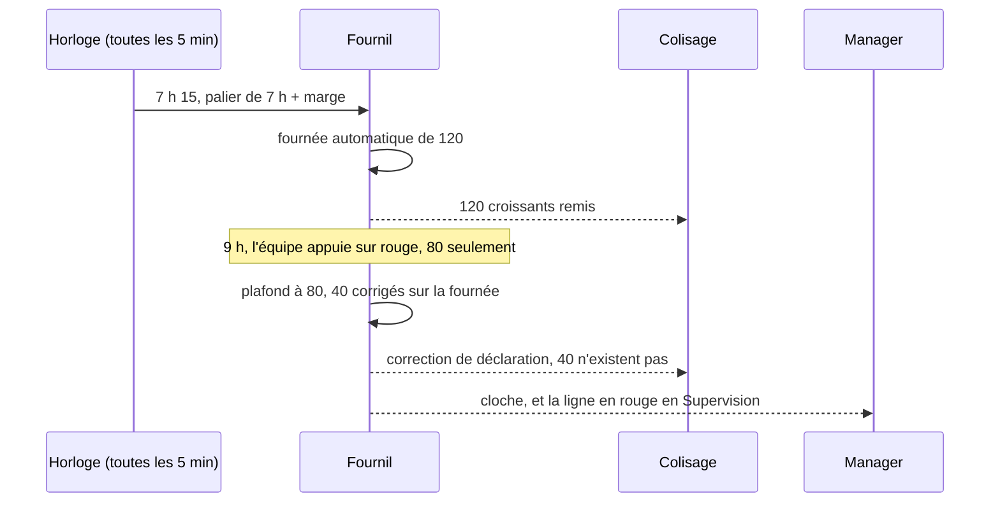

# Les niveaux de suivi du fournil

**État : ✅ en production depuis le 2026-11-18 (`bf32f26ee`)**, en service
depuis le même jour. Décisions de Hugo des 2026-11-17 et 2026-11-18. Ce qu'il
faut régler à l'écran : « À la mise en service », plus bas.

La fiche elle-même (lignes, paliers, fournées) est décrite dans
[`la-fiche-d-atelier.md`](la-fiche-d-atelier.md) ; les postes dans
[`les-postes-du-fournil.md`](les-postes-du-fournil.md).

---

## 1. En simple

Combien de gestes demande-t-on à l'équipe du fournil ? Trois réponses, au
choix :

| Niveau                     | Ce que fait l'équipe                                                                         |
| -------------------------- | -------------------------------------------------------------------------------------------- |
| **Toujours vert** (défaut) | rien : chaque palier est réputé sorti à son heure, plus une marge. Seul geste : « Problème » |
| **Simple**                 | ✅ « Fait » ou 🟥 « Problème », par produit                                                  |
| **Détaillé**               | les fournées, plaques et paliers d'aujourd'hui                                               |

Le défaut est **toujours vert** parce que, selon la manager, « ils ne cocheront
jamais » : un vert que personne ne coche laisserait tout « à faire », et le
vrai manque se noierait dans le faux. Le seul geste demandé est donc le rouge,
quand ça ne va pas (décidé par Hugo le 2026-11-17).

### Un niveau pour le fournil, remplaçable par poste

- Le fournil a **un niveau**, que chaque **poste** peut remplacer (la
  Pâtisserie en détaillé, le reste en toujours vert). Un poste sans réglage
  propre, ou une ligne sans poste (mode boutique, produit « à ranger », hors
  catalogue), suit le fournil.
- **Un changement vaut pour la journée suivante.** Le niveau d'une journée est
  **figé au premier geste après son arrêt** (le passage automatique, « Fait »
  ou « Problème ») et ne bouge plus, même si la journée est rouverte ou
  reprise. Tant que rien n'est figé, la fiche montre le réglage en vigueur.

### Le rouge — « Problème »

On dit **combien est réellement sorti**, et une raison si on veut. Alors :

- ce nombre devient un **plafond** : ni « Fait » ni la fournée automatique ne
  déclarent plus au-delà, ce jour-là, pour ce produit. Une fournée **saisie à
  la main** reste admise : quelqu'un a compté des pièces qui existent (décidé
  par Hugo le 2026-11-17) ;
- si des pièces avaient déjà été déclarées en trop, elles sont retirées des
  fournées : c'est une **correction de déclaration** (« N pièces déclarées
  n'existent pas »), annoncée au colisage ;
- si le nombre est plus haut que ce qui est déclaré, la différence est
  déclarée comme une fournée ordinaire. Il ne peut pas dépasser le compte du
  jour, ou ce qui est déjà déclaré s'il le dépasse (décidé par Hugo le
  2026-11-18) : au-delà, c'est une faute de frappe, refusée ; un vrai
  surplus se déclare par une fournée ;
- la **cloche** du back-office sonne chez toute personne qui peut lire la
  Supervision, et un clic mène à la ligne ;
- la ligne reste **en rouge dans la Supervision** (colonne du fournil) jusqu'à
  ce qu'un responsable la marque **traitée**. Le plafond, lui, reste.

Un second rouge sur le même produit le même jour remplace le premier (plus
haut ou plus bas), et rouvre le problème s'il était traité.

### « Fait » (niveau simple)

Un bouton par produit : tout ce qui restait à sortir (sous le plafond, s'il y
en a un) est déclaré en une fournée. Une ligne déjà faite ne fait rien.

### La fournée automatique (toujours vert)

Toutes les **5 minutes**, le système regarde les journées arrêtées
d'aujourd'hui et de demain. Pour chaque produit en toujours vert, dès que
l'heure d'un palier **plus la marge** (15 minutes par défaut) est passée, il
déclare une fournée ordinaire de ce qui manque pour atteindre ce palier. Elle
part au colisage comme toute fournée. Une échéance qui passerait minuit tombe
au dernier passage du jour, à 23 h 55.

Une ligne **sans palier à heure** (produit sans tranche horaire, besoins du
commerce illisibles, ou heure qui n'existe pas le jour du passage à l'heure
d'été) n'est pas complétée : elle s'affiche « **à confirmer** » dans la
Supervision, sous les rouges, et se confirme depuis la fiche. Une ligne qui a
des paliers à heure et un reste « la journée » y apparaît aussi, pour ce
reste.

### La page « Niveau de suivi »

Réglages › Niveau de suivi (`/reglages/niveau-de-suivi`) : le niveau du
fournil et sa marge, puis chaque poste avec son niveau (« suit le fournil »
par défaut), et la mention « vaut à partir de la prochaine journée arrêtée ».
La page **rassemble sans posséder** : chaque réglage s'écrit par la route de
son propriétaire. Un **aperçu** de démonstration
(`/reglages/niveau-de-suivi/apercu`) montre une fiche aux trois niveaux.

### Le fournil et le colisage ne se connaissent pas

Le fournil ignore le niveau du colisage, et inversement. Le fournil publie les
**mêmes faits** à tous ses niveaux (des fournées remises, une correction) ; au
colisage de les traiter à son niveau. Aujourd'hui, le colisage n'écoute pas
encore la correction (voir [« Reste à faire »](#reste-à-faire)).

---

## 2. Partie technique

Tout vit dans le fournil (`apps/lfd-api/src/production/`), surtout dans le
métier `atelier/` ; le niveau d'un poste dans `workstations/`.

### Les tables (schéma `production`)

| Table / colonne                         | Propriétaire   | Ce qu'elle porte                                                                                                                             |
| --------------------------------------- | -------------- | -------------------------------------------------------------------------------------------------------------------------------------------- |
| `production_tracking_settings`          | `atelier`      | une ligne, clé `house` : `level` (`always_green` \| `simple` \| `detailed`), `margin_minutes`, auteur. Ligne absente : toujours vert, 15 min |
| `production_workstation.tracking_level` | `workstations` | le niveau propre d'un poste, `null` = suit le fournil                                                                                        |
| `production_day_tracking_level`         | `atelier`      | clé `service_day` : `house_level`, `workstation_levels` (id de poste → niveau résolu), `frozen_at`. Jamais réécrite                          |
| `production_problem`                    | `atelier`      | unique `(service_day, sku)` : `expected`, `produced` (le plafond), `reason`, auteur, `resolved_*`, `version` (monte à chaque rouge)          |
| `production_batch.corrected_quantity`   | noyau (`day`)  | la part corrigée d'une fournée, `0 ≤ corrigé ≤ quantité`                                                                                     |

Les modèles sont inscrits à la carte de `lint:production-subcontexts` ; les
colonnes d'auteur au registre RGPD (`production_batch.recorded_by` y dit
« membre du staff, ou le système », `system:always-green`).

### Le niveau d'une journée

- **Le figement** : `DayTrackingLevelsFreezing`
  (`atelier/application/services/day-tracking-levels-freezing.service.ts`),
  appelé sous le verrou de la journée par le tour automatique, « Fait » et
  « Problème ». Insertion qui ignore le conflit sur la clé du jour. **La fiche
  ne fige pas** : une lecture n'écrit rien (CLAUDE.md § 4) ; elle sert le
  niveau figé, sinon celui que le premier passage figera
  (`day-tracking-levels-reading.service.ts`). L'écart dure au plus un passage
  du cron (5 minutes) ; il s'allonge si le cron tombe.
- **La mise en service** : une journée arrêtée avant
  `TRACKING_LEVELS_SINCE` (`atelier/domain/services/tracking-levels-since.ts`,
  lu par le port `TrackingLevelsCommissioning`, que les e2e remplacent) reste
  en détaillé et n'est jamais figée.
- **Par ligne** : `WorkshopLine.trackingLevel`, résolu par le poste de la
  ligne (`domain/services/tracking-levels.ts`), quel que soit le groupe où elle
  est rangée.

### La part corrigée

Les lecteurs qui somment les fournées déduisent le corrigé : `countedBatch`
(`day/domain/services/production-output.ts`, et par lui `outputOf`,
`producedOf`, `effectiveBatchesOf`, la fiche), la vue des fournées servie au
front, `dev/scenario/scenario-facts.reader.ts`. Le corrigé se prend sur la
part **remise au colisage**, jamais sur la part gardée sur place par un
réassort : la borne est `stillAtPackingOf` (`atelier/domain/services/on-site-share.ts`,
`remis − rendu − corrigé`), qui borne aussi le retour partiel. « Tout rendu »
(`on-packing-returned.handler.ts`) compte `rendu + corrigé ≥ remis`. Une
fournée entièrement corrigée reste comptée à zéro ; elle n'est pas annulée.

### Les gestes et les routes

| Route                                                               | Garde / idempotence             | Handler                                                                  |
| ------------------------------------------------------------------- | ------------------------------- | ------------------------------------------------------------------------ |
| `GET`/`PUT admin/production/settings/tracking`                      | `@IntentKey` sur le `PUT`       | `SetProductionTrackingHandler`                                           |
| `PUT admin/production/workstations/:id/tracking-level`              | `@IntentKey`                    | `SetWorkstationTrackingLevelHandler` (`WorkstationMap.setTrackingLevel`) |
| `POST …/worksheet/:date/lines/:sku/done`                            | `@IntentKey`, `runSealed`       | `MarkLineDoneHandler`                                                    |
| `POST …/worksheet/:date/lines/:sku/problem` `{ produced, reason? }` | `@IntentKey`, `runSealed`       | `ReportProblemHandler`                                                   |
| `GET admin/supervision/production-problems`                         | `b2b_supervision`               | `ListOpenProductionProblemsHandler`                                      |
| `POST admin/supervision/production-problems/:id/resolve`            | `@IntentKey`, `runSealed`       | `ResolveProblemHandler`                                                  |
| `POST admin/production/tracking/always-green`                       | `RecomputeGuard`, `@Idempotent` | `RunAlwaysGreenRoundHandler`                                             |

Le `GET` du réglage sert aussi `inServiceSince` et `inService`. La page des
postes lit le niveau de chacun sur `GET admin/production/workstations`.

- **« Problème »** : sous le verrou, relit le sorti ; s'il est plus haut que
  `produced`, répartit l'écart sur les fournées remises les plus récentes
  (`outputCorrectionOf`, `domain/services/output-correction.ts`) et publie la
  correction (`OutputCorrecting`) ; s'il est plus bas, déclare la différence
  (fournée `problem-<id>-<version>`). L'agrégat `ProductionProblem` porte le
  plafond et la version. « Attendu » est la quantité au compte au moment du
  rouge. Ce qui n'a pas pu être corrigé n'a pas de colonne : le fait
  journalisé le porte (`uncorrected`), et la Supervision sert le sorti actuel
  à côté du plafond.
- **« Fait »** : une fournée `done-<ULID>` de
  `remainderUnderCeiling(quantité, plafond, sorti)`
  (`domain/services/line-remainder.ts`), par `BatchRecording`, l'écriture
  commune que `RecordBatchHandler` emploie aussi.
- **La cloche** : `ProblemBell`, après validation (`AfterCommit` +
  `BackgroundWork`), nature `production.problem_reported`, audience
  `b2b_supervision:read`, clé par problème et version, lien
  `/fournil?jour=<jour>&ligne=<sku>` (la fiche lit `ligne`).
- **Le tour automatique** : le Worker l'appelle sur le cron `*/5`
  (`triggerAlwaysGreen`, `apps/lfd-api/container/worker.ts`) ; en dev,
  `dev-toolbox/dev-sweeps.mjs`. `RunAlwaysGreenRoundHandler` parcourt les
  journées arrêtées d'aujourd'hui et demain (heure de Paris), puis les lignes
  en toujours vert d'après le niveau figé (`AlwaysGreenLines`), et passe par le
  port `AlwaysGreenLineRunner` une `RunAlwaysGreenLineCommand` par ligne ;
  chaque journée et chaque ligne sont isolées, le compte rendu dit `recorded`,
  `toConfirm`, `failed`. Sous le verrou, `RunAlwaysGreenLineHandler` relit les
  paliers (`deadlinesOf`, ceux de la fiche), le compte, le plafond, le sorti
  et `n`, le nombre de fournées de la ligne annulées comprises ; la règle pure
  `alwaysGreenStep` (`domain/services/always-green.ts`) vise
  `min(paliers échus, compte, plafond)` et déclare la différence en fournée
  `auto-<jour>-<sku>-<n>`, auteur `system:always-green`. `n` ne recule
  jamais : deux passages sur le même état rejouent la même charge. Un palier
  « la journée » (sans heure) n'échoit jamais, ni une heure inexistante (le
  passage à l'heure d'été).
- **« À confirmer »** : `UnconfirmedLinesReading`, servi dans
  `ProductionProblemsView.unconfirmed` — ligne en toujours vert, sans palier à
  heure, pas encore sortie jusqu'à `min(compte, plafond)`, journée arrêtée.

### Les faits

| Fait                                        | Où                                                                                                                                                     |
| ------------------------------------------- | ------------------------------------------------------------------------------------------------------------------------------------------------------ |
| `production_tracking_settings.updated`      | journal                                                                                                                                                |
| `production_workstation.tracking_level_set` | journal                                                                                                                                                |
| `production_problem.reported` / `.resolved` | journal : SKU, attendu, sorti, fournées corrigées, reste non corrigé                                                                                   |
| `production.output_corrected`               | canal `production/channels/packing/` : jour, SKU, fournées avec leur `handoffId` et leur part corrigée ; clé par problème et version. **Aucun abonné** |

La lecture nommée `OutputCorrectionsReader.correctionsOf(jour)`
(`channels/packing/output-corrections.reader.ts`), implémentée par le noyau,
rend les corrections d'une journée : le colisage pourra les relire même
publiées avant qu'il ne les écoute (la boîte d'envoi n'adresse un fait qu'aux
abonnés connus à sa publication).

### La fiche et le cache

Par ligne, la fiche sert `trackingLevel`, `ceiling` (le dernier rouge, traité
ou non), `remainingUnderCeiling` et `problem` (le rouge ouvert seulement), lus
par `DayProblemsReader.allOf(jour)`. Le front choisit le composant par un
`@switch` sur `trackingLevel` (`line-always-green`, `line-simple`, sinon la
ligne détaillée d'aujourd'hui) ; le panneau rouge est partagé.

La version de la fiche suit le journal de la journée : les déclencheurs de
`production_batch` (insertion, mise à jour) couvrent « Fait », la fournée
automatique et la correction ; `production_problem` et
`production_day_tracking_level` ont les leurs. La clé de `WorksheetContents`
gagne la version du réglage de suivi ; `setTrackingLevel` fait monter celle de
la carte des postes.

### Les portes

`lint:write-idempotence` (les routes ci-dessus), `lint:rgpd-staff` (les
colonnes d'auteur), `lint:production-subcontexts` (les trois modèles d'`atelier`,
et l'arête `atelier → workstations` par le port `WorkstationTrackingLevels`),
et l'e2e `write-replay` (les deux routes de réglage).

---

## À la mise en service

- **`TRACKING_LEVELS_SINCE` vaut le 2026-11-18 à minuit** (décidé par Hugo
  le 2026-11-18) : une journée arrêtée avant reste en détaillé ; la première
  arrêtée depuis suit le niveau réglé, toujours vert par défaut — le régler à
  l'écran avant son arrêt si l'équipe doit garder sa fiche.
- **Il faut des tranches à heure.** Le mode fixe en demande au moins une et
  le défaut est calculé ; seul un réglage fixe sans heure déjà en base (une
  seule tranche, « la journée ») met toutes les lignes « à confirmer », et la
  fournée automatique n'y **déclare rien**.
- **Un reste sans échéance n'est pas complété** : une ligne qui a des paliers
  à heure plus un reste « la journée » voit ses paliers complétés, et ce
  reste est servi « à confirmer » en Supervision (`unautomatedRemainder`).
- **La marge est celle du réglage courant**, pas une valeur figée avec le
  niveau de la journée.
- **Le coût est à mesurer en production** : le tour lit chaque journée
  arrêtée une fois (compte, paliers, réglage, problèmes) et trie ses lignes
  hors verrou ; seule une ligne qui a une fournée à déclarer prend le verrou
  et se relit. Avant la mise en service, il ne lit rien.

## Reste à faire

- **Le colisage et la correction.** Aucun abonné n'écoute
  `production.output_corrected` ; en attendant, une correction ne baisse pas
  la réserve du colisage (le colisage, en détaillé, voit les pièces manquantes
  et déclare son manque ; le manager est déjà prévenu par la cloche). Le
  colisage à trois niveaux et ce traitement sont à penser dans
  [`../colisage/reflexion-colisage-simple.md`](../colisage/reflexion-colisage-simple.md),
  avec ces contraintes :
  - traiter le fait à chacun de ses niveaux, en relisant les corrections chez
    le fournil (`OutputCorrectionsReader`) ;
  - ne jamais laisser la réserve à découvert : l'invariant réel est
    `packed + returned + sentToShop ≤ received`, avec les réservations des
    réassorts (`packing/domain/entities/packing-stock.ts`) ;
  - attendre que les remises nommées par une correction soient reçues ;
    l'ordre des verrous (commandes par id, puis la réserve, revérifier) ; un
    geste « retirer du bac » par `BinDesk`, puisque `reportShortfall` ne
    retire rien ; les commandes fermées, chargées ou remises ;
  - selon le niveau : en détaillé et en simple, une pièce au bac a été posée
    par un humain, donc elle existe ; la correction la signale au manager sans
    la retirer. En toujours vert seulement, le colisage la retire ;
  - la valeur `always_green` du colisage n'existe pas tant que ce traitement
    n'est pas livré.
- **Un lien de cloche vers une autre journée** : le lien porte `jour`, mais la
  fiche ouvre la journée en cours et ne montre la ligne que si c'est celle du
  lien.
- **Un geste sur une carte « à confirmer »** de la Supervision : aujourd'hui
  aucun, la ligne se confirme depuis la fiche.
