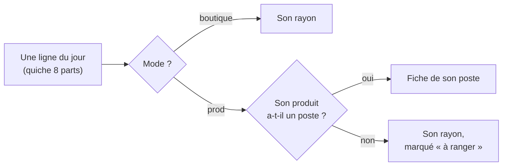

# Les postes du fournil

**État : ✅ en production depuis le 2026-11-17** (`71915a045`), essayé dans
Chrome sur le dev le même jour. Décisions de Hugo des 2026-11-16 et 17.
Après le déploiement : accorder `production_workstations` dans
`/admin/staff-roles`, sans quoi les pages Postes et Simulation restent
fermées.

---

## 1. En simple

La boutique range ses produits en **rayons**, pour le client. Le fournil
s'organise en **postes**, pour l'équipe : boulangerie, tourier, pâtisserie…
La quiche est au rayon « Traiteur salé », et c'est la pâtisserie qui la fait.

Le fournil tient deux choses, et rien d'autre :

- **sa liste de postes**, que l'on nomme et ordonne à l'écran
  (Réglages › Production › Postes du fournil, `/reglages/production/postes`) ;
- **le poste de chaque produit**. Toutes ses déclinaisons (quiche 6 parts,
  8 parts) en héritent.

Un réglage choisit le rangement : **mode boutique** (par rayon, le défaut) ou
**mode prod** (par poste). Le réglage vaut pour tout le fournil : la fiche
d'atelier devient des **fiches de poste**, et le dossier du jour, le
prévisionnel, le récapitulatif et les filtres des réassorts du fournil sont
rangés par poste. Le réassort du comptoir, écran de la boutique, ne change
pas.



- **On ne bascule pas à vide.** Le passage en mode prod est refusé tant
  qu'aucun produit n'a de poste. S'il en reste sans poste parmi les produits
  commandés, une confirmation en donne le compte.
- **On contrôle avant de basculer.** La page « Simuler le dossier de prod »
  (Réglages › Production, `/reglages/production/simulation`) sort un dossier
  avec une pièce de chaque article vendable, rangé par le vrai code du
  dossier. On y choisit le rangement (mode boutique ou mode prod) et
  l'affichage des sous-catégories, pré-réglés sur le réglage en vigueur. Rien
  n'est enregistré, et chaque page porte « SIMULATION — ne pas produire ». Une
  page à part plutôt qu'une simulation par option (décidé par Hugo le
  2026-11-17) ; la carte du rangement de la page Postes y mène par un lien.
  En mode prod sans aucun produit placé, tout ressort « à ranger » : c'est
  voulu.
- **Un produit oublié ne disparaît pas.** Il reste sous son rayon, marqué « à
  ranger ». La page Postes du fournil le compte, et le Prod manager affiche
  « N produits du jour à ranger » dès qu'il est commandé, avant l'arrêt ; son
  lien « Les ranger » ouvre `/reglages/production/postes?filtre=a-ranger`.
- **« Partir des rayons »** crée un poste par rayon racine et y place les
  produits sans poste : un premier jeu de noms à corriger.
- **Tout ce qui est commandé est « à produire »** : un article revendu tel quel
  prend un poste comme les autres (« Revente », « Réserve »).
- **La boutique et le référentiel n'en savent rien.**

Ce qui n'est pas traité : un produit fait par deux postes, ou une déclinaison
faite ailleurs que son produit (il faudrait la recette) ; la distinction
fabriqué / revendu (une propriété de l'article, un autre chantier).

---

## 2. Partie technique

### Le métier `production/workstations/`

Un métier du fournil, avec son `index.ts` (« ce que les postes savent
répondre ») et son module Nest. Il lit le partagé (`day/`, `shared/print/`,
`channels/`), et `atelier/` et `plan/` le lisent : ce sont les seules arêtes
entre métiers qu'il ajoute (`dev-toolbox/gates/lib/production-subcontexts-graph.mjs`).

| Publié                  | Ce qu'il répond                                                                                                                          |
| ----------------------- | ---------------------------------------------------------------------------------------------------------------------------------------- |
| `WorkstationOfProducts` | le poste de chaque produit, et les postes vivants dans l'ordre                                                                           |
| `PlacedProducts`        | combien de produits ont un poste (la garde de bascule)                                                                                   |
| `GroupingSourceReading` | la seule lecture « articles puis postes, avec repli par rayon », que la fiche, le dossier, la simulation et le rangement servi partagent |

### Les tables

```
production.production_workstation           id, name, position, archived_at, updated_*
production.production_workstation_product   product_sku (pk), workstation_id → RESTRICT
production.production_display_settings      + grouping 'shelf' | 'workstation'
```

Aucune clé ne sort du schéma `production` : la référence produit est opaque,
comme le SKU des lignes. Les deux tables sont des réglages, pas des faits du
jour (`UNWATCHED` de `test/day-change-triggers.e2e-spec.ts`). La ressource de
droits est `production_workstations`, accordée à l'écran.

### L'agrégat `WorkstationMap`

La carte entière, parce que trois règles refusent une écriture et se jugent
sur l'ensemble : deux postes vivants ne portent pas le même nom (sans casse),
un poste qui porte des produits ne s'archive pas, et rien ne va sur un poste
archivé. L'adaptateur écrit la différence sous un verrou consultatif. Remettre
un produit « à ranger » efface sa ligne de placement : c'est un réglage, et
l'historique reste dans le journal.

Cinq gestes, tous par intention (`@IntentKey`, `runSealed`), chacun avec son
fait : `production_workstation.declared`, `.renamed`, `.reordered`,
`.archived`, `.products_placed`.

### Le produit d'une ligne

Le fournil déclare `ProductionArticlesReader` (`channels/commerce/`), que le
commerce implémente sur son miroir `CatalogItem`, **sans les filtres de vente
mais avec `STILL_SOLD`** : une déclinaison masquée suit le poste de son
produit, et un produit masqué mais fabriqué peut recevoir un poste.
`WorkshopShelvesReader` (le rayon, en mode boutique) et `SellableArticlesReader`
(les raccourcis de fournées) ne changent pas. Un SKU absent du miroir ou
retiré va dans « Hors catalogue — à ranger », et ne peut pas recevoir de
poste.

### Le rangement

Une fonction pure de l'imprimerie, `groupingOf`
(`shared/print/domain/services/production-grouping.ts`) :

- **mode boutique** : exactement `rootShelvesOf`, sans lire les postes ;
- **mode prod** : un groupe par poste dans l'ordre des postes, puis les rayons
  « — à ranger », puis « Hors catalogue — à ranger ». Un poste n'a **pas
  d'intertitre de boutique** (décidé par Hugo le 2026-11-17) : « afficher les
  sous-catégories » ne vaut qu'en mode boutique.

Toute ligne qui entre ressort une fois. La fiche et le dossier la traduisent
dans leur forme d'aujourd'hui : un poste prend la place d'un rayon, et la mise
en page ne change pas. Dans le contrat, `WorkshopGroup` porte `kind`,
`workstation` et `unplaced`, et `key` vaut `ws:<id>` pour un poste.

**Une panne des postes** en mode prod range comme le mode boutique, se
journalise, et la fiche le dit (`workstationsKnown: false`). Le dossier n'est
alors pas archivé : il est gardé au premier tirage **archivable**, avec le mode
de ce tirage.

### Le rangement servi aux écrans

```
POST /admin/production/workstations/grouping   { skus } (500 au plus)
```

Une lecture (`@Idempotent`, `@HttpCode(200)`), ouverte à
`production_plan:read` et `production_resupply:read`. Le prévisionnel, le
récapitulatif et les réassorts du fournil y envoient les SKU qu'ils affichent,
et ne rangent plus eux-mêmes. Si le rangement ne se lit pas, les réassorts le
disent dans un encadré.

### Les autres routes (`admin/production/workstations`)

| Route                                                                     | Ce qu'elle fait                                                                                                                          |
| ------------------------------------------------------------------------- | ---------------------------------------------------------------------------------------------------------------------------------------- |
| `GET`                                                                     | la page Postes : les postes, et les produits (miroir, journées arrêtées de J−30, demande des 14 prochains jours, commandes et réassorts) |
| `POST`, `PUT order`, `PUT :id/name`, `POST :id/archive`, `PUT placements` | les cinq gestes                                                                                                                          |
| `GET unplaced?date=`                                                      | l'alerte : avant l'arrêt sur la demande du jour, après sur les lignes du jour (`KnownArticles`, publié par `day/`)                       |

La simulation a sa propre adresse, hors des postes, parce qu'elle simule tout
le dossier (rangement et sous-catégories) : `GET /admin/production/simulation.pdf?mode=&showSubcategories=`,
sous `production_workstations` en lecture, rendue par `plan/` ;
`showSubcategories` (`true`/`false`) absent : celui du réglage ; elle refuse
sur panne au lieu de se dégrader.

La bascule passe par `PUT /admin/production/settings/display` (`grouping`),
refusée tant que `PlacedProducts.count()` vaut 0.

### Le cache de la fiche

`WorksheetContents` suit, en plus des journaux de la journée, le `updated_at`
du réglage d'affichage et le plus grand `updated_at` de la carte des postes.
Un geste des postes ou du mode fait servir une fiche à jour à sa prochaine
relecture.

### Les écrans

- `production/production-simulation-page/` : « Simuler le dossier de prod »,
  `/reglages/production/simulation`, sous `production_workstations:read`
  comme sa route, au rail comme aux tuiles. Le réglage se lit sous
  `production_settings:read` ; sans lui, les choix partent du mode boutique
  sans sous-catégories, et la page le dit. Le PDF s'ouvre dans un onglet, un
  lien de téléchargement le remplace si le navigateur le bloque.
- `production/workstations-page/` : le rangement (le mode, et un lien vers la
  simulation), les
  postes, les produits avec un `fold-listbox` par ligne et les filtres
  (`?filtre=a-ranger`). Elle vit aux Réglages (`/reglages/production/postes`,
  décidé par Hugo le 2026-11-17), au rail comme aux tuiles du menu mobile ;
  l'ancienne adresse `/prod-manager/postes` y redirige, filtre compris.
- `production/fiche-atelier/` : les fiches de poste, `/fournil?poste=<id>`
  (l'adresse suit la fiche choisie), le choix retenu par personne dans
  `nav_prefs.worksheetCategory`.
- `production/prod-manager/unplaced-products-alert/` : relue au retour sur
  l'onglet et au changement de jour.
- « Poste fixe » s'appelle « tablette » : « poste » ne désigne plus que le
  métier de l'atelier.

---

## 3. Reste à faire

- Recompter les SKU en production avant de basculer : la borne de 500 a été
  calculée sur le dev (99 SKU non retirés).
- Mesurer en production le coût de la page Postes (quatre sources), de
  l'alerte et du rangement servi, la base étant facturée à l'opération.
- Accorder `production_workstations` dans `/admin/staff-roles` après le
  déploiement, sinon la page Postes reste inaccessible.
- Le calendrier de la simulation n'a qu'une colonne « Sans heure » : une
  commande fictive n'a pas d'échéance.
