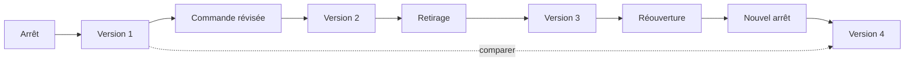
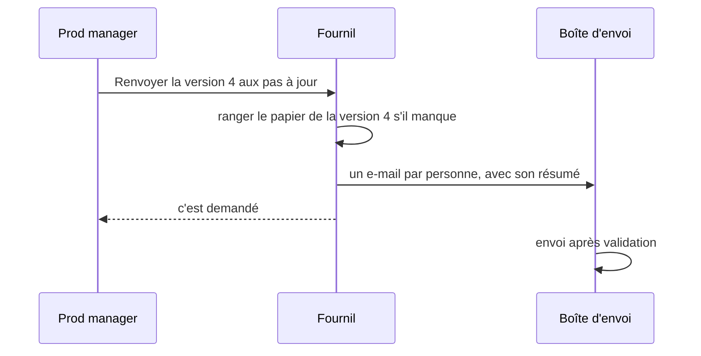

# Les versions du plan de production

> ✅ **Implémenté**, en production depuis le 2026-11-28. Ce document décrit
> l'état du code ; la partie technique a été relue fichier par fichier le
> 2026-11-28.

---

## Partie 1 — Ce que c'est, simplement

### Une version, c'est une photo du plan

Le plan de production d'une journée se fige à l'**arrêt**. Ensuite, il peut
encore bouger : une commande révisée, un retirage qui fait entrer des
commandes, une annulation. Chaque fois que le plan figé change, le système
prend une **photo** : c'est une **version**. Elle garde les commandes, leurs
lignes, le compte à produire, qui a fait le geste, quand, et **pourquoi
chaque commande est là**.

Une version naît à chacun de ces gestes :

- l'**arrêt** du plan (manuel ou automatique) ;
- un **retirage** ;
- une **commande révisée** après l'arrêt ;
- une **commande annulée** après l'arrêt — elle reste produite, mais on la
  note ;
- un **réassort lancé** (y compris celui qui ouvre la journée) ;
- un **nouvel arrêt** après une réouverture.

Un geste qui ne change rien au plan n'en crée pas. La réouverture elle-même
n'en crée pas : c'est le nouvel arrêt qui suit qui en crée une.

Chaque version a **son papier** : le dossier du jour et le compte à produire,
fabriqués et rangés juste après le geste.

### L'écran « Versions du plan »

Il est dans le **dossier du jour**, onglet **Prévisionnel**, sous le compte à
rebours, pour la journée choisie. On y voit :

- **la liste des versions** : le numéro et le tirage (« Version 4 ·
  tirage 1 »), la cause (« Arrêt », « Retirage », « Commande révisée »…),
  qui (un nom, « l'équipe », « le client » ou « automatique ») et quand, et
  l'état du papier ;
- **la comparaison de deux versions** — par défaut la courante contre la
  précédente ;
- **les destinataires du dossier**, avec la dernière version que chacun a
  reçue, et le bouton de renvoi.

### Lire une comparaison

Toujours dans le même ordre :

1. **L'effet sur la production**, produit par produit : « croissant 120 →
   135, +15 ». C'est le chiffre du fournil. Une annulation après l'arrêt ne
   le baisse pas (la commande est déjà en production), une révision ne le
   baisse jamais.
2. **À vérifier**, en **orange** : une commande sortie du plan dont le
   fournil ne connaît pas la raison — « sortie du plan, raison au
   commerce ». Ce n'est pas une erreur : un paiement refusé, une date
   changée par le client, un passage à la vitrine sortent légitimement une
   commande. Mais c'est à regarder.
3. **Les changements expliqués**, commande par commande : « hors plan,
   intégrée au retirage de 19 h 10 », « révisée : croissant 10 → 15 »,
   « annulée après l'arrêt — toujours produite », « refigée après
   réouverture », « modifiée pendant la réouverture », et les réassorts
   lancés, entrés ou sortis.

Comparer deux versions éloignées enchaîne les explications de toutes les
versions entre elles.

### Le renvoi du dossier

Quand une version plus récente existe, l'écran dit qui n'est **pas à jour** :
quelqu'un qui a reçu une version plus ancienne, ou rien du tout. On peut
renvoyer la version courante à une personne, ou à **tous ceux qui ne sont pas
à jour**. Il faut le droit d'arrêter le plan.

L'e-mail « Dossier de production mis à jour » joint le dossier de la version
courante et dit à chacun **ce qui a changé depuis le papier qu'il a reçu,
lui** : l'effet sur la production, les commandes (dix au plus, puis « et N
autres changements »), les réassorts, puis « À vérifier ». C'est le même
calcul que l'écran : les deux ne peuvent pas dire deux choses différentes.

Après le clic, la ligne affiche « Demandé » : l'e-mail est confié à la boîte
d'envoi, il part dans l'instant qui suit. Ce n'est pas encore une preuve
qu'il est arrivé.

### « Papier non rangé »

Le papier d'une version est fabriqué juste après le geste. S'il n'a pas pu
l'être fidèlement (un bon de livraison pas encore né, une lecture en panne),
il est retenté à la prochaine ouverture du dossier, **tant que la version est
la courante**. Une fois dépassée, son papier ne sera plus jamais fabriqué —
le plan a changé, il mentirait. L'écran dit alors **« Papier non rangé »** :
la version reste lisible et comparable (ses données sont gardées), seul son
PDF manque.

Une version née d'une annulation n'a pas de papier propre (ni les commandes
ni le compte n'ont changé) : l'écran dit « Même papier que la version n ».

---

## Partie 2 — Technique (vérifiée dans le code le 2026-11-28)

### Les tables, schéma `production`

| table / colonne                                   | migration                                                     | sens                                                                                                                          |
| ------------------------------------------------- | ------------------------------------------------------------- | ----------------------------------------------------------------------------------------------------------------------------- |
| `production_day.undone_closed_at`                 | `20261127235500_l_arret_defait_garde_son_instant`             | l'instant de l'arrêt qu'une réouverture a défait, posé par `reopen` (`ReopenMark.undoneClosedAt`) ; nul avant la colonne      |
| `production_order.off_plan` (bool, nullable)      | `20261128000000_la_commande_figee_sait_si_elle_est_hors_plan` | « reçue hors plan », recopié de `placedOffPlan` du commerce ; `NULL` pour une commande figée avant : on n'invente pas `false` |
| `production_day.plan_version` (int, nullable)     | `20261128000500_les_versions_du_plan`                         | le numéro de la version courante, écrit par le même `save` que l'état qu'il numérote                                          |
| `production.plan_versions`                        | `20261128000500_les_versions_du_plan`                         | une ligne par version, ajout seul                                                                                             |
| `production_dossier_dispatch.plan_version`        | `20261128001000_chaque_envoi_du_dossier_note_sa_version`      | la version du papier joint à chaque envoi ; nul pour les envois d'avant                                                       |
| `production_dossier_dispatch.outcome = requested` | `20261128002000_le_renvoi_du_dossier_est_une_demande`         | valeur ajoutée au CHECK (`pending`, `sent`, `failed`, `requested`) : un renvoi confié à la boîte d'envoi                      |

`production.plan_versions` : `id` (ULID), `service_day`, `version` (≥ 1,
unique avec `service_day`), `cause` (CHECK : `closed`, `auto_closed`,
`retaken`, `order_revised`, `order_withdrawn`, `resupply_launched`,
`opened_by_resupply`), `recorded_at`, `recorded_by_kind` (CHECK : `staff`,
`customer`, `guest`, `system`), `recorded_by_id` et `recorded_by_name`
(nuls hors `staff`, CHECK `plan_versions_recorded_by_staff_only_check` : un
identifiant de client n'entre pas au schéma `production`), `closed_at`,
`print_run` (≥ 1), `content_version`, `content` (jsonb). Les deux colonnes
d'auteur sont au registre `documentation/legal/rgpd-registre.json`, durée
« non bornée » (décidé par Hugo le 2026-11-27 : les versions ne s'effacent
pas pour le moment). Modèle : `apps/lfd-api/prisma/schema/production.prisma`.
La table n'a pas de déclencheur `day_change` : une version n'est ajoutée
qu'avec la journée qui prend son numéro, et le déclencheur de la journée la
marque.

Le contenu (`apps/lfd-api/src/production/day/domain/entities/plan-version.content.ts`,
relu par le schéma de `apps/lfd-api/src/production/day/infrastructure/plan-version.content.column.ts`) :
les envois `(orderId, rank)` avec référence, libellé client, acheminement,
échéance, lignes, `offPlan` et `entry` ; le compte (`counts`, recopié de la
journée, jamais recalculé) ; les réassorts et les réassorts lancés ; les
**retirées** (`withdrawn` : envoi, instant, auteur), gardées à part parce
qu'un nouvel arrêt les écarte et que le diff doit encore les nommer. Ni
adresse complète ni fournées. Tout est trié (commande puis rang, SKU,
identifiant) : `jsonb` ne garde pas l'ordre.

### Le propriétaire : le noyau `day/`

Les versions appartiennent à `apps/lfd-api/src/production/day/`, seul
sous-contexte que `plan/` et `resupply/` peuvent atteindre. Ce que
`apps/lfd-api/src/production/day/index.ts` publie :

- `PlanVersionRecorder` (`domain/ports/plan-version.recorder.ts`) —
  l'écrivain, implémenté par `LedgerPlanVersionRecorder`
  (`application/services/ledger-plan-version-recorder.ts`) ;
- `PlanVersionPaper` (`domain/ports/plan-version.paper.ts`) — déclaré par le
  noyau, implémenté par le plan (`ArchivedPlanVersionPaper`), relié par
  `apps/lfd-api/src/appBootstrap/plan-version-paper-feed.module.ts` ;
- trois lectures nommées : `PlanVersionListing` (la liste),
  `PlanVersionComparison` (le diff de deux versions),
  `PlanVersionSummaries` (le résumé « depuis la version n » de l'e-mail),
  dans `domain/ports/`. Le diff lui-même n'est pas exporté.

Lectures internes au noyau : `PlanVersionsReader` (`latestOf`, pour
l'écrivain), `PlanVersionChainReader`, `PlanVersionLedger` (`append`
seulement : le port n'a ni mise à jour ni effacement).

### Les écrivains et leurs causes

Un geste qui change un plan figé appelle `PlanVersionRecorder.save(journée,
cause, auteur)` à la place de `ProductionDayRepository.save`, dans sa
transaction et sous le verrou de la journée. L'écrivain relit la version
précédente et les retraits après inscription, construit la suivante
(`PlanVersion.next`, `domain/entities/plan-version.ts` et `plan-version.build.ts`),
et **si le plan a changé** numérote la journée (`numberPlanVersion`), la
sauve, ajoute la version, puis demande le papier. Un échec fait échouer le
geste : la trace ne peut pas manquer.

| geste                        | fichier (`apps/lfd-api/src/production/…`)                      | cause                                                   | auteur                                                      |
| ---------------------------- | -------------------------------------------------------------- | ------------------------------------------------------- | ----------------------------------------------------------- |
| arrêt                        | `plan/application/services/plan-arrest-recording.ts`           | `closed` (staff, ou sans signataire) ; `auto_closed`    | staff avec nom ; `system` sinon                             |
| retirage                     | `plan/application/services/retake-recording.ts`                | `retaken`                                               | staff avec nom ; `system` sans auteur connu                 |
| réassort lancé               | `resupply/application/services/resupply-launch-recording.ts`   | `resupply_launched`, `opened_by_resupply`               | staff avec nom                                              |
| commande révisée             | `day/application/services/production-order-revision.desk.ts`   | `order_revised`                                         | `DeskActor` du commerce (`channels/commerce/desk-actor.ts`) |
| commande annulée après arrêt | `day/application/services/production-order-withdrawal.desk.ts` | `order_withdrawn` (seulement si la journée est arrêtée) | `DeskActor`                                                 |

« Le plan a changé » se juge sur le contenu trié, `entry` et l'auteur des
retirées exclus ; un arrêt différent de celui de la version précédente est
toujours une version. Une révision qui baisse le dû change la ligne, donc
écrit une version ; une révision aux quantités identiques n'en écrit pas.
Un numéro hors suite fait échouer le geste (`PlanVersionOutOfSequenceError`).

### La déduction d'`entry`

`entryRule` dans `apps/lfd-api/src/production/day/domain/entities/plan-version.build.ts` :

- sans version précédente : `arrested` si la cause arrête la journée
  (`closed`, `auto_closed`, `opened_by_resupply`), `unknown` sinon (journée
  arrêtée avant les versions) ;
- `closed_at` différent de la version précédente : `arrested_after_reopen`
  pour tous les envois (aucune version n'est écrite à la réouverture) ;
- envoi déjà présent : `unchanged` ;
- envoi neuf : `retaken` si la cause est `retaken`, `unknown` sinon.

### Le papier

**Clé par version** : `<jour>/dossier-du-jour-<DOSSIER_LAYOUT_VERSION>-version-<n>.pdf`
(`dayDossierPdfKey`, `apps/lfd-api/src/production/plan/domain/services/day-dossier-pdf.ts`)
et `<jour>/compte-a-produire-<COUNT_LAYOUT_VERSION>-version-<n>.pdf`
(`productionCountPdfKey`, `apps/lfd-api/src/production/shared/print/domain/services/atelier-sheet-pdf.ts`),
`n` lu sur la journée chargée : l'état et son numéro venant de la même ligne,
un lecteur range toujours l'état `n` sous la clé `n`. Une journée sans
`plan_version` garde la **clé par tirage** (instant de l'arrêt, puis du
dernier retirage) ; pour le compte, avec la mise en page figée
`RUN_KEYED_COUNT_LAYOUT = "v2"`, si bien que ses comptes rangés restent
atteints. Le compte à produire porte « Version n » en en-tête
(`COUNT_LAYOUT_VERSION = "v3"`).

**Rangé au geste** : `ArchivedPlanVersionPaper`
(`apps/lfd-api/src/production/plan/application/services/archived-plan-version-paper.ts`)
inscrit le compte et le dossier par `AfterCommit`, hors transaction, depuis
la journée en mémoire ; deux tâches indépendantes, chaque échec journalisé
par `BackgroundWork`. Pas pour `order_withdrawn`. Un dossier non
`archivable` n'est pas rangé : la lecture suivante le reprend
(`ProductionPaperArchive.storedOr`) tant que la version est la courante.
Aucun tour de cron ne reprend.

**« Rangé ? » se lit au stockage**, jamais en base :
`ProductionPaperArchive.isArchived` (`apps/lfd-api/src/production/shared/print/application/services/production-paper-archive.service.ts`)
lit l'objet entier (`readIfPresent` — le port de stockage n'a pas de
lecture d'existence). `PlanVersionPaperShelf` le dit pour la liste ; un
stockage qui ne répond pas rend `null`, jamais « non rangé ». Un retrait
renvoie au papier de la dernière version d'avant qui en a un
(`planVersionEntriesOf`, `day/domain/services/plan-version-entries.ts`).

### Le diff

`diffPlanVersions` (`apps/lfd-api/src/production/day/domain/services/plan-version-diff/plan-version-diff.ts`),
fonction pure qui ne reçoit que la chaîne des versions de `from` à `to`
(`plan-version-step.ts` pour chaque pas) :

- `production` : par SKU, avant, après, écart — lu sur `counts` ;
- `changes` : `entered` (raison `arrested`, `retaken`, `retaken_off_plan`,
  `rearrested`, `rearrested_off_plan`, `unknown` — l'entrée l'emporte sur
  `offPlan`, et un `offPlan` nul n'est jamais « hors plan »), `revised`
  (cause `order_revised`), `modified_during_reopen` (lignes changées entre
  deux arrêts différents, quelle que soit la cause), `lines_changed`,
  `withdrawn`, `left_after_withdrawal` ;
- `resupplies` : `launched`, `entered`, `left` ;
- `toCheck` : `left_reason_at_commerce`, l'orange ;
- `baselineUnknown` : `from` est une première version qui n'arrête pas.

Les lignes se comparent par SKU, quantités sommées. Erreurs
(`day/domain/errors/plan-version-diff-errors.ts`) :
`PlanVersionRangeInvertedError` (400), `PlanVersionNotFoundError` (404).

`summarizePlanVersionDiff` (`plan-version-diff-summary.ts`) en tire le
résumé de l'e-mail : production entière, changements plafonnés à
`SUMMARY_CHANGE_LIMIT = 10` (`otherChanges`), réassorts et sorties à
vérifier entiers.

### Les routes

`apps/lfd-api/src/production/plan/http/production-plan-versions.controller.ts`,
sous `admin/production`. Types et schémas : `packages/contracts/src/production-plan-versions.ts`.

| route                                                         | droit                         | réponse                                                                                                  |
| ------------------------------------------------------------- | ----------------------------- | -------------------------------------------------------------------------------------------------------- |
| `GET batch/:date/plan-history`                                | lecture `production_plan`     | `PlanVersionView[]` (`[]` sans version)                                                                  |
| `GET batch/:date/plan-history/compare?from=&to=`              | lecture `production_plan`     | `PlanVersionDiffView` ; 400 forme ou ordre inversé, 404 version inconnue                                 |
| `GET batch/:date/plan-history/dispatches`                     | lecture `production_plan`     | `DossierDispatchView[]` (`lastReceived` compte `sent` et `requested`)                                    |
| `POST batch/:date/plan-history/resend`                        | `production_count_stop:write` | 204 ; `Idempotency-Key` obligatoire ; `{ target: "recipient", recipientId }` ou `{ target: "outdated" }` |
| `GET batch/:date/plan-history/:version/dossier.pdf`           | lecture `production_plan`     | le dossier **rangé** de la version ; 404 sinon                                                           |
| `GET batch/:date/plan-history/:version/compte-a-produire.pdf` | lecture `production_plan`     | de même pour le compte                                                                                   |

Les chemins disent `plan-history` : un mot `version(s)` dans un chemin est
refusé par `lint:day-version-door`. Le nom d'un auteur du staff est celui
figé au geste, à défaut celui de l'annuaire aujourd'hui (`StaffContacts`,
`list-plan-versions.handler.ts`), à défaut `null` (« l'équipe »).

Écran : `apps/lfd-backoffice-frontend/src/app/production/plan-versions/`
(`PlanVersionsService`, `plan-version-wording.ts`) et les composants
`prod-manager/plan-versions-section/`, `prod-manager/plan-version-diff/`,
`prod-manager/plan-version-dispatches/`, posés par
`production/previsionnel/dossier-du-jour/`.

### Le renvoi

`ResendPlanVersionDossierHandler`
(`apps/lfd-api/src/production/plan/application/commands/resend-plan-version-dossier.handler.ts`) :

1. intention scellée (`OncePerIntent.runSealed`, clé de l'écran) : un rejeu
   ne renvoie rien ;
2. hors transaction : la journée, les destinataires servis aujourd'hui et ce
   que chacun a reçu (`dossier-resend-targets.ts`), le papier de la version
   courante rangé s'il ne l'est pas (`VersionDossierPaper`), les résumés
   (`PlanVersionSummaries.since`) — chacun depuis sa dernière version reçue,
   ou la première ;
3. dans une transaction, par destinataire : `DossierDispatchLog.claim`
   (clé `(journée, instant du renvoi, ligne)`, version courante),
   `mail.send` du modèle `staff.production-dossier-updated`
   (`apps/lfd-api/src/mail/templates/production-dossier-updated-mail.ts`,
   textes dans `mail/templates/copy/fr/team-mails.fr.ts`), papier joint par
   référence (`pdfStored`, magasin `production-documents`), clé
   `production-dossier-updated:<jour>:<intention>:<ligne>` — jamais
   l'adresse ; puis la trace réglée `requested` ; puis, s'il y a eu au moins
   une demande, le fait de journal `production_day.dossier_resent`
   (`DossierResentJournalEvent`, des comptes seulement).

Refus (`plan/domain/errors/dossier-resend-errors.ts`) : 409
`NoPlanVersionToResendError`, 409 `ProductionDayNotClosedError` (journée
rouverte), 404 `DossierResendRecipientUnknownError`, 409
`DossierRecipientUpToDateError`, 409 `DossierPaperNotStoredError`. « Tous
les pas à jour » sans personne à servir rend 204 sans rien envoyer.

### La course de la réouverture

À la réouverture, le commerce remet en `placed` les commandes confirmées à
l'instant de l'arrêt défait, par un abonné durable. Un nouvel arrêt fait
avant cette remise laissait des commandes hors de tout plan. **L'arrêt
refuse tant que la remise n'est pas faite** :
`apps/lfd-api/src/production/plan/application/services/plan-intake-reading.ts`
lit, après une réouverture seulement (`reopened` et `undoneClosedAt` non
nuls), le port `ReopenReleasePending`
(`production/channels/commerce/reopen-release.pending.ts`), que le commerce
implémente (`lafoliecoffee/orders/infrastructure/prisma-reopen-release-pending.ts`)
avec la même condition que la remise (`releasableFromPlanWhere`,
`order-plan-release.where.ts`). Refus : `ReopenReleasePendingError` (409,
`production.day.reopen_release_pending`, « … encore en cours de remise au
commerce : réessayez dans un instant »). L'arrêt automatique refusé ainsi
n'est pas retenté au tour suivant : la cloche le dit, la reprise est à la
main.

Le fait d'arrêt livré après une réouverture ne confirme rien :
`OnProductionDayClosed` ne confirme et ne prévoit les BL que si la journée
est encore arrêtée par CET arrêt (`CurrentArrestHold.holdIfCurrent`,
`production/channels/commerce/current-arrest.hold.ts`, verrou partagé de la
journée jusqu'au `COMMIT` du reçu).

### Le retirage côté commerce

Le fait `production.day_retaken` porte les envois absorbés et `closedAt`,
l'arrêt en vigueur. `OnProductionDayRetaken`
(`apps/lfd-api/src/lafoliecoffee/orders/application/handlers/on-production-day-retaken.handler.ts`,
abonné durable `lfc.orders.absorb-retaken-into-plan`) tient le plan par
`CurrentArrestHold`, puis `absorbIntoPlan` (confirmation **à l'instant de
l'arrêt**, celui que la remise d'une réouverture cherche) et
`planConfirmed` (le BL-1 prévu). Livré après une réouverture ou un réarrêt,
il ne fait rien : le nouvel arrêt reprend la commande, encore `placed`.

### Le badge « hors plan » de la liste du staff

`ListAdminOrdersHandler`
(`apps/lfd-api/src/lafoliecoffee/orders/application/queries/list-admin-orders.handler.ts`)
éteint le badge `offPlan` des commandes que le fournil a déjà inscrites, lues
par `InscribedOrdersReader` (`production/channels/commerce/inscribed-orders.reader.ts`,
implémenté par `production/day/infrastructure/prisma-inscribed-orders.reader.ts`) :
le badge reste juste entre le retirage et la livraison de son fait au
commerce.

---

## Ce qui reste

- **Le flux continu** : le retirage reste un geste manuel ; rien ne fait
  entrer une commande au plan d'elle-même après l'arrêt.
- **L'en-tête du dossier** ne dit pas « Version n · tirage m » : il dit
  toujours « Plan du … pour le … · v<tirage> » (`dossierHeader`), parce que
  la forme longue fait passer le titre de page sur deux lignes. À trancher
  par Hugo : forme courte, version au pied, ou en-tête sur deux lignes. Le
  compte à produire, lui, dit sa version.
- **Risque d'interblocage, sans perte** : l'abonné de l'arrêt tient le
  verrou partagé de la journée puis écrit `orders` ; l'annulation prend la
  ligne `orders` puis le verrou exclusif de la journée. S'ils se croisent,
  Postgres annule l'un : l'abonné est relivré, l'annulation rend une erreur
  et se réessaie. Fenêtre étroite, assumée.
- **Nom d'auteur vide pour l'équipe** sur une révision ou un retrait : le
  commerce ne connaît pas le nom de son staff, `recorded_by_name` est nul ;
  l'écran le relit dans l'annuaire du jour, et dit « l'équipe » à défaut.
- **La clé du dossier contient `DOSSIER_LAYOUT_VERSION`** (`v16`), dans la
  clé par version comme dans la clé par tirage : le jour où la mise en page
  monte, les dossiers déjà rangés se diront « non rangé » et les journées
  sans version perdront les leurs. Il faudra figer la constante pour les
  clés existantes, comme `RUN_KEYED_COUNT_LAYOUT` l'a fait pour le compte.
- **« Rangé ? » lit l'objet entier** : acceptable pour quelques versions par
  journée ; une lecture d'existence au port de stockage
  (`packages/storage`) serait plus sobre.
- **La raison d'une sortie reste au commerce** : un port « état de ces
  commandes » que le commerce implémenterait permettrait de remplacer
  l'orange par la raison. Non bâti, par choix.
- **Rien n'est reconstruit pour les journées d'avant** : pas de version, pas
  de papier refait ; le diff ne remonte pas avant la première version.
- **La fluidité d'ensemble de la réouverture**, que Hugo veut repenser, est
  un chantier à part.
- **Non vérifié au bâti**, et toujours ouvert : la taille de `content` sur
  la journée la plus chargée.
