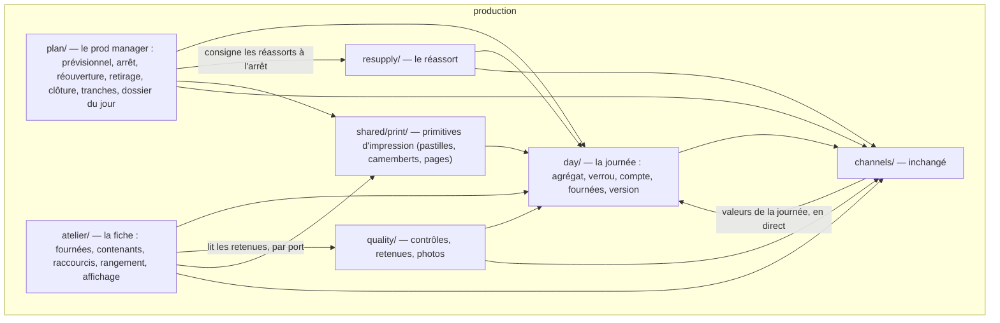
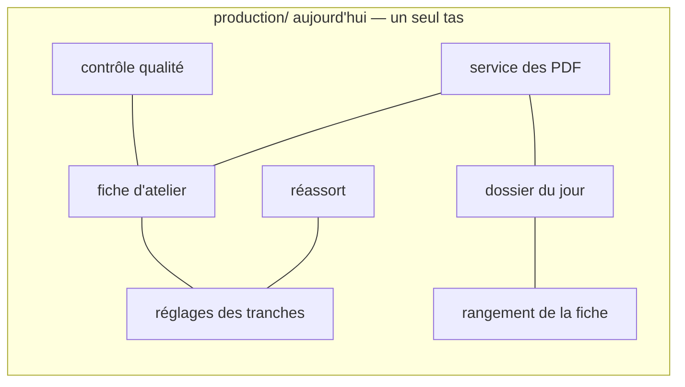
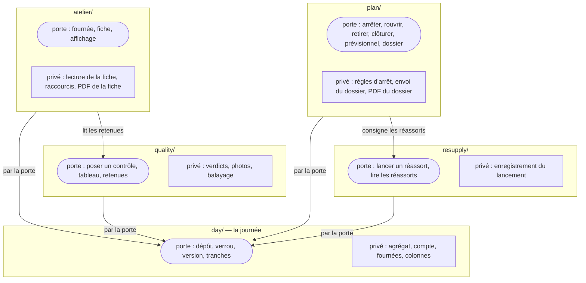

# Plan — découper le fournil en métiers autour de la journée

> Plan du 2026-11-15 (v4 : les canaux et la journée se lisent déjà dans les
> deux sens, d'où la règle anti-cycle des index ; v3 : une surface publique par métier, tenue par la
> porte et par les modules Nest ; v2, après `vitruve` : le noyau importait encore le
> plan par les tranches, et la matrice oubliait l'impression), demandé par Hugo (« je veux une belle isolation »).
> Pas encore bâti. Touche une frontière du dépôt (une porte neuve) :
> `vitruve` avant Hugo. S'ouvre après la fin des coches
> ([`plan-fin-des-coches.md`](plan-fin-des-coches.md)), qui touche l'atelier.

## 1. En simple

Le bloc `production/` est **un seul contexte à plat** : 374 fichiers rangés
par couche (`domain/`, `application/`, `infrastructure/`, `http/`), où
l'atelier, le prod manager, la qualité et le réassort se côtoient dans les
mêmes dossiers et les mêmes services. Le dépôt veut ailleurs un sous-dossier
par contexte métier (`lafoliecoffee/orders/`, `lafoliecoffee/account/`).

Ces métiers partagent pourtant **une même chose** : la journée de production
(arrêtée par le prod manager, fournée par l'atelier, retenue par la qualité,
lancée en réassort). La séparer casserait l'agrégat qui la protège. La forme
est donc **un noyau, et des métiers autour** :

**La règle**, tenue par une porte : chaque métier lit `day/`,
`shared/print/` et `channels/` ; `shared/print/` lit `day/` ; les seules
arêtes entre métiers sont celles du schéma, à sens unique ; `day/`
n'importe ni un métier ni `shared/print/`. La porte raisonne aussi **par
modèle Prisma** : chaque modèle du schéma `production` appartient à un
sous-contexte, et l'infrastructure d'un autre sous-contexte ne le lit pas —
sans quoi une lecture en Prisma direct franchirait la frontière que les
imports respectent (`prisma-model-ownership` raisonne par bloc,
`dev-toolbox/gates/prisma-model-ownership.mjs:63`).

### 1 bis. Une surface publique par métier (décidé par Hugo le 2026-11-15)

**Aujourd'hui** : tout est à plat, et n'importe quel fichier en lit
n'importe quel autre.

**Demain** : chaque métier est une pièce fermée avec **une seule porte**
(son `index.ts`). On entre par la porte ; l'intérieur est privé.

Une flèche qui viserait l'intérieur d'une pièce (« privé ») est refusée par
la porte au commit, et par le module Nest au démarrage.

Chaque sous-contexte expose **une petite porte d'entrée**, et garde le reste
privé. Trois couches la tiennent :

| Couche                                 | Ce qu'elle tient                                                                                                                        | Quand                 |
| -------------------------------------- | --------------------------------------------------------------------------------------------------------------------------------------- | --------------------- |
| `index.ts` du sous-contexte            | la liste de ce qui est public : ses commandes et requêtes (classes), ses ports publiés, ses types de vue                                | —                     |
| la porte `lint:production-subcontexts` | aucun import d'un autre sous-contexte ne passe à côté de son `index.ts` (même mécanisme que `PORT_SURFACE` pour les canaux entre blocs) | à chaque commit       |
| le module Nest du sous-contexte        | un module n'injecte que ce qu'un autre **exporte**                                                                                      | au démarrage de l'API |

Exemples de surfaces : `quality/` publie « poser un contrôle », « lire le
tableau qualité » et le port `QualityHoldsReader` ; `plan/` publie arrêter,
rouvrir, retirer, clôturer, lire le prévisionnel, produire le dossier ;
`atelier/` publie enregistrer ou annuler une fournée, lire la fiche, régler
l'affichage ; `day/` publie son dépôt, son verrou, sa version et ses
tranches. **On ne rend public que ce que les autres utilisent réellement** :
la carte de D0 le mesure, et la surface de départ en sort.

⚠️ **Le bus de `@nestjs/cqrs` est global** : un handler enregistré répond à
n'importe quel émetteur, quel que soit son module. Les modules protègent les
services injectés (dépôts, ports, lecteurs), **pas les messages du bus**.
Une commande ou une requête n'est donc publique que si l'`index.ts` de son
sous-contexte l'exporte — et c'est la porte, pas Nest, qui le tient. Il en va
de même des **faits** : un abonné (`@DurableHandler`, `@EventsHandler`) d'un
métier n'écoute que les faits qu'un autre métier publie par son `index.ts`.

**Les règles de la porte, tranchées** (v4, après `vitruve`) :

- **Aucun cycle entre `index.ts`.** Un `index.ts` ne fait que réexporter ; la
  porte refuse tout cycle d'imports qui traverse un `index.ts` — un cycle de
  « barrels » rend une classe `undefined` au moment où Nest lit ses
  métadonnées d'injection (`emitDecoratorMetadata`), et l'API refuse de
  démarrer sur une erreur qui ne nomme pas la cause.
- **`channels/` n'est pas un sous-contexte** : il importe les fichiers de
  `day/` **en direct** (les valeurs `ServiceDay`, `ServiceRange`), et
  _day/index.ts_ (à créer) n'exporte rien qui charge un canal.
- **Les types passent aussi par la porte** : un `import type` vers
  l'intérieur d'un autre sous-contexte est refusé comme un import de valeur ;
  ce qui doit être lu ailleurs est exporté par l'`index.ts`.
- **Les tests** d'un sous-contexte lisent son intérieur librement ; ceux qui
  doublent le port d'un autre passent par son `index.ts`.
- **Les racines sont exemptées** : `appBootstrap/`, `dev/` et `test/`
  composent l'application et relient des adaptateurs concrets — elles lisent
  l'intérieur, et la porte le dit.
- C'est un **mécanisme neuf** : la porte des frontières entre blocs tient
  les canaux par préfixe de dossier (`PORT_SURFACE`,
  `context-boundaries.mjs:481`), pas par fichier d'entrée ; celle-ci s'écrit
  et s'éprouve entière, cycles compris.

## 2. Ce qui existe (cartographie du 2026-11-15)

Classement fichier par fichier fait par nom et par imports (non ouvert un à
un) ; les ambigus sont tranchés au § 3. Trois **cycles de fichiers** empêchent
aujourd'hui un ordre propre :

| Cycle             | Par où                                                                                                                                                                                             |
| ----------------- | -------------------------------------------------------------------------------------------------------------------------------------------------------------------------------------------------- |
| atelier ⇄ plan    | `production-worksheet-reading.service.ts:22-23` et `worksheet-deadlines-reading.service.ts:4,5,9` (atelier lit les tranches) ; `domain/services/day-dossier.ts:14` (le dossier lit `root-shelves`) |
| plan ⇄ papiers    | `dossier-dispatch.service.ts:22` → `production-paper.service` ; les PDF du dossier importent `day-dossier`, `plan-signer`…                                                                         |
| atelier ⇄ papiers | `atelier-sheet-pdf.ts:20-25` (primitives d'impression) ; `production-paper.service.ts:38` → `worksheet-deadlines-reading`                                                                          |

Et le noyau importe deux métiers : `production-day.batches.ts:11` →
`production-output.ts` ; `production-day.launch.ts:7-8`,
`production-day.plan.ts:9` → `resupply-launch-errors`, `production-count.ts`.

Services partagés qui bloquent : `production-worksheet-reading.service`
(lit qualité, tranches, affichage), `production-paper.service` (9
dépendances : rendu, archivage, URL, logo, fiches), `sealed-day-reading.service`
(qualité et plan). Contrôleurs à plusieurs métiers :
`production-day.controller.ts` (plan, réassort, papiers, atelier),
`production-worksheet.controller.ts` (atelier + retirage),
`production-settings.controller.ts` (tranches, jours fermés, affichage).

La porte `context-boundaries` ne connaît que les blocs
(`dev-toolbox/gates/context-boundaries.mjs:185`) : rien ne tiendrait un
découpage interne.

## 3. Les tranchages

- **Au noyau `day/`** : l'agrégat et ses fichiers, `production-output`,
  `production-count`, `shipment-ref`, `sealed-day-reading`, la version et
  l'élagueur de journée, les colonnes partagées, `packing-overlay`,
  `resupply-launch-errors` (refusées par l'agrégat), et **les tranches** :
  `production-deadlines`, `production-tranches`, l'entité et les ports des
  réglages de tranches et leurs adaptateurs. Les tranches disent le rythme de
  la journée, lu par l'atelier, le plan et le dossier ; le geste qui les
  règle (`set-production-tranches`) reste au plan et écrit par le port du
  noyau.
- **Pas de métier « papiers »** : un document appartient au métier qui le
  produit. Le dossier du jour et le compte à produire vont au `plan/`, la
  fiche d'atelier PDF à l'`atelier/`. Les **primitives** d'impression
  (`count-color-pie`, `count-color-shares`, `line-tally`, `order-routing-pdf`,
  `order-color-swatch`, `made-to-order`, les pages, `fulfillment-method-label`)
  vont à `shared/print/`. `ProductionPapers` est coupé en deux : le rendu et
  l'archivage, appelés par chaque métier.
- **`root-shelves`** (le rangement par catégorie racine) va à
  `shared/print/` : c'est une règle de présentation, lue par la fiche et le
  dossier.
- **Les réglages d'affichage** appartiennent à l'atelier ; leur route quitte
  `production-settings.controller` pour un contrôleur de l'atelier (le
  chemin d'API ne change pas).
- **Les retenues qualité** sont lues par l'atelier par un port que `quality/`
  publie (`QualityHoldsReader`), jamais par ses fichiers internes.
- **Le retirage** est un geste du plan ; sa route quitte le contrôleur de la
  fiche pour un contrôleur du plan (même chemin).
- **La supervision** (`production-supervision.controller`) lit la fiche : elle
  va à l'atelier.
- Les chemins d'API **ne changent pas** : seuls les fichiers bougent.

## 4. Lots

**Les coupes d'abord, les déplacements ensuite.** Couper un service ou créer
un port change du code ; déplacer un fichier n'en change pas. Les deux ne se
mêlent jamais dans un lot.

1. **D0 — la porte et la carte.** `lint:production-subcontexts` lit le graphe
   d'imports réel de `src/production/` et la propriété des modèles ; elle
   publie la **carte vérifiée** fichier → sous-contexte (remplace le
   classement par nom du § 2), mesure ce que chaque sous-contexte utilise
   chez les autres (la surface de départ des `index.ts`, § 1 bis) et
   **compte** les imports et lectures interdits d'aujourd'hui comme une
   dette qui ne peut que décroître. Les `index.ts` sont posés à chaque
   déplacement ; tant qu'un sous-contexte n'a pas le sien, la porte compte
   ses imports internes comme dette.
2. **C1 — couper `ProductionPapers`** en rendu et archivage.
3. **C2 — couper les contrôleurs** à plusieurs métiers
   (`production-day`, `production-worksheet`, `production-settings`) : un
   contrôleur par métier, mêmes chemins d'API, e2e inchangés.
4. **C3 — le port `QualityHoldsReader`** et la coupe de
   `production-worksheet-reading.service`.
5. **D1 — déplacer le noyau** (`day/`) et `shared/print/`.
6. **D2 — déplacer la qualité. D3 — le réassort. D4 — le plan. D5 —
   l'atelier** (dont `production-batch-shortcuts.module.ts`).
7. **D6 — un module Nest par métier.** `day/` devient un module qui fournit
   et exporte la journée (dépôt, verrou, version, tranches) ; les quatre
   métiers l'importent, jamais l'inverse, et aucun `forwardRef` (zéro
   aujourd'hui, la porte le refuse). `ProductionModule` ne fait plus
   qu'importer et réexporter les 13 fournisseurs qu'`appBootstrap` relie
   (`production.module.ts:384-396`), chacun exporté d'abord par le module de
   son métier. La carte de D0 fournit la liste des ports par module et
   range les abonnés qui touchent plusieurs métiers (ex.
   `on-packing-returned.handler.ts`) là où vit la majorité de leurs ports,
   les autres lus par `index.ts`. Seul
   lot qui peut changer l'ordre d'instanciation : il passe la suite e2e du
   fournil entière et le semis dev.

**Ce que chaque déplacement doit emporter**, listé dans son lot :

- les chemins écrits en dur dans les portes :
  `dev-toolbox/gates/mail-attachment-by-reference.mjs:43`,
  `mail-receipt-admitted.mjs:65`, `mail-status-honest.mjs:132`
  (`dossier-dispatch.service.ts`, D4),
  `write-idempotence-exceptions.json:365` (raccourcis, D5) et `:371`
  (destinataires du dossier, D4) ;
- les imports d'`appBootstrap` (6 fichiers), du semis `dev/seeding`
  (4 fichiers) et de `test/` (9 fichiers, e2e et rejeu) ;
- les chemins cités par la documentation (24 documents) et par les
  commentaires d'autres blocs.

Chaque lot : `pnpm lint:gates`, tests unitaires du bloc, e2e du fournil, un
commit. Aucune migration, aucun chemin d'API changé.

## 5. Corrections faites avant, à part (revue du 2026-11-15)

Deux défauts vérifiés, petits, corrigés dans un lot à eux avant D0 :

- **Le contrôle qualité décide hors verrou**
  (`render-quality-check.handler.ts:100-136`) : il prendra le verrou de la
  journée, relira, puis décidera, comme les fournées.
- **Deux registres peuvent écraser leur issue**
  (`prisma-auto-close-round.ts:108`, `prisma-dossier-dispatch.log.ts:30`) :
  `settle` ne s'applique qu'à une issue encore `pending`, comme
  `prisma-production-return.requests.ts:41`.

Tests de régression : deux contrôles qualité simultanés sur la même journée
ne posent qu'une retenue, et un contrôle sur une commande partie pendant
qu'il s'écrit est refusé ; un `settle` rejoué ne réécrit pas une issue déjà
posée.

## 6. Où en est l'architecture, et où elle irait

Évaluation du 2026-11-15, sur la revue SOLID du bloc et sur ce plan.

**Aujourd'hui : 6,5/10.** Solide : les couches sont tenues (aucun type
Prisma hors `infrastructure/`, temps par le `Clock`, erreurs par catégorie),
les ports sont étroits, l'agrégat de la journée refuse lui-même ses
transitions, et les frontières avec les autres blocs sont gardées par des
portes. Ce qui manque : l'intérieur est à plat avec trois cycles entre
métiers ; deux défauts réels (§ 5) ; la mise en page PDF vit dans le
domaine ; quelques fichiers dépassent la borne.

**Après le découpage : environ 8,5/10.** Une surface publique par métier,
tenue à la compilation par la porte et au démarrage par les modules Nest ;
plus de cycle ; les deux défauts corrigés.

**Ce qui l'empêche d'aller plus haut, et c'est assumé :**

1. **Le bus de `@nestjs/cqrs` est global** : les commandes, requêtes et faits
   ne sont protégés que par la porte, pas par Nest à l'exécution.
2. **Une seule base, un seul client Prisma** : rien ne rend physiquement
   impossible la lecture de la table d'un autre métier ; la porte par modèle
   l'interdit, c'est une discipline outillée, pas une impossibilité.
3. **Les lectures entre métiers restent synchrones** (par port) : le bon
   choix pour un monolithe, mais un couplage à l'exécution.
4. **Des exemptions** : `appBootstrap/`, `dev/` et `test/` lisent l'intérieur
   des métiers.

**Vers 9,5/10, plus tard et métier par métier** : un client Prisma restreint
par sous-contexte, sur le modèle de `PimPrismaService`
(`apps/lfd-api/src/pim/infra/database/pim-prisma.service.ts`), qui n'expose
que ses modèles. La lecture d'une table d'un autre métier ne serait plus
interdite : elle ne compilerait plus.
