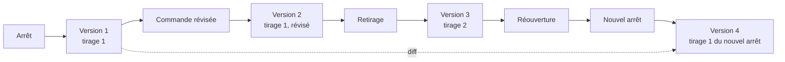

# L'historique des tirages du plan — plan

> 📝 **Plan à bâtir**, écrit le 2026-11-27 à la demande de Hugo, contredit par
> vitruve le même jour (§ 7). Rien de ce qui suit n'est construit, sauf ce que
> le § 0 décrit comme existant.

## En bref

Chaque fois que le plan de production d'une journée **change après son
arrêt** — l'arrêt lui-même, un retirage, une commande révisée, un réassort
lancé, un nouvel arrêt après réouverture — on garde une **copie en données**
du plan figé : les commandes, leurs lignes, le compte à produire, qui et
quand. Le Prod manager voit la **liste des versions** de la journée, rouvre le
papier quand il a été rangé, et **compare deux versions** à l'écran :
commandes entrées, sorties, quantités qui ont changé.

La donnée est la trace : elle existe pour chaque version, toujours. Le papier
(PDF) n'est qu'un complément, présent quand il a pu être rangé.

---

## 0. Ce qui existe (ouvert le 2026-11-27)

- **Le PDF d'un tirage a sa clé** depuis `1ef18c73e` : le dossier
  (`dayDossierPdfKey`, `plan/domain/services/day-dossier-pdf.ts`) et le compte
  à produire (`productionCountPdfKey`, `shared/print/domain/services/atelier-sheet-pdf.ts`)
  portent l'instant de l'arrêt et du dernier retirage (`printRunStamp`, même
  fichier que le compte).
- **Mais le PDF n'est fabriqué qu'à la première lecture**, depuis la journée
  COURANTE (`ProductionPaperArchive.storedOr`, `GetDayDossierPdfHandler`), et
  n'est rangé que si toutes ses lectures ont répondu (`archivable` : bons de
  livraison, rayons, tranches, postes, fiches de fonction). Un tirage que
  personne n'a ouvert avant le geste suivant n'a donc **jamais** eu de papier,
  et ne peut plus en avoir.
- **Rien ne liste ces PDF** : l'archive ne sait que lire une clé connue ou la
  fabriquer.
- **La réouverture efface le plan figé** (`ProductionDay.reopen`,
  `day/domain/entities/production-day.ts`) : arrêt, retirage et compteur
  remis à zéro, plan vidé. Le PDF imprime « tirage `retakeCount + 1` », donc
  il recommence à 1 après un nouvel arrêt.
- **Les gestes qui changent un plan figé** :

  | geste                                                                                           | où il écrit                                                             | auteur disponible                                                                |
  | ----------------------------------------------------------------------------------------------- | ----------------------------------------------------------------------- | -------------------------------------------------------------------------------- |
  | arrêt manuel et automatique (le tour repasse par `CloseProductionDayCommand(day, "automatic")`) | `plan/…/plan-arrest-recording.ts`                                       | `current.closedBy` (`PlanSigner`, `name` peut être nul ; nul pour l'automatique) |
  | retirage                                                                                        | `plan/…/retake-recording.ts`                                            | `staffUserId`, `byName`                                                          |
  | commande révisée (journée arrêtée)                                                              | `day/…/production-order-revision.desk.ts` (`ProductionDay.reviseOrder`) | à vérifier en H1                                                                 |
  | réassort lancé, qui arrête la journée ou non                                                    | `resupply/…/resupply-launch-recording.ts`                               | `gesture.staffUserId`, `gesture` nom                                             |

  La ré-annonce d'une journée déjà arrêtée (`close-production-day.handler.ts`,
  branche `isClosed`) ne change rien et n'écrit pas de version.

- **Ce que la journée connaît d'un plan figé** : `ProductionDaySnapshot`
  (`day/domain/entities/production-day.snapshot.ts`). Le dossier imprime en
  plus des lectures faites au tirage chez d'autres (bons de livraison,
  rayons, postes, fiches de fonction, couleurs, réglages) : la donnée gardée
  ne refera jamais le papier.

## 1. Ce qu'on décide

1. **Une version = une ligne**, écrite dans la **même transaction** et sous
   le **même verrou** que le geste. Pas d'abonné : une version écrite après
   coup pourrait manquer ou décrire un autre état.
2. **Propriétaire : le noyau `day/`.** C'est le seul sous-contexte que les
   trois écrivains (`plan/`, `resupply/`, `day/` lui-même) ont le droit
   d'atteindre (`dev-toolbox/gates/lib/production-subcontexts-graph.mjs`,
   `ALLOWED`). Il déclare le port dans `day/index.ts`, sous « ce que la
   journée sait garder ». La version se construit par une méthode de
   l'agrégat (`ProductionDay.version(cause, at, by)`), pas par l'appelant.
3. **Ajout seul, par discipline** : le port n'a ni `update` ni `delete`, et
   rien d'autre ne le tient (ni trigger, ni droit). La réouverture n'y touche
   pas.
4. **Le contenu est le plan, pas le papier** : commandes (référence, client,
   acheminement, échéance, lignes), compte à produire, réassorts du soir
   (`resupplies`) et réassorts lancés (`launchedResupplies`), chacun nommé à
   part. **Pas** de `sheetDetails` ni de `destination` complète : le diff n'en
   a pas besoin, et ce sont des données personnelles du client. Pas de
   fournées ni de marques de colisage. Forme versionnée (`content_version`).
5. **Deux numéros, dits tous les deux** : `version` court sur toute la
   journée (1, 2, 3, 4…) et fait foi dans la liste ; `print_run` recopie le
   « tirage n » que le papier imprime (`retakeCount + 1`). La liste affiche
   « Version 4 · tirage 1 du nouvel arrêt » : on ne renumérote pas le papier.
6. **Le papier, rangé au geste, après validation.** Après le `COMMIT` d'un
   arrêt ou d'un retirage (`AfterCommit`, hors transaction :
   `network-outside-transaction`), on demande la fabrication et le rangement
   du dossier sous la clé du tirage. S'il n'est pas `archivable`, il n'est pas
   rangé, et l'écran dit « papier non rangé (lectures incomplètes au
   tirage) » — sans jamais le refaire depuis la journée courante sous une
   ancienne clé. Une version de révision ou de réassort lancé n'a **pas** de
   papier propre : la clé ne change pas, et le papier rangé au tirage dit
   l'état d'avant. L'écran le dit.
7. **Le diff se calcule à la lecture**, par une fonction pure du domaine.

## 2. La table — schéma `production`

`production.plan_versions` (migration additive, aucune donnée déplacée) :

| colonne            | type             | sens                                                                                           |
| ------------------ | ---------------- | ---------------------------------------------------------------------------------------------- |
| `id`               | text (ULID)      | `IdGenerator`                                                                                  |
| `service_day`      | text             | comme ailleurs dans le schéma                                                                  |
| `version`          | int              | unique avec `service_day`                                                                      |
| `cause`            | text + CHECK     | `closed`, `auto_closed`, `retaken`, `order_revised`, `resupply_launched`, `opened_by_resupply` |
| `recorded_at`      | timestamptz      | l'instant du geste (`Clock`)                                                                   |
| `recorded_by_id`   | text null        | le staff ; nul pour l'arrêt automatique                                                        |
| `recorded_by_name` | text null        | le nom figé ; peut être nul même pour un humain                                                |
| `closed_at`        | timestamptz      | l'arrêt auquel elle appartient                                                                 |
| `retaken_at`       | timestamptz null |                                                                                                |
| `print_run`        | int              | le « tirage n » du papier                                                                      |
| `paper_key`        | text null        | la clé du dossier rangé ; nulle tant qu'il ne l'est pas                                        |
| `content_version`  | int              |                                                                                                |
| `content`          | jsonb            | § 1.4                                                                                          |

`version` est attribué sous le verrou de la journée que tous ces gestes
prennent déjà.

Portes : `lint:prisma-model-ownership` et `lint:production-subcontexts`
(ajouter le modèle à `dev-toolbox/gates/production-subcontexts.map.json`,
propriétaire `day`), `schema-drift`. `content` porte le libellé du client et
`recorded_by_name` un nom du staff : la colonne staff entre au registre
`documentation/legal/rgpd-registre.json` (`lint:rgpd-staff`) ; **aucune porte
ne tient le libellé client**, c'est une décision écrite ici et à Q1.

## 3. Les lots

**H1 — garder les versions.** Le port et son adaptateur Prisma dans `day/`,
la méthode de l'agrégat, les quatre écrivains du § 0 l'appellent après
`days.save`. Vérifier d'abord que la révision tient le verrou et la
transaction de la journée, et où est son auteur. Tests : domaine (contenu,
causes), application (chaque geste écrit une version, la ré-annonce et la
réouverture n'en écrivent pas), e2e (arrêt → révision → retirage →
réouverture → arrêt = 5 versions, numéros et `print_run` attendus).

**H2 — ranger le papier au tirage.** L'abonné `AfterCommit` d'un arrêt ou
d'un retirage fabrique le dossier, le range s'il est `archivable` et remplit
`paper_key`. Tests : rangé, non rangé (commerce muet), retirage arrivé avant
la fabrication (la version précédente reste sans papier, rien n'est
réattribué).

**H3 — comparer.** `diffPlanVersions(a, b)` pur : commandes ajoutées,
retirées, lignes changées (par commande et sku), compte par sku (avant,
après, écart, poids et pièces), réassorts entrés ou sortis.

**H4 — lire.** Deux requêtes nommées et leurs routes sous le contrôleur de
la journée : la liste des versions, la comparaison de deux versions. Droit :
celui qui lit déjà le dossier du jour.

**H5 — l'écran.** Dans `prod-manager` du back-office : un panneau
« Versions du plan » (liste, cause, qui, quand, papier rangé ou non, cocher
deux versions → comparer, par défaut la courante contre la précédente),
fold-ng d'abord.

## 4. Ce que ce plan ne fait pas

- Il ne corrige pas **la commande sortie du plan à la réouverture** (restée
  `confirmed`, que le nouvel arrêt ne relit pas). Le diff la rendra visible ;
  la corriger est un chantier à part, avec la fluidité de la réouverture que
  Hugo veut repenser.
- Il ne reconstruit ni versions ni papiers d'avant H1.
- Il ne refait jamais un papier ancien : la donnée ne le permet pas (§ 0).

## 5. Vérifications avant de bâtir

- La révision (`production-order-revision.desk.ts`) : verrou, transaction,
  auteur.
- La taille de `content` sur la journée la plus chargée en dev.
- `arret-du-plan.md` et `dossier-prod-du-jour.md` : ce qu'ils disent du
  papier rangé, à mettre au présent après H2.

## 6. Questions pour Hugo

- **Q1** — durée de conservation des versions (elles portent des libellés
  clients et des noms du staff) : la même que les PDF archivés, ou une borne ?
- **Q2** — l'envoi du dossier par e-mail (`dossier-dispatch.service.ts`)
  doit-il noter la version envoyée à chaque destinataire ?

## 7. Ce que vitruve a contredit (2026-11-27), et ce qui a changé

- **Bloquant** — un PDF par tirage n'existe pas forcément : la donnée devient
  la trace, le papier est rangé au geste après validation, et son absence est
  dite (§ 1.6, H2).
- **Bloquant** — `resupply/` ne peut pas atteindre `plan/` : propriétaire
  `day/` (§ 1.2).
- **Bloquant** — la révision d'une commande et le réassort lancé changent le
  plan figé sans nouveau tirage : ce sont des versions, sans papier propre
  (§ 0, § 1.6).
- **Sérieux** — deux numérotations : `version` et `print_run`, toutes deux
  dites (§ 1.5) ; contenu limité et données personnelles tranchées (§ 1.4) ;
  le registre ne tient pas le client (§ 2) ; ajout seul par discipline
  (§ 1.3) ; auteurs nullables (§ 0, § 2).
- **Mineur** — l'arrêt automatique est le même chemin que le manuel ; la
  ré-annonce n'écrit rien ; les deux réassorts nommés à part ; emplacement de
  `printRunStamp`.
