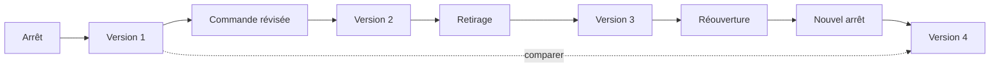

# Les versions du plan de production — plan

> 📝 **Plan à bâtir**, écrit le 2026-11-27 à la demande de Hugo, contredit
> trois fois par vitruve le même jour (§ 8). Rien de ce qui suit n'est
> construit, sauf ce que le § 0 décrit comme existant.

## En bref

Chaque fois que le plan de production d'une journée **change après son
arrêt** — l'arrêt, un retirage, une commande révisée, une commande annulée,
un réassort lancé, un nouvel arrêt après réouverture — on garde une **version**
en données : les commandes, leurs lignes, le compte à produire, qui et quand,
et pourquoi chaque commande est là. Chaque version a **son papier** (PDF),
rangé dès qu'il a pu être fabriqué fidèlement.

Le Prod manager voit la **liste des versions** de la journée, rouvre le papier
de chacune, et **compare deux versions** : d'abord l'effet sur la production
(produit par produit), puis chaque changement **expliqué** — « hors plan,
intégrée au retirage de 19 h 10 », « révisée : croissant 10 → 15 »,
« annulée après l'arrêt, toujours produite ».

La donnée est la trace et elle existe pour chaque version. Le papier vient
en plus, et l'écran dit quand il manque.

---

## 0. Ce qui existe (ouvert le 2026-11-27)

### Le papier

- La clé du dossier (`dayDossierPdfKey`, `plan/domain/services/day-dossier-pdf.ts`)
  et celle du compte à produire (`productionCountPdfKey`,
  `shared/print/domain/services/atelier-sheet-pdf.ts`) portent l'instant de
  l'arrêt et du dernier retirage (`printRunStamp`, même fichier que le compte)
  depuis `1ef18c73e`.
- Le papier n'est fabriqué qu'**à la lecture**, depuis la journée COURANTE,
  et rangé par `ProductionPaperArchive.storedOr` seulement s'il est
  `archivable` (bons de livraison, rayons, tranches, postes, fiches de
  fonction ont répondu). Trois lecteurs : `get-day-dossier-pdf.handler.ts`,
  `get-production-count-pdf.handler.ts`, `dossier-dispatch.service.ts`.
- Une révision ou un réassort lancé change le plan sans changer la clé : le
  premier lecteur range alors l'état révisé sous la clé du tirage d'avant.
- Rien ne liste les papiers rangés.

### Le plan figé et ce qui le change

- La réouverture (`ProductionDay.reopen`) efface le plan figé, l'arrêt, le
  retirage et le compteur. Le papier imprime « tirage `retakeCount + 1` ».
- Les gestes qui changent un plan figé :

  | geste                                                                                                                                                                                                                         | où il écrit                                                                                  | auteur                                                                                                                                                                                                                                      |
  | ----------------------------------------------------------------------------------------------------------------------------------------------------------------------------------------------------------------------------- | -------------------------------------------------------------------------------------------- | ------------------------------------------------------------------------------------------------------------------------------------------------------------------------------------------------------------------------------------------- |
  | arrêt manuel et automatique (le tour repasse par `CloseProductionDayCommand(day, "automatic")`)                                                                                                                               | `plan/…/plan-arrest-recording.ts`                                                            | `current.closedBy` — `PlanSigner`, `name` nullable ; nul pour l'automatique                                                                                                                                                                 |
  | retirage — n'**ajoute** que (`planValue.absorbed`), en écartant les retirées                                                                                                                                                  | `plan/…/retake-recording.ts`                                                                 | `staffUserId`, `byName`                                                                                                                                                                                                                     |
  | commande révisée — ne baisse jamais le compte du jour (`reviseOrder`)                                                                                                                                                         | `day/…/production-order-revision.desk.ts`                                                    | **ne traverse pas le port** : `OrderRevisionDesk.note(…)` ne porte pas d'acteur                                                                                                                                                             |
  | réassort lancé, qui arrête la journée ou non                                                                                                                                                                                  | `resupply/…/resupply-launch-recording.ts`                                                    | `gesture`                                                                                                                                                                                                                                   |
  | commande annulée après l'arrêt — **ne retire pas** la commande du plan figé, ne change **ni le compte ni les fournées** : elle est inscrite au registre des retraits (`OrderWithdrawalLedger`) et le colisage libère ses bacs | `day/…/production-order-withdrawal.desk.ts` (fait `days.load` sous le verrou, jamais `save`) | **ne traverse pas le port** : le commerce a `intent.actor` (client, invité ou staff — après l'arrêt, surtout un client : `before_packing`, commandes personnelles), `OrderWithdrawalDesk.withdraw(day, orderId, allowance)` ne le passe pas |

  La ré-annonce d'une journée déjà arrêtée n'écrit rien. Une annulation
  d'une commande prise sur la vitrine ne passe pas par le guichet et ne
  touche pas le plan.

- Le plan est indexé par `(service_day, order_id, rank)` : une commande peut
  y figurer par plusieurs envois.

### Ce que lit un lecteur du papier

Un lecteur charge la journée par un seul `findUnique` sur `production_day`
(`prisma-production-day.repository.ts`), sans verrou, et calcule la clé
depuis elle seule (`production-paper-slots.ts`). `storedOr` ne réécrit
jamais une clé présente. Le dossier lit en plus, à l'instant du rendu, les
bons de livraison, rayons, tranches, fiches de fonction et réglages
d'affichage : seul le compte à produire ne dépend que de la journée.

### Ce qui sort d'un plan d'une version à l'autre sans passer par le registre

- À la réouverture, le commerce ne remet en `placed` que les commandes
  confirmées à l'instant de l'arrêt défait, ni prêtes, ni avec un manque
  décidé (`prisma-order-plan-release.ts`). Les autres restent `confirmed`, et
  le nouvel arrêt, qui ne lit que `placed` (`STATUS_IN_PLAN`), ne les reprend
  pas — volontairement pour un manque décidé.
- Cette remise passe par un **abonné durable** qui ne fait rien si la journée
  est de nouveau arrêtée quand il reçoit le fait
  (`on-production-day-reopened.handler.ts`). Un nouvel arrêt fait avant que
  l'abonné ait tout traité laisse des commandes hors de tout plan : c'est la
  cause du 8 → 7 du 2026-11-27 (§ 5).
- Pendant la réouverture, une commande peut aussi sortir légitimement :
  paiement refusé ou remboursé (`settlementWhere`), passage à la vitrine
  (`notFromStock`), date changée par le client.

Le fournil ne connaît aucune de ces raisons : elles sont au commerce.

### Ce que le fournil sait d'une commande

`ProducibleOrder` (`channels/commerce/day-orders.reader.ts`, implémenté par
`PrismaDayOrdersSource`) ne porte pas « hors plan ». Le commerce le sait
(`placedOffPlan`, posé par `Order.receiveOffPlan`, staff seulement,
définitif). Une commande absorbée par un retirage reste `placed` au
commerce : aucun abonné n'écoute le retirage (le commentaire contraire de
`prisma-admin-order-list.reader.ts`, « le retirage la passe `confirmed` »,
est faux — à corriger au premier passage).

## 1. Ce qu'on décide

### La version

1. **Une version = une ligne**, écrite dans la **même transaction** et sous
   le **même verrou** que le geste.
2. **Propriétaire : le noyau `day/`**, seul sous-contexte que `plan/`,
   `resupply/` et `day/` peuvent atteindre (`ALLOWED`,
   `dev-toolbox/gates/lib/production-subcontexts-graph.mjs`). Le port est
   rangé dans `day/index.ts`.
3. **Le numéro de la version courante vit sur la journée** :
   `production_day.plan_version`, écrit par le même `save` que l'état qu'il
   numérote. Un lecteur qui charge la journée lit donc l'état ET son numéro
   en une seule ligne : pas de seconde lecture, pas de course (§ 1.10).
4. **Construite par une fonction du domaine qui reçoit la version
   précédente** : `PlanVersion.next(previous, snapshot, cause, withdrawn, by)`.
   C'est elle qui déduit pourquoi chaque commande est là (§ 1.7).
5. **Ajout seul, par discipline** : le port n'a ni `update` ni `delete`, et
   rien d'autre ne le tient. Une version n'est jamais réécrite, pas même pour
   son papier (§ 1.10).
6. **Une version n'est écrite que si le plan change** — commandes, lignes,
   compte, réassorts **ou retirées** (`withdrawn`). N'en écrivent pas : une
   ré-annonce, une annulation d'une commande absente du plan, une révision
   rendue `unchanged`, la réouverture elle-même.

### Le contenu

7. **Par envoi `(orderId, rank)`** : référence, client (libellé seul),
   acheminement, échéance, lignes, `offPlan` (§ 1.8), et `entry`, déduit en
   comparant à la version précédente :
   - `arrested` — présente au premier arrêt de la journée ;
   - `retaken` — entrée par un retirage ;
   - `arrested_after_reopen` — refigée par l'arrêt qui suit une réouverture ;
   - `unchanged` — déjà là à la version précédente ;
   - `unknown` — première version d'une journée arrêtée **avant H1** : on ne
     sait pas comment elle est entrée, et le diff ne remonte pas avant elle.

   Règles de déduction : sans version précédente, `arrested` si la cause est
   un arrêt, `unknown` sinon ; `arrested_after_reopen` quand le `closed_at`
   diffère de celui de la version précédente (aucune version n'est écrite à
   la réouverture) ; `retaken` quand l'envoi est nouveau et la cause
   `retaken`.

   Un envoi entré par un retirage avec `offPlan = true` se dit « hors plan,
   intégrée au retirage ». Après une réouverture, `entry` l'emporte sur
   `offPlan` dans la phrase : « refigée après réouverture (reçue hors plan) ».

8. **`offPlan: boolean | null`** sur la commande figée : `null` pour les
   commandes figées avant la colonne — on ne savait pas, on n'invente pas
   `false`.
9. **Le compte à produire est celui de la journée (`counts`)**, recopié tel
   quel. Les **retirées** sont gardées à part (`withdrawn` : envoi, instant,
   auteur), lues au registre par l'écrivain sous le verrou, parce que le
   nouvel arrêt les écarte et que le diff doit encore pouvoir les nommer. Pas
   de `sheetDetails` ni de `destination` complète (données personnelles,
   inutiles au diff), pas de fournées ni de marques de colisage.
   `content_version` versionne la forme.

### Le papier

10. **La clé du papier est celle de la version** :
    `<jour>/dossier-du-jour-<mise en page>-version-<n>.pdf` (de même pour le
    compte à produire), `n` lu sur la journée chargée (§ 1.3). La journée et
    son numéro venant de la même ligne, un lecteur range toujours l'état `n`
    sous la clé `n`. Une journée arrêtée avant H1 (sans `plan_version`)
    garde la clé par tirage de `1ef18c73e` : les papiers déjà rangés restent
    atteints.
11. **Rangé au geste** : après le `COMMIT` d'un geste qui écrit une version
    (`AfterCommit`, hors transaction, `network-outside-transaction`), on
    demande le papier. S'il n'est pas `archivable`, la reprise est la lecture
    suivante, tant que la version est la courante ; ensuite l'écran dit
    « papier non rangé ». Pas de tour de cron : le tour d'arrêt automatique
    est « une tentative, pas une boucle ».
12. **« Papier rangé » se lit au stockage**, pas en base : la liste demande à
    l'archive si la clé de la version existe. Aucune lecture n'écrit en base
    (CLAUDE.md § 4) ; pas de colonne `paper_key`.
13. **Ce que le papier garantit, dit honnêtement** : le plan qu'il imprime
    est celui de la version ; les bons de livraison, rayons, tranches,
    fiches de fonction et réglages sont ceux de l'instant où il a été
    fabriqué — au geste dans le cas normal, plus tard s'il a fallu la
    reprise. Le compte à produire ne dépend que de la version.
14. **Une version sans papier propre** : un retrait ne change ni les
    commandes ni le compte, son papier serait celui de la précédente ; la
    liste renvoie au papier de la version d'avant et le dit.
15. **Le papier dit sa version** : « Version n · tirage m », en en-tête.

### Le diff

16. **Calculé à la lecture par une fonction pure** (`diffPlanVersions`), qui
    ne reçoit que les versions : tout ce dont elle a besoin est dans leur
    contenu (§ 1.7 à 1.9).
17. **L'effet sur la production d'abord**, lu sur `counts` — le chiffre du
    fournil, pas un recalcul sur les lignes : une annulation après l'arrêt
    ne baisse pas le compte, une révision ne le baisse jamais. Une retirée
    s'affiche « annulée après l'arrêt — toujours produite ».
18. **Chaque changement avec sa raison**, par envoi : entrée (`entry`,
    `offPlan`), lignes changées par une révision (version `order_revised`),
    retirée (`withdrawn`), réassort lancé.
19. **Une sortie dont le fournil ne connaît pas la raison est dite sans
    accuser** : « sortie du plan — raison au commerce » (paiement, vitrine,
    date, manque décidé), **en orange**. C'est un **choix**, pas une contrainte : un port « état de
    ces commandes » que le commerce implémenterait est possible, et reste
    hors de ce plan. Le choix ne tient que parce que la course de la
    réouverture est **corrigée avant** (lot H-1, § 5) : sans elle, l'orange
    classerait comme légitime le seul défaut qui a motivé ce plan.
20. **Les changements faits pendant une réouverture** (commande `placed`
    modifiée par le client, puis refigée) n'ont pas de version
    `order_revised` : le diff les dit « modifiée pendant la réouverture ».
21. **Comparer deux versions éloignées enchaîne** les explications des
    versions intermédiaires.

## 2. Les tables — schéma `production`

`production.plan_versions` (migration additive) :

| colonne            | type         | sens                                                                                                              |
| ------------------ | ------------ | ----------------------------------------------------------------------------------------------------------------- |
| `id`               | text (ULID)  | `IdGenerator`                                                                                                     |
| `service_day`      | text         |                                                                                                                   |
| `version`          | int          | unique avec `service_day`, attribué sous le verrou                                                                |
| `cause`            | text + CHECK | `closed`, `auto_closed`, `retaken`, `order_revised`, `order_withdrawn`, `resupply_launched`, `opened_by_resupply` |
| `recorded_at`      | timestamptz  | `Clock`                                                                                                           |
| `recorded_by_kind` | text + CHECK | `staff`, `customer`, `guest`, `system` (arrêt automatique)                                                        |
| `recorded_by_id`   | text null    | **staff seulement** ; nul pour un client, un invité ou le système                                                 |
| `recorded_by_name` | text null    | staff seulement, peut être nul ; l'écran dit « le client » pour `customer` et `guest`                             |
| `closed_at`        | timestamptz  | l'arrêt auquel elle appartient                                                                                    |
| `print_run`        | int          | le « tirage m » du papier                                                                                         |
| `content_version`  | int          |                                                                                                                   |
| `content`          | jsonb        | § 1.7 à 1.9                                                                                                       |

`production.production_order` gagne `off_plan boolean NULL` (§ 1.8) ;
`production.production_day` gagne `plan_version int NULL` (§ 1.3), nul pour une
journée jamais versionnée.

Portes : `lint:prisma-model-ownership`, `lint:production-subcontexts`
(modèle à `dev-toolbox/gates/production-subcontexts.map.json`, propriétaire
`day`), `schema-drift`. `recorded_by_name` entre au registre
`documentation/legal/rgpd-registre.json` (`lint:rgpd-staff`). Le libellé
client de `content` n'est tenu par **aucune porte** : décision écrite ici et
à Q1. `context-version-columns` ne s'applique pas (elle ne lit que les tables
de l'instantané du catalogue).

## 3. Les lots

**H-1 — fermer la course de la réouverture (préalable).** Un arrêt refuse
de passer tant que la remise de la réouverture précédente n'est pas faite au
commerce (§ 5). Bâti avant H3 : c'est lui qui rend l'orange honnête.

**H0 — « hors plan » jusqu'au fournil.** `offPlan: boolean | null` sur
`ProducibleOrder` (13 fichiers hors tests, et les faux du port), rempli par
`PrismaDayOrdersSource` depuis `placedOffPlan` ; la colonne `off_plan` de
`production_order`, `production-day.row.ts` et
`production-day-children.writer.ts`. Corriger le commentaire faux de
`prisma-admin-order-list.reader.ts`.

**H1 — garder les versions.** Le port, l'adaptateur et `PlanVersion.next`
dans `day/` ; les écrivains : arrêt, retirage, révision, réassort lancé
(après `days.save`, qui écrit aussi `plan_version`), et le guichet du
retrait, qui charge déjà la journée sous son verrou, lit le registre et
la **sauve** pour faire monter `plan_version`. L'auteur traverse deux ports :
`OrderWithdrawalDesk.withdraw` et `OrderRevisionDesk.note` prennent l'acteur
(un seul appelant de production chacun ; `order-workshop-withdrawal.ts` l'a
déjà), réduit à `{ kind, staffId?, name? }` : un identifiant de client
n'entre pas au schéma `production`. Tests : domaine (`entry`, `offPlan`,
retirées, rangs), application (chaque geste écrit une version, ceux du § 1.6
n'en écrivent pas), e2e (arrêt → révision → annulation → retirage →
réouverture → arrêt).

**H2 — le papier par version.** La clé par version (§ 1.10) pour le dossier
et le compte, la clé par tirage gardée pour les journées sans version, la
demande `AfterCommit`, l'en-tête « Version n ».
Tests : rangé au geste, non rangé puis rangé à la lecture, version dépassée
jamais rangée, révision rangée sous sa propre version.

**H2b — la version de chaque envoi.** `plan_version` sur
`production_dossier_dispatch` (migration additive), posé à `claim`. Tests :
arrêt puis retirage, chaque destinataire porte la version de son papier.

**H3 — comparer et expliquer.** `diffPlanVersions` (§ 1.16 à 1.21), tests
unitaires exhaustifs, dont le cas du 2026-11-27 rejoué.

**H4 — lire.** La liste des versions et la comparaison, deux requêtes et
leurs routes sous le contrôleur de la journée ; droit de lecture du dossier.

**H5 — l'écran.** Dans `prod-manager` : « Versions du plan » — liste (cause,
qui, quand, papier rangé ou non), comparer deux versions (par défaut la
courante contre la précédente) : l'effet par produit en tête, les sorties
inexpliquées en orange, puis les changements expliqués. fold-ng d'abord.

**H6 — le réenvoi.** Sur l'écran des versions : la liste des destinataires
avec la dernière version reçue, et le geste « renvoyer la version courante »
— à un destinataire ou à tous ceux qui ont une version dépassée. Un e-mail
« dossier mis à jour » (texte au dictionnaire des e-mails, manifeste
régénéré), le papier de la version courante joint, une trace par envoi
comme aujourd'hui (clé `(journée, instant du réenvoi, destinataire)`), la
clé d'intention de l'écran (`lint:intent-key-gestures`). Ce que l'e-mail dit
du changement (le résumé du diff ?) est à décider avec Hugo avant H6.

## 4. Ce que ce plan ne fait pas

- Il ne reconstruit ni versions ni papiers d'avant H1.
- Il ne refait jamais un papier ancien.
- Il ne dit pas au fournil POURQUOI le commerce a sorti une commande : il dit
  qu'elle est sortie et que la raison est au commerce.

## 5. La course de la réouverture — lot H-1

Le nouvel arrêt ne doit pas passer avant que le commerce ait remis en
`placed` les commandes de l'arrêt défait. C'est ce qui a produit 8 → 7, puis
9 au tour suivant, le 2026-11-27.

**Retenu : l'arrêt refuse tant que la remise n'est pas faite.** Le fournil
déclare dans `production/channels/commerce/` un lecteur « des commandes de
cet arrêt défait sont-elles encore confirmées ? », que le commerce implémente
avec la même condition que `releaseFromPlan` — la figure de
`OrderInscriptionReader` et de `PlanAdmissionDesk`, que la matrice admet déjà.
L'arrêt le lit sous son verrou, après une réouverture seulement. Réponse
« oui » :

- arrêt manuel : refus nommé — « la réouverture est encore en cours de
  remise au commerce, réessayez dans un instant » ;
- arrêt automatique : refusé ce tour-là, comme tout refus du tour (alerte
  « bloqué » si ça dure), et repris au tour suivant.

**Écartée : remettre en `placed` dans la transaction de la réouverture.**
Elle inverserait l'ordre des verrous : l'annulation prend la ligne `orders`
puis la journée (`order-cancellation.service.ts`), la réouverture prendrait
la journée puis écrirait `orders`. Risque d'interblocage.

La fluidité d'ensemble de la réouverture, que Hugo veut repenser, reste un
chantier à part ; H-1 n'en ferme que la perte silencieuse.

## 6. Vérifications avant de bâtir

- Que `AfterCommit` se déclenche quand le guichet du retrait tourne dans la
  transaction du commerce.
- Que la réouverture refuse une journée avec des commandes prêtes ou des
  manques décidés (`assertReopenable` ne lit que fournées, colisage, départ).
- Qu'aucun reliquat n'inscrit encore de rang supérieur à 1 au plan.
- La taille de `content` sur la journée la plus chargée.

## 7. Décisions de Hugo (2026-11-27)

- **Q1 — conservation : sans limite pour le moment.** Les versions ne
  s'effacent pas. Au registre `documentation/legal/rgpd-registre.json`, la
  durée de `recorded_by_name` s'écrit « non bornée, décision du
  2026-11-27, à revoir » — `lint:rgpd-staff` la compte parmi les durées non
  décidées, ce qui est voulu : elle reste visible.
- **Q2 — chaque envoi du dossier note sa version.** La trace existante,
  `production.production_dossier_dispatch` (une ligne par journée, instant
  d'origine et destinataire), gagne `plan_version int NULL`, écrit par
  `DossierDispatchLog.claim` depuis la journée que l'abonné a chargée (§ 1.3 :
  l'état et son numéro viennent de la même ligne, donc le numéro est celui du
  papier joint). `NULL` pour les envois d'avant H2.

  But : **le réenvoi**. Quand une version plus récente existe, l'écran des
  versions dit, pour chaque destinataire, quelle version il a reçue en
  dernier, et propose de lui renvoyer la courante (lot H6).

## 8. Ce que vitruve a contredit (2026-11-27)

**Première lecture** — un tirage n'a pas toujours de papier (la donnée
devient la trace) ; `resupply/` ne peut pas écrire dans `plan/` (propriétaire
`day/`) ; révision et réassort lancé changent le plan sans tirage (ce sont
des versions) ; deux numérotations (`version`, `print_run`) ; contenu limité ;
auteurs nullables ; ajout seul par discipline.

**Seconde lecture, sur le diff expliqué** :

- **Bloquant** — l'« anomalie en rouge » avait des causes légitimes au
  commerce que le fournil ne voit pas : orange, sans accuser (§ 1.19), et la
  course corrigée à la source (§ 5).
- **Bloquant** — les retirées disparaissent du contenu après un nouvel arrêt :
  gardées à part (`withdrawn`, § 1.9).
- **Bloquant** — l'agrégat ne sait pas pourquoi une commande est là : `entry`
  déduit de la version précédente (§ 1.4, § 1.7) ; le guichet du retrait
  doit charger la journée et recevoir l'auteur (H1).
- **Bloquant** — ranger « à la prochaine lecture » sous la clé du tirage
  rangeait un état révisé sous une ancienne clé : clé par version (§ 1.10).
- **Sérieux** — « à produire » lu sur `counts`, jamais recalculé (§ 1.17) ;
  ordre `entry` / `offPlan` écrit (§ 1.7) ; modifiée pendant la réouverture
  (§ 1.20) ; H0 chiffré, `offPlan` nullable (§ 1.8) ; pas de reprise par le
  cron (§ 1.11) ; auteur du retrait à faire passer par le port (H1).
- **Mineur** — diff par envoi `(orderId, rank)` ; pas de version sans
  changement (§ 1.6) ; commentaire faux à corriger (H0).

**Troisième lecture** :

- **Bloquant** — le numéro de version lu à côté de la journée faisait ranger
  un état sous la clé d'un autre : il vit sur `production_day`, écrit par le
  même `save` (§ 1.3, § 1.10).
- **Bloquant** — l'auteur d'un retrait est surtout un client :
  `recorded_by_kind`, identifiant réservé au staff (§ 2, H1).
- **Sérieux** — la révision a le même trou d'auteur (H1) ; `entry` sans
  version précédente (`unknown`) et la règle de `arrested_after_reopen`
  (§ 1.7) ; les journées d'avant H1 gardent la clé par tirage (§ 1.10) ;
  plus de `paper_key` écrit par une lecture (§ 1.12) ; ce que le papier
  garantit vraiment (§ 1.13) ; l'orange est un choix, qui exige la course
  corrigée avant (§ 1.19, H-1) ; la piste « dans la transaction » écartée
  pour l'ordre des verrous, la piste « l'arrêt attend » précisée (§ 5).
- **Mineur** — le guichet charge déjà la journée (§ 0) ; un retrait écrit une
  version sans papier propre (§ 1.14) ; une révision `unchanged` n'écrit rien
  (§ 1.6).
