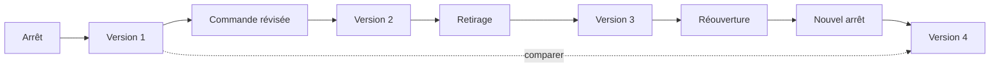

# Les versions du plan de production — plan

> 📝 **Plan à bâtir**, écrit le 2026-11-27 à la demande de Hugo, contredit
> trois fois par vitruve le même jour (§ 8). Rien de ce qui suit n'est
> construit, sauf ce que le § 0 décrit comme existant.

## En bref

Chaque fois que le plan de production d'une journée **change après son
arrêt** — l'arrêt, un retirage, une commande révisée, une commande annulée,
un réassort lancé, un nouvel arrêt après réouverture — on garde une **version**
en données : les commandes, leurs lignes, le compte à produire, qui et quand,
et pourquoi chaque commande est là. Chaque version a **son papier** (PDF),
rangé dès qu'il a pu être fabriqué fidèlement.

Le Prod manager voit la **liste des versions** de la journée, rouvre le papier
de chacune, et **compare deux versions** : d'abord l'effet sur la production
(produit par produit), puis chaque changement **expliqué** — « hors plan,
intégrée au retirage de 19 h 10 », « révisée : croissant 10 → 15 »,
« annulée après l'arrêt, toujours produite ».

La donnée est la trace et elle existe pour chaque version. Le papier vient
en plus, et l'écran dit quand il manque.

---

## 0. Ce qui existe (ouvert le 2026-11-27)

### Le papier

- La clé du dossier (`dayDossierPdfKey`, `plan/domain/services/day-dossier-pdf.ts`)
  et celle du compte à produire (`productionCountPdfKey`,
  `shared/print/domain/services/atelier-sheet-pdf.ts`) portent l'instant de
  l'arrêt et du dernier retirage (`printRunStamp`, même fichier que le compte)
  depuis `1ef18c73e`.
- Le papier n'est fabriqué qu'**à la lecture**, depuis la journée COURANTE,
  et rangé par `ProductionPaperArchive.storedOr` seulement s'il est
  `archivable` (bons de livraison, rayons, tranches, postes, fiches de
  fonction ont répondu). Trois lecteurs : `get-day-dossier-pdf.handler.ts`,
  `get-production-count-pdf.handler.ts`, `dossier-dispatch.service.ts`.
- Une révision ou un réassort lancé change le plan sans changer la clé : le
  premier lecteur range alors l'état révisé sous la clé du tirage d'avant.
- Rien ne liste les papiers rangés.

### Le plan figé et ce qui le change

- La réouverture (`ProductionDay.reopen`) efface le plan figé, l'arrêt, le
  retirage et le compteur. Le papier imprime « tirage `retakeCount + 1` ».
- Les gestes qui changent un plan figé :

  | geste                                                                                                                                                                                                                         | où il écrit                                                                                  | auteur                                                                                                                                                                                                                                      |
  | ----------------------------------------------------------------------------------------------------------------------------------------------------------------------------------------------------------------------------- | -------------------------------------------------------------------------------------------- | ------------------------------------------------------------------------------------------------------------------------------------------------------------------------------------------------------------------------------------------- |
  | arrêt manuel et automatique (le tour repasse par `CloseProductionDayCommand(day, "automatic")`)                                                                                                                               | `plan/…/plan-arrest-recording.ts`                                                            | `current.closedBy` — `PlanSigner`, `name` nullable ; nul pour l'automatique                                                                                                                                                                 |
  | retirage — n'**ajoute** que (`planValue.absorbed`), en écartant les retirées                                                                                                                                                  | `plan/…/retake-recording.ts`                                                                 | `staffUserId`, `byName`                                                                                                                                                                                                                     |
  | commande révisée — ne baisse jamais le compte du jour (`reviseOrder`)                                                                                                                                                         | `day/…/production-order-revision.desk.ts`                                                    | **ne traverse pas le port** : `OrderRevisionDesk.note(…)` ne porte pas d'acteur                                                                                                                                                             |
  | réassort lancé, qui arrête la journée ou non                                                                                                                                                                                  | `resupply/…/resupply-launch-recording.ts`                                                    | `gesture`                                                                                                                                                                                                                                   |
  | commande annulée après l'arrêt — **ne retire pas** la commande du plan figé, ne change **ni le compte ni les fournées** : elle est inscrite au registre des retraits (`OrderWithdrawalLedger`) et le colisage libère ses bacs | `day/…/production-order-withdrawal.desk.ts` (fait `days.load` sous le verrou, jamais `save`) | **ne traverse pas le port** : le commerce a `intent.actor` (client, invité ou staff — après l'arrêt, surtout un client : `before_packing`, commandes personnelles), `OrderWithdrawalDesk.withdraw(day, orderId, allowance)` ne le passe pas |

  La ré-annonce d'une journée déjà arrêtée n'écrit rien. Une annulation
  d'une commande prise sur la vitrine ne passe pas par le guichet et ne
  touche pas le plan.

- Le plan est indexé par `(service_day, order_id, rank)` : une commande peut
  y figurer par plusieurs envois.

### Ce que lit un lecteur du papier

Un lecteur charge la journée par un seul `findUnique` sur `production_day`
(`prisma-production-day.repository.ts`), sans verrou, et calcule la clé
depuis elle seule (`production-paper-slots.ts`). `storedOr` ne réécrit
jamais une clé présente. Le dossier lit en plus, à l'instant du rendu, les
bons de livraison, rayons, tranches, fiches de fonction et réglages
d'affichage : seul le compte à produire ne dépend que de la journée.

### Ce qui sort d'un plan d'une version à l'autre sans passer par le registre

- À la réouverture, le commerce ne remet en `placed` que les commandes
  confirmées à l'instant de l'arrêt défait, ni prêtes, ni avec un manque
  décidé (`prisma-order-plan-release.ts`). Les autres restent `confirmed`, et
  le nouvel arrêt, qui ne lit que `placed` (`STATUS_IN_PLAN`), ne les reprend
  pas — volontairement pour un manque décidé.
- Cette remise passe par un **abonné durable** qui ne fait rien si la journée
  est de nouveau arrêtée quand il reçoit le fait
  (`on-production-day-reopened.handler.ts`). Un nouvel arrêt fait avant que
  l'abonné ait tout traité laisse des commandes hors de tout plan : c'est la
  cause du 8 → 7 du 2026-11-27 (§ 5).
- Pendant la réouverture, une commande peut aussi sortir légitimement :
  paiement refusé ou remboursé (`settlementWhere`), passage à la vitrine
  (`notFromStock`), date changée par le client.

Le fournil ne connaît aucune de ces raisons : elles sont au commerce.

### Ce que le fournil sait d'une commande

`ProducibleOrder` (`channels/commerce/day-orders.reader.ts`, implémenté par
`PrismaDayOrdersSource`) porte `offPlan: boolean | null` depuis H0, recopié
de `placedOffPlan` (posé par `Order.receiveOffPlan`, staff seulement,
définitif), et la journée le garde (`production_order.off_plan`, `NULL` pour
les commandes figées avant).

**Une commande absorbée par un retirage est confirmée à l'instant de l'arrêt
en vigueur.** Le retirage publie `production.day_retaken` avec les envois
absorbés et `closedAt`, l'arrêt en vigueur (`retake-recording.ts`). Le fait
est déclaré dans `channels/delivery/` et réexporté par `channels/commerce/`.
Le commerce l'écoute (`OnProductionDayRetaken`, abonné durable
`lfc.orders.absorb-retaken-into-plan`) et fait ce que l'arrêt fait :
`absorbIntoPlan`, puis `planConfirmed` (le BL-1 prévu), les deux à
`closedAt`, jamais à l'heure du retirage. C'est l'instant que la remise d'une
réouverture cherche (`releasableFromPlanWhere`) : la commande est rendue au
client comme les autres, et l'arrêt suivant n'attend pas. L'abonné tient le
plan (`CurrentArrestHold.holdIfCurrent(serviceDay, closedAt)`) : livré après
une réouverture ou un réarrêt, il ne confirme rien, et le nouvel arrêt
reprend la commande, encore `placed`. Un fait écrit sans `closedAt` ne
confirme rien. Régression : `test/production-retaken-order-confirmed.e2e-spec.ts`.

La liste des commandes du staff calcule `offPlan: placedOffPlan && status ===
"placed"`, et éteint en plus le badge des commandes que le fournil a déjà
inscrites (`InscribedOrdersReader`) : le badge est juste entre le retirage et
la livraison de son fait au commerce.

## 1. Ce qu'on décide

### La version

1. **Une version = une ligne**, écrite dans la **même transaction** et sous
   le **même verrou** que le geste.
2. **Propriétaire : le noyau `day/`**, seul sous-contexte que `plan/`,
   `resupply/` et `day/` peuvent atteindre (`ALLOWED`,
   `dev-toolbox/gates/lib/production-subcontexts-graph.mjs`). Le port est
   rangé dans `day/index.ts`.
3. **Le numéro de la version courante vit sur la journée** :
   `production_day.plan_version`, écrit par le même `save` que l'état qu'il
   numérote. Un lecteur qui charge la journée lit donc l'état ET son numéro
   en une seule ligne : pas de seconde lecture, pas de course (§ 1.10).
4. **Construite par une fonction du domaine qui reçoit la version
   précédente** : `PlanVersion.next(previous, snapshot, cause, withdrawn, by)`.
   C'est elle qui déduit pourquoi chaque commande est là (§ 1.7).
5. **Ajout seul, par discipline** : le port n'a ni `update` ni `delete`, et
   rien d'autre ne le tient. Une version n'est jamais réécrite, pas même pour
   son papier (§ 1.10).
6. **Une version n'est écrite que si le plan change** — commandes, lignes,
   compte, réassorts **ou retirées** (`withdrawn`). N'en écrivent pas : une
   ré-annonce, une annulation d'une commande absente du plan, une révision
   rendue `unchanged`, la réouverture elle-même.

### Le contenu

7. **Par envoi `(orderId, rank)`** : référence, client (libellé seul),
   acheminement, échéance, lignes, `offPlan` (§ 1.8), et `entry`, déduit en
   comparant à la version précédente :
   - `arrested` — présente au premier arrêt de la journée ;
   - `retaken` — entrée par un retirage ;
   - `arrested_after_reopen` — refigée par l'arrêt qui suit une réouverture ;
   - `unchanged` — déjà là à la version précédente ;
   - `unknown` — première version d'une journée arrêtée **avant H1** : on ne
     sait pas comment elle est entrée, et le diff ne remonte pas avant elle.

   Règles de déduction : sans version précédente, `arrested` si la cause est
   un arrêt, `unknown` sinon ; `arrested_after_reopen` quand le `closed_at`
   diffère de celui de la version précédente (aucune version n'est écrite à
   la réouverture) ; `retaken` quand l'envoi est nouveau et la cause
   `retaken`.

   Un envoi entré par un retirage avec `offPlan = true` se dit « hors plan,
   intégrée au retirage ». Après une réouverture, `entry` l'emporte sur
   `offPlan` dans la phrase : « refigée après réouverture (reçue hors plan) ».

8. **`offPlan: boolean | null`** sur la commande figée : `null` pour les
   commandes figées avant la colonne — on ne savait pas, on n'invente pas
   `false`.
9. **Le compte à produire est celui de la journée (`counts`)**, recopié tel
   quel. Les **retirées** sont gardées à part (`withdrawn` : envoi, instant,
   auteur), lues au registre par l'écrivain sous le verrou, parce que le
   nouvel arrêt les écarte et que le diff doit encore pouvoir les nommer. Pas
   de `sheetDetails` ni de `destination` complète (données personnelles,
   inutiles au diff), pas de fournées ni de marques de colisage.
   `content_version` versionne la forme.

### Le papier

10. **La clé du papier est celle de la version** :
    `<jour>/dossier-du-jour-<mise en page>-version-<n>.pdf` (de même pour le
    compte à produire), `n` lu sur la journée chargée (§ 1.3). La journée et
    son numéro venant de la même ligne, un lecteur range toujours l'état `n`
    sous la clé `n`. Une journée arrêtée avant H1 (sans `plan_version`)
    garde la clé par tirage de `1ef18c73e` : les papiers déjà rangés restent
    atteints.
11. **Rangé au geste** : après le `COMMIT` d'un geste qui écrit une version
    (`AfterCommit`, hors transaction, `network-outside-transaction`), on
    demande le papier. S'il n'est pas `archivable`, la reprise est la lecture
    suivante, tant que la version est la courante ; ensuite l'écran dit
    « papier non rangé ». Pas de tour de cron : le tour d'arrêt automatique
    est « une tentative, pas une boucle ».
12. **« Papier rangé » se lit au stockage**, pas en base : la liste demande à
    l'archive si la clé de la version existe. Aucune lecture n'écrit en base
    (CLAUDE.md § 4) ; pas de colonne `paper_key`.
13. **Ce que le papier garantit, dit honnêtement** : le plan qu'il imprime
    est celui de la version ; les bons de livraison, rayons, tranches,
    fiches de fonction et réglages sont ceux de l'instant où il a été
    fabriqué — au geste dans le cas normal, plus tard s'il a fallu la
    reprise. Le compte à produire ne dépend que de la version.
14. **Une version sans papier propre** : un retrait ne change ni les
    commandes ni le compte, son papier serait celui de la précédente ; la
    liste renvoie au papier de la version d'avant et le dit.
15. **Le papier dit sa version** : « Version n · tirage m », en en-tête.

### Le diff

16. **Calculé à la lecture par une fonction pure** (`diffPlanVersions`), qui
    ne reçoit que les versions : tout ce dont elle a besoin est dans leur
    contenu (§ 1.7 à 1.9).
17. **L'effet sur la production d'abord**, lu sur `counts` — le chiffre du
    fournil, pas un recalcul sur les lignes : une annulation après l'arrêt
    ne baisse pas le compte, une révision ne le baisse jamais. Une retirée
    s'affiche « annulée après l'arrêt — toujours produite ».
18. **Chaque changement avec sa raison**, par envoi : entrée (`entry`,
    `offPlan`), lignes changées par une révision (version `order_revised`),
    retirée (`withdrawn`), réassort lancé.
19. **Une sortie dont le fournil ne connaît pas la raison est dite sans
    accuser** : « sortie du plan — raison au commerce » (paiement, vitrine,
    date, manque décidé), **en orange**. C'est un **choix**, pas une contrainte : un port « état de
    ces commandes » que le commerce implémenterait est possible, et reste
    hors de ce plan. Le choix ne tient que parce que la course de la
    réouverture est **corrigée avant** (lot H-1, § 5) : sans elle, l'orange
    classerait comme légitime le seul défaut qui a motivé ce plan.
20. **Les changements faits pendant une réouverture** (commande `placed`
    modifiée par le client, puis refigée) n'ont pas de version
    `order_revised` : le diff les dit « modifiée pendant la réouverture ».
21. **Comparer deux versions éloignées enchaîne** les explications des
    versions intermédiaires.

## 2. Les tables — schéma `production`

`production.plan_versions` (migration additive) :

| colonne            | type         | sens                                                                                                              |
| ------------------ | ------------ | ----------------------------------------------------------------------------------------------------------------- |
| `id`               | text (ULID)  | `IdGenerator`                                                                                                     |
| `service_day`      | text         |                                                                                                                   |
| `version`          | int          | unique avec `service_day`, attribué sous le verrou                                                                |
| `cause`            | text + CHECK | `closed`, `auto_closed`, `retaken`, `order_revised`, `order_withdrawn`, `resupply_launched`, `opened_by_resupply` |
| `recorded_at`      | timestamptz  | `Clock`                                                                                                           |
| `recorded_by_kind` | text + CHECK | `staff`, `customer`, `guest`, `system` (arrêt automatique)                                                        |
| `recorded_by_id`   | text null    | **staff seulement** ; nul pour un client, un invité ou le système                                                 |
| `recorded_by_name` | text null    | staff seulement, peut être nul ; l'écran dit « le client » pour `customer` et `guest`                             |
| `closed_at`        | timestamptz  | l'arrêt auquel elle appartient                                                                                    |
| `print_run`        | int          | le « tirage m » du papier                                                                                         |
| `content_version`  | int          |                                                                                                                   |
| `content`          | jsonb        | § 1.7 à 1.9                                                                                                       |

`production.production_order` gagne `off_plan boolean NULL` (§ 1.8) ;
`production.production_day` gagne `plan_version int NULL` (§ 1.3), nul pour une
journée jamais versionnée.

Portes : `lint:prisma-model-ownership`, `lint:production-subcontexts`
(modèle à `dev-toolbox/gates/production-subcontexts.map.json`, propriétaire
`day`), `schema-drift`. `recorded_by_name` entre au registre
`documentation/legal/rgpd-registre.json` (`lint:rgpd-staff`). Le libellé
client de `content` n'est tenu par **aucune porte** : décision écrite ici et
à Q1. `context-version-columns` ne s'applique pas (elle ne lit que les tables
de l'instantané du catalogue).

## 2 bis. Le parcours normal ne change pas

Décidé par Hugo le 2026-11-27 : sur le parcours normal — arrêter, tirer le
dossier, l'envoyer, retirer, le retirer et l'envoyer, sans réouverture —
tout se passe comme avant ce plan.

**Ce qui reste identique** : les gestes, leurs refus et leurs faits durables ;
les envois du dossier (mêmes moments, mêmes destinataires, PDF joint) ; le
compte à produire et le contenu du dossier ; un arrêt ordinaire, que H-1 ne
touche pas (il ne lit le commerce qu'après une réouverture).

**Ce qui change, et que ce plan assume** :

1. chaque geste écrit une version **dans sa transaction** : si elle échoue,
   le geste échoue (la trace ne doit pas pouvoir manquer) ;
2. l'annulation après l'arrêt sauve aussi la journée (`plan_version`), sous
   le verrou qu'elle prend déjà ;
3. le dossier est fabriqué après l'arrêt en plus du téléchargement, **hors
   transaction** : son échec est journalisé, il n'annule ni le geste ni
   l'e-mail ;
4. le PDF porte « Version n » en en-tête et se range sous une clé par
   version.

**Comment c'est tenu** :

- un e2e du parcours normal complet (arrêt → dossier → e-mail → retirage →
  dossier → e-mail), écrit **avant** H-1 et vert à chaque lot ;
- les e2e existants passent **sans modification** — `production-day-closed`,
  `production-day-reopened`, `production-dossier`, `production-dossier-mail`,
  `production-closing-sweep`, `production-day-persistence`,
  `reopened-fact-rearrest-race` — sauf les seules attentes que le § 2 bis
  point 4 change (nom du fichier rangé, en-tête), modifiées dans le lot H2 et
  nommées dans son commit ;
- tout ce qui part hors transaction (papier au geste, réenvoi) journalise son
  échec et ne retient rien.

## 3. Les lots

~~**H-1 — fermer la course de la réouverture (préalable).** Un arrêt refuse
de passer tant que la remise de la réouverture précédente n'est pas faite au
commerce (§ 5). Bâti avant H3 : c'est lui qui rend l'orange honnête.~~
— 2026-11-27, bâti, non commité. Garde-fou du § 2 bis :
`test/production-normal-path.e2e-spec.ts` ; régression :
`test/production-rearrest-before-release.e2e-spec.ts`.

~~**H0 — « hors plan » jusqu'au fournil.** `offPlan: boolean | null` sur
`ProducibleOrder` (13 fichiers hors tests, et les faux du port), rempli par
`PrismaDayOrdersSource` depuis `placedOffPlan` ; la colonne `off_plan` de
`production_order`, `production-day.row.ts` et
`production-day-children.writer.ts`. Corriger le commentaire faux de
`prisma-admin-order-list.reader.ts`.~~
— 2026-11-27, bâti, non commité. Migration
`20261128000000_la_commande_figee_sait_si_elle_est_hors_plan` ; tests :
`lafoliecoffee/orders/infrastructure/__tests__/prisma-day-orders.source.spec.ts`,
`test/production-order-off-plan.e2e-spec.ts`,
et une attente ajoutée en fin de `production-normal-path.e2e-spec.ts`.

~~**H1 — garder les versions.** Le port, l'adaptateur et `PlanVersion.next`
dans `day/` ; les écrivains : arrêt, retirage, révision, réassort lancé
(après `days.save`, qui écrit aussi `plan_version`), et le guichet du
retrait, qui charge déjà la journée sous son verrou, lit le registre et
la **sauve** pour faire monter `plan_version`. L'auteur traverse deux ports :
`OrderWithdrawalDesk.withdraw` et `OrderRevisionDesk.note` prennent l'acteur
(un seul appelant de production chacun ; `order-workshop-withdrawal.ts` l'a
déjà), réduit à `{ kind, staffId?, name? }` : un identifiant de client
n'entre pas au schéma `production`. Tests : domaine (`entry`, `offPlan`,
retirées, rangs), application (chaque geste écrit une version, ceux du § 1.6
n'en écrivent pas), e2e (arrêt → révision → annulation → retirage →
réouverture → arrêt).~~
— 2026-11-27, bâti, non commité. Migration
`20261128000500_les_versions_du_plan` (retour arrière dans `prisma/rollback/`) ;
domaine `apps/lfd-api/src/production/day/domain/entities/plan-version.ts` ; port
`PlanVersionRecorder` (`apps/lfd-api/src/production/day/domain/ports/plan-version.recorder.ts`, seul
nom ajouté à `day/index.ts`) et son implémentation `LedgerPlanVersionRecorder` ;
tests : `apps/lfd-api/src/production/day/domain/entities/__tests__/plan-version.spec.ts`,
`apps/lfd-api/src/production/day/application/services/__tests__/ledger-plan-version-recorder.spec.ts`,
les specs des deux guichets,
`apps/lfd-api/src/production/plan/application/commands/__tests__/close-production-day.versions.spec.ts`,
`apps/lfd-api/src/production/plan/application/commands/__tests__/retake-production-day.versions.spec.ts`,
`launch-resupply.handler.spec.ts`, et
`apps/lfd-api/test/production-plan-versions.e2e-spec.ts`.

Décidé au bâti (2026-11-27), là où le plan ne tranchait pas :

- **Un port, pas un appel au registre dans chaque écrivain.** Les gestes
  appellent `PlanVersionRecorder.save(journée, cause, auteur)` à la place de
  `ProductionDayRepository.save` : il lit la version précédente et les
  retraits sous le verrou, construit la suivante, numérote la journée
  (`numberPlanVersion`), sauve, puis ajoute la version. « Après `days.save` »
  (H1) et « écrit par le même `save` » (§ 1.3) tiennent ensemble parce que le
  numéro est posé AVANT le `save` et la ligne de version ajoutée APRÈS.
  `day/index.ts` passe de 77 à 78 noms : aucun nom exporté n'était sans
  lecteur hors du noyau, rien à rendre (dette `$h1` de
  `production-subcontexts-debt.json`, à relire).
- **Une révision qui BAISSE le dû écrit une version**, alors que le guichet
  rend `unchanged`. § 1.6 dit « une révision rendue `unchanged` » n'en écrit
  pas, mais aussi qu'une version s'écrit dès que les **lignes** changent — et
  une baisse change la ligne. Retenu : la règle du contenu (§ 1.3, § 1.10) —
  sans version, l'état `n` sauvé ne serait plus celui de la version `n`, et
  son papier serait rangé sous une clé qui ment. Une révision `unchanged` aux
  quantités identiques n'en écrit pas. **À confirmer par Hugo.**
- **Les retirées d'une version** sont les seuls retraits `after_inscription`
  du registre (un retrait avant l'inscription ne touche aucun plan). Un envoi
  par rang : ceux du plan courant, sinon ceux qu'une version précédente a
  nommés, sinon le rang 1. Le registre ne garde pas l'auteur : il vient du
  geste qui retire, puis se recopie de version en version ; un retrait
  d'avant les versions a `by: null`.
- **Le plan « n'a pas changé »** se juge sur le contenu, `entry` et l'auteur
  des retirées exclus, après tri (envois par commande puis rang, lignes, compte
  par SKU, réassorts par identifiant) : `jsonb` ne garde pas l'ordre des clés.
  Un arrêt différent de la version précédente est toujours une version.
- **`entry`** : `opened_by_resupply` compte comme un arrêt (sans version
  précédente, `arrested`) ; un envoi neuf sous une autre cause qu'un retirage,
  au même arrêt, est `unknown`.
- **L'auteur** : arrêt sans signataire connu (un semis) → cause `closed`,
  auteur `system`. Le commerce ne connaît pas le nom de son staff : la
  révision et le retrait passent `{ kind: "staff", staffId }` sans nom, donc
  `recorded_by_name` est nul pour eux. CHECK de plus en base :
  `recorded_by_id` et `recorded_by_name` sont nuls hors `staff`.
  `recorded_by_id` est aussi au registre RGPD (même durée que le nom).
- **Le guichet du retrait** ne sauve la journée que si elle est arrêtée : la
  sauver ouverte créerait sa ligne `production_day`.
- **Un numéro hors suite** (journée et table qui se contredisent) fait
  échouer le geste (`PlanVersionOutOfSequenceError`, 500).
- **La lecture** n'a que `latestOf` : la liste par journée vient avec H4, qui
  la lit.
- Le contenu garde ses instants en chaînes ISO (forme 1, relue par un schéma
  qui vérifie la forme, jamais un cast).

~~**H2 — le papier par version.** La clé par version (§ 1.10) pour le dossier
et le compte, la clé par tirage gardée pour les journées sans version, la
demande `AfterCommit`, l'en-tête « Version n ».
Tests : rangé au geste, non rangé puis rangé à la lecture, version dépassée
jamais rangée, révision rangée sous sa propre version.~~
— 2026-11-27, bâti, non commité. Clés : `dayDossierPdfKey` et
`productionCountPdfKey` (paramètre `planVersion`, lu sur la journée chargée
par `production-paper-slots.ts`) ; port `PlanVersionPaper`
(`apps/lfd-api/src/production/day/domain/ports/plan-version.paper.ts`),
implémenté par `ArchivedPlanVersionPaper`
(`apps/lfd-api/src/production/plan/application/services/archived-plan-version-paper.ts`),
relié par `apps/lfd-api/src/appBootstrap/plan-version-paper-feed.module.ts` ;
`ProductionPaperArchive.isArchived` pour H4. Tests :
`apps/lfd-api/src/production/plan/domain/services/__tests__/day-dossier-pdf-key.spec.ts`,
`apps/lfd-api/src/production/shared/print/domain/services/__tests__/production-count-pdf-key.spec.ts`,
`apps/lfd-api/src/production/plan/application/services/__tests__/archived-plan-version-paper.spec.ts`,
`get-day-dossier-pdf.handler.spec.ts`, `ledger-plan-version-recorder.spec.ts`
(ajouts), et `apps/lfd-api/test/production-plan-version-paper.e2e-spec.ts`.
**Reste de H2 : l'en-tête « Version n · tirage m » du dossier** — voir
ci-dessous, en attente de Hugo.

~~**H2b — la version de chaque envoi.** `plan_version` sur
`production_dossier_dispatch` (migration additive), posé à `claim`. Tests :
arrêt puis retirage, chaque destinataire porte la version de son papier.~~
— 2026-11-27, bâti, non commité. Migration
`20261128001000_chaque_envoi_du_dossier_note_sa_version` (retour arrière dans
`prisma/rollback/`) ; tests :
`apps/lfd-api/src/production/plan/application/handlers/__tests__/send-dossier.plan-version.spec.ts`
et le même e2e que H2.

Décidé au bâti de H2 et H2b (2026-11-27), là où le plan ne tranchait pas :

- **Le papier est demandé par l'écrivain des versions**, pas par chaque
  geste : la révision vit dans `day/` et le réassort lancé dans `resupply/`,
  qui n'atteignent pas le plan. Le noyau déclare `PlanVersionPaper`, le plan
  l'implémente, `appBootstrap` les relie (`@Global`, comme les autres fils :
  le module de la journée ne peut pas importer celui du plan, qui l'importe).
  `day/index.ts` passe de 78 à 79 noms (`$h2` de
  `production-subcontexts-debt.json`, **à relire**). `shared/print` reste à 39.
- **Seule la cause `order_withdrawn` ne demande pas de papier** (§ 1.14).
  Toutes les autres, quand une version est écrite, le demandent : arrêt,
  arrêt automatique, retirage, révision, réassort lancé, ouverture par un
  réassort.
- **Le papier est tiré de la journée en mémoire**, celle que le geste vient
  de sauver (état `n`, numéro `n`) : rien n'est relu en base après la
  validation. Compte et dossier sont deux tâches indépendantes : l'une qui
  échoue n'empêche pas l'autre. Un échec est journalisé par `BackgroundWork`.
- **🟥 L'en-tête du dossier n'est PAS changé — à trancher par Hugo.**
  « Plan du ven. 27 nov. pour le ven. 27 nov. · Version 1 · tirage 1 »
  allonge l'en-tête de droite de dix-huit caractères, et le titre de chaque
  page, à sa gauche, prend la place qui reste : « ORD-… — Fiche de
  commande » passe sur deux lignes (vérifié au rendu le 2026-11-27), et
  `production-dossier.e2e-spec.ts` rougit sur trois cas (il cherche la page
  par « Fiche de commande »). Le dossier garde donc « · vN » pour toutes les
  journées, et `DOSSIER_LAYOUT_VERSION` reste `v16`. Pistes, à choisir : une
  forme courte (« · V1 · t1 »), la version au pied (« Arrêté le … ·
  Version 1 »), ou un en-tête sur deux lignes. Le jour où la mise en page
  change, ⚠️ la constante entre aussi dans la clé par tirage : il faudra la
  figer pour les journées sans version, sans quoi leurs dossiers rangés
  deviennent inatteignables (§ 1.10).
- **Le compte à produire dit sa version** en en-tête (« 28 novembre 2026 ·
  Version 4 ») : son titre est court et ne passe pas à la ligne (vérifié au
  rendu). `COUNT_LAYOUT_VERSION` monte à `v3` ; la clé par tirage garde `v2`,
  figée dans une constante privée : une journée sans version imprime le même
  compte qu'avant, et ses comptes rangés restent atteints.
- **« Ce papier est-il rangé ? »** : `ProductionPaperArchive.isArchived(clé)`,
  lu au stockage. Un stockage en panne **lève** au lieu de répondre « non » :
  « papier non rangé » est une affirmation. Il lit l'objet entier
  (`readIfPresent`) : le port de stockage n'a pas de lecture d'existence, à
  revoir en H4 si la liste en lit beaucoup.
- **`DossierDispatchLog.claim` prend la version en quatrième paramètre,
  facultatif** (`null` par défaut) : le seul appelant de production la passe
  toujours, et l'appel direct de `production-dossier.e2e-spec.ts` reste tel
  quel (§ 2 bis : les e2e existants passent sans modification). De même,
  `planVersion` est facultatif dans `dayDossierPdfKey` et
  `productionCountPdfKey`, pour que les attentes existantes sur la clé par
  tirage ne changent pas.

~~**H3 — comparer et expliquer.** `diffPlanVersions` (§ 1.16 à 1.21), tests
unitaires exhaustifs, dont le cas du 2026-11-27 rejoué.~~
— 2026-11-27, bâti, non commité. Domaine pur, dans le noyau :
`apps/lfd-api/src/production/day/domain/services/plan-version-diff/`
(`plan-version-diff.ts`, `plan-version-step.ts`, `plan-version-diff.types.ts`,
`plan-version-diff-summary.ts`) et `day/domain/errors/plan-version-diff-errors.ts` ;
tests dans le `__tests__/` du même dossier (versions construites par
`PlanVersion.next`, journée jouée geste par geste).

Décidé au bâti de H3 (2026-11-27), là où le plan ne tranchait pas :

- **Dans `day/`, sans nom de plus à `day/index.ts` (reste 79).** H4 lit les
  versions, qui sont au noyau : sa requête y vivra et importe le diff en
  interne. **H6 (le réenvoi, au plan) devra traverser la porte** : un nom de
  plus (`summarizePlanVersionDiff`, ou une lecture « résumé depuis la
  version n » publiée par le noyau, plus étroite) — à décider en H6.
- **La sortie** : `from`/`to` (`PlanVersionMark` : numéro, cause, instant,
  auteur, arrêt), `production` (par SKU : avant, après, écart, unité),
  `changes` (union discriminée `entered` / `revised` /
  `modified_during_reopen` / `lines_changed` / `withdrawn` /
  `left_after_withdrawal`, chacun marqué de sa version), `resupplies`
  (`launched` / `entered` / `left`), `toCheck` (`left_reason_at_commerce`,
  gravité `to_check`) et `baselineUnknown`.
- **La raison d'une entrée est rendue prête** (`reason`) : `retaken_off_plan`
  pour « hors plan, intégrée au retirage », `rearrested_off_plan` pour
  « refigée après réouverture (reçue hors plan) » — l'entrée d'abord (§ 1.7).
  `offPlan` nul ne devient jamais « hors plan ».
- **Les lignes se comparent par SKU, quantités sommées** : un changement
  d'options seul, à quantité égale, n'est pas dit.
- **Une réouverture l'emporte sur la cause** : des lignes changées entre deux
  arrêts différents sont « modifiée pendant la réouverture », même si la
  version porte une autre cause. Au même arrêt, hors `order_revised`, elles
  sont `lines_changed` (aucun geste ne le fait aujourd'hui ; dit plutôt que
  tu).
- **Une retirée que le nouvel arrêt écarte** sort avec sa raison
  (`left_after_withdrawal`), pas en orange : elle est au registre.
- **`baselineUnknown`** : `from` est la version 1 sous une cause qui n'arrête
  pas (journée arrêtée avant H1). Une entrée `unknown` au milieu de la
  chaîne se dit `entered`, raison `unknown`.
- **Erreurs** : `PlanVersionRangeInvertedError` (400) pour `from > to`,
  `PlanVersionNotFoundError` (404) pour une version absente, bornes ou
  intermédiaire. `from = to` rend un diff vide.
- **Le résumé de l'e-mail** (`summarizePlanVersionDiff`) : la production
  entière, les changements de commandes plafonnés (`SUMMARY_CHANGE_LIMIT` = 10,
  `otherChanges` pour « et N autres »), les réassorts et les sorties à
  vérifier entiers — une sortie à vérifier ne se cache pas derrière un
  compte.

~~**H4 — lire.** La liste des versions et la comparaison, deux requêtes et
leurs routes sous le contrôleur de la journée ; droit de lecture du dossier.~~
— 2026-11-28, bâti, non commité. Noyau : ports publiés `PlanVersionListing`
et `PlanVersionComparison` (`day/domain/ports/`), lecture interne
`PlanVersionChainReader` (`PrismaPlanVersionChainReader`), règle pure
`planVersionEntriesOf` (`day/domain/services/plan-version-entries.ts`). Plan :
`ListPlanVersionsQuery`, `ComparePlanVersionsQuery`,
`ListDossierDispatchesQuery` (`plan/application/queries/`), formes dans
`production-plan-versions.ts` (`@lfd/contracts`), `PlanVersionPaperShelf`, port
`DossierDispatchesReader`, contrôleur `production-plan-versions.controller.ts`.
Tests : `plan-version-entries.spec.ts`, `chain-plan-version-readings.spec.ts`,
`plan-versions.queries.spec.ts`, `list-dossier-dispatches.handler.spec.ts`,
`production-plan-versions.spec.ts` (au paquet), la table des routes, et
`apps/lfd-api/test/production-plan-versions-read.e2e-spec.ts`.

Les routes (surface `production_plan`, lecture — celle du dossier) :

| route                                            | réponse                                                                  |
| ------------------------------------------------ | ------------------------------------------------------------------------ |
| `GET admin/production/batch/:date/plan-versions` | `PlanVersionView[]`, de la 1 à la dernière, `[]` sans version            |
| `GET …/plan-versions/compare?from=&to=`          | `PlanVersionDiffView` ; 400 forme ou ordre inversé, 404 version inconnue |
| `GET …/plan-versions/dispatches`                 | `DossierDispatchView[]`                                                  |

Pour l'écran (H5) :

- `PlanVersionView` : `version`, `cause`, `recordedAt` et `closedAt` (ISO),
  `printRun`, `shipmentCount`, `author`, `paper`.
- `author` : `{ kind: "staff", staffId, name }` — `name` figé au geste, sinon
  celui de l'annuaire aujourd'hui, sinon `null` (l'écran dit « l'équipe ») ;
  `{ kind: "customer" | "guest" }` (« le client ») ; `{ kind: "system" }`
  (« automatique »).
- `paper` : `{ version, dossier, count }`. `version` est celle dont le papier
  sert (elle-même ; pour un retrait, la dernière d'avant qui a un papier ;
  `null` s'il n'y en a pas). `dossier` et `count` : `true` rangé, `false` non
  rangé, `null` le stockage n'a pas répondu.
- `PlanVersionDiffView` : la sortie de H3 telle quelle (`from`, `to`,
  `baselineUnknown`, `production`, `changes`, `resupplies`, `toCheck`), chaque
  `PlanVersionMark` avec `recordedAt` et `closedAt` en ISO. Les auteurs du
  diff ne sont pas nommés par l'annuaire : l'écran les relit dans la liste,
  par numéro de version.
- `DossierDispatchView` : `recipientId`, `name`, `lastReceived`
  (`{ at, planVersion }` du dernier envoi `sent`, ou `null`), `lastAttempt`
  (le dernier envoi, avec son `outcome`).

Décidé au bâti de H4 (2026-11-28), là où le plan ne tranchait pas :

- **Les requêtes vivent au plan, les versions restent au noyau.** Le papier
  (stockage, clés) et la trace d'envoi sont au plan ; le noyau publie deux
  lectures nommées, une par question (ISP). `day/index.ts` passe de 79 à
  **81** (`$h4` de `production-subcontexts-debt.json`, **à relire**). Leurs
  types ne sont pas exportés : le plan les lit sur la signature des ports.
- **Les types de réponse sont au paquet** (`@lfd/contracts`,
  `production-plan-versions.ts`), avec le schéma `?from=&to=` : déplacés en H5.
- **« Papier rangé » : le dossier ET le compte**, sous la clé de la version.
  Lu par `isArchived`, qui lit l'objet entier : quelques versions par
  journée, un dossier de l'ordre de 200 Ko (spécimen), lectures en
  parallèle, une version lue une fois même si un retrait y renvoie. Jugé
  acceptable : pas de lecture d'existence au port de stockage (elle aurait
  demandé de toucher `packages/storage`).
- **Un stockage qui ne répond pas rend `null`** pour ce papier au lieu de
  faire tomber la liste ; il ne dit jamais « non rangé ».
- **Les envois** sont une troisième requête : les destinataires qu'un envoi
  servirait maintenant (`dossierAddresseesOf`), avec leurs traces de la
  journée. Une ligne retirée de la liste n'y figure plus.
- ⚠️ La clé du dossier par version porte `DOSSIER_LAYOUT_VERSION` : le jour où
  la mise en page change, les dossiers des versions déjà rangés se diront
  « non rangé » (même piège que la clé par tirage, H2).

~~**H5 — l'écran.** Dans `prod-manager` : « Versions du plan » — liste (cause,
qui, quand, papier rangé ou non), comparer deux versions (par défaut la
courante contre la précédente) : l'effet par produit en tête, les sorties
inexpliquées en orange, puis les changements expliqués. fold-ng d'abord.~~
— 2026-11-28, bâti, non commité. Types de réponse et schéma `?from=&to=`
déplacés au paquet : `packages/contracts/src/production-plan-versions.ts`
(l'API les importe et ne les déclare plus ; le test du schéma suit dans
`packages/contracts/src/__tests__/production-plan-versions.spec.ts`). Écran :
`PlanVersionsService` et les mots (`plan-version-wording.ts`) dans
`apps/lfd-backoffice-frontend/src/app/production/plan-versions/`, composants
`prod-manager/plan-versions-section/` et `prod-manager/plan-version-diff/`,
posés dans le dossier du jour (sa journée choisie), sous le compte à rebours.

Décidé au bâti de H5 (2026-11-28), là où le plan ne tranchait pas :

- **Le panneau vit dans le dossier du jour** (onglet Prévisionnel), qui porte
  la journée choisie ; le Prod manager n'en a pas d'autre.
- **Le papier ne s'ouvre que pour la version courante.** La route du dossier
  (`…/dossier.pdf`) sert le papier de la journée chargée, donc de la version
  courante ; aucune route ne sert celui d'une version passée. La liste dit
  « Papier rangé » / « non rangé » / « même papier que la version n » pour les
  autres. **À trancher** : une route par version (`…/plan-versions/:n/dossier.pdf`)
  si l'on veut rouvrir un papier ancien.
- **L'ordre de la comparaison est celui du plan** : l'effet par produit, puis
  « à vérifier » en orange, puis les changements expliqués.
- **Les bornes se lisent dans l'ordre** : choisir « de 4 à 2 » compare 2 à 4.
  Une seule version : rien à comparer.
- **Un destinataire « pas à jour »** : version reçue antérieure à la courante,
  envoi d'avant les versions, ou rien reçu. Un dernier envoi en échec est
  signalé à part. La place du réenvoi (H6) est marquée dans le gabarit.

**H6 — le réenvoi.** Sur l'écran des versions : la liste des destinataires
avec la dernière version reçue, et le geste « renvoyer la version courante »
— à un destinataire ou à tous ceux qui ont une version dépassée. Un e-mail
« dossier mis à jour » (texte au dictionnaire des e-mails, manifeste
régénéré), le papier de la version courante joint, une trace par envoi
comme aujourd'hui (clé `(journée, instant du réenvoi, destinataire)`), la
clé d'intention de l'écran (`lint:intent-key-gestures`).

**L'e-mail porte un résumé du diff** (Hugo, 2026-11-27), calculé par la même
`diffPlanVersions` que l'écran — l'écran et l'e-mail ne peuvent pas dire deux
choses différentes. Par destinataire, il compare **la dernière version qu'il a
reçue** (`plan_version` de sa trace, H2b) à la version courante : chacun lit ce
qui a changé depuis SON papier. Dans l'ordre : l'effet sur la production par
produit (« croissant 120 → 135, +15 »), les changements de commandes en une
ligne chacun (entrées, dont hors plan ; révisées ; annulées — toujours
produites), plafonnés avec « et N autres », puis les sorties dont la raison
est au commerce, dites comme à l'écran. Un destinataire sans trace de version
(envoi d'avant H2b) reçoit le résumé contre la première version de la journée.

## 4. Ce que ce plan ne fait pas

- Il ne reconstruit ni versions ni papiers d'avant H1.
- Il ne refait jamais un papier ancien.
- Il ne dit pas au fournil POURQUOI le commerce a sorti une commande : il dit
  qu'elle est sortie et que la raison est au commerce.

## 5. La course de la réouverture — lot H-1

Le nouvel arrêt ne doit pas passer avant que le commerce ait remis en
`placed` les commandes de l'arrêt défait. C'est ce qui a produit 8 → 7, puis
9 au tour suivant, le 2026-11-27.

**Retenu : l'arrêt refuse tant que la remise n'est pas faite.** Le fournil
déclare dans `production/channels/commerce/` un lecteur « des commandes de
cet arrêt défait sont-elles encore confirmées ? », que le commerce implémente
avec la même condition que `releaseFromPlan` — la figure de
`OrderInscriptionReader` et de `PlanAdmissionDesk`, que la matrice admet déjà.
L'arrêt le lit sous son verrou, après une réouverture seulement. Réponse
« oui » :

- arrêt manuel : refus nommé — « la réouverture est encore en cours de
  remise au commerce, réessayez dans un instant » ;
- arrêt automatique : refusé comme tout refus du tour (`afterRefusal` :
  trace `failed`, cloche « non arrêté » avec le message). Il n'est **pas**
  repris au tour suivant — le tour ne tente qu'une fois par journée
  (`closeStep` : `attempt === null`) : la reprise est à la main, et la
  cloche le dit.

**L'instant de l'arrêt défait est gardé sur la journée** (décidé au bâti,
2026-11-27). `reopen` efface `closed_at` ; la journée ne gardait que
`reopened_at`/`reopened_by`, et la remise borne sa condition à
`confirmedAt = <arrêt défait>`. Un repli « confirmée avant `reopened_at` »
aurait été faux : une commande restée confirmée par un arrêt plus ancien
(remise sautée, prête, manque décidé) bloquerait l'arrêt pour toujours. D'où
`production_day.undone_closed_at` (migration additive
`20261127235500_l_arret_defait_garde_son_instant`), posé par `reopen` dans
la marque de réouverture (`ReopenMark.undoneClosedAt`). Nulle pour une
réouverture d'avant la colonne : l'arrêt ne demande alors rien au commerce.

La condition est **une seule fonction** (`releasableFromPlanWhere`,
`lafoliecoffee/orders/infrastructure/order-plan-release.where.ts`), lue par la
remise et par le lecteur `ReopenReleasePending`
(`production/channels/commerce/`). Le lecteur ne borne pas aux `orderIds` du
fait : la journée n'en garde pas la liste. Le refus est
`ReopenReleasePendingError` (409), rangé dans `plan/domain/errors/` et non
dans `day/` : l'index de `day/` est à son plafond de noms exportés
(`lint:production-subcontexts`), et c'est l'arrêt — `plan/` — qui refuse.

**Le fait d'arrêt livré après la réouverture ne confirme rien.** La boîte
d'envoi ne garantit pas l'ordre : livré après la remise, il confirmait des
commandes sur une journée rouverte, et l'arrêt suivant attendait leur remise
sans fin. Le commerce (`OnProductionDayClosed`) ne confirme et ne prévoit les
BL que si la journée est encore arrêtée par CET arrêt (`closed_at` = l'instant
du fait), lu sous le verrou partagé de la journée jusqu'au `COMMIT` du reçu :
port `CurrentArrestHold` de `production/channels/commerce/`, déclaré et
implémenté par le fournil (même verrou que `ArrestedPlanHold`). Sinon il ne
fait rien : le nouvel arrêt fera le travail. Une réannonce publie le même
instant et confirme toujours. Régression :
`test/production-closed-fact-after-reopen.e2e-spec.ts`.

**Écartée : remettre en `placed` dans la transaction de la réouverture.**
Elle inverserait l'ordre des verrous : l'annulation prend la ligne `orders`
puis la journée (`order-cancellation.service.ts`), la réouverture prendrait
la journée puis écrirait `orders`. Risque d'interblocage.

**Risque connu, sans perte** : l'abonné du commerce à l'arrêt tient le
verrou partagé de la journée puis écrit des lignes `orders` ; l'annulation
prend la ligne `orders` puis le verrou exclusif de la journée. S'ils se
croisent, Postgres annule l'un des deux : l'abonné est relivré par la boîte
d'envoi ; l'annulation, elle, rend une erreur à celui qui annule, qui
réessaie. Fenêtre étroite (la livraison du fait d'arrêt), assumée.

La fluidité d'ensemble de la réouverture, que Hugo veut repenser, reste un
chantier à part ; H-1 n'en ferme que la perte silencieuse.

## 6. Vérifications avant de bâtir

- Que `AfterCommit` se déclenche quand le guichet du retrait tourne dans la
  transaction du commerce.
- Que la réouverture refuse une journée avec des commandes prêtes ou des
  manques décidés (`assertReopenable` ne lit que fournées, colisage, départ).
- Qu'aucun reliquat n'inscrit encore de rang supérieur à 1 au plan.
- La taille de `content` sur la journée la plus chargée.

## 7. Décisions de Hugo (2026-11-27)

- **Q1 — conservation : sans limite pour le moment.** Les versions ne
  s'effacent pas. Au registre `documentation/legal/rgpd-registre.json`, la
  durée de `recorded_by_name` s'écrit « non bornée, décision du
  2026-11-27, à revoir » — `lint:rgpd-staff` la compte parmi les durées non
  décidées, ce qui est voulu : elle reste visible.
- **Q2 — chaque envoi du dossier note sa version.** La trace existante,
  `production.production_dossier_dispatch` (une ligne par journée, instant
  d'origine et destinataire), gagne `plan_version int NULL`, écrit par
  `DossierDispatchLog.claim` depuis la journée que l'abonné a chargée (§ 1.3 :
  l'état et son numéro viennent de la même ligne, donc le numéro est celui du
  papier joint). `NULL` pour les envois d'avant H2.

  But : **le réenvoi**. Quand une version plus récente existe, l'écran des
  versions dit, pour chaque destinataire, quelle version il a reçue en
  dernier, et propose de lui renvoyer la courante (lot H6).

## 8. Ce que vitruve a contredit (2026-11-27)

**Première lecture** — un tirage n'a pas toujours de papier (la donnée
devient la trace) ; `resupply/` ne peut pas écrire dans `plan/` (propriétaire
`day/`) ; révision et réassort lancé changent le plan sans tirage (ce sont
des versions) ; deux numérotations (`version`, `print_run`) ; contenu limité ;
auteurs nullables ; ajout seul par discipline.

**Seconde lecture, sur le diff expliqué** :

- **Bloquant** — l'« anomalie en rouge » avait des causes légitimes au
  commerce que le fournil ne voit pas : orange, sans accuser (§ 1.19), et la
  course corrigée à la source (§ 5).
- **Bloquant** — les retirées disparaissent du contenu après un nouvel arrêt :
  gardées à part (`withdrawn`, § 1.9).
- **Bloquant** — l'agrégat ne sait pas pourquoi une commande est là : `entry`
  déduit de la version précédente (§ 1.4, § 1.7) ; le guichet du retrait
  doit charger la journée et recevoir l'auteur (H1).
- **Bloquant** — ranger « à la prochaine lecture » sous la clé du tirage
  rangeait un état révisé sous une ancienne clé : clé par version (§ 1.10).
- **Sérieux** — « à produire » lu sur `counts`, jamais recalculé (§ 1.17) ;
  ordre `entry` / `offPlan` écrit (§ 1.7) ; modifiée pendant la réouverture
  (§ 1.20) ; H0 chiffré, `offPlan` nullable (§ 1.8) ; pas de reprise par le
  cron (§ 1.11) ; auteur du retrait à faire passer par le port (H1).
- **Mineur** — diff par envoi `(orderId, rank)` ; pas de version sans
  changement (§ 1.6) ; commentaire faux à corriger (H0).

**Troisième lecture** :

- **Bloquant** — le numéro de version lu à côté de la journée faisait ranger
  un état sous la clé d'un autre : il vit sur `production_day`, écrit par le
  même `save` (§ 1.3, § 1.10).
- **Bloquant** — l'auteur d'un retrait est surtout un client :
  `recorded_by_kind`, identifiant réservé au staff (§ 2, H1).
- **Sérieux** — la révision a le même trou d'auteur (H1) ; `entry` sans
  version précédente (`unknown`) et la règle de `arrested_after_reopen`
  (§ 1.7) ; les journées d'avant H1 gardent la clé par tirage (§ 1.10) ;
  plus de `paper_key` écrit par une lecture (§ 1.12) ; ce que le papier
  garantit vraiment (§ 1.13) ; l'orange est un choix, qui exige la course
  corrigée avant (§ 1.19, H-1) ; la piste « dans la transaction » écartée
  pour l'ordre des verrous, la piste « l'arrêt attend » précisée (§ 5).
- **Mineur** — le guichet charge déjà la journée (§ 0) ; un retrait écrit une
  version sans papier propre (§ 1.14) ; une révision `unchanged` n'écrit rien
  (§ 1.6).
