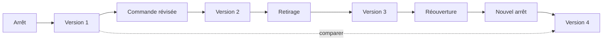

# Les versions du plan de production — plan

> 📝 **Plan à bâtir**, écrit le 2026-11-27 à la demande de Hugo, contredit
> deux fois par vitruve le même jour (§ 8). Rien de ce qui suit n'est
> construit, sauf ce que le § 0 décrit comme existant.

## En bref

Chaque fois que le plan de production d'une journée **change après son
arrêt** — l'arrêt, un retirage, une commande révisée, une commande annulée,
un réassort lancé, un nouvel arrêt après réouverture — on garde une **version**
en données : les commandes, leurs lignes, le compte à produire, qui et quand,
et pourquoi chaque commande est là. Chaque version a **son papier** (PDF),
rangé dès qu'il a pu être fabriqué fidèlement.

Le Prod manager voit la **liste des versions** de la journée, rouvre le papier
de chacune, et **compare deux versions** : d'abord l'effet sur la production
(produit par produit), puis chaque changement **expliqué** — « hors plan,
intégrée au retirage de 19 h 10 », « révisée : croissant 10 → 15 »,
« annulée après l'arrêt, toujours produite ».

La donnée est la trace et elle existe pour chaque version. Le papier vient
en plus, et l'écran dit quand il manque.

---

## 0. Ce qui existe (ouvert le 2026-11-27)

### Le papier

- La clé du dossier (`dayDossierPdfKey`, `plan/domain/services/day-dossier-pdf.ts`)
  et celle du compte à produire (`productionCountPdfKey`,
  `shared/print/domain/services/atelier-sheet-pdf.ts`) portent l'instant de
  l'arrêt et du dernier retirage (`printRunStamp`, même fichier que le compte)
  depuis `1ef18c73e`.
- Le papier n'est fabriqué qu'**à la lecture**, depuis la journée COURANTE,
  et rangé par `ProductionPaperArchive.storedOr` seulement s'il est
  `archivable` (bons de livraison, rayons, tranches, postes, fiches de
  fonction ont répondu). Trois lecteurs : `get-day-dossier-pdf.handler.ts`,
  `get-production-count-pdf.handler.ts`, `dossier-dispatch.service.ts`.
- Une révision ou un réassort lancé change le plan sans changer la clé : le
  premier lecteur range alors l'état révisé sous la clé du tirage d'avant.
- Rien ne liste les papiers rangés.

### Le plan figé et ce qui le change

- La réouverture (`ProductionDay.reopen`) efface le plan figé, l'arrêt, le
  retirage et le compteur. Le papier imprime « tirage `retakeCount + 1` ».
- Les gestes qui changent un plan figé :

  | geste                                                                                                                                                                                                                         | où il écrit                                                                             | auteur                                                                                                                              |
  | ----------------------------------------------------------------------------------------------------------------------------------------------------------------------------------------------------------------------------- | --------------------------------------------------------------------------------------- | ----------------------------------------------------------------------------------------------------------------------------------- |
  | arrêt manuel et automatique (le tour repasse par `CloseProductionDayCommand(day, "automatic")`)                                                                                                                               | `plan/…/plan-arrest-recording.ts`                                                       | `current.closedBy` — `PlanSigner`, `name` nullable ; nul pour l'automatique                                                         |
  | retirage — n'**ajoute** que (`planValue.absorbed`), en écartant les retirées                                                                                                                                                  | `plan/…/retake-recording.ts`                                                            | `staffUserId`, `byName`                                                                                                             |
  | commande révisée — ne baisse jamais le compte du jour (`reviseOrder`)                                                                                                                                                         | `day/…/production-order-revision.desk.ts`                                               | à lire en H1                                                                                                                        |
  | réassort lancé, qui arrête la journée ou non                                                                                                                                                                                  | `resupply/…/resupply-launch-recording.ts`                                               | `gesture`                                                                                                                           |
  | commande annulée après l'arrêt — **ne retire pas** la commande du plan figé, ne change **ni le compte ni les fournées** : elle est inscrite au registre des retraits (`OrderWithdrawalLedger`) et le colisage libère ses bacs | `day/…/production-order-withdrawal.desk.ts` (ne fait ni `load` ni `save` de la journée) | **ne traverse pas le port** : le commerce a `intent.actor`, `OrderWithdrawalDesk.withdraw(day, orderId, allowance)` ne le passe pas |

  La ré-annonce d'une journée déjà arrêtée n'écrit rien. Une annulation
  d'une commande prise sur la vitrine ne passe pas par le guichet et ne
  touche pas le plan.

- Le plan est indexé par `(service_day, order_id, rank)` : une commande peut
  y figurer par plusieurs envois.

### Ce qui sort d'un plan d'une version à l'autre sans passer par le registre

- À la réouverture, le commerce ne remet en `placed` que les commandes
  confirmées à l'instant de l'arrêt défait, ni prêtes, ni avec un manque
  décidé (`prisma-order-plan-release.ts`). Les autres restent `confirmed`, et
  le nouvel arrêt, qui ne lit que `placed` (`STATUS_IN_PLAN`), ne les reprend
  pas — volontairement pour un manque décidé.
- Cette remise passe par un **abonné durable** qui ne fait rien si la journée
  est de nouveau arrêtée quand il reçoit le fait
  (`on-production-day-reopened.handler.ts`). Un nouvel arrêt fait avant que
  l'abonné ait tout traité laisse des commandes hors de tout plan : c'est la
  cause du 8 → 7 du 2026-11-27 (§ 5).
- Pendant la réouverture, une commande peut aussi sortir légitimement :
  paiement refusé ou remboursé (`settlementWhere`), passage à la vitrine
  (`notFromStock`), date changée par le client.

Le fournil ne connaît aucune de ces raisons : elles sont au commerce.

### Ce que le fournil sait d'une commande

`ProducibleOrder` (`channels/commerce/day-orders.reader.ts`, implémenté par
`PrismaDayOrdersSource`) ne porte pas « hors plan ». Le commerce le sait
(`placedOffPlan`, posé par `Order.receiveOffPlan`, staff seulement,
définitif). Une commande absorbée par un retirage reste `placed` au
commerce : aucun abonné n'écoute le retirage (le commentaire contraire de
`prisma-admin-order-list.reader.ts`, « le retirage la passe `confirmed` »,
est faux — à corriger au premier passage).

## 1. Ce qu'on décide

### La version

1. **Une version = une ligne**, écrite dans la **même transaction** et sous
   le **même verrou** que le geste.
2. **Propriétaire : le noyau `day/`**, seul sous-contexte que `plan/`,
   `resupply/` et `day/` peuvent atteindre (`ALLOWED`,
   `dev-toolbox/gates/lib/production-subcontexts-graph.mjs`). Le port est
   rangé dans `day/index.ts`.
3. **Construite par une fonction du domaine qui reçoit la version
   précédente** : `PlanVersion.next(previous, snapshot, cause, withdrawn, by)`.
   C'est elle qui déduit pourquoi chaque commande est là (§ 1.6) : l'agrégat
   ne le sait pas, et l'apprendre à `production_order` coûterait une colonne
   pour une information que la version précédente donne.
4. **Ajout seul, par discipline** : le port n'a ni `update` ni `delete`
   (seul `paper_key` se remplit, une fois, § 1.9). Rien d'autre ne le tient.
5. **Une version n'est écrite que si le plan change** : une annulation d'une
   commande absente du plan, une ré-annonce, n'en écrivent pas.

### Le contenu

6. **Par envoi `(orderId, rank)`** : référence, client (libellé seul),
   acheminement, échéance, lignes, `offPlan` (§ 1.7), et `entry`, déduit en
   comparant à la version précédente :
   - `arrested` — présente au premier arrêt de la journée ;
   - `retaken` — entrée par un retirage ;
   - `arrested_after_reopen` — refigée par l'arrêt qui suit une réouverture ;
   - `unchanged` — déjà là à la version précédente.

   Un envoi entré par un retirage avec `offPlan = true` se dit « hors plan,
   intégrée au retirage ». Après une réouverture, `entry` l'emporte sur
   `offPlan` dans la phrase : « refigée après réouverture (reçue hors plan) ».

7. **`offPlan: boolean | null`** sur la commande figée : `null` pour les
   commandes figées avant la colonne — on ne savait pas, on n'invente pas
   `false`.
8. **Le compte à produire est celui de la journée (`counts`)**, recopié tel
   quel. Les **retirées** sont gardées à part (`withdrawn` : envoi, instant,
   auteur), lues au registre par l'écrivain sous le verrou, parce que le
   nouvel arrêt les écarte et que le diff doit encore pouvoir les nommer. Pas
   de `sheetDetails` ni de `destination` complète (données personnelles,
   inutiles au diff), pas de fournées ni de marques de colisage.
   `content_version` versionne la forme.

### Le papier

9. **La clé du papier est celle de la version** :
   `<jour>/dossier-du-jour-<mise en page>-version-<n>.pdf` (de même pour le
   compte à produire). Elle remplace la clé par tirage de `1ef18c73e`.
   Chaque lecteur (les trois du § 0) range sous la clé de la **version
   courante** : la journée qu'il lit EST cette version, le papier est donc
   fidèle, révision comprise. Une version dépassée n'est plus jamais rangée.
   Le premier qui range remplit `paper_key`.
10. **Rangé au geste** : après le `COMMIT` d'un geste qui écrit une version
    (`AfterCommit`, hors transaction, `network-outside-transaction`), on
    demande le papier. S'il n'est pas `archivable`, la **reprise est la
    lecture suivante** (§ 1.9) — pas de tour de cron : le tour d'arrêt
    automatique est « une tentative, pas une boucle » et ne traite que deux
    jours. Si une autre version arrive avant, l'écran dit « papier non rangé
    (lectures incomplètes) ».
11. **Le papier dit sa version** : « Version n · tirage m », en en-tête.
    `print_run` reste le « tirage m » imprimé ; `version` fait foi dans la
    liste.

### Le diff

12. **Calculé à la lecture par une fonction pure** (`diffPlanVersions`), qui
    ne reçoit que les versions : tout ce dont elle a besoin est dans leur
    contenu (§ 1.6 à 1.8).
13. **L'effet sur la production d'abord**, lu sur `counts` — le chiffre du
    fournil, pas un recalcul sur les lignes : une annulation après l'arrêt
    ne baisse pas le compte, une révision ne le baisse jamais. Une retirée
    s'affiche « annulée après l'arrêt — toujours produite ».
14. **Chaque changement avec sa raison**, par envoi : entrée (`entry`,
    `offPlan`), lignes changées par une révision (version `order_revised`),
    retirée (`withdrawn`), réassort lancé.
15. **Une sortie dont le fournil ne connaît pas la raison est dite sans
    accuser** : « sortie du plan — raison au commerce » (paiement, vitrine,
    date, manque décidé, remise pas encore faite), **en orange**, pas en
    rouge. Le fournil ne peut pas distinguer une sortie voulue d'une perte ;
    le rouge pour toutes serait faux et vite ignoré. La perte réelle, la
    course du § 0, se corrige à la source (§ 5).
16. **Les changements faits pendant une réouverture** (commande `placed`
    modifiée par le client, puis refigée) n'ont pas de version
    `order_revised` : le diff les dit « modifiée pendant la réouverture ».
17. **Comparer deux versions éloignées enchaîne** les explications des
    versions intermédiaires.

## 2. Les tables — schéma `production`

`production.plan_versions` (migration additive) :

| colonne            | type         | sens                                                                                                              |
| ------------------ | ------------ | ----------------------------------------------------------------------------------------------------------------- |
| `id`               | text (ULID)  | `IdGenerator`                                                                                                     |
| `service_day`      | text         |                                                                                                                   |
| `version`          | int          | unique avec `service_day`, attribué sous le verrou                                                                |
| `cause`            | text + CHECK | `closed`, `auto_closed`, `retaken`, `order_revised`, `order_withdrawn`, `resupply_launched`, `opened_by_resupply` |
| `recorded_at`      | timestamptz  | `Clock`                                                                                                           |
| `recorded_by_id`   | text null    | nul pour l'arrêt automatique                                                                                      |
| `recorded_by_name` | text null    | peut être nul même pour un humain                                                                                 |
| `closed_at`        | timestamptz  | l'arrêt auquel elle appartient                                                                                    |
| `print_run`        | int          | le « tirage m » du papier                                                                                         |
| `paper_key`        | text null    | rempli une fois, au premier rangement                                                                             |
| `content_version`  | int          |                                                                                                                   |
| `content`          | jsonb        | § 1.6 à 1.8                                                                                                       |

`production.production_order` gagne `off_plan boolean NULL` (§ 1.7).

Portes : `lint:prisma-model-ownership`, `lint:production-subcontexts`
(modèle à `dev-toolbox/gates/production-subcontexts.map.json`, propriétaire
`day`), `schema-drift`. `recorded_by_name` entre au registre
`documentation/legal/rgpd-registre.json` (`lint:rgpd-staff`). Le libellé
client de `content` n'est tenu par **aucune porte** : décision écrite ici et
à Q1. `context-version-columns` ne s'applique pas (elle ne lit que les tables
de l'instantané du catalogue).

## 3. Les lots

**H0 — « hors plan » jusqu'au fournil.** `offPlan: boolean | null` sur
`ProducibleOrder` (13 fichiers hors tests, et les faux du port), rempli par
`PrismaDayOrdersSource` depuis `placedOffPlan` ; la colonne `off_plan` de
`production_order`, `production-day.row.ts` et
`production-day-children.writer.ts`. Corriger le commentaire faux de
`prisma-admin-order-list.reader.ts`.

**H1 — garder les versions.** Le port, l'adaptateur et `PlanVersion.next`
dans `day/` ; les écrivains : arrêt, retirage, révision, réassort lancé
(après `days.save`), et le guichet du retrait, qui doit **charger** la
journée sous son verrou, lire le registre, et recevoir l'auteur —
`OrderWithdrawalDesk.withdraw` prend l'acteur, que
`order-workshop-withdrawal.ts` lui passe. Tests : domaine (`entry`, `offPlan`,
retirées, rangs), application (chaque geste écrit une version, ceux du § 1.5
n'en écrivent pas), e2e (arrêt → révision → annulation → retirage →
réouverture → arrêt).

**H2 — le papier par version.** La clé par version (§ 1.9) pour le dossier et
le compte, les trois lecteurs rangent sous la version courante et
remplissent `paper_key`, la demande `AfterCommit`, l'en-tête « Version n ».
Tests : rangé au geste, non rangé puis rangé à la lecture, version dépassée
jamais rangée, révision rangée sous sa propre version.

**H3 — comparer et expliquer.** `diffPlanVersions` (§ 1.12 à 1.17), tests
unitaires exhaustifs, dont le cas du 2026-11-27 rejoué.

**H4 — lire.** La liste des versions et la comparaison, deux requêtes et
leurs routes sous le contrôleur de la journée ; droit de lecture du dossier.

**H5 — l'écran.** Dans `prod-manager` : « Versions du plan » — liste (cause,
qui, quand, papier rangé ou non), comparer deux versions (par défaut la
courante contre la précédente) : l'effet par produit en tête, les sorties
inexpliquées en orange, puis les changements expliqués. fold-ng d'abord.

## 4. Ce que ce plan ne fait pas

- Il ne reconstruit ni versions ni papiers d'avant H1.
- Il ne refait jamais un papier ancien.
- Il ne dit pas au fournil POURQUOI le commerce a sorti une commande : il dit
  qu'elle est sortie et que la raison est au commerce.

## 5. À corriger à part : la course de la réouverture

Le nouvel arrêt ne doit pas pouvoir passer avant que la remise du commerce
soit faite. Deux pistes, pour le chantier de la fluidité de la réouverture
que Hugo veut repenser : remettre les commandes en `placed` dans la
transaction de la réouverture (un port du commerce appelé par le fournil,
comme les lectures sous verrou), ou faire attendre l'arrêt tant que l'abonné
n'a pas traité la dernière réouverture. C'est ce qui a produit 8 → 7, puis 9
au tour suivant, le 2026-11-27 ; ce plan le rend visible, il ne le corrige
pas.

## 6. Vérifications avant de bâtir

- La révision (`production-order-revision.desk.ts`) : où est son auteur.
- Que la réouverture refuse une journée avec des commandes prêtes ou des
  manques décidés (`assertReopenable` ne lit que fournées, colisage, départ).
- Qu'aucun reliquat n'inscrit encore de rang supérieur à 1 au plan.
- La taille de `content` sur la journée la plus chargée.

## 7. Questions pour Hugo

- **Q1** — durée de conservation des versions (libellés clients, noms du
  staff) : la même que les papiers rangés, ou une borne ?
- **Q2** — l'envoi du dossier par e-mail doit-il noter la version envoyée à
  chaque destinataire ?

## 8. Ce que vitruve a contredit (2026-11-27)

**Première lecture** — un tirage n'a pas toujours de papier (la donnée
devient la trace) ; `resupply/` ne peut pas écrire dans `plan/` (propriétaire
`day/`) ; révision et réassort lancé changent le plan sans tirage (ce sont
des versions) ; deux numérotations (`version`, `print_run`) ; contenu limité ;
auteurs nullables ; ajout seul par discipline.

**Seconde lecture, sur le diff expliqué** :

- **Bloquant** — l'« anomalie en rouge » avait des causes légitimes au
  commerce que le fournil ne voit pas : orange, sans accuser (§ 1.15), et la
  course corrigée à la source (§ 5).
- **Bloquant** — les retirées disparaissent du contenu après un nouvel arrêt :
  gardées à part (`withdrawn`, § 1.8).
- **Bloquant** — l'agrégat ne sait pas pourquoi une commande est là : `entry`
  déduit de la version précédente (§ 1.3, § 1.6) ; le guichet du retrait
  doit charger la journée et recevoir l'auteur (H1).
- **Bloquant** — ranger « à la prochaine lecture » sous la clé du tirage
  rangeait un état révisé sous une ancienne clé : clé par version (§ 1.9).
- **Sérieux** — « à produire » lu sur `counts`, jamais recalculé (§ 1.13) ;
  ordre `entry` / `offPlan` écrit (§ 1.6) ; modifiée pendant la réouverture
  (§ 1.16) ; H0 chiffré, `offPlan` nullable (§ 1.7) ; pas de reprise par le
  cron (§ 1.10) ; auteur du retrait à faire passer par le port (H1).
- **Mineur** — diff par envoi `(orderId, rank)` ; pas de version sans
  changement (§ 1.5) ; commentaire faux à corriger (H0).
