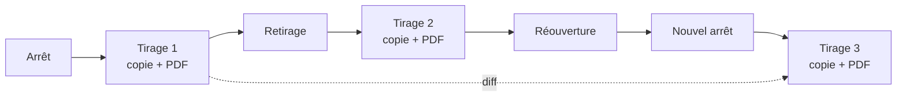

# L'historique des tirages du plan — plan

> 📝 **Plan à bâtir**, écrit le 2026-11-27 à la demande de Hugo. Rien de ce
> qui suit n'est construit, sauf ce que le § 0 décrit comme existant.

## En bref

Chaque fois que le plan de production d'une journée est **figé** (arrêt,
retirage, réouverture puis nouvel arrêt), on garde une **copie en données** de
ce qui est parti au fournil : les commandes, leurs lignes, le compte à
produire, qui et quand. Le Prod manager voit la **liste des tirages** de la
journée, rouvre le PDF de chacun, et **compare deux tirages** à l'écran :
commandes entrées, sorties, quantités qui ont changé.

Ce qu'on gagne : la trace de ce que le fournil a reçu, et la réponse
immédiate à « pourquoi j'ai 7 commandes alors que j'en avais 8 ? ».

---

## 0. Ce qui existe (ouvert le 2026-11-27)

- **Le PDF de chaque tirage est rangé** depuis `1ef18c73e` : la clé du
  dossier et celle du compte à produire portent l'instant de l'arrêt et du
  dernier retirage (`dayDossierPdfKey`, `productionCountPdfKey`,
  `printRunStamp` dans `production/shared/print/`). Avant ce commit, un
  nouvel arrêt après réouverture resservait l'ancien dossier.
- **Rien ne liste ces PDF** : `ProductionPaperArchive` sait seulement
  `storedOr(slot, make)` — lire une clé connue ou la fabriquer.
- **La réouverture efface le plan figé** : `ProductionDay.reopen`
  (`day/domain/entities/production-day.ts`) remet `closedAt`, le retirage et
  le compteur à zéro et vide le plan (`planValue.cleared()`). Ce qu'il y
  avait au premier arrêt n'existe donc plus en base, seulement dans son PDF.
- **Quatre chemins figent un plan**, et tous passent par trois services
  d'écriture du sous-contexte `plan/` :
  - l'arrêt manuel (`close-production-day.handler.ts`) et l'arrêt
    automatique (`run-auto-close-round.handler.ts`, par le port
    `AutomaticDayCloser`) → `PlanArrestRecording` ;
  - le retirage (`retake-production-day.handler.ts`) → `RetakeRecording` ;
  - le lancement d'un réassort « au plus tôt » sur une journée jamais
    arrêtée, qui l'arrête (`resupply/…/launch-resupply.handler.ts`,
    `ProductionDay.launchResupply`) → `ResupplyLaunchRecording`.
- **Ce que le tirage contient** est déjà une forme sans type Prisma :
  `ProductionDaySnapshot` (`day/domain/entities/production-day.snapshot.ts`)
  — `orders` (référence, client, acheminement, échéance, lignes), `counts`
  (sku, nom, quantité, unité), `resupplies`, `launchedResupplies`, `closedBy`,
  `retaken`.

## 1. Ce qu'on décide

1. **Un tirage = une ligne**, écrite dans la **même transaction** que le geste
   qui fige (arrêt, retirage, lancement qui arrête). Pas d'abonné : un tirage
   enregistré après coup pourrait manquer ou décrire un autre état.
2. **Ajout seul.** Une ligne de tirage ne se modifie ni ne se supprime ; la
   réouverture n'y touche pas. C'est une trace.
3. **Le contenu est la forme du papier, pas celle de la base** : une copie
   versionnée (`content_version`) du cliché réduit à ce que le dossier
   imprime. On ne copie pas les fournées ni les marques de colisage : elles
   n'existent pas au moment du tirage et le diff n'en a pas besoin.
4. **Le diff se calcule à la lecture**, par une fonction pure du domaine
   (deux contenus → différences). Rien de calculé n'est rangé.
5. **Le PDF reste celui de l'archive** : la ligne porte sa clé
   (`dayDossierPdfKey(...)`), l'écran le rouvre par elle. Un tirage antérieur
   à ce chantier n'a pas de ligne ; on n'en reconstruit pas.

## 2. La table — schéma `production`

`production.plan_print_runs` (migration additive, aucune donnée existante
déplacée) :

| colonne           | type             | sens                                                     |
| ----------------- | ---------------- | -------------------------------------------------------- |
| `id`              | text (ULID)      | `IdGenerator`                                            |
| `service_day`     | text             | la journée, comme ailleurs dans le schéma                |
| `run_number`      | int              | 1, 2, 3… dans la journée, unique avec `service_day`      |
| `cause`           | text + CHECK     | `closed`, `auto_closed`, `retaken`, `opened_by_resupply` |
| `drawn_at`        | timestamptz      | l'instant du geste (le `Clock`)                          |
| `drawn_by_id`     | text null        | le staff, `null` pour l'arrêt automatique                |
| `drawn_by_name`   | text null        | le nom figé, comme `retakenByName`                       |
| `closed_at`       | timestamptz      | l'arrêt auquel il appartient — sert la clé du PDF        |
| `retaken_at`      | timestamptz null | idem                                                     |
| `content_version` | int              | la forme de `content`                                    |
| `content`         | jsonb            | commandes, lignes, compte, réassorts (cf. § 1.3)         |

`run_number` est attribué sous le verrou de la journée que les quatre gestes
prennent déjà : pas de course entre deux tirages d'une même journée.

Propriétaire : le sous-contexte `plan/` ; `lint:prisma-model-ownership` et
`lint:production-subcontexts` le tiendront. Données personnelles :
`content` porte le libellé client (`customerLabel`) et l'adresse
d'acheminement, et `drawn_by_name` un nom du staff → **entrées au registre
`documentation/legal/rgpd-registre.json`** (`lint:rgpd-staff`), durée de
conservation à décider par Hugo (cf. § 6).

## 3. Les lots

**H1 — enregistrer.** Le port `PlanPrintRuns` (`append(run)`, lecture par
journée) et son adaptateur Prisma ; un `PlanPrintRun.draw(day, cause, at, by)`
du domaine qui construit le contenu depuis `toSnapshot()` ; les trois
services d'écriture l'appellent après `days.save`. Tests : domaine (contenu,
numéro), application (chaque chemin écrit une ligne, la réouverture n'en
écrit pas), e2e (arrêt → retirage → réouverture → arrêt donne 3 lignes et
3 PDF distincts).

**H2 — comparer.** `diffPrintRuns(a, b)` pur : commandes ajoutées,
retirées, lignes changées (par commande et sku), compte à produire par sku
(avant, après, écart), réassorts entrés ou sortis. Tests unitaires
exhaustifs, poids et pièces compris.

**H3 — lire.** Deux requêtes nommées et leurs routes sous le contrôleur de
la journée : la liste des tirages d'une journée (numéro, cause, quand, qui,
nombre de commandes) et la comparaison de deux tirages. Droit : celui qui
lit déjà le dossier du jour.

**H4 — l'écran.** Dans `prod-manager` du back-office : un panneau
« Tirages » sur la journée (liste, ouvrir le PDF, cocher deux tirages →
comparer), fold-ng d'abord. Par défaut, la comparaison propose le tirage
courant contre le précédent.

## 4. Ce que ce plan ne fait pas

- Il ne corrige pas **la commande sortie du plan à la réouverture** (une
  commande restée `confirmed` que le nouvel arrêt ne relit pas). Le diff la
  rendra visible ; la corriger est un chantier à part, avec la fluidité de la
  réouverture que Hugo veut repenser.
- Il ne liste pas les PDF déjà archivés avant H1.

## 5. Vérifications avant de bâtir

- Relire les trois services d'écriture : chacun a-t-il bien la journée
  verrouillée et le `staffUserId` sous la main ? (Non ouvert en détail le
  2026-11-27.)
- Taille de `content` : un dossier de la journée la plus chargée en dev,
  mesuré, avant de choisir de tout copier.

## 6. Questions pour Hugo

- **Q1** — durée de conservation des tirages (registre RGPD) : la même que
  les PDF archivés, ou une borne ?
- **Q2** — les envois de dossier par e-mail (`dossier-dispatch.service.ts`)
  doivent-ils pointer le tirage envoyé, pour savoir lequel chaque
  destinataire a reçu ?
