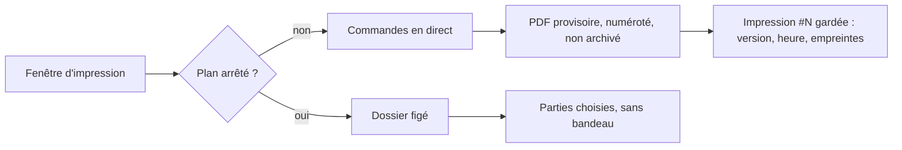

# Plan — imprimer le dossier en provisoire, partie par partie

> 📝 **Plan, rien n'est bâti.** Demandé par Hugo le 2026-11-24 : « imprimer le
> dossier de prod de manière temporaire tout au long de la journée », par une
> fenêtre qui demande quelle partie imprimer. Décisions de Hugo le même jour :
> provisoire avant l'arrêt, quatre façons de choisir, et chaque page porte
> **« Provisoire <date> #<compteur> <hh:mm> »**, où le compteur est le numéro
> d'impression provisoire de la journée.
>
> Le dossier figé à l'arrêt ([`dossier-prod-du-jour.md`](dossier-prod-du-jour.md))
> ne change pas.

## En bref

Aujourd'hui, le dossier ne s'imprime qu'une fois le plan **arrêté**, et
toujours en entier. Pendant la journée, le fournil a besoin de papier plus tôt
et par morceaux.

Le bouton « Imprimer le dossier » ouvre désormais une **fenêtre** :

```
┌ Imprimer le dossier du jeu. 26 nov. ─────────────────────┐
│ ⚠ La journée a changé depuis l'impression #3 (10:42)     │
│                                                          │
│ Parties    ☑ Couverture   ☑ Totaux par rayon             │
│            ☑ Calendriers  ☑ Fiches de commande  ☑ BL     │
│            ☑ Fiches de réassort                          │
│ Rayons     ☑ Tous  ☐ Viennoiseries ☐ Pains …  (ou postes)│
│ Commandes  ◉ Toutes                                      │
│            ○ Nouvelles ou modifiées depuis [#3 ▾]        │
│            ○ Choisies : ☐ ORD-0142 ☐ ORD-0143 …          │
│                                                          │
│                      [Annuler]  [Imprimer en provisoire] │
└──────────────────────────────────────────────────────────┘
```

- **Avant l'arrêt**, le PDF est tiré des commandes **en direct**. Chaque page
  porte en en-tête **« Provisoire 26/11 #4 11:15 »**. Ce PDF n'est **ni
  archivé, ni envoyé par e-mail** : ce n'est pas le papier officiel.
- **Après l'arrêt**, la même fenêtre sert à réimprimer **des parties du
  dossier figé**, sans bandeau « Provisoire » et sans nouveau numéro. Le PDF
  complet archivé reste celui de l'arrêt.
- **« La journée a changé »** s'affiche quand des commandes ont bougé depuis
  la dernière impression provisoire. Le fournil sait alors qu'il doit
  réimprimer.
- **« Nouvelles ou modifiées depuis #3 »** n'imprime que les fiches des
  commandes absentes de l'impression #3, ou dont le contenu a changé depuis.



## Partie technique

### 1. Ce qui existe, et qu'on réutilise (vérifié le 2026-11-24)

| Brique                                                                                  | Où                                                                                                                       |
| --------------------------------------------------------------------------------------- | ------------------------------------------------------------------------------------------------------------------------ |
| Le PDF figé, refusé tant que la journée n'est pas arrêtée                               | `plan/application/queries/get-day-dossier-pdf.handler.ts`, `GET /admin/production/batch/:date/dossier.pdf`               |
| Le montage et le rendu, purs, qui prennent des commandes en paramètre                   | `dayDossierFrom` (`plan/domain/services/day-dossier.ts`), `renderDayDossierPdf` (`day-dossier-pdf.ts`)                   |
| Les entrées du rendu : rayons ou postes, couleurs, QR, BL, tranches, logo               | `ProductionPaperRenderer.dossierInputsOf` (`plan/application/services/production-paper.service.ts`)                      |
| Les commandes et réassorts **en direct**, déjà lus avant l'arrêt par la fiche d'atelier | `DayOrdersReader.producibleFor`, `DayResuppliesReader.placedFor` (`production/channels/commerce/`)                       |
| La version d'une journée du commerce, opaque et croissante                              | `public.day_change`, lue par `PrismaCommerceDayVersionReader` (`lafoliecoffee/orders/infrastructure/`) pour la livraison |
| Le bouton actuel                                                                        | `lfd-backoffice-frontend/…/previsionnel/dossier-du-jour/dossier-du-jour.html`                                            |

Le rendu prend déjà des commandes **en paramètre** : la simulation et
l'exemple du dossier le font sans journée arrêtée
(`get-day-dossier-specimen.handler.ts`). Le provisoire est un troisième
appelant du même rendu, pas un second dessin.

### 2. Le numéro et la version — table `production.provisional_print`

Une ligne par impression provisoire. Migration **additive** (une table
neuve, aucune donnée existante touchée).

| Colonne              | Rôle                                                                 |
| -------------------- | -------------------------------------------------------------------- |
| `id`                 | ULID (`IdGenerator`)                                                 |
| `service_day`        | `AAAA-MM-JJ`                                                         |
| `run`                | le `#` : 1, 2, 3… par journée, `UNIQUE (service_day, run)`           |
| `commerce_version`   | la version `public.day_change` lue au tirage                         |
| `printed_at`         | l'instant (`Clock`) — l'`hh:mm` du bandeau, à l'heure de Paris       |
| `printed_by`         | l'id de la fiche staff (jamais le `sub`, cf. `lint:subject-readers`) |
| `order_fingerprints` | `jsonb` : `{ orderId: empreinte }` des commandes **imprimées**       |
| `parts`              | `jsonb` : ce qui a été coché, pour le relire dans la fenêtre         |

- **Le numéro** se tire sous le verrou de la journée, ou par
  `max(run) + 1` avec la contrainte d'unicité et un rejeu sur conflit. Un
  numéro sauté n'est pas grave ; deux impressions sous le même numéro le
  seraient.
- **L'empreinte** d'une commande est un hachage de ce qui s'imprime sur sa
  fiche : les lignes (SKU, quantité, unité), la fenêtre, l'adresse, la note.
  « Modifiée depuis #3 » = empreinte différente de celle gardée en #3.
  `ProducibleOrder` ne porte **aucun horodatage** (vérifié le 2026-11-24) :
  l'empreinte évite d'en ajouter un au canal, et de dépendre d'une horloge.
- **Rétention** : les lignes des journées passées se balaient comme
  `day_change` (`prune-production-day-changes`), le fil de la journée n'ayant
  plus d'usage une fois le jour passé.
- `lint:rgpd-staff` : `printed_by` porte un id staff, à inscrire au registre.

### 3. La version du commerce vue par le fournil

Le fournil ne lit pas `public.day_change`. Il **déclare**
`CommerceDayVersionReader` dans `production/channels/commerce/` (un port à
lui, ISP), et le commerce l'implémente avec **la même requête** que celle
qu'il sert déjà à la livraison. `appBootstrap` relie. Aucune case de la
matrice ne change : `lafoliecoffee → production : port uniquement`.

### 4. Les routes

| Route                                                                     | Ce qu'elle fait                                                                                                                                                   |
| ------------------------------------------------------------------------- | ----------------------------------------------------------------------------------------------------------------------------------------------------------------- |
| `GET /admin/production/batch/:date/print-options`                         | l'état de la fenêtre : arrêté ou non, rayons ou postes du jour, commandes (référence, client), impressions de la journée (`#`, heure, auteur), `changedSinceLast` |
| `POST /admin/production/batch/:date/provisional-print`                    | tire le PDF provisoire pour une sélection, **écrit la ligne** `provisional_print`, rend le PDF                                                                    |
| `GET /admin/production/batch/:date/dossier.pdf?parts=…&groups=…&orders=…` | après l'arrêt : les parties choisies du dossier figé, sans archivage du sous-ensemble                                                                             |

- Le `POST` est une **écriture** (il consomme un numéro) : il porte
  `@IntentKey()` et scelle son intention (`lint:write-idempotence`), et le
  front passe la clé d'une `GestureIntents` (`lint:front-intent-keys`). Un
  double clic ne tire pas deux numéros.
- CQRS (tranché le 2026-11-24) : la commande tire le PDF, le **range au
  stockage** (`<jour>/provisoire-<run>.pdf`, même stockage que le papier
  archivé) et rend l'identifiant de l'impression ; une requête le sert
  (`GET …/provisional-print/:id.pdf`). Le PDF ne se refait pas depuis les
  commandes en direct : il donnerait un autre contenu que les empreintes
  gardées. Ces fichiers ne sont pas le papier officiel ; ils partent avec le
  balayage des lignes de la journée.
- Avant l'arrêt, le `GET dossier.pdf` reste refusé comme aujourd'hui.

### 5. La sélection dans le rendu

`renderDayDossierPdf` reçoit une **sélection** :
`{ parts: Set<"cover" | "recap" | "calendar" | "orders" | "deliveryNotes" | "resupplies">, groups: Set<string> | "all", orders: Set<string> | "all" }`.

- Les commandes se filtrent **avant** `dayDossierFrom` quand on choisit des
  commandes : la couverture et les totaux disent alors « sélection : 3
  commandes », jamais le total du jour présenté comme tel.
- Les rayons ou postes se filtrent **après** le montage, sur les pages
  « total à produire » et « par tranche horaire ».
- Le folio « x/N » compte les pages **du fichier tiré** : une feuille
  manquante se voit toujours.
- Le bandeau : `stamp` gagne `provisional: { run, printedAt } | null` ; le
  pied « Arrêté par … » devient « Provisoire — plan non arrêté ».
- `DOSSIER_LAYOUT_VERSION` monte (le dossier figé change de code, pas de
  rendu : à vérifier qu'aucune page figée ne bouge, par le spec du rendu et la
  planche `lint:pdf-specimens`). Le provisoire a son exemple sur la planche.

### 6. Le front

`dossier-du-jour` : le bouton ouvre une `fold-dialog` (fold-ng d'abord,
tokens fold). La fenêtre lit `print-options`, coche tout par défaut, et
propose « depuis #N » sur la dernière impression. Le PDF s'ouvre dans un
nouvel onglet, comme aujourd'hui. Un poste sans impression n'a pas l'option
« nouvelles ou modifiées ».

### 7. Lots

| Lot | Contenu                                                                                   |
| --- | ----------------------------------------------------------------------------------------- |
| P1  | sélection dans le rendu (§5) + parties du dossier figé après l'arrêt — aucun schéma       |
| P2  | table `provisional_print`, port `CommerceDayVersionReader`, empreintes, `POST` provisoire |
| P3  | `print-options` et la fenêtre du back-office                                              |
| P4  | doc d'état : ce plan fondu dans `dossier-prod-du-jour.md`, puis retiré                    |

P1 est utile seul : il donne la fenêtre après l'arrêt.

### 8. Ce qui n'est pas vérifié

- Où la conversion `ProducibleOrder` → `ProductionOrderSnapshot` vit
  exactement (l'arrêt la fait, via `PlanIntakeReading` puis l'agrégat) : à
  ouvrir en P2 pour la réutiliser, pas la recopier.
- Le coût en lectures d'un tirage provisoire (commandes en direct + BL +
  couleurs) sur la base de production, facturée à l'opération : à mesurer
  après déploiement.
- Le droit qui garde la route : a priori celui du bouton actuel ; à lire
  sur le contrôleur en P2.
