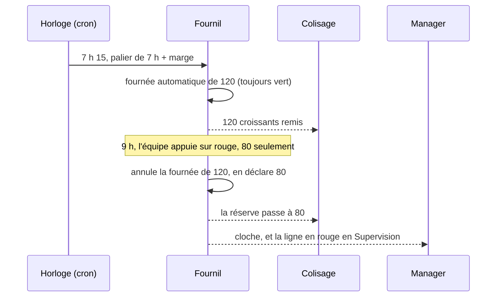

# Plan — les niveaux de suivi du fournil

**État : 📝 plan, rien n'est bâti** (2026-11-17). Il bâtit ce que décide la
réflexion [`reflexion-fiche-simple.md`](reflexion-fiche-simple.md) (décisions
1 à 4 de Hugo, 2026-11-17), pour le **fournil seulement**. Le colisage
simple a sa propre réflexion et viendra après. Le plan touche au manque, donc
à ce qui est facturé : il passe par `vitruve`. Ses affirmations sur l'existant
ont été vérifiées le 2026-11-17 ; celles marquées **à vérifier** ne l'ont pas
été.

---

## 1. En simple

La fiche d'atelier a trois niveaux de suivi :

| Niveau            | Ce que fait l'équipe                                                                           |
| ----------------- | ---------------------------------------------------------------------------------------------- |
| **Toujours vert** | rien : chaque palier est réputé sorti à son heure plus une marge. Seul geste : 🟥 « Problème » |
| **Simple**        | ✅ « Fait » ou 🟥 « Problème » par produit                                                     |
| **Détaillé**      | ce qui existe : fournées, plaques, paliers                                                     |

- **Un niveau pour tout le fournil**, que chaque **poste** peut remplacer
  (la Pâtisserie en détaillé, le reste en toujours vert). Un poste sans
  réglage, ou une ligne sans poste, suit le fournil.
- **Le rouge** demande combien est réellement sorti, et une raison si on
  veut. Il **sonne dans la cloche** de qui a le droit et **reste en rouge dans
  la Supervision** jusqu'à ce qu'un responsable le marque traité.
- **Rien de neuf au cœur du fournil** : « toujours vert », « Fait » et la
  correction sont faits des deux gestes existants, déclarer une fournée et
  l'annuler. Le colisage reçoit ce qui est sorti, comme aujourd'hui.



## 2. Ce qui existe (vérifié le 2026-11-17)

- **Déclarer une fournée** : `RecordBatchCommand`
  (`atelier/application/commands/record-batch.handler.ts`), `PUT
…/worksheet/:date/lines/:sku/batches/:batchId`. L'`id` vient de l'appelant ;
  rejouer la même charge n'écrit rien. La fournée et la remise au colisage
  s'écrivent dans la même unité de travail, et `production.handed_to_packing`
  part au colisage.
- **Annuler une fournée** : `CancelBatchCommand` (`cancel-batch.handler.ts`),
  entière, tracée, refusée si ses pièces sont déjà au bac.
- **« Faite »** se lit sur les seules fournées ([`la-fiche-d-atelier.md`](la-fiche-d-atelier.md)).
- **Les paliers** d'un SKU sont lus par `WorksheetDeadlinesReading`
  (`atelier/application/services/worksheet-deadlines-reading.service.ts`) :
  les besoins datés du commerce (`DueThresholdsReader`) rangés par le réglage
  des tranches (`trancheThresholdsBySku`, `day/`).
- **Un geste lancé par l'horloge** : l'arrêt automatique du plan
  (`plan/http/auto-close.controller.ts`) est appelé par le cron du Worker sous
  `RecomputeGuard`, avec un bail par journée et une clé par cloche, pour qu'un
  second passage ne fasse rien deux fois.
- **La cloche** : `StaffNotifier.notify` (`staff/notifications/domain/ports/staff-notifier.ts`),
  avec une `audience` par droit et une clé d'idempotence. Le fournil l'emploie
  déjà (`plan/application/services/plan-arrest-bell.ts`).
- **La Supervision** a son contrôleur côté fournil
  (`atelier/http/production-supervision.controller.ts`), sous
  `b2b_supervision`.
- **Les postes** vivent dans `production/workstations/`
  ([`les-postes-du-fournil.md`](les-postes-du-fournil.md)).
- **Le manque du colisage** (`PackingSheet.reportShortfall`) porte un écart
  sur une commande, et le manager décide
  ([`../commandes/reliquat/reliquat.md`](../commandes/reliquat/reliquat.md)).

## 3. La conception

### 3.1 Les réglages

- **Le niveau du fournil** et **la marge** (en minutes, 15 par défaut) : un
  réglage unique du métier `atelier/` (`production_tracking_settings`), qui
  porte les gestes de la fiche. Niveau par défaut à l'installation :
  **détaillé**, pour que rien ne change au déploiement ; Hugo bascule à
  l'écran.
- **Le niveau d'un poste** : une colonne nullable
  `production_workstation.tracking_level` dans `workstations/`, posée par un
  geste de la carte des postes (`WorkstationMap.setTrackingLevel`). `null` :
  le poste suit le fournil.
- **La résolution** est une fonction pure : le niveau du poste de la ligne,
  sinon celui du fournil. Elle est servie avec chaque groupe de la fiche
  (`WorkshopGroup.trackingLevel`) ; le front ne la recalcule pas.

### 3.2 « Toujours vert » : la fournée automatique

Une route de cron, comme l'arrêt automatique :
`POST /internal/production/tracking/always-green`, sous `RecomputeGuard`,
appelée chaque minute par le Worker. Pour la journée en cours, et pour chaque
ligne en « toujours vert » :

- pour chaque palier dont **l'heure + la marge** est passée, si ce qui est
  déjà sorti pour cette ligne est inférieur au cumul des paliers échus, elle
  déclare **une fournée ordinaire** de la différence, par `RecordBatchCommand` ;
- l'`id` de la fournée est **déterministe** : `auto-<jour>-<sku>-<palier>`.
  Un second passage rejoue la même charge et n'écrit rien ; deux crons
  concurrents ne doublent rien ;
- l'auteur est le système (`recorded_by` : le compte de service, à nommer
  en P1, **à vérifier** qu'une fournée l'accepte) ;
- une ligne qui a un **problème ouvert** (§ 3.4) n'est plus complétée
  automatiquement : c'est l'équipe ou le manager qui décide.

Un fournil arrêté en détaillé ou en simple n'est jamais touché par le cron.

### 3.3 « Simple » : « Fait »

`POST …/worksheet/:date/lines/:sku/done` : déclare une fournée du **reste à
sortir** de la ligne, par `RecordBatchCommand`, avec la clé d'intention du
geste. Une ligne déjà faite ne fait rien.

### 3.4 Le rouge : « Problème »

`POST …/worksheet/:date/lines/:sku/problem`, corps `{ produced, reason? }`,
par intention (`@IntentKey`, `runSealed`). Le handler, dans une unité de
travail :

1. calcule ce qui est déjà sorti pour la ligne ;
2. si `produced` est **inférieur**, il annule les fournées **automatiques**
   les plus récentes (`CancelBatchCommand`) qui ne sont pas au bac, puis
   déclare une fournée de ce qui manque pour atteindre `produced` ;
3. si des pièces sont **déjà au bac**, il n'annule que la part annulable ;
   l'écart restant est dit dans le problème (« 40 déjà au colisage : le manque
   passe par le colisage ») ;
4. enregistre un **problème** (table `production_problem` du métier
   `atelier/` : jour, SKU, attendu, sorti, raison, auteur, heure,
   `resolved_at`) ;
5. fait sonner la cloche, `audience: b2b_supervision:read`, avec une clé par
   problème.

En « simple », le rouge fait la même chose, sans fournée automatique à
annuler : il déclare ce qui est sorti.

**Ce que le rouge ne fait pas** : il ne touche ni aux commandes ni au bon de
livraison. L'écart déjà au colisage passe par le manque du colisage
(`reportShortfall`), qui existe, et la décision du manager.

### 3.5 La Supervision et la cloche

- La colonne du fournil de la Supervision montre les **problèmes ouverts**
  en rouge (SKU, attendu, sorti, raison, depuis quand), avec « Marquer
  traité » (`resolved_at`, sous `b2b_supervision:write`).
- La notification mène à la ligne de la fiche.

### 3.6 Le front : un `@switch`, pas de signal `mode`

Décidé le 2026-11-17 avec Hugo. La liste de la fiche choisit **une fois**,
sur le niveau servi avec le groupe :

```html
@switch (group.trackingLevel) { @case ('always_green') { <app-line-always-green [line]="line" /> }
@case ('simple') { <app-line-simple [line]="line" /> } @default {
<app-worksheet-line [line]="line" /> } }
```

- Le niveau **détaillé** reste le composant d'aujourd'hui, inchangé.
- Le **panneau rouge** (« Combien est réellement sorti ? ») est un composant
  partagé par « toujours vert » et « simple ».
- Pas de registre injecté (`NgComponentOutlet`) : ses entrées ne seraient
  pas vérifiées par le compilateur AOT. Si les niveaux deviennent un jour
  extensibles, seul ce `@switch` changera.

### 3.7 La page « Niveau de suivi »

**Réglages › Niveau de suivi** : le niveau du fournil et sa marge, puis la
liste des postes avec leur niveau propre (« suit le fournil » par défaut). La
page **rassemble** : chaque réglage s'écrit par la route de son propriétaire
(`atelier/` pour le fournil, `workstations/` pour les postes). L'aperçu de
démonstration (`/reglages/niveau-de-suivi/apercu`) reste à côté.

## 4. Les lots

| Lot    | Contenu                                                                                                                                                         |
| ------ | --------------------------------------------------------------------------------------------------------------------------------------------------------------- |
| **N1** | Migration (réglage du fournil, colonne du poste, table des problèmes) ; la résolution du niveau ; le niveau servi avec chaque groupe ; `lecteur-de-migrations`. |
| **N2** | « Fait » et « Problème » (commandes, intention, cloche) ; la Supervision des problèmes.                                                                         |
| **N3** | La fournée automatique : la route de cron, son bail, l'`id` déterministe, le Worker.                                                                            |
| **N4** | Le front : les deux composants de ligne, le panneau rouge, le `@switch`, la page « Niveau de suivi » (`pablo`).                                                 |
| **N5** | Doc d'état, réflexion et plan retirés.                                                                                                                          |

## 5. Questions

- **Q1** — Le niveau par défaut au déploiement : **détaillé** (proposé, rien ne
  change), ou toujours vert ?
- **Q2** — Qui marque un problème traité : qui a `b2b_supervision:write`
  (proposé), ou seulement un rôle de manager ?
- **Q3** — Le rouge peut-il dire **plus** que prévu (« 130 sortis » sur 120) ?
  Proposé : non en « toujours vert » (le surplus se déclare en détaillé),
  oui en « simple ».
