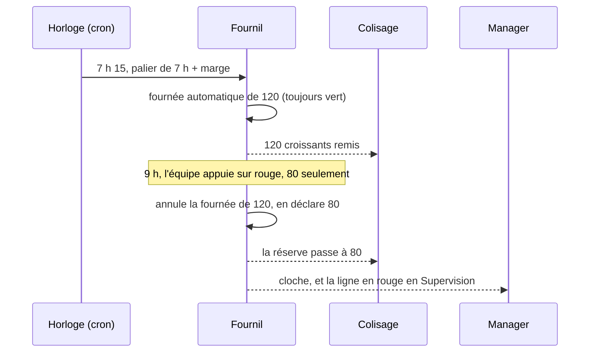

# Plan — les niveaux de suivi du fournil

**État : 📝 plan, rien n'est bâti** (2026-11-17). Il bâtit ce que décide la
réflexion [`reflexion-fiche-simple.md`](reflexion-fiche-simple.md) (décisions
1 à 4 de Hugo, 2026-11-17), pour le **fournil seulement**. Le colisage
simple a sa propre réflexion et viendra après. Le plan touche au manque, donc
à ce qui est facturé : il passe par `vitruve`. Ses affirmations sur l'existant
ont été vérifiées le 2026-11-17 ; celles marquées **à vérifier** ne l'ont pas
été. **La § 6 corrige les §§ 2 à 5 après la première contradiction de `vitruve`,
la § 7 corrige la § 6 après la seconde, la § 10 corrige tout après la
troisième, la § 11 remplace le retour par une correction de déclaration ; la
plus récente prime.**

---

## 1. En simple

La fiche d'atelier a trois niveaux de suivi :

| Niveau            | Ce que fait l'équipe                                                                           |
| ----------------- | ---------------------------------------------------------------------------------------------- |
| **Toujours vert** | rien : chaque palier est réputé sorti à son heure plus une marge. Seul geste : 🟥 « Problème » |
| **Simple**        | ✅ « Fait » ou 🟥 « Problème » par produit                                                     |
| **Détaillé**      | ce qui existe : fournées, plaques, paliers                                                     |

- **Un niveau pour tout le fournil**, que chaque **poste** peut remplacer
  (la Pâtisserie en détaillé, le reste en toujours vert). Un poste sans
  réglage, ou une ligne sans poste, suit le fournil.
- **Le rouge** demande combien est réellement sorti, et une raison si on
  veut. Il **sonne dans la cloche** de qui a le droit et **reste en rouge dans
  la Supervision** jusqu'à ce qu'un responsable le marque traité.
- **Rien de neuf au cœur du fournil** : « toujours vert », « Fait » et la
  correction sont faits des deux gestes existants, déclarer une fournée et
  l'annuler. Le colisage reçoit ce qui est sorti, comme aujourd'hui.



## 2. Ce qui existe (vérifié le 2026-11-17)

- **Déclarer une fournée** : `RecordBatchCommand`
  (`atelier/application/commands/record-batch.handler.ts`), `PUT
…/worksheet/:date/lines/:sku/batches/:batchId`. L'`id` vient de l'appelant ;
  rejouer la même charge n'écrit rien. La fournée et la remise au colisage
  s'écrivent dans la même unité de travail, et `production.handed_to_packing`
  part au colisage.
- **Annuler une fournée** : `CancelBatchCommand` (`cancel-batch.handler.ts`),
  entière, tracée, refusée si ses pièces sont déjà au bac.
- **« Faite »** se lit sur les seules fournées ([`la-fiche-d-atelier.md`](la-fiche-d-atelier.md)).
- **Les paliers** d'un SKU sont lus par `WorksheetDeadlinesReading`
  (`atelier/application/services/worksheet-deadlines-reading.service.ts`) :
  les besoins datés du commerce (`DueThresholdsReader`) rangés par le réglage
  des tranches (`trancheThresholdsBySku`, `day/`).
- **Un geste lancé par l'horloge** : l'arrêt automatique du plan
  (`plan/http/auto-close.controller.ts`) est appelé par le cron du Worker sous
  `RecomputeGuard`, avec un bail par journée et une clé par cloche, pour qu'un
  second passage ne fasse rien deux fois.
- **La cloche** : `StaffNotifier.notify` (`staff/notifications/domain/ports/staff-notifier.ts`),
  avec une `audience` par droit et une clé d'idempotence. Le fournil l'emploie
  déjà (`plan/application/services/plan-arrest-bell.ts`).
- **La Supervision** a son contrôleur côté fournil
  (`atelier/http/production-supervision.controller.ts`), sous
  `b2b_supervision`.
- **Les postes** vivent dans `production/workstations/`
  ([`les-postes-du-fournil.md`](les-postes-du-fournil.md)).
- **Le manque du colisage** (`PackingSheet.reportShortfall`) porte un écart
  sur une commande, et le manager décide
  ([`../commandes/reliquat/reliquat.md`](../commandes/reliquat/reliquat.md)).

## 3. La conception

### 3.1 Les réglages

- **Le niveau du fournil** et **la marge** (en minutes, 15 par défaut) : un
  réglage unique du métier `atelier/` (`production_tracking_settings`), qui
  porte les gestes de la fiche. Niveau par défaut à l'installation :
  **détaillé**, pour que rien ne change au déploiement ; Hugo bascule à
  l'écran.
- **Le niveau d'un poste** : une colonne nullable
  `production_workstation.tracking_level` dans `workstations/`, posée par un
  geste de la carte des postes (`WorkstationMap.setTrackingLevel`). `null` :
  le poste suit le fournil.
- **La résolution** est une fonction pure : le niveau du poste de la ligne,
  sinon celui du fournil. Elle est servie avec chaque groupe de la fiche
  (`WorkshopGroup.trackingLevel`) ; le front ne la recalcule pas.

### 3.2 « Toujours vert » : la fournée automatique

Une route de cron, comme l'arrêt automatique :
`POST /internal/production/tracking/always-green`, sous `RecomputeGuard`,
appelée chaque minute par le Worker. Pour la journée en cours, et pour chaque
ligne en « toujours vert » :

- pour chaque palier dont **l'heure + la marge** est passée, si ce qui est
  déjà sorti pour cette ligne est inférieur au cumul des paliers échus, elle
  déclare **une fournée ordinaire** de la différence, par `RecordBatchCommand` ;
- l'`id` de la fournée est **déterministe** : `auto-<jour>-<sku>-<palier>`.
  Un second passage rejoue la même charge et n'écrit rien ; deux crons
  concurrents ne doublent rien ;
- l'auteur est le système (`recorded_by` : le compte de service, à nommer
  en P1, **à vérifier** qu'une fournée l'accepte) ;
- une ligne qui a un **problème ouvert** (§ 3.4) n'est plus complétée
  automatiquement : c'est l'équipe ou le manager qui décide.

Un fournil arrêté en détaillé ou en simple n'est jamais touché par le cron.

### 3.3 « Simple » : « Fait »

`POST …/worksheet/:date/lines/:sku/done` : déclare une fournée du **reste à
sortir** de la ligne, par `RecordBatchCommand`, avec la clé d'intention du
geste. Une ligne déjà faite ne fait rien.

### 3.4 Le rouge : « Problème »

`POST …/worksheet/:date/lines/:sku/problem`, corps `{ produced, reason? }`,
par intention (`@IntentKey`, `runSealed`). Le handler, dans une unité de
travail :

1. calcule ce qui est déjà sorti pour la ligne ;
2. si `produced` est **inférieur**, il annule les fournées **automatiques**
   les plus récentes (`CancelBatchCommand`) qui ne sont pas au bac, puis
   déclare une fournée de ce qui manque pour atteindre `produced` ;
3. si des pièces sont **déjà au bac**, il n'annule que la part annulable ;
   l'écart restant est dit dans le problème (« 40 déjà au colisage : le manque
   passe par le colisage ») ;
4. enregistre un **problème** (table `production_problem` du métier
   `atelier/` : jour, SKU, attendu, sorti, raison, auteur, heure,
   `resolved_at`) ;
5. fait sonner la cloche, `audience: b2b_supervision:read`, avec une clé par
   problème.

En « simple », le rouge fait la même chose, sans fournée automatique à
annuler : il déclare ce qui est sorti.

**Ce que le rouge ne fait pas** : il ne touche ni aux commandes ni au bon de
livraison. L'écart déjà au colisage passe par le manque du colisage
(`reportShortfall`), qui existe, et la décision du manager.

### 3.5 La Supervision et la cloche

- La colonne du fournil de la Supervision montre les **problèmes ouverts**
  en rouge (SKU, attendu, sorti, raison, depuis quand), avec « Marquer
  traité » (`resolved_at`, sous `b2b_supervision:write`).
- La notification mène à la ligne de la fiche.

### 3.6 Le front : un `@switch`, pas de signal `mode`

Décidé le 2026-11-17 avec Hugo. La liste de la fiche choisit **une fois**,
sur le niveau servi avec le groupe :

```html
@switch (group.trackingLevel) { @case ('always_green') { <app-line-always-green [line]="line" /> }
@case ('simple') { <app-line-simple [line]="line" /> } @default {
<app-worksheet-line [line]="line" /> } }
```

- Le niveau **détaillé** reste le composant d'aujourd'hui, inchangé.
- Le **panneau rouge** (« Combien est réellement sorti ? ») est un composant
  partagé par « toujours vert » et « simple ».
- Pas de registre injecté (`NgComponentOutlet`) : ses entrées ne seraient
  pas vérifiées par le compilateur AOT. Si les niveaux deviennent un jour
  extensibles, seul ce `@switch` changera.

### 3.7 La page « Niveau de suivi »

**Réglages › Niveau de suivi** : le niveau du fournil et sa marge, puis la
liste des postes avec leur niveau propre (« suit le fournil » par défaut). La
page **rassemble** : chaque réglage s'écrit par la route de son propriétaire
(`atelier/` pour le fournil, `workstations/` pour les postes). L'aperçu de
démonstration (`/reglages/niveau-de-suivi/apercu`) reste à côté.

## 4. Les lots

| Lot    | Contenu                                                                                                                                                         |
| ------ | --------------------------------------------------------------------------------------------------------------------------------------------------------------- |
| **N1** | Migration (réglage du fournil, colonne du poste, table des problèmes) ; la résolution du niveau ; le niveau servi avec chaque groupe ; `lecteur-de-migrations`. |
| **N2** | « Fait » et « Problème » (commandes, intention, cloche) ; la Supervision des problèmes.                                                                         |
| **N3** | La fournée automatique : la route de cron, son bail, l'`id` déterministe, le Worker.                                                                            |
| **N4** | Le front : les deux composants de ligne, le panneau rouge, le `@switch`, la page « Niveau de suivi » (`pablo`).                                                 |
| **N5** | Doc d'état, réflexion et plan retirés.                                                                                                                          |

## 5. Questions

- **Q1** — Le niveau par défaut au déploiement : **détaillé** (proposé, rien ne
  change), ou toujours vert ?
- **Q2** — Qui marque un problème traité : qui a `b2b_supervision:write`
  (proposé), ou seulement un rôle de manager ?
- **Q3** — Le rouge peut-il dire **plus** que prévu (« 130 sortis » sur 120) ?
  Proposé : non en « toujours vert » (le surplus se déclare en détaillé),
  oui en « simple ».

---

## 6. Après la contradiction de `vitruve` (2026-11-17) — prime sur les §§ 2 à 5

### Décisions de Hugo

- **Q1 — toujours vert par défaut.** Deux précautions : un changement de
  niveau (du fournil ou d'un poste) **ne prend effet qu'à la journée suivante**,
  jamais au milieu d'une journée déjà commencée ; et la page « Niveau de
  suivi » est **en ligne avant** que la fournée automatique ne s'active (le
  lot N4 de la page passe avant N3).

### Le rouge, refondu sur la demande de retour (bloquant 1)

Le § 2 se trompait. Sur une journée arrêtée, ce qui est le cas de toute
journée réelle (`packing_owner = packing`, `day/domain/entities/production-day.ts`),
**annuler une fournée déjà remise n'annule rien** : `CancelBatchCommand` émet
une **demande de retour** au colisage (`production.return_requested`), et la
réponse du colisage fixe ce qui revient, éventuellement moins que la fournée.
Une fournée automatique est toujours remise dès sa déclaration. Donc :

- **Le rouge pose un plafond** : « pour ce jour et ce SKU, il est sorti
  `produced` ». Il est **persistant** (`production_problem`, un par jour et
  SKU au plus, ouvert ou traité).
- **Si ce qui est sorti dépasse le plafond**, le rouge demande au colisage le
  **retour** des fournées automatiques en trop, par le geste d'annulation
  existant (qui, sur une journée arrêtée, demande le retour). Le colisage
  répond comme aujourd'hui ; sa réponse fixe le « sorti ». Ce qui est déjà
  dans des commandes et ne revient pas passe par le **manque du colisage**.
- **Si ce qui est sorti est en dessous** (cas du simple), le rouge déclare la
  différence par `RecordBatchCommand`.
- **Aucune « part annulable » partielle** n'est inventée : seule la réponse du
  colisage fractionne.
- La cloche sonne **après la validation** (`AfterCommit`), pas dans la
  transaction : un rouge qui échoue ne fait pas vibrer les téléphones.

### La fournée automatique, refondue (bloquants 2, 3 et 4, sérieux)

- **La cible** d'une ligne, à un instant : le **minimum** entre le cumul des
  paliers échus (heure + marge), la **quantité au compte** du jour, et le
  **plafond** d'un rouge s'il y en a un. Le plafond ne disparaît pas quand le
  problème est marqué traité : le cron ne redéclare jamais ce que l'équipe a
  dit manquer.
- **La quantité** déclarée est `cible − sorti`, si elle est positive.
- **L'`id`** est tiré de l'état : `auto-<jour>-<sku>-<cible>-<sorti>`. Deux
  passages sur le même état rejouent la même charge et n'écrivent rien ; un
  état différent donne un autre `id`, donc jamais de `BatchConflictError` en
  boucle.
- **Le tour ne traite que** les journées arrêtées et les SKU au compte, et
  **isole chaque ligne** : une ligne en erreur se journalise, les autres
  continuent, comme le tour de l'arrêt automatique.
- **Une ligne sans palier** (SKU sans tranche, ou besoins du commerce
  illisibles) n'est **pas** complétée automatiquement : elle reste à faire et
  s'affiche « à confirmer » dans la Supervision. **Doute écrit** : un défaut
  plus confortable (compléter au compte à une heure fixe) reste possible, à
  décider à l'usage.
- **La cadence** est celle des crons existants, **toutes les 5 minutes**
  (`apps/lfd-api/wrangler.jsonc`), par une route `admin/production/...`
  appelée par le Worker comme `admin/production/auto-close`, sous
  `RecomputeGuard`. **La journée en cours** est celle que la fiche d'atelier
  choisit déjà au serveur, à l'heure de Paris.
- **L'auteur** des fournées automatiques est un compte de service nommé
  (`system:always-green`) ; le registre RGPD de `production_batch.recorded_by`
  dit « membre du staff, ou le système ».
- Le cron vit dans **`atelier/`**, qui porte déjà les gestes de la fiche et
  lit `workstations/` (arête admise).

### Le reste

- **Le cache de la fiche** (`WorksheetContents`) gagne deux versions dans sa
  clé : celle du réglage de suivi du fournil et celle des problèmes ;
  `setTrackingLevel` (à créer sur `WorkstationMap`) fait monter la version de
  la carte des postes.
- **Les portes** : `production_problem.author` et `resolved_by` au registre
  RGPD ; « Fait », « Problème » et le niveau d'un poste par intention,
  « Marquer traité » aussi, et la route du cron `@Idempotent` ; un **fait
  journalisé** par problème (`production.problem_reported`,
  `production.problem_resolved`), puisqu'il touche à ce qui est facturé.
- **Q3 retirée** : le code accepte déjà un surplus (« une ligne complète n'est
  pas un refus, c'est un surplus ») ; le rouge peut dire plus que prévu, dans
  tous les niveaux.
- **À vérifier en N1** : comment `WorkshopGroup` mêle les postes en mode
  boutique (un groupe-rayon contient des lignes de postes différents) — le
  niveau est alors servi **par ligne**, pas par groupe, et le `@switch` du
  front porte sur la ligne.
- **L'ordre des lots** devient : N1, N2, **N4** (la page et la fiche), puis
  **N3** (le cron), puis N5.

---

## 7. Après la seconde contradiction (2026-11-17) — prime sur la § 6

Les trois bloquants tiennent au même point : corriger **après coup** une
fournée automatique déjà remise. La demande de retour existante rend une
fournée **entière** (`requestReturns`, `atelier/application/services/packing-handoffs.service.ts`),
et une fournée annulée puis rejouée sous le même `id` ne se réécrit pas
(`assertSameCharge`, `day/domain/entities/production-day.batches.ts`).

### Le rouge, en deux temps

1. **Pendant la marge** (entre l'heure du palier et l'heure + marge), rien
   n'est encore remis : le rouge pose seulement le **plafond**, et la fournée
   automatique déclare le minimum. **Aucun retour.** C'est l'usage prévu de la
   marge (décision 1).
2. **Après la marge**, les pièces sont au colisage. Le rouge pose le plafond
   et demande le retour **de l'excédent seulement** : la demande de retour
   gagne une **quantité demandée** (`production_return_request.quantity`, et
   le fait `production.return_requested` la porte). Le colisage voit « 40
   demandés » et répond comme aujourd'hui. Le geste se fait dans l'unité de
   travail et sous le verrou du rouge, sur la liste des fournées
   automatiques, en sautant celles qui ont déjà un retour en attente et en
   comptant ce retour dans l'excédent. Un second rouge pendant un retour en
   attente n'échoue donc pas.
3. **Un retour refusé** (le colisage ne rend rien) laisse l'excédent visible
   en Supervision (« 40 en trop au colisage »), et le responsable peut
   redemander le retour.

### L'`id` de la fournée automatique

`auto-<jour>-<sku>-<n>`, où `n` est le **nombre de fournées de la ligne,
annulées comprises**. Il ne revient jamais en arrière : une fournée annulée
puis une nouvelle déclaration donnent un autre `id`. Deux passages sur le même
état gardent le même `n`, donc le même `id`. Le verrou de la journée, pris par
`RecordBatchHandler`, sérialise deux passages concurrents ; pas de bail à part.

### Le plafond

Un par jour et SKU. **Un second rouge le remplace**, plus haut ou plus bas :
plus haut, il relève la cible du cron ; plus bas, il demande le retour de
l'excédent.

### La prise d'effet à la journée suivante

Le niveau **est figé dans la journée à son arrêt** : l'arrêt du plan écrit le
niveau résolu de chaque poste et du fournil (`production_day_tracking_level`,
une ligne par poste plus le fournil). La fiche et le cron lisent le niveau de
la journée, jamais le réglage courant. Un changement à 10 h vaut donc pour la
prochaine journée arrêtée.

### Le niveau, servi par ligne

En mode boutique, un groupe-rayon mêle des lignes de postes différents : le
niveau est servi **par ligne** (`WorkshopLine.trackingLevel`), et le
`@switch` du front porte sur la ligne. La § 3.6 se lit ainsi.

### Le reste

- Le fait `production.problem_reported` porte les fournées visées par une
  demande de retour : la trace de ce qui touche au facturé est complète.
- La route du cron vit dans `atelier/` (`admin/production/tracking/always-green`),
  et s'ajoute aux appels du Worker (`container/worker.ts`).
- `recorded_by` est une chaîne libre : `system:always-green` y entre sans
  changement de schéma.
- **Rayés** : la § 3.2 (cron chaque minute, route `/internal/…`, `id` par
  palier, bail) et le point 3 de la § 3.4 (« part annulable »).

## 8. Décision de Hugo (2026-11-17) : la version complète

- **Le rouge après la marge demande le retour de l'excédent** (§ 7), avec la
  quantité demandée côté colisage. Pas de version allégée.
- **Les niveaux restent indépendants** : le fournil, chacun de ses postes et
  le colisage ont chacun le leur, et toutes les combinaisons sont permises.
  Au lancement, Hugo passera tout en « toujours vert » en même temps : c'est un
  choix de déploiement, pas une règle du système.
- **La seule condition technique** : le colisage ne peut être réglé en
  « toujours vert » que si **le retour de l'excédent est en service**. En
  toujours vert, le colisage déclare une commande prête dès que sa réserve la
  couvre ; sans ce retour, une réserve gonflée de pièces qui n'existent pas
  ferait déclarer prêtes, puis facturer, des commandes impossibles. La page
  « Niveau de suivi » refuse donc « toujours vert » au colisage tant que ce
  lot n'est pas livré.
- **Le colisage « toujours vert » a son propre plan**, à tirer de
  [`../colisage/reflexion-colisage-simple.md`](../colisage/reflexion-colisage-simple.md).

## 9. L'indépendance des parties (Hugo, 2026-11-17) — prime sur la § 8

**Le colisage ne connaît pas le niveau du fournil**, et le fournil ne connaît
pas celui du colisage. Chacun reçoit les faits de l'autre et sait les traiter
**à chacun de ses propres niveaux**.

- **Ce que le fournil publie** ne dépend pas de son niveau : « N pièces
  remises » (`production.handed_to_packing`), « rends-moi N pièces » (la
  demande de retour, avec sa quantité, § 7). Une fournée automatique, un
  « Fait » ou une plaque saisie au pavé produisent le **même** fait.
- **Ce que le colisage en fait** dépend de **son** niveau, jamais de celui du
  fournil :

  | Niveau du colisage | Une demande de retour de N pièces                                                                                                                                     |
  | ------------------ | --------------------------------------------------------------------------------------------------------------------------------------------------------------------- |
  | **Détaillé**       | le coliseur la voit et répond, comme aujourd'hui                                                                                                                      |
  | **Simple**         | le poste la voit et répond en un geste                                                                                                                                |
  | **Toujours vert**  | le colisage rend seul ce qui n'est dans aucune commande ; ce qui est déjà dans des commandes prêtes devient un **manque** sur ces commandes, et le manager est appelé |

- **La condition de la § 8 tombe** : il n'y a pas de « colisage toujours vert
  refusé tant que le fournil n'a pas son retour ». Le colisage, à tous ses
  niveaux, sait traiter une demande de retour **avec quantité** ; c'est une
  capacité du colisage, livrée avec son plan, et non un réglage croisé.
- **Le contrat** entre les deux est le canal existant
  (`production/channels/packing/`) : le fournil le déclare et y publie, le
  colisage s'y abonne. Aucune lecture du réglage de l'autre.

---

## 10. Après la troisième contradiction (2026-11-17) — prime sur tout

### Bloquants

- **Le cron calcule sous le verrou.** Un handler propre au cron
  (`RunAlwaysGreenLineCommand`, dans `atelier/`) prend le verrou de la
  journée, **puis** relit le plafond, le sorti et `n`, et seulement alors
  calcule la quantité et déclare la fournée (par le même service d'écriture que
  `RecordBatchHandler`). Un rouge ou une fournée humaine validés entre-temps
  sont donc vus : ni excédent fantôme, ni double comptage.
- **Le niveau est figé par `atelier/`**, par un abonné interne au fait
  `production.day_closed` : il écrit `production_day_tracking_level` (modèle
  d'`atelier`, inscrit à la carte de la porte). `plan/` n'a pas à lire le
  réglage du fournil ; aucune arête neuve.

### Le retour partiel existe déjà (vérifié par `vitruve` le 2026-11-17)

`production_return_request.quantity` existe, le fait
`production.return_requested` la porte, le colisage rend
`requested` (`giveBack`), et `OnPackingReturned` inscrit le rendu et
n'annule la fournée que lorsque tout est revenu ; la fournée n'est pas
réduite, son `returned` monte. **Aucune migration, aucun contrat de fait
neuf.** Le seul changement : `requestReturns`
(`atelier/application/services/packing-handoffs.service.ts`) reçoit une
quantité et la borne à `remis − returned − retour en attente`, au lieu de
redemander toute la fournée. Le commentaire du schéma qui dit le contraire est
corrigé au passage, et le `requestId` documenté (`return-<fournée>-<n>`)
s'aligne sur celui du code (`return-<ULID>`).

### Le rouge, réécrit une dernière fois

- Il demande le retour de **`sorti − plafond`**, **quel que soit le
  moment** : les fournées des paliers précédents et les fournées humaines sont
  déjà remises. La marge réduit seulement la fréquence de ces retours.
- Il parcourt **toutes** les fournées remises de la ligne (automatiques,
  « Fait », humaines), les plus récentes d'abord, en sautant celles qui ont
  déjà un retour en attente.
- La § 6 (« par le geste d'annulation existant ») est rayée : le rouge appelle
  `requestReturns` avec une quantité, pas `CancelBatchCommand`.

### Le niveau figé : deux cas tranchés

- **Une journée sans niveau figé** (arrêtée avant le déploiement) est en
  **détaillé**. Le cron ne la touche jamais.
- **Une journée réouverte puis refermée garde le niveau de son premier
  arrêt.** Un changement de réglage pendant la réouverture vaut pour la
  journée suivante, comme toujours.

### Le défaut

Le réglage du fournil est **« toujours vert » par défaut** (décision Q1), et
celui du colisage aussi, quand il existera. Une journée n'en hérite qu'à son
arrêt, et les journées arrêtées avant le déploiement restent en détaillé.

### Le colisage

Son niveau est **son** réglage, dans **son** bloc, porté par **son** plan
(§ 9). Pour qu'il ne soit jamais réglé en toujours vert avant de savoir
traiter un retour en toujours vert, la valeur `always_green` **n'existe pas**
dans l'énum de son réglage tant que ce lot n'est pas livré : l'interdit est
inexprimable, pas vérifié.

### Les lots, mis à jour

| Lot    | Contenu                                                                                                                                                           |
| ------ | ----------------------------------------------------------------------------------------------------------------------------------------------------------------- |
| **N1** | Réglages (fournil, poste), niveau figé à l'arrêt (abonné d'`atelier`), table des problèmes, niveau servi par ligne ; migration additive, `lecteur-de-migrations`. |
| **N2** | « Fait », « Problème » (plafond, retour de l'excédent borné), la cloche après validation, la Supervision des problèmes.                                           |
| **N4** | Le front : les composants de ligne, le panneau rouge, le `@switch` par ligne, la page « Niveau de suivi ».                                                        |
| **N3** | Le cron : la route, `RunAlwaysGreenLineCommand` sous le verrou, l'appel du Worker.                                                                                |
| **N5** | Doc d'état, réflexion et plan retirés.                                                                                                                            |

---

## 11. Une correction de déclaration, pas un retour (Hugo, 2026-11-17) — prime sur tout

**Un retour et une erreur de déclaration ne sont pas la même chose.**

|                         | Un retour (existe, inchangé)                                | Une correction de déclaration (neuf)                                                 |
| ----------------------- | ----------------------------------------------------------- | ------------------------------------------------------------------------------------ |
| Ce qui s'est passé      | des pièces **existent** au colisage, le fournil les reprend | des pièces ont été déclarées sorties mais **n'ont jamais existé**                    |
| Ce qui bouge            | des pièces reviennent                                       | **rien**                                                                             |
| Ce que fait le colisage | les rend et confirme combien                                | **corrige son compte**, et met en manque les commandes qui comptaient sur ces pièces |

Le rouge ne passe donc **plus par la demande de retour** (§§ 7 et 10 rayés
sur ce point) :

- **Le fournil** pose le plafond et publie un fait neuf, la **correction de
  déclaration** : « pour ce jour et ce SKU, N pièces déclarées n'existent
  pas » (`production.output_corrected`, dans `production/channels/packing/`,
  le canal que le fournil déclare). Le fait est le même à tous les niveaux du
  fournil. Côté fournil, le sorti de la ligne baisse de N : les fournées
  concernées (les plus récentes d'abord) portent la part corrigée, sans être
  supprimées, et le registre de la ligne garde la trace.
- **Le colisage** s'y abonne (`@DurableHandler`) et le traite à **son**
  niveau (§ 9) : il baisse sa réserve de N. Si ces pièces étaient libres,
  c'est fini. S'il en avait déjà réparti dans des commandes, ces commandes
  passent en **manque** (`reportShortfall`), et le manager décide. En
  détaillé et en simple, le poste voit l'alerte sur ces commandes ; en
  toujours vert, c'est automatique.
- **Le retour existant** reste la reprise physique de pièces, inchangé.

### 🔴 La contrainte du colisage : jamais de réserve négative

L'invariant du colisage est **au bac ≤ reçu − rendu**
([`../colisage/colisage.md`](../colisage/colisage.md) § 4.3), et une
réserve relue à découvert est **refusée** (`PackingStock.fromSnapshot`,
`packing.stock.overdrawn`, erreur technique). Baisser la réserve de N alors que
des pièces sont déjà au bac la mettrait à découvert.

**Donc, dans une seule unité de travail et sous les verrous du colisage,
dans leur ordre (la commande, puis les bacs, puis la réserve) :**

1. calculer ce qui manque à la réserve après correction :
   `manque = au bac − (reçu − N − rendu)` ;
2. si `manque > 0`, **retirer d'abord** ces pièces des commandes concernées et
   les déclarer en manque (les commandes les plus récemment colisées d'abord,
   **à trancher dans le plan du colisage**) ;
3. **puis seulement** baisser `reçu` de N.

La réserve n'est jamais à découvert, pas même un instant dans la transaction.
Le détail (quelles commandes, quel ordre, l'écran) appartient au plan du
colisage ; ce plan-ci ne fait que publier le fait.

## 12. Le périmètre de ce chantier (Hugo, 2026-11-17)

**Ce chantier livre le fournil et le fait, pas son traitement au colisage.**

- **Dedans** : les trois niveaux du fournil (réglage global, par poste, figé à
  l'arrêt), la fournée automatique, « Fait », « Problème » (plafond, cloche,
  Supervision), la **publication** du fait de correction de déclaration
  (`production.output_corrected`), la page « Niveau de suivi » et la fiche à
  trois niveaux.
- **Dehors, à repenser le moment venu** : ce que le colisage fait du fait
  (baisser sa réserve sans jamais la mettre à découvert, quelles commandes
  perdent les pièces), et le colisage à trois niveaux. Le fait reste dans la
  boîte d'envoi, publié et tracé, sans abonné tant que ce plan n'existe pas.
- **Ce que ça veut dire au service, en attendant** : une correction ne baisse
  pas la réserve du colisage. Le colisage, encore en détaillé, voit
  physiquement qu'il manque des pièces et déclare son manque comme aujourd'hui ;
  le manager est déjà prévenu par la cloche du fournil.
