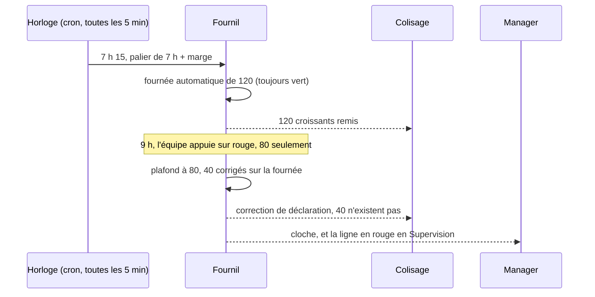

# Plan — les niveaux de suivi du fournil

**État : 📝 plan, rien n'est bâti.** Texte unique réécrit le 2026-11-17 après
quatre contradictions de `vitruve` ; leurs objections y sont intégrées et leur
historique est dans git. Il bâtit les décisions de Hugo du 2026-11-17, prises
dans la réflexion [`reflexion-fiche-simple.md`](reflexion-fiche-simple.md).
Le plan touche à ce qui est facturé (une correction de ce qui est sorti) : il
passe par `vitruve`. Les affirmations sur l'existant ont été vérifiées le
2026-11-17 ; celles marquées **à vérifier** ne l'ont pas été.

---

## 1. En simple

La fiche d'atelier a trois **niveaux de suivi** :

| Niveau                     | Ce que fait l'équipe                                                                           |
| -------------------------- | ---------------------------------------------------------------------------------------------- |
| **Toujours vert** (défaut) | rien : chaque palier est réputé sorti à son heure plus une marge. Seul geste : 🟥 « Problème » |
| **Simple**                 | ✅ « Fait » ou 🟥 « Problème » par produit                                                     |
| **Détaillé**               | ce qui existe : fournées, plaques, paliers                                                     |

- **Un niveau pour tout le fournil**, que chaque **poste** peut remplacer (la
  Pâtisserie en détaillé, le reste en toujours vert). Un poste sans réglage
  propre, ou une ligne sans poste, suit le fournil.
- **Un changement de niveau vaut pour la journée suivante**, jamais au milieu
  d'une journée commencée : le niveau d'une journée est figé à son arrêt.
- **Le rouge** demande combien est réellement sorti, et une raison si on veut.
  Il pose un **plafond** que rien ne dépasse plus ce jour-là pour ce produit,
  **sonne dans la cloche** de qui a le droit, et **reste en rouge dans la
  Supervision** jusqu'à ce qu'un responsable le marque traité. S'il corrige
  des pièces déjà déclarées, il publie une **correction de déclaration** (« N
  pièces déclarées n'existent pas »).
- **Rien de neuf au cœur du fournil** : « toujours vert » et « Fait » sont des
  fournées ordinaires, et le colisage reçoit ce qui est sorti, comme
  aujourd'hui.
- **Le fournil ignore le niveau du colisage**, et inversement : chacun publie
  des faits, les mêmes quel que soit son niveau, et l'autre les traite à son
  niveau.



### Le périmètre de ce chantier

- **Dedans** : les trois niveaux du fournil, la fournée automatique, « Fait »,
  « Problème » (plafond, correction, cloche, Supervision), la publication du
  fait de correction, la page « Niveau de suivi » et la fiche à trois niveaux.
- **Dehors, à penser le moment venu** : ce que le colisage fait de la
  correction, et le colisage à trois niveaux (§ 5). En attendant, une
  correction ne baisse pas la réserve du colisage : le colisage, en détaillé,
  voit physiquement les pièces manquantes et déclare son manque comme
  aujourd'hui, et le manager est déjà prévenu par la cloche du fournil.

## 2. Ce qui existe (vérifié le 2026-11-17)

- **Déclarer une fournée** : `RecordBatchCommand`
  (`production/atelier/application/commands/record-batch.handler.ts`). L'`id`
  vient de l'appelant ; un rejeu de même charge (même jour, SKU, quantité) ne
  fait rien, même si la fournée a été annulée depuis (`assertSameCharge`,
  `day/domain/entities/production-day.batches.ts`), et une charge différente
  sous le même `id` lève `BatchConflictError`. Le handler prend le verrou de la
  journée, écrit la fournée **et** sa remise au colisage
  (`production_handoff`), et publie `production.handed_to_packing`. Il refuse
  une journée non arrêtée et un SKU hors du compte.
- **Annuler une fournée** : `CancelBatchCommand`. Sur une journée arrêtée
  (`packing_owner = packing`, toutes les journées réelles), annuler une
  fournée remise **n'annule pas** : c'est une demande de retour au colisage
  (`production.return_requested`), et la réponse du colisage fixe ce qui
  revient. Ce plan **n'utilise pas** l'annulation.
- **Le retour partiel existe** : `production_return_request.quantity`, le
  fait la porte, le colisage rend `requested`, `OnPackingReturned` inscrit le
  rendu et n'annule la fournée que si tout est revenu.
- **Ce qui est sorti** se calcule à partir des fournées
  (`day/domain/services/production-output.ts`, `outputOf`, `countedBatch`) ;
  « Faite » se lit sur les seules fournées.
- **Les paliers** d'un SKU : `WorksheetDeadlinesReading`
  (`atelier/application/services/worksheet-deadlines-reading.service.ts`),
  qui relit en direct les besoins du commerce (`DueThresholdsReader`) et le
  réglage des tranches. Ils peuvent bouger dans la journée (une commande après
  l'arrêt, un réglage changé), et manquer (SKU sans tranche, commerce
  injoignable : `null`).
- **Les crons** : toutes les 5 minutes (`apps/lfd-api/wrangler.jsonc`), le
  Worker appelle des routes `admin/production/...` sous `RecomputeGuard`
  (`container/worker.ts`), comme l'arrêt automatique
  (`plan/http/auto-close.controller.ts`).
- **La cloche** : `StaffNotifier.notify`
  (`staff/notifications/domain/ports/staff-notifier.ts`), avec une `audience`
  par droit et une clé d'idempotence ; le fournil l'emploie déjà
  (`plan/application/services/plan-arrest-bell.ts`). L'envoi part dès
  `notify`, sans attendre la validation.
- **La boîte d'envoi** ne crée une livraison que pour les abonnés connus au
  moment de la publication (`platform/outbox/prisma-outbox.ts`) : un fait
  publié avant qu'un abonné existe ne lui parviendra jamais.
- **La Supervision** a son contrôleur côté fournil
  (`atelier/http/production-supervision.controller.ts`), sous
  `b2b_supervision`.
- **Le cache de la fiche** (`atelier/application/services/worksheet-contents.service.ts`)
  bâtit sa clé sur les journaux du jour, la version de la carte des postes et
  celle du réglage d'affichage.
- **La porte `production-subcontexts`** n'admet entre métiers que
  `atelier → quality`, `plan → resupply` et `atelier`/`plan → workstations`.
  L'arrêt du plan vit dans `plan/` ; les gestes de la fiche dans `atelier/`.
- **`recorded_by`** (`production_batch`) est une chaîne libre, sans clé
  étrangère.

## 3. La conception

### 3.1 Les réglages et le niveau d'une journée

- **Le niveau du fournil et la marge** (minutes, 15 par défaut) : un réglage
  unique du métier `atelier/` (`production_tracking_settings`). Niveau par
  défaut : **toujours vert**.
- **Le niveau d'un poste** : une colonne nullable
  `production_workstation.tracking_level` dans `workstations/`, posée par une
  méthode neuve de l'agrégat, `WorkstationMap.setTrackingLevel`, par intention.
  `null` : le poste suit le fournil. Le geste fait monter la version de la
  carte des postes.
- **Le niveau figé au premier passage d'une journée arrêtée.** Le niveau
  d'une journée est écrit dans `production_day_tracking_level` (le niveau du
  fournil et de chaque poste, résolus à cet instant ; modèle d'`atelier`,
  inscrit à la carte de la porte ; **clé unique sur le jour**, insertion qui
  ignore un conflit) **par le premier lecteur d'`atelier/`** qui trouve la
  journée arrêtée sans niveau figé : la fiche ou le cron, sous le verrou de la
  journée. Ce n'est **pas** un abonné à `production.day_closed` : un abonné
  durable passe après la validation, la fiche lirait « détaillé » entre
  l'arrêt et lui, et une journée ouverte par un lancement « au plus tôt » ne
  publie jamais `day_closed`. `plan/` n'a rien à écrire ni à lire.
- **La fiche et le cron lisent le niveau figé**, jamais le réglage courant.
  **Une journée arrêtée avant la mise en service** (la date de service
  `TRACKING_LEVELS_SINCE`, posée au déploiement) reste en **détaillé** et n'est
  jamais figée. **Une journée réouverte, reprise ou réannoncée garde son
  premier niveau** : la clé unique l'empêche d'être réécrit. **Limite assumée** :
  un réglage changé entre l'arrêt et ce premier passage (quelques minutes au
  plus, la fiche et le cron passant souvent) s'applique à la journée.
- **Le niveau est servi par ligne** (`WorkshopLine.trackingLevel`) : en mode
  boutique, un groupe-rayon mêle des lignes de postes différents. **À
  vérifier en N1** : la façon dont `WorkshopGroup` rassemble les lignes.

### 3.2 Les problèmes et le plafond

Une table `production_problem` du métier `atelier/` : jour, SKU, attendu,
**sorti déclaré** (le plafond), raison, auteur, heure, `resolved_at`,
`resolved_by`, et une **version** qui monte à chaque rouge. **Un problème
par jour et SKU** ; un second rouge le **remplace**, plus haut ou plus bas.
Le plafond **survit** au « traité » : rien ne dépasse plus le sorti déclaré
pour ce jour et ce SKU.

### 3.3 La part corrigée d'une fournée

Une colonne `production_batch.corrected_quantity` (entier, `0` par défaut,
CHECK `0 ≤ corrected_quantity ≤ quantity`).

- **Elle se prend sur la part remise au colisage**, jamais sur la part gardée
  sur place par un réassort (`on-site-share.ts`) : ce sont des pièces que le
  colisage croyait avoir. **Borne, tenue par le domaine** : pour chaque
  fournée, `corrigé ≤ remis − rendu − retour en attente`. Le rouge **saute**
  une fournée qui a un retour en attente ; s'il ne trouve pas assez de part
  corrigeable, il corrige ce qu'il peut et le problème dit le reste au manager.
- **Les lecteurs qui somment les fournées déduisent le corrigé**, chacun avec
  un test : `countedBatch` (`day/domain/services/production-output.ts` ;
  `outputOf` y passe), `producedOf` et `effectiveBatchesOf`
  (`day/domain/entities/production-day.batches.ts`), `on-site-share.ts`
  (la part gardée = `quantity − corrigé − remis`), la vue servie au front
  (`worksheet-line-views.ts`), et `dev/scenario/scenario-facts.reader.ts`.
  **N1 commence par les recenser tous**, SQL brut compris (le dossier, le
  prévisionnel, le récapitulatif), et inscrit la liste ici.
- La borne du retour partiel (`requestReturns`,
  `atelier/application/services/packing-handoffs.service.ts`) devient
  `remis − corrigé − rendu − retour en attente`.
- Une fournée automatique entièrement corrigée reste comptée à zéro ; elle
  n'est pas annulée.

### 3.4 « Problème » — le rouge

`POST …/worksheet/:date/lines/:sku/problem`, corps `{ produced, reason? }`,
par intention (`@IntentKey`, `runSealed`). Dans une unité de travail, sous le
verrou de la journée :

1. relit ce qui est sorti pour la ligne (corrigé déduit) ;
2. **si `produced` est inférieur**, corrige l'écart sur les fournées remises
   de la ligne, les plus récentes d'abord (automatiques, « Fait » et
   humaines confondues), en montant leur `corrected_quantity` ; puis publie
   **`production.output_corrected`** (§ 3.5) ;
3. **si `produced` est supérieur** (le rouge peut dire plus que prévu : le
   code accepte déjà un surplus), déclare la différence par une fournée
   ordinaire ;
4. écrit ou remplace le problème (plafond, version) ;
5. **après validation**, par la file d'après validation déjà en place
   (`AfterCommit`, celle du signal des rayons), fait sonner la cloche,
   `audience: b2b_supervision:read`, clé `problème:<id>:<version>`.

Un fait journalisé `production.problem_reported` (et
`production.problem_resolved` au « traité ») porte le SKU, l'attendu, le
sorti, et les fournées corrigées : la trace de ce qui touche au facturé est
complète.

### 3.5 La correction de déclaration

**Ce n'est pas un retour** : rien ne bouge physiquement, des pièces déclarées
n'ont jamais existé.

- **Elle est rangée au fournil**, son propriétaire : les fournées portent
  leur `corrected_quantity`, et le problème sa version. Le fournil publie une
  **lecture nommée**, « les corrections de déclaration d'une journée », que le
  colisage relira quand il saura les traiter : rien ne se perd, même publié
  avant que le colisage ne l'écoute.
- **Le fait** `production.output_corrected`, déclaré dans
  `production/channels/packing/`, clé `production.output_corrected:<id du
problème>:<version>`, charge : le jour, le SKU, et **les fournées avec leur
  remise (`handoffId`) et la part corrigée de chacune**. Il est le même à tous
  les niveaux du fournil. **Aucun abonné dans ce chantier.**

### 3.6 « Fait » (simple)

`POST …/worksheet/:date/lines/:sku/done`, par intention : déclare une fournée
du **reste à sortir** (`min(compte, plafond) − sorti`), par le même service
d'écriture que `RecordBatchHandler`. Une ligne déjà faite ne fait rien.

### 3.7 La fournée automatique (toujours vert)

Une route du cron, dans `atelier/` :
`POST admin/production/tracking/always-green`, `@Idempotent`, sous
`RecomputeGuard`, appelée toutes les 5 minutes par le Worker
(`container/worker.ts`). Pour la journée en cours (celle que la fiche
choisit au serveur, à l'heure de Paris ; **à vérifier en N3** : le service
qui la choisit), si elle est arrêtée :

- pour chaque SKU **au compte**, dont la ligne est en toujours vert d'après le
  niveau figé, le tour envoie une commande par ligne,
  **`RunAlwaysGreenLineCommand`** ; **chaque ligne est isolée** : une erreur
  se journalise, les autres continuent ;
- le handler prend le **verrou de la journée**, **puis** relit les paliers
  échus (heure + marge), la quantité au compte, le plafond s'il y en a un,
  le sorti (corrigé déduit) et `n`, le nombre de fournées de la ligne
  **annulées comprises** ;
- **la cible** est `min(cumul des paliers échus, compte, plafond)` ;
  **la quantité** est `cible − sorti`, si elle est positive ;
- il déclare une fournée ordinaire d'`id` **`auto-<jour>-<sku>-<n>`**, auteur
  `system:always-green` : `n` ne revient jamais en arrière, donc deux passages
  sur le même état rejouent la même charge, et un état nouveau donne un
  nouvel `id` ;
- **une ligne sans palier** (SKU sans tranche, ou besoins du commerce
  illisibles) n'est pas complétée : elle reste à faire et s'affiche « à
  confirmer » dans la Supervision. **Doute écrit** : compléter au compte à une
  heure fixe reste possible, à décider à l'usage.

### 3.8 La Supervision et la cloche

La colonne du fournil de la Supervision montre les **problèmes ouverts** en
rouge (SKU, attendu, sorti, raison, depuis quand) et les lignes « à
confirmer », avec « Marquer traité » (`resolved_at`, `resolved_by`, sous
`b2b_supervision:write`, par intention). La notification mène à la ligne de la
fiche.

### 3.9 Le cache

La clé de `WorksheetContents` gagne la version du réglage de suivi, celle du
niveau figé de la journée et celle des problèmes ; `setTrackingLevel` fait
monter la version de la carte des postes.

### 3.10 Le front

- **Un `@switch` sur le niveau de la ligne**, servi par le serveur :

  ```html
  @switch (line.trackingLevel) { @case ('always_green') { <app-line-always-green [line]="line" /> }
  @case ('simple') { <app-line-simple [line]="line" /> } @default {
  <app-worksheet-line [line]="line" /> } }
  ```

  Le niveau **détaillé** reste le composant d'aujourd'hui, inchangé. Pas de
  registre injecté (`NgComponentOutlet`) : ses entrées ne seraient pas
  vérifiées par le compilateur AOT.

- **Le panneau rouge** (« Combien est réellement sorti ? ») est un composant
  partagé par toujours vert et simple.
- **La page « Niveau de suivi »** (Réglages) : le niveau du fournil et sa
  marge, puis les postes avec leur niveau (« suit le fournil » par défaut),
  et la mention « vaut à partir de la prochaine journée arrêtée ». Elle
  rassemble : chaque réglage s'écrit par la route de son propriétaire
  (`atelier/`, `workstations/`). L'aperçu de démonstration
  (`/reglages/niveau-de-suivi/apercu`) reste à côté.

### 3.11 Les portes

- RGPD : `production_problem.author`, `resolved_by`, et le registre de
  `production_batch.recorded_by` dit « membre du staff, ou le système »
  (`system:always-green`).
- Idempotence : « Fait », « Problème », « Marquer traité » et le niveau d'un
  poste par intention ; la route du cron `@Idempotent`.
- Journal : les deux faits de problème, et le fait de réglage de suivi.
- `production-subcontexts` : `production_tracking_settings`,
  `production_day_tracking_level` et `production_problem` à `atelier`.

## 4. Les lots

Dans l'ordre de la table : la page (N4) est en ligne **avant** que le cron
(N3) n'agisse.

| Lot    | Contenu                                                                                                                                                                                                                                                                                                                        |
| ------ | ------------------------------------------------------------------------------------------------------------------------------------------------------------------------------------------------------------------------------------------------------------------------------------------------------------------------------ |
| **N1** | Le recensement des lecteurs des fournées (§ 3.3) ; migration additive : réglage du fournil, colonne du poste, niveau figé, table des problèmes, `corrected_quantity` ; le niveau figé au premier passage, et `TRACKING_LEVELS_SINCE` ; `outputOf` qui déduit le corrigé ; le niveau servi par ligne ; `lecteur-de-migrations`. |
| **N2** | « Fait », « Problème » (plafond, correction, fait publié, lecture des corrections), la cloche après validation, la Supervision des problèmes, la borne du retour.                                                                                                                                                              |
| **N4** | Le front : composants de ligne, panneau rouge, `@switch`, page « Niveau de suivi » (`pablo`). Avant le cron : la page est en ligne avant que toujours vert n'agisse.                                                                                                                                                           |
| **N3** | Le cron : la route, `RunAlwaysGreenLineCommand` sous le verrou, l'appel du Worker.                                                                                                                                                                                                                                             |
| **N5** | Doc d'état ; réflexion et plan retirés.                                                                                                                                                                                                                                                                                        |

## 5. Pour le plan du colisage (noté, pas tranché)

- Traiter `production.output_corrected` à chacun de ses niveaux, en relisant
  les corrections chez le fournil.
- **Ne jamais laisser la réserve à découvert** : l'invariant réel est
  `packed + returned + sentToShop ≤ received`, avec les réservations des
  réassorts (`packing/domain/entities/packing-stock.ts`) ; le commentaire de
  `packing.prisma` cite un invariant périmé.
- Attendre que les remises nommées par une correction soient reçues ; l'ordre
  des verrous (commandes par id, puis la réserve, revérifier) ; un geste
  « retirer du bac » par `BinDesk`, puisque `reportShortfall` ne retire rien ;
  les commandes fermées, chargées ou remises.
- **Selon son niveau** : en détaillé et en simple, une pièce au bac a été
  posée par un humain, donc elle existe ; la correction ne la retire pas, elle
  la signale au manager. En toujours vert seulement, le colisage la retire.
- Sa valeur `always_green` n'existe pas tant que ce traitement n'est pas
  livré.
