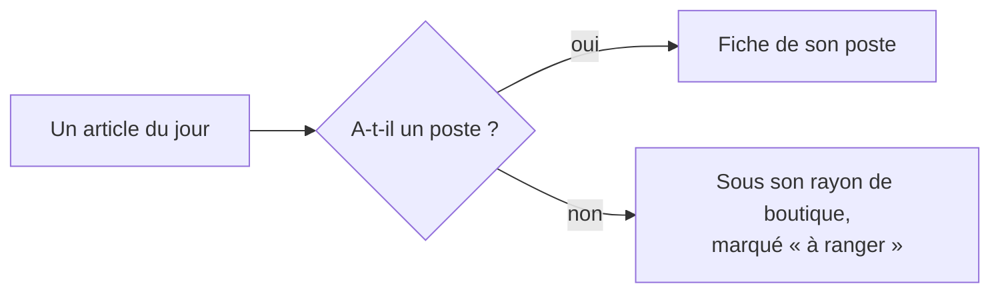

# Plan — les postes du fournil

**État : 📝 plan, rien n'est bâti.** Demande de Hugo, le 2026-11-16 : un
article rangé en « Traiteur salé » à la boutique peut être fait par la
pâtisserie au fournil. Aujourd'hui, la fiche d'atelier et le dossier de
production le rangent quand même sous « Traiteur salé ». Il faut pouvoir
ranger chaque article au poste qui le fait, sans toucher au rangement de la
boutique et sans rien apprendre du référentiel.

Forme retenue avec Hugo le même jour : **un poste par article**, réglé par le
fournil, sans règle par rayon. Ni argent, ni migration de données (deux tables
neuves), ni frontière de sécurité, ni runbook : ce plan ne passe pas par
`vitruve`. Ses affirmations sur l'existant ont été vérifiées en ouvrant le
code le 2026-11-16 (§ 2).

---

## 1. En simple

La boutique range ses articles en **rayons**, pour le client. Le fournil
s'organise en **postes**, pour l'équipe. La quiche est au rayon « Traiteur
salé », et c'est la pâtisserie qui la fait.

Le fournil tient donc deux choses, et rien d'autre :

- **sa liste de postes** : Tourière, Pâtisserie, Traiteur… un nom et un ordre ;
- **le poste de chaque article** qu'il fabrique.

La fiche d'atelier et le dossier du jour rangent alors par poste. Un article
qui n'a pas encore de poste reste sous son rayon de boutique, marqué « à
ranger ».



- **Rien ne change le premier jour.** Sans poste, tout est rangé comme
  aujourd'hui.
- **La boutique et le référentiel n'en savent rien.** Le fournil ne range que
  des SKU, qu'il connaît déjà.
- **Un nouvel article** arrive « à ranger ». Quelqu'un le range une fois, et
  c'est le fournil qui sait qui le fait.

### Ce qui protège d'un article oublié

1. **Il ne peut pas disparaître, par construction.** Le rangement place chaque
   ligne quelque part : son poste, sinon son rayon, sinon « Hors catalogue ».
   Un test vérifie que toutes les lignes qui entrent ressortent dans un groupe.
2. **Il se voit.** Son groupe porte « à ranger ». La page Postes compte les
   articles sans poste, et la couverture du dossier du jour les nomme.
3. **Il se voit à temps.** Le Prod manager signale, avant l'arrêt, les articles
   de la journée qui n'ont pas de poste.

Il n'y a **pas d'événement « article publié »** à écouter : « ce qui reste à
ranger » se calcule au moment de la lecture, sur les articles que le fournil
a réellement à produire. Un événement peut se perdre, ou concerner un article
que le fournil ne fera jamais. Un état calculé ne ment pas.

---

## 2. Ce qui existe (vérifié le 2026-11-16)

- **Le fournil ne connaît un article que par son SKU.** Il demande le rayon au
  commerce par un port qu'il déclare :
  `production/channels/commerce/workshop-shelves.reader.ts`
  (`WorkshopShelvesReader.shelvesOf(skus)`). Le commerce l'implémente sur son
  miroir des familles
  (`lafoliecoffee/catalog/infrastructure/catalog-workshop-shelves.reader.ts`).
  Ce plan n'y touche pas.
- **Deux lecteurs rangent par rayon côté serveur**, tous deux par
  `rootShelvesOf` de l'imprimerie (`production/shared/print/`) :
  - la fiche d'atelier : `atelier/domain/services/production-worksheet-groups.ts`
    (`worksheetGroupsOf`) ;
  - le dossier du jour : `plan/domain/services/day-dossier.ts`, lu par
    `plan/application/services/production-paper.service.ts`, figé et archivé
    à l'arrêt.
- **Le réglage `showSubcategories`** vit dans `ProductionDisplaySettings`
  (`atelier/http/production-display-settings.controller.ts`).
- **Les articles vendables, nommés et rangés**, arrivent déjà au fournil par
  `production/channels/commerce/sellable-articles.reader.ts`
  (`SellableArticlesReader`, la table des raccourcis). La page Postes les
  liste par ce port.
- **La porte `production-subcontexts`** n'admet entre métiers que
  `atelier → quality` et `plan → resupply`
  (`dev-toolbox/gates/production-subcontexts.mjs`).
- **Le mot « station »** est déjà pris (`PackingStation`, `StationContext`).
  Le poste s'appelle `Workstation` dans le code.

---

## 3. La conception

### 3.1 Le métier `workstations/`

Les postes sont le vocabulaire du fournil. Ils vivent dans le schéma
`production`, dans un nouveau métier `src/production/workstations/`, avec son
`index.ts` et son module Nest. Ni dans `day/`, qui ne connaît aucun métier, ni
dans `atelier/`, que `plan/` n'a pas le droit de lire.

Il publie **une lecture nommée** :

```ts
/** Le poste de chaque SKU ; un SKU absent n'a pas de poste. */
export abstract class WorkstationOfArticles {
  abstract workstationsOf(skus: readonly string[]): Promise<ReadonlyMap<string, WorkstationView>>;
}
```

La porte gagne deux arêtes, avec leur raison : `atelier → workstations` et
`plan → workstations`.

### 3.2 Les tables

```
production.workstation
  id           text pk            (ULID)
  name         text not null      unique parmi les postes vivants
  position     int  not null      l'ordre des fiches
  archived_at  timestamptz null   pas de DELETE physique
  updated_at, updated_by

production.workstation_article
  sku             text pk         un article, un poste
  workstation_id  text not null → production.workstation (RESTRICT)
  updated_at, updated_by
```

- **Aucune clé ne sort du schéma `production`.** Le SKU y est déjà opaque,
  comme dans `ProductionOrderLine`.
- **Archiver un poste** est refusé tant qu'il porte des articles : on les
  déplace d'abord. Un poste vide part sans laisser d'article orphelin.
- `updated_by` entre au registre RGPD (`lint:rgpd-staff`).

### 3.3 Les gestes

Un CRUD avec deux refus, assez petit pour se passer d'agrégat : un nom en
double, et l'archivage d'un poste encore occupé.

- `DeclareWorkstation`, `RenameWorkstation`, `ReorderWorkstations`,
  `ArchiveWorkstation` ;
- `PlaceArticles(skus, workstationId | null)` : un ou plusieurs articles à un
  poste, `null` pour les remettre « à ranger ». Le geste « tout ce rayon → ce
  poste » de l'écran l'appelle avec les SKU du rayon : il affecte les articles
  un par un et ne laisse aucune règle derrière lui ;
- la requête `ListWorkstations` : les postes, leurs articles, les articles à
  ranger.

### 3.4 Le rangement

`rootShelvesOf` reste tel quel. Une fonction voisine de l'imprimerie,
`workstationGroupsOf(lines, workstationOf, shelfOf)`, rend :

1. un groupe par poste qui a des lignes, dans l'ordre des postes ;
2. puis, pour ce qui n'a pas de poste, un groupe par rayon de boutique marqué
   `unplaced: true` (« à ranger »), dans l'ordre d'aujourd'hui ;
3. puis « Hors catalogue » ou « Rayon inconnu », comme aujourd'hui.

**Invariant testé :** toutes les lignes qui entrent ressortent, une seule
fois. Une **panne** de la lecture des postes se traite comme la panne des
rayons aujourd'hui : on journalise, et tout est rangé par rayon. Un poste
n'empêche jamais de produire.

Avec `showSubcategories`, les sections d'un groupe-poste sont les rayons de
boutique d'où viennent ses articles. On y retrouve la quiche en lisant le
site.

Le contrat `WorkshopGroup` gagne `workstation: { id, name } | null` et
`unplaced: boolean`.

### 3.5 Le figement

Le dossier du jour est figé à l'arrêt : il garde les postes du moment, sans
rien de plus. La fiche d'atelier est vivante : un changement de poste se voit
au rafraîchissement suivant.

### 3.6 L'écran

Prod manager → **Postes** :

- en tête, les postes : ajouter, renommer, monter ou descendre, archiver ;
- dessous, **les articles fabriqués**, chacun avec son rayon de boutique et un
  `fold-listbox` « Poste ». Un filtre « à ranger » avec son compte, un filtre
  par rayon, et le geste « tout ce rayon → ce poste » ;
- le Prod manager affiche « N articles du jour à ranger » avec un lien vers ce
  filtre, tant qu'il en reste.

Une ressource `production_workstations` est créée par migration et accordée
**à l'écran** (règle des droits, CLAUDE.md § 3).

---

## 4. Les lots

| Lot    | Contenu                                                                                                                                                                          | Tests                                                                                    |
| ------ | -------------------------------------------------------------------------------------------------------------------------------------------------------------------------------- | ---------------------------------------------------------------------------------------- |
| **W0** | La porte `production-subcontexts` connaît `workstations/`, ses deux modèles et ses deux arêtes, avant que le dossier existe.                                                     | un import hors `index.ts` échoue                                                         |
| **W1** | Migration (deux tables, ressource), gestes et requête, dépôt Prisma, `WorkstationOfArticles`, routes `/admin/production/workstations`. `lecteur-de-migrations`.                  | les deux refus, `PlaceArticles` à `null`, e2e                                            |
| **W2** | `workstationGroupsOf` ; la fiche d'atelier et le dossier l'appellent ; la couverture du dossier nomme les articles à ranger ; le contrat.                                        | **sans poste, sortie identique à aujourd'hui** ; toutes les lignes ressortent ; la panne |
| **W3** | La page Postes et l'alerte du Prod manager (`pablo`), le rail et les tuiles.                                                                                                     | spec de l'écran ; essai dans Chrome sur le scénario de commandes                         |
| **W4** | Doc d'état des postes du fournil (dans `fournil/`) ; `la-fiche-d-atelier.md` et `dossier-prod-du-jour.md` à jour ; le spécimen du dossier montre un poste. Le plan est supprimé. | —                                                                                        |

---

## 5. Questions à trancher (Hugo)

- **Q1 — Un article fait par deux postes** (la pâte à la tourière, la
  garniture à la pâtisserie). Hors du plan : un article, un poste. Le partager
  demanderait la recette.
- **Q2 — Les écrans rangés par rayon côté front** (prévisionnel, filtres des
  réassorts, récapitulatif). Défaut proposé : ils restent par rayon, et un lot
  suivant les passera aux postes s'il le faut.
- **Q3 — Un article que le fournil ne fabrique pas** (acheté tout fait). Défaut
  proposé : il n'apparaît pas sur la fiche, comme aujourd'hui, et donc pas
  dans « à ranger ». Si un tel article se retrouvait dans les comptes du jour,
  un poste « Achats » suffirait.
