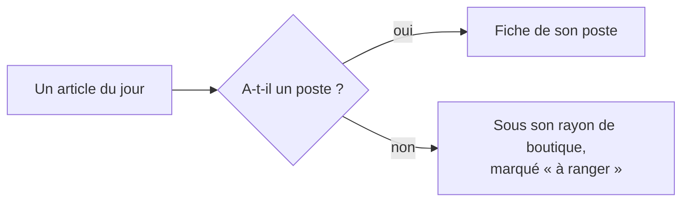

# Plan — les postes du fournil

**État : 📝 plan, rien n'est bâti.** Demande de Hugo, le 2026-11-16 : un
article rangé en « Traiteur salé » à la boutique peut être fait par la
pâtisserie au fournil. Aujourd'hui, la fiche d'atelier et le dossier de
production le rangent quand même sous « Traiteur salé ». Il faut pouvoir
ranger chaque article au poste qui le fait, sans toucher au rangement de la
boutique et sans rien apprendre du référentiel.

Forme retenue avec Hugo le même jour : **un poste par article**, réglé par le
fournil, sans règle par rayon. Ni argent, ni migration de données (deux tables
neuves et une colonne de réglage, additives), ni frontière de sécurité, ni runbook. Hugo a
pourtant demandé deux contradictions de `vitruve`, et leurs réponses sont au
§ 7. Ses affirmations sur l'existant ont été vérifiées en ouvrant le
code le 2026-11-16 (§ 2).

---

## 1. En simple

La boutique range ses articles en **rayons**, pour le client. Le fournil
s'organise en **postes**, pour l'équipe. La quiche est au rayon « Traiteur
salé », et c'est la pâtisserie qui la fait.

Le fournil tient donc deux choses, et rien d'autre :

- **sa liste de postes** : Tourière, Pâtisserie, Traiteur… un nom et un ordre ;
- **le poste de chaque article** qu'il fabrique.

La fiche d'atelier et le dossier du jour rangent alors par poste. Un article
qui n'a pas encore de poste reste sous son rayon de boutique, marqué « à
ranger ».



- **Rien ne change le premier jour.** Sans poste, tout est rangé comme
  aujourd'hui.
- **La boutique et le référentiel n'en savent rien.** Le fournil ne range que
  des SKU, qu'il connaît déjà.
- **Un nouvel article** arrive « à ranger ». Quelqu'un le range une fois, et
  c'est le fournil qui sait qui le fait.

### Ce qui protège d'un article oublié

1. **Il ne peut pas disparaître, par construction.** Le rangement place chaque
   ligne quelque part : son poste, sinon son rayon, sinon « Hors catalogue ».
   Un test vérifie que toutes les lignes qui entrent ressortent dans un groupe.
2. **Il se voit.** Son groupe porte « à ranger ». La page Postes compte les
   articles sans poste, et la couverture du dossier du jour les nomme.
3. **Il se voit à temps.** Le Prod manager signale, avant l'arrêt, les articles
   de la journée qui n'ont pas de poste.

Il n'y a **pas d'événement « article publié »** à écouter : « ce qui reste à
ranger » se calcule au moment de la lecture, sur les articles que le fournil
a réellement à produire. Un événement peut se perdre, ou concerner un article
que le fournil ne fera jamais. Un état calculé ne ment pas.

---

## 2. Ce qui existe (vérifié le 2026-11-16)

- **Le fournil ne connaît un article que par son SKU.** Il demande le rayon au
  commerce par un port qu'il déclare :
  `production/channels/commerce/workshop-shelves.reader.ts`
  (`WorkshopShelvesReader.shelvesOf(skus)`). Le commerce l'implémente sur son
  miroir des familles
  (`lafoliecoffee/catalog/infrastructure/catalog-workshop-shelves.reader.ts`).
  Ce plan n'y touche pas.
- **Deux lecteurs rangent par rayon côté serveur**, tous deux par
  `rootShelvesOf` de l'imprimerie (`production/shared/print/`) :
  - la fiche d'atelier : `atelier/domain/services/production-worksheet-groups.ts`
    (`worksheetGroupsOf`) ;
  - le dossier du jour : `plan/domain/services/day-dossier.ts`, lu par
    `plan/application/services/production-paper.service.ts`, figé et archivé
    à l'arrêt.
- **Le réglage `showSubcategories`** appartient à l'imprimerie
  (`shared/print/infrastructure/prisma-production-display-settings.*`), lue
  par la fiche comme par le dossier ; seule sa route vit dans `atelier/http/`.
  Le mode boutique / mode prod la rejoint là, et non dans `workstations/` :
  c'est une règle de rangement, que les deux métiers lisent déjà.
- **Les articles vendables, nommés et rangés**, arrivent déjà au fournil par
  `production/channels/commerce/sellable-articles.reader.ts`
  (`SellableArticlesReader`, la table des raccourcis). La page Postes les
  liste par ce port.
- **La porte `production-subcontexts`** n'admet entre métiers que
  `atelier → quality` et `plan → resupply`
  (`dev-toolbox/gates/production-subcontexts.mjs`).
- **Le mot « station »** est déjà pris (`PackingStation`, `StationContext`).
  Le poste s'appelle `Workstation` dans le code.

---

## 3. La conception

### 3.1 Le métier `workstations/`

Les postes sont le vocabulaire du fournil. Ils vivent dans le schéma
`production`, dans un nouveau métier `src/production/workstations/`, avec son
`index.ts` et son module Nest. Ni dans `day/`, qui ne connaît aucun métier, ni
dans `atelier/`, que `plan/` n'a pas le droit de lire.

Il publie **une lecture nommée** :

```ts
/** Le poste de chaque SKU ; un SKU absent n'a pas de poste. */
export abstract class WorkstationOfArticles {
  abstract workstationsOf(skus: readonly string[]): Promise<ReadonlyMap<string, WorkstationView>>;
}
```

La porte gagne deux arêtes, avec leur raison : `atelier → workstations` et
`plan → workstations`.

### 3.2 Les tables

```
production.production_workstation
  id           text pk            (ULID)
  name         text not null      unique parmi les postes vivants
  position     int  not null      l'ordre des fiches
  archived_at  timestamptz null   pas de DELETE physique
  updated_at, updated_by_staff_id, updated_by_name

production.production_workstation_article
  sku             text pk         un article, un poste
  workstation_id  text not null → production_workstation (RESTRICT)
  updated_at, updated_by_staff_id, updated_by_name
```

- **Aucune clé ne sort du schéma `production`.** Le SKU y est déjà opaque,
  comme dans `ProductionOrderLine`.
- **Archiver un poste** est refusé tant qu'il porte des articles : on les
  déplace d'abord. Un poste vide part sans laisser d'article orphelin.
- `updated_by` entre au registre RGPD (`lint:rgpd-staff`).

### 3.3 L'agrégat et les gestes

Trois règles peuvent refuser une écriture : deux postes vivants ne portent
pas le même nom, un poste qui porte des articles ne s'archive pas, et aucun
article ne va à un poste archivé. Selon la question de tri de CLAUDE.md
(§ 3.1), c'est donc un **agrégat**, et non un CRUD.

**`WorkstationMap`**, la carte entière du fournil, c'est-à-dire ses postes et
le poste de chaque article. Les trois règles portent sur l'ensemble : l'unicité
d'un nom se vérifie contre les autres postes, et l'archivage contre les
articles. Elle reste petite, avec une dizaine de postes et quelques centaines
d'articles au plus.

- La factory `WorkstationMap.empty()`, puis les méthodes métier, qui refusent
  chacune la transition illégale (`BusinessError`, avec un message qui nomme le
  poste et le geste de sortie) :
  - `declare(name)` ;
  - `rename(id, name)` ;
  - `reorder(ids)` ;
  - `archive(id)` ;
  - `place(skus, workstationId | null)`, où `null` remet les articles « à
    ranger ».
- Les value objects : `WorkstationName` (nom non vide, borné, comparé sans
  casse ni espaces de bord) et `Sku`, celui du fournil.
- Le port d'écriture `WorkstationMapRepository` : `load(): Promise<WorkstationMap>`
  et `save(map)`. L'adaptateur Prisma porte `toDomain` et `toPersistence`, et
  un verrou consultatif sérialise deux gestes simultanés.
- Les commandes : `DeclareWorkstation`, `RenameWorkstation`,
  `ReorderWorkstations`, `ArchiveWorkstation`, `PlaceArticles`. Chacune charge
  la carte, appelle une méthode, puis sauve. Le geste « tout ce rayon → ce
  poste » de l'écran appelle `PlaceArticles` avec les SKU du rayon, sans
  laisser de règle derrière lui.
- La lecture `ListWorkstations`, et la lecture publiée `WorkstationOfArticles`,
  passent par un port de **lecture** distinct (ISP), qui ne charge pas
  l'agrégat.

### 3.4 Le rangement

`rootShelvesOf` reste tel quel. Une fonction voisine de l'imprimerie,
`workstationGroupsOf(lines, workstationOf, shelfOf)`, rend :

1. un groupe par poste qui a des lignes, dans l'ordre des postes ;
2. puis, pour ce qui n'a pas de poste, un groupe par rayon de boutique marqué
   `unplaced: true` (« à ranger »), dans l'ordre d'aujourd'hui ;
3. puis « Hors catalogue » ou « Rayon inconnu », comme aujourd'hui.

**Invariant testé :** toutes les lignes qui entrent ressortent, une seule
fois. Une **panne** de la lecture des postes se traite comme la panne des
rayons aujourd'hui : on journalise, et tout est rangé par rayon. Un poste
n'empêche jamais de produire.

Avec `showSubcategories`, les sections d'un groupe-poste sont les rayons de
boutique d'où viennent ses articles. On y retrouve la quiche en lisant le
site.

Le contrat `WorkshopGroup` gagne `workstation: { id, name } | null` et
`unplaced: boolean`.

#### La même découpe de page (décidé par Hugo le 2026-11-16)

Le dossier du jour et la fiche d'atelier gardent **exactement** leur
découpe : un poste prend la place d'un rayon, et rien d'autre ne bouge.

- **Une section par groupe.** Le titre est le nom du poste au lieu du nom du
  rayon. Le calendrier par tranche, l'ordre des lignes (le plus gros d'abord),
  les sauts de page et les annexes restent les mêmes.
- **Les intertitres** (avec `showSubcategories`) deviennent les rayons de
  boutique à l'intérieur du poste, à la place des sous-catégories. Le
  mécanisme est le même.
- **Un groupe « à ranger »** a la forme d'un groupe de rayon. Seul son titre
  porte la mention : « Traiteur salé — à ranger ».

C'est tenu par la construction : `recapOf` (`plan/domain/services/day-dossier.ts`)
et `worksheetGroupsOf` rendent déjà des groupes `{ titre, lignes,
intertitres }`, et la mise en page ne lit que ces groupes (vérifié le
2026-11-16). Le changement se fait **en amont**, dans le choix des groupes ;
le gabarit du PDF n'est pas touché.

**Test (W2) :** une journée où chaque rayon a exactement un poste du même nom
rend un dossier dont les groupes sont identiques, titres compris, à ceux du
mode boutique.

#### Les fiches d'atelier deviennent des fiches de poste (décidé par Hugo le 2026-11-16)

En mode prod, la fiche d'atelier (`/fournil`) montre **une fiche par poste** :
l'onglet sur tablette et le sélecteur sur téléphone listent les postes, avec
leur avancement, à la place des rayons. L'en-tête dit « Fiche de poste —
Pâtisserie · fiche 2 sur 5 ». La fiche elle-même (lignes, tranches, fournées,
pavé numérique) ne change pas.

- **Ouvrir directement sa fiche :** `/fournil?poste=<id>` ouvre la fiche d'un
  poste. La tablette de la pâtisserie peut garder ce lien en favori. Le dernier
  poste ouvert est retenu **par personne**, dans les préférences de navigation
  (`nav_prefs.worksheetCategory`, comme le rayon aujourd'hui), jamais dans le
  stockage du navigateur.
- **Un poste sans ligne ce jour-là n'a pas de fiche,** comme un rayon vide
  aujourd'hui.
- **Les messages suivent le mode.** « Les rayons n'ont pas pu être lus »
  devient, en mode prod, « Les postes n'ont pas pu être lus — les fiches sont
  rangées par rayon ».
- **Le mot.** Le front appelle aujourd'hui « poste fixe » la tablette posée à
  l'atelier, par opposition au téléphone (`fiche-atelier.html`, vérifié le
  2026-11-16). Avec les postes du fournil, ce mot désignerait deux choses. Il
  devient « tablette » dans les commentaires et les libellés (W3), et
  « poste » ne désigne plus que le métier de l'atelier.

### 3.5 Le figement

Le dossier du jour est figé au **premier tirage archivable** (§ 7, B1) : il
garde le mode et les postes de ce tirage-là. **Limite assumée :** un réglage
changé entre l'arrêt et ce tirage s'y voit. Le tirage suit l'arrêt de près, et
on ne règle pas les postes pendant le service. La fiche d'atelier est vivante : un changement de poste se voit
au rafraîchissement suivant.

### 3.6 L'écran

Prod manager → **Postes** :

- en tête, les postes : ajouter, renommer, monter ou descendre, archiver ;
- dessous, **les articles fabriqués**, chacun avec son rayon de boutique et un
  `fold-listbox` « Poste ». Un filtre « à ranger » avec son compte, un filtre
  par rayon, et le geste « tout ce rayon → ce poste » ;
- le bouton **« Simuler le catalogue en production »** (§ 3.7) ;
- le réglage **mode boutique / mode prod** y est rappelé, avec un lien vers les réglages du fournil ;
- en mode prod, le Prod manager affiche « N articles du jour à ranger » avec un lien vers ce
  filtre, tant qu'il en reste.

Une ressource `production_workstations` est créée par migration et accordée
**à l'écran** (règle des droits, CLAUDE.md § 3).

### 3.7 Simuler le catalogue en production

Demande de Hugo, le 2026-11-16 : un bouton **« Simuler le catalogue en
production »** sur la page Postes, qui sort un dossier de production avec
**tous** les articles fabricables, rangés comme ils le seraient, pour contrôler
la répartition avant de basculer en mode prod.

- **La source :** tous les articles vendables, que le fournil lit déjà par
  `SellableArticlesReader`, une pièce de chacun, dans une seule commande
  fictive.
- **Le rendu :** la partie « un rayon et son calendrier » du **vrai** dossier
  du jour (`plan/domain/services/day-dossier.ts`), avec les postes et le mode
  du moment. Le code est le même, donc ce qu'on contrôle est ce qu'on
  imprimera. Ni fiche par commande, ni BL, ni réassorts : une commande fictive
  n'a rien à y montrer.
- **Le choix du mode :** « Simuler en mode prod » et « Simuler en mode
  boutique », quel que soit le réglage en cours. On compare les deux avant de
  basculer.
- **La couverture** compte les articles par poste et nomme ceux qui sont « à
  ranger ». C'est la liste de contrôle.
- **Jamais persistée,** comme la journée d'exemple de la planche des
  documents (`plan/application/document-specimens/specimen-day.ts`, même
  principe) : aucune journée, aucun archivage, aucun envoi. Chaque page porte
  « SIMULATION — ne pas produire ».
- **La route :** `GET /admin/production/workstations/simulation.pdf?mode=workstation|shelf`,
  une requête qui n'écrit rien, sous la ressource `production_workstations`.

---

## 4. Les lots

| Lot     | Contenu                                                                                                                                                                                                                                                                                                                                                      | Tests                                                                                                         |
| ------- | ------------------------------------------------------------------------------------------------------------------------------------------------------------------------------------------------------------------------------------------------------------------------------------------------------------------------------------------------------------ | ------------------------------------------------------------------------------------------------------------- |
| **W0**  | La porte `production-subcontexts` : `workstations` dans `DIRECTORIES`, `GATED` et `ALLOWED` (`workstations` lit le partagé, comme tout métier ; `atelier` et `plan` lisent `workstations`) de `dev-toolbox/gates/lib/production-subcontexts-graph.mjs`, et les deux modèles avec leur propriétaire dans `production-subcontexts.map.json`. Avant le dossier. | un fichier sous `workstations/` est refusé avant, admis après ; un import hors `index.ts` échoue              |
| **W1**  | Migration (deux tables, ressource), gestes et requête, dépôt Prisma, `WorkstationOfArticles`, routes `/admin/production/workstations`. `lecteur-de-migrations`.                                                                                                                                                                                              | domaine : les trois refus et `place` à `null`, sans Nest ; handlers à ports doublés ; e2e                     |
| **W2**  | `workstationGroupsOf` ; la fiche d'atelier et le dossier l'appellent ; la couverture du dossier nomme les articles à ranger ; le contrat.                                                                                                                                                                                                                    | **sans poste, sortie identique à aujourd'hui** ; toutes les lignes ressortent ; la panne                      |
| **W2b** | La simulation du catalogue en production : requête, route, couverture de contrôle, filigrane.                                                                                                                                                                                                                                                                | tous les articles vendables ressortent une seule fois ; mode prod et mode boutique ; rien n'est écrit en base |
| **W3**  | Les fiches de poste (`/fournil?poste=`, onglets, en-tête, messages, « poste fixe » → « tablette » dans tout le back-office) ; la page Postes, l'option mode boutique / mode prod, l'alerte du Prod manager (`pablo`), le rail et les tuiles.                                                                                                                 | spec de l'écran ; essai dans Chrome sur le scénario de commandes                                              |
| **W3b** | Le rangement servi au front (§ 7, B3) : le prévisionnel, le récapitulatif et les filtres des réassorts ne rangent plus eux-mêmes.                                                                                                                                                                                                                            | les écrans, dans les deux modes ; plus aucun `catalogRootShelves` dans ces écrans                             |
| **W4**  | Doc d'état des postes du fournil (dans `fournil/`) ; `la-fiche-d-atelier.md` et `dossier-prod-du-jour.md` à jour ; le spécimen du dossier montre un poste. Le plan est supprimé.                                                                                                                                                                             | —                                                                                                             |

---

## 5. Décisions et question ouverte

- **Q1 — tranchée par Hugo le 2026-11-16 : un article, un poste.** Les postes
  sont des métiers de l'atelier : boulangerie, tourier, pâtisserie… Un article
  fait par deux postes n'est pas traité ici ; il demanderait la recette.
- **Q2 — tranchée par Hugo le 2026-11-16 : une option du fournil, « mode
  boutique » ou « mode prod ».** Un réglage `grouping: "shelf" | "workstation"`
  rejoint `ProductionDisplaySettings` (imprimerie), à côté de `showSubcategories`, et vaut
  pour **tous** les rangements du fournil : la fiche d'atelier, le dossier du
  jour, le prévisionnel, les filtres des réassorts et le récapitulatif. En mode
  boutique, tout est rangé par rayon, comme aujourd'hui, même si des postes
  sont déclarés. En mode prod, tout est rangé par poste, et ce qui n'en a pas
  reste sous son rayon, marqué « à ranger ». Défaut : mode boutique. Le
  dossier figé garde le mode de son premier tirage archivable (§ 3.5).
- **Q3 — tranchée par Hugo le 2026-11-16 : tout ce qui est commandé est « à
  produire », au sens « doit exister pour la commande ».** Peu importe qu'on le
  fabrique ou qu'on le sorte de la réserve : une bouteille de jus ou un pot de
  confiture revendus tels quels sont des articles comme les autres. Ils
  prennent un poste comme les autres (par exemple « Revente » ou « Réserve »),
  et un article sans poste reste « à ranger ». Il n'y a donc **aucune notion
  d'article de revente** à bâtir aujourd'hui (aucune n'existe, vérifié le
  2026-11-16).
  **Limite assumée :** le fournil ne distingue pas ce qu'il fabrique de ce
  qu'il sort tel quel. Le jour où il faudra le distinguer (coût de revient,
  capacité du four, traçabilité d'un lot acheté), ce sera une propriété de
  l'article, pas un poste, et un autre chantier.

---

## 7. La contradiction de `vitruve` (2026-11-16) et ses réponses

Ce qui suit **prime** sur les sections précédentes là où elles divergent.

### Bloquants

- **B1 — Le dossier n'est pas figé à l'arrêt.** Il est rangé à chaque tirage,
  avec le réglage et les rayons du moment, puis le premier tirage
  **archivable** est figé (`plan/application/services/production-paper.service.ts`,
  `archivable`). **Réponse :** le plan dit désormais « figé au premier tirage
  archivable », comme le reste du dossier. La condition `archivable` gagne
  « postes lus » : un dossier rangé par rayon faute de postes, en mode prod,
  n'est pas archivé, et le tirage suivant réessaie.
- **B2 — La « même forme » des groupes est fausse.** `recapOf` rend
  `{ label, quantity, lines, intertitles }`, et `worksheetGroupsOf` rend
  `{ key = id de famille, family, sections… }`. Le front indexe ses onglets
  sur `group.key` (`fiche-atelier.ts`, vérifié le 2026-11-16). **Réponse :**
  pas de fonction commune aux deux sorties. Une fonction de l'imprimerie,
  `groupingOf(lines, mode, workstationOf, shelfOf)`, rend des **groupements
  neutres** `{ key, title, kind: "workstation" | "shelf" | "unplaced" |
"off_catalog", sections }`. `recapOf` et `worksheetGroupsOf` les traduisent
  chacun dans leur forme d'aujourd'hui. Contrat `WorkshopGroup` : `key`
  devient `ws:<id>` pour un poste (un id de famille reste un id de famille),
  `family` vaut `null` pour un poste, et on ajoute
  `workstation: { id, name } | null` et `unplaced: boolean`. C'est un
  changement additif.
- **B3 — Le front range seul, sur le catalogue.** Le prévisionnel et le
  récapitulatif rangent côté client (`catalogRootShelves`). Le mode prod y
  ajouterait une troisième copie du rangement. **Réponse :** un seul rangement,
  au serveur. Une route `GET /admin/production/grouping?skus=…` rend, pour des
  SKU, leur groupement selon le mode du réglage (clé, titre, ordre, section).
  Les trois écrans du front l'appellent et ne rangent plus eux-mêmes, dans les
  deux modes. Les filtres des réassorts, qui filtrent par famille, filtrent par
  cette clé. C'est un lot à part, **W3b**, après W3.

### Sérieux

- **S4 — Journal.** Chaque geste émet un fait dans la même transaction
  (`production_workstation.declared`, `.renamed`, `.reordered`, `.archived`,
  `production_workstation.articles_placed`), avec ses phrases de journal. Le
  fait existant `production_display_settings.updated` porte `grouping`.
- **S5 — Idempotence (`lint:write-idempotence`).** Déclarer et placer sont des
  routes « par intention » (`@IntentKey`, `runSealed`) ; renommer, réordonner
  et archiver sont `@Idempotent`, puisque rejouer le même état est neutre.
  C'est écrit route par route en W1.
- **S6 — Spécimen.** La simulation est un PDF : elle a son exemple sur la
  planche des documents (`lint:pdf-specimens`) en W2b.
- **S7 — La source de la page Postes est trop étroite.** `SellableArticlesReader`
  ne liste que le vendable : un article masqué mais commandé n'y est pas. Et
  le rayon n'est lu qu'en vue pro. **Réponse :** la page Postes liste le
  vendable **plus** les SKU des journées des 30 derniers jours qui n'y sont
  pas, avec leur nom recopié. « À ranger » veut dire « sans poste », quel que
  soit le groupe, « Hors catalogue » compris. Le compteur du Prod manager
  compte donc aussi les articles hors catalogue sans poste.
- **S8 — La porte s'arme ailleurs.** Les sous-contextes et les arêtes vivent
  dans `dev-toolbox/gates/lib/production-subcontexts-graph.mjs` (`DIRECTORIES`,
  `GATED`, `ALLOWED`, vérifié le 2026-11-16), et les modèles dans la carte.
  W0 modifie les trois constantes et la carte, et vérifie avant cela qu'un
  fichier sous `workstations/` est refusé.
- **S9 — La migration.** Elle crée deux tables **et** ajoute la colonne
  `production_display_settings.grouping`, `NOT NULL DEFAULT 'shelf'`, avec son
  CHECK `('shelf', 'workstation')`. Elle passe par `lecteur-de-migrations`.
- **S10 — Le test d'identité.** « Groupes identiques au mode boutique » ne
  vaut que réglage `showSubcategories` éteint. Il y a deux tests : éteint,
  identité des groupes ; allumé, des intertitres égaux aux rayons de boutique.

### Mineurs

- **Les noms.** Les tables s'appellent `production_workstation` et
  `production_workstation_article`, avec `updated_by_staff_id` et
  `updated_by_name` comme `production_display_settings`. Les deux colonnes
  entrent au registre RGPD.
- **« Poste fixe »** sert aussi en livraison (`livraison/loading-round/`). W3
  le renomme « tablette » partout dans le back-office, et pas seulement dans
  `fiche-atelier/`.
- **La route du réglage :** `PUT /admin/production/settings/display` porte
  `grouping` à côté de `showSubcategories`.
- **`save(map)`** écrit la différence : les articles placés, déplacés ou
  remis à ranger, et les postes changés. Il ne réécrit pas la carte entière.
- **`Sku`** n'existe pas dans `src/production` : le value object est à créer
  dans `workstations/domain/`.
- **Restent à ouvrir en W1** (non vérifiés) : que `ProductionOrderLine.sku`
  soit toujours le SKU produit, comportement de la porte sur un dossier
  inconnu de `DIRECTORIES`, calendrier d'une commande fictive sans tranches
  pour la simulation.

---

## 8. La seconde contradiction (2026-11-16) et ses réponses

Ce qui suit **prime** sur le § 7 là où il diverge.

### Bloquants

- **B3 bis — La route du rangement n'avait ni hébergeur ni taille tenable.**
  **Réponse :** elle vit dans `workstations/`, qui lit déjà l'imprimerie
  (réglage et rangement), les canaux (rayons) et ses propres postes, sans
  nouvelle arête. Elle **lit elle-même ses SKU** au lieu de les recevoir :
  `GET /admin/production/grouping?scope=catalogue` pour tous les articles
  vendables (prévisionnel, réassorts), `?scope=day&serviceDay=…` pour ceux
  d'une journée (récapitulatif). L'URL reste courte, quel que soit le nombre
  d'articles.
- **S7 bis — La liste des SKU commandés n'avait pas de propriétaire.** Les
  lignes appartiennent à `day/` (`ProductionOrderLine`). **Réponse :** `day/`
  publie une lecture nommée, `KnownArticles` : les SKU (et leur nom recopié) des
  journées **de J−30 à la dernière journée connue**, futures comprises. Un
  article masqué mais commandé pour la semaine prochaine apparaît donc sur la
  page Postes. `workstations → day` est une arête admise (tout métier lit le
  noyau).

### Sérieux

- **Un tirage non archivé se signale.** En mode prod **seulement**, la
  condition `archivable` gagne « postes lus ». Chaque tirage non archivé est
  journalisé avec sa cause (rayons, BL, tranches ou postes). Le Prod manager
  affiche « dossier du jour pas encore archivé » tant qu'il ne l'est pas.
  Aujourd'hui, l'archive avale cet échec en silence : le plan élargit le cas,
  il le rend donc visible.
- **Le harnais e2e.** `production_workstation` et
  `production_workstation_article` entrent dès W1 dans la liste des tables du
  fournil sans journée (`test/day-change-triggers.e2e-spec.ts`), avec leur
  raison : un réglage, pas un fait du jour.
- **Idempotence, corrigée.** Rejouer un renommage ou un ordre après le geste
  de quelqu'un d'autre le défait. **Tous** les gestes passent donc par
  `@IntentKey` et `runSealed`, et l'écran porte la clé de son `GestureIntents`.
- **`family: null` change de sens.** Pour un lecteur du contrat, un groupe se
  lit d'abord par `kind`. Le JSDoc de `WorkshopGroup.family` le dit :
  « `null` : poste, hors catalogue ou rayons illisibles ; lire `kind` ».

### Mineurs

- Les cinq faits entrent au catalogue `packages/contracts/src/journal-facts/`
  et à son test de clôture. `ProductionDisplaySettingsUpdatedEvent` porte
  `grouping` et `previous.grouping`.
- Une ligne de réglage absente vaut `grouping: 'shelf'` dans l'adaptateur,
  comme `showSubcategories: false` aujourd'hui.
- **À vérifier en W1 :** la longueur réelle des SKU ; si le filtre des
  réassorts range par famille ou ne fait que choisir des articles ; le
  calendrier d'une commande fictive ; l'envoi d'un dossier non archivé face à
  `lint:mail-attachment-by-reference`.
