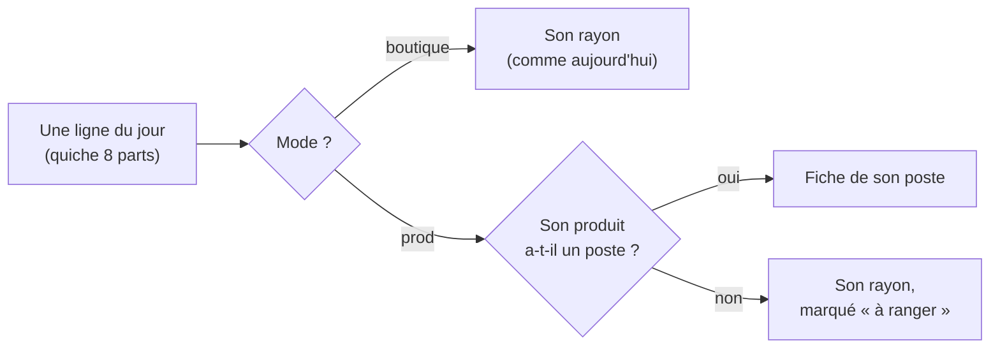

# Plan — les postes du fournil

**État : 📝 plan, rien n'est bâti.** Demande de Hugo, le 2026-11-16 : un
produit rangé en « Traiteur salé » à la boutique peut être fait par la
pâtisserie au fournil. Aujourd'hui, la fiche d'atelier et le dossier de
production le rangent quand même sous « Traiteur salé ». Le fournil doit
pouvoir ranger chaque produit au poste qui le fait, sans toucher au rangement
de la boutique et sans rien apprendre du référentiel.

Texte unique réécrit le 2026-11-16 après cinq contradictions de `vitruve`.
Leurs objections y sont intégrées, et leur historique est dans git. Les
décisions de Hugo sont datées.

---

## 1. En simple

La boutique range ses produits en **rayons**, pour le client. Le fournil
s'organise en **postes**, pour l'équipe : boulangerie, tourier, pâtisserie…
La quiche est au rayon « Traiteur salé », et c'est la pâtisserie qui la fait.

Le fournil tient deux choses, et rien d'autre :

- **sa liste de postes**, que Hugo nomme et ordonne à l'écran ;
- **le poste de chaque produit**. Toutes ses déclinaisons (quiche 6 parts,
  8 parts) en héritent.

Un réglage du fournil choisit le rangement : **mode boutique** (par rayon,
comme aujourd'hui, le défaut) ou **mode prod** (par poste). En mode prod, la
fiche d'atelier devient des **fiches de poste**, et le dossier du jour, le
prévisionnel, le récapitulatif et les filtres des réassorts du fournil sont
rangés par poste. Un produit sans poste reste sous son rayon, marqué « à
ranger ».



- **Rien ne change tant qu'on ne bascule pas.** Le mode boutique est le
  défaut, et il ne lit même pas les postes.
- **On ne bascule pas à vide.** Le passage en mode prod est refusé tant
  qu'aucun produit n'a de poste. S'il en reste sans poste, la bascule demande
  une confirmation qui en donne le compte.
- **On contrôle avant de basculer.** « Simuler le catalogue en production »
  sort un dossier avec tous les produits, rangés comme ils le seraient, pour
  chaque mode.
- **La boutique et le référentiel n'en savent rien.** Le fournil ne range que
  des références opaques que le commerce lui donne déjà.
- **Un produit oublié ne peut pas disparaître.** Il reste sous son rayon,
  marqué « à ranger », la page Postes le compte, et le Prod manager le signale
  dès qu'il est commandé, avant l'arrêt.

---

## 2. Ce qui existe (vérifié le 2026-11-16)

- **Le fournil ne connaît un article que par son SKU**, celui de la
  déclinaison : chaque déclinaison se vend sous sa référence, le défaut
  compris (`lafoliecoffee/catalog/domain/shop-sku.ts`). Une quiche 6 parts et
  une 8 parts sont deux lignes sur la fiche. Le commerce connaît la référence
  du produit de chaque déclinaison (`productSku`, dans
  `lafoliecoffee/catalog/domain/ports/catalog.reader.ts`).
- **Les ports que le fournil déclare et que le commerce implémente**
  (`production/channels/commerce/`) :
  - `WorkshopShelvesReader.shelvesOf(skus)` : le rayon de chaque SKU, lu en
    vue pro. Un SKU masqué ou inconnu est absent de la réponse.
  - `SellableArticlesReader.sellableArticles()` : les articles vendables, mais
    **seulement la déclinaison par défaut** de chaque produit (filtre
    `isDefault`, `catalog-sellable-articles.reader.ts`).
  - `ExpectedProductionReader.expectedBetween(range)` : la demande des
    commandes par jour et par SKU (au plus 31 jours, `ServiceRange`).
  - `ExpectedResuppliesReader.expectedBetween(range)` : la même chose pour les
    réassorts. Elle charge les réassorts entiers, puis fusionne en mémoire.
- **Les lignes du fournil appartiennent à `day/`.** `ProductionOrderLine` et
  `ProductionResupplyLine` portent `sku` et `productName`, et ne sont écrites
  qu'à l'arrêt d'une journée (`day/infrastructure/production-day-children.writer.ts`).
- **Deux rangements côté serveur**, par `rootShelvesOf` de l'imprimerie
  (`production/shared/print/`) :
  - la fiche d'atelier, `worksheetGroupsOf`
    (`atelier/domain/services/production-worksheet-groups.ts`). Ses groupes
    ont `key` = id de famille, et le front indexe ses onglets sur `key` ;
  - le dossier du jour, `recapOf` (`plan/domain/services/day-dossier.ts`),
    avec des groupes `{ label, quantity, lines, intertitles }`.
- **Le dossier n'est pas figé à l'arrêt.** Il est rangé à chaque tirage, et
  le premier tirage **archivable** est gardé
  (`plan/application/services/production-paper.service.ts`, `archivable`).
- **Le réglage d'affichage** (`showSubcategories`) appartient à l'imprimerie
  (`shared/print/infrastructure/prisma-production-display-settings.*`), sa
  route est `PUT /admin/production/settings/display` dans `atelier/http/`, et
  son changement émet `production_display_settings.updated`.
- **Trois écrans du front rangent eux-mêmes**, sur le catalogue :
  - le prévisionnel (`previsionnel/previsionnel-matrix.ts`, `catalogRootShelves`) ;
  - le récapitulatif (`production-recap.ts`) ;
  - les filtres des réassorts à produire (`reassorts-a-produire/`), qui
    filtrent par la catégorie portée par l'article (`categoryId`), sans
    racine.

  Le réassort du comptoir (`comptoir/reassort-boutique-page/`) est un écran
  de la boutique.

- **Les droits.** Le prévisionnel et le récapitulatif relèvent de
  `production_plan:read`, et les réassorts du fournil de
  `production_resupply:read`. `StaffAccessGuard` déduit le droit de la méthode
  HTTP : un POST demande `:write`, sauf décorateur explicite
  (`platform/auth/staff-access.guard.ts`).
- **La porte `production-subcontexts`** déclare ses sous-contextes et ses
  arêtes dans `dev-toolbox/gates/lib/production-subcontexts-graph.mjs`
  (`DIRECTORIES`, `GATED`, `ALLOWED`), et ses modèles dans
  `dev-toolbox/gates/production-subcontexts.map.json`. Entre métiers, elle
  n'admet que `atelier → quality` et `plan → resupply`.
- **Les tables du fournil sans journée** sont listées, avec leur raison, dans
  `test/day-change-triggers.e2e-spec.ts` (`UNWATCHED`). La suite vérifie que
  chaque table inscrite existe.
- **Les mots.** « Station » est pris (`PackingStation`, `StationContext`),
  donc un poste s'appelle `Workstation` dans le code. Le front appelle
  « poste fixe » la tablette, en fiche d'atelier comme en livraison.

---

## 3. La conception

### 3.1 Le métier `workstations/`

Les postes sont le vocabulaire du fournil. Ils vivent dans le schéma
`production`, dans un nouveau métier `src/production/workstations/`, avec son
`index.ts` et son module Nest. Ni dans `day/`, qui ne connaît aucun métier, ni
dans `atelier/`, que `plan/` ne lit pas.

`workstations/` lit le partagé (`day/`, `shared/print/`, `channels/`), comme
tout métier. `atelier/` et `plan/` lisent `workstations/`. Ce sont les deux
seules arêtes neuves entre métiers.

Il publie, dans son `index.ts`, sous « ce que les postes savent répondre » :

- `WorkstationOfProducts.workstationsOf(productSkus)` : le poste de chaque
  produit, ou rien ;
- `ProductionGrouping.groupingOf(lines, mode)` : le rangement complet (§ 3.4),
  pour ceux qui rangent.

### 3.2 Les tables (migration additive)

```
production.production_workstation
  id                   text pk           ULID
  name                 text not null     unique parmi les postes vivants (sans casse)
  position             int  not null     l'ordre des fiches
  archived_at          timestamptz null  pas de DELETE physique
  updated_at, updated_by_staff_id, updated_by_name

production.production_workstation_product
  product_sku          text pk           la référence du produit, opaque
  workstation_id       text not null → production_workstation (RESTRICT)
  updated_at, updated_by_staff_id, updated_by_name

production.production_display_settings
  + grouping           text not null default 'shelf'
                       CHECK (grouping in ('shelf', 'workstation'))
```

- **Aucune clé ne sort du schéma `production`.** La référence produit est
  opaque, comme le SKU des lignes.
- La migration crée aussi la ressource `production_workstations`, accordée à
  l'écran, jamais par migration.
- Les deux tables entrent à `UNWATCHED` (un réglage, pas un fait du jour)
  **dans le même lot** que la migration. Les colonnes `updated_by_*` entrent
  au registre RGPD.
- Une ligne de réglage absente vaut `grouping: 'shelf'`.

### 3.3 L'agrégat `WorkstationMap`

Trois règles peuvent refuser une écriture, donc c'est un agrégat (CLAUDE.md
§ 3.1) :

- deux postes vivants ne portent pas le même nom ;
- un poste qui porte des produits ne s'archive pas ;
- aucun produit ne va à un poste archivé.

La carte entière fait l'agrégat (une dizaine de postes, quelques centaines de
produits) :

- `WorkstationMap.empty()` ;
- les méthodes `declare(name)`, `rename(id, name)`, `reorder(ids)`,
  `archive(id)` et `place(productSkus, workstationId | null)`, chacune
  refusant la transition illégale par une `BusinessError` qui nomme le poste et
  le geste de sortie ;
- les value objects `WorkstationName` (non vide, au plus 40 caractères,
  comparé sans casse ni espaces de bord) et `ProductSku`, à créer dans
  `workstations/domain/` ;
- le port `WorkstationMapRepository` : `load()` et `save(map)`. L'adaptateur
  écrit la **différence**, sous un verrou consultatif, avec `toDomain` et
  `toPersistence` ;
- cinq commandes (`DeclareWorkstation`, `RenameWorkstation`,
  `ReorderWorkstations`, `ArchiveWorkstation`, `PlaceProducts`), toutes
  **par intention** : `@IntentKey`, `runSealed`, et la clé d'une
  `GestureIntents` côté écran. Rejouer un renommage après celui de quelqu'un
  d'autre le déferait ;
- un fait par geste, dans la même transaction (`production_workstation.declared`,
  `.renamed`, `.reordered`, `.archived`, `.products_placed`), inscrit au
  catalogue `packages/contracts/src/journal-facts/` avec ses phrases de
  journal ;
- les lectures passent par un port de lecture distinct, qui ne charge pas
  l'agrégat.

### 3.4 Le rangement

Une seule fonction pure de l'imprimerie, `groupingOf`, rend des
**groupements neutres** :

```
{ key, title, kind: "workstation" | "shelf" | "unplaced" | "off_catalog",
  workstation: { id, name } | null, sections, lines }
```

- **Mode boutique :** exactement `rootShelvesOf` d'aujourd'hui. Un groupe par
  rayon (`kind: "shelf"`), puis « Hors catalogue » ou « Rayon inconnu ».
  Aucune lecture des postes.
- **Mode prod :**
  1. un groupe par poste qui a des lignes, dans l'ordre des postes ;
  2. pour les produits sans poste, un groupe par rayon, `kind: "unplaced"`,
     titré « Traiteur salé — à ranger » ;
  3. « Hors catalogue — à ranger » pour un SKU que le commerce ne connaît
     plus (sans produit, il ne peut pas recevoir de poste) ;
  4. sections : avec `showSubcategories`, les rayons de boutique d'où
     viennent les lignes du poste.

**Invariant testé :** toute ligne qui entre ressort une fois, dans les deux
modes. Une **panne** de la lecture des postes en mode prod rend le
rangement du mode boutique, journalise la panne, et le dossier n'est pas
archivé (§ 3.5).

**Le produit d'une ligne.** Le port des rayons, `WorkshopShelvesReader.shelvesOf`,
rend en plus la référence produit de chaque SKU (`productSku`, que le
commerce porte déjà). C'est un champ de plus dans une réponse qui existe, pas
une lecture de plus.

**La même découpe de page** (décision de Hugo, 2026-11-16). `recapOf` et
`worksheetGroupsOf` traduisent ces groupements dans leur forme d'aujourd'hui.
Le gabarit du PDF et la mise en page de la fiche ne changent pas : un poste
prend la place d'un rayon. Le contrat `WorkshopGroup` gagne `kind`,
`workstation` et `unplaced`. `key` vaut `ws:<id>` pour un poste. Le JSDoc de
`family` dit qu'il vaut `null` pour un poste, un hors catalogue ou des rayons
illisibles, et qu'il faut lire `kind`.

### 3.5 Le figement du dossier

Le dossier est gardé au **premier tirage archivable**, avec le mode et les
postes de ce tirage. En mode prod, `archivable` exige aussi « postes lus ».
Chaque tirage non archivable est journalisé avec sa cause. **Limite
assumée :** un réglage changé entre l'arrêt et ce tirage s'y voit. On ne règle
pas les postes pendant le service.

### 3.6 Les fiches de poste (décision de Hugo, 2026-11-16)

En mode prod, `/fournil` montre **une fiche par poste**. Les onglets de la
tablette et le sélecteur du téléphone listent les postes, avec leur
avancement, et l'en-tête dit « Fiche de poste — Pâtisserie · fiche 2 sur 5 ».
La fiche elle-même ne change pas.

- `/fournil?poste=<id>` ouvre la fiche d'un poste. Le dernier ouvert est
  retenu par personne, dans `nav_prefs.worksheetCategory`, avec la clé du
  contrat (`ws:<id>`, 29 caractères pour une limite de 40).
- Les messages suivent le mode : « Les postes n'ont pas pu être lus — les
  fiches sont rangées par rayon ».
- « Poste fixe » devient « tablette » dans tout le back-office (fiche
  d'atelier et livraison).

### 3.7 Le rangement servi au front

Le prévisionnel, le récapitulatif et les filtres des réassorts du fournil ne
rangent plus eux-mêmes. Ils appellent :

```
POST /admin/production/workstations/grouping
corps : { skus: string[] }        Zod : 1 à N SKU, chacun de 1 à 64 caractères
réponse : le groupement de chaque SKU (clé, titre, kind, ordre, section)
```

- C'est une **lecture** : une `Query` sur le bus, `@Idempotent("lecture :
n'écrit rien")`, `@HttpCode(200)`, et
  `@RequireAnyPermission("production_plan:read", "production_resupply:read")`,
  puisque le garde déduirait `:write` d'un POST. Ce n'est pas une route par
  intention.
- **La borne N** : à mesurer en W3b, à quelques fois le nombre réel de SKU
  vendables, déclinaisons comprises, avec sa raison écrite. Le corps tient de
  toute façon sous `JSON_BODY_LIMIT` (512 Ko).
- **En mode boutique,** les filtres des réassorts gardent leur filtre par
  `categoryId`, et le prévisionnel et le récapitulatif restent rangés comme
  aujourd'hui (le serveur rend le rangement par rayon). Le réassort du
  **comptoir** n'est jamais concerné.

### 3.8 La page Postes

Prod manager → **Postes** (`production_workstations`) :

- en tête, les postes : ajouter (nommé par Hugo), renommer, monter ou
  descendre, archiver. « Partir des rayons » crée un poste par rayon racine
  et y place ses produits, comme premier jeu de noms à corriger ;
- dessous, **les produits**, chacun avec son rayon, ses déclinaisons en
  dessous pour information, et un `fold-listbox` « Poste ». Un filtre « à
  ranger » avec son compte, un filtre par rayon, et « tout ce rayon → ce
  poste », qui appelle `PlaceProducts` sans laisser de règle ;
- le réglage **mode boutique / mode prod**, et les deux boutons de
  simulation.

**Les produits listés** sont l'union de quatre sources, ramenée au produit
par la réponse du commerce :

1. les articles vendables (`SellableArticlesReader`, qui rend désormais
   **toutes** les déclinaisons et leur `productSku`) ;
2. les lignes des journées arrêtées de J−30 à la dernière, commandes et
   réassorts : la lecture nommée `KnownArticles`, publiée par `day/` ;
3. la demande des commandes des 14 prochains jours (`ExpectedProductionReader`) ;
4. celle des réassorts (`ExpectedResuppliesReader`), hors réassorts « au plus
   tôt », qui n'entrent pas au plan.

Un SKU que le commerce ne rattache plus à aucun produit est listé à part,
« hors catalogue ». Il ne peut pas recevoir de poste.

### 3.9 La bascule en mode prod

`PUT /admin/production/settings/display` porte `grouping`. Le fait
`production_display_settings.updated` porte `grouping` et `previous.grouping`.

- **Refusée tant qu'aucun produit n'a de poste** : « Aucun produit n'a de
  poste : rangez-les depuis la page Postes, ou partez de “Simuler le
  catalogue en production”. »
- **Si des produits de la demande des 14 jours n'ont pas de poste,** l'écran
  demande une confirmation qui en donne le compte. Le serveur ne refuse pas.
- **Avant W3b,** le serveur refuse `workstation` (« le mode prod arrive avec le
  rangement des écrans du prévisionnel ») : sans ça, la fiche serait rangée
  par poste et le prévisionnel encore par rayon.
- Retirer des postes après la bascule ne fait pas revenir en mode boutique.
  L'alerte le signale.

### 3.10 L'alerte du Prod manager

En mode prod, « N produits du jour à ranger », avec un lien vers le filtre.
Avant l'arrêt, elle lit la demande attendue **du seul jour** (commandes et
réassorts). Après, elle lit les lignes du jour (`KnownArticles` borné au
jour). Elle est servie par une requête de `workstations/`.

### 3.11 Simuler le catalogue en production (pour chaque mode)

Sur la page Postes : « Simuler en mode prod » et « Simuler en mode
boutique », quel que soit le réglage.

- Une pièce de chaque article vendable, déclinaisons comprises, dans une seule
  commande fictive, rendue par la partie « un rayon et son calendrier » du
  **vrai** dossier, avec le rangement du mode demandé.
- La couverture compte les lignes par groupe et nomme les produits « à
  ranger ».
- Rien n'est persisté, ni archivé, ni envoyé. Chaque page porte
  « SIMULATION — ne pas produire ».
- `GET /admin/production/workstations/simulation.pdf?mode=workstation|shelf`,
  sous `production_workstations`. Son exemple figure sur la planche des
  documents (`lint:pdf-specimens`).
- **À vérifier en W2b :** le calendrier d'une commande fictive sans tranches
  réelles.

---

## 4. Décisions de Hugo (2026-11-16)

- **Un poste par produit.** Les déclinaisons en héritent. Un produit fait par
  deux postes, ou une déclinaison faite ailleurs que son produit, n'est pas
  traité ici (il faudrait la recette).
- **Mode boutique / mode prod**, un réglage du fournil qui vaut pour tous ses
  rangements, prévisionnel compris.
- **Tout ce qui est commandé est « à produire »** : qu'on le fabrique ou qu'on
  le sorte de la réserve, il prend un poste (« Revente », « Réserve »…). La
  distinction fabriqué / revendu, le jour où il la faudra, sera une propriété
  de l'article et un autre chantier.
- **La même découpe de page** pour le dossier et la fiche.
- **Les fiches d'atelier deviennent des fiches de poste.**
- **Hugo nomme les postes.**
- **Une simulation pour chaque mode.**
- **Pas de bascule à vide.**

---

## 5. Les lots

| Lot     | Contenu                                                                                                                                                                                                                                                                                                                                                                | Tests                                                                                                             |
| ------- | ---------------------------------------------------------------------------------------------------------------------------------------------------------------------------------------------------------------------------------------------------------------------------------------------------------------------------------------------------------------------- | ----------------------------------------------------------------------------------------------------------------- |
| **W0**  | Porte : `workstations` dans `DIRECTORIES`, `GATED`, `ALLOWED` (`workstations: SHARED`) ; `atelier` et `plan` gagnent `workstations` ; les deux modèles et leur propriétaire dans la carte.                                                                                                                                                                             | un fichier sous `workstations/` est refusé avant, admis après                                                     |
| **W1**  | Migration (deux tables, `grouping`, ressource) ; `UNWATCHED` et registre RGPD ; l'agrégat, ses commandes par intention, ses faits et leurs phrases ; les lectures ; `KnownArticles` dans `day/` ; `shelvesOf` et `sellableArticles` rendent `productSku` (toutes les déclinaisons) ; la page des données de `/admin/production/workstations`. `lecteur-de-migrations`. | domaine sans Nest (trois refus, `place` à `null`, noms) ; handlers ; e2e ; `lint:write-idempotence`               |
| **W2**  | `groupingOf` ; la fiche et le dossier l'appellent ; le contrat ; `archivable` en mode prod ; le refus de `workstation` au réglage tant que W3b n'est pas là.                                                                                                                                                                                                           | mode boutique identique à aujourd'hui (deux cas de `showSubcategories`) ; toute ligne ressort une fois ; la panne |
| **W2b** | La simulation, son spécimen.                                                                                                                                                                                                                                                                                                                                           | tous les articles ressortent ; deux modes ; rien n'est écrit                                                      |
| **W3**  | `pablo` : la page Postes, les fiches de poste, « tablette », l'alerte.                                                                                                                                                                                                                                                                                                 | specs ; `lint:front-intent-keys` ; essai dans Chrome                                                              |
| **W3b** | La route `grouping` ; le prévisionnel, le récapitulatif et les filtres des réassorts du fournil l'appellent ; la borne N mesurée ; la bascule en mode prod ouverte (refus à vide, confirmation).                                                                                                                                                                       | les écrans dans les deux modes ; plus de `catalogRootShelves` dans le prévisionnel ni le récapitulatif            |
| **W4**  | Doc d'état des postes du fournil (dans `fournil/`) ; `la-fiche-d-atelier.md` et `dossier-prod-du-jour.md` à jour ; le plan est supprimé.                                                                                                                                                                                                                               | —                                                                                                                 |

---

## 6. À mesurer ou vérifier pendant la construction

- Le coût sur la base de production : la page Postes (quatre sources),
  l'alerte, la route `grouping`. `KnownArticles` fait un `DISTINCT` par
  jointure sur `production_order.service_day`, avec un index à ajouter si la
  mesure le demande.
- Si `ExpectedProductionReader` rend encore une journée arrêtée, ce qui fixe
  la source de l'alerte après l'arrêt.
- Les rôles qui ont `production_resupply` sans `production_plan`.
- Le nombre réel de SKU vendables, qui donne la borne N.
