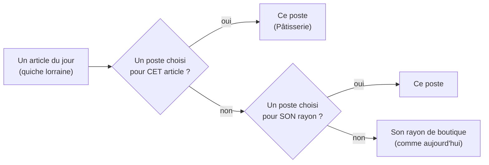
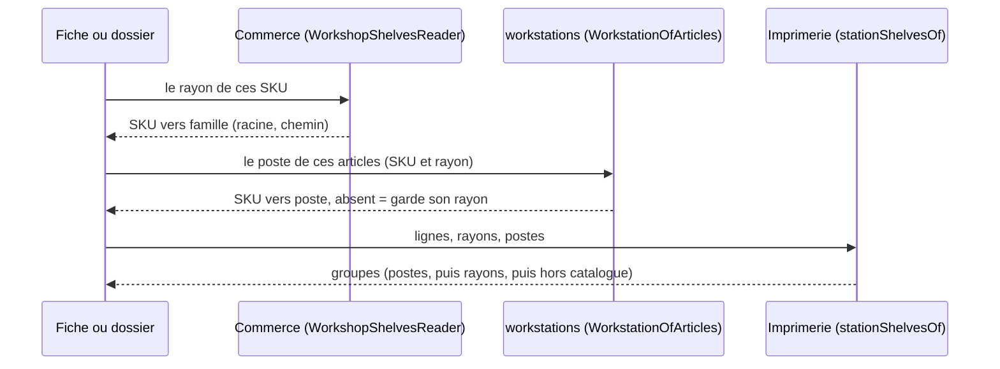

# Plan — les postes du fournil

**État : 📝 plan, rien n'est bâti.** Demande de Hugo, le 2026-11-16 : un
article rangé en « Traiteur salé » à la boutique peut être fait par la
pâtisserie au fournil. Aujourd'hui, la fiche d'atelier et le dossier de
production le rangent quand même sous « Traiteur salé ». Il faut pouvoir
ranger chaque article au poste qui le fait, sans toucher au rangement de la
boutique et sans casser la séparation entre le commerce et le fournil.

Ni argent, ni migration de données (deux tables neuves, additives), ni
frontière de sécurité, ni runbook : ce plan ne passe pas par `vitruve`. Ses
affirmations sur l'existant ont été vérifiées en ouvrant le code le
2026-11-16 (§ 2).

---

## 1. En simple

La boutique range ses articles en **rayons**, pour le client. Le fournil
s'organise en **postes**, pour l'équipe. Les deux se ressemblent, mais pas
toujours : la quiche est au rayon « Traiteur salé », et c'est la pâtisserie
qui la fait.

Le fournil aura donc **sa propre liste de postes**, qu'il règle lui-même. Pour
chaque poste, on dit ce qu'il fait : un rayon entier (« tout le Snacking va à
la Tourière ») ou un article précis (« la quiche va à la Pâtisserie »).



Trois propriétés tiennent tout le plan :

- **Rien ne change tant qu'on ne règle rien.** Un article sans poste se range
  sous son rayon de boutique, exactement comme aujourd'hui. Le jour de la mise
  en service, les fiches restent identiques.
- **La boutique ne sait rien des postes.** Renommer ou déplacer un poste ne
  touche ni le site, ni le catalogue, ni le référentiel.
- **Le dossier imprimé garde le poste du moment de l'arrêt.** Il est déjà figé
  et archivé à l'arrêt du plan. Un changement de réglage l'après-midi ne
  réécrit pas le papier du matin.

---

## 2. Ce qui existe (vérifié le 2026-11-16)

- **Le fournil ne connaît un article que par son SKU.** Il demande le rayon au
  commerce par un port qu'il déclare :
  `production/channels/commerce/workshop-shelves.reader.ts`
  (`WorkshopShelvesReader.shelvesOf(skus) → Map<sku, CatalogFamilyView>`).
  Le commerce l'implémente dans
  `lafoliecoffee/catalog/infrastructure/catalog-workshop-shelves.reader.ts`,
  sur le miroir des familles du référentiel. La famille rendue porte sa racine
  (`root`) et son chemin (`path`), d'après `packages/contracts/src/catalog.ts`.
- **Deux lecteurs rangent par rayon côté serveur**, tous deux par
  `rootShelvesOf` de l'imprimerie (`production/shared/print/`) :
  - la fiche d'atelier : `atelier/domain/services/production-worksheet-groups.ts`
    (`worksheetGroupsOf`), lue par
    `atelier/application/services/production-worksheet-reading.service.ts` ;
  - le dossier du jour : `plan/domain/services/day-dossier.ts`, lu par
    `plan/application/services/production-paper.service.ts`, figé et archivé
    à l'arrêt (`fournil/dossier-prod-du-jour.md`).
- **Le réglage d'affichage** (`showSubcategories`) vit dans
  `ProductionDisplaySettings`, réglé par `PUT /admin/production/settings/display`
  (`atelier/http/production-display-settings.controller.ts`).
- **Trois écrans rangent par rayon côté front**, sur le catalogue et pas sur
  le fournil : le prévisionnel (`previsionnel/previsionnel-matrix.ts`), les
  filtres des réassorts à produire (`reassorts-a-produire/bakehouse-resupply-card/article-filters.ts`)
  et le récapitulatif (`production-recap.ts`). Ils restent hors du lot 1
  (§ 6).
- **La porte `production-subcontexts`** n'admet entre métiers que
  `atelier → quality` et `plan → resupply`
  (`dev-toolbox/gates/production-subcontexts.mjs`, en-tête). Un nouveau métier
  lu par `plan` et `atelier` demande deux arêtes de plus, écrites dans la porte.
- **Le mot « station »** est déjà pris : `PackingStation` (le colisage) et
  `StationContext` (les sites). Les postes du fournil s'appelleront
  `Workstation` dans le code (lexique : poste = `workstation`).

---

## 3. La conception

### 3.1 Le propriétaire : un métier `workstations/` du fournil

Les postes sont **le vocabulaire du fournil**, pas celui de la vente. Ils
vivent donc dans le schéma `production`, dans un nouveau métier
`src/production/workstations/`, avec son `index.ts` et son module Nest.

Pourquoi pas ailleurs :

| Où                                                     | Pourquoi non                                                                                                                                                                                        |
| ------------------------------------------------------ | --------------------------------------------------------------------------------------------------------------------------------------------------------------------------------------------------- |
| Un « rayon de production » sur la fiche du référentiel | Le référentiel décrirait l'organisation d'un atelier. Le fournil devrait le lire par le commerce (`production → pim` est interdit). Et renommer un poste deviendrait une révision de fiche produit. |
| Ranger l'article dans un autre rayon de boutique       | Un poste qui n'existe pas en boutique (« Tour », « Four à sole ») serait impossible. Et on toucherait au rangement que voit le client.                                                              |
| Dans `day/`                                            | Le noyau répond aux questions sur la journée. Il ne connaît aucun métier, et un réglage n'est pas une journée.                                                                                      |
| Dans `atelier/` (là où est le réglage d'affichage)     | Le dossier (`plan/`) en a besoin aussi. `plan → atelier` n'est pas une arête admise, et l'ouvrir pour un réglage ferait de l'atelier un fourre-tout.                                                |

`workstations/` **publie une lecture nommée**, selon la règle « le
propriétaire parle de ce qui est à lui » (CLAUDE.md § 3) :

```ts
/** Le poste qui fait chaque article, ou rien : il garde alors son rayon. */
export abstract class WorkstationOfArticles {
  abstract placementsOf(
    articles: readonly { sku: string; shelf: CatalogFamilyView | null }[],
  ): Promise<ReadonlyMap<string, WorkstationView>>;
}
```

L'appelant passe le rayon qu'il a **déjà** lu au commerce. `workstations/` ne
relit pas le catalogue, et le commerce n'est interrogé qu'une fois par
tirage, comme aujourd'hui.

Deux arêtes s'ajoutent à la porte, chacune avec sa raison :
`atelier → workstations` et `plan → workstations`. `workstations/` lui-même ne
lit que `day/`, `channels/` et `platform/`, et personne ne lit l'intérieur du
fournil.

### 3.2 Les tables (additives)

```
production.workstation
  id            text  pk            (ULID, IdGenerator)
  name          text  not null      unique parmi les postes vivants
  position      int   not null      l'ordre des fiches
  archived_at   timestamptz null    pas de DELETE physique
  created_at / updated_at / updated_by

production.workstation_assignment
  id               text pk
  workstation_id   text not null → production.workstation (RESTRICT)
  kind             text not null  CHECK in ('family', 'sku')
  target           text not null  id de famille du référentiel, ou SKU — opaque
  unique (kind, target)            un article, un rayon : UN poste au plus
  updated_at / updated_by
```

- **Aucune clé étrangère ne sort du schéma `production`.** La famille et le
  SKU sont des identifiants opaques, comme `ProductionOrderLine.sku`
  aujourd'hui.
- **Une cible disparue n'est pas une erreur.** Un rayon supprimé ou un SKU
  retiré laisse une affectation qui ne s'applique plus. L'écran la montre
  (« rayon disparu ») et propose de la retirer.
- **Archiver un poste** libère ses affectations : la règle de résolution
  ignore un poste archivé, et ses articles reviennent à leur rayon.
- `updated_by` désigne une personne du staff : la colonne entre au registre
  RGPD (`lint:rgpd-staff`).

### 3.3 L'agrégat

La question de tri du § 3.1 de CLAUDE.md (« une règle peut-elle refuser cette
écriture ? ») répond oui : deux postes vivants ne portent pas le même nom, un
article ou un rayon n'a qu'un poste, et on n'affecte rien à un poste archivé.
L'agrégat est **`WorkstationMap`**, toute la carte d'un coup (une dizaine de
postes, quelques dizaines d'affectations) :

- `declare(name)`, `rename(id, name)`, `reorder(ids)`, `archive(id)` ;
- `assignFamily(familyId, workstationId)`, `assignSku(sku, workstationId)`,
  `unassign(kind, target)` ;
- `placementOf(sku, shelf)` : la règle de la § 1, **pure**. Le SKU d'abord,
  puis la famille exacte, puis ses ancêtres en remontant `path`, la racine en
  dernier.

Le dépôt fait `load()` / `save(map)`. Un verrou consultatif sur la carte évite
que deux écrans écrasent leurs gestes.

### 3.4 Le rangement

`rootShelvesOf` (imprimerie) reste tel quel. Une fonction voisine,
`stationShelvesOf(lines, shelfOf, placementOf)`, produit des **groupes** :

- un groupe par poste qui a des lignes, dans l'ordre des postes ;
- puis un groupe par rayon de boutique pour ce qui n'a pas de poste, dans
  l'ordre du référentiel, comme aujourd'hui ;
- puis « Hors catalogue » ou « Rayon inconnu », comme aujourd'hui.

**Une panne de la lecture des postes** se traite comme une panne des rayons
aujourd'hui : on journalise, et la fiche est servie rangée par rayon. Un poste
ne doit jamais empêcher de produire.

Avec `showSubcategories`, les sections d'un groupe-poste sont **les rayons de
boutique** d'où viennent ses articles (« Pâtisserie › Traiteur salé »). C'est
ce qui permet de retrouver la quiche en lisant le site.

`worksheetGroupsOf` et `day-dossier` appellent la fonction neuve. Leurs
groupes gardent leur forme. `WorkshopGroup` (contrat) gagne
`workstation: { id, name } | null` à côté de `family` : un groupe porte l'un
ou l'autre.

### 3.5 Le figement

Le dossier du jour est un PDF figé à l'arrêt : il garde le poste de
l'arrêt, sans rien à faire de plus. La fiche d'atelier, elle, est vivante :
un réglage changé en pleine journée la réorganise au prochain rafraîchissement
(15 s). Figer les postes de la journée à l'arrêt n'est pas proposé ici
(question Q3).



### 3.6 L'écran

Prod manager → **Réglages → Postes du fournil**, sur une page de détail : la
liste des postes, ses rayons et ses articles, et plusieurs sujets à régler.

- Une `fold-card` par poste : son nom, ses rayons, ses articles, et les
  gestes renommer, monter / descendre et archiver.
- « Ajouter un rayon » ou « Ajouter un article » : un choix dans le catalogue
  (rayons du référentiel, articles fabriqués). Un article déjà couvert par son
  rayon s'affiche « par son rayon ».
- Un encadré **« Ce qui garde son rayon de boutique »** liste les rayons qui
  n'ont aucun poste. C'est là qu'on voit ce qu'on a oublié.
- « Partir des rayons » crée un poste par rayon racine et l'y affecte. C'est
  le premier geste sur une carte vide, et il ne change rien aux fiches.

Une ressource neuve, `production_workstations`, est créée par migration et
accordée **à l'écran** (règle des droits du § 3 de CLAUDE.md).

---

## 4. Les lots

| Lot    | Contenu                                                                                                                                                                                                         | Tests                                                                                                     |
| ------ | --------------------------------------------------------------------------------------------------------------------------------------------------------------------------------------------------------------- | --------------------------------------------------------------------------------------------------------- |
| **W0** | Porte `production-subcontexts` : le métier `workstations/`, ses modèles, les deux arêtes et leurs raisons. Armée avant le dossier (« armer une porte avant de déménager »).                                     | la porte refuse un import `plan → workstations` hors `index.ts`                                           |
| **W1** | Migration (deux tables, ressource), agrégat `WorkstationMap` et `placementOf`, dépôt Prisma, commandes et requête, routes `/admin/production/workstations`. `lecteur-de-migrations`.                            | domaine (résolution SKU > famille > ancêtre > rien, archivé ignoré, noms uniques), handlers, e2e du dépôt |
| **W2** | `stationShelvesOf` dans l'imprimerie ; la fiche d'atelier et le dossier l'appellent ; contrat `WorkshopGroup.workstation`. Panne des postes = rangement par rayon, journalisé.                                  | **carte vide = sortie identique à aujourd'hui** (test de non-régression sur les deux), panne, sections    |
| **W3** | L'écran Postes du fournil (`pablo`), le rail et les tuiles, « Partir des rayons ».                                                                                                                              | spec de l'écran ; essai dans Chrome sur le scénario de commandes                                          |
| **W4** | Doc d’état des postes du fournil (dans `fournil/`) ; mise à jour de `la-fiche-d-atelier.md` et `dossier-prod-du-jour.md` ; le spécimen du dossier montre un poste (`lint:pdf-specimens`). Le plan est supprimé. | —                                                                                                         |

W2 est le seul lot qui change ce que voit l'équipe, et il ne change rien tant
que W3 n'a rien réglé.

---

## 5. Questions à trancher (Hugo)

- **Q1 — Un article sans poste, une fois des postes déclarés.** Défaut
  proposé : il garde son rayon de boutique, en fin de fiche (ce plan).
  Variante : un groupe « Sans poste », plus visible, mais une famille neuve
  côté boutique y tomberait sans que personne ait rien changé au fournil.
- **Q2 — Un article qui va à deux postes** (la pâte à la tourière, la
  garniture à la pâtisserie). Hors plan : un article, un poste. Le partager
  demanderait des quantités par poste, donc la recette, ce qui est un autre
  chantier.
- **Q3 — Figer les postes de la journée à l'arrêt**, pour que la fiche ne
  bouge pas pendant le service. Défaut proposé : non. Le dossier est déjà
  figé, et un réglage se fait en dehors du service.
- **Q4 — Les écrans rangés par rayon côté front** (prévisionnel, réassorts,
  récapitulatif). Défaut proposé : ils restent par rayon dans ce plan, et un
  lot suivant les passera aux postes s'il le faut. Le colisage n'est pas
  concerné : il range par commande.

---

## 6. Hors du plan

- Le référentiel, le catalogue et la boutique : aucune ligne ne change.
- Les fournées, le colisage, la qualité : ils ne rangent pas par rayon.
- La capacité d'un poste (charge, four) : un poste n'est ici qu'un
  rangement.
