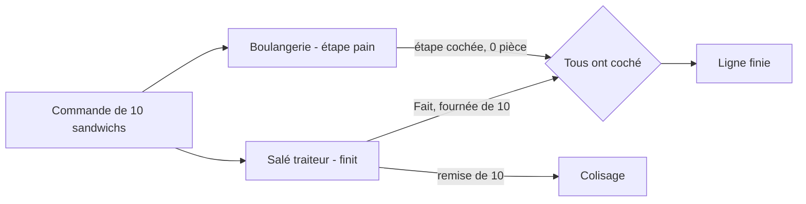

# Un produit sur plusieurs postes — plan

_Demandé par Hugo le 2026-11-25. Statut : plan, rien n'est bâti._
État d'aujourd'hui : [`les-postes-du-fournil.md`](les-postes-du-fournil.md),
[`les-niveaux-de-suivi.md`](les-niveaux-de-suivi.md).

## 1. En simple

Aujourd'hui, en mode prod, un produit va à **un** poste. Demain, il pourra en
avoir plusieurs : un sandwich passe à la Boulangerie (le pain) et au Salé
traiteur (la garniture et l'assemblage).

Décidé par Hugo le 2026-11-25 :

- chaque poste voit la ligne avec **toute** la quantité commandée ;
- chaque poste coche **sa part**, et la ligne n'est finie que quand tous ont coché ;
- sur le dossier imprimé, la ligne figure sous **chacun** de ses postes ;
- un seul poste est **celui qui finit** : seul son « Fait » compte des pièces
  et les remet au colisage. Les autres cochent une **étape**, qui ne compte
  aucune pièce (sinon on compterait 20 sandwichs pour 10).

Quand les postes n'ont pas le même niveau de suivi (proposé) :

- **la fournée suit le poste qui finit** : en toujours vert, elle part seule à
  l'heure ; sinon, c'est son « Fait » qui la déclare ;
- **une étape en toujours vert se coche d'office** à l'échéance, par le même
  tour automatique, sans compter de pièce ;
- **« Problème » reste par ligne** et se déclare depuis le poste qui finit
  (le plafond porte sur ce qui sort) ; un poste d'étape met son étape **en
  rouge** avec une raison, sans plafond ;
- **la sortie fait foi pour tout ce qui compte des pièces** : colisage,
  clôture de la journée, Supervision et totaux lisent la fournée, comme
  aujourd'hui. Les étapes se voient sur la fiche (« en attente de :
  Boulangerie »), elles ne retiennent rien d'autre.

Le mode boutique (rayons) ne change pas : une ligne y ressort une fois, et
aucune étape n'est exigée.

## 2. Partie technique

### 2.1 L'existant (vérifié le 2026-11-25)

- `apps/lfd-api/prisma/schema/production.prisma` : `ProductionWorkstationProduct`
  a `productSku @id` (un produit, un poste), `workstationId`, `position Int?`.
  `ProductionProblem` est `@@unique([serviceDay, sku])`.
  `ProductionDayTrackingLevel.workstationLevels` (Json) fige le niveau de
  chaque poste. `ProductionBatch` et `ProductionHandoff` sont par
  (`serviceDay`, `sku`), sans poste.
- `production/workstations/domain/ports/workstation-of-products.ts` :
  `byProduct: Map<sku, workstationId>`, `positions: Map<sku, number>`.
- `production/shared/print/domain/services/production-grouping.ts` :
  `workstationGroupsOf` pousse chaque ligne dans **un** groupe ; `inPile` trie
  par position du produit.
- `production/workstations/domain/entities/workstation-map.ts` :
  `workstationOf`, `positionOf`, `place`, `reorderProducts`, `archive` (refusé
  tant que le poste porte des produits).
- `production/atelier/application/services/worksheet-tracking-levels.ts` : un
  niveau **par ligne** (`levelOf(sku)`), celui du poste du produit, sinon celui
  du fournil ; postes illisibles → détaillé.
- La fournée automatique : tour `*/5`, id `auto-<jour>-<sku>-<n>`, auteur
  `system:always-green` (`les-niveaux-de-suivi.md`).

### 2.2 Le modèle

`production_workstation_product` :

- clé primaire **(`product_sku`, `workstation_id`)** ;
- `finishes boolean not null` ;
- `position Int?` devient la place du produit **dans ce poste** ;
- `UNIQUE (product_sku) WHERE finishes` : au plus un poste qui finit.
  « Au moins un » est tenu par l'agrégat, qui écrit la carte en une
  transaction.

### 2.3 La migration de données (L0)

Un seul `migration.sql`, dans le même déploiement que le code (pré-release,
CLAUDE.md § 0 : contrat cassable, aucune suppression) :

1. `ADD COLUMN finishes boolean NOT NULL DEFAULT true` — chaque produit placé
   devient sa seule ligne, qui finit ;
2. `DROP CONSTRAINT production_workstation_product_pkey`, puis
   `ADD PRIMARY KEY (product_sku, workstation_id)` ;
3. l'index unique partiel ;
4. `ALTER COLUMN finishes DROP DEFAULT` — le code dit toujours qui finit ;
5. la table des étapes (2.6), **avec ses trois déclencheurs** INSERT / UPDATE /
   DELETE vers `record_day_change_by_service_day`, sur le modèle de
   `production_problem` (`migrations/20261117100000_les_niveaux_de_suivi`) :
   la fiche est en cache sur les journaux de la journée
   (`atelier/application/services/worksheet-contents.service.ts`), et une
   étape cochée sans déclencheur laisserait la fiche d'avant.

La clé s'élargit : aucune ligne existante ne la viole. Portes et listes à
tenir : `schema-drift` (l'index partiel ne s'écrit pas en Prisma → une entrée
dans `prisma/schema-drift-admitted.json`, comme
`shop_carts_user_company_unique`), `prisma-schema-layout`,
`production-subcontexts` (`ProductionLineStep → atelier` dans sa carte),
`test/day-change-triggers.e2e-spec.ts` (la table est surveillée, pas
`UNWATCHED`).

🔴 **Irréversible dès le premier produit à deux postes** : revenir à une clé
par produit demanderait de supprimer des lignes, ce que CLAUDE.md § 0 interdit
sans ordre de Hugo. Le retour arrière d'avant ce premier usage est un
`DROP` de la clé composée et de l'index, sans perte.

### 2.4 L'agrégat et les gestes

L'état passe à `Map<sku, Map<workstationId, { position, finishes }>>`.
Chaque geste est une commande par intention (`@IntentKey`, `runSealed`) :

- `place(products, workstationId | null)` **reste** : « ces produits sur ce
  seul poste, qui finit » ; `null` = « à ranger » ;
- `addWorkstationToProducts(products, workstationId)` : premier poste → il
  finit ; sinon étape, en bas de la pile ;
- `removeWorkstationFromProducts(products, workstationId)` : retirer celui qui
  finit alors qu'il en reste d'autres est **refusé** tant qu'un autre n'a pas
  été choisi ; retirer le dernier rend le produit « à ranger » ;
- `setFinishingWorkstation(product, workstationId)` : le poste doit déjà être
  un poste du produit ;
- `reorderProducts` ne change pas : la pile d'un poste est faite de tous les
  produits qui ont une ligne chez lui ;
- `archive` reste refusé tant que le poste porte des produits.

Un geste qui ne change rien n'émet aucun fait.

Le dépôt (`prisma-workstation-map.repository.ts`) supprime et fait ses upserts
par `productSku` : les deux passent sur la clé (sku, poste), et `changes()`
rend des couples. **Le numéro de la carte** (`PrismaWorkstationMapVersion`,
`_max(updated_at)`) ne voit pas une ligne supprimée : comme `place()` réécrit
le poste quitté, retirer un poste d'un produit réécrit ce poste, sinon la
fiche garde en cache l'ancien rangement. `PrismaWorkstationMapReader.listing`
et `PlacedProducts.count()` (qui comptera des couples ; seul `=== 0` est lu,
`set-production-display.handler.ts`) suivent.

### 2.5 Les faits

`products_placed` passe à `{ products, workstations: [{ id, finishes }] }`.
Nouveaux : `products_workstation_added`, `products_workstation_removed`,
`finishing_workstation_set`. `products_reordered` ne change pas.

### 2.6 L'étape d'un poste qui ne finit pas

Table `production_line_step` (schéma `production`, sous-contexte `atelier`) :
`service_day` (FK `production_day`), `sku`, `workstation_id`, `status`
(`done` | `red`), `reason` (1 à 500 caractères ou `null`, CHECK),
`checked_at`, `checked_by_staff_id`, `checked_by_name`, `version` ; clé
(`service_day`, `sku`, `workstation_id`).

Geste `MarkStepDone` : `POST …/worksheet/:date/lines/:sku/steps/:workstationId`,
par intention, sous le verrou de la journée comme « Fait ». Refusé si le poste
est celui qui finit, ou n'est pas un poste de la ligne **figé** pour ce jour.
Fait `production_line.step_done` / `step_red`.

**`done` ne change pas de sens** : il reste « la fournée atteint l'attendu »
(`atelier/domain/services/production-worksheet.ts`), et tous ses lecteurs le
gardent — compteurs des groupes, dérive, `channels/handover/atelier-sheets.reader.ts`,
`day/infrastructure/prisma-atelier-sheets.reader.ts`, l'état du jour, le
prévisionnel, la clôture automatique, le colisage. La ligne gagne à côté
`stepsPending: workstationId[]`, que seule la fiche affiche : elle est « finie »
à l'œil quand `done` et qu'aucune étape n'attend.

**Les postes d'une ligne se lisent sur la carte courante**, comme le poste
d'une ligne aujourd'hui (`worksheet-tracking-levels.ts` relit la carte en
direct) : rien n'est figé de plus. Une étape déjà cochée reste en base si le
poste quitte le produit ; elle n'est simplement plus attendue.

### 2.7 Le rangement

- `WorkstationsOfProducts.byProduct` : `Map<sku, readonly { workstationId,
finishes }[]>` ; la position se lit par (produit, poste).
- `groupingOf` en mode prod : une ligne ressort **sous chacun de ses postes**,
  avec un `role` (`finishes` | `step`). « Toute ligne ressort une fois » ne vaut
  plus qu'en mode boutique.
- Fiche d'atelier : chez celui qui finit, « Fait », la fournée, « Problème » ;
  chez une étape, « Étape faite » ou rouge, la quantité en lecture seule. Une
  puce « en attente de : Boulangerie » dit qui n'a pas coché.
- Dossier du jour : la ligne répétée, mention « étape » ou « finit ».
- Prévisionnel et réassorts : la ligne compte dans la charge de chaque poste ;
  un **total général** se dédoublonne par SKU. Avant de bâtir L2, chaque somme
  est relevée et rangée (par poste ou générale) dans ce plan : les compteurs
  des groupes de la fiche (`totalUnits`, `remainingUnits`, `doneUnits`), le
  dossier (`plan/application/services/production-paper.service.ts`,
  `dossier-group-labels.ts`), la simulation et son spécimen
  (`production-simulation-pdf.ts`, `specimen-simulation.ts`). Le dossier
  archivé est figé : une somme fausse y resterait.
- « À ranger » : un produit sans aucun poste. Par invariant, un produit placé a
  toujours un poste qui finit.

### 2.8 Les niveaux de suivi

- Le niveau de chaque poste reste celui figé du jour
  (`workstation_levels`), sans changement ; les postes de la ligne se lisent
  sur la carte courante (2.6).
- `levelOf(sku)` devient `outputLevelOf(sku)` (le poste qui finit) et
  `stepLevelOf(sku, workstationId)`.
- Fournée automatique : si le poste qui finit est en toujours vert, comme
  aujourd'hui. Boulangerie en toujours vert et Traiteur (finit) en détaillé :
  pas de fournée automatique, l'étape pain se coche d'office. Cas inverse : la
  fournée part à l'heure, et la ligne reste non finie tant que l'étape n'est
  pas cochée.
- Étape en toujours vert : le même tour (`always-green-lines.service.ts`, qui
  ne connaît aujourd'hui que `levelOf(sku)`) écrit `done`, auteur
  `system:always-green`, en insertion qui ignore le conflit sur la clé : une
  étape déjà `done` ou `red` n'est pas touchée. Sans palier à heure, elle est
  « à confirmer », comme la fournée.
- « Problème » : inchangé, par ligne, depuis le poste qui finit.
- Retard : **hors du chantier**. Aucune alerte de retard par ligne n'existe
  aujourd'hui ; ce serait une fonctionnalité neuve, à concevoir à part.
- Postes illisibles : la règle actuelle — tout en détaillé, une ligne, aucune
  étape exigée.

### 2.9 L'écran Postes et la fiche

- Onglet Produits : le choix d'un poste devient des **puces**, une par poste,
  et celui qui finit porte la marque « finit ». Au téléphone : une feuille avec
  une case par poste et un choix « finit ».
- Onglet Pile : un produit d'étape figure dans la pile de chaque poste, avec un
  badge « étape ».
- Fiche d'atelier : un composant de ligne d'étape à côté des lignes existantes.

### 2.10 Les lots

- **L0** — migration (clé, `finishes`, index partiel, table des étapes) et
  dépôt adapté ; comportement inchangé.
- **L1** — agrégat multi-postes, trois gestes, faits, contrats, routes.
- **L2** — rangement répété avec `role`, totaux dédoublonnés.
- **L3** — niveau de sortie et niveau d'étape.
- **L4** — geste étape, ligne finie = sortie + étapes.
- **L5** — toujours vert pour les étapes, rouge d'étape à la Supervision.
- **L6** — écran Postes (puces, « finit », mobile, pile).
- **L7** — fiche d'atelier, dossier imprimé, docs d'état.

Tests aux trois niveaux à chaque lot ; un e2e de bout en bout : un sandwich
sur deux postes, les deux fiches, l'étape, « Fait », **une** fournée et **une**
remise de 10, le dossier avec la ligne répétée.

### 2.11 Questions ouvertes

1. La fournée automatique doit-elle attendre les étapes ? Proposé : non.
2. Peut-on décocher une étape, et qui ? À trancher avant L4 : la réponse fixe
   le contrat de `status` et `version`.
3. Un ordre imposé entre postes (pain avant garniture) ? Proposé : aucun.
4. Une alerte de retard par poste, plus tard, comme chantier à part ?
5. La ligne d'étape compte-t-elle dans la charge du poste ? Proposé : oui.
6. Le rouge d'étape : dans la liste des problèmes de la Supervision, ou à part ?
