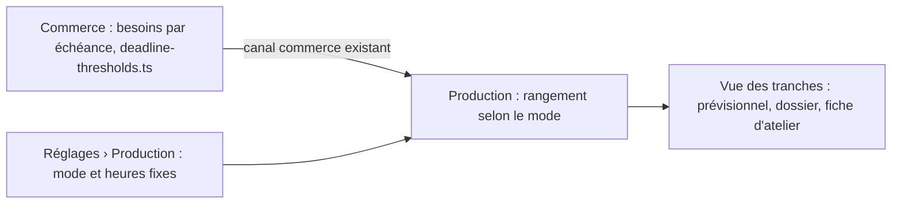

# Plan — les tranches de production : fixes ou calculées

> ✅ **Bâti le 2026-10-28** (T1, T2, T3) : table `production.production_tranche_settings`,
> migration `20261028180000_les_tranches_de_production`, rangement
> `rangeInTranches`, carte de Réglages › Production, prévisionnel, dossier du
> jour et fiche d'atelier.
>
> 📝 Plan du 2026-10-28. Demande de Hugo : « sur 2000 croissants, peut-être
> que je dois en produire 400 avant 5 h, 800 de plus avant 7 h et 800 avant
> midi ». Il veut que **toutes les commandes et leurs contraintes** fixent ces
> quantités. Décisions du même jour :
>
> - des **tranches fixes** d'abord, réglées dans **Réglages › Production** ;
> - un **interrupteur** au même endroit pour passer aux **tranches calculées** ;
> - la **capacité du four plus tard**, hors de ce plan.
>
> Il prolonge [`plan-production-par-vagues.md`](plan-production-par-vagues.md),
> dont il garde toutes les décisions (§7). Rien n'est bâti de ce plan-ci. Même
> page de réglage : [`plan-raccourcis-du-fournil.md`](plan-raccourcis-du-fournil.md).

## 1. Ce qui existe (relu le 2026-10-28)

- **Les tranches calculées existent déjà, en prévision** (lot V0 du plan des
  vagues, commit `5047c33b1`).
  - La fonction pure `apps/lfd-api/src/b2b/orders/domain/services/deadline-thresholds.ts`
    calcule, pour chaque commande, son échéance : le début du créneau s'il y en
    a un, sinon sa fin. Elle retire ensuite la marge de livraison ou de retrait.
    Un retrait servi par transfert prend le départ requis du transfert ; un
    retrait colisé sur place ajoute la mise en place au comptoir.
  - Elle cumule, par produit, ce qui doit être sorti avant chaque heure.
  - C'est le **commerce** qui calcule, car lui seul connaît les échéances. La
    production le lit par son canal
    (`apps/lfd-api/src/production/channels/commerce/due-thresholds.reader.ts`)
    et le sert sur `GET /admin/production/batch/:date/due-thresholds`
    (`ProductionDueThresholdsView`, `packages/contracts/src/production-due-thresholds.ts`).
  - Le back-office l'affiche dans le prévisionnel
    (`production/previsionnel/due-thresholds-section/`) et dans le dossier du jour.
    **La fiche d'atelier ne l'affiche pas.**
- **Les marges** (livraison, retrait) sont des réglages du **commerce**, page
  « Disponibilité de la livraison »
  (`b2b/reglages/delivery-availability-page/`). Sans les deux marges, un seul
  seuil : la journée.
- **Chaque commande figée au plan porte son échéance** (`production_order.due_at`,
  `HH:mm`). Le colisage l'utilise déjà pour servir d'abord l'échéance la plus
  proche.
- **Le « sorti »** d'un produit est la somme de ses fournées non annulées
  (`production_batch`, horodatées par `recorded_at`).
- **Réglages › Production** (`/reglages/production/fournil`,
  `production/production-settings-page/`) règle l'arrêt du plan :
  `production_settings`, une ligne `house`, champs `close_mode`, `close_at`,
  `alert_at`.

## 2. Les deux modes

Les deux modes partent des **mêmes besoins** : les seuils calculés par le
commerce, une heure « prêt avant » par commande et par produit, toutes
commandes et contraintes comprises (créneaux, échéances, transferts, marges).
Ils ne diffèrent que par la façon de **ranger** ces heures.

| Mode               | Les tranches sont…                                     | Pour qui                                  |
| ------------------ | ------------------------------------------------------ | ----------------------------------------- |
| **Fixes** (défaut) | des heures réglées une fois : 05:00, 07:00, 12:00…     | l'atelier, qui retrouve les mêmes repères |
| **Calculées**      | les heures des besoins eux-mêmes (le V0 tel qu'il est) | qui veut la précision à la minute         |

### 2.1 La règle de rangement en mode fixe

🔴 **Un besoin va dans la DERNIÈRE tranche fixe qui tombe au plus tard à son
heure « prêt avant ».** On arrondit toujours vers **plus tôt**, jamais vers
plus tard : produire trop tard est le seul vrai défaut (plan des vagues, §7.4).

Exemple, avec des tranches réglées à 05:00, 07:00 et 12:00 :

| Besoin « prêt avant » | Tranche              | Pourquoi                                                                                               |
| --------------------- | -------------------- | ------------------------------------------------------------------------------------------------------ |
| 06:40                 | 05:00                | 07:00 serait trop tard                                                                                 |
| 07:00                 | 07:00                | pile à l'heure                                                                                         |
| 11:15                 | 07:00                | 12:00 serait trop tard                                                                                 |
| 04:30                 | **05:00, signalé**   | avant la première tranche : l'écran dit « 120 croissants attendus à 04:30, avant la première tranche » |
| sans échéance         | la dernière, signalé | comme aujourd'hui (`undated`)                                                                          |

Conséquence voulue : en mode fixe, une tranche porte ce qui doit être prêt
**à** son heure. Avec ces tranches, la phrase de Hugo se lit : « 400 avant
05:00, +800 avant 07:00, +800 avant 12:00 ».

### 2.2 Sans réglage

- Mode fixe **sans aucune heure réglée** : une seule tranche, la journée.
  L'écran le dit et mène au réglage. Aucune heure par défaut n'est inventée.
- Sans les deux marges du commerce : un seul seuil, comme aujourd'hui, quel que
  soit le mode.

## 3. Où vit le rangement

Le rangement est une règle de **production** : l'atelier choisit ses repères.
Il vit donc dans la production, **après** la lecture des seuils du commerce :

- **Aucune frontière nouvelle** : la production lit déjà les seuils par son
  canal, et elle lit ses propres réglages.
- Une fonction pure, à créer dans le domaine de la production
  (fichier `production-tranches`, sous `production/domain/services/`) : `(seuils, mode, heures) → tranches`.
  En mode calculé, elle rend les seuils tels quels.
- Le commerce ne change pas.

## 4. Le réglage

Dans **Réglages › Production**, une carte « Tranches de production » :

- un interrupteur **Fixes / Calculées** (`fold-view-toggle`) ;
- en mode fixe, la liste des heures (`HH:mm`), triée à l'enregistrement : on
  ajoute et on retire des lignes ; au plus 8 heures, jamais deux fois la même ;
- en mode calculé, une phrase dit d'où viennent les heures, avec un lien vers
  les marges (réglages du commerce).

Persistance : une table **à part**, `production.production_tranche_settings`,
une ligne `house`, comme `production_quality_settings`. Elle porte `mode`
(`fixed` | `computed`), `fixed_tranches` (`text[]`), l'auteur et l'instant ;
ligne absente = mode fixe sans heure. Ce n'est pas `production_settings` :
cette table n'est plus lue par personne, l'arrêt du plan venant de l'heure
limite générale (vérifié le 2026-10-28 : aucun lecteur hors du client Prisma).
L'agrégat valide la forme `HH:mm`, l'unicité, le tri et la borne de 8. La route
est `PUT /admin/production/settings/tranches`, sous `production_settings`, et
`GET /admin/production/settings` rend aussi les tranches.

## 5. Ce que voit l'atelier

- **La vue** : `ProductionDueThresholdsView` gagne `trancheMode` et, en mode
  fixe, `fixedTranches`. Ses lignes sont déjà rangées. Ses seuils gagnent un
  `kind` de plus, `before_first`, pour le besoin d'avant la première tranche.
  Tout est **ajouté** : le prévisionnel actuel lit encore ce qu'il lit.
- **Le prévisionnel et le dossier du jour** affichent les tranches du mode
  réglé, et le mode dans leur titre (« Tranches fixes » / « Tranches calculées »).
- **La fiche d'atelier** gagne, par produit, la ligne des tranches **cumulées**
  et le sorti en face : « Croissant — 400 avant 05:00 · 1 200 avant 07:00 ·
  2 000 avant 12:00 — sorti 650 ». La prochaine tranche non couverte est mise
  en avant, avec ce qui lui manque. Le sorti est déjà connu ; rien ne se coche
  par tranche (plan des vagues, §7.2 : une fournée ne se déclare pas « pour
  une vague »).

## 6. Lots

| Lot | Contenu                                                                     | Migration |
| --- | --------------------------------------------------------------------------- | --------- |
| T1  | Le réglage : table, agrégat, routes, carte de Réglages › Production         | additive  |
| T2  | Le rangement : fonction pure, vue enrichie, prévisionnel et dossier du jour | non       |
| T3  | La fiche d'atelier : tranches cumulées, sorti, prochaine tranche à couvrir  | non       |

**Hors de ce plan** :

- la capacité du four (décidé « plus tard ») ;
- le figeage des seuils à l'arrêt du plan (V1 du plan des vagues) ;
- l'alerte d'écart après la composition des tournées (V3).

Ces trois-là restent chez le plan des vagues.

## 7. Questions ouvertes

- **Q1** — Les marges vivent chez le commerce (« Disponibilité de la
  livraison »). Faut-il les **déplacer** dans Réglages › Production, à côté des
  tranches ? Proposé : non dans ce plan, mais un lien depuis la carte. Les
  déplacer touche à une frontière, puisque le commerce en a besoin pour calculer.
- **Q2** — Les tranches fixes sont-elles **les mêmes tous les jours**, ou par
  jour de la semaine (le dimanche n'a pas les mêmes tournées) ? Proposé : les
  mêmes tous les jours dans T1. Un réglage par jour s'ajouterait sans casser.
