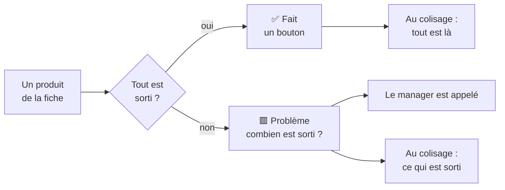
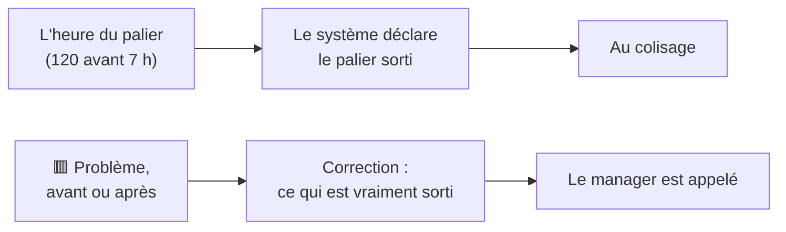

# Réflexion — une fiche d'atelier simple, au choix

**État : 🗒️ réflexion, rien n'est décidé ni bâti** (2026-11-17). Demande de
Hugo : « le fournil sur le remplissage de fournées est très complet,
seulement il me faudrait un mode simple green red pareil » — pareil que le
colisage simple ([`../colisage/reflexion-colisage-simple.md`](../colisage/reflexion-colisage-simple.md)).
Les affirmations sur l'existant ont été vérifiées le 2026-11-17 dans
[`la-fiche-d-atelier.md`](la-fiche-d-atelier.md) (§ « Les fournées »).

Ce document n'est pas un plan : il pose l'idée et les questions à trancher.

---

## 1. En simple

Aujourd'hui, la fiche d'atelier compte ce qui sort du four **fournée par
fournée** : « + 1 plaque », un raccourci ou une saisie au pavé, chaque
fournée part aussitôt au colisage, et une barre montre ce qui est sorti face
à ce qu'il faut, par paliers. C'est précis, et c'est beaucoup de gestes quand
tout se passe comme prévu.

L'idée : un réglage **mode simple / détaillé** de la fiche, **simple par
défaut**, avec les deux mêmes gestes que le colisage simple, mais sur chaque
**produit** de la fiche :

- **✅ « Fait ».** Un bouton sur la ligne : tout ce qui restait à sortir est
  déclaré sorti, d'un coup, et part au colisage.
- **🟥 « Problème ».** On dit combien est réellement sorti (0 si rien, moins
  si une plaque est ratée). Ce qui est sorti part au colisage, et le manager
  est appelé avec la ligne, le manque et, si on le donne, la raison (fournée
  ratée, matière manquante, panne…).

Le mode détaillé reste disponible, inchangé : paliers, plaques, raccourcis,
pavé, annulation d'une fournée.

## 2. Ce qui ne change pas

Les deux gestes sont faits du geste qui existe déjà, **déclarer une
fournée** (`RecordBatchCommand`) :

| Règle d'aujourd'hui                                                            | En mode simple                                                                                                      |
| ------------------------------------------------------------------------------ | ------------------------------------------------------------------------------------------------------------------- |
| Une fournée **s'ajoute**, sorti = somme des fournées non annulées              | « Fait » déclare **une** fournée de ce qui reste ; « Problème » déclare une fournée de ce qui est sorti (rien si 0) |
| La fournée part **aussitôt au colisage** (`production.handed_to_packing`)      | Inchangé : le colisage reçoit exactement ce qui est sorti                                                           |
| Rejouer le même geste n'écrit rien (l'`id` vient de l'écran)                   | Inchangé                                                                                                            |
| Une fournée s'**annule**, jamais ne s'efface, et pas si ses pièces sont au bac | Inchangé : le bandeau « Annuler » reste après « Fait »                                                              |
| « Faite » se lit sur les seules fournées                                       | Inchangé : « Fait » rend la ligne faite parce qu'il déclare le reste                                                |

**Le manque se propage tout seul.** Si le fournil sort moins que prévu, la
réserve du colisage reçoit moins, et une commande ne peut pas être déclarée
prête faute de pièces : le colisage simple passe alors par son propre chemin
rouge. Le manager est prévenu deux fois, au four puis au bac (question Q5).

## 3. Ce qui est neuf

- **Appeler le manager depuis le fournil.** Aujourd'hui, rien ne prévient
  quelqu'un qu'une ligne ne sera pas tenue. C'est le même besoin qu'au
  colisage, et sans doute le même mécanisme (une notification, question Q3).
- **Un manque déclaré au four**, qui n'existe pas aujourd'hui : le fournil
  ne connaît que ce qui est sorti, pas ce qui ne sortira pas. Le chemin rouge
  laisse une trace (la ligne, la quantité manquante, la raison, l'auteur,
  l'heure), lisible par le manager et la Supervision.

## 4. Questions à trancher avant le plan

- **Q1 — Un bouton par produit, ou par fiche ?** Par produit (proposé) : un
  produit sort quand il sort. Un « tout est sorti » par fiche de poste serait
  plus rapide en fin de service, mais déclarerait d'un coup des produits qui
  ne sont peut-être pas sortis.
- **Q2 — Les paliers.** Un produit à deux paliers (« 120 avant 7 h, puis 120
  avant 9 h 30 ») : « Fait » déclare tout ce qui reste (proposé), ou seulement
  le palier en cours, avec un second « Fait » pour le suivant ?
- **Q3 — Appeler le manager** : la cloche du back-office, un son, un SMS ?
  Le même choix qu'au colisage, pour n'avoir qu'un seul mécanisme.
- **Q4 — Après « Problème », que fait-on ?** On peut relancer une fournée
  plus tard (une nouvelle fournée s'ajoute), et la ligne redevient « à faire »
  pour ce qui manque. Le manager peut aussi décider « on n'en fera pas plus »,
  pour que le colisage sache tout de suite qu'il n'attendra pas.
- **Q5 — Un ou deux réglages ?** Un seul « mode simple » pour la fiche et le
  colisage, ou un réglage chacun ? Et faut-il relier les deux alertes (un
  manque au four annoncé au colisage avant qu'il ne bute dessus) ?
- **Q6 — Basculer en cours de journée.** Les fournées déjà déclarées en mode
  détaillé comptent telles quelles, et « Fait » ne déclare que le reste.

## 5. Plus loin : « toujours vert », la gestion par exception

Hugo, 2026-11-17 : « on aurait même presque un mode always green non ? »
Oui : on part du principe que **tout sort comme prévu**, et on ne déclare
**que ce qui ne sort pas**. Plus aucun « Fait » : seul le bouton rouge existe.

**La vraie question : quand le système considère-t-il que c'est sorti ?**
Parce que c'est ce moment-là qui remplit la réserve du colisage.

| Moment                                           | Ce que ça donne                                 | Le risque                                                                     |
| ------------------------------------------------ | ----------------------------------------------- | ----------------------------------------------------------------------------- |
| **À l'arrêt du plan**, tout d'un coup            | le colisage peut tout déclarer prêt dès le soir | on colise des commandes avant que le pain existe ; un manque se découvre tard |
| **À l'heure de chaque palier** (proposé)         | la réserve se remplit au rythme prévu du four   | un palier raté et non signalé passe pour sorti                                |
| **Au premier geste du colisage** sur la commande | rien n'est sorti « en avance »                  | le fournil ne voit plus rien de ce qui avance                                 |

Ce qu'on perd, et qu'il faut accepter en connaissance de cause :

- **La barre d'avancement ne dit plus la réalité**, seulement le plan. La
  Supervision montre « sorti » à l'heure prévue, même si le four a du retard.
- **Un oubli devient un mensonge.** En mode détaillé, un produit oublié reste
  « à faire » et se voit. En « toujours vert », il passe pour sorti, et le
  manque se découvre au colisage (s'il est détaillé) ou chez le client.
- **Le chemin rouge doit pouvoir corriger après coup** : déclarer « en fait,
  seulement 80 sur 120 » après l'heure du palier. Ça veut dire **annuler une
  partie** d'une fournée automatique, ce que le geste d'annulation ne sait pas
  faire aujourd'hui (il annule une fournée **entière**, et seulement si ses
  pièces ne sont pas au bac).

Les trois niveaux formeraient alors un seul réglage, du plus léger au plus
précis : **toujours vert** (exceptions seulement), **simple** (vert / rouge par
produit), **détaillé** (fournées, plaques, paliers). Question **Q7** : lequel
par défaut, et peut-on mélanger (toujours vert au fournil, simple au colisage) ?

## Ce que dit le terrain (2026-11-17)

La manager, rapportée par Hugo : **« ils ne cocheront jamais »**.

C'est la donnée qui tranche le mode par défaut. Un geste vert que personne ne
fait laisse tout « à faire » : l'écran ment alors dans l'autre sens, et le
manque réel se noie dans le faux. Donc :

- **le mode par défaut est « toujours vert »** : tout est réputé fait à
  l'heure prévue, et le seul geste demandé est le **rouge**, quand ça ne va
  pas ;
- le **rouge doit coûter le moins possible** : un geste, la quantité réelle,
  la raison facultative, et le manager prévenu sans rien faire de plus ;
- les modes simple et détaillé restent au réglage, pour qui veut suivre de
  près.

## Décidé par Hugo le 2026-11-17 : trois niveaux

| Niveau                     | Ce que fait l'équipe                                                 | Pour qui                          |
| -------------------------- | -------------------------------------------------------------------- | --------------------------------- |
| **Toujours vert** (défaut) | rien, sauf le rouge quand ça ne va pas                               | l'équipe qui ne cochera jamais    |
| **Simple**                 | un vert ou un rouge par produit (fournil) ou par commande (colisage) | qui veut confirmer sans détailler |
| **Détaillé**               | fournées, plaques et paliers ; contenants, répartition et étiquettes | qui veut tout suivre              |

Restent à trancher avant le plan : le moment où « toujours vert » considère un
produit sorti (proposé : l'heure de chaque palier), la façon d'appeler le
manager, la correction d'un vert après coup, et si fournil et colisage
partagent un réglage ou en ont un chacun.

## Une page transverse : Réglages › Niveau de suivi (décidé par Hugo le 2026-11-17)

Le niveau de suivi est une même question posée à chaque poste : combien de
gestes demande-t-on à l'équipe ? Elle se règle sur **une seule page**, une
ligne par poste, le même choix à trois niveaux et une phrase qui dit ce que
l'équipe aura à faire.

| Poste                    | Toujours vert           | Simple                                         | Détaillé                            |
| ------------------------ | ----------------------- | ---------------------------------------------- | ----------------------------------- |
| **Fournil**              | rien, sauf « Problème » | « Fait » ou « Problème » par produit           | fournées, plaques, paliers          |
| **Colisage — retrait**   | rien, sauf « Problème » | « Tout est prêt » ou « Problème » par commande | contenants, répartition, étiquettes |
| **Colisage — livraison** | plus tard               | plus tard                                      | bacs, étiquettes (aujourd'hui)      |
| **Chargement**           | plus tard               | plus tard                                      | scan des bacs (aujourd'hui)         |

Les réglages voisins de même nature peuvent y venir : le contrôle qualité au
fournil et au colisage, le partage des demi-bacs.

**La page rassemble, elle ne possède pas.** Chaque bloc garde son réglage et
la règle qui va avec ; la page les lit et les écrit chacun par sa porte. Une
table centrale « complexité » qui commanderait les modules mélangerait leurs
règles, et aucun ne pourrait plus changer la sienne seul.
