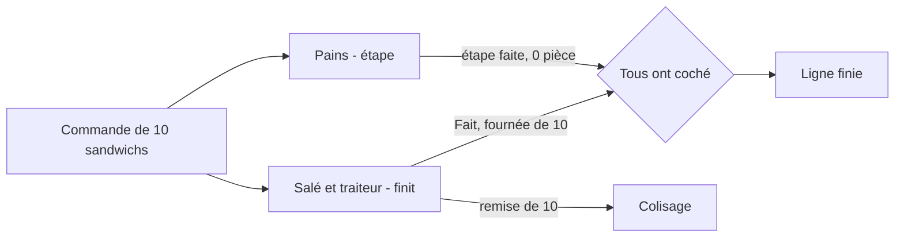

# Un produit sur plusieurs postes

_Implémenté le 2026-11-25 (branche `feat/produit-multi-postes`). Décidé par
Hugo le 2026-11-25._ Voisins : [`les-postes-du-fournil.md`](les-postes-du-fournil.md),
[`les-niveaux-de-suivi.md`](les-niveaux-de-suivi.md),
[`la-fiche-d-atelier.md`](la-fiche-d-atelier.md),
[`dossier-prod-du-jour.md`](dossier-prod-du-jour.md).

## 1. En simple

En mode prod, un produit peut aller à **plusieurs** postes : un sandwich passe
aux Pains (le pain) et au Salé & traiteur (la garniture et l'assemblage).

- chaque poste voit la ligne avec **toute** la quantité commandée ;
- **un seul poste finit** : seul son « Fait » déclare la fournée et la remet au
  colisage ;
- les autres cochent une **étape** — faite, ou en rouge avec une raison — qui
  ne compte aucune pièce (sinon on compterait 20 sandwichs pour 10) ;
- la ligne est finie à l'œil quand la fournée est faite **et** qu'aucune étape
  n'attend ; la fiche du poste qui finit dit « en attente de : Pains ».

Quand les postes n'ont pas le même niveau de suivi :

- **la fournée suit le poste qui finit** : en toujours vert, elle part seule à
  l'heure ; sinon, son « Fait » la déclare. Elle n'attend jamais les étapes ;
- **une étape en toujours vert se coche d'office**, quand tous les paliers à
  heure de la ligne sont échus ;
- **« Problème » reste par ligne**, depuis le poste qui finit ; un poste
  d'étape met son étape en rouge, sans plafond ;
- **la sortie fait foi pour tout ce qui compte des pièces** : colisage,
  clôture, totaux lisent la fournée.

Le mode boutique (rayons) ne change pas : une ligne y ressort une fois, et
aucune étape n'est exigée. Il n'y a ni ordre imposé entre postes, ni alerte de
retard par poste.

## 2. Partie technique

### 2.1 La carte

`production.production_workstation_product` : clé (`product_sku`,
`workstation_id`), `finishes boolean`, `position` = la place du produit
**dans ce poste**. L'index unique partiel
`production_workstation_product_one_finisher` (`WHERE finishes`) tient « au
plus un qui finit » ; « au moins un » est tenu par l'agrégat
(`workstations/domain/entities/`, `product-placements.ts`).

Gestes (par intention, `runSealed`), routes sous `admin/production/workstations` :

| Geste                               | Route                       | Règle                                                                                                  |
| ----------------------------------- | --------------------------- | ------------------------------------------------------------------------------------------------------ |
| placer sur un seul poste, qui finit | `PUT placements`            | `null` = « à ranger »                                                                                  |
| ajouter un poste                    | `POST :id/products`         | premier poste → il finit ; sinon étape, en bas de la pile                                              |
| retirer un poste                    | `POST :id/products/removal` | refusé pour celui qui finit tant qu'il en reste d'autres (`FinishingWorkstationStillNeededError`, 409) |
| désigner celui qui finit            | `PUT :id/finishing`         | le poste doit déjà être un poste du produit (`WorkstationNotOfProductError`, 409)                      |

Un geste qui ne change rien n'émet aucun fait. Faits :
`products_workstation_added`, `products_workstation_removed`,
`finishing_workstation_set`. `WorkstationProductView.workstations` sert tous
les postes d'un produit.

### 2.2 Le rangement

En mode prod, `groupingOf` (`shared/print/domain/services/production-grouping.ts`)
range une ligne **sous chacun** de ses postes en service, à sa place dans la
pile de ce poste, avec un rôle `finishes` | `step` (`ProductionGroup.roles`,
`WorkshopLine.role`). Une somme **par poste** (compteurs d'une fiche, charge du
dossier, calendrier par tranche) compte la ligne dans chacun ; une somme
**générale** (`DayDossier.pieces`, `resupplyPieces`, l'e-mail du dossier, les
totaux des écrans) se fait sur les produits, dédoublonnés par SKU — jamais en
additionnant les groupes.

### 2.3 L'étape

Table `production.production_line_step` (sous-contexte `atelier`) : clé
(`service_day`, `sku`, `workstation_id`), `status` (`done` | `red` |
`undone`), `reason`, auteur, `version` ; trois déclencheurs vers les journaux de
la journée, pour que la fiche en cache se relise. Agrégat `LineStep`
(`atelier/domain/entities/line-step.ts`).

| Geste       | Route                                                         |
| ----------- | ------------------------------------------------------------- |
| étape faite | `POST …/worksheet/:date/lines/:sku/steps/:workstationId`      |
| rouge       | `POST …/steps/:workstationId/red` (`{ reason? }`)             |
| décocher    | `DELETE …/steps/:workstationId` (la ligne reste, en `undone`) |

Même droit et mêmes refus que « Fait » ; le poste est vérifié sur la carte
**courante** (409 s'il finit la ligne ou n'en est pas un poste). Faits
`production_line.step_done`, `step_red`, `step_undone`. La cloche ne sonne pas
sur un rouge d'étape.

`done` d'une ligne garde son sens (la fournée atteint l'attendu) pour tous ses
lecteurs. La fiche sert à côté `stepsPending` (postes d'étape qui n'ont pas
coché), et, sur une ligne `step`, `stepState` (`pending` | `done` | `red`) et
`stepRedReason` pour le poste de la fiche. Une étape cochée reste en base si le
poste quitte le produit ; elle n'est simplement plus attendue.

### 2.4 Les niveaux de suivi

`WorksheetTrackingLevels` sert `outputLevelOf(sku)` (le niveau du poste qui
finit, qui règle la fournée) et `stepLevelOf(sku, workstationId)` (le niveau
figé du poste). Le tour toujours vert (`run-always-green-round.handler.ts`)
coche ensuite les étapes échues des postes en toujours vert, auteur
`system:always-green`, sans réécrire une étape présente ; une panne des étapes
est journalisée et n'efface pas les fournées. Postes illisibles : tout en
détaillé, aucune étape exigée.

### 2.5 Les écrans et le papier

- **Postes** : les postes d'un produit en puces, « finit » marqué quand il en a
  plusieurs ; un dialogue (feuille du bas au téléphone) les règle — ajouts,
  puis `finishing`, puis retraits. La pile d'un poste porte ses produits
  d'étape, badge « étape ».
- **Fiche d'atelier** : une ligne `step` (`fiche-atelier/line-step/`) montre la
  quantité en lecture seule, « Étape faite » et « Rouge » en attente, « Faite »
  ou « Rouge — raison » avec « Décocher » sinon ; ni « Fait », ni fournée, ni
  « Problème ». La ligne qui finit porte « En attente de : … ».
- **Supervision** : les rouges d'étape (`stepReds`) dans la même liste que les
  problèmes, marqués « Étape », sans « Marquer traité ».
- **Dossier du jour**, écran et PDF : la ligne répétée sous chaque poste, « ·
  étape » ou « · finit » pour un produit à plusieurs postes.

### 2.6 Reste à faire

- Pas de file hors ligne pour les gestes d'étape : sans réseau, le refus
  s'affiche et il faut refaire le geste.
- Le dialogue des postes joue ses gestes l'un après l'autre : un refus au
  milieu laisse les précédents écrits (la page relit la carte).
- 🔴 Revenir à un poste par produit dans le **code** n'est plus possible sans
  supprimer des lignes dès qu'un produit a deux postes ; dans l'**usage**, un
  produit repasse sur un seul poste par l'écran à tout moment.
