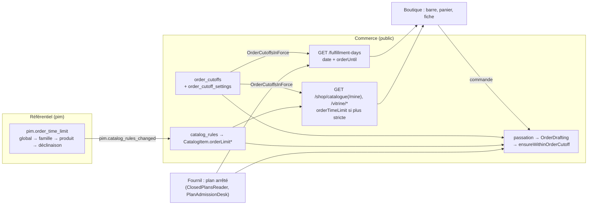

# Les limites de commande

> Dossier ouvert le 2026-10-21 (Hugo : « rassemble toutes les docs de limite
> de commande »). Ce qui suit décrit le code **vérifié le 2026-10-21** ; ce qui
> n'a pas été ouvert est dit comme tel.

Une commande vise une **journée de service** (retrait ou livraison). Plusieurs
règles peuvent dire « trop tard » pour cette journée. Ce dossier dit lesquelles,
comment elles se combinent, où chacune se règle, et ce que la boutique en dit.

## 1. Les règles qui limitent une commande

| Règle                                 | Ce qu'elle dit                                                        | Où elle se règle (écran · droit)                                                                | Doc                                                                                                                |
| ------------------------------------- | --------------------------------------------------------------------- | ----------------------------------------------------------------------------------------------- | ------------------------------------------------------------------------------------------------------------------ |
| **Heure limite générale** (commerce)  | « la veille à 23 h », par défaut ou par point × jour de semaine       | Réglages › Commandes › Heure limite (`/reglages/commandes/heure-limite`) · `lfc_order_settings` | [`reglages-generaux.md`](reglages-generaux.md)                                                                     |
| **Interrupteur** de la règle générale | activée / désactivée — désactivée, la règle n'est plus servie         | même écran · `lfc_order_settings`                                                               | [`reglages-generaux.md`](reglages-generaux.md)                                                                     |
| **Jour même**                         | une commande peut-elle viser aujourd'hui ? (non par défaut)           | même écran · `lfc_order_settings`                                                               | [`reglages-generaux.md`](reglages-generaux.md)                                                                     |
| **Limite d'article** (référentiel)    | « 2 jours avant, 12 h » pour un produit, une famille, une déclinaison | Référentiel › Limites de commande (`/pim/limites-de-commande`) et fiche produit · `pim_catalog` | [`limites-produit.md`](limites-produit.md)                                                                         |
| **Arrêt du plan** (fournil)           | une journée dont le plan est arrêté ne prend plus de commande client  | Production · voir la doc du fournil                                                             | [`../production/arret-du-plan.md`](../production/arret-du-plan.md)                                                 |
| **Fenêtre d'une opération datée**     | `orderFrom` / `orderUntil` d'une opération (bûches, galettes…)        | Opérations · voir leur doc                                                                      | [`../operations-datees/architecture-operations-datees.md`](../operations-datees/architecture-operations-datees.md) |

La **dérogation** (`order_cutoff_waiver`, droit `b2b_order_waivers`) n'est pas
une règle : c'est l'autorisation ponctuelle, pour une société et une journée,
de passer **pendant le rattrapage** d'une limite. Après le rattrapage, personne
ne passe ([`reglages-generaux.md`](reglages-generaux.md) §3).

## 2. Comment elles se combinent

La garde est `ensureWithinOrderCutoff`
(`apps/lfd-api/src/b2b/orders/domain/services/order-cutoff-guard.ts`, lue le
2026-10-21), appelée par `OrderDrafting.ensureNotTooLate` pour les passations
client, invité et équipe :

1. **Ligne par ligne**, un article qui porte une limite d'article est jugé par
   **elle seule** (`decideOrderLimit`) ; un article qui n'en porte pas est jugé
   par la règle générale (`decideOrderCutoff`, calculée une fois par panier).
   ⚠️ L'article **remplace** la règle générale, il ne s'y ajoute pas : une limite
   d'article plus tardive que la générale l'emporte pour cet article.
2. **Sur le panier, la plus fermée gagne** : `open` < `grace` < `closed`. Un
   panier ne se découpe pas.
3. Dans la grâce, seule une dérogation ouverte fait passer ; sinon
   `orders.cutoff.grace` (« appelez-nous »). Au-delà : `orders.cutoff.past`.
4. **Rien nulle part → tout passe.**

À côté de cette garde : le **jour même** non autorisé refuse
(`orders.same_day_closed`), le **plan arrêté** refuse le client
(`orders.production_plan_closed`, `order-plan-gate.service.ts` ; l'équipe est
reçue « hors plan »), et, **après** la garde, l'opération datée oppose sa propre
fenêtre (`ensureWithinOperation`, `order-operation-guard.ts`) — sans dérogation
possible. Toutes s'appliquent : c'est la plus tôt qui ferme.

## 3. Ce que la boutique dit

| Où                          | Phrase                                                                | Source                        |
| --------------------------- | --------------------------------------------------------------------- | ----------------------------- |
| barre / panier, forme calme | « Pour jeudi, commandez avant 23 h. »                                 | `orderUntil` du jour accordé  |
| les six dernières heures    | « Plus que 2 h 15 pour commander pour jeudi. »                        | idem                          |
| vraiment trop tard          | « Trop tard pour demain, la limite était 23 h : … »                   | premier jour accordé > demain |
| article plus strict         | « Plus que 1 h 40 pour commander Bûche pour jeudi. »                  | limite d'article du panier    |
| fiche, ligne du panier      | « Préparé sur commande — à commander 2 jours à l'avance, avant 12 h » | `ShopItemView.orderTimeLimit` |

La grâce n'est **jamais** annoncée. Tout cela est une **annonce** : seule la
passation refuse. Détail : [`reglages-generaux.md`](reglages-generaux.md) §6 et
[`limites-produit.md`](limites-produit.md) §4–§6.

## 4. Le chemin

## 5. Les docs du dossier

| Doc                                                                                    | État | Ce qu'elle porte                                                                                                   |
| -------------------------------------------------------------------------------------- | ---- | ------------------------------------------------------------------------------------------------------------------ |
| [`reglages-generaux.md`](reglages-generaux.md)                                         | ✅   | **État** de l'heure limite générale : tables, interrupteur, jour même, dérogations, `orderUntil`, compte à rebours |
| [`limites-produit.md`](limites-produit.md)                                             | ✅   | **État** de la limite par article : échelle du référentiel, propagation, passation, « Préparé sur commande »       |
| [`architecture-heure-limite-de-commande.md`](architecture-heure-limite-de-commande.md) | 🟡   | Le **pourquoi** (2026-09-04) : trois états, grâce, dérogation, **surtaxe de retard**, fuseau                       |
| [`demontage-order-cutoff.md`](demontage-order-cutoff.md)                               | ⏸️   | Plan **suspendu** : retirer `OrderCutoff` au profit de l'échelle                                                   |
| [`plan-heure-limite-par-clientele.md`](plan-heure-limite-par-clientele.md)             | 📐   | Plan **non bâti** : la limite du B2C (délai d'article à J+N, stock à J)                                            |

Hors du dossier, et cités plutôt que déplacés :
[`../commandes/plan-reglages-commandes.md`](../commandes/plan-reglages-commandes.md)
(l'écran Réglages › Commandes, ses droits, l'interrupteur — lot O3, §8),
[`../production/arret-du-plan.md`](../production/arret-du-plan.md),
[`../operations-datees/architecture-operations-datees.md`](../operations-datees/architecture-operations-datees.md).
