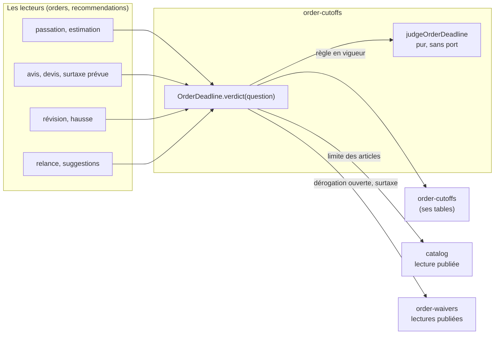

# Plan — le verdict de l'heure limite

> 📐 **Plan v3, rien n'est bâti** (2026-11-19). v1 et v2 contredites par
> `vitruve` le même jour (§ 7) ; la v3 range les lots en deux temps : V1–V7
> déménagent **sans changer une réponse**, V8–V10 changent ce qui doit
> changer, chacun le dit. Né de l'inventaire
> [`../commandes/domaines-a-decouper.md`](../commandes/domaines-a-decouper.md)
> (§ 2.1, 2026-11-10), où il est le premier de l'ordre proposé. Hugo, le
> 2026-11-19 : « on attaque, je veux un module 10/10 ». Les couplages ont été
> **lus un par un le 2026-11-19** (§ 2). La surtaxe de retard est de l'argent
> et le jugement est une frontière : `vitruve` avant Hugo.
>
> Il passe **avant** [`plan-passer-outre-la-limite-produit.md`](plan-passer-outre-la-limite-produit.md),
> qui s'écrira dans le verdict au lieu d'un drapeau passé à cinq lecteurs.

## 1. En deux mots

Aujourd'hui, la question « est-ce trop tard ? » a ses **réglages** dans
`order-cutoffs` et son **jugement** éparpillé dans `orders`, `recommendations`
et `@lfd/contracts`. Chaque lecteur rassemble lui-même ses sources (la règle
générale, la limite de chaque article, la dérogation, la surtaxe) et appelle
une des trois fonctions de décision.

Après : **une seule question, posée à `order-cutoffs`**, qui rend un
**verdict**. Les lecteurs n'ont plus qu'à l'appliquer.



**Ce qui ne bouge pas :** aucune réponse. Le chantier est un déménagement à
comportement constant, éprouvé contre le jugement actuel (§ 5, lot V1). Ni
les codes d'erreur (`orders.cutoff.grace`, `orders.cutoff.past`), ni les
contrats servis, ni les tables.

## 2. Les couplages, lus le 2026-11-19

### 2.1 Les trois fonctions de décision

| Fonction                                                  | Où                                                 | Ce qu'elle décide                                                                         |
| --------------------------------------------------------- | -------------------------------------------------- | ----------------------------------------------------------------------------------------- |
| `decideOrderLimit(limit, day, now)`                       | `packages/contracts/src/order-cutoff.ts:244`       | les trois états d'**une** limite, bornes incluses                                         |
| `decideOrderCutoff(rules, day, now)`                      | id. `:221`                                         | la règle générale, puis `decideOrderLimit`                                                |
| `decideStrictestOrderCutoff({lines, fallback, day, now})` | `orders/domain/services/order-cutoff-guard.ts:155` | la plus fermée entre règle générale et limites d'article (sans grâce), sur tout le panier |

Autour : `ensureWithinOrderCutoff` (refuse, rend la dérogation dépensée),
`foreseenWaiver` (la même sans refuser), `waiverSpentBy` (« une dérogation
n'ouvre que la grâce »), `withoutGrace`, `stricterOf`. Tous dans le même
fichier.

### 2.2 Les lecteurs

| #      | Lecteur                                                                  | Fichier                                                                                                                                                                                   | Ce qu'il lit                                                                                                                                   | Instant          | Dérogation                                                                                   |
| ------ | ------------------------------------------------------------------------ | ----------------------------------------------------------------------------------------------------------------------------------------------------------------------------------------- | ---------------------------------------------------------------------------------------------------------------------------------------------- | ---------------- | -------------------------------------------------------------------------------------------- |
| 1      | Passation client, invité et boutique (`place-shop-order.handler.ts:164`) | `orders/application/services/order-drafting.service.ts:310` (`ensureNotTooLate`, par `ensureCircuit` si fabriquée)                                                                        | `OrderCutoffGate.ensure`                                                                                                                       | horloge          | **dépensée** (consommée après persistance par `place-order.handler.ts:347`)                  |
| 2      | Passation et estimation de l'équipe                                      | même chemin, par `prepareStaffOrder`                                                                                                                                                      | id.                                                                                                                                            | horloge          | dépensée (`place-order-for-customer.handler.ts:133`) ; l'estimation la lit sans la consommer |
| 3      | Surtaxe facturée                                                         | `late-fee-judgement.service.ts` `forWaiver`                                                                                                                                               | dérogation dépensée → réglage de surtaxe                                                                                                       | —                | —                                                                                            |
| 4      | Surtaxe prévue (devis d'une société)                                     | `late-fee-judgement.service.ts` `foreseen` ← `shop-cart-quoting.service.ts:174`                                                                                                           | `OrderCutoffGate.foresee`                                                                                                                      | horloge          | lue, non dépensée                                                                            |
| 5      | Avis d'heure limite                                                      | `order-cutoff-notice.service.ts` ← `quote-order.handler.ts:90`, `estimate-order-for-customer.handler.ts:120`                                                                              | `decideStrictestOrderCutoff`                                                                                                                   | horloge          | **non**                                                                                      |
| 6      | Révision du client                                                       | `revision/application/services/order-revising.service.ts:411` (`ensureBeforeCutoff`)                                                                                                      | `OrderCutoffGate.ensure`, ancienne **et** nouvelle journée, articles des deux compositions                                                     | `decidedAt` (R6) | non                                                                                          |
| 7      | Révisabilité                                                             | id. `:163` → `revision/domain/services/order-revisability.ts`                                                                                                                             | `OrderCutoffGate.decide`                                                                                                                       | horloge          | non                                                                                          |
| 8      | Hausse carte                                                             | `revision/application/commands/propose-card-increase.handler.ts:227`                                                                                                                      | `decide`, la limite la plus proche des deux journées                                                                                           | horloge          | non                                                                                          |
| 9      | Relance de règlement                                                     | `send-settlement-reminders.handler.ts:67` → `domain/services/settlement-reminder.ts:49`                                                                                                   | `decideOrderCutoff` (règle générale **seule**, grâce comprise)                                                                                 | horloge          | non                                                                                          |
| 10     | Suggestions                                                              | `recommendations/domain/orderable-today.ts:83` ← `recommendations/application/services/recommendation-filter.ts` (plusieurs journées, règle par son port `RecommendationCutoffReader`)    | `decideStrictestOrderCutoff`, importé du domaine d'`orders`, sur la limite **du catalogue de celui qui regarde** (`CatalogViewers.forCompany`) | fourni           | non                                                                                          |
| 10 bis | Golden master des prix                                                   | `test/pricing-golden-master-pairs.ts:20, 83`                                                                                                                                              | construit `new OrderCutoffGate(…)`, appelle `foresee`                                                                                          | horloge          | lue                                                                                          |
| 11     | Vitrine et journées                                                      | `catalog/application/shop-catalogue-order-limits.ts` (`shownItemOrderLimit`) ; `order-cutoffs/application/list-fulfillment-days.handler.ts` (`nextFulfillmentDay`, `announcedOrderUntil`) | `@lfd/contracts`                                                                                                                               | horloge          | non                                                                                          |
| 12     | Arrêt du plan au fournil                                                 | `order-cutoffs/infrastructure/production-order-cutoff-rules.reader.ts`                                                                                                                    | la règle générale                                                                                                                              | —                | —                                                                                            |

Les lecteurs 1 à 10 **jugent**. Les lecteurs 11 et 12 **annoncent** ou
**lisent une règle** : ils restent où ils sont (§ 3.6).

Les sources, toutes lues par chaque juge :

- **la règle en vigueur** : `OrderCutoffReader` (port d'`orders`) ←
  `OrderCutoffsInForce` (`order-cutoffs/domain/order-cutoffs-in-force.ts`) ;
- **la limite des articles** : `ProductCatalogReader.resolveMany(skus,
staffViewer("pro"))` chez les lecteurs 1 à 8 ; **le catalogue de celui qui
  regarde** chez les suggestions (10), qui reçoivent la limite déjà chargée
  avec le candidat ;
- **la dérogation ouverte** : `OrderCutoffWaiverGate.openFor` (port
  d'`orders`) ← `order-waivers/infrastructure/prisma-order-cutoff-waiver.gate.ts` ;
- **la surtaxe** : `OrderLateFeeReader` (port d'`orders`).

### 2.3 Ce que la lecture a trouvé

- **`OrderDrafting` construit son juge à la main** (`new OrderCutoffGate(…)`,
  `new LateFeeJudgement(…)`, `order-drafting.service.ts:116-117`), pendant que
  la révision et la hausse injectent le leur. Deux instances du même juge, et
  un service qui reçoit seize dépendances pour en passer quatre à un autre.
- **`recommendations` importe le domaine d'`orders`** pour décider. Une
  suggestion ne devrait pas savoir où vit la passation.
- **Deux commentaires porteurs sont faux** : la garde
  (`order-cutoff-guard.ts:46-48`) et le port de la vitrine
  (`catalog/domain/ports/shop-order-cutoffs.reader.ts:10`) parlent d'un
  interrupteur de la règle générale. Il est retiré depuis le 2026-10-21
  (`order-cutoffs/application/general-order-cutoff-in-force.ts`).
- **La décision rendue est agrégée** : `decideStrictestOrderCutoff` rend une
  seule décision pour le panier. Personne ne sait dire quelle ligne ferme.
  L'écran de la boutique et le futur dépassement en ont besoin.
- **L'audience est figée à `pro`** chez les juges 1 à 8 (pas chez les
  suggestions, § 2.2). Le plan
  [`plan-heure-limite-par-clientele.md`](plan-heure-limite-par-clientele.md)
  la fera varier : la question doit déjà la porter, sans changer de réponse
  aujourd'hui.
- **La dépense d'une dérogation n'est pas exclusive** : `consume`
  (`order-waivers/infrastructure/prisma-order-cutoff-waiver.gate.ts:32-37`)
  fait un `updateMany` conditionné sur `usedByOrderId: null` et **ne lit pas
  le compte**. Deux passations qui ont lu la même dérogation passent toutes
  les deux ; la seconde la « consomme » sans rien écrire, sans erreur. Une
  décision laisse donc passer deux commandes tardives, ce que le port promet
  d'empêcher. **Hors de ce chantier** (comportement constant) : correctif à
  part, avec son test de régression (§ 6).
- **La surtaxe ne se lit que si une dérogation a servi**, déjà aujourd'hui
  (`late-fee-judgement.service.ts:39-45`). Le verdict garde cette condition ;
  il n'y gagne rien.

## 3. Le modèle

### 3.1 La question

```ts
/** Ce qu'on demande au délai de commande. */
interface OrderDeadlineQuestion {
  /** Les articles du panier ; le service les déduplique. Vide → rien à opposer. */
  readonly skus: readonly string[];
  /** La journée d'acheminement demandée. */
  readonly serviceDay: string;
  /** L'instant de la décision : l'horloge, ou celui d'un geste décidé plus tôt (R6). */
  readonly at: Instant;
  /** Pour qui l'on juge. */
  readonly asker: OrderDeadlineAsker;
}

interface OrderDeadlineAsker {
  /** La clientèle dont on lit les limites d'article (`pro` aujourd'hui, partout). */
  readonly audience: ShopAudience;
  /** Qui demande : un plan arrêté refuse le client, reçoit l'équipe hors plan. */
  readonly kind: "customer" | "staff";
  /** La société, pour sa dérogation. `null` : aucune dérogation possible. */
  readonly companyId: string | null;
  /** Ce que la question fait de la dérogation. */
  readonly waiver: "ignore" | "consider";
}
```

`waiver: "ignore"` : l'avis, la révision (qui a pourtant une société), la hausse.
`"consider"` : la passation, l'estimation, la surtaxe prévue. **La question ne
dépense rien** (§ 3.4). `at` est obligatoire : la surtaxe prévue et l'avis
passent l'horloge, comme aujourd'hui.

### 3.2 Le verdict

Le verdict garde **toutes** les bornes de la décision retenue, dans chaque
état. La v1 n'en gardait qu'une (`until`), et deux lecteurs lisent
aujourd'hui la limite même quand la journée est en rattrapage ou fermée : la
révisabilité (`order-revisability.ts:126-127`) et la hausse
(`propose-card-increase.handler.ts:236-239`).

```ts
/** La décision retenue pour le panier, et de quoi la raconter. */
interface DeadlineBounds {
  /** L'instant limite retenu, ou `null` : rien à opposer, ou heure inexistante ce jour-là. */
  readonly limit: Instant | null;
  /** La fin du rattrapage ; égale à `limit` sans rattrapage. */
  readonly graceEnd: Instant | null;
  /** Ce qui l'a retenue. */
  readonly source: "general_rule" | "item_limit" | "plan_closed" | "none";
  /** L'équipe sur un plan arrêté : reçue hors plan. */
  readonly offPlan: boolean;
  /** La décision de chaque article. */
  readonly lines: ReadonlyMap<string, LineVerdict>;
}

type OrderDeadlineVerdict =
  | ({ readonly kind: "open" } & DeadlineBounds)
  | ({
      readonly kind: "grace";
      /** La dérogation qui ferait passer, si la question l'a considérée. */
      readonly waiver: WaiverAvailable | null;
      /** Ce que la passer coûterait : présent seulement avec `waiver` et un réglage. */
      readonly lateFee: LateFeeAdjustment | null;
    } & DeadlineBounds)
  | ({ readonly kind: "closed" } & DeadlineBounds);

interface LineVerdict {
  readonly status: OrderCutoffStatus;
  readonly source: "general_rule" | "item_limit" | "none";
  readonly limit: Instant | null;
}
```

- `kind`, `limit`, `graceEnd` et `source` sont ceux de la décision que
  `stricterOf` retient aujourd'hui, **avec ses égalités** (à état égal, la
  première gardée, donc la règle générale ; en grâce, la fin la plus
  proche ; ouverte, la limite la plus proche).
- `source` dit d'où vient la décision retenue. C'est ce qui manquait pour
  savoir laquelle a gagné à égalité.
- `lines` répond à « quelle ligne ferme ? », et le verdict propose les gestes
  qui débloquent (§ 3.8).
- **« Une dérogation n'ouvre que la grâce » devient inexprimable** : `waiver`
  n'existe que sur la variante `grace`.

Ce que chaque lecteur en tire, **à l'identique d'aujourd'hui** :

| Lecteur                       | Lit                                                                           |
| ----------------------------- | ----------------------------------------------------------------------------- |
| avis (`OrderQuoteCutoffView`) | `open` → `limit` ; `grace` → `graceEnd` ; `closed` → `null`                   |
| révisabilité                  | `open` → révisable jusqu'à `limit` ; sinon `past_cutoff` jusqu'à `limit`      |
| hausse                        | la plus proche des `limit` non nulles des deux journées, quel que soit l'état |
| passation                     | `kind`, `waiver`, `lateFee`, `graceEnd` (le message du rattrapage)            |

### 3.3 Le juge pur

`judgeOrderDeadline(input) → OrderDeadlineVerdict`, dans
`order-cutoffs/domain/deadline/`. Sans port, sans horloge, sans Nest. Il
reçoit la règle en vigueur, la limite de chaque article, la dérogation
ouverte et le réglage de surtaxe déjà lus. Il absorbe `decideStrictestOrderCutoff`,
`waiverSpentBy`, `withoutGrace` et `stricterOf`. Il appelle `decideOrderLimit`
de `@lfd/contracts`, qui reste la seule implémentation des bornes, partagée
avec les écrans.

Il est **publié** lui aussi (l'`index.ts` d'`order-cutoffs` (à créer)), pour les lecteurs qui
ont déjà leurs données en mémoire : les suggestions jugent des dizaines de
candidats, sur plusieurs journées, avec la limite du catalogue de celui qui
regarde déjà chargée. Les faire relire par le service ajouterait une lecture
par lot et changerait leur source.

### 3.4 Le service : `OrderDeadline`

Classe abstraite publiée par `order-cutoffs` (l'`index.ts` d'`order-cutoffs` (à créer), sous
le titre « ce que le délai de commande sait répondre »), deux méthodes :

```ts
abstract class OrderDeadline {
  /** Le panier : règle générale et limites d'article. */
  abstract verdict(question: OrderDeadlineQuestion): Promise<OrderDeadlineVerdict>;
  /** La règle générale seule, grâce comprise : ce que la relance demande. */
  abstract generalRuleStatus(serviceDay: string, at: Instant): Promise<OrderCutoffStatus>;
}
```

La relance pose une autre question (« la règle générale est-elle passée ? »),
sans panier : un panier vide n'oppose rien, donc `verdict` ne peut pas la
servir sans changer sa réponse.

Son implémentation lit les quatre sources **en parallèle**, et seulement
celles dont la question a besoin (pas de dérogation pour `ignore` ni sans
société ; pas de surtaxe hors de la grâce avec dérogation), puis appelle le
juge pur.

Ports qu'`order-cutoffs` **déclare** pour ses sources, un par capacité :

| Port                                             | Implémenté par                                                             | Remplace                             |
| ------------------------------------------------ | -------------------------------------------------------------------------- | ------------------------------------ |
| `ItemOrderLimitsReader.limitsOf(skus, audience)` | `catalog` (adaptateur sur `ProductCatalogReader.resolveMany`)              | la lecture recopiée dans chaque juge |
| `OpenWaiverReader.openFor(companyId, day)`       | `order-waivers` (la lecture existe : `open-order-cutoff-waiver.reader.ts`) | `OrderCutoffWaiverGate.openFor`      |
| `LateFeeSettingReader.current()`                 | `order-waivers` (propriétaire du réglage)                                  | `OrderLateFeeReader`                 |
| la règle en vigueur                              | `order-cutoffs` lui-même (`OrderCutoffsInForce`)                           | `OrderCutoffReader` d'`orders`       |

**Le module.** `OrderDeadline` vit dans `OrderCutoffsModule`, qui importe
déjà `CatalogModule` ; il y ajoute `OrderWaiversModule` (qui n'importe rien).
Pas dans `OrderCutoffsInForceModule` : `CatalogModule` importe celui-ci, et y
mettre l'adaptateur du catalogue fermerait un cycle
(`catalog/catalog.module.ts:171`, `order-cutoffs/order-cutoffs.module.ts`).
`orders` importe déjà `OrderCutoffsModule` (`orders.module.ts:360`). Ce sont
des contextes du même bloc : la reliure se fait dans leurs modules, pas dans
`appBootstrap`.

**Dépenser une dérogation reste dans `orders`**, et c'est une écriture : la
passation lit `verdict.waiver`, persiste, puis consomme par
`OrderCutoffWaiverGate.consume`, réduit à cette seule méthode. Une question
qui écrit ne serait plus une question.

### 3.5 Ce qui reste dans `orders` : appliquer

Une fonction pure `admitOrRefuse(verdict, day)` dans `orders/domain/` :
`open` → rien ; `grace` avec `waiver` → la dérogation à dépenser et la
surtaxe ; `grace` sans → `OrderCutoffGraceError` ; `closed` →
`PastOrderCutoffError`, sauf `source: "plan_closed"` (à partir de V8) →
`ProductionPlanClosedError`. Les écrans trient les refus par code
(`apps/lfd-backoffice-frontend/src/app/commandes/nouvelle-commande/grace-refusal.ts`) :
aucun code ne change. Les erreurs et leurs codes restent ceux d'`orders` :
c'est la passation qui refuse, pas le délai qui juge.

| Lecteur (§ 2.2)            | Devient                                                                                                                                                                                                    |
| -------------------------- | ---------------------------------------------------------------------------------------------------------------------------------------------------------------------------------------------------------- |
| 1, 2 passation, estimation | `verdict({ waiver: "consider" })` → `admitOrRefuse` ; la surtaxe vient du verdict                                                                                                                          |
| 3 surtaxe facturée         | lue sur le verdict (`lateFee`) ; `LateFeeJudgement.forWaiver` disparaît                                                                                                                                    |
| 4 surtaxe prévue           | `verdict({ waiver: "consider" })`, rien de dépensé ; `foreseen` garde sa garde « fabriquée » (`ShelfCircuit`)                                                                                              |
| 5 avis                     | `verdict({ waiver: "ignore" })` → `OrderQuoteCutoffView`                                                                                                                                                   |
| 6 révision du client       | un verdict par journée, `at = decidedAt`, `ignore` → `admitOrRefuse` sans dérogation                                                                                                                       |
| 7 révisabilité             | `verdict({ waiver: "ignore" })` → `revisabilityOf` lit `kind` et `limit` (§ 3.2)                                                                                                                           |
| 8 hausse                   | la plus proche des `limit` non nulles des deux journées, quel que soit l'état (§ 3.2)                                                                                                                      |
| 9 relance                  | `generalRuleStatus(day, at) !== "open"` (§ 3.4)                                                                                                                                                            |
| 10 suggestions             | le juge pur publié (§ 3.3), avec la règle lue par `RecommendationCutoffReader` et la limite du candidat déjà chargée ; une journée par appel, comme aujourd'hui. `recommendations` n'importe plus `orders` |
| 10 bis golden master       | `OrderDeadline` construit sur les mêmes doubles, `verdict({ waiver: "consider" }).waiver` à la place de `foresee`                                                                                          |

### 3.6 Ce qui ne déménage pas

- **`@lfd/contracts`** garde `decideOrderLimit`, `decideOrderCutoff`,
  `nextFulfillmentDay`, `announcedOrderUntil`, `shownItemOrderLimit` : ce sont
  des fonctions partagées avec les écrans (« deux implémentations finiraient
  par diverger »), et elles annoncent sans juger un panier.
- **La vitrine, les journées, le fournil** (lecteurs 11, 12) : ils lisent la
  règle, ils ne jugent pas de panier.
- **La fenêtre d'une opération datée** (`order-operation-guard.ts`) : une
  autre règle, sans dérogation, jugée après. Elle pourra rejoindre le verdict
  plus tard ; ce chantier ne la touche pas.
- **Le contexte `order-waivers`** garde ses tables et ses écritures. Le
  fusionner dans `order-cutoffs` est une question ouverte (§ 6), pas une étape.

### 3.7 La porte

`lafoliecoffee` n'a pas de porte de sous-contextes (`lint/lint-backend.json`
en a une pour `pim` et pour `production`) : `lint:context-boundaries` ne voit
que les blocs de `src/`, et ne dit rien de ce chantier. L'interdiction se
pose donc par une porte à elle, `lint:order-deadline-door`, sur des
**imports**, pas sur des noms de fonction :

- hors d'`order-cutoffs/domain/deadline/` et de ses tests, aucun fichier
  d'`apps/lfd-api/src` ni d'`apps/lfd-api/test` n'importe `decideOrderLimit`,
  `decideOrderCutoff` ni `OrderCutoffDecision` de `@lfd/contracts` ; les
  annonceurs (§ 3.6 : journées, vitrine, fournil) sont inscrits avec leur
  raison ;
- personne n'importe `orders/domain/services/order-cutoff-guard`,
  `OrderCutoffGate` ni `LateFeeJudgement`.

**Armée dès V3**, en dette comptée qui ne peut que décroître : la liste
admise part des fichiers qui le font encore, et chaque lot en retire.
Un fichier basculé qui y revient échoue ; une entrée qui ne l'importe plus
échoue aussi. Au lot V7, la liste des imports retirés est vide.

Elle ne verra pas un lecteur qui recopie la comparaison à la main. Ce
risque-là se tient par la revue, et par le fait qu'il n'y aura plus rien à
recopier : les trois états vivent dans `decideOrderLimit`, et le choix de la
plus fermée dans le juge.

### 3.8 Ce qui bloque, et les gestes de réponse

Demandé par Hugo le 2026-11-19 : « il faut savoir quelle ligne du panier est
bloquante pour pouvoir avoir les gestes de réponse ». Un refus qui ne dit pas
**quoi** fait chercher ; un refus qui le dit propose **quoi faire**.

**Aujourd'hui**, personne côté serveur ne sait quelle ligne ferme : la garde
rend une décision agrégée (§ 2.3), et l'avis (`OrderQuoteCutoffView`,
`packages/contracts/src/order.ts:1600`) n'a que `status` et `until`. La
boutique le recalcule **elle-même**, à partir des limites que la vitrine lui
sert (`decideDayNotice`, entrée `cartLimits`,
`apps/lfc-ecommerce-frontend/src/app/client/shop/service-day-notice.rules.ts`) :
« Un article de votre panier : trop tard pour jeudi, possible à partir de
samedi » (`limites-produit.md` § 6). C'est une quatrième copie du jugement,
en navigateur.

**Le verdict le dit, ligne par ligne.** `LineVerdict` gagne :

```ts
interface LineVerdict {
  readonly status: OrderCutoffStatus;
  /** La limite qui juge CETTE ligne (jamais `plan_closed` : la journée se lit sur le panier). */
  readonly source: "general_rule" | "item_limit" | "none";
  readonly limit: Instant | null;
  /**
   * Les limites que cette ligne a FRANCHIES, la plus fermée d'abord — vide si
   * elle passe. Les deux à la fois quand l'article et la règle générale sont
   * passés tous les deux.
   */
  readonly crossed: readonly CrossedLimit[];
  /** La première journée où CETTE ligne passerait, dans l'horizon ; `null` sinon. */
  readonly firstOpenDay: string | null;
}

/** Une limite franchie, de quoi la dire telle qu'elle a été réglée. */
interface CrossedLimit {
  readonly source: "general_rule" | "item_limit" | "plan_closed";
  /**
   * La règle telle qu'elle JUGE : pour une limite d'article, rattrapage à 0
   * (`withoutGrace`), jamais la grâce rangée sur l'article. `null` pour un plan
   * arrêté. : « 2 jours avant, 12 h », rattrapage compris. */
  readonly rule: OrderLimitSpec | null;
  /** L'instant où elle est tombée pour cette journée ; `null` pour un plan arrêté. */
  readonly limit: Instant | null;
  /** La fin du rattrapage ; égale à `limit` pour une limite d'article. */
  readonly graceEnd: Instant | null;
  /** `grace` : encore rattrapable ; `closed` : plus du tout. */
  readonly status: "grace" | "closed";
}
```

Demandé par Hugo le 2026-11-19 : « et quelle limite a été franchie par
ligne ». C'est ce qui permet de **dire** le refus (« Le pain au levain se
commande 2 jours avant, 12 h : c'était hier midi ») et de **choisir** le
geste : une limite d'article franchie se lève par le retrait de la ligne ou
le dépassement ; la règle générale franchie, par la dérogation ou une autre
journée.

Et le verdict d'un panier fermé ou en rattrapage porte **les gestes qui le
débloquent**, dérivés par le domaine, jamais par l'écran :

| Geste                                                                                            | Quand                                                                                          | Qui                                      |
| ------------------------------------------------------------------------------------------------ | ---------------------------------------------------------------------------------------------- | ---------------------------------------- |
| **Retirer ces articles** (`remove_lines`, avec leurs SKU)                                        | des lignes `item_limit` ferment, et le reste du panier passe sans elles                        | tous                                     |
| **Choisir une autre journée** (`move_day`, avec la première journée où **tout** le panier passe) | toujours, si une journée de l'horizon convient                                                 | tous                                     |
| **Accorder une dérogation** (`grant_waiver`)                                                     | `grace` venu de la règle générale, sans dérogation ouverte, avec une société                   | l'équipe, avec `b2b_order_waivers:write` |
| **Passer outre la limite** (`exceed_item_limit`)                                                 | plus tard : [`plan-passer-outre-la-limite-produit.md`](plan-passer-outre-la-limite-produit.md) | l'équipe, avec son droit                 |

Le geste dit ce qui est **possible**. Les droits n'entrent pas dans le juge
pur : la question porte `asker.remedies`, **la liste des gestes que cet
appelant peut faire**, construite par une fabrique par point d'entrée
(`customerAsker`, `staffAsker(permissions)`, `systemAsker`), jamais par
défaut. La relance, la hausse et l'estimation n'ont pas de contrôleur au point
d'appel : elles passent `systemAsker` (aucun geste) ou reçoivent les
permissions de leur contrôleur. Un geste hors de cette liste n'est pas rendu.

**Les journées proposées** (`firstOpenDay`, `move_day`) ne se calculent pas
par une boucle de plus. Elles se composent avec la source qui sert déjà
`/fulfillment-days` (`list-fulfillment-days.handler.ts` : jours servis du
point ou de la livraison, plans arrêtés, « jour même »), sur le même horizon
(`NEXT_FULFILLMENT_HORIZON_DAYS`, 14 jours), et lisent les plans arrêtés de
l'horizon en **une** requête (`closedBetween(from, to)`). Un jour que
`/fulfillment-days` ne proposerait pas n'est jamais proposé.

**Le back-office** : le contrat de l'avis (`OrderQuoteCutoffView`) s'étend
**en ajoutant** (`lines`, `remedies`) ; il n'est servi qu'au staff
(`packages/contracts/src/order.ts:1613`, `toCustomerQuote` le retire).

**La boutique** ne reçoit aucun avis du serveur : `decideDayNotice`
(`service-day-notice.ts:70-97`) est un `computed` pur, recalculé à chaque
changement de panier et à chaque tic d'horloge, **sans requête**. Lui faire
demander le verdict au serveur multiplierait les appels (une par mutation du
panier, plus une relance quand une limite tombe pendant la saisie), sur une
base facturée à l'opération, et exposerait au client les règles franchies.
**Ce que la boutique ne doit pas savoir** (Hugo, 2026-11-19 : « on ne peut
pas cacher les règles de cutoff ? »). Aujourd'hui, elle ne reçoit déjà
**aucune règle** : seulement l'instant annoncé de chaque journée
(`FulfillmentDayView.orderUntil`, rattrapage **non** compris) et, pour un
article plus strict que la règle générale, son délai et son heure
(`shownItemOrderLimit`, sans rattrapage). Le rattrapage, sa durée, les
dérogations, la surtaxe et l'arrêt du plan ne lui sont jamais servis. C'est
voulu : un client qui connaît la durée du rattrapage commande dedans.

Ce qui ne peut pas être caché, c'est **l'heure annoncée** : « commandez avant
18 h » est précisément ce qu'on veut qu'il lise.

Donc **pas de juge partagé fourni de règles** : il faudrait servir la règle
générale entière, rattrapage compris. La boutique garde ce qu'elle reçoit, et
`decideDayNotice` reste un calcul d'affichage sur des instants annoncés. Ce
qui change en V10 : il cesse de **recopier** la décision (« la plus fermée du
panier », `graceMinutes: 0` forcé à la main, l.148, 173, 194) et appelle une
fonction de présentation publiée par `@lfd/contracts` qui ne prend que ces
instants annoncés. Une décision, une implémentation côté serveur ; une
annonce, une implémentation côté écrans ; aucune règle de plus servie, aucun
appel de plus. Le serveur reste seul à refuser, et son refus (code, ligne
franchie, journée possible) ne dit au client que ce qui le concerne : jamais
`grace`, jamais la dérogation, jamais la surtaxe — une ligne en rattrapage lui
est dite « trop tard ». Les gestes servis à la boutique ne nomment que ce
qu'un client peut faire.

### 3.9 L'arrêt du plan du fournil

Décidé par Hugo le 2026-11-19 : l'arrêt du plan entre dans le verdict.
« Puis-je commander pour ce jour ? » n'a alors qu'une réponse, et le
dépassement de limite pourra s'y appuyer.

**Aujourd'hui** (lu le 2026-11-19), la question « le plan de ce jour est-il
arrêté ? » se pose par `OrderPlanGate.isClosed`
(`orders/application/services/order-plan-gate.service.ts`, sur
`ClosedPlansReader` que le fournil publie dans `production/channels/commerce/`),
et chaque lecteur en tire sa conséquence :

| Lecteur                     | Où                                                                    | Ce qu'il en fait                                                                                   |
| --------------------------- | --------------------------------------------------------------------- | -------------------------------------------------------------------------------------------------- |
| passation (`ensureDayOpen`) | `order-drafting.service.ts:246`                                       | client refusé (`ProductionPlanClosedError`) ; l'équipe passe, et le « jour même » n'est pas opposé |
| révisabilité                | `order-revising.service.ts:164`                                       | `planClosedDay` de `revisabilityOf`                                                                |
| révision                    | `order-revising.service.ts:362`                                       | sa propre garde du jour                                                                            |
| application d'une hausse    | `apply-card-increase.handler.ts:158`                                  | refuse sur un plan arrêté                                                                          |
| circuit sur stock           | `shelf-circuit.service.ts:84` ; `get-shelf-stock-today.handler.ts:47` | **choisit le circuit** : plan d'aujourd'hui arrêté → la vitrine                                    |

**Ce qui entre dans le verdict, au lot V8 et pas avant.** Le faire au lot
V3 changerait des réponses, ce que V1–V7 s'interdisent : `draft` lit
aujourd'hui le plan arrêté **avant** de charger le panier
(`order-drafting.service.ts:177`, puis `load` l.181, puis l'heure limite
l.195). Un client qui vise un plan arrêté avec un article inconnu reçoit
`ProductionPlanClosedError` ; si le plan est jugé dans le verdict, demandé
après `load`, il recevrait l'erreur de chargement, et le panier serait tarifé
avant le refus. V8 l'assume et le dit :

- **où** : le verdict est demandé une fois, **à la place de `ensureDayOpen`**,
  avant `load`. Il n'a besoin que des SKU, de la journée, de l'instant et de
  qui demande : la limite d'un article se lit sur le catalogue `pro`, pas sur
  le point retenu (la règle par point est retirée depuis le 2026-10-21, ce que
  le commentaire l.191-194 suppose encore). L'ordre des refus devient : plan
  arrêté, « jour même », heure limite, puis chargement. **Ce qui change** : un
  panier qui serait refusé au chargement **et** pour l'heure est refusé pour
  l'heure. Écrit dans les e2e de V8, épinglé.
- **le « jour même »** lit le même verdict : `ensureNotTooSoon(day, door, at,
verdict.offPlan)`. L'équipe sur un plan arrêté reste exemptée, comme
  aujourd'hui (l.252, JSDoc l.243-245), sans seconde lecture de `isClosed`.
  Un test épingle l'exemption.
- **chaque lecteur garde sa traduction et son code**, parce qu'ils ne disent
  pas la même chose aujourd'hui :

| Lecteur                                                         | Client          | Équipe          | Code                          |
| --------------------------------------------------------------- | --------------- | --------------- | ----------------------------- |
| passation (`ensureDayOpen`)                                     | refusé          | reçue hors plan | `ProductionPlanClosedError`   |
| révision, date inchangée (`order-revising.service.ts:362-367`)  | refusé          | passe           | id.                           |
| révision vers un jour arrêté                                    | refusé          | **refusée**     | `RevisionIntoClosedDayError`  |
| révision sous verrou (`holdDay`, l.339-348)                     | même asymétrie  |                 |                               |
| application d'une hausse (`apply-card-increase.handler.ts:158`) | refusé          | refusé          | `CardIncreasePlanClosedError` |
| révisabilité (l.159-160)                                        | `planClosedDay` | rien de lu      | —                             |

Le verdict rend le **fait** (`source: "plan_closed"`, `offPlan`) ; la
traduction reste au lecteur. `asker.kind` ne suffit pas à la deviner.

- **ce que le verdict lit** : le plan arrêté n'est lu que pour la passation,
  l'estimation, la révision et la hausse. L'avis et la surtaxe prévue ne le
  lisent pas aujourd'hui ; ils ne le lisent pas en V8 (une lecture de plus à
  chaque saisie de l'équipe, sur une base facturée à l'opération).
- **le fait, sans instant** : `ClosedPlansReader.closedBetween`
  (`production/channels/commerce/`) rend des journées, pas l'heure de l'arrêt.
  Pour `plan_closed`, `CrossedLimit.limit`, `graceEnd` et `rule` valent `null`.
- **la frontière** : `ClosedPlansReader` est un port du fournil
  (`lafoliecoffee → production` : port uniquement), fourni par
  `appBootstrap/production-desk-feed.module.ts`, global. Le cycle
  d'instanciation (`ProductionModule` ↔ l'adaptateur de la fin du rattrapage
  que fournit `OrderCutoffsModule`) s'éprouve au démarrage dès V2.

**Ce qui reste au fournil** : le calcul de l'heure d'arrêt automatique
(`production/plan/application/services/plan-stop-rules.ts`, la plus tardive de
la fin du rattrapage et de l'heure du réassort), et l'arrêt lui-même.

## 4. Les tests

- **Juge pur** : la table des cas d'aujourd'hui (les deux specs de
  `order-cutoff-guard*.spec.ts` y migrent), plus les cas neufs (`lines`,
  `reason`, dérogation hors grâce inexprimable, surtaxe sans réglage).
- **Équivalence** (lot V1, puis supprimée au lot V7) : pour une matrice
  générée — règle absente ou présente (délai 0 à 2, rattrapage 0 ou 30),
  zéro à trois articles avec ou sans limite (doublons compris), dérogation ou
  non, réglage de surtaxe ou non, et `now` balayé de part et d'autre de chaque
  borne à la seconde, heure d'été comprise —, on compare **ce que chaque
  lecteur produit**, pas seulement l'état du juge :
  - la passation : refus (lequel, avec quelle fin de rattrapage) ou dérogation
    dépensée, et la surtaxe (`forWaiver` d'aujourd'hui) ;
  - la surtaxe prévue (`foresee` puis `forWaiver`) ;
  - l'avis (`OrderQuoteCutoffView` : `status`, `until`) ;
  - la révisabilité (`revisabilityOf` : `revisable`, `block.until`) ;
  - la hausse (la limite retenue sur deux journées) ;
  - la relance (`isSettlementReminderDue`) ;
  - les suggestions (`keepOrderable`).
    Dates **relatives** (§ 5 du `CLAUDE.md`) ; seules les bornes du passage à
    l'heure d'été sont absolues, comparées entre elles.
- **Service** : ports doublés par des classes qui les implémentent ; ce qui
  est lu selon la question (pas de dérogation pour `ignore` même avec une
  société, comme la révision aujourd'hui ; pas de surtaxe hors grâce avec
  dérogation).
- **Doubles à migrer**, comptés : `place-shop-order.handler.spec.ts`,
  `card-increase-scene.ts`, `revision-scene.ts`, `late-fee-judgement.doubles.ts`,
  `shop-cart-quoting.doubles.ts`, `recommendation-filter.spec.ts`,
  `order-cutoff-notice.service.spec.ts`, `test/pricing-golden-master-pairs.ts`.
- **E2E** : les suites de passation, de révision, de devis et de relance
  existantes, inchangées et vertes à chaque lot ; le golden master des prix (`test/pricing-golden-master.e2e-spec.ts`) au
  lot V3 (la surtaxe).

## 5. Les lots

| Lot     | Contenu                                                                                                                                                                                                                                                                            | Fini quand                                                                                                                                |
| ------- | ---------------------------------------------------------------------------------------------------------------------------------------------------------------------------------------------------------------------------------------------------------------------------------- | ----------------------------------------------------------------------------------------------------------------------------------------- |
| **V1**  | Juge pur + types dans `order-cutoffs/domain/deadline/` ; test d'équivalence                                                                                                                                                                                                        | l'équivalence passe sur toute la matrice ; aucun appelant touché                                                                          |
| **V2**  | Ports, adaptateurs (`catalog`, `order-waivers`), `OrderDeadline` dans `OrderCutoffsModule`, `index.ts`                                                                                                                                                                             | tests du service ; l'API démarre (pas de cycle de modules) ; `lint:prisma-model-ownership` vert                                           |
| **V3**  | Passation et estimation (1, 2, 3) : `admitOrRefuse`, `OrderDrafting` injecte `OrderDeadline` au lieu de construire son juge ; le plan arrêté reste lu par `ensureDayOpen` ; **porte armée** en dette comptée                                                                       | e2e de passation et golden master des prix inchangés                                                                                      |
| **V4**  | Avis, surtaxe prévue et golden master (4, 5, 10 bis)                                                                                                                                                                                                                               | specs migrées ; golden master inchangé                                                                                                    |
| **V5**  | Révision, révisabilité, hausse (6, 7, 8) ; le plan arrêté reste lu où il l'est                                                                                                                                                                                                     | e2e de révision et de hausse inchangés                                                                                                    |
| **V6**  | Relance et suggestions (9, 10) ; `recommendations` n'importe plus `orders` ; `RecommendationCutoffReader` relu (il reste : la règle se lit, le juge est pur)                                                                                                                       | specs migrées                                                                                                                             |
| **V7**  | Retrait : `order-cutoff-guard.ts`, `OrderCutoffGate`, `LateFeeJudgement`, `OrderCutoffReader` et `OrderLateFeeReader` d'`orders`, le test d'équivalence ; la liste admise de la porte réduite aux annonceurs ; doc d'état du verdict (à écrire dans ce dossier) et `README.md` § 2 | dette à zéro, porte verte, `pnpm test` racine                                                                                             |
| **V8**  | **Comportement changé, dit** : l'arrêt du plan dans le verdict (§ 3.9), demandé à la place d'`ensureDayOpen` ; « jour même » sur `offPlan` ; la table des lecteurs du plan                                                                                                         | e2e : chaque ligne de la table du § 3.9, l'exemption du « jour même », le nouvel ordre des refus épinglé                                  |
| **V9**  | Le verdict par ligne et les gestes (§ 3.8) : `crossed`, `firstOpenDay`, `remedies`, fabriques d'`asker`, journées composées avec `/fulfillment-days` ; avis du back-office étendu en ajoutant                                                                                      | unitaires des gestes (chaque ligne, un geste absent faute de droit) ; e2e du devis                                                        |
| **V10** | Les écrans : la saisie du back-office lit lignes et gestes ; `decideDayNotice` appelle la fonction de présentation partagée, sur les seuls instants annoncés ; aucune règle de plus servie au client                                                                               | specs des écrans ; budget de la boutique mesuré ; phrases du recueil régénérées (`pnpm tool copy:digest`) ; ce plan devient la doc d'état |

Chaque lot se commite seul, sous ses tests. Un lot à la fois.

🔴 **Seuls V1 à V7 sont à bâtir** (Hugo, 2026-11-19 : bâtir d'abord, puis
faire l'inventaire). Les §§ 3.8 et 3.9 et les lignes V8 à V10 sont des
**pistes**, pas des lots : une fois V7 livré, on fait l'inventaire de ce que le
verdict sait répondre, de ce qui manque et de comment l'exploiter, sur le code
réel, puis un plan court pour la suite, contredit à son tour.

## 6. Questions ouvertes

- **Le « jour même » dans le verdict** ? « Trop tôt » plutôt que « trop tard »,
  avec sa porte par clientèle (`same-day-doors.ts`). Proposé : après V9, par
  une raison de plus.

- **La dépense d'une dérogation n'est pas exclusive** (§ 2.3). Proposé : un
  correctif à part, **avant** V3 — `consume` lit le compte et refuse s'il est
  nul, dans la transaction de la commande, avec son test de régression. C'est
  un changement de comportement, donc hors d'un déménagement à comportement
  constant.

- **Fusionner `order-waivers` dans `order-cutoffs`** ? La dérogation et la
  surtaxe n'existent que par l'heure limite. Les garder à part coûte deux
  ports ; les fusionner coûte un déménagement de tables et de droits
  (`b2b_order_waivers`, `b2b_late_fee`). Proposé : à part pour ce chantier,
  décision à prendre après V7.
- **La fenêtre d'une opération datée dans le verdict** ? Elle refuse aussi
  « trop tard », sans dérogation. Proposé : après, par un `reason` de plus.

## 7. La contradiction de `vitruve` (2026-11-19, v1)

| Objection                                                                                            | Devenue                                                                     |
| ---------------------------------------------------------------------------------------------------- | --------------------------------------------------------------------------- |
| B1 — la révisabilité lit `limit` en rattrapage et fermé ; la v1 ne gardait que `until`               | vérifiée (`order-revisability.ts:126-127`) ; § 3.2 garde toutes les bornes  |
| B2 — la hausse lit `limit` quel que soit l'état                                                      | vérifiée (`propose-card-increase.handler.ts:236-239`) ; § 3.2               |
| B3 — l'équivalence ne comparait que l'état du juge                                                   | § 4 : ce que chaque lecteur produit                                         |
| S4 — le golden master construit `OrderCutoffGate`                                                    | vérifié (`test/pricing-golden-master-pairs.ts:20, 83`) ; § 2.2 (10 bis), V4 |
| S5 — les suggestions jugent sur le catalogue de celui qui regarde, plusieurs journées, par leur port | vérifié (`recommendation-filter.ts:8, 44, 120`) ; § 2.2, § 3.3, § 3.5       |
| S6 — aucune porte de sous-contextes dans `lafoliecoffee`, et `appBootstrap` hors de propos           | § 3.4, § 3.7 : porte sur les imports, armée dès V3                          |
| S7 — le module et le cycle `CatalogModule` ↔ `InForce`                                               | vérifié (`catalog.module.ts:171`) ; § 3.4                                   |
| S8 — le gain sur la surtaxe n'existe pas ; la dépense de la dérogation                               | vérifiés ; § 2.3, § 6 (`consume` ne lit pas le compte)                      |
| Mineurs (doublons, `at` du devis, passation boutique, doubles à migrer, seconde méthode)             | § 3.1, § 2.2, § 4, § 3.4                                                    |

## 7 bis. La contradiction de `vitruve` (2026-11-19, ajouts de la v2)

| Objection                                                                                            | Devenue                                                                                                                              |
| ---------------------------------------------------------------------------------------------------- | ------------------------------------------------------------------------------------------------------------------------------------ |
| B1 — `closed` traduit en `PastOrderCutoffError` changeait le code du plan arrêté                     | `admitOrRefuse` lit `source` (§ 3.5)                                                                                                 |
| B2 — juger le plan après `load` change l'ordre des refus                                             | vérifié (`order-drafting.service.ts:166-203`) ; plan arrêté sorti de V3, lot V8 à comportement changé et dit (§ 3.9)                 |
| B3 — l'exemption du « jour même » pour l'équipe                                                      | `ensureNotTooSoon` lit `offPlan` du même verdict (§ 3.9)                                                                             |
| S1 — chaque lecteur du plan a sa traduction et son code                                              | table du § 3.9                                                                                                                       |
| S2 — la boutique n'a pas d'avis serveur ; un appel par mutation                                      | vérifié (`order.ts:1576`, `toCustomerQuote`) ; la boutique garde ses instants annoncés, aucune règle servie (§ 3.8, demande de Hugo) |
| S3 — horizon et source des journées                                                                  | composées avec `/fulfillment-days`, une requête (§ 3.8)                                                                              |
| S4 — une lecture de plus à chaque avis                                                               | le plan n'est lu que par passation, estimation, révision, hausse (§ 3.9)                                                             |
| S5 — les droits dans `asker`                                                                         | `asker.remedies` par fabrique, jamais par défaut (§ 3.8)                                                                             |
| Mineurs (instants nullables, règle après `withoutGrace`, `LineVerdict.source`, tableau coupé, baril) | § 3.8, § 5                                                                                                                           |
| Non vérifié : le cycle d'instanciation Nest avec le fournil                                          | à éprouver au démarrage, critère de V2                                                                                               |
