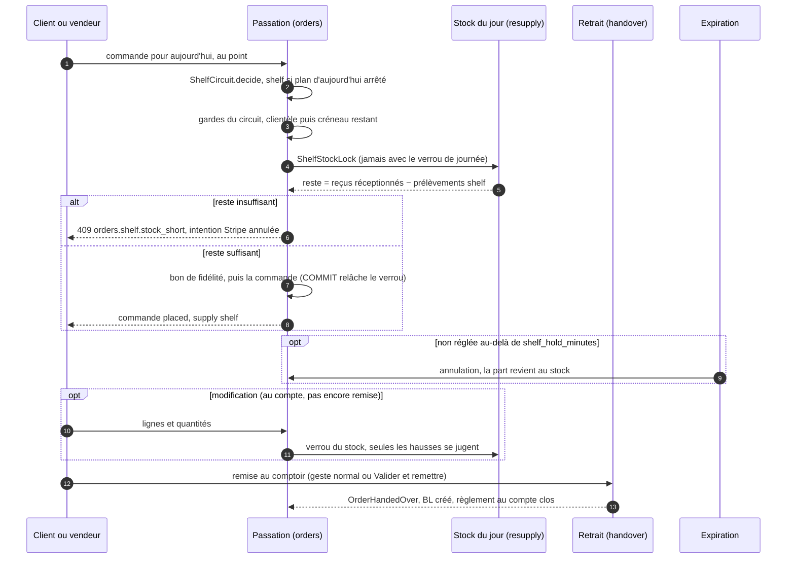
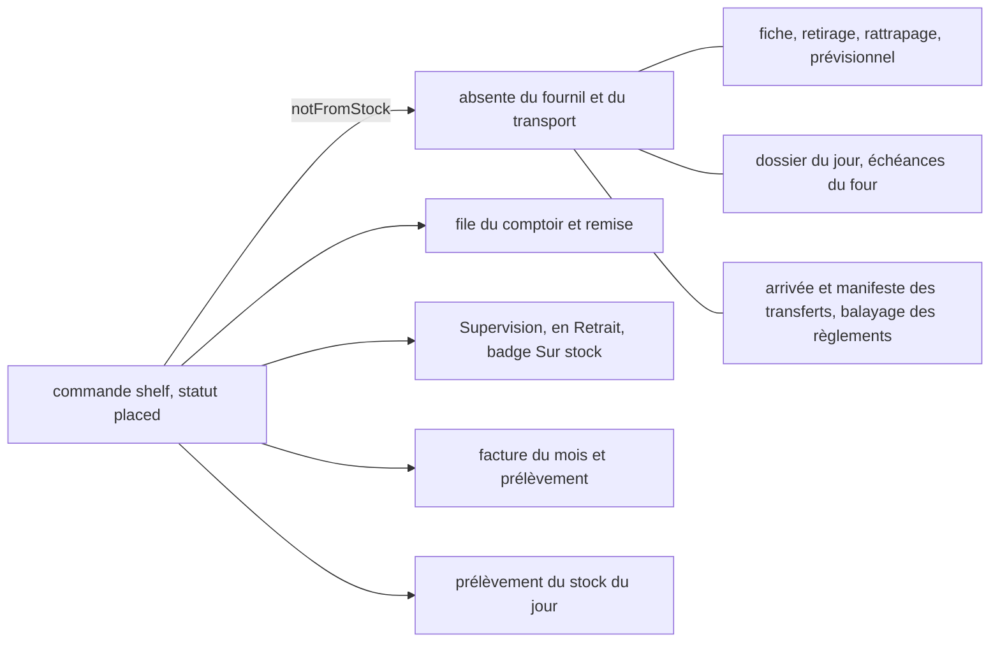
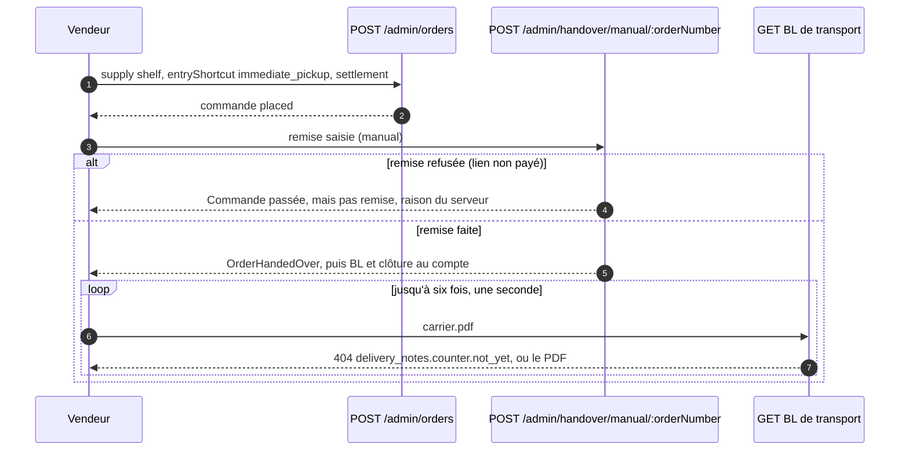

# Le circuit du jour J — commander pour aujourd'hui, sur le stock de la vitrine

> **Doc d'état, au présent.** Elle remplace le plan du circuit (lots L1 à L7,
> L2b, L7b et leurs restes, bâtis le 2026-11-02 ; L1–L7 en production depuis le
> 2026-11-02), supprimé une fois bâti — son contenu, ses quatre contradictions
> de `vitruve` et ses lots restent dans l'historique git. Les chemins
> `fichier:ligne` ont été ouverts le 2026-11-02.
>
> **État : implémenté.** Touche l'**argent** et un **stock**. Ce qui reste est
> au §11.

## 1. Le modèle — une phrase

**Demain se commande avant l'heure limite ; aujourd'hui se prend dans le
stock** ([`schema-des-reglages.md`](schema-des-reglages.md) §0, Hugo,
2026-10-21). L'heure limite protège le plan du fournil ; une commande du jour
n'entre pas dans un plan déjà figé : elle puise dans ce qui est déjà en vitrine.

Une commande porte donc **d'où vient sa marchandise** : `orders.supply`,
`planned` (fabriquée pour elle) ou `shelf` (prise dans la vitrine). La marque
est décidée **par le serveur**, figée à la passation, sans setter ; ce n'est
pas un mode d'acheminement — une `shelf` reste un **retrait** pour la file du
comptoir, la remise, le BL et la facture. `placed_off_plan` reste un simple
badge et ne la remplace pas.

Deux portes sur le même circuit :

|              | Client en ligne (particulier, pro si ouvert)       | Pro au comptoir — « Retrait immédiat »         |
| ------------ | -------------------------------------------------- | ---------------------------------------------- |
| Qui passe    | le client                                          | l'équipe, depuis `/comptoir`                   |
| Point        | celui qu'il choisit                                | celui ouvert dans la bande du comptoir         |
| Règlement    | carte en ligne (pro : selon son compte)            | au compte, ou lien de paiement (option admin)  |
| Créneau      | créneaux publics restants / fenêtre pro non finie  | aucune garde — le client est devant le vendeur |
| Remise       | au comptoir, geste normal                          | aussitôt : « Valider et remettre »             |
| Acheminement | retrait seulement (livraison du jour hors circuit) | retrait                                        |

Le retrait immédiat **n'est pas un type de commande** (Hugo, 2026-11-02) :
c'est un raccourci qui pré-règle une `shelf` et pose
`orders.entry_shortcut = immediate_pickup`, pour compter combien de fois il a
servi et pour quelle clientèle (croisée avec `orders.clientele`, déjà figée).

## 2. Le circuit d'une commande sur stock

Ce que la marque change **et ne change pas** :

## 3. Le stock du jour

- **Le stock est le réassort reçu** au point ce jour-là (reçus
  **réceptionnés** seulement), corrigé par le comptoir. Sans reçu, il n'y a
  pas de stock : aujourd'hui n'est pas proposé — **jamais un stock inventé**
  (Q4, 2026-10-21). La réception est décrite dans
  [`../reassort-boutiques/README.md`](../reassort-boutiques/README.md).
- **Le reste** = reçus réceptionnés − lignes des commandes `shelf` du jour au
  point, statut ni `draft` ni `cancelled`. Une commande au paiement en cours
  ou refusé **compte** jusqu'à son annulation par l'expiration.
- **Par (article, unité)**, jamais pièces et grammes ensemble : un article au
  poids a un stock en **grammes** entiers (Hugo, 2026-11-02 : « un article au
  poids doit avoir un stock au poids »). L'unité est figée sur les lignes de
  demande, de reçu, du fournil et du colisage ; le réassort au poids traverse
  fournil, colisage et transfert ([`../pricing/vente-au-poids.md`](../pricing/vente-au-poids.md)).
- **Un seul calcul** : `estimateStock(receipts, draws)` reste pure
  (`b2b/resupply/domain/estimated-stock.ts:46`) ; `DayShelfStock`
  (`b2b/resupply/application/day-shelf-stock.ts:19`) est le seul endroit qui
  lui passe les prélèvements, lus par le port `ShelfDrawsReader`
  (`b2b/resupply/domain/shelf-draws.reader.ts:24`), déclaré par le réassort et
  implémenté par les commandes (`b2b/orders/infrastructure/prisma-shelf-draws.reader.ts:25`),
  relié par `apps/lfd-api/src/appBootstrap/shelf-draws-feed.module.ts` (2026-11-03).
- **Toute baisse d'une quantité reçue** (corriger une ligne réceptionnée,
  corriger ou retirer une ligne du réassort sans commande) passe par
  `ReceivedStockLowering.lower` (`b2b/resupply/application/received-stock-lowering.ts:34`),
  sous le verrou, et refuse de descendre sous le déjà-pris.

## 4. Le verrou, et pourquoi il n'interbloque pas

- `ShelfStockLock` (`b2b/resupply/domain/shelf-stock-lock.ts:18`), propriété
  du réassort ; adaptateur `PrismaShelfStockLock`
  (`b2b/resupply/infrastructure/prisma-shelf-stock-lock.ts:27`) :
  `pg_advisory_xact_lock` par (jour, point), relâché au `COMMIT` — la forme de
  `b2b/accounting`.
- **Le verrou du stock et le verrou de journée du fournil ne sont jamais tenus
  ensemble.** La passation choisit l'un OU l'autre selon la marque
  (`OrderDrafting.holdSupply`, `order-drafting.service.ts:280`), en premier
  dans `persist`, avant le bon de fidélité ; la révision aussi
  (`OrderRevising.holdSupply`, `order-revising.service.ts:274`, après le verrou
  de la ligne `orders`). L'arrêt du plan, le retirage et le lancement d'un
  réassort ne prennent pas le verrou du stock. La règle est écrite dans le
  JSDoc des deux ports, et une e2e passe une `shelf` pendant qu'une autre
  transaction tient la journée.

## 5. La passation

- **Qui décide `shelf`** — `ShelfCircuit.decide`
  (`b2b/orders/application/services/shelf-circuit.service.ts:71`) :
  - un **client** (particulier, invité, pro en ligne) pour **aujourd'hui** sur
    un plan **arrêté** → `shelf` ; plan ouvert ou rouvert → `planned`, le
    fournil la prend (l. 81 ; confirmé par Hugo le 2026-11-02) ;
  - l'**équipe** : ce que l'écran envoie (`supply`, champ facultatif de
    `adminPlaceOrderPayloadSchema` et de `orderQuotePayloadSchema`, absent =
    `planned`).
- **L'agrégat porte l'invariant** (`ensureSupplyFits`,
  `b2b/orders/domain/services/order-supply-rules.ts:25`) : une `shelf` est un
  retrait, pour **aujourd'hui** (reçu en paramètre), à un point.
- **Les gardes se séparent sur la marque** dans `OrderDrafting.draft`
  (`order-drafting.service.ts:157-176`, `:253-261`) :

  | Garde                                       | `planned` | `shelf`                                            |
  | ------------------------------------------- | --------- | -------------------------------------------------- |
  | jour ouvert / plan arrêté (`ensureDayOpen`) | oui       | non — remplacée par la clientèle (`sameDayOpenTo`) |
  | heure limite, dérogation, surtaxe           | oui       | non — remplacée par le créneau restant             |
  | verrou de journée du fournil                | oui       | non                                                |
  | reste sous `ShelfStockLock`                 | —         | oui (`ensureShelfStockCovers`)                     |

- **La clientèle** : `sameDayDoorOf` / `sameDayOpenTo`
  (`b2b/order-cutoffs/domain/same-day-doors.ts:24`, `:40`) — trois portes :
  particulier, pro en ligne, comptoir.
- **Le créneau restant** : `pickupLeftToday`
  (`b2b/orders/domain/services/shelf-circuit.ts:37`) — créneaux publics et
  fermetures pour le particulier (un créneau dont le début est après
  maintenant), fenêtre pro non finie pour le pro en ligne, aucune garde au
  comptoir. Un site sans créneau ni fenêtre pour cette clientèle ne propose
  pas aujourd'hui.
- **Le reste** : `ensureShelfStockCovers` (même fichier, l. 153) — par article
  et unité ; un article absent du stock vaut 0, d'où le refus du **panier
  mixte**. Un refus annule l'intention Stripe sur les trois portes
  (`place-order.handler.ts:244`, `place-shop-order.handler.ts:237`,
  `place-order-for-customer.handler.ts:146`).
- **Le pro sans crédit, au comptoir** (Q7) : une `shelf` au lien de paiement
  d'un payeur sans crédit est refusée si le réglage dit « refuser » ; « lien
  de paiement » la laisse passer, en attente de règlement. Au compte, la règle
  générale tient (`AccountSettlementNotGrantedError`).
- **Le devis** dit « ouvert, sans heure » pour une `shelf`.

## 6. L'expiration et l'annulation

- **La tenue** : au-delà de `shelf_hold_minutes`, l'expiration annule une
  `shelf` non réglée qui porte une intention de paiement — client **ou**
  équipe au lien (Hugo, 2026-11-02) — et sa part revient
  (`unsettledShelfOrderWhere`, `b2b/orders/infrastructure/unsettled-shop-order.where.ts:42`).
  Une commande au compte n'a pas d'intention : elle n'y entre jamais. Les
  commandes boutique fabriquées gardent leurs 30 minutes.
- Le balayage des règlements à la clôture ignore les `shelf` (`notFromStock`).
- **L'annulation** d'une `shelf` ne traverse pas le guichet du fournil
  (`OrderWorkshopWithdrawal`, `CancellationSubject.supply`) : elle ne fut
  jamais inscrite ; la part revient en retombant hors des prélèvements.

## 7. La modification

Hugo, 2026-11-02 : « je voudrais pouvoir modifier les commandes prises sur la
vitrine ».

- **Lignes et quantités seulement.** Le mode, la journée et le point sont
  refusés par l'agrégat (`ensureShelfKeepsRoute`,
  `order-supply-rules.ts:73`, `orders.revise.shelf_route`) : le stock d'un
  autre point est un autre stock, changer de point c'est annuler et refaire.
- **Gardes du circuit** (`ShelfRevising`,
  `b2b/orders/revision/application/services/shelf-revising.service.ts:37`) : la porte de
  qui modifie, le créneau restant, et la journée qui doit être aujourd'hui
  (`orders.shelf.not_today`).
- **Ni note au fournil ni suivi des BL** : `ReviseOrderHandler` les saute pour
  une `shelf` (`revise-order.handler.ts:105`, `holdSupply`).
- **Le reste rejugé sous le verrou** (`ensureShelfRevisionCovered`,
  `shelf-circuit.ts:184`) : seules les **hausses** se jugent.
- **La limite acceptée** (Hugo, 2026-11-02) : une `shelf` réglée par carte ne
  se modifie pas (M1, `orders.revise.card_settled`) — elle s'annule et se
  refait. Une `shelf` remise ne se modifie plus.
- Les écrans lisent le verdict `revisabilityOf` : bloc `shelf_closed` pour
  l'équipe, code `too_late` pour le client.

## 8. Le comptoir — « Retrait immédiat » et « Valider et remettre »

- **L'écran** (`apps/lfd-backoffice-frontend/src/app/commandes/nouvelle-commande/acheminement-commande/`) :
  « Retrait immédiat » à gauche, puis « Commande programmée » (Retrait,
  Coursier). Proposé seulement sous `/comptoir`, avec
  `handover_counter:write` et un point ouvert dans la bande. Le raccourci pose
  retrait, aujourd'hui, le point et le créneau en cours ; il n'entre pas dans
  le brouillon conservé.
- **Le catalogue réduit** au reste du point, lu par
  `GET /admin/resupply-receipts/:siteId/:day` (`stock[]` = `DayShelfStock`) ;
  le panier refuse ce que la vitrine ne couvre pas, le serveur rejuge.
- **Le règlement pré-rempli** par le **payeur** : `settlesOnAccount`
  (`b2b/account/application/queries/get-counter-customer.handler.ts:72`), la
  règle du serveur (`order-settlement.ts:125`). Aucun défaut serveur : la
  soumission exige un `settlement` explicite.
- **Le raccourci** n'est accepté qu'avec `supply: "shelf"` (`staffSupplyOf`,
  `order-supply-rules.ts:52`), sinon `orders.shelf.shortcut_off_shelf` (400).
- **La remise reste celle du bloc du retrait** : le commerce n'écrit jamais la
  remise. Le BL naît à la remise, le règlement au compte s'y clôt, la commande
  entre dans la facture du mois.
- **Le bon remis au client** : le BL **de transport**, non chiffré, qu'on
  tend et fait signer (articles, quantités, « Reçu par, le, signature ») —
  `GET /admin/counter/orders/:orderId/delivery-note/carrier.pdf`
  (`b2b/delivery-notes/http/admin-counter-delivery-notes.controller.ts`),
  handler `get-counter-carrier-note-pdf.handler.ts`. ⚠️ **Décision du
  2026-11-03 (Hugo)**, qui revient sur celle du 2026-11-02 (BL client chiffré,
  `…/client.pdf`) : « respecter la même logique de chiffre qu'en livraison ».
  Le chiffré reste dans l'espace client et sur la fiche commande ;
  `…/client.pdf` du comptoir est retirée dans le même déploiement
  (pré-release) et répond 404. Même mur, même « pas encore », même trace
  d'impression qu'avant.
  sous `handover_counter:read`, sans numéro ; il sert le BL **remis** d'un
  **retrait** (`counterNoteReach`,
  `b2b/delivery-notes/domain/services/counter-note-reach.ts:33`). Côté écran :
  `apps/lfd-backoffice-frontend/src/app/comptoir/counter-delivery-note.service.ts`.
- **Le badge « Sur stock »** : liste des Commandes, Supervision (colonnes
  Retrait / livraison et Colisage, par `DaySupervisionView.shelfOrderIds`).

## 9. La boutique

- **« Aujourd'hui » dans le choix du jour** quand `/fulfillment-days` le sert :
  plan d'aujourd'hui arrêté, clientèle ouverte, et au point un créneau restant
  **et** un reste positif pour **tout le panier** (port `ShelfTodaySites`,
  `b2b/order-cutoffs/domain/shelf-today-sites.ts:29`, implémenté par
  `b2b/orders/application/services/order-shelf-today-sites.ts`), sans heure
  (`orderUntil: null`). Le panier envoie tous ses SKU ; un panier mixte se voit
  proposer demain.
- **La clientèle se décide au serveur** : un client reconnu lit
  `GET /fulfillment-days/mine` (`b2b/order-cutoffs/http/my-fulfillment-days.controller.ts:17-22`,
  société par `@ActingCompany()`) ; l'anonyme lit `GET /fulfillment-days`
  (`fulfillment-days.controller.ts:34-51`).
- **Le reste sur la vignette** : `GET /shelf-stock/today?pickupAddressId=…&audience=…`
  (`b2b/orders/http/shelf-stock-today.controller.ts:25-31`, public, throttlé) et
  `GET /shelf-stock/today/mine?pickupAddressId=…`
  (`my-shelf-stock-today.controller.ts:16-20`, muré). Contrat
  `packages/contracts/src/shelf-stock-today.ts` : `{ sku, saleUnit, left }[]`,
  vide à chaque refus (plan non arrêté, porte fermée, plus de créneau),
  réduit aux articles servis à l'appelant (`shelfLeftFor`,
  `b2b/orders/domain/services/shelf-left-today.ts:27`).
- **À l'écran** : `ShelfStockToday`
  (`apps/lfc-ecommerce-frontend/src/app/client/shop/shelf-stock-today.store.ts`)
  ne lit que si le retrait choisi vise un point pour aujourd'hui ; la vignette
  et la fiche disent « Plus que 3 aujourd'hui » / « Plus que 1,2 kg
  aujourd'hui », grisent « Épuisé pour aujourd'hui » ; le panier refuse
  au-delà du reste. Un refus `orders.shelf.*` relit les jours et le reste.

## 10. Réglages, refus, lecteurs

### Réglages — Réglages › Commandes › Jour même

Colonnes de `order_cutoff_settings` (migration `20261102200000_les_reglages_du_jour_j`,
`prisma/schema/public/settings.prisma:373-381`), droit `lfc_order_settings`,
page `apps/lfd-backoffice-frontend/src/app/reglages/commandes/same-day-circuit-card/` :

| Colonne                       | Sens                                                       | Défaut   |
| ----------------------------- | ---------------------------------------------------------- | -------- |
| `same_day_public_allowed`     | les particuliers commandent pour aujourd'hui               | `false`  |
| `same_day_pro_allowed`        | les pros aussi — au comptoir seulement sans l'option       | `false`  |
| `same_day_pro_online`         | un pro le fait aussi en ligne                              | `false`  |
| `same_day_pro_without_credit` | pro sans crédit au comptoir : `refuse` / `payment_link`    | `refuse` |
| `shelf_hold_minutes`          | tenue du stock par un paiement en cours, bornée de 5 à 120 | 30       |

`same_day_allowed` est une **colonne morte** (tranché par Hugo le 2026-11-02) :
elle reste en base, aucune décision ne la lit
([`reglages-generaux.md`](reglages-generaux.md) §1, §4).

### Refus nommés

| Code                                  | Statut | Cas                                                        |
| ------------------------------------- | ------ | ---------------------------------------------------------- |
| `orders.same_day_closed`              | 409    | la clientèle n'a pas le jour même                          |
| `orders.shelf.no_pickup_left`         | 409    | plus de créneau aujourd'hui au point                       |
| `orders.shelf.stock_short`            | 409    | la vitrine ne couvre pas (passation ou hausse en révision) |
| `orders.shelf.without_credit`         | 409    | pro sans crédit, réglage « refuser »                       |
| `orders.shelf.not_pickup`             | 400    | une `shelf` qui n'est pas un retrait                       |
| `orders.shelf.not_today`              | 400    | une `shelf` d'un autre jour                                |
| `orders.revise.shelf_route`           | 400    | changer mode, journée ou point d'une `shelf`               |
| `orders.shelf.shortcut_off_shelf`     | 400    | le raccourci sur une commande programmée                   |
| `resupply.receipt.below_shelf_draws`  | 409    | baisser un reçu sous ce qui a déjà été pris                |
| `delivery_notes.counter.not_yet`      | 404    | remise attestée, BL pas encore écrit — l'écran réessaie    |
| `delivery_notes.counter.out_of_reach` | 404    | le bon n'est pas celui d'un retrait remis                  |

Définis dans `b2b/orders/domain/errors/shelf-circuit-errors.ts`,
`shelf-order-errors.ts`, `same-day-order-closed.error.ts`,
`b2b/resupply/domain/resupply-receipt-errors.ts:183` et
`b2b/delivery-notes/domain/errors/delivery-note-errors.ts:219-234`.

### Les lecteurs d'une journée

Le filtre est **un seul**, dans `b2b/orders/infrastructure/plan-filter.ts` :
`notFromStock()` (l. 86) versé dans `planWhere()` (l. 53) et dans
`productionWhere()` = `settlementWhere` + `notFromStock` (l. 98).

- **L'ignorent** : fiche d'atelier, compte à produire, retirage, réassort
  lancé, alerte de rattrapage, prévisionnel (par `planWhere`) ; dossier du
  jour, échéances du four, arrivée des transferts (par `productionWhere`) ;
  rattachement et manifeste des transferts, balayage des règlements (par
  `notFromStock`). Le colisage ne la voit pas : il lit les faits de l'arrêt et
  du retirage.
- **La voient telle quelle** : file du comptoir et remise, rappels au client,
  facture et prélèvement, listes du staff et du client.
- **La voient autrement** : la Supervision, qui la montre à l'étape **prête**,
  jamais en attente ni « attend le four ».

E2E : `apps/lfd-api/test/shelf-order-readers.e2e-spec.ts`,
`shelf-order-placement.e2e-spec.ts`, `shelf-stock.e2e-spec.ts`,
`shelf-stock-weight.e2e-spec.ts`, `shelf-stock-today.e2e-spec.ts`,
`counter-immediate-pickup.e2e-spec.ts`, `resupply-village-flow.e2e-spec.ts`.

### Migrations

`20261102100000_d_ou_vient_la_marchandise` (`orders.supply`,
`orders.entry_shortcut`, CHECK `orders_entry_shortcut_on_shelf`),
`20261102200000_les_reglages_du_jour_j`, `20261102210000_le_reassort_au_poids`,
`20261102220000_le_reassort_au_poids_au_fournil`,
`20261102230000_le_reassort_au_poids_au_colisage` — toutes additives, chacune
avec son retour dans `prisma/rollback/`.

## 11. Reste à faire

- **M2** — modifier une `shelf` payée par carte (complément ou remboursement
  partiel Stripe). D'ici là, elle s'annule et se refait.
- **Le texte de vignette** d'une promotion « dans le prix affiché » à côté de
  la mention du reste.
- **La facture « Remise client »** pour une commande remise au comptoir.
- **Le rayon pro sans connexion** lit encore son libellé propre, pas le
  libellé commun.
- ~~**`PackingStock.release`** ne prend pas l'unité~~ — fait le 2026-11-02
  (commit à venir) : `release(quantity, unit)`, l'unité de la ligne du bon.
- **La route publique `/fulfillment-days`** accepte encore `audience=public`
  d'un pro (`fulfillment-days.controller.ts:21,48`) : un pro qui ne passe pas
  par `/mine` lit le réglage des particuliers ; la passation tranche.
- Non couvert : les abonnements ne passent pas par `OrderDrafting` et n'ont
  pas été ouverts pour aujourd'hui ; la vue détail `AdminOrderView` ne porte
  pas `supply`.

## 12. Hors périmètre

- Le stock en temps réel (ventes en caisse sans commande).
- La livraison le jour même.

## 13. Les documents voisins

- [`schema-des-reglages.md`](schema-des-reglages.md) — le modèle des réglages
  de commande.
- [`reglages-generaux.md`](reglages-generaux.md) §4 — la page Jour même.
- [`../reassort-boutiques/README.md`](../reassort-boutiques/README.md) — le
  réassort, d'où vient le stock du jour.
- [`../fournil/arret-du-plan.md`](../fournil/arret-du-plan.md) — l'arrêt qui
  fait basculer aujourd'hui sur le stock.
- [`../commandes/reglement/commande-carte-reglee.md`](../commandes/reglement/commande-carte-reglee.md)
  §4.4 — une commande non réglée n'entre pas dans la file.
- [`../comptoir/architecture-commande-au-comptoir.md`](../comptoir/architecture-commande-au-comptoir.md)
  — la saisie au comptoir.
